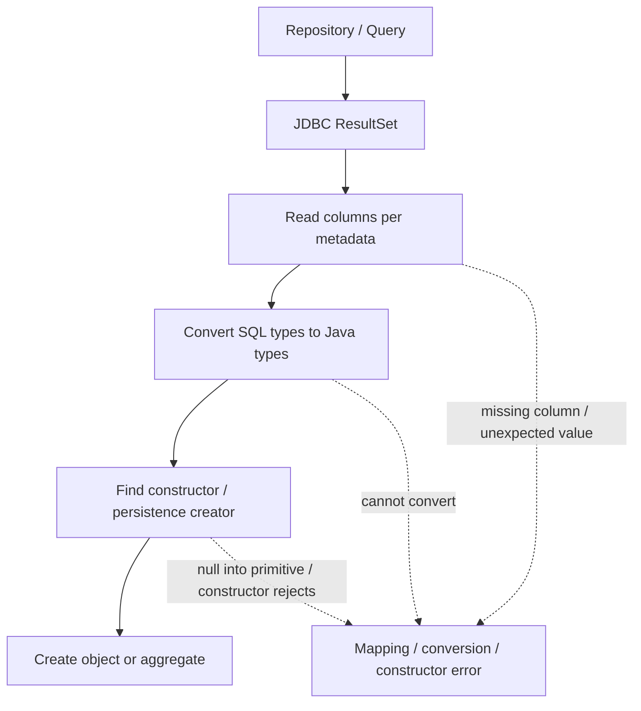

# Nullability and Failures to Construct Objects from ResultSet

When Spring Data JDBC reads a data row, the framework must convert values from the `ResultSet` into Java object properties, then call a constructor or factory method to create the object. This process can fail if the database returns `NULL`, a SQL type cannot be converted to a Java type, a required column is missing from the query result, or the constructor does not receive the values it requires.

To handle this properly, you must understand three distinct layers of nullability: **values in the database**, **Java types and nullability rules**, and **Spring Data JDBC's object creation rules**. This lesson uses an order model to explain these scenarios, how to read errors, and how to design schemas, constructors, and repositories so data maps reliably.

## 1. Distinguishing No Row, SQL NULL, and Column Missing from Result

The following three scenarios differ in meaning:

| Scenario | Example | Meaning |
| --- | --- | --- |
| No row returned | `SELECT ... WHERE id = 999` returns no rows. | No record matches the condition. |
| Row exists, one column is `NULL` | Order row has `note = NULL`. | The record exists, yet that property's value is unstored/unknown. |
| Column absent from ResultSet | Query selects only `id, status` while mapper requires `customer_id`. | Query result fails to supply a column the mapper expects. |

When using a repository, `findById(id)` typically represents the first case with `Optional.empty()`. If a row exists yet `note` is SQL `NULL`, the object can still be created with `note == null` provided that property allows null. The third case is a query-result or mapping structure error, not a normal null value.

SQL examples:

```sql
-- No row if id = 999 does not exist.
SELECT id, status, note
FROM purchase_order
WHERE id = 999;

-- Row exists, yet note may be SQL NULL.
SELECT id, status, note
FROM purchase_order
WHERE id = 1001;

-- This query does not return the customer_id column.
SELECT id, status
FROM purchase_order
WHERE id = 1001;
```

Do not handle all three scenarios with a single `if (value == null)` check. Determine whether the database returned a row, whether the column is present in the result, and what the actual column value is.

## 2. Order Model and Nullability Rules

An order has an ID, customer, status, total amount, optional note, and list of order lines:

| Property | Nullable? | Reason |
| --- | --- | --- |
| `id` | Yes when creating; must not be null after successful save. | Database-generated ID. |
| `customerId` | No. | An order must belong to a customer. |
| `status` | No. | Every order must have a valid status. |
| `totalAmount` | No. | Total amount must be defined. |
| `note` | Yes. | Notes are optional information. |
| `lines` | Should not use null to represent no lines. | An empty collection represents zero elements; business rules may require at least one line. |
| `OrderLine.quantity` | No. | Quantity must be a positive integer. |
| `OrderLine.unitPrice` | No. | Unit price must be defined and non-negative. |

These rules must align across SQL, Java, and business logic. For instance, if `customer_id` is mandatory, the table should declare `NOT NULL` with a foreign key; Java should use a type capable of checking null; and the service must validate the customer before saving.

### DDL Expressing Nullability

```sql
CREATE TABLE customer (
    id BIGINT GENERATED BY DEFAULT AS IDENTITY PRIMARY KEY,
    name VARCHAR(150) NOT NULL
);

CREATE TABLE purchase_order (
    id BIGINT GENERATED BY DEFAULT AS IDENTITY PRIMARY KEY,
    customer_id BIGINT NOT NULL REFERENCES customer(id),
    status VARCHAR(20) NOT NULL,
    total_amount NUMERIC(19, 2) NOT NULL
        CHECK (total_amount >= 0),
    note VARCHAR(500) NULL
);

CREATE TABLE order_line (
    order_id BIGINT NOT NULL REFERENCES purchase_order(id),
    line_no INTEGER NOT NULL,
    product_id BIGINT NOT NULL,
    quantity INTEGER NOT NULL CHECK (quantity > 0),
    unit_price NUMERIC(19, 2) NOT NULL CHECK (unit_price >= 0),
    PRIMARY KEY (order_id, line_no)
);
```

`NOT NULL` is a database constraint. It prevents writes from storing null in a column, yet it does not retroactively fix old rows existing before the constraint was added. If a system has legacy data, inspect and clean it before running a migration that adds `NOT NULL`.

Understand how `DEFAULT` behaves as well:

```sql
CREATE TABLE product (
    id BIGINT GENERATED BY DEFAULT AS IDENTITY PRIMARY KEY,
    name VARCHAR(180) NOT NULL,
    active BOOLEAN NOT NULL DEFAULT TRUE
);

-- Uses default because active column is omitted.
INSERT INTO product (name) VALUES ('Keyboard');

-- NULL value is passed explicitly; DEFAULT does not replace NULL.
INSERT INTO product (name, active) VALUES ('Mouse', NULL);
```

The default value generally applies when the column is omitted from the `INSERT` statement or when the `DEFAULT` keyword is specified. If the application passes an explicit SQL `NULL`, the `NOT NULL` constraint can still fail.

## 3. Nullability in Java: Primitives, Wrappers, and Reference Types

Java primitives cannot represent null. Wrapper types and reference types can hold null:

| Primitive | Wrapper | Can Represent Null? |
| --- | --- | --- |
| `int` | `Integer` | Only `Integer` |
| `long` | `Long` | Only `Long` |
| `boolean` | `Boolean` | Only `Boolean` |
| `double` | `Double` | Only `Double` |

`String`, `BigDecimal`, `LocalDate`, and other Java objects can also accept null unless a constructor rejects it.

If a nullable SQL column is mapped to a primitive, the framework cannot represent the null value accurately. Depending on the mapping path and version, failures may happen during conversion or when invoking the constructor. Do not rely on `0`/`false` defaults to guess null, as doing so erases the distinction between "missing value" and "zero/false value."

Error-prone example:

```java
public record OrderLine(
    Long productId,
    int quantity,
    BigDecimal unitPrice
) {}
```

If column `quantity` can be SQL `NULL`, component `int quantity` cannot receive that value. There are two design options:

**Option A — Quantity is always mandatory.** Keep `int`, ensure DDL has `quantity INTEGER NOT NULL`, clean legacy data, and validate all write paths.

**Option B — Null is a permitted business state.** Use `Integer` and handle null explicitly. However, if an order cannot contain a line missing quantity, it is better to reject null at the domain/service boundary rather than letting null propagate deep into the system.

Do not mechanically switch every primitive to a wrapper. Choose Java types that reflect data rules: primitives when values are strictly mandatory and protected; wrappers/references when null carries real meaning or when reading legacy data prior to validation.

## 4. Constructor Mapping in Spring Data JDBC

Spring Data JDBC builds aggregates from read data using its object mapping mechanism. For immutable classes or Java records, the framework uses an appropriate constructor to pass read/converted values.

Record example:

```java
import java.math.BigDecimal;
import java.util.List;

import org.springframework.data.annotation.Id;
import org.springframework.data.relational.core.mapping.Column;
import org.springframework.data.relational.core.mapping.MappedCollection;
import org.springframework.data.relational.core.mapping.Table;

@Table("purchase_order")
public record PurchaseOrder(
    @Id Long id,
    @Column("customer_id") Long customerId,
    String status,
    @Column("total_amount") BigDecimal totalAmount,
    String note,
    @MappedCollection(idColumn = "order_id", keyColumn = "line_no")
    List<OrderLine> lines
) {}
```

Key points to remember:

- Record component names are Java property names.
- `@Column` can specify column names differing from conventions.
- The record's canonical constructor receives components in declaration order.
- Nullable columns such as `note` can be passed in as null.
- If a primitive component receives SQL null data, the constructor cannot produce a valid value.
- Child collections are constructed per aggregate mapping; they have a lifecycle tied to the root rather than being a single scalar column.

For a regular class with a single constructor, Spring Data can use that constructor to create the object. If multiple constructors exist, specify which constructor is used. You can mark the constructor/factory method used for persistence with `@PersistenceCreator`:

```java
import java.math.BigDecimal;
import org.springframework.data.annotation.Id;
import org.springframework.data.annotation.PersistenceCreator;
import org.springframework.data.relational.core.mapping.Table;

@Table("purchase_order")
public class PurchaseOrder {

    private final Long id;
    private final Long customerId;
    private final String status;
    private final BigDecimal totalAmount;
    private final String note;

    @PersistenceCreator
    public PurchaseOrder(
            Long id,
            Long customerId,
            String status,
            BigDecimal totalAmount,
            String note) {
        this.id = id;
        this.customerId = customerId;
        this.status = status;
        this.totalAmount = totalAmount;
        this.note = note;
    }

    public PurchaseOrder(Long customerId, String status) {
        this(null, customerId, status, BigDecimal.ZERO, null);
    }

    @Id
    public Long getId() {
        return id;
    }

    public Long getCustomerId() {
        return customerId;
    }

    public String getStatus() {
        return status;
    }

    public BigDecimal getTotalAmount() {
        return totalAmount;
    }

    public String getNote() {
        return note;
    }
}
```

When a constructor has multiple parameters, parameter names must match the properties Spring Data uses for mapping. For regular Java classes, compiler settings that preserve parameter name metadata (e.g., `-parameters`) keep name discovery reliable. For records, component names are already record metadata. If names cannot be discovered or mismatch, object creation may fail or receive wrong data depending on the scenario.

`@PersistenceCreator` solves selecting the constructor/factory method. It does not turn a nullable column into non-null, nor does it automatically convert incompatible SQL types.

## 5. How Is SQL NULL Passed into a Constructor?

General process when reading an aggregate:



A query returning a row with `note = NULL` normally results in `note == null` in a Java reference type. If the constructor calls `Objects.requireNonNull(note)`, the object will not be created because the domain constructor itself rejects that data. That is intentional behavior if notes are considered mandatory; if notes are optional, the constructor should not reject null.

Validating domain constructor example:

```java
import java.math.BigDecimal;
import java.util.Objects;

public record OrderLine(
    Long productId,
    int quantity,
    BigDecimal unitPrice
) {
    public OrderLine {
        Objects.requireNonNull(productId, "productId is required");
        Objects.requireNonNull(unitPrice, "unitPrice is required");

        if (quantity <= 0) {
            throw new IllegalArgumentException(
                "quantity must be greater than zero"
            );
        }
        if (unitPrice.signum() < 0) {
            throw new IllegalArgumentException(
                "unitPrice must not be negative"
            );
        }
    }
}
```

If the database returns `product_id = NULL` or `unit_price = NULL`, the constructor fails. For valid data, these columns should be protected by `NOT NULL` and corresponding constraints. When reading corrupted legacy data, the constructor's message may appear as the root cause wrapped inside another mapping exception.

## 6. Failures to Construct Objects: Identifying by Cause

There is no single exception type for every mapping failure. The outer exception type depends on the layer where it originated, the framework version, and whether it was wrapped by Spring Data/Spring JDBC. When reading a stack trace, find the **deepest root cause** and identify the failing stage.

| Error Category | Example Causes | Investigation Direction |
| --- | --- | --- |
| Column not found | Query omits `customer_id` required by mapper; wrong alias. | Check SELECT list, aliases, and schema. |
| Incompatible null | SQL NULL goes into a Java primitive or constructor rejects null. | Check DDL, actual data, and component types. |
| Type cannot be converted | Numeric/string/date column has type incompatible with property. | Check JDBC type, converters, and driver. |
| Unsuitable constructor | Cannot determine persistence creator, missing parameters, or name mismatch. | Check constructors, `@PersistenceCreator`, and parameter name metadata. |
| Constructor throws error | `Objects.requireNonNull`, validation, or constructor logic fails. | Check exception cause and domain conditions. |
| Pre-mapping SQL error | Table/column missing, permission denied, or syntax error. | Check SQL exception and actual query. |
| Data error on write | `NOT NULL`, FK, or CHECK constraint violated. | Check payload and database constraints. |

Some exception types that may appear in stack traces:

- `org.springframework.data.mapping.MappingException`: error during metadata/object mapping.
- `org.springframework.core.convert.ConversionFailedException`: value conversion failure.
- `org.springframework.dao.DataAccessException` and its subclasses: Spring's abstraction for data access errors; the cause may originate from JDBC/database.
- Exceptions thrown from constructors, such as `IllegalArgumentException` or `NullPointerException`, may sit in the cause chain when a constructor rejects data.

Do not jump to conclusions from the outermost exception name alone. For instance, a mapping exception can wrap a constructor error, while `relation does not exist` occurs before any object is constructed. Reading the full `Caused by:` chain and SQL logs identifies the exact layer.

## 7. Missing Columns, Aliases, and Custom Queries

Mapping depends on the columns returned by a query. If a query method returns an entity/aggregate type, the query must provide the data needed to map that type. You cannot omit a mandatory column and expect the framework to infer a value.

Reduced query example:

```sql
SELECT id, status
FROM purchase_order
WHERE id = :id;
```

If the result is mapped to `PurchaseOrder` which also has `customer_id` and `total_amount`, missing columns can break mapping. If the goal only requires ID and status, use a result type matching those exact two fields (a DTO/projection or custom row mapper) instead of partially mapping into the full aggregate.

Column names must also match mapping metadata. Example:

```sql
SELECT
    id,
    customer_id,
    status,
    total_amount,
    note
FROM purchase_order
WHERE id = :id;
```

If a query uses aliases, aliases must follow the column names expected by mapping. When a Java property is explicitly mapped with `@Column("order_state")`, the query result must provide a column/alias matching that mapping.

### LEFT JOIN and Nulls from the Unmatched Side

A query with `LEFT JOIN` can return a left-side row while right-side columns are all null because no matching related record exists:

```sql
SELECT
    o.id,
    o.status,
    c.name AS customer_name
FROM purchase_order o
LEFT JOIN customer c ON c.id = o.customer_id;
```

If no customer matches, `customer_name` is SQL NULL even though the order exists. A screen DTO can represent a nullable `customerName`. Yet if you try to stuff this join result into an entity with required fields, its constructor may reject null.

Spring Data JDBC focuses on aggregate mapping rather than arbitrary join-graph ORM. For complex reporting/join queries, a DTO or custom repository with a `RowMapper` usually expresses nullability semantics more clearly.

## 8. Reading SQL NULL Safely with Plain JDBC

When writing a `RowMapper` or raw JDBC code, remember that some `ResultSet` primitive getters return default values when SQL is NULL. For example, `getLong()` can return `0`; you must call `wasNull()` immediately after the getter to know whether the value just read was SQL NULL.

Example:

```java
long rawCustomerId = rs.getLong("customer_id");
Long customerId = rs.wasNull() ? null : rawCustomerId;

int rawQuantity = rs.getInt("quantity");
Integer quantity = rs.wasNull() ? null : rawQuantity;

String note = rs.getString("note");          // SQL NULL -> null
BigDecimal total = rs.getBigDecimal("total_amount");
```

`wasNull()` refers to the column most recently read by a getter; therefore, call it immediately after `getLong()`/`getInt()`, before reading another column.

You can wrap this in helper methods:

```java
private static Long nullableLong(
        ResultSet rs, String column) throws SQLException {

    long value = rs.getLong(column);
    return rs.wasNull() ? null : value;
}

private static Integer nullableInt(
        ResultSet rs, String column) throws SQLException {

    int value = rs.getInt(column);
    return rs.wasNull() ? null : value;
}
```

If the JDBC driver supports typed `getObject(column, Type.class)` per an appropriate JDBC version, you can use it to retrieve wrapper/reference types directly; still verify driver compatibility. Do not blindly cast `getObject()` results if the database might return a different numeric type.

Custom row mapper example for a DTO:

```java
public record OrderHeaderView(
    Long id,
    Long customerId,
    String status,
    BigDecimal totalAmount,
    String note
) {}

RowMapper<OrderHeaderView> mapper = (rs, rowNum) ->
    new OrderHeaderView(
        nullableLong(rs, "id"),
        nullableLong(rs, "customer_id"),
        rs.getString("status"),
        rs.getBigDecimal("total_amount"),
        rs.getString("note")
    );
```

The example requires the corresponding JDBC and `RowMapper` imports. If `customer_id` is mandatory, the DTO can be validated after reading, or the mapper can proactively throw an exception with a clear message upon detecting null.

## 9. Designing Objects to Represent Intentional Nulls

Not every null is an error. Some properties are genuinely optional, such as an order note, an unknown estimated delivery date, or an unused promo code.

A record can clearly express optional fields:

```java
@Table("purchase_order")
public record PurchaseOrder(
    @Id Long id,
    @Column("customer_id") Long customerId,
    String status,
    @Column("total_amount") BigDecimal totalAmount,
    String note
) {}
```

Here `note` may be null. If `customerId`, `status`, and `totalAmount` are mandatory, protect that in the database and the domain constructor/service.

A compact constructor can be used on the record:

```java
@Table("purchase_order")
public record PurchaseOrder(
    @Id Long id,
    @Column("customer_id") Long customerId,
    String status,
    @Column("total_amount") BigDecimal totalAmount,
    String note
) {
    public PurchaseOrder {
        Objects.requireNonNull(customerId, "customerId is required");
        Objects.requireNonNull(status, "status is required");
        Objects.requireNonNull(totalAmount, "totalAmount is required");

        if (totalAmount.signum() < 0) {
            throw new IllegalArgumentException(
                "totalAmount must not be negative"
            );
        }
        // note is allowed to be null.
    }
}
```

This fails fast if the database contains data violating invariants. However, if legacy data may be missing mandatory fields and the application needs gradual migration, you can read through a temporarily nullable DTO, clean/normalize the data, and then convert to a valid domain object. Do not weaken the domain constructor to accept arbitrary invalid data just to dodge mapping errors.

### Is `Optional` a Good Choice for Entity Fields?

`Optional<T>` is generally well suited to represent a potentially absent return value, such as `findById` returning `Optional<PurchaseOrder>`. For fields inside an entity/aggregate, nullable reference types are typically simpler and better supported by object mapping. Do not overuse `Optional` as fields or constructor parameters without verifying mapping support and your application's serialization conventions.

Distinguish:

- Aggregate not found: repository returns `Optional.empty()`.
- Aggregate has an optional field without a value: field may be null.
- Aggregate has a mandatory field that is null: data violates invariant and must be detected and handled.

## 10. Using Bean Validation and Database Constraints in Their Proper Roles

Bean Validation can express rules such as `@NotNull`, `@Positive`, `@Size`. However, validation annotations do not automatically replace database constraints and do not guarantee constructor mapping runs validation on every read/write path.

Request DTO example:

```java
public record CreateOrderRequest(
    @NotNull Long customerId,
    @NotEmpty List<@Valid CreateOrderLineRequest> lines
) {}

public record CreateOrderLineRequest(
    @NotNull Long productId,
    @Positive int quantity
) {}
```

This is API input validation. At other layers:

| Layer | Responsibility |
| --- | --- |
| Request/API | Catch missing or malformed payloads before invoking business logic. |
| Domain/service | Protect invariants, state, and business rules. |
| Spring Data mapping | Translate JDBC data into objects per metadata/converters/constructors. |
| Database | Enforce `NOT NULL`, PK, FK, UNIQUE, CHECK, and storage-level consistency. |

If a SQL script, batch job, or another application writes directly to the database, API validation does not protect that data. Database constraints are an essential defense layer for structural rules.

## 11. Investigation Workflow When Spring Data JDBC Fails to Create an Object

When encountering an error in repository `findById` or a query method, investigate in this order:

1. **Verify whether the query returns rows.** If not, check the ID and WHERE predicate; `Optional.empty()` may be the right outcome.
2. **Verify actual columns.** Run the corresponding SELECT against the right database/schema and inspect column names, aliases, and null values.
3. **Compare mapping metadata.** Check `@Table`, `@Column`, naming strategy, `@MappedCollection`, and constructor components.
4. **Check SQL and Java types.** For example `NUMERIC` with `BigDecimal`, `BIGINT` with `Long`; do not let SQL NULL flow into primitives.
5. **Check persistence creator.** With multiple constructors, verify `@PersistenceCreator` is placed properly; parameters must map to the right property names.
6. **Read the root cause.** Look for conversion, column lookup, constructor validation, or SQL exceptions inside the `Caused by` chain.
7. **Inspect legacy data.** A new migration may enforce `NOT NULL` for new rows while old rows remain uncleaned; inspect all existing rows.
8. **Write a reproducing integration test.** Use the actual production database/driver if the issue depends on dialect or JDBC metadata.

You can run data inspection queries:

```sql
-- Find orders missing customer_id, status, or total_amount.
SELECT id
FROM purchase_order
WHERE customer_id IS NULL
   OR status IS NULL
   OR total_amount IS NULL;

-- Find order lines with missing mandatory values.
SELECT order_id, line_no
FROM order_line
WHERE product_id IS NULL
   OR quantity IS NULL
   OR unit_price IS NULL;

-- Check for abnormal quantities and total amounts.
SELECT id, total_amount
FROM purchase_order
WHERE total_amount < 0;
```

If the table already has `NOT NULL`, null checks may return empty sets, yet they remain useful prior to migrations or when data is imported from external sources.

## 12. Migrations When Changing Nullability

Suppose column `note` initially allowed null, yet a new requirement mandates every order must have a note. Do not merely change Java from `String` to a type/constructor rejecting null and deploy immediately. Handle data and schema in sequence first.

An illustrative PostgreSQL migration:

```sql
-- Step 1: inspect and normalize legacy data.
UPDATE purchase_order
SET note = ''
WHERE note IS NULL;

-- Step 2: after verifying no NULLs remain, add constraint.
ALTER TABLE purchase_order
ALTER COLUMN note SET NOT NULL;
```

If `note` truly should not be an empty string, replace the default value with meaningful business content or address the records needing backfill. Do not blindly fill empty strings just to make a migration pass.

A safe rollout workflow typically involves:

- Counting rows currently null and deciding meaningful handling.
- Deploying compatible code during the transition phase if needed.
- Backfilling legacy data in appropriate batches.
- Adding the database constraint once data satisfies it.
- Updating domain constructors/validation to reflect the new rule.
- Running integration tests against the post-migration schema.

In the reverse direction, when a mandatory column becomes optional, alter the DDL to allow null, adjust the domain/API, and inspect consumers that assume the value is always present.

## 13. Testing Nullability and Constructor Mapping

Tests should cover both valid cases and invalid data:

| Scenario | Expected Outcome |
| --- | --- |
| Valid row, all mandatory fields populated | Repository creates object successfully. |
| `note` is SQL NULL | Object is created with `note == null` if field is optional. |
| No row for ID | `Optional.empty()`. |
| Mandatory column is SQL NULL while Java/domain rejects it | Read operation fails with an identifiable mapping/constructor cause. |
| Column absent from query result | Query/mapping fails or cannot build requested type; add column/alias or use a suitable DTO. |
| Column has incompatible SQL type | Conversion fails; fix schema, converter, or query. |
| Invalid legacy values | Test reproduces legacy data and verifies migration/cleanup strategy. |

General integration test example:

```java
@DataJdbcTest
class PurchaseOrderMappingTest {

    @Autowired
    PurchaseOrderRepository repository;

    @Autowired
    JdbcTemplate jdbcTemplate;

    @Test
    void mapsNullableNote() {
        // Arrange: create a customer and a valid order.
        // Can use repository.save(...) or a SQL fixture.

        Long id = jdbcTemplate.queryForObject(
            "SELECT id FROM purchase_order ORDER BY id DESC LIMIT 1",
            Long.class
        );

        jdbcTemplate.update(
            "UPDATE purchase_order SET note = NULL WHERE id = ?",
            id
        );

        PurchaseOrder loaded = repository.findById(id).orElseThrow();

        assertThat(loaded.note()).isNull();
    }
}
```

This is an illustrative skeleton; fixtures and repository names must match your real project. The test uses raw SQL to set up the exact database state under test, then uses the repository to verify object mapping.

If using H2 for tests while production runs PostgreSQL/MySQL/Oracle, maintain integration tests against the target engine, especially for errors involving data types, conversions, identifiers, or drivers. H2 may not reproduce every production driver behavior.

## 14. Misconceptions to Avoid

- **"`Optional.empty()` means some column was NULL."** Incorrect. It normally means the query found no matching row.
- **"Java primitive null automatically becomes 0."** Unsafe. JDBC primitive getters may return 0 on SQL NULL, yet `wasNull()` is needed to tell them apart; object mapping should not rely on that default.
- **"`DEFAULT` automatically replaces every NULL."** Incorrect. DEFAULT applies when a column is omitted or DEFAULT is specified, not when NULL is passed explicitly.
- **"`@NotNull` guarantees the database cannot store null."** Incorrect without enforced validation and SQL constraints.
- **"Adding a field to a class automatically adds the column in the database."** Incorrect. Schemas must be migrated/updated separately.
- **"Constructors can accept any data and validate later."** If a constructor rejects a value, the object cannot be constructed; if it skips checks, objects violating invariants can travel deep into the system.
- **"A query selecting only a few columns can still map to the full aggregate."** Do not assume so. Use a result type matching the selected columns.
- **"H2 passing proves production passes."** Incorrect regarding SQL, driver, metadata, and null-conversion differences.

## 15. Self-Check Questions

- Distinguish no row returned, a SQL NULL column, and a column absent from the ResultSet.
- Why cannot `int` represent `quantity = NULL`?
- When should `Integer` be used instead of `int`?
- What roles do `NOT NULL` and `DEFAULT` serve, and how do they differ?
- Which constructor does Spring Data JDBC pick when a class has multiple constructors? What problem does `@PersistenceCreator` solve?
- Why must constructor parameter names match property metadata?
- Why might a query selecting only `id, status` be insufficient to map a full `PurchaseOrder`?
- When using `ResultSet.getLong()`, at what point must `wasNull()` be called?
- Why can a `LEFT JOIN` produce SQL NULL for right-table columns even when the main row exists?
- How should legacy data be handled before changing a nullable column to `NOT NULL`?

When Spring Data JDBC fails to construct an object from a ResultSet, trace the path **SQL row → columns/values → Java types → constructor → domain invariants**. Design nullability consistently across the database and Java, supply all required columns in queries, and read the root cause instead of guessing from the outermost exception. This approach distinguishes data errors, mapping errors, and business errors, letting you fix the exact layer where the issue arises.
