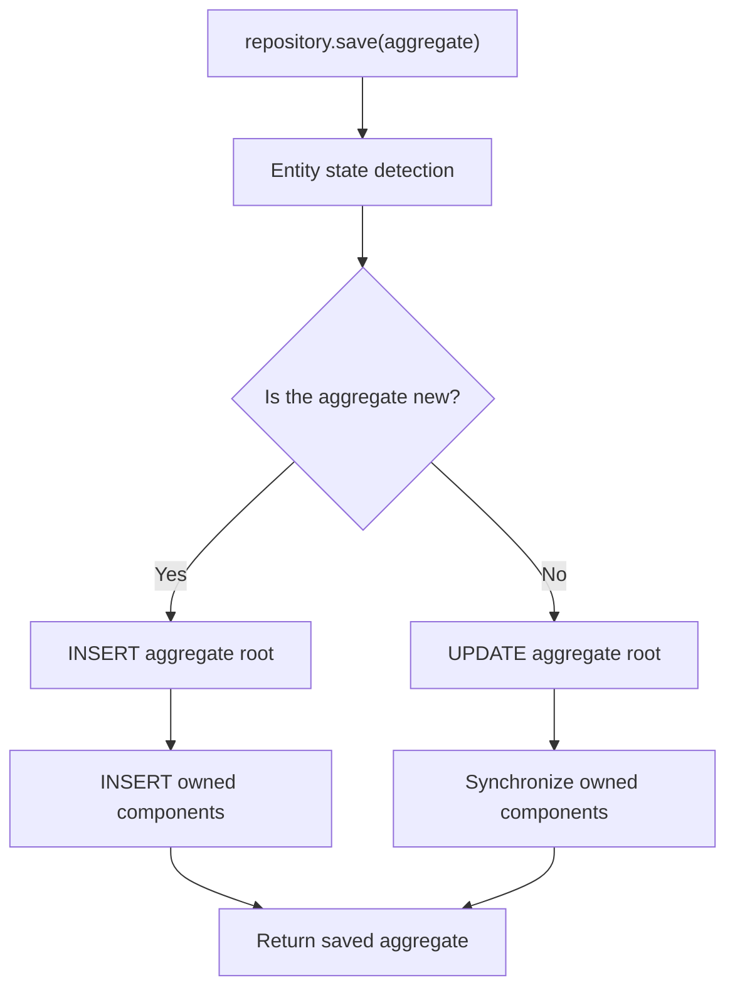
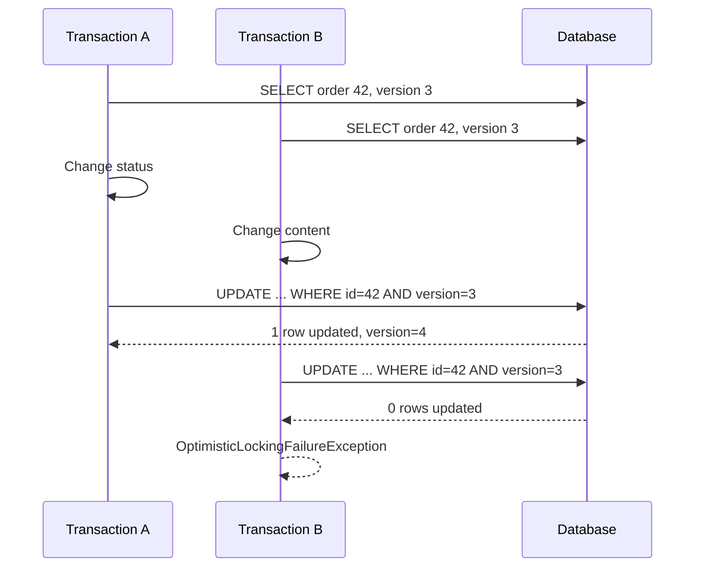

# Detecting New Entities from @Id and @Version

When calling `repository.save(entity)` in Spring Data JDBC, the framework must decide whether to **INSERT** a new aggregate or **UPDATE** an existing aggregate. This decision is called **entity state detection** — detecting whether an object is in a new state.

By default, Spring Data does not query the database to check whether an ID already exists before every save. Instead, the framework inspects the object's state through its mapping properties, primarily `@Id` and `@Version`. Understanding these rules accurately is essential when the database auto-generates IDs, when the application assigns UUIDs itself, or when an aggregate uses optimistic locking.

## 1. Why does Spring Data need to know if an entity is new?

The exact same call:

```java
repository.save(order);
```

can lead to two different groups of operations:

- If the aggregate is considered **new**, Spring Data JDBC creates records using INSERT statements for the aggregate root and the objects owned by the root.
- If the aggregate is considered **existing**, Spring Data JDBC runs the flow to update the root and synchronize child objects according to the aggregate's state.



In Spring Data JDBC, if the aggregate root is new, the framework inserts the root and then inserts directly or indirectly referenced entities. If the root already exists, the default flow may delete referenced entities, update the root, and then re-insert child entities. Therefore, misidentifying newness can lead to incorrect or expensive SQL operations. This is not a minor repository detail.

**Newness is an object state**, inferred from metadata and property values. It is not simply the answer to "does the database already have this row?".

## 2. The role of @Id and @Version

Two important annotations from Spring Data Commons:

```java
import org.springframework.data.annotation.Id;
import org.springframework.data.annotation.Version;
```

| Annotation | Primary meaning | Role in new-entity detection |
| --- | --- | --- |
| `@Id` | Marks the entity's identifier property. | Used as the default mechanism when there is no suitable `@Version` or custom `Persistable` strategy. |
| `@Version` | Marks the version property used for optimistic locking. | When present, the version value is used to determine whether the entity is new before falling back to the ID. |

`@Id` indicates **which row the object represents**. `@Version` indicates **which persistence version the object is at** and also supports new-entity detection.

For Spring Data JDBC, `@Version` is typically placed on the **aggregate root**. This property must be a numeric type, such as `Long`, `Integer`, `long`, or `int`, and the database must have a corresponding column.

## 3. Rules for detecting new state

Spring Data provides strategies for detecting new entities. In the default case:

1. If the entity has a `@Version` property, Spring Data checks the version first.
2. If the version is `null`, the entity is considered new.
3. If the version is a primitive type and its value is `0`, the entity is considered new.
4. If the version has any value other than the new conditions above, the entity is considered existing.
5. If there is no `@Version` property, Spring Data checks `@Id`: a `null` ID or a primitive ID equal to `0` indicates a new entity; other values indicate an existing entity.

You can summarize the default rule with this table:

| Metadata and value | Result |
| --- | --- |
| Has `@Version Long`, version `null` | New |
| Has `@Version long`, version `0` | New |
| Has `@Version` with value other than `null`/primitive `0` | Existing |
| No `@Version`, `@Id Long` is `null` | New |
| No `@Version`, `@Id long` is `0` | New |
| No `@Version`, ID has a value other than new conditions | Existing |

**Note on wrapper vs. primitive types:** `Long version = 0L` is a non-null value, so under version property inspection it is considered existing. `long version = 0` is the primitive default value and is considered new. Similarly, `Long id = null` indicates new under ID inspection, while `long id = 0` is a primitive value considered new.

This is why the property's data type matters, not just the annotation name.

## 4. Detecting new objects from @Id alone

The simplest approach is to use a database-generated ID. When creating a new object, the ID has no value yet:

```java
import org.springframework.data.annotation.Id;
import org.springframework.data.relational.core.mapping.Table;

@Table("purchase_orders")
public class PurchaseOrder {

    @Id
    private Long id;

    private String orderNumber;

    protected PurchaseOrder() {
    }

    public PurchaseOrder(String orderNumber) {
        this.orderNumber = orderNumber;
    }

    public Long getId() {
        return id;
    }

    public String getOrderNumber() {
        return orderNumber;
    }
}
```

When calling:

```java
PurchaseOrder order = new PurchaseOrder("PO-2026-001");

PurchaseOrder saved = repository.save(order);
```

state before saving:

```text
id = null
=> Spring Data treats the aggregate as new
=> executes INSERT
=> database generates ID
=> Spring Data sets ID on the returned aggregate
```

After the insert, the ID is assigned, so the returned object is no longer considered new under the ID-checking strategy.

### 4.1. Auto-increment IDs

This is the common case with identity/auto-increment columns:

```sql
CREATE TABLE purchase_orders (
    id BIGINT GENERATED BY DEFAULT AS IDENTITY PRIMARY KEY,
    order_number VARCHAR(50) NOT NULL
);
```

Java uses the `Long` wrapper type so it can represent the unassigned state with `null`. When the insert succeeds, the ID generated by the database is returned on the saved object.

You should use the result of `save`:

```java
PurchaseOrder saved = repository.save(
    new PurchaseOrder("PO-2026-001")
);

Long generatedId = saved.getId();
```

Do not assume every object is mutated in place. With immutable entities, the framework may create a new instance containing the ID value; therefore, always use the object returned from the repository.

### 4.2. Pre-assigned IDs

If the application assigns IDs itself, such as UUIDs:

```java
UUID id = UUID.randomUUID();
PurchaseOrder order = new PurchaseOrder(id, "PO-2026-002");

repository.save(order);
```

Without `@Version` or a custom `Persistable` strategy, an already populated ID causes the entity to be treated as **existing**. Spring Data may choose UPDATE even though the corresponding row has not been inserted into the database.

This commonly causes errors when a system wants to use an ID created in the application layer while still calling `save` for a new aggregate.

Example:

```java
@Table("purchase_orders")
public class PurchaseOrder {

    @Id
    private UUID id;

    private String orderNumber;

    public PurchaseOrder(UUID id, String orderNumber) {
        this.id = id;
        this.orderNumber = orderNumber;
    }
}
```

The object has `id != null`, so the default ID-based strategy cannot tell whether that ID was just created in the application or already exists in the database. Spring Data does not infer when the UUID was generated.

Handling options include:

- Use `@Version` with an initial version state indicating a new object.
- Implement `Persistable<ID>` and provide `isNew()` if the application needs explicit state control.
- Use the `insert` API when the use case definitely requires an insert and the chosen API fits the Spring Data version in use.
- Design the ID lifecycle to align with the new-entity detection strategy.

## 5. Detecting new objects with @Version

`@Version` serves two related roles:

1. Helps Spring Data recognize a new aggregate even when an ID is already assigned.
2. Protects updates from overwriting data already modified by another transaction via optimistic locking.

Example:

```java
import java.util.UUID;

import org.springframework.data.annotation.Id;
import org.springframework.data.annotation.Version;
import org.springframework.data.relational.core.mapping.Table;

@Table("purchase_orders")
public class PurchaseOrder {

    @Id
    private UUID id;

    @Version
    private Long version;

    private String orderNumber;

    public PurchaseOrder(UUID id, String orderNumber) {
        this.id = id;
        this.orderNumber = orderNumber;
    }

    public UUID getId() {
        return id;
    }

    public Long getVersion() {
        return version;
    }

    public String getOrderNumber() {
        return orderNumber;
    }
}
```

Creating the object:

```java
PurchaseOrder order = new PurchaseOrder(
    UUID.randomUUID(),
    "PO-2026-003"
);
```

Initial state:

```text
id      = generated UUID
version = null

@Version exists and version is null
=> aggregate is considered new
=> Spring Data JDBC executes INSERT
```

In this example, the ID already has a value, but the `null` version is used to recognize the new object. This is especially useful with UUIDs or application-generated IDs.

After inserting, Spring Data JDBC manages the version and returns the aggregate with an initialized version state. On the next save, the version has a value, so the object is considered existing and follows the UPDATE path.

### 5.1. Wrapper version types

Using `Long` or `Integer` lets you represent the initial state with `null`:

```java
@Id
private UUID id;

@Version
private Long version;
```

This is a clear choice for entities with pre-assigned IDs. An initial `null` version signals newness.

Do not set `0L` manually on a wrapper property if you want to rely on this rule: `0L` is a non-null value and is treated as existing under version property inspection.

### 5.2. Primitive version types

You can use:

```java
@Id
private Long id;

@Version
private long version;
```

The `long` type has a default value of `0`. Spring Data treats a primitive version equal to `0` as a new state. After persistence, the version is incremented so the object is no longer in the new state.

Key distinctions:

| Declaration | Initial value | Detection result |
| --- | --- | --- |
| `Long version` | `null` | New |
| `Long version` | `0L` | Existing |
| `long version` | `0` | New |
| `long version` | `1` | Existing |

With wrappers, avoid defaulting the version to zero when using null to distinguish unsaved objects. With primitives, zero is the default state understood by the framework as new.

## 6. @Version takes precedence over @Id

When an entity has both `@Id` and `@Version`, the version property is used first to determine new state; the ID is used as a fallback when no version property exists.

This has clear implications for pre-assigned IDs:

```java
@Id
private UUID id;

@Version
private Long version;
```

| ID | Version | Result under default strategy |
| --- | --- | --- |
| `null` | `null` | New |
| Assigned UUID | `null` | New |
| Assigned UUID | `1L` | Existing |
| `null` | `1L` | Existing by version; this state is usually invalid for business data |
| `null` | No version property | New by ID |
| Assigned UUID | No version property | Existing by ID |

A row with `id = null` yet a populated version is an abnormal state for typical aggregates. Spring Data trusts the version metadata and may choose UPDATE; the application must ensure object state is initialized consistently.

**Do not use @Version to check whether an ID actually exists in the database.** Version is also just state on the object; the framework does not run a SELECT query to check existence before deciding insert/update.

## 7. @Version also provides optimistic locking

Optimistic locking handles the scenario where two transactions read the same aggregate and then both attempt to update it.

Suppose the database has an order:

```text
purchase_orders
+----+----------------+---------+
| id | order_number   | version |
+----+----------------+---------+
| 42 | PO-2026-004    | 3       |
+----+----------------+---------+
```

Two requests read the same version 3:



Spring Data JDBC's UPDATE statement has a condition similar to:

```sql
UPDATE purchase_orders
SET order_number = ?, version = 4
WHERE id = 42 AND version = 3;
```

If transaction A has already updated the version to 4, transaction B's UPDATE with condition version = 3 no longer matches any row. Spring Data JDBC throws `OptimisticLockingFailureException` to report an update conflict.

As a result, newer data is not silently overwritten by an object loaded from stale state.

### 7.1. Version is incremented on save

When saving an aggregate with `@Version`:

- For a new aggregate, Spring Data JDBC initializes the version for the record and updates the object's version state.
- For an existing aggregate, the version in the UPDATE statement is checked; when the update succeeds, the version is incremented.
- For a delete operation with a version, the version condition is also checked; deleting does not increment the version.

Use the object returned from `save` for subsequent operations, especially when the domain model is immutable or the framework creates a new instance to hold the updated version.

### 7.2. Version must be stored in the database

Schema example:

```sql
CREATE TABLE purchase_orders (
    id UUID PRIMARY KEY,
    order_number VARCHAR(50) NOT NULL,
    version BIGINT NOT NULL
);
```

The `version` column must correspond to the `@Version` property. If a legacy schema lacks this column, simply adding the annotation in Java is not enough for optimistic locking to work. A migration or schema adjustment is needed according to database ownership.

If the version column does not exist or its data type is incompatible, persistence operations will fail at the database level. If multiple applications write to the same table, other writers must also respect the version rule if optimistic locking is expected to protect all update paths.

## 8. Impact of state detection on save()

Suppose we have a repository:

```java
public interface PurchaseOrderRepository
        extends CrudRepository<PurchaseOrder, UUID> {
}
```

When calling `save`, Spring Data JDBC uses the aggregate's state to choose the operation.

| State | Decision | Impact |
| --- | --- | --- |
| Null ID, no version | New | Inserts root and owned components. |
| Populated ID, no version | Existing | Updates root by ID. |
| Populated ID, null version (wrapper) | New | Inserts; useful with pre-assigned IDs. |
| Populated ID, primitive version 0 | New | Inserts. |
| Populated ID, populated version | Existing | Updates with version condition. |

For an existing aggregate, Spring Data JDBC by default does not keep a snapshot of the old state of child entities like an ORM with a persistence context. The update flow may delete and recreate referenced child entities. Thus, accurately distinguishing new vs. existing also affects write cost and child data lifecycle.

### 8.1. If a new object is detected as existing

For example, a pre-assigned UUID without `@Version`:

```java
PurchaseOrder newOrder = new PurchaseOrder(
    UUID.randomUUID(),
    "PO-2026-005"
);

repository.save(newOrder);
```

The framework treats a populated ID as a sign of existing state and attempts an UPDATE. If the database does not yet have a matching row, the update affects zero rows and the operation may fail. Spring Data does not automatically fall back to INSERT just because an update found no row.

### 8.2. If an existing object is detected as new

If an object already exists in the database but its version is reset to null or primitive 0, Spring Data may choose INSERT. When the ID collides with an existing primary key, the database raises a unique/primary key violation error.

Therefore, do not arbitrarily clear the version or reset the ID of a saved object to "force the framework to re-insert". If you need to create a new record, create a new aggregate with an appropriate lifecycle/identity.

## 9. When is Persistable needed?

Spring Data Commons also supports the `Persistable<ID>` interface:

```java
public interface Persistable<ID> {
    ID getId();
    boolean isNew();
}
```

If an entity implements `Persistable`, Spring Data delegates new-state detection to the entity's `isNew()` method. This is useful when:

- The ID is pre-assigned and null cannot be relied upon to distinguish state.
- New/existing lifecycle rules are application-specific.
- The entity needs an application-managed state flag.

Conceptual example:

```java
public class ImportedOrder implements Persistable<UUID> {

    @Id
    private UUID id;

    @Transient
    private boolean newEntity;

    @Override
    public UUID getId() {
        return id;
    }

    @Override
    public boolean isNew() {
        return newEntity;
    }
}
```

This is an illustrative skeleton; the application must complete the lifecycle to mark the object as no longer new after insertion and when materializing the object from the database. You can use an appropriate Spring Data Relational callback or a domain factory mechanism to manage the flag. Do not leave the flag true indefinitely after saving, or subsequent saves will continue to be treated as inserts.

If property-based access is used, `Persistable` accessors might be treated as persistent properties. Mark the supporting property with `@Transient` when appropriate to avoid writing it to the database.

There is no need to implement `Persistable` if the default rules from `@Id` or `@Version` already meet your needs.

## 10. Distinguishing new detection from upsert

A common misconception is that `save` is always equivalent to SQL `MERGE` or `UPSERT`.

`save` in Spring Data JDBC chooses insert/update based on **object state**:

- New → insert.
- Existing → update.

It does not by default ask the database whether the ID exists in order to decide between insert and update.

If native upsert is needed, Spring Data JDBC provides the `JdbcAggregateTemplate.upsert` API on supported dialects. Upsert has its own semantics and requirements, notably requiring a populated ID; according to current documentation, upsert does not support optimistic locking. Therefore, do not use the term upsert as a general description of `repository.save`.

| API | How it decides |
| --- | --- |
| `CrudRepository.save` | Based on the object's new/existing state. |
| `JdbcAggregateTemplate.insert` | Explicitly requests an insert. |
| `JdbcAggregateTemplate.update` | Explicitly requests an update. |
| `JdbcAggregateTemplate.upsert` | Uses native database upsert if the dialect supports it; has specific requirements. |

These template APIs are appropriate when finer persistence control is needed, but you must choose the right semantics for the use case.

## 11. Testing new/existing scenarios

You can write repository tests to verify both insert and update paths.

### 11.1. Testing database-generated IDs

```java
@Test
void insertsAggregateWithoutId() {
    PurchaseOrder order = new PurchaseOrder("PO-NEW");

    assertThat(order.getId()).isNull();

    PurchaseOrder saved = repository.save(order);

    assertThat(saved.getId()).isNotNull();
}
```

This test confirms an ID is generated after insert. For immutable entities, inspect the returned object rather than the input object.

### 11.2. Testing pre-assigned ID with null version

```java
@Test
void insertsAggregateWithAssignedIdWhenVersionIsNull() {
    UUID id = UUID.randomUUID();

    PurchaseOrder order = new PurchaseOrder(
        id,
        null,
        "PO-ASSIGNED"
    );

    PurchaseOrder saved = repository.save(order);

    assertThat(saved.getId()).isEqualTo(id);
    assertThat(saved.getVersion()).isNotNull();
}
```

The constructor in this test must correspond to an entity with `@Version Long` where a null version indicates new. The test needs to run against a database schema with a version column.

### 11.3. Testing optimistic locking

A test scenario can:

1. Save an aggregate to create a row and version.
2. Read the same aggregate into two independent instances.
3. Save the first instance so the version increments.
4. Attempt to save the second instance still holding the old version.
5. Verify Spring Data throws `OptimisticLockingFailureException`.

Skeleton example:

```java
@Test
void rejectsStaleAggregateVersion() {
    PurchaseOrder saved = repository.save(
        PurchaseOrder.newOrder("PO-LOCK")
    );

    PurchaseOrder first = repository.findById(saved.getId())
        .orElseThrow();
    PurchaseOrder stale = repository.findById(saved.getId())
        .orElseThrow();

    first.rename("PO-LOCK-A");
    repository.save(first);

    stale.rename("PO-LOCK-B");

    assertThatThrownBy(() -> repository.save(stale))
        .isInstanceOf(OptimisticLockingFailureException.class);
}
```

This is a skeleton example; a domain `rename` method and corresponding repository/domain model are required. The test must use two independent instances with the same initial version, otherwise it will not reproduce the stale update situation.

## 12. Common mistakes

| Symptom | Cause | Resolution |
| --- | --- | --- |
| UUID ID is already set, but save runs UPDATE | No version or custom newness strategy. | Add `@Version` with an appropriate initial state or implement `Persistable`. |
| New entity is treated as existing | ID is pre-assigned or version is not in new state. | Inspect `@Id` and `@Version` before saving. |
| Existing entity gets INSERTed | Version was reset to null/primitive 0 or ID was reset. | Preserve version/ID state after loading. |
| UPDATE affects zero rows | Object was treated as existing, but the row does not exist or version mismatched. | Check ID, version, and object lifecycle. |
| Optimistic locking fails to detect conflicts | Missing `@Version` or another writer ignores version. | Ensure all update paths use version/proper concurrency mechanism. |
| Version column does not exist | Schema has not been migrated. | Add a numeric column matching `@Version`. |
| Wrapper version `0L` is treated as existing | Wrapper is non-null, so it does not satisfy the new condition. | Use null for initial state or redesign lifecycle. |
| Primitive version always starts at 0 | Primitive default value. | Understand that 0 means new; use the framework-managed version after saving. |

## 13. Process for choosing a strategy for your project

When designing a Spring Data JDBC entity, determine:

1. **Where is the ID assigned?** Database identity/sequence or application UUID?
2. **Is the ID null before the first save?** If yes, the default `@Id` strategy is usually sufficient.
3. **Is optimistic locking needed?** If yes, add `@Version` and a version column on the aggregate root.
4. **What is the initial version?** Use a null wrapper or primitive 0 according to the new-detection rules.
5. **Is a custom lifecycle needed?** Only implement `Persistable` when the default rules do not fit.
6. **Is the returned object used after save?** Necessary when ID/version is updated by the framework or when the entity is immutable.
7. **Does the database schema match?** ID and version columns need the right types and constraints.
8. **Do tests cover both insert and stale update?** Test against a compatible database/dialect to confirm behavior.

### Quick selection table

| Scenario | Suitable choice |
| --- | --- |
| Auto-increment ID, new object has no ID yet | `@Id` is usually enough. |
| Application-assigned UUID beforehand, needs initial insert | `@Version` with initial null/primitive 0 version, or `Persistable`. |
| Need to detect concurrent update conflicts | `@Version` on the aggregate root. |
| Special rule for determining new/existing | `Persistable` and `isNew()`. |
| Want explicit insert/update/upsert | Look into `JdbcAggregateTemplate` and corresponding API semantics. |

> **`@Id` identifies the row and by default supports detecting new entities when the ID is not yet assigned. `@Version` can both determine new state ahead of the ID and protect updates with optimistic locking.** Choose wrapper/primitive types and initial values intentionally; never assume `save` will query the database to infer whether an object is new.

### References

- [Spring Data Commons — Entity State Detection Strategies](https://docs.spring.io/spring-data/commons/reference/is-new-state-detection.html): rules for detecting new entities from `@Id`, `@Version`, and `Persistable`.
- [Spring Data Relational — Persisting Entities](https://docs.spring.io/spring-data/relational/reference/jdbc/entity-persistence.html): aggregate insert/update, ID generation, and optimistic locking in Spring Data JDBC.
- [Spring Data Commons — Persistable API](https://docs.spring.io/spring-data/commons/reference/api/java/org/springframework/data/domain/Persistable.html): the `getId()` and `isNew()` contract.
- [Spring Data JDBC — Custom ID Generation](https://spring.io/blog/2021/09/09/spring-data-jdbc-how-to-use-custom-id-generation/): scenarios with pre-assigned IDs and their impact on new-state detection.
