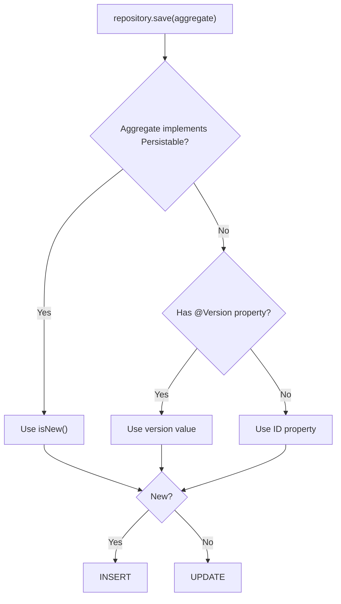

# Distinguishing Null IDs, Zero Values, and Assigned IDs

In Spring Data JDBC, when calling `repository.save(aggregate)`, the framework must determine whether the aggregate is **newly created** or **already exists in the database**. This decision directly affects the SQL statement executed: normally, a new aggregate follows the `INSERT` path, while an existing aggregate follows the `UPDATE` path.

Therefore, the following three states cannot be treated as equivalent:

- **ID is `null`:** no identifier value exists yet in Java.
- **ID equals `0`:** holds a specific numeric value of 0; its meaning for newness detection depends on the Java type and the newness detection strategy.
- **ID is assigned:** the identifier property already holds a value, whether generated by the database or supplied by the application.

The key point is that **having an ID does not guarantee the record already exists in the database**. An application can assign an ID itself before inserting. Spring Data JDBC needs a clear rule to distinguish that case from an aggregate that was previously saved.

## 1. What role does ID play in an aggregate?

An ID (*identifier*) is the value that identifies an aggregate root. It allows the application to look up the right aggregate in subsequent operations, reference the aggregate from elsewhere, and identify the corresponding row in a table.

Example of a product:

```java
import org.springframework.data.annotation.Id;
import org.springframework.data.relational.core.mapping.Table;

@Table("products")
public class Product {

    @Id
    private Long id;

    private String name;

    public Product() {
    }

    public Product(String name) {
        this.name = name;
    }

    public Long getId() {
        return id;
    }

    public String getName() {
        return name;
    }
}
```

`@Id` marks the aggregate's identifier property. It tells Spring Data JDBC which property corresponds to the key of the data row.

However, `@Id` **does not by itself say that the ID must be generated by the database**, nor does it mean that seeing an ID other than `null` guarantees the row already exists. How the ID is assigned and how new state is detected are two related but distinct concerns.

Example PostgreSQL schema using an auto-generated key:

```sql
CREATE TABLE products (
    id BIGINT GENERATED BY DEFAULT AS IDENTITY PRIMARY KEY,
    name VARCHAR(200) NOT NULL
);
```

With this design, the database can assign the ID on insert without the application passing an ID. On the Java side, using `Long` allows representing the pre-save state as `id == null`.

## 2. Three common ID states

### 2.1. ID is null

```java
Product product = new Product("Keyboard");
System.out.println(product.getId()); // null
```

`Long` is a reference type, so an unassigned field defaults to `null`. Under the default new-state detection strategy, a reference-type ID that is `null` indicates the aggregate is **new**.

When calling:

```java
Product saved = productRepository.save(product);
```

Spring Data JDBC typically performs an insert. The database assigns the primary key, and the ID value is populated into the returned aggregate.

```text
Java before save                       Database
----------------                       --------
Product                                products
  id = null             INSERT ------> id = 101
  name = "Keyboard"                    name = "Keyboard"

Java after save
---------------
saved
  id = 101
  name = "Keyboard"
```

With immutable aggregates, or when the framework creates a new instance containing the generated ID, you must **use the return value of `save`**:

```java
Product saved = productRepository.save(product);

Long generatedId = saved.getId();
```

Do not assume the original `product` variable is always mutated in place. Take the returned aggregate to use the ID and post-persistence state.

### 2.2. ID equals 0

The value `0` is a valid integer in Java. It is not automatically synonymous with `null`.

Example:

```java
Long id = 0L;
long primitiveId = 0L;
```

Both variables above represent the number 0, but their types differ:

- `Long id` is a wrapper, which can be `null` or hold the value 0.
- `long primitiveId` cannot be `null`; an unassigned field defaults to 0.

In Spring Data Commons' default new-state detection strategy used by Spring Data JDBC, **a primitive type with numeric value 0 is considered as having no ID value yet**. Conversely, a wrapper such as `Long` containing `0L` is a non-`null` value and is considered as already having an ID unless another newness rule takes precedence.

This creates a notable difference:

| Java declaration | Value | Meaning under default ID-based newness |
| --- | --- | --- |
| `Long id` | `null` | New |
| `Long id` | `0L` | Existing |
| `Long id` | `101L` | Existing |
| `long id` | `0L` | New (default/sentinel primitive value) |
| `long id` | `101L` | Existing |

**Do not infer that databases forbid an ID equal to 0.** A database can allow a primary key of 0 if the schema and insert approach permit it. Treating primitive ID 0 as a newness marker is a convention of the entity detection strategy, not a universal SQL rule.

If the business requires ID 0 to be an actual assigned identifier, using a primitive ID can lose the ability to distinguish between "no ID yet" and "valid ID equal to 0". A wrapper type or a different newness detection strategy will be clearer.

### 2.3. ID is assigned

An assigned ID can come from many sources:

- The database generated the ID after a previous insert.
- The application assigns IDs according to its own rules.
- An external system sends an ID that needs to be stored.
- The ID is a natural key, such as a product code or business code.
- The application generates a UUID before writing data.

Example:

```java
Product product = new Product("Wireless Mouse");
product.setId(101L);
```

Under the default ID-based strategy, a non-`null` wrapper ID is treated as an existing aggregate. When calling `save`, Spring Data JDBC takes the update path.

```text
Product
  id = 101
  name = "Wireless Mouse"
       |
       v
Spring Data JDBC detects: existing
       |
       v
UPDATE products
SET name = ?
WHERE id = 101
```

A common pitfall: **the application assigning an ID before saving does not prove that a row with that ID already exists in the database**. If the row does not exist yet, an update operation does not automatically turn into an insert simply because the application wanted to create a new record.

Depending on configuration, version, and optimistic locking context, an update that finds no row may fail to update anything and may raise an exception regarding update semantics. Therefore, configure the new-state detection strategy properly instead of merely setting an ID and calling `save`.

## 3. How does Spring Data JDBC determine a new aggregate?

Spring Data JDBC needs to know the newness state before choosing the write path. Spring Data Commons' default mechanism evaluates information on the aggregate in the following general order:

1. If the aggregate implements `Persistable`, the `isNew()` method provided by the aggregate is used to determine new state.
2. If there is a version property annotated with `@Version`, the version is used to determine new state.
3. If neither mechanism applies, the ID property is the basis for determining newness.

For the selected property-based strategy:

- A `null` value indicates a new aggregate.
- For primitive numeric properties, the default value `0` is also considered new.
- A non-`null` wrapper value, such as `Long.valueOf(0)`, is considered populated.
- A value other than the sentinel on a primitive property is considered populated.

This is a **Spring Data layer newness rule**, not a database query check to verify whether a row exists.

### 3.1. Illustrative decision table

Assuming `Persistable` is not implemented and there is no `@Version` property:

| ID property | Value | Default newness result |
| --- | --- | --- |
| `Long` | `null` | New |
| `Long` | `0L` | Existing |
| `Long` | `101L` | Existing |
| `long` | `0L` | New |
| `long` | `101L` | Existing |
| `String` | `null` | New |
| `String` | `"P-101"` | Existing |
| `UUID` | `null` | New |
| `UUID` | A specific UUID | Existing |

This table describes the ID-based strategy. If the aggregate has `@Version` or implements `Persistable`, evaluate that mechanism before drawing conclusions from the ID.

### 3.2. Operation selection flowchart



The `isNew` result only determines the write path. It does not replace database constraint checks, input validation, or concurrency conflict checks.

## 4. Why is a wrapper ID usually suitable for auto-generated keys?

With database-assigned IDs, a wrapper type cleanly represents states before and after saving:

```java
@Id
private Long id;
```

States:

```text
Before INSERT: id = null
After INSERT:  id = 101
After reading: id = 101
```

This is an easy-to-understand model:

- `null`: no key assigned yet.
- `101`: has a concrete identity.
- No need to reserve the number 0 as a marker for "no ID yet".

Compare with a primitive:

```java
@Id
private long id;
```

A `long` field always has a numeric value. Before assignment, it is 0. If the database or business also uses ID 0 as a valid value, the code can no longer clearly represent the two distinct states.

Therefore, for typical auto-generated keys, **`Long` is usually a clearer choice than `long`**. This does not mean every ID must be `Long`; UUID, String, or other ID types remain suitable if they fit the mapping contract and newness strategy.

## 5. Complete example: database-generated ID

### 5.1. Schema

Using PostgreSQL:

```sql
CREATE TABLE products (
    id BIGINT GENERATED BY DEFAULT AS IDENTITY PRIMARY KEY,
    name VARCHAR(200) NOT NULL
);
```

`GENERATED BY DEFAULT AS IDENTITY` lets PostgreSQL automatically assign an ID when an insert statement does not supply one. This declaration also permits supplying an explicit ID value in appropriate cases.

### 5.2. Aggregate

```java
import org.springframework.data.annotation.Id;
import org.springframework.data.relational.core.mapping.Table;

@Table("products")
public record Product(
        @Id Long id,
        String name
) {
}
```

### 5.3. Repository

```java
import org.springframework.data.repository.CrudRepository;

public interface ProductRepository
        extends CrudRepository<Product, Long> {
}
```

### 5.4. Saving a new aggregate

```java
Product draft = new Product(null, "Mechanical Keyboard");

Product saved = productRepository.save(draft);

System.out.println(saved.id());
```

Before saving, `draft.id()` is `null`. Spring Data JDBC detects a new aggregate and performs an insert. After inserting, use `saved` to retrieve the generated ID.

### 5.5. Reading and updating the aggregate

```java
Product current = productRepository.findById(saved.id())
        .orElseThrow();

Product renamed = new Product(
        current.id(),
        "Mechanical Keyboard New Edition"
);

Product updated = productRepository.save(renamed);
```

This time the ID already has a value. The aggregate is considered existing and the save operation takes the update path.

```text
First time:
new Product(null, "Mechanical Keyboard")
       |
       v
INSERT -> database assigns id = 101

Second time:
new Product(101, "Mechanical Keyboard New Edition")
       |
       v
UPDATE -> modifies row id = 101
```

Distinguish between **an ID generated after the first save** and **an ID assigned by the application before the first save**. Both can be the number 101 in Java, yet default ID-based newness behaves differently if the ID is already present right before calling save.

## 6. ID assigned by the application before insert

Some systems do not use auto-increment keys. They may assign IDs from:

- UUIDs generated in the application.
- Unique product codes.
- Order numbers following business rules.
- IDs issued by another system.
- Custom sequences or ID allocators.

Example:

```java
Product product = new Product(9001L, "27-inch Monitor");
```

Without `@Version` and without implementing `Persistable`, Spring Data JDBC by default sees a populated ID and treats the aggregate as existing. However, row `9001` may not exist yet.

To handle this properly, you need a way to express that **the ID has already been assigned, yet the aggregate is still new**.

There are two common options:

1. Use a nullable `@Version` property to determine newness while also gaining optimistic locking.
2. Implement `Persistable` and manage `isNew()` yourself.

### 6.1. Approach 1: use a @Version property

Spring Data JDBC supports optimistic locking through a property marked with `@Version`. The version property is also used to determine new state when present.

Example:

```java
import org.springframework.data.annotation.Id;
import org.springframework.data.annotation.Version;
import org.springframework.data.relational.core.mapping.Table;

@Table("products")
public record Product(
        @Id Long id,
        @Version Long version,
        String name
) {
}
```

Creating an aggregate with an assigned ID but no version yet:

```java
Product newProduct = new Product(
        9001L,
        null,
        "27-inch Monitor"
);

Product saved = productRepository.save(newProduct);
```

Because `version == null`, the aggregate is detected as new under the version strategy. Spring Data JDBC can perform an insert with the supplied ID. After inserting, the version is initialized according to Spring Data JDBC's optimistic locking mechanism.

Conceptual state:

```text
Before INSERT:
  id      = 9001
  version = null
  name    = "27-inch Monitor"

After INSERT:
  id      = 9001
  version = initial value managed by the version mechanism
  name    = "27-inch Monitor"

Subsequent save:
  version has a value -> existing
  UPDATE checks the current version
```

**Why is this approach useful?**

- The ID can be assigned before saving.
- You do not have to rely on a null ID as the sole signal of a new aggregate.
- Version helps detect certain conflicting concurrent updates.
- After reading the aggregate from the database, the version has a value, so the aggregate is recognized as existing.

Using a `Long version` wrapper lets you represent `null` before the first save. If using a primitive version, the newness strategy can rely on 0 as a sentinel; understand that rule clearly and do not assign a non-zero version to a new aggregate.

**Note:** `@Version` is not just a new/existing flag. It participates in optimistic locking. When an aggregate has been updated by another transaction and the version changes, an update attempt using the old version can fail with an optimistic locking exception. The application must decide how to report the error, reload, or resolve the conflict according to business rules.

### 6.2. Approach 2: implement Persistable

If the application's newness rule cannot be adequately expressed with ID or version, the aggregate can implement `Persistable<ID>`.

This interface provides:

- `getId()`: returns the aggregate's identifier.
- `isNew()`: returns whether the aggregate is new or existing.

Structural example:

```java
import org.springframework.data.annotation.Id;
import org.springframework.data.annotation.Transient;
import org.springframework.data.domain.Persistable;
import org.springframework.data.relational.core.mapping.Table;

@Table("products")
public class AssignedIdProduct implements Persistable<Long> {

    @Id
    private Long id;

    private String name;

    @Transient
    private boolean newEntity = true;

    protected AssignedIdProduct() {
    }

    public AssignedIdProduct(Long id, String name) {
        this.id = id;
        this.name = name;
        this.newEntity = true;
    }

    @Override
    public Long getId() {
        return id;
    }

    @Override
    public boolean isNew() {
        return newEntity;
    }

    public void markNotNew() {
        this.newEntity = false;
    }

    public String getName() {
        return name;
    }
}
```

Spring Data's `@Transient` marks `newEntity` as transient state, not a column to persist in the table. `isNew()` is used by Spring Data instead of the default newness detection strategy.

Creation flow example:

```java
AssignedIdProduct product =
        new AssignedIdProduct(9001L, "27-inch Monitor");

AssignedIdProduct saved = repository.save(product);

// After confirming save succeeded, update state
saved.markNotNew();
```

This example illustrates controlling the state; in a real application, setting `newEntity` to false must be properly integrated with the persist and load lifecycle.

**Two mandatory responsibilities when using Persistable:**

1. After a successful insert, the entity must be marked existing before the next save.
2. When the entity is loaded from the database, it must also be initialized in the existing state.

You can manage this using a factory, mapping constructor, or appropriate lifecycle callback (such as a callback after the aggregate is converted from database data). If you only set `newEntity = true` and forget to update it when reading data, an existing aggregate may be misidentified as new on a subsequent save.

Only use `Persistable` when you genuinely need control over newness. If `@Version` already solves the pre-assigned ID case, that approach typically involves less custom state.

## 7. Distinguishing ID, version, and existence state

ID and version serve different roles:

| Property | Answers the question | Example |
| --- | --- | --- |
| `@Id Long id` | By what value is the aggregate identified? | `id = 9001` |
| `@Version Long version` | Which data version is the aggregate at? | `version = 3` |
| `Persistable.isNew()` | According to the aggregate's rules, is it considered new? | `true` / `false` |

The ID is not the version. The ID typically remains stable across updates; the version changes on successful updates to support optimistic locking.

Example:

```text
Insert:
  id = 9001
  version = 0

Successful update:
  id = 9001
  version = 1

Next update:
  id = 9001
  version = 2
```

The specific initial version value may depend on the mechanism and version type used. The key takeaway is that version changes with each write; the ID stays constant to identify the aggregate.

Do not manually increment `version` during normal save calls. Let Spring Data JDBC manage the version under optimistic locking.

## 8. How do SQL INSERT and UPDATE differ?

Suppose we have the table:

```sql
CREATE TABLE products (
    id BIGINT PRIMARY KEY,
    name VARCHAR(200) NOT NULL
);
```

An insert operation with a supplied ID:

```sql
INSERT INTO products (id, name)
VALUES (9001, '27-inch Monitor');
```

An update operation:

```sql
UPDATE products
SET name = '27-inch Monitor New Edition'
WHERE id = 9001;
```

The two statements have different purposes:

- `INSERT` creates a new row; if the primary key already exists, the database rejects it per the constraint.
- `UPDATE` modifies an existing row; if no row matches, the number of updated rows is 0.
- `save` chooses the operation path based on the aggregate's newness state; it is not a universal SQL "upsert" command that automatically inserts if an update finds nothing.

This is why assigning an ID before inserting without adjusting the newness strategy can cause errors. **A populated ID is not enough to conclude the record has already been inserted.**

### 8.1. Avoid confusing save with upsert

Some databases support dedicated upsert syntax such as PostgreSQL's `INSERT ... ON CONFLICT ... DO UPDATE`. That is a specific SQL strategy. Spring Data JDBC's `repository.save` should not be assumed to always issue such an upsert statement.

If business logic requires "update if present, create if absent", define the key conflict policy and implement it appropriately. Checking existence and then inserting can still encounter a race condition when two requests run concurrently; unique constraints and database error handling remain vital.

## 9. When to use null IDs vs. assigned IDs?

| Scenario | Usually appropriate representation | Reason |
| --- | --- | --- |
| Database auto-generates ID | `Long id = null` | Clear newness; database assigns ID on insert. |
| Application generates UUID before saving | Populated ID + `@Version Long version = null` or `Persistable` | An assigned ID does not mean the aggregate already exists. |
| ID is a fixed business code | Populated ID + clear newness mechanism | Allows inserting with a known ID. |
| Reading a saved aggregate | Populated ID and version (if any) | Aggregate is existing. |
| Numeric ID 0 has business meaning | Avoid using primitive 0 as a sentinel | Must distinguish valid ID from unassigned ID state. |
| Want to decide newness state yourself | `Persistable` | Can express custom rules, but lifecycle must be managed accurately. |

### 9.1. Database-generated ID

Choose `Long` or an appropriate wrapper, initialize it to `null`, and let the database assign the value. This is the simplest model when the database manages IDs.

### 9.2. Application-assigned ID

If the application needs to know the ID before writing (e.g., UUID), do not assume Spring Data will automatically understand that the aggregate is still new. Use a nullable `@Version` or `Persistable` to declare the state explicitly.

### 9.3. ID can be 0

If ID 0 is a valid value, do not use primitive 0 as a marker for "no ID yet" without another mechanism. With `Long`, `0L` is an assigned value; with `long`, the default strategy may treat 0 as a new state. This distinction must be accounted for in the design.

## 10. Common errors and how to handle them

| Symptom | Possible cause | Resolution |
| --- | --- | --- |
| Calling save with an assigned ID does not create a new row | Default ID-based strategy treats non-null ID as existing | Use a nullable version or `Persistable` if the aggregate is truly new. |
| Primitive ID always has value 0 before assignment | Primitives have no null state | Prefer a wrapper for auto-generated keys; if valid ID 0 is needed, choose another newness strategy. |
| Calling save with wrapper ID 0L expecting insert | `Long 0L` is a non-null value | Use null for generated IDs or configure version/Persistable for assigned IDs. |
| Update finds no row | Aggregate was detected as existing, but row does not exist yet | Check the newness strategy and database data. |
| Saved entity is treated as new on next save | Custom `isNew` state was not switched to false or load callback is wrong | Fix lifecycle management if using `Persistable`. |
| Update fails with optimistic locking failure | Version became stale because another transaction updated it | Reload data, resolve conflict, or notify user per business rules. |
| Duplicate ID on insert | Application-assigned ID was already used | Check unique constraints, ID generation rules, and conflict handling. |
| Assuming `@Id` auto-generates IDs | Confusing identity metadata with ID generation strategy | Check schema, generation configuration, and driver/database. |

### 10.1. How to investigate when save takes the wrong branch

When save behavior is not as expected, check in this order:

1. **ID type:** is the field `Long`, `long`, UUID, or String?
2. **Actual value before save:** null, 0, or a specific value?
3. **Is there a `@Version`?** If so, what is the version value before save?
4. **Does the aggregate implement `Persistable`?** If so, what does `isNew()` return?
5. **Does the record actually exist?** Query the database by ID.
6. **How does the schema assign IDs?** Identity, sequence, UUID, or application-assigned?
7. **What is the actual SQL?** Enable appropriate logging or observe queries to confirm insert/update.
8. **Are transactions or optimistic locking involved?** Check the version and underlying exception.

Do not fix errors by arbitrarily changing the ID to 0 or null before every save. Identify the actual business state and newness strategy properly.

## 11. Checking ID and newness in Java

You can write small checks to understand Java type differences:

```java
Long nullableId = null;
Long zeroWrapperId = 0L;
Long assignedWrapperId = 101L;

long zeroPrimitiveId = 0L;
long assignedPrimitiveId = 101L;

System.out.println(nullableId == null);       // true
System.out.println(zeroWrapperId == null);    // false
System.out.println(assignedWrapperId == null);// false

System.out.println(zeroPrimitiveId);          // 0
System.out.println(assignedPrimitiveId);      // 101
```

These comparisons only prove the state of Java variables. They **do not query the database** and do not confirm that a row exists.

If you want to observe Spring Data JDBC's SQL path, you can enable appropriate SQL logging in development. Example logger configuration depending on Spring Boot version and logging system:

```yaml
logging:
  level:
    org.springframework.jdbc.core: DEBUG
    org.springframework.data.jdbc.core: DEBUG
```

Logger names and detail levels may vary by version. Do not enable logging containing sensitive data in production without controlling parameter logging.

## 12. Design principles to remember

**For database-generated keys:**

- Use a wrapper ID like `Long`.
- Leave the ID as `null` before the first insert.
- Retrieve the ID from the returned aggregate after `save`.
- When reading back, use the populated ID to update the correct aggregate.

**For application-assigned IDs:**

- Do not rely solely on a non-null ID to conclude the aggregate already exists.
- Use a nullable `@Version` when optimistic locking is also appropriate.
- Or implement `Persistable` with `isNew()` and carefully manage state after save/load.

**For ID 0:**

- `0` is a numeric value, not SQL NULL or Java null.
- A primitive ID of 0 can be treated as new by the default strategy.
- A wrapper ID `Long.valueOf(0)` is a non-null value and can be treated as existing without another newness mechanism.
- Only use ID 0 when ID generation rules and the newness strategy are clearly defined.

**For optimistic locking:**

- ID is used to identify the aggregate.
- Version is used to track data versions and detect conflicting updates.
- Do not equate version with ID or modify version outside persistence rules.

## 13. Self-practice

Predict whether Spring Data JDBC will choose insert or update in each scenario. Assume there is no `@Version` and `Persistable` is not implemented, unless stated otherwise:

| Case | ID type and value | Prediction |
| --- | --- | --- |
| A | `Long id = null` | ? |
| B | `Long id = 0L` | ? |
| C | `Long id = 101L` | ? |
| D | `long id = 0L` | ? |
| E | `long id = 101L` | ? |
| F | `UUID id = null` | ? |
| G | `UUID id = a specific UUID` | ? |

Then consider these additional scenarios:

1. An aggregate has `id = 9001L` and `@Version Long version = null`. Is it considered new?
2. An aggregate has an assigned ID but implements `Persistable` with `isNew()` returning `true`. Which mechanism is used?
3. An aggregate is loaded from the database, yet a custom `isNew` flag remains `true`. What might happen on the next save?
4. A table allows a primary key of 0. What confusion could using `long id` with the default strategy cause?
5. Why does checking for a non-null ID fail to prove that a row exists in the database?

### Hands-on exercise

Create a `products` table and a Spring Data JDBC repository, then try two models:

**Model 1 — Database-generated ID**

- Use `@Id Long id`.
- Create an aggregate with a null ID.
- Call `save` and read the ID from the returned result.
- Read the aggregate back by ID, rename it, and save.
- Observe insert the first time, update the next time.

**Model 2 — Application-assigned ID**

- Create an aggregate with ID 9001 when the row does not exist in the database yet.
- Try saving while relying solely on the ID.
- Add `@Version Long version` and initialize version to null.
- Save again with the assigned ID, observing the insert and the version value after saving.
- Read the aggregate, modify data, and save again to observe optimistic locking.
- If trying `Persistable`, verify both the state after save and after loading from the database.

The goal of this exercise is to recognize that **an assigned ID only indicates the aggregate has an identifier in Java; it does not prove the aggregate has been persisted**. The newness strategy decides whether Spring Data JDBC chooses insert or update.

## 14. Key takeaways

The three states to distinguish are:

- **Null ID:** no identifier value; with wrappers and the default strategy, the aggregate is considered new.
- **ID equal to 0:** a numeric value. Primitive zero can act as a sentinel for new state; wrapper `Long 0L` is a non-null value and is considered existing under the default ID strategy.
- **Assigned ID:** can be a previously saved aggregate or a new aggregate whose ID was assigned beforehand by the application. If the ID already has a value yet the aggregate still needs to be inserted, use a nullable `@Version` or `Persistable` to express newness properly.

Understanding this difference helps you avoid choosing the wrong `INSERT`/`UPDATE` path, design clear IDs, and handle both database-generated IDs and application-assigned IDs properly in Spring Data JDBC.

