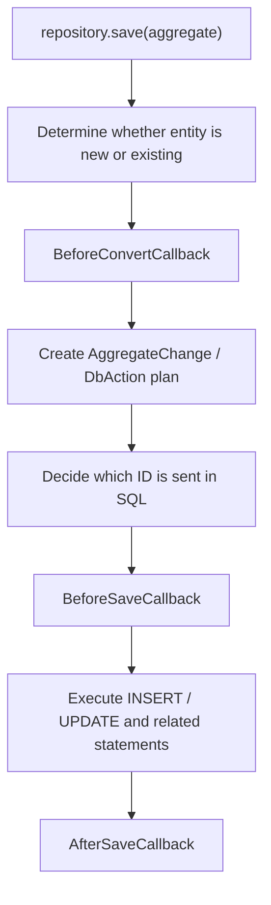

# Choosing When to Assign IDs via Callbacks and Verifying Insert/Update Decisions

In **Spring Data Relational JDBC**, `repository.save(entity)` does not query the database to ask "does this ID already exist?" before deciding how to write. Spring Data first determines whether the entity is **new** or **existing** based on the object's state. From that decision, the framework chooses `INSERT` or `UPDATE`.

This becomes important when the application assigns IDs itself, especially UUIDs. If you want to generate IDs in a lifecycle callback, you must pick the right timing: **`BeforeConvertCallback` is invoked after Spring Data has decided insert/update, yet before the framework builds the SQL plan**. This callback can assign an ID to an aggregate already detected as new; `BeforeSaveCallback` is too late for that job.

This lesson explains the lifecycle order, how Spring Data detects new entities, three ID-assignment strategies, and how to verify write decisions using SQL, `@Version`, and integration tests.

## 1. `save()` decides insert or update based on entity state

A common misconception is that `save()` acts like an *upsert* command:

```text
save(entity)
  -> SELECT to check if ID exists
  -> exists: UPDATE
  -> absent: INSERT
```

That is **not** Spring Data JDBC's default mechanism. The framework checks the object's new state (`isNew`) and then chooses the operation. Whether the row actually exists in the database is only verified when the SQL statement executes.

Under the default strategy, Spring Data checks `@Id`:

- ID is `null` (or `0` when using a primitive type) → entity is treated as **new** → `INSERT`.
- ID already has a value → entity is treated as **existing** → `UPDATE`.

If the entity has a `@Version` property, version takes precedence for determining state:

- Version is `null` (or `0` for primitive types) → new entity.
- Version has a value different from the initial state → existing entity.

If the entity implements `Persistable`, Spring Data uses the entity's `isNew()` instead of default inference. The table below summarizes:

| Detection method | State treated as new | State treated as existing |
|---|---|---|
| `@Id` (default) | ID `null`; primitive ID equal to `0` | ID other than `null`/`0` |
| `@Version` | Version `null`; primitive version equal to `0` | Version already initialized |
| `Persistable.isNew()` | Method returns `true` | Method returns `false` |

**Consequence:** a UUID already assigned in a constructor is no longer `null`. If the entity lacks `@Version` and does not implement `Persistable`, `save()` can choose `UPDATE` even when the row does not exist yet. A valid UUID does not mean the entity has already been saved.

## 2. Callback order when saving an aggregate

Spring Data JDBC executes the main steps in the following order:



| Callback | Timing | Suitable for assigning ID? |
|---|---|---|
| `BeforeConvertCallback<T>` | After insert/update decision, before aggregate is converted into a SQL plan | **Yes.** The ID created here will be included in the subsequent insert plan |
| `BeforeSaveCallback<T>` | After the SQL plan has been created, before statements run | **No.** The decision of what ID to send to the database has already been made |
| `AfterSaveCallback<T>` | After the SQL statements have executed | Too late to assign an ID for the insert that just ran |

Therefore, if you want to assign an ID in a callback, use `BeforeConvertCallback`. Spring Data recommends entity callbacks over application events when mutating or transforming entities: a callback returns a new or modified instance and is invoked synchronously in the lifecycle. Events are suitable for notifications/observation; do not use event listeners as a required mechanism for assigning IDs.

Another important point: these callbacks apply to the **aggregate root**. Derived query statements or direct `@Query` methods do not go through the repository's aggregate save pipeline in the same way, because Spring Data cannot fully identify the affected aggregate to dispatch lifecycle callbacks.

## 3. Assigning a UUID in `BeforeConvertCallback`

Suppose the application wants to generate UUIDs in the application layer without every service having to remember to call `UUID.randomUUID()`. You can place the ID generation logic in a shared callback.

### Aggregate root

```java
package com.example.jobs;

import java.util.UUID;

import org.springframework.data.annotation.Id;
import org.springframework.data.annotation.Version;
import org.springframework.data.relational.core.mapping.Table;

@Table("job")
public class Job {

    @Id
    private UUID id;

    @Version
    private Long version;

    private String description;

    protected Job() {}

    public Job(String description) {
        this.description = description;
    }

    public UUID getId() { return id; }
    public Long getVersion() { return version; }
    public String getDescription() { return description; }

    public void rename(String description) {
        this.description = description;
    }

    public void assignId(UUID id) {
        this.id = id;
    }
}
```

In this example, `id` is initially `null` and `version` is also `null`. When calling `save()`, Spring Data detects the aggregate as new before running callbacks.

### Callback assigning ID if missing

```java
package com.example.jobs;

import java.util.UUID;

import org.springframework.data.relational.core.mapping.event.BeforeConvertCallback;
import org.springframework.stereotype.Component;

@Component
public class JobIdCallback implements BeforeConvertCallback<Job> {

    @Override
    public Job onBeforeConvert(Job aggregate) {
        if (aggregate.getId() == null) {
            aggregate.assignId(UUID.randomUUID());
        }

        return aggregate;
    }
}
```

Spring registers the callback as a bean; `BeforeConvertCallback<Job>` applies to aggregate roots of type `Job`. The callback only creates an ID when none is present yet, ensuring it does not overwrite an ID already assigned from another valid source.

When calling:

```java
Job saved = jobRepository.save(new Job("Generate monthly report"));
```

the actual sequence is:

1. `Job.id == null`, `Job.version == null` → detected as a new entity.
2. `BeforeConvertCallback` creates a UUID and assigns it to `Job.id`.
3. Spring Data converts the aggregate into an `INSERT` plan; this time the ID has a value, so it is sent in the SQL statement.
4. The database saves the row; `@Version` is initialized via Spring Data JDBC's optimistic locking mechanism.
5. `save()` returns the saved aggregate.

Callbacks can return a different instance, so they also fit immutable aggregates. With the mutable class in this example, the callback modifies the instance and returns that same instance.

### Repository

```java
package com.example.jobs;

import java.util.UUID;

import org.springframework.data.repository.CrudRepository;

public interface JobRepository extends CrudRepository<Job, UUID> {}
```

There is no need to invoke the callback manually in a service. When `JobRepository.save()` uses Spring Data JDBC's aggregate save flow, the callback is applied automatically if the bean is registered in the application context.

## 4. Why can `BeforeConvertCallback` assign an ID without making `save()` switch to update?

This is the easiest point to misunderstand: **Spring Data decides whether the entity is new or existing before calling `BeforeConvertCallback`**. The callback does not alter the decision already made.

Initial entity example:

```text
id      = null
version = null
```

After state detection:

```text
isNew = true
operation = INSERT
```

After the callback:

```text
id      = 9f7f... (newly generated UUID)
version = null
operation is still INSERT
```

Because the ID is assigned before the SQL plan is built, it can appear in the `INSERT`. Having a non-`null` `id` at this stage does not retroactively turn the operation into `UPDATE`.

This differs completely from the case where the application assigns the ID **before calling `save()`**:

```java
Job job = new Job("Generate monthly report");
job.assignId(UUID.randomUUID());

jobRepository.save(job);
```

Without `@Version` or `Persistable`, Spring Data sees a non-`null` ID right at the state detection step and treats the entity as existing. At that point, a callback cannot reverse the decision to insert because the callback only runs after that step.

## 5. Choosing one of three ID-assignment strategies

### Strategy A — Database generates the ID

Use when the database has identity/auto-increment or a sequence and you want the database to manage key values.

```java
@Table("job")
public class Job {
    @Id
    private Long id;

    private String description;

    public Job(String description) {
        this.description = description;
    }
}
```

With a `Long` wrapper ID initially `null`, Spring Data detects a new entity. Do not assign an ID in `BeforeConvertCallback`; leave it `null` so the framework/database uses the generated-key mechanism. After inserting, the database-generated ID is populated back onto the entity.

```sql
CREATE TABLE job (
    id BIGINT GENERATED BY DEFAULT AS IDENTITY PRIMARY KEY,
    description VARCHAR(255) NOT NULL
);
```

If a callback assigns an ID before the insert plan is created, Spring Data treats it as a supplied ID and includes it in the insert statement. That is no longer letting the database auto-generate the ID; with identity columns configured to disallow explicit values, the insert may fail.

### Strategy B — Callback assigns the ID after state detection

Use when you want application-generated IDs without coupling business code to the ID generation algorithm.

```text
Entity before save:      id = null
Spring Data detection:   INSERT
BeforeConvertCallback:   generates UUID
AggregateChange:         INSERT with assigned UUID
```

This strategy fits `BeforeConvertCallback`. You can use a UUID, a code from an internal generator, or an ID produced by a purely local algorithm. The callback should:

- Only assign when the ID is missing.
- Not call network APIs or depend on external services during save.
- Be deterministic for a given execution pass and never overwrite an existing ID.
- Not try to change the insert/update decision already made by Spring Data.

### Strategy C — ID is already present before `save()`

Use when the ID comes from another system, is assigned in a constructor/factory, or must exist before writing to the database. In this case, provide an additional mechanism to indicate new state.

**Common approach: `@Version`**

```java
@Table("job")
public class Job {

    @Id
    private UUID id;

    @Version
    private Long version;

    private String description;

    public Job(UUID id, String description) {
        this.id = id;
        this.description = description;
        // leave version null: Spring Data detects the entity as new.
    }
}
```

When `version == null`, the entity is considered new even though the UUID already has a value. After inserting, the version is initialized; the next save will be recognized as an update. This is also why `@Version` is useful with UUIDs generated in constructors.

**Alternative: `Persistable`**

If new/existing state follows custom rules that cannot be expressed via ID or version, the entity can implement `Persistable<ID>` and provide `isNew()`. You must manage transitioning `isNew` from `true` to `false` after a successful insert; if it always returns `true`, subsequent saves will continue attempting inserts and hit duplicate key errors. When using property access, supporting properties for `Persistable` must be marked `@Transient` if you do not want Spring Data to persist them as domain data.

Do not implement `Persistable` merely as a workaround for an issue you have not understood. `@Version` is usually more concise and provides optimistic locking at the same time.

## 6. `BeforeSaveCallback` is too late to assign an ID

The following example is the wrong place for ID generation:

```java
@Component
public class JobBeforeSaveCallback implements BeforeSaveCallback<Job> {

    @Override
    public Job onBeforeSave(Job aggregate, AggregateChange<Job> change) {
        if (aggregate.getId() == null) {
            aggregate.assignId(UUID.randomUUID());
        }
        return aggregate;
    }
}
```

By the time `BeforeSaveCallback` runs, `AggregateChange` and its `DbAction` items have already been created. The framework has already decided which ID is sent to the database or whether the database will generate it. Modifying `aggregate.id` in this callback does not update the decisions already recorded in the plan.

| Purpose | Suitable callback |
|---|---|
| Generate ID for a new aggregate | `BeforeConvertCallback` |
| Supplement/adjust data before building the SQL plan | `BeforeConvertCallback` |
| Inspect or modify entity once the write plan is built | `BeforeSaveCallback` |
| Record outcome after SQL has executed | `AfterSaveCallback` |

For `BeforeConvertEvent`/`BeforeSaveEvent`, the same timing rules apply. However, events are a notification mechanism; listeners may be affected by `ApplicationEventMulticaster` and executors, so do not use event listeners to perform a data mutation that must finish before SQL generation. Use entity callbacks instead.

## 7. Verifying insert/update decisions with `@Version`

An easy way to observe behavior is placing `@Version` on the aggregate root. Spring Data JDBC uses version to detect new entities and enforce optimistic locking on updates.

State example:

| Invocation | ID | Version before save | Decision |
|---|---|---|---|
| Create `new Job(...)` | `null` | `null` | `INSERT` |
| After `BeforeConvertCallback` | UUID present | `null` | Still `INSERT` |
| After insert | UUID present | Initialized | Entity is no longer new |
| Edit description and save | UUID present | Current version | `UPDATE ... WHERE id = ? AND version = ?` |
| Save with old version | UUID present | Stale version | Cannot update; throws optimistic locking error |

On update, the SQL filters by both ID and version. If another transaction updated the row earlier, the database version no longer matches the entity's version; Spring Data JDBC detects an unexpected updated row count and throws `OptimisticLockingFailureException`.

### Integration test verifying both branches

```java
import static org.assertj.core.api.Assertions.assertThat;

import org.junit.jupiter.api.Test;
import org.springframework.beans.factory.annotation.Autowired;
import org.springframework.boot.test.autoconfigure.data.jdbc.DataJdbcTest;
import org.springframework.context.annotation.Import;
import org.springframework.jdbc.core.JdbcTemplate;

@DataJdbcTest
@Import(JobIdCallback.class)
class JobRepositoryTest {

    @Autowired JobRepository repository;
    @Autowired JdbcTemplate jdbcTemplate;

    @Test
    void callbackAssignsIdBeforeInsertAndLaterSaveUpdates() {
        Job saved = repository.save(new Job("First description"));

        assertThat(saved.getId()).isNotNull();
        assertThat(saved.getVersion()).isNotNull();

        Integer rowsAfterInsert = jdbcTemplate.queryForObject(
                "SELECT COUNT(*) FROM job WHERE id = ?",
                Integer.class,
                saved.getId()
        );
        assertThat(rowsAfterInsert).isEqualTo(1);

        Long insertedVersion = saved.getVersion();
        saved.rename("Updated description");

        Job updated = repository.save(saved);

        assertThat(updated.getVersion()).isGreaterThan(insertedVersion);

        String description = jdbcTemplate.queryForObject(
                "SELECT description FROM job WHERE id = ?",
                String.class,
                saved.getId()
        );
        assertThat(description).isEqualTo("Updated description");

        Integer rowCount = jdbcTemplate.queryForObject(
                "SELECT COUNT(*) FROM job WHERE id = ?",
                Integer.class,
                saved.getId()
        );
        assertThat(rowCount).isEqualTo(1);
    }
}
```

The test requires the `job` schema and the callback bean loaded into the test context. Because `@DataJdbcTest` is a slice test, `@Import(JobIdCallback.class)` brings the callback into the context explicitly. With H2, you can place the DDL in `src/test/resources/schema.sql`:

```sql
CREATE TABLE job (
    id UUID PRIMARY KEY,
    version BIGINT NOT NULL,
    description VARCHAR(255) NOT NULL
);
```

If the test uses a different in-memory database, adjust the ID type for that database. In a real project, run against the target database/driver via Testcontainers to verify UUID binding and exact SQL statements.

The test above verifies three things: the callback assigned an ID, the row was actually inserted, and the next save updated the existing row while incrementing the version. Counting rows catches accidental duplicate inserts, while reading the content back confirms the update took effect.

## 8. Observing SQL to see which operation Spring Data chose

In development/test environments, you can enable JDBC logging:

```yaml
logging:
  level:
    org.springframework.jdbc.core: DEBUG
```

Depending on the driver and version, logs can reveal the `INSERT` or `UPDATE` statements and bind parameters. For updates with `@Version`, look for conditions on both ID and version. Do not enable logging of sensitive bind values in production.

Another verification method is using database assertions in integration tests:

```sql
SELECT id, version, description
FROM job
WHERE id = :id;
```

Distinguish three concepts:

- **Entity state detection:** Spring Data decides whether the object is new/existing from `@Id`, `@Version`, or `Persistable`.
- **SQL action planning:** the framework determines the `DbAction` items, which ID is bound, and operations on child entities.
- **Database result:** whether the actual SQL writes a row; whether the ID exists, constraints pass, and version still matches.

An object detected as new does not guarantee insert succeeds: the ID could collide with a primary key, constraints could fail, or the database could reject the statement. Conversely, an object detected as existing does not prove a row exists; an update can affect zero rows and fail.

## 9. Distinguishing `save()`, `insert()`, `update()`, and `upsert()`

In most repository code, `save()` is the standard choice because it uses entity state to select insert or update. `JdbcAggregateTemplate` also provides explicit operations:

| API | Meaning | When to consider |
|---|---|---|
| `save(entity)` | Chooses insert/update based on `isNew` | Normal repository flows |
| `insert(entity)` | Assumes aggregate is new, skips state detection | When the use case knows for certain this is an insert |
| `update(entity)` | Assumes aggregate already exists | When the use case knows for certain this is an update |
| `upsert(entity)` | Uses native database upsert if supported by dialect | When insert-or-update in one round-trip is needed and optimistic locking limits are understood |

`insert()`/`update()` are not the default cure for broken entity state detection. If your domain model needs `save()`, fix the ID/version state or `Persistable`. `upsert()` has different semantics: it requires a populated ID, depends on dialect support, and current documentation states that upsert does not support optimistic locking. Only use it when that behavior fits your business concurrency requirements.

## 10. Common mistakes

| Symptom | Cause | Resolution |
|---|---|---|
| Callback generates ID, yet save still enters update | ID was already present before state detection, or version already marked entity as existing | Check ID/version values at the time `save()` is called |
| Callback generates ID, yet database still generates ID | Used `BeforeSaveCallback` or the SQL plan was built while ID was empty | Move the logic to `BeforeConvertCallback` |
| `save()` updates a non-existent row | ID is non-null without version/Persistable marking the entity as new | Use a wrapper `@Version` or `Persistable.isNew()` |
| Every save tries to insert again | `Persistable.isNew()` always returns `true`, or state was not updated after insert | Manage state transition after saving succeeds |
| UUID gets overwritten during update | ID-generating callback does not check `id == null` | Only assign IDs to aggregates that do not have one yet |
| Database reports duplicate key | Assigned ID already exists or generator lacks uniqueness | Check generator, ID source, and constraints |
| Callback does not appear to run | Direct SQL/derived query/annotated query called, callback bean not registered, or wrong generic type | Check invocation path and application context |
| ID is present on the object, yet missing in the insert statement | ID was assigned after the action plan was created | Verify the right lifecycle callback and SQL logs |
| Update fails with optimistic locking failure | Version on object is older than database version or row was deleted | Reload and handle conflict; do not manually bump version to bypass checks |

## 11. Workflow for choosing when to assign IDs

1. **Choose the ID owner:** database, constructor/factory, callback, or external system?
2. **Check state at `save()` call time:** is ID null? Is version null? What does `Persistable.isNew()` return?
3. **If the database generates IDs:** keep ID in its initial state and do not assign it in a callback.
4. **If a callback generates IDs:** ensure the entity is detected as new before the callback runs; assign the ID in `BeforeConvertCallback`.
5. **If IDs exist before `save()`:** use an appropriate `@Version` or `Persistable` to express a new entity; never rely on a non-null UUID as proof of existence.
6. **If insert/update must be forced:** only use `JdbcAggregateTemplate.insert()`/`update()` when the use case truly knows the state for certain.
7. **Verify the outcome:** confirm insert/update SQL, row count, version, and data round-trip in integration tests.

Selection rule examples:

| Need | ID entering `save()` | State detection mechanism | Where ID is assigned |
|---|---|---|---|
| Database identity | `null` | `@Id` | Database on insert |
| UUID assigned by callback | `null` | `@Id` or null `@Version` | `BeforeConvertCallback` |
| UUID assigned in constructor | Populated | Null `@Version` | Constructor/factory |
| ID imported from another system | Populated | Null `@Version` or `Persistable.isNew()` | Before `save()` |
| Already saved entity | Populated | Initialized version or `isNew() == false` | Not reassigned; update |

**Key point to remember:** when an ID is assigned and when insert/update is decided are two separate steps. In Spring Data JDBC, `BeforeConvertCallback` sits between them in the exact right order: state detection has finished, while the SQL plan has not yet been created. Choose this callback when you need to assign IDs to new aggregates; use `@Version` or `Persistable` when the ID already exists before calling `save()`, and always verify the decision using SQL and integration tests.

## Official References

- [Spring Data Relational — Lifecycle Events and Entity Callbacks](https://docs.spring.io/spring-data/relational/reference/jdbc/events.html): insert/update decision order, `BeforeConvertCallback`, `BeforeSaveCallback`, and other callbacks.
- [Spring Data Relational — Entity State Detection](https://docs.spring.io/spring-data/relational/reference/data-commons/is-new-state-detection.html): strategies for detecting new entities via `@Id`, `@Version`, and `Persistable`.
- [Spring Data Relational — Persisting Entities](https://docs.spring.io/spring-data/relational/reference/jdbc/entity-persistence.html): insert/update, ID generation, version, and `JdbcAggregateTemplate`.
- [Spring Data JDBC — `BeforeConvertCallback` API](https://docs.spring.io/spring-data/jdbc/docs/current/api/org/springframework/data/relational/core/mapping/event/BeforeConvertCallback.html): the right-timed callback for assigning IDs and persistence ordering.
- [Spring Data JDBC — `BeforeSaveCallback` API](https://docs.spring.io/spring-data/jdbc/docs/current/api/org/springframework/data/relational/core/mapping/event/BeforeSaveCallback.html): callback after the aggregate change plan is created.
- [Spring Blog — Spring Data JDBC: How to use custom ID generation](https://spring.io/blog/2021/09/09/spring-data-jdbc-how-to-use-custom-id-generation/): example of custom ID generation with callbacks.
