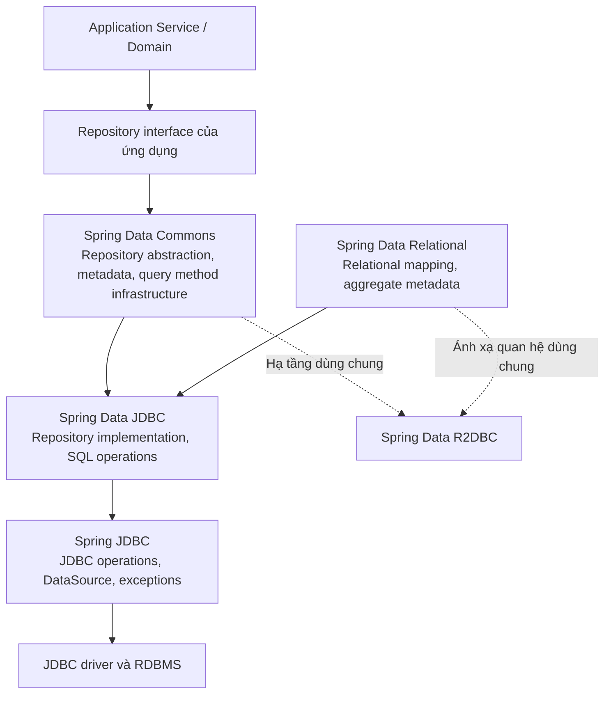

# Vai trò của Spring Data Relational, Spring Data Commons và Spring Data JDBC

Khi xây dựng ứng dụng Java lưu dữ liệu trong cơ sở dữ liệu quan hệ, chúng ta thường gặp ba tên gần giống nhau: **Spring Data Commons**, **Spring Data Relational** và **Spring Data JDBC**. Chúng không phải ba lựa chọn thay thế ngang hàng. Mỗi thành phần giải quyết một tầng trách nhiệm khác nhau, và Spring Data JDBC sử dụng các nền tảng do hai thành phần còn lại cung cấp.

Bài học này tập trung vào vị trí của từng thành phần trong hệ sinh thái Spring Data, cách chúng phối hợp khi một repository đọc/ghi dữ liệu, và tác động của thiết kế đó lên mô hình domain.

## 1. Bức tranh tổng thể

Spring Data là họ dự án giúp thống nhất cách ứng dụng làm việc với các nguồn dữ liệu khác nhau. Phần dùng chung cung cấp khái niệm repository, kiểu phân trang, metadata và cơ chế tạo repository; từng mô-đun chuyên biệt đảm nhiệm cách truy cập một loại kho dữ liệu.

Trong nhánh cơ sở dữ liệu quan hệ:

- **Spring Data Commons** cung cấp các hợp đồng và hạ tầng dùng chung cho nhiều mô-đun Spring Data, không gắn với JDBC hay một hệ quản trị cơ sở dữ liệu cụ thể.
- **Spring Data Relational** cung cấp mô hình ánh xạ đối tượng–quan hệ theo *aggregate*, metadata bảng/cột và các khái niệm quan hệ được dùng chung cho Spring Data JDBC và Spring Data R2DBC.
- **Spring Data JDBC** hiện thực truy cập dữ liệu quan hệ **đồng bộ, blocking qua JDBC**, gồm repository, sinh/thực thi thao tác SQL và chuyển đổi hàng dữ liệu thành đối tượng theo mô hình ánh xạ nói trên.

Đằng sau Spring Data JDBC còn có **Spring JDBC** (ví dụ `JdbcTemplate`, `NamedParameterJdbcOperations`), JDBC driver và cơ sở dữ liệu. Spring JDBC là thư viện truy cập SQL ở mức thấp hơn; nó không tự cung cấp mô hình aggregate/repository của Spring Data JDBC.



Sơ đồ biểu diễn **trách nhiệm logic**, không phải chuỗi gọi hàm cố định: mã của Spring Data JDBC đồng thời dựa trên abstractions của Commons và metadata của Relational.

## 2. Spring Data Commons: hợp đồng repository và hạ tầng chung

### 2.1. Vai trò chính

Spring Data Commons là nền tảng chung của các mô-đun như Spring Data JDBC, JPA, MongoDB và nhiều mô-đun khác. Nhờ lớp này, lập trình viên có thể dùng ngôn ngữ repository tương đối nhất quán dù cơ chế lưu trữ bên dưới khác nhau.

Những khái niệm thường gặp từ Commons:

| Thành phần | Vai trò |
| --- | --- |
| `Repository<T, ID>` | Interface đánh dấu một repository quản lý kiểu domain `T` và kiểu khóa `ID`. |
| `CrudRepository<T, ID>` | Hợp đồng `save`, `findById`, `findAll`, `deleteById` và các thao tác CRUD cơ bản. |
| `ListCrudRepository<T, ID>` | Biến thể CRUD trả về `List` ở những thao tác trả về nhiều đối tượng. |
| `PagingAndSortingRepository<T, ID>` | Hợp đồng phân trang/sắp xếp; trong Spring Data 3.x không tự mở rộng `CrudRepository`, cần kế thừa thêm khi muốn cả hai nhóm chức năng. |
| `Pageable`, `Page`, `Sort` | Các kiểu mô tả trang, kết quả phân trang và thứ tự sắp xếp. |
| `@Id`, `@Version`, `@CreatedDate` | Annotation metadata dùng chung cho định danh, optimistic locking, auditing (khả năng thực tế phụ thuộc mô-đun và cấu hình). |
| Repository factory/proxy và query method infrastructure | Hạ tầng giúp mô-đun chuyên biệt tạo implementation cho repository và xử lý phương thức truy vấn. |

Ví dụ khai báo một interface thuộc hợp đồng Commons:

```java
import org.springframework.data.repository.ListCrudRepository;

public interface BookRepository extends ListCrudRepository<Book, Long> {
}
```

Bản thân `ListCrudRepository` **không biết** bảng `books` nằm ở đâu, SQL nào cần chạy hay dùng JDBC driver nào. Khi Spring Data JDBC có mặt và repository được cấu hình cho JDBC, mô-đun JDBC cung cấp implementation thực tế cho interface đó.

### 2.2. Cách hiểu đúng về phương thức truy vấn tự khai báo

Ta có thể khai báo thêm phương thức:

```java
import java.util.Optional;
import org.springframework.data.repository.ListCrudRepository;

public interface BookRepository extends ListCrudRepository<Book, Long> {
    Optional<Book> findByIsbn(String isbn);
}
```

Spring Data Commons cung cấp cơ sở hạ tầng để phân tích mô tả phương thức repository; **Spring Data JDBC** chịu trách nhiệm hiện thực truy vấn phù hợp với ánh xạ quan hệ và dialect SQL. Không nên suy luận rằng một tên phương thức được hỗ trợ giống hệt nhau ở tất cả mô-đun Spring Data: khả năng query derivation và biểu thức hỗ trợ có thể khác nhau.

**Giới hạn trách nhiệm:** Chỉ thêm `spring-data-commons` vào ứng dụng sẽ không tạo được một JDBC repository hoạt động. Commons không phải thư viện kết nối database, không quản lý driver và không có JDBC SQL executor.

## 3. Spring Data Relational: mô hình ánh xạ và aggregate

### 3.1. Relational giữ phần nào?

Spring Data Relational là nền tảng ánh xạ dữ liệu quan hệ dùng chung, đặc biệt cho Spring Data JDBC và Spring Data R2DBC. Thành phần này mô tả cách lớp Java tương ứng với bảng/cột và quan hệ sở hữu bên trong aggregate.

Ví dụ các annotation thuộc namespace `org.springframework.data.relational.core.mapping`:

- `@Table("books")`: chỉ định bảng tương ứng với kiểu domain.
- `@Column("book_title")`: chỉ định tên cột khi khác tên mặc định.
- `@MappedCollection`: mô tả collection các phần tử được sở hữu trong cùng aggregate; có thể cấu hình cột foreign key và cột thứ tự/key.
- `@Embedded`: ánh xạ các thuộc tính của value object vào các cột của cùng bảng, theo cấu hình.

Các thành phần như `RelationalMappingContext` và `RelationalPersistentEntity` giữ metadata về entity, property, tên bảng/cột và quan hệ trong aggregate. Đây là nền tảng để một mô-đun truy cập dữ liệu như JDBC quyết định cần đọc/ghi các hàng nào.

**Phân biệt:** Annotation `@Id` của ví dụ Spring Data JDBC thường được import từ `org.springframework.data.annotation.Id` (Commons), còn `@Table` được import từ `org.springframework.data.relational.core.mapping.Table` (Relational). Việc hai annotation xuất hiện chung trên một class phản ánh đúng sự phối hợp giữa các mô-đun.

### 3.2. Aggregate là ranh giới quan trọng

Một **aggregate** là nhóm đối tượng domain được quản lý nhất quán thông qua một **aggregate root**. Repository thường được thiết kế cho root; các phần tử con được sở hữu bởi root, và việc lưu root có thể kéo theo thao tác lưu/xóa đối với các bảng chứa phần tử con.

Giả sử `PurchaseOrder` là aggregate root, chứa nhiều `OrderLine`:

```java
import java.util.ArrayList;
import java.util.List;
import org.springframework.data.annotation.Id;
import org.springframework.data.relational.core.mapping.MappedCollection;
import org.springframework.data.relational.core.mapping.Table;

@Table("purchase_orders")
public class PurchaseOrder {
    @Id
    private Long id;

    @MappedCollection(idColumn = "order_id", keyColumn = "line_position")
    private List<OrderLine> lines = new ArrayList<>();

    // Constructor, hành vi domain và accessor được lược bớt.
}

@Table("order_lines")
class OrderLine {
    @Id
    private Long id;
    private String sku;
    private int quantity;
}
```

Ở đây, `order_lines.order_id` là cột liên kết tới đơn hàng, còn `line_position` lưu vị trí trong `List`. Tên bảng và cột thực tế phải khớp schema SQL.

```text
purchase_orders
  id (PK)
       |
       | 1 - N: order_lines.order_id
       v
order_lines
  id (PK)
  order_id (FK)
  line_position
  sku
  quantity
```

Các `OrderLine` thuộc vòng đời của `PurchaseOrder`. Khi lưu aggregate đã tồn tại, cách ghi của Spring Data JDBC có thể xóa và ghi lại các hàng con được tham chiếu, ngay cả khi chỉ một phần nhỏ dữ liệu thay đổi. Đây là hệ quả cần cân nhắc khi aggregate có collection lớn hoặc có yêu cầu giữ định danh con ổn định.

Đối với quan hệ từ aggregate này sang **aggregate độc lập** khác, thông thường chỉ lưu khóa định danh (chẳng hạn `customerId` hoặc `AggregateReference<Customer, Long>`), thay vì mô hình hóa toàn bộ đối tượng khác thành một collection được root sở hữu. Điều đó giúp giữ ranh giới aggregate và tránh hiểu nhầm về cascade.

### 3.3. Relational có trực tiếp truy cập database không?

**Không.** Relational xác định *dữ liệu được ánh xạ như thế nào*; nó không phải một JDBC engine độc lập. Công việc mở kết nối, tạo câu lệnh SQL, thực thi và nhận kết quả thuộc các tầng chuyên biệt như Spring Data JDBC phối hợp với Spring JDBC.

Tên “Spring Data Relational” cũng không đồng nghĩa với “mọi kỹ thuật làm việc với relational database” hay với một API reactive: Spring Data JDBC là nhánh blocking; Spring Data R2DBC là nhánh reactive khác và cùng dùng một phần nền tảng relational mapping.

## 4. Spring Data JDBC: hiện thực persistence đồng bộ trên JDBC

### 4.1. Spring Data JDBC bổ sung điều gì?

Spring Data JDBC kết hợp hạ tầng repository của Commons với metadata/aggregate của Relational để:

1. Tạo implementation của repository do ứng dụng khai báo.
2. Ánh xạ object và aggregate sang bảng/cột quan hệ.
3. Tạo các thao tác SQL cho CRUD và nhiều truy vấn repository.
4. Thực thi thao tác thông qua Spring JDBC, `DataSource` và JDBC driver.
5. Chuyển dữ liệu đọc được thành domain objects, đồng thời phối hợp với transaction infrastructure của Spring.

Trong đường đi này, JDBC vẫn là cơ chế **đồng bộ và blocking**: một thao tác truy vấn chiếm luồng đang thực thi cho đến khi truy vấn trả kết quả hoặc lỗi. Nó phù hợp với mô hình Spring MVC/traditional JDBC; không tự trở thành non-blocking chỉ vì dùng abstraction repository.

### 4.2. Ví dụ tối thiểu: lưu và tìm sách

Giả sử ứng dụng dùng Spring Boot với database PostgreSQL. Trong dự án Gradle Groovy, thêm:

```groovy
dependencies {
    implementation 'org.springframework.boot:spring-boot-starter-data-jdbc'
    runtimeOnly 'org.postgresql:postgresql'
}
```

Spring Boot quản lý phiên bản các Spring Data module tương thích thông qua dependency management. Starter JDBC Data mang các dependency cần thiết của Spring Data JDBC, Relational, Commons và Spring JDBC; JDBC driver của database phải có mặt trên classpath.

Cấu hình kết nối minh họa (thay giá trị theo môi trường triển khai):

```properties
spring.datasource.url=jdbc:postgresql://localhost:5432/library
spring.datasource.username=library_app
spring.datasource.password=replace_me
```

Schema minh họa:

```sql
CREATE TABLE books (
    id BIGINT GENERATED BY DEFAULT AS IDENTITY PRIMARY KEY,
    title VARCHAR(255) NOT NULL,
    isbn VARCHAR(32) NOT NULL UNIQUE
);
```

Entity bất biến bằng Java `record`:

```java
import org.springframework.data.annotation.Id;
import org.springframework.data.relational.core.mapping.Table;

@Table("books")
public record Book(
    @Id Long id,
    String title,
    String isbn
) {}
```

Repository:

```java
import java.util.Optional;
import org.springframework.data.repository.ListCrudRepository;

public interface BookRepository extends ListCrudRepository<Book, Long> {
    Optional<Book> findByIsbn(String isbn);
}
```

Service:

```java
import java.util.Optional;
import org.springframework.stereotype.Service;
import org.springframework.transaction.annotation.Transactional;

@Service
public class BookService {
    private final BookRepository books;

    public BookService(BookRepository books) {
        this.books = books;
    }

    @Transactional
    public Book create(String title, String isbn) {
        return books.save(new Book(null, title, isbn));
    }

    @Transactional(readOnly = true)
    public Optional<Book> findByIsbn(String isbn) {
        return books.findByIsbn(isbn);
    }
}
```

Với cấu hình repository và datasource hợp lệ, Spring Boot có thể tự cấu hình Spring Data JDBC repository. Lệnh `save(new Book(null, ...))` báo hiệu entity mới trong cách xác định trạng thái mặc định dựa trên ID; khi database sinh khóa, Spring Data JDBC trả về đối tượng đã lưu với ID được gán. Phương thức `findByIsbn` được mô-đun JDBC triển khai thành truy vấn tương ứng theo quy tắc ánh xạ.

Spring Data JDBC **không tự tạo schema từ entity như quy trình Hibernate DDL thường thấy**. Ứng dụng nên quản lý schema bằng migration như Flyway/Liquibase hoặc cơ chế SQL initialization được cấu hình rõ ràng. Ví dụ trên chỉ minh họa thành phần liên quan, chưa bao gồm dựng database, chạy migration và tạo ứng dụng đầy đủ.

### 4.3. Theo dấu một lệnh `save`

Giả sử gọi:

```java
Book saved = books.save(new Book(null, "Spring Data", "ISBN-001"));
```

Dòng xử lý có thể hiểu như sau:

| Bước | Ai cung cấp khả năng? | Ý nghĩa |
| --- | --- | --- |
| 1. Ứng dụng gọi `BookRepository.save` | Interface theo Commons; repository implementation do JDBC cung cấp | Code nghiệp vụ không phải tự viết JDBC statement. |
| 2. Xác định entity mới, nhận diện metadata | Commons và Relational, được JDBC sử dụng | Xác định ID, bảng `books`, thuộc tính và quy tắc mapping. |
| 3. Chuẩn bị thao tác ghi | Spring Data JDBC | Chọn insert/update và xây dựng thao tác SQL phù hợp. |
| 4. Thực thi SQL | Spring JDBC + JDBC driver | Lấy connection qua `DataSource`, bind tham số và trao đổi với database. |
| 5. Trả kết quả | Spring Data JDBC + mapping infrastructure | Ánh xạ giá trị/ID được sinh và trả domain object cho service. |

Chi tiết class và câu SQL có thể khác theo phiên bản, dialect và kiểu aggregate. Mô hình trách nhiệm nêu trên vẫn là điểm quan trọng cần nhớ.

## 5. So sánh trách nhiệm của ba thành phần

| Tiêu chí | Spring Data Commons | Spring Data Relational | Spring Data JDBC |
| --- | --- | --- | --- |
| Câu hỏi chính | “Repository được biểu diễn và dùng chung thế nào?” | “Object/aggregate ánh xạ vào mô hình quan hệ ra sao?” | “Lưu và truy vấn aggregate bằng JDBC thế nào?” |
| Đối tượng phục vụ | Nhiều mô-đun Spring Data | Các mô-đun dữ liệu quan hệ như JDBC, R2DBC | Ứng dụng dùng SQL database qua JDBC |
| API/khái niệm tiêu biểu | `CrudRepository`, `ListCrudRepository`, `Pageable`, `@Id` | `@Table`, `@Column`, `@MappedCollection`, relational metadata | JDBC repositories, `JdbcAggregateTemplate`, JDBC query mapping |
| Tự thực thi JDBC SQL? | Không | Không | Có, phối hợp Spring JDBC |
| Phụ thuộc mô hình aggregate quan hệ? | Không | Có, định nghĩa metadata | Có, dùng trong persistence |
| Dùng trực tiếp như tầng persistence hoàn chỉnh? | Không | Không | Có, cùng datasource/driver/schema |

Tên Maven/Gradle artifact thường tương ứng là `spring-data-commons`, `spring-data-relational` và `spring-data-jdbc`. Trong ứng dụng Spring Boot, cách thông thường là khai báo starter `spring-boot-starter-data-jdbc`, không tự chọn rời rạc phiên bản từng artifact.

## 6. Phân biệt với Spring JDBC, Spring Data JPA và Spring Data R2DBC

Ba tên ở tiêu đề dễ bị nhầm với các công nghệ liên quan:

| Công nghệ | Cách làm việc và khác biệt |
| --- | --- |
| **Spring JDBC** | Tiện ích thực thi JDBC SQL trực tiếp, xử lý connection, statement, exception; developer tự viết SQL và mapping khi dùng `JdbcTemplate`/`NamedParameterJdbcTemplate`. |
| **Spring Data JDBC** | Repository và ánh xạ aggregate quan hệ trên JDBC; ít cơ chế ngầm hơn JPA, nhưng có các ràng buộc về aggregate và cách lưu collection con. |
| **Spring Data JPA** | Repository xây trên JPA provider (thường Hibernate); có persistence context, dirty checking, association mapping, lazy loading và nhiều khả năng ORM khác. |
| **Spring Data R2DBC** | Repository/ánh xạ dữ liệu quan hệ trên R2DBC, sử dụng API reactive để truy cập database theo mô hình non-blocking khi cả driver và pipeline hỗ trợ. |
| **Spring Data Relational** | Phần mô hình ánh xạ dùng chung mà JDBC và R2DBC dựa vào, không phải một phương thức kết nối độc lập. |

Các khác biệt nổi bật giữa Spring Data JDBC và JPA:

- Spring Data JDBC **không có JPA persistence context**, không có `EntityManager` và không thực hiện dirty checking đối tượng trong một session. Sau khi sửa domain object, cần gọi thao tác lưu một cách tường minh.
- Spring Data JDBC ưu tiên **aggregate root và quan hệ sở hữu rõ ràng**. Các cấu trúc annotation JPA như `@Entity`, `@OneToMany`, `@ManyToOne` không phải cách cấu hình quan hệ cho Spring Data JDBC.
- Spring Data JDBC thường dễ dự đoán hơn về ranh giới truy cập và vòng đời aggregate, nhưng không có đầy đủ các chiến lược tải quan hệ hoặc cache của ORM JPA.
- Cập nhật aggregate có nhiều child rows có thể tốn chi phí ghi đáng kể; cần thiết kế aggregate vừa phải và cân nhắc truy vấn SQL riêng cho tác vụ chuyên biệt khi hợp lý.

**Không có lựa chọn tuyệt đối tốt hơn cho mọi bài toán.** Nếu mô hình dữ liệu cần ORM phong phú với quan hệ phức tạp và persistence context, Spring Data JPA có thể phù hợp. Nếu muốn repository cho aggregate với SQL database và hành vi persistence tương đối trực tiếp, Spring Data JDBC là một lựa chọn đáng cân nhắc. Nếu ứng dụng yêu cầu pipeline truy cập dữ liệu reactive, cần xem xét Spring Data R2DBC cùng sự hỗ trợ của driver/database.

## 7. Những nhầm lẫn thực tế thường gặp

### “Có `CrudRepository` thì đã dùng Spring Data JDBC?”

Chưa. `CrudRepository` thuộc Commons. Repository thực tế dùng JDBC, JPA hay một mô-đun khác phụ thuộc dependencies và cấu hình repository. Cùng một interface gốc không đồng nghĩa với cùng cơ chế sinh SQL hoặc cùng semantics lưu dữ liệu.

### “`@Table` và `@Id` đều của Spring Data JDBC?”

Không nhất thiết. Trong ví dụ Spring Data JDBC, `@Table` đến từ Spring Data Relational, còn `@Id` đến từ Spring Data Commons. Các annotation có nguồn gốc khác nhau nhưng được mô-đun JDBC phối hợp sử dụng.

### “Có thể áp dụng annotation JPA cho quan hệ trong Spring Data JDBC?”

Không nên. Spring Data JDBC không triển khai JPA mapping. Hãy thiết kế aggregate và dùng ánh xạ của Spring Data Relational, như `@MappedCollection` cho dữ liệu con được root sở hữu; với aggregate độc lập, lưu tham chiếu khóa phù hợp.

### “Gọi `save` giống hệt `persist`/`merge` của JPA?”

Không. Spring Data JDBC quyết định insert/update dựa trên cơ chế nhận diện entity mới (mặc định thường xét ID hoặc version; có thể tùy biến bằng `Persistable`). Nó không vận hành qua persistence context như JPA. Đặc biệt, cập nhật root có collection con có thể phát sinh nhiều lệnh DELETE/INSERT hơn dự đoán.

### “Dùng Spring Data JDBC là không cần biết SQL?”

Không. Vẫn phải hiểu schema, khóa chính/khóa ngoại, index, transaction, dialect, chi phí truy vấn và kế hoạch migration. Repository giảm mã lặp cho CRUD, không thay thế thiết kế database.

## 8. Cách chọn đúng tầng API khi phát triển

Ở mức **domain service**, hãy biểu diễn nhu cầu CRUD rõ ràng bằng repository, giữ ranh giới aggregate có ý nghĩa nghiệp vụ và dùng transaction khi một use case gồm nhiều thao tác cần nhất quán.

Ở mức **data access**, ưu tiên Spring Data JDBC repository khi truy vấn và vòng đời aggregate phù hợp mô hình mặc định. Với truy vấn tổng hợp, báo cáo, join phức tạp hoặc cập nhật theo lô, có thể chủ động viết SQL bằng API JDBC phù hợp, kể cả `JdbcTemplate` hoặc `NamedParameterJdbcOperations`, thay vì ép mọi thao tác vào một aggregate repository.

Ở mức **kiến trúc**, không cần chọn “Commons hay Relational hay JDBC” như ba thư viện cạnh tranh: Commons và Relational tạo nền tảng cho JDBC. Lựa chọn thực sự thường nằm giữa các **mô hình truy cập dữ liệu** như Spring Data JDBC, Spring Data JPA, Spring JDBC thuần hoặc Spring Data R2DBC, dựa trên nhu cầu đồng bộ/reactive, độ phức tạp mapping và hành vi persistence mong muốn.

## 9. Tình huống áp dụng

Một hệ thống quản lý đơn hàng có các yêu cầu:

1. Tạo đơn hàng và các dòng hàng cùng một transaction.
2. Truy xuất đơn hàng theo ID.
3. Liên kết đơn hàng với khách hàng là aggregate độc lập.
4. Xuất báo cáo tổng doanh thu theo tháng.

Có thể phân bổ trách nhiệm như sau:

- **Commons**: interface `OrderRepository` kế thừa `ListCrudRepository<Order, Long>`, sử dụng `Optional` và các repository contract.
- **Relational**: `@Table` cho đơn hàng và dòng hàng, `@MappedCollection` cho các dòng thuộc đơn hàng, cùng thuộc tính `customerId` để chỉ tới aggregate khách hàng.
- **JDBC**: triển khai `save`/`findById` cho aggregate, làm việc với SQL thông qua Spring JDBC.
- **SQL trực tiếp khi cần**: truy vấn tổng hợp doanh thu được viết riêng trong một read repository hoặc `NamedParameterJdbcOperations`, trả về DTO báo cáo; không cần tải toàn bộ aggregate vào bộ nhớ để cộng số liệu.

Ví dụ này cho thấy ranh giới repository/aggregate phục vụ nghiệp vụ ghi, trong khi truy vấn đọc chuyên biệt có thể chọn kỹ thuật hợp lý với database.

## 10. Ghi nhớ về mối quan hệ giữa ba thành phần

> **Spring Data Commons** định nghĩa hợp đồng và hạ tầng repository dùng chung. **Spring Data Relational** mô tả cách domain object/aggregate ánh xạ vào cấu trúc quan hệ. **Spring Data JDBC** dùng hai nền tảng ấy để thực hiện persistence đồng bộ thông qua Spring JDBC và JDBC driver.

Khi đọc một codebase Spring Data JDBC, hãy tự hỏi: *interface repository đến từ đâu, metadata mapping đến từ đâu, và thành phần nào thực sự thực thi SQL?* Trả lời được ba câu hỏi đó sẽ giúp lần theo luồng xử lý, cấu hình đúng dependencies và lựa chọn thiết kế aggregate phù hợp.
