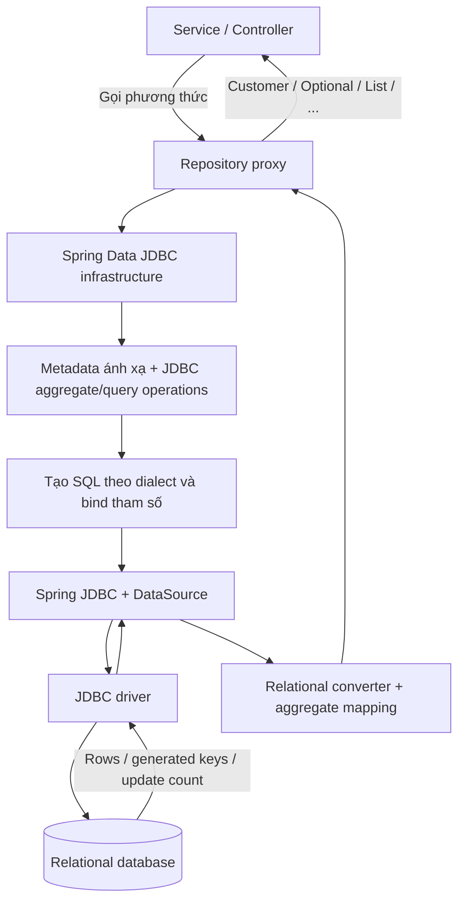

# Luồng xử lý từ lời gọi Repository đến SQL và đối tượng trả về

Trong **Spring Data JDBC**, mã ứng dụng thường chỉ gọi `repository.findById(id)`, `repository.save(entity)` hoặc một phương thức truy vấn theo tên như `findByEmail(email)`. Đằng sau những lời gọi ngắn gọn đó là một chuỗi công việc: Spring Data nhận diện thao tác, đọc metadata ánh xạ, tạo câu SQL phù hợp với hệ quản trị cơ sở dữ liệu, truyền tham số qua JDBC, rồi chuyển kết quả SQL thành đối tượng Java.

Bài này đi theo **đường đi thực tế của dữ liệu**, từ tầng service đến database và quay về service. Trọng tâm là **Spring Data JDBC** thuộc hệ sinh thái Spring Data Relational; cơ chế này khác với JPA/Hibernate ở chỗ không có persistence context quản lý entity, không tự phát hiện thay đổi thuộc tính và không yêu cầu `flush()` để đồng bộ trạng thái đối tượng.

## 1. Ví dụ xuyên suốt

Giả sử ứng dụng quản lý khách hàng có bảng sau (DDL minh họa cho cơ sở dữ liệu hỗ trợ cú pháp `IDENTITY`, chẳng hạn H2 hoặc PostgreSQL):

```sql
CREATE TABLE customers (
    id BIGINT GENERATED BY DEFAULT AS IDENTITY PRIMARY KEY,
    name VARCHAR(150) NOT NULL,
    email VARCHAR(255) NOT NULL
);
```

Ánh xạ bảng sang một aggregate root Java:

```java
import org.springframework.data.annotation.Id;
import org.springframework.data.relational.core.mapping.Table;

@Table("customers")
public record Customer(
        @Id Long id,
        String name,
        String email
) {}
```

Khai báo repository:

```java
import java.util.List;
import org.springframework.data.repository.CrudRepository;

public interface CustomerRepository extends CrudRepository<Customer, Long> {
    List<Customer> findByEmail(String email);
}
```

Tại service, có thể sử dụng:

```java
Customer created = customerRepository.save(
        new Customer(null, "Lan", "lan@example.com")
);

Optional<Customer> found = customerRepository.findById(created.id());

List<Customer> matches = customerRepository.findByEmail("lan@example.com");

Customer renamed = customerRepository.save(
        new Customer(created.id(), "Lan Anh", created.email())
);
```

`@Table` xác định bảng nguồn; `@Id` đánh dấu khóa chính. Spring Data JDBC biết các trường Java cần ánh xạ thành cột. Với `record` bất biến, khi database sinh `id`, đối tượng **trả về từ `save`** có `id` mới; không nên giả định tham chiếu đầu vào đã được sửa tại chỗ.

> Các câu SQL bên dưới thể hiện **ý nghĩa tương đương**, không cam kết chuỗi ký tự SQL được sinh ra hoàn toàn giống nhau giữa các phiên bản Spring Data JDBC hoặc các dialect. Cách quote tên, thứ tự cột, cú pháp phân trang và cách lấy khóa sinh tự động có thể khác.

## 2. Các tầng tham gia trong một lời gọi



Các thành phần có vai trò cụ thể:

| Thành phần | Trách nhiệm chính |
|---|---|
| **Repository proxy** | Spring tạo implementation tại runtime từ interface repository. Proxy phân luồng phương thức CRUD có sẵn, truy vấn suy diễn từ tên, `@Query` hoặc implementation tùy biến. |
| **Repository/aggregate operations** | Các thao tác CRUD thường được hỗ trợ bởi `SimpleJdbcRepository` và `JdbcAggregateOperations` (thường là `JdbcAggregateTemplate`); phần truy vấn có cơ chế thực thi riêng. |
| **Relational mapping context / converter** | Đọc `@Table`, `@Id`, `@Column`, quan hệ trong aggregate, tên cột và các quy tắc chuyển đổi kiểu Java ↔ JDBC. |
| **SQL generation + Dialect** | Xác định bảng, cột, điều kiện, loại lệnh `SELECT`/`INSERT`/`UPDATE`/`DELETE` và cú pháp phù hợp database. |
| **Spring JDBC** | Lấy `Connection`, tạo `PreparedStatement`, bind tham số, thực thi SQL và xử lý `ResultSet` hoặc số hàng bị ảnh hưởng. |
| **JDBC driver + database** | Truyền lệnh đến database, thực thi và trả dữ liệu hoặc khóa được sinh. |

Tên lớp nội bộ có thể thay đổi theo phiên bản, nhưng các **ranh giới trách nhiệm** trên là cách hữu ích để lần theo một yêu cầu khi debug.

## 3. Đường đi đọc dữ liệu: `findById(id)`

Với lời gọi:

```java
Optional<Customer> result = customerRepository.findById(42L);
```

### Bước 1 — Proxy xác định thao tác

`CustomerRepository` là interface, nhưng khi ứng dụng khởi động, Spring Data đăng ký bean repository có implementation tại runtime. Khi gọi `findById`, lời gọi được chuyển đến đường thực thi CRUD tương ứng với kiểu entity `Customer` và kiểu ID `Long`.

Các phương thức có sẵn như `findById` không cần tự viết JDBC code. Metadata entity cho Spring biết bảng là `customers`, thuộc tính khóa là `id`, cùng tên và kiểu dữ liệu các cột còn lại.

### Bước 2 — Tạo câu `SELECT` và truyền tham số

SQL minh họa:

```sql
SELECT id, name, email
FROM customers
WHERE id = ?;
```

Giá trị `42` được bind vào placeholder thông qua JDBC; không nối trực tiếp giá trị từ người dùng vào chuỗi SQL. Spring JDBC thường sử dụng cơ chế tham số có tên ở tầng cao (`:id`) rồi chuyển thành tham số mà `PreparedStatement` có thể xử lý.

Metadata mapping và dialect quyết định biểu thức SQL cụ thể. Trong ứng dụng thực tế, các kết nối có thể tham gia transaction đang mở hoặc được lấy và giải phóng trong phạm vi từng thao tác.

### Bước 3 — Database trả rows, Spring dựng đối tượng

JDBC driver trả một `ResultSet`. Spring Data JDBC đọc giá trị từng cột, chuyển kiểu phù hợp, sau đó dựng `Customer` theo constructor của record:

```text
ResultSet:
    id = 42
    name = "Lan"
    email = "lan@example.com"
                 |
                 v
Customer(42L, "Lan", "lan@example.com")
                 |
                 v
Optional.of(customer)
```

Nếu không có hàng khớp ID, phương thức trả `Optional.empty()`. Nếu có dữ liệu hợp lệ, bên gọi nhận `Optional<Customer>`. Khi entity là aggregate có các thành phần con được ánh xạ, Spring Data còn phải nạp và kết hợp dữ liệu con để dựng aggregate; số lượng câu `SELECT` và chiến lược đọc phụ thuộc cấu trúc ánh xạ, phiên bản và cấu hình.

### Trình tự hai chiều

```mermaid
sequenceDiagram
    participant Service
    participant Repo as Repository proxy
    participant Data as Spring Data JDBC
    participant JDBC as Spring JDBC / Driver
    participant DB as Database
    Service->>Repo: findById(42)
    Repo->>Data: Thực thi CRUD + metadata Customer
    Data->>JDBC: SELECT ... WHERE id = ?; bind 42
    JDBC->>DB: Execute SQL
    DB-->>JDBC: ResultSet (0 hoặc 1 root row)
    JDBC-->>Data: Giá trị các cột
    Data-->>Repo: Customer đã ánh xạ / không thấy
    Repo-->>Service: Optional<Customer>
```

## 4. Truy vấn suy diễn từ tên phương thức: `findByEmail`

Spring Data phân tích tên phương thức khai báo trong repository:

```java
List<Customer> findByEmail(String email);
```

Ở đây, `find...By` là mẫu truy vấn, còn `Email` tham chiếu thuộc tính `email` của `Customer`. Với:

```java
List<Customer> customers = customerRepository.findByEmail("lan@example.com");
```

SQL có thể tương đương:

```sql
SELECT id, name, email
FROM customers
WHERE email = ?;
```

Tham số được bind, các hàng kết quả được ánh xạ thành `Customer`, sau đó gom thành `List<Customer>`; không khớp thì trả danh sách rỗng. Đây là **query derivation**: tên phương thức hướng dẫn Spring Data tạo truy vấn. Việc hỗ trợ các từ khóa và tổ hợp điều kiện cụ thể cần đối chiếu với phiên bản Spring Data JDBC được dùng.

Nếu cần kiểm soát câu SQL, có thể khai báo một truy vấn tường minh:

```java
import org.springframework.data.jdbc.repository.query.Query;
import org.springframework.data.repository.query.Param;

@Query("SELECT id, name, email FROM customers WHERE LOWER(email) = LOWER(:email)")
List<Customer> findEmailIgnoringCase(@Param("email") String email);
```

Trong trường hợp này, **Spring dùng SQL do lập trình viên cung cấp**, tiếp tục bind tham số, thực thi bằng JDBC và ánh xạ rows về kiểu trả về. Với truy vấn tùy chỉnh cho aggregate phức tạp, cần chủ động bảo đảm các cột và cách dựng đối tượng đáp ứng yêu cầu ánh xạ.

## 5. Đường đi ghi dữ liệu: `save(entity)`

`save` đi theo đường xử lý **aggregate**, không đơn thuần chuyển một object thành một lệnh SQL cố định. Trước khi ghi, Spring Data cần quyết định entity là mới hay đã tồn tại theo quy tắc nhận diện trạng thái của entity.

```mermaid
flowchart TD
    A[repository.save(customer)] --> B[Nhận diện entity mới hay đã tồn tại]
    B -->|Mới| C[INSERT aggregate]
    B -->|Đã tồn tại| D[UPDATE aggregate]
    C --> E[Bind dữ liệu + thực thi JDBC]
    D --> E
    E --> F[Nhận generated key / version / kết quả ghi]
    F --> G[Trả aggregate đã lưu]
```

### 5.1. Khi đối tượng mới: `INSERT`

Ví dụ:

```java
Customer input = new Customer(null, "Lan", "lan@example.com");
Customer saved = customerRepository.save(input);
```

Trong ánh xạ thông thường dùng `@Id Long`, ID bằng `null` báo hiệu aggregate mới. Spring Data JDBC xây dựng lệnh `INSERT` và bind thuộc tính cần lưu:

```sql
INSERT INTO customers (name, email)
VALUES (?, ?);
```

Nếu cột ID được database tự sinh, cơ chế JDBC lấy generated key và Spring Data đưa ID đó vào aggregate trả về. Với kiểu bất biến như `record`, điều này thường tạo một instance mới:

```java
input.id(); // null
saved.id(); // ID do database tạo, ví dụ 42
```

ID có thể do ứng dụng tự cấp, được tạo bởi callback hoặc được database cấp; không phải mọi entity đều dùng cùng cơ chế sinh ID.

### 5.2. Khi đối tượng được coi là đã tồn tại: `UPDATE`

Ví dụ:

```java
Customer changed = new Customer(42L, "Lan Anh", "lan@example.com");
Customer saved = customerRepository.save(changed);
```

SQL minh họa:

```sql
UPDATE customers
SET name = ?, email = ?
WHERE id = ?;
```

Không có cơ chế tự theo dõi trường nào đã thay đổi như persistence context của JPA. Vì vậy, **gọi setter hoặc tạo object mới trong bộ nhớ không tự làm phát sinh `UPDATE`**; ứng dụng phải gọi `save`, và việc ghi thường dựa trên trạng thái aggregate đang được gửi vào, không phải một bản diff được dirty checking tạo sẵn.

`save` cũng **không mặc nhiên là một câu SQL UPSERT** (`INSERT ... ON CONFLICT ...`). Với đối tượng có ID nhưng không có bản ghi tương ứng, kết quả phụ thuộc cơ chế cập nhật và kiểm tra số hàng ảnh hưởng; không nên xem `save` như một lệnh đảm bảo tự thêm mới nếu `UPDATE` không tìm thấy hàng.

### 5.3. `isNew` được xác định ra sao?

Các tình huống phổ biến:

| Trạng thái entity | Hành vi thường thấy |
|---|---|
| `@Id Long id = null` | Được coi là mới, thực hiện `INSERT`. |
| `@Id Long id = 42L` | Thường được coi là đã tồn tại, thực hiện `UPDATE`. |
| Có `@Version` | Giá trị version tham gia quy tắc nhận diện mới và cơ chế kiểm soát cập nhật đồng thời. |
| Entity triển khai `Persistable` | Có thể tự cung cấp `isNew()` để kiểm soát trạng thái, hữu ích khi tự cấp ID. |

Quy tắc có thể được tùy biến. Đừng kiểm tra `id != null` một cách cơ học khi aggregate sử dụng ID được cấp trước, `@Version` hoặc `Persistable`.

### 5.4. Nếu có `@Version`: optimistic locking

Giả sử `Customer` có thuộc tính được đánh dấu `@Version`. Khi cập nhật, SQL có thể chứa điều kiện đồng thời cho ID và version cũ:

```sql
UPDATE customers
SET name = ?, email = ?, version = ?
WHERE id = ? AND version = ?;
```

Nếu một giao dịch khác đã cập nhật bản ghi và thay đổi version, lệnh cập nhật có thể ảnh hưởng 0 hàng; Spring Data JDBC sẽ phát hiện xung đột và báo lỗi optimistic locking, thường thuộc họ `OptimisticLockingFailureException`. Cách này giúp tránh việc ghi đè âm thầm dữ liệu mà bên khác đã sửa.

## 6. Ghi và đọc một aggregate có phần tử con

Trong Spring Data JDBC, **aggregate** là ranh giới nhất quán dữ liệu. Một repository thường được khai báo cho **aggregate root**; các phần tử con thuộc aggregate đó được lưu và đọc theo root.

Ví dụ một đơn hàng chứa nhiều dòng hàng:

```java
import java.util.List;
import org.springframework.data.annotation.Id;
import org.springframework.data.relational.core.mapping.MappedCollection;
import org.springframework.data.relational.core.mapping.Table;

@Table("orders")
public record Order(
        @Id Long id,
        String customerName,
        @MappedCollection(idColumn = "order_id", keyColumn = "line_index")
        List<OrderLine> lines
) {}

@Table("order_lines")
public record OrderLine(String sku, int quantity) {}
```

Ví dụ bảng `order_lines` có các cột `order_id`, `line_index`, `sku`, `quantity`. `idColumn` chỉ cột tham chiếu về root; `keyColumn` chứa chỉ số của phần tử trong `List`.

Khi gọi `orderRepository.save(order)`, một lần gọi Java **có thể phát sinh nhiều câu SQL**: ghi bảng `orders` trước, rồi ghi các dòng trong `order_lines` cùng khóa tham chiếu `order_id`. Với aggregate đã tồn tại, cơ chế quản lý collection có thể xóa và tạo lại các dòng con để phản ánh trạng thái toàn bộ aggregate, tùy quan hệ và cách mapping. Không nên giả định mỗi lần `save` chỉ cập nhật đúng một hàng hoặc cập nhật tối thiểu các phần tử đã đổi.

Khi gọi `findById`, framework dựng lại `Order` với các `OrderLine` thuộc aggregate; việc đọc có thể cần nhiều truy vấn hoặc chiến lược tải phù hợp, chứ không thể suy ra chắc chắn một SQL `JOIN` từ một lời gọi Java.

Mối quan hệ **giữa hai aggregate độc lập** thường được biểu diễn bằng ID hoặc `AggregateReference` thay vì một cây object được framework tự động quản lý sâu như quan hệ entity trong JPA. Điều này giúp xác định rõ đối tượng nào thuộc phạm vi cập nhật của `save`.

## 7. Các phương thức phổ biến và kiểu kết quả

| Lời gọi | Loại SQL thường dùng | Kết quả Java |
|---|---|---|
| `save(entity)` | `INSERT` hoặc `UPDATE`; có thể thêm SQL cho các phần tử con | Aggregate đã lưu, có thể có ID/version mới |
| `findById(id)` | `SELECT ... WHERE id = ?` | `Optional<T>` |
| `findAll()` | `SELECT` (và SQL tải phần tử con nếu cần) | `Iterable<T>` theo `CrudRepository` |
| `findByEmail(email)` | `SELECT ... WHERE email = ?` | `List<Customer>` theo chữ ký khai báo |
| `existsById(id)` | Truy vấn kiểm tra sự tồn tại | `boolean` |
| `count()` | `SELECT COUNT(...)` | `long` |
| `deleteById(id)` | `DELETE`, có thể xóa những hàng con thuộc aggregate | `void` |

Đây là **mối liên hệ giữa ý nghĩa repository và tác vụ SQL**, không phải cam kết rằng luôn có đúng một SQL cho mỗi phương thức. Ví dụ, `save`/`delete` aggregate có collection có thể tạo nhiều lệnh; tùy cấu hình có thể có callback, optimistic locking và query phụ.

## 8. Ánh xạ dữ liệu trên đường trở về

JDBC chỉ biết các giá trị theo cột và kiểu tương ứng của driver; Spring Data JDBC phải tái tạo mô hình Java mà service sử dụng.

### Ánh xạ cột, tên và constructor

`RelationalMappingContext` và converter dùng metadata để biết:

- Entity nằm trong bảng nào (`@Table`), khóa chính là thuộc tính nào (`@Id`), tên cột cụ thể khi đặt `@Column`.
- Thuộc tính Java nào tương ứng với giá trị JDBC; tên cột mặc định còn phụ thuộc naming strategy.
- Cách khởi tạo đối tượng qua constructor/record hoặc gán property; đối tượng bất biến vẫn được hỗ trợ nếu ánh xạ phù hợp.
- Cách chuyển đổi kiểu: kiểu số, chuỗi, ngày giờ, enum và các custom converter đã đăng ký.

Ví dụ nếu schema có tên cột `display_name` còn Java dùng `displayName`, có thể chỉ rõ:

```java
@Column("display_name")
private String displayName;
```

Khi có kiểu dữ liệu đặc thù (ví dụ value object hoặc kiểu vendor-specific), có thể cần `Converter` đọc/ghi. Cơ chế chuyển đổi hoạt động theo cả hai chiều: **giá trị object → JDBC parameters** khi ghi, và **JDBC column values → object** khi đọc.

### Kết quả trả về không nhất thiết là một entity

Kiểu trả về được quyết định bởi chữ ký phương thức repository và loại thao tác: `Optional<Customer>`, `List<Customer>`, `boolean`, `long`, `void` hoặc aggregate sau khi lưu. Framework xử lý số hàng và ánh xạ trước khi trả cho service; service không tự duyệt `ResultSet` trong trường hợp dùng repository chuẩn.

## 9. Transaction, callback và xử lý lỗi nằm ở đâu?

**Transaction** bao quanh thao tác JDBC khi có cấu hình giao dịch phù hợp. Nếu nghiệp vụ gồm nhiều thao tác cần thành công hoặc thất bại cùng nhau, đặt transaction ở ranh giới service:

```java
import org.springframework.stereotype.Service;
import org.springframework.transaction.annotation.Transactional;

@Service
public class RegistrationService {
    private final CustomerRepository customers;

    public RegistrationService(CustomerRepository customers) {
        this.customers = customers;
    }

    @Transactional
    public Customer register(String name, String email) {
        // Có thể phối hợp thêm các repository/công việc cùng transaction.
        return customers.save(new Customer(null, name, email));
    }
}
```

`@Transactional` thông qua Spring transaction management điều phối connection/commit/rollback. Một `save` aggregate có nhiều lệnh ghi cần được xét như một thao tác nhất quán; transaction ở tầng service đặc biệt quan trọng khi phối hợp **nhiều lời gọi repository**. Thuộc tính `readOnly = true` nếu dùng chủ yếu là gợi ý quản lý transaction và tối ưu hóa, không thể coi là rào chắn SQL ghi tuyệt đối trên mọi database.

Spring Data JDBC cũng hỗ trợ **entity callbacks** (ví dụ trước chuyển đổi, trước/sau lưu, sau chuyển đổi) để bổ sung xử lý như auditing hay chuẩn hóa dữ liệu. Callback có thể tham gia vào chuỗi xử lý ngay trước hoặc sau thao tác ánh xạ/ghi; chúng không biến Spring Data JDBC thành một ORM có dirty checking.

Nếu database hoặc driver báo lỗi, Spring JDBC dịch nhiều `SQLException` thành nhóm exception thống nhất `DataAccessException` của Spring (ví dụ lỗi ràng buộc dữ liệu). Điều này cho phép tầng service xử lý lỗi theo loại mà ít phụ thuộc mã lỗi riêng của database.

## 10. Theo dõi SQL để hiểu một lần gọi thực tế

Khi học hoặc debug, có thể bật mức log phù hợp trong `application.yml`:

```yaml
logging:
  level:
    org.springframework.jdbc.core: DEBUG
    org.springframework.jdbc.core.StatementCreatorUtils: TRACE
    org.springframework.data.jdbc.core: DEBUG
```

`org.springframework.jdbc.core` thường giúp thấy câu SQL được Spring JDBC thực thi; `StatementCreatorUtils` ở mức `TRACE` có thể cho thêm thông tin về việc bind tham số. Tùy phiên bản, driver và cách cấu hình logging, mức chi tiết có thể khác. Nên hạ mức log trong môi trường có dữ liệu nhạy cảm vì giá trị tham số có thể bị ghi lại.

Khi đọc log, lần theo ba điểm:

1. **Phương thức Java được gọi:** `save`, `findById`, `findByEmail` hay `deleteById`? Aggregate có collection không?
2. **SQL và tham số thực thi:** thao tác là `SELECT`, `INSERT`, `UPDATE` hay `DELETE`, điều kiện `WHERE` có đúng ID/version không, một lần gọi sinh mấy lệnh?
3. **Kết quả Java:** ID/version trả về có được cập nhật không, `Optional` có rỗng không, số object có khớp hàng trả về và cấu trúc aggregate không?

Ví dụ lần vết đơn giản:

```text
Customer input = new Customer(null, "Lan", "lan@example.com")
    -> CustomerRepository.save(input)
    -> Nhận diện aggregate mới
    -> INSERT INTO customers (...) VALUES (...)
    -> Database tạo id = 42
    -> Customer saved = new Customer(42, "Lan", "lan@example.com")

CustomerRepository.findById(42)
    -> SELECT ... FROM customers WHERE id = 42
    -> JDBC ResultSet (1 row)
    -> Converter dựng Customer(42, "Lan", "lan@example.com")
    -> Optional.of(Customer(...))
```

## 11. Những nhầm lẫn thường gặp khi lần theo luồng

| Hiểu nhầm | Cơ chế thực tế của Spring Data JDBC |
|---|---|
| “Khai báo repository thì sẽ tự tạo bảng.” | Repository chủ yếu ánh xạ và thực thi thao tác dữ liệu. Schema phải tồn tại; thường quản lý bằng migration như Flyway/Liquibase hoặc script khởi tạo. |
| “Lấy entity ra rồi sửa field là database tự cập nhật.” | Không có dirty checking/persistence context; cần gọi `save` để ghi lại. |
| “`save` luôn chạy một SQL.” | Một aggregate có thành phần con có thể cần nhiều SQL trong một lần lưu. |
| “`save` tự biết record chưa tồn tại và sẽ insert.” | Quy tắc `isNew` quyết định nhánh insert/update; ID được cấp trước cần cấu hình phù hợp. |
| “`findById` luôn tương ứng chính xác một `SELECT`.” | Aggregate có quan hệ con có thể cần thêm thao tác đọc; chiến lược còn tùy phiên bản. |
| “Các quan hệ sẽ được lazy load như Hibernate.” | Spring Data JDBC không dựa trên proxy lazy loading của ORM; thông thường dữ liệu thuộc aggregate được dựng khi đọc aggregate. |
| “Tên phương thức có thể biến thành bất kỳ SQL phức tạp nào.” | Derived query hỗ trợ các quy tắc nhất định; SQL phức tạp có thể cần `@Query` hoặc thao tác JDBC tùy biến. |

## 12. Ghi nhớ theo hành trình dữ liệu

Với **đọc**: `Repository method → proxy/query resolution → mapping metadata → SQL SELECT + parameters → JDBC/DB → ResultSet → converter/aggregate mapping → Optional/List/entity`.

Với **ghi**: `Repository.save → xác định trạng thái mới/đã tồn tại → xây thay đổi aggregate → SQL INSERT/UPDATE (có thể nhiều lệnh) → JDBC/DB → generated key/version → aggregate trả về`.

Điểm quan trọng khi thiết kế ứng dụng là **đơn vị được lưu và nạp là aggregate**, còn repository là API trừu tượng trên SQL/JDBC. Hiểu ranh giới này giúp suy luận được thời điểm SQL chạy, số lệnh có thể phát sinh, cách dữ liệu đi vào `PreparedStatement` và vì sao service cuối cùng nhận được một đối tượng Java cụ thể.
