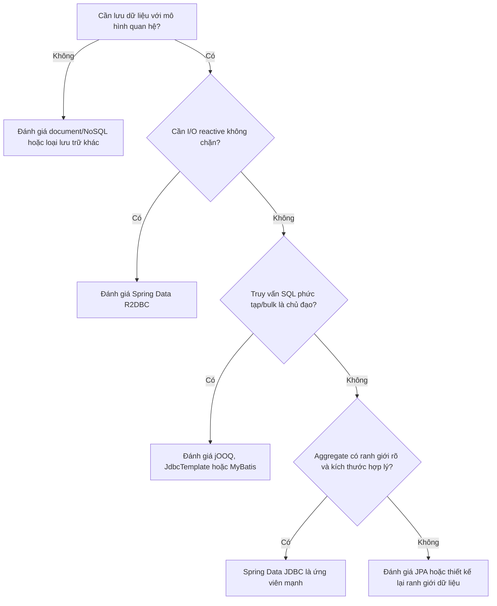

# Khi nào nên chọn Spring Data JDBC và khi nào nên chọn giải pháp khác?

## 1. Vấn đề thực sự cần quyết định

Một ứng dụng Spring Boot dùng cơ sở dữ liệu quan hệ có nhiều cách truy cập dữ liệu: Spring Data JDBC, Spring Data JPA/Hibernate, `JdbcTemplate`, jOOQ, MyBatis hoặc Spring Data R2DBC. Các công cụ này cùng có thể đọc và ghi dữ liệu SQL nhưng khác nhau ở **mô hình lập trình, cách quản lý quan hệ, quyền kiểm soát câu SQL và chi phí vận hành**.

**Spring Data JDBC là lựa chọn tốt khi dữ liệu có thể được tổ chức thành những aggregate rõ ràng, nghiệp vụ chủ yếu là CRUD và giao dịch trên từng aggregate, đồng thời nhóm phát triển muốn tránh cơ chế quản lý trạng thái phức tạp của ORM.** Nó không tự động là lựa chọn tốt nhất chỉ vì hệ thống đang dùng một cơ sở dữ liệu SQL.

Để chọn đúng, cần trả lời bốn câu hỏi:

1. Đơn vị nhất quán nghiệp vụ là gì: một đơn hàng cùng các dòng hàng của nó, hay một mạng lưới nhiều đối tượng liên kết?
2. Tác vụ chủ yếu là lưu/sửa aggregate, hay là báo cáo, tìm kiếm và truy vấn nhiều phép `JOIN`?
3. Ứng dụng chạy theo mô hình đồng bộ/blocking hay cần luồng dữ liệu reactive không chặn?
4. Nhóm muốn làm việc qua repository và mô hình đối tượng, hay cần viết và tối ưu SQL một cách tường minh?

## 2. Hiểu đúng Spring Data JDBC trước khi chọn

Spring Data JDBC thuộc hệ sinh thái Spring Data, sử dụng JDBC để tương tác với cơ sở dữ liệu quan hệ. Nó cung cấp ánh xạ bảng–đối tượng, repository, các truy vấn được suy diễn từ tên phương thức, câu SQL tùy chỉnh, giao dịch và các cơ chế như optimistic locking. Tuy nhiên, **Spring Data JDBC không phải JPA phiên bản rút gọn**: nó có mô hình sở hữu dữ liệu và vòng đời đối tượng khác biệt.

| Đặc điểm | Spring Data JDBC | Spring Data JPA với Hibernate |
| --- | --- | --- |
| Cách tiếp cận | Lưu và tải aggregate tương đối trực tiếp | Quản lý các entity trong persistence context |
| Trạng thái đối tượng | Không có persistence context/dirty checking kiểu JPA | Theo dõi entity đang được quản lý; có dirty checking |
| Quan hệ | Ưu tiên quan hệ sở hữu **bên trong aggregate**; tham chiếu aggregate khác bằng ID | Có `@ManyToOne`, `@OneToMany`, `@ManyToMany` và nhiều chiến lược ánh xạ |
| Lazy loading | Không cung cấp lazy-loading proxy kiểu Hibernate | Có thể dùng lazy loading, cần kiểm soát truy vấn phát sinh |
| Cập nhật | Thường gọi `repository.save(...)` một cách tường minh | Entity được quản lý có thể được đồng bộ khi flush/commit |
| Ngôn ngữ truy vấn | SQL và phương thức repository | JPQL, Criteria API, SQL native, phương thức repository |
| Phù hợp nổi bật | Aggregate có ranh giới rõ, ít quan hệ sở hữu lớn | Mô hình entity và quan hệ phức tạp, cần nhiều tính năng ORM |

### Aggregate là ranh giới quan trọng

Trong thiết kế hướng miền (DDD), một **aggregate** là nhóm đối tượng được thay đổi theo một tập quy tắc nhất quán; **aggregate root** là điểm truy cập và lưu trữ chính.

Ví dụ:

```text
PurchaseOrder (aggregate root)
├── OrderLine #1  (thuộc đơn hàng)
├── OrderLine #2  (thuộc đơn hàng)
└── OrderLine #3  (thuộc đơn hàng)

Customer (aggregate root khác)
└── Không thuộc vòng đời của PurchaseOrder

PurchaseOrder.customerId -> ID của Customer
```

Khi thêm hoặc xóa một `OrderLine`, ta thay đổi `PurchaseOrder`. Khi sửa thông tin `Customer`, ta xử lý aggregate khách hàng riêng. Việc một đơn hàng *tham chiếu* khách hàng không có nghĩa đơn hàng *sở hữu* toàn bộ entity khách hàng.

Mô hình này rất hợp với Spring Data JDBC. Ngược lại, nếu ứng dụng muốn đi qua hàng loạt quan hệ đối tượng theo kiểu `order.getCustomer().getAddresses()` và điều khiển lazy/eager loading, JPA thường phù hợp hơn.

## 3. Những trường hợp nên chọn Spring Data JDBC

### 3.1. Aggregate nhỏ hoặc vừa, ranh giới sở hữu rõ ràng

Ví dụ thường gặp là đơn hàng và dòng hàng, giỏ hàng và các mục trong giỏ, phiếu nhập và các dòng phiếu, cấu hình và tập mục cấu hình. Tập con được quản lý cùng vòng đời với aggregate root; không cần dùng những đối tượng con đó như những aggregate độc lập.

Trong tình huống này, một repository cho aggregate root thường đủ rõ ràng:

- Tạo đơn hàng cùng các dòng hàng trong một thao tác lưu.
- Tải đơn hàng để kiểm tra quy tắc nghiệp vụ.
- Thay đổi trạng thái hoặc nội dung đơn hàng rồi lưu lại.
- Dùng khóa và ràng buộc của cơ sở dữ liệu để giữ tính nhất quán.

Điều kiện cần xem xét là **kích thước tập con và tần suất sửa**. Không nên mặc định coi một aggregate chứa hàng nghìn phần tử, thay đổi liên tục, là rẻ khi lưu bằng Spring Data JDBC.

### 3.2. Muốn mô hình dữ liệu và thao tác lưu minh bạch

Spring Data JDBC không dùng persistence context kiểu Hibernate. Người đọc code thấy lệnh `save` và hiểu rằng ứng dụng đang yêu cầu lưu aggregate; không phải dự đoán thời điểm dirty checking hoặc flush phát sinh SQL. Đây là điểm mạnh khi nhóm cần cách lập trình dễ lần theo hành vi.

Tuy nhiên, **minh bạch về mô hình không có nghĩa một `save` chỉ tạo một câu SQL**. Các bảng con vẫn có thể bị ghi lại khi lưu aggregate đã tồn tại. Cần quan sát câu SQL thực tế trong nghiệp vụ có tải ghi cao.

### 3.3. Phần lớn nghiệp vụ là CRUD, truy vấn không quá phức tạp

Repository rất hữu ích cho thao tác theo ID, tìm kiếm theo một vài cột, lọc đơn giản, phân trang và các câu SQL tùy chỉnh vừa phải. Mô hình này đặc biệt hợp với dịch vụ quản lý dữ liệu có giao dịch rõ ràng nhưng không cần khai thác đồ thị quan hệ đối tượng phong phú.

Ví dụ: dịch vụ quản lý phiếu xuất kho có các thao tác tạo phiếu, xem chi tiết, đổi trạng thái và truy vấn theo kho/ngày. Nếu phần lớn use case truy cập một phiếu với các dòng của nó, Spring Data JDBC là một ứng viên hợp lý.

### 3.4. Đang dùng Spring Boot theo luồng đồng bộ

JDBC là API blocking: lời gọi cơ sở dữ liệu chiếm luồng trong thời gian chờ kết quả. Trong ứng dụng Spring MVC hoặc các job chạy đồng bộ, đây thường là một mô hình đơn giản và phù hợp.

Nếu hệ thống yêu cầu pipeline reactive không chặn từ HTTP đến database, cần xem Spring Data R2DBC và khả năng hỗ trợ của driver, thư viện, giao dịch. Dùng WebFlux **không biến JDBC thành non-blocking**; điều quan trọng là toàn bộ đường thực thi I/O.

## 4. Ví dụ: một aggregate phù hợp với Spring Data JDBC

Giả sử hệ thống có `purchase_orders` và `order_lines`. Đơn hàng sở hữu các dòng hàng; khách hàng là aggregate khác và được tham chiếu qua `customerId`.

Khai báo dependency theo Spring Boot (ví dụ Gradle Groovy):

```groovy
dependencies {
    implementation 'org.springframework.boot:spring-boot-starter-data-jdbc'
    runtimeOnly 'org.postgresql:postgresql'
}
```

Mô hình tối giản sau minh họa cách ánh xạ. Các lớp được đặt cùng package; trong dự án thực tế nên tách chúng thành các file riêng:

```java
import java.math.BigDecimal;
import java.util.ArrayList;
import java.util.List;

import org.springframework.data.annotation.Id;
import org.springframework.data.annotation.Version;
import org.springframework.data.relational.core.mapping.MappedCollection;
import org.springframework.data.relational.core.mapping.Table;
import org.springframework.data.repository.CrudRepository;

@Table("purchase_orders")
class PurchaseOrder {
    @Id
    Long id;

    @Version
    Long version;

    Long customerId;
    String status;

    @MappedCollection(idColumn = "order_id", keyColumn = "line_no")
    List<OrderLine> lines = new ArrayList<>();
}

@Table("order_lines")
record OrderLine(String sku, int quantity, BigDecimal unitPrice) {
}

interface PurchaseOrderRepository
        extends CrudRepository<PurchaseOrder, Long> {
}
```

Với PostgreSQL, một schema minh họa tương ứng là:

```sql
CREATE TABLE purchase_orders (
    id          BIGINT GENERATED BY DEFAULT AS IDENTITY PRIMARY KEY,
    version     BIGINT,
    customer_id BIGINT NOT NULL,
    status      VARCHAR(24) NOT NULL
);

CREATE TABLE order_lines (
    order_id    BIGINT NOT NULL REFERENCES purchase_orders(id),
    line_no     INTEGER NOT NULL,
    sku         VARCHAR(64) NOT NULL,
    quantity    INTEGER NOT NULL CHECK (quantity > 0),
    unit_price  DECIMAL(12, 2) NOT NULL,
    PRIMARY KEY (order_id, line_no)
);
```

Ví dụ tạo đơn hàng trong cùng package:

```java
PurchaseOrder order = new PurchaseOrder();
order.customerId = 42L;
order.status = "NEW";
order.lines.add(new OrderLine("BOOK-001", 2, new BigDecimal("150.00")));

PurchaseOrder saved = repository.save(order);
Long newOrderId = saved.id;
```

Những chi tiết thiết kế cần chú ý:

1. `@Id` xác định khóa của aggregate root; `@Version` hỗ trợ optimistic locking khi có các cập nhật cạnh tranh.
2. `@MappedCollection` xác định cách các `OrderLine` thuộc aggregate được lưu ở bảng khác. Ở đây `order_id` là khóa ngoại và `line_no` lưu vị trí của phần tử trong `List`.
3. `customerId` là một giá trị vô hướng. Không đặt cả `Customer` dưới `PurchaseOrder` nếu khách hàng có vòng đời độc lập.
4. Schema phải được quản lý bằng cơ chế khởi tạo/migration phù hợp như Flyway hoặc Liquibase. Spring Data JDBC không tự cung cấp cơ chế sinh/cập nhật schema kiểu `hibernate.hbm2ddl.auto`.
5. Ví dụ tập trung vào mapping. Ứng dụng thực tế còn cần kiểm tra nghiệp vụ, phân quyền, ràng buộc dữ liệu và cách phát hành giao dịch.

### Điểm dễ bỏ sót: `save` một aggregate đã tồn tại

Spring Data JDBC không dùng dirty checking để tìm từng thay đổi ở đồ thị đối tượng. Với mô hình lưu aggregate thông thường, khi cập nhật root, framework có thể **xóa rồi chèn lại các entity con được root sở hữu** để đưa cơ sở dữ liệu về trạng thái aggregate mới; root được cập nhật riêng. Vì thế, sửa `status` của đơn hàng có nhiều `OrderLine` vẫn có thể dẫn tới nhiều thao tác ghi bảng `order_lines`.

Đây không phải lỗi: nó xuất phát từ cách Spring Data JDBC quản lý aggregate. Tuy nhiên, nó ảnh hưởng tới độ trễ, khóa, foreign key, trigger, audit và khối lượng ghi. Trước khi chọn, hãy ước lượng số phần tử con, tần suất thay đổi root và yêu cầu giữ danh tính/ID riêng của từng phần tử.

Nếu cần sửa một dòng hàng độc lập với tần suất cao, cân nhắc **thu nhỏ aggregate hoặc xác định lại ranh giới sở hữu**; một phương án khác là dùng SQL tường minh cho thao tác đặc thù. Việc này phải phù hợp với quy tắc nhất quán nghiệp vụ, thay vì chỉ nhằm tiết kiệm câu lệnh.

## 5. Những trường hợp nên chọn giải pháp khác

### 5.1. Spring Data JPA/Hibernate: mô hình entity và quan hệ phong phú

Ưu tiên xem xét JPA khi ứng dụng thường xuyên điều hướng giữa nhiều entity, có các liên kết phức tạp, cần identity map, dirty checking, lazy loading, cơ chế fetch và những tính năng ORM phát triển hơn. Ví dụ: hệ thống quản trị có nhiều quan hệ giữa người dùng, nhóm, vai trò, chính sách và các thực thể nghiệp vụ cần được truy cập qua nhiều đường.

JPA cũng có chi phí riêng: cần hiểu persistence context, transaction, cascade, fetch plan, N+1 query và thời điểm flush. Không nên chọn chỉ vì muốn “tránh SQL”; khi hiệu năng quan trọng vẫn phải đo câu SQL thực tế.

**Tín hiệu chọn JPA:** phần lớn code thao tác với các entity có liên hệ chéo và cần đặc tính quản lý entity của ORM.

### 5.2. `JdbcTemplate` / `NamedParameterJdbcTemplate`: muốn kiểm soát trực tiếp câu SQL

Đây là lựa chọn mạnh khi SQL là thành phần chính của use case: cập nhật hàng loạt, thao tác với những bảng hiện hữu có cấu trúc đặc biệt, gọi stored procedure, báo cáo đơn giản nhưng cần tối ưu chính xác hoặc chỉ có một vài truy vấn.

`JdbcTemplate` xử lý kết nối, tài nguyên và lỗi theo hạ tầng Spring, còn nhóm tự viết SQL và ánh xạ kết quả bằng `RowMapper`. `NamedParameterJdbcTemplate` cho phép dùng tham số tên, giúp câu SQL dễ đọc hơn.

**Tín hiệu chọn JdbcTemplate:** từng câu SQL cần được thiết kế và kiểm soát rõ ràng; xây dựng cả một mô hình aggregate/repository không mang lại lợi ích tương xứng.

### 5.3. jOOQ: truy vấn SQL phức tạp, kiểu dữ liệu chặt chẽ

jOOQ cung cấp DSL để viết SQL trong Java với mức độ kiểm tra kiểu tốt và khả năng tận dụng nhiều đặc trưng của SQL. Nó thường đáng cân nhắc cho báo cáo nhiều `JOIN`, CTE, window function, truy vấn tổng hợp phức tạp hoặc bộ lọc động.

Điểm cần tính là bước tạo code từ schema, mức độ phụ thuộc vào dialect và điều kiện giấy phép đối với phiên bản/loại cơ sở dữ liệu được dùng. Có thể dùng jOOQ cho phần đọc phức tạp bên cạnh một giải pháp khác quản lý các aggregate ghi.

**Tín hiệu chọn jOOQ:** tính biểu đạt và khả năng tối ưu SQL quan trọng hơn cơ chế lưu nguyên một aggregate.

### 5.4. MyBatis: SQL viết tay với lớp mapping có cấu trúc

MyBatis phù hợp khi tổ chức muốn duy trì SQL tường minh trong mapper, dùng ánh xạ kết quả phức tạp và SQL động theo cấu trúc quen thuộc. Đây là hướng hữu ích trong hệ thống dùng nhiều câu SQL viết tay hoặc schema legacy.

Đổi lại, nhóm phải quản lý mapper và truy vấn; MyBatis không thay thế tự động các quy tắc vòng đời aggregate của Spring Data JDBC.

### 5.5. Spring Data R2DBC: đầu cuối reactive, không chặn

R2DBC dành cho truy cập cơ sở dữ liệu quan hệ theo API reactive. Xem xét khi ứng dụng đã có nhu cầu thực tế về I/O non-blocking, driver và database hỗ trợ tốt, đội ngũ hiểu `Publisher`/`Mono`/`Flux`, cancellation, backpressure và ranh giới giao dịch reactive.

Reactive không bảo đảm một truy vấn SQL chạy nhanh hơn. Với hệ thống CRUD đồng bộ, JDBC thường đơn giản hơn. Không nên đưa JDBC blocking vào luồng event-loop rồi giả định toàn bộ đường xử lý là non-blocking.

### 5.6. Cơ sở dữ liệu tài liệu/NoSQL: mô hình lưu dữ liệu có bản chất khác

Nếu dữ liệu chủ yếu là tài liệu độc lập có cấu trúc lồng nhau, linh hoạt theo từng bản ghi, cách truy cập tập trung theo tài liệu và ít phụ thuộc vào ràng buộc quan hệ, có thể xem xét Spring Data MongoDB hoặc hệ dữ liệu chuyên biệt phù hợp.

Quyết định chọn database cần dựa trên truy vấn, nhất quán, transaction, indexing và vận hành. **Không chọn NoSQL chỉ vì có nhiều trường JSON**, cũng không ép một mô hình tài liệu vào bảng SQL nếu chi phí ánh xạ vượt lợi ích quan hệ.

## 6. Bảng lựa chọn theo tình huống

| Tình huống | Lựa chọn nên đánh giá trước | Câu hỏi cần kiểm tra |
| --- | --- | --- |
| CRUD cho đơn hàng và các dòng hàng có cùng vòng đời | **Spring Data JDBC** | Tập con có nhỏ và thay đổi theo đơn hàng không? |
| Nhiều entity liên kết, cần lazy loading và quản lý trạng thái trong transaction | **JPA/Hibernate** | Fetch plan và cascade có được thiết kế rõ không? |
| Đọc báo cáo với nhiều `JOIN`, window function, CTE | **jOOQ** hoặc SQL qua `JdbcTemplate` | SQL cần DSL type-safe hay chỉ một số truy vấn tĩnh? |
| Ghi hàng loạt, update một vài cột trên hàng triệu bản ghi | **JdbcTemplate`/batch SQL**, jOOQ hoặc giải pháp bulk chuyên dụng | Có tránh được việc tải/lưu lại cả aggregate không? |
| SQL legacy và mapper được kiểm soát chặt | **MyBatis** hoặc `JdbcTemplate` | Chi phí quản lý mapping và SQL là bao nhiêu? |
| Pipeline reactive có driver DB và thư viện hỗ trợ | **Spring Data R2DBC** | Toàn bộ luồng I/O có thật sự non-blocking không? |
| Mỗi bản ghi là tài liệu lồng nhau, cần schema linh hoạt | **Spring Data MongoDB** hoặc kho tài liệu thích hợp | Những ràng buộc quan hệ và nhu cầu transaction có quan trọng không? |
| Phần ghi theo aggregate, phần đọc là báo cáo phức tạp | **Spring Data JDBC + jOOQ/JdbcTemplate** | Ranh giới ghi/đọc và transaction có rõ ràng không? |

Các lựa chọn không nhất thiết loại trừ nhau. Một dịch vụ có thể dùng Spring Data JDBC cho thao tác ghi `PurchaseOrder`, `JdbcTemplate` cho câu lệnh cập nhật đặc thù và jOOQ cho báo cáo. Điều quan trọng là quy định rõ **ai sở hữu mỗi bảng/tác vụ ghi**, tránh hai cơ chế tự ý thay đổi cùng dữ liệu theo những giả định khác nhau.

## 7. Quy trình ra quyết định thực tế

Có thể đi theo thứ tự sau:

1. **Chọn loại lưu trữ trước.** Nghiệp vụ có cần khóa ngoại, ràng buộc quan hệ, giao dịch và SQL? Nếu có, cơ sở dữ liệu quan hệ là ứng viên tự nhiên.
2. **Xác định mô hình thực thi.** Với ứng dụng blocking, JDBC là hợp lý. Với pipeline reactive thực sự, nghiên cứu R2DBC cùng driver và mô hình transaction.
3. **Vẽ aggregate.** Xác định root, đối tượng được sở hữu, tham chiếu qua ID, quy tắc nhất quán và giao dịch. Nếu aggregate rõ ràng, tiếp tục đánh giá Spring Data JDBC.
4. **Phân loại truy vấn.** Đếm tỷ lệ CRUD theo aggregate so với báo cáo, tìm kiếm phức tạp và bulk update. Nếu phần lớn là SQL phức tạp, jOOQ/`JdbcTemplate` có thể hợp hơn.
5. **Kiểm tra khối lượng ghi.** Aggregate có bao nhiêu entity con? Một thay đổi nhỏ có thể làm ghi lại bao nhiêu dòng? Có yêu cầu update cục bộ, bảo toàn ID con hoặc audit bằng trigger không?
6. **Đánh giá kỹ năng và vận hành.** Nhóm hiểu DDD aggregate hay JPA hơn? Schema được migration như thế nào? Công cụ logging SQL, đo thời gian và kiểm tra execution plan đã sẵn sàng chưa?

Một cây quyết định rút gọn:



Lưu ý: sơ đồ dùng để sàng lọc. Hệ thống cụ thể vẫn có thể kết hợp nhiều giải pháp theo từng use case.

## 8. Bốn lưu ý kỹ thuật có thể làm thay đổi quyết định

### 8.1. Quan hệ giữa aggregate không phải quan hệ sở hữu

Đối tượng con thuộc root được lưu như một phần của aggregate. Đối tượng có vòng đời độc lập nên được tham chiếu bằng ID hoặc cơ chế tham chiếu phù hợp, thay vì biến toàn bộ mạng quan hệ thành một aggregate lớn.

Ví dụ `Order` có `customerId`, `Payment` có `orderId`, `Shipment` có `orderId`. Ba đối tượng root này có thể có transaction hoặc event riêng tùy quy tắc nghiệp vụ. Nếu cần cập nhật nhiều root nguyên tử trong một cơ sở dữ liệu, có thể điều phối chúng trong service dùng `@Transactional`; ranh giới aggregate không tự động phủ nhận giao dịch đa aggregate.

### 8.2. Optimistic locking giải quyết xung đột, không thay thế kiểm tra nghiệp vụ

`@Version` trên aggregate root giúp phát hiện cập nhật cạnh tranh bằng kiểm tra version. Nếu hai tác vụ cùng đọc một đơn hàng rồi đều lưu, thao tác sau có thể nhận lỗi optimistic locking thay vì âm thầm ghi đè. Ứng dụng phải quyết định retry, báo xung đột hay yêu cầu đọc lại.

Khóa version không thay thế `UNIQUE`, `FOREIGN KEY`, `CHECK` và các ràng buộc nghiệp vụ ở database/service. Khi nhiều aggregate cùng tham gia một quy tắc, phải cân nhắc khóa/giao dịch ở mức phù hợp.

### 8.3. Đọc nhanh và ghi nhanh là hai bài toán khác nhau

Spring Data JDBC giảm độ phức tạp ORM nhưng không tự tối ưu tất cả truy vấn. Khi tải aggregate có nhiều bảng con, phải quan sát cách SQL được thực thi; khi lưu aggregate lớn, phải quan sát số lệnh `DELETE`/`INSERT`. Với báo cáo chỉ cần vài cột từ nhiều bảng, dùng SQL trả trực tiếp về DTO/projection thường rõ ràng hơn việc tải hàng loạt aggregate đầy đủ.

Nên đo ít nhất: số câu SQL mỗi use case, số dòng bị đọc/ghi, thời gian phản hồi ở kích thước dữ liệu dự kiến, chỉ mục và execution plan của truy vấn quan trọng. Không suy luận hiệu năng chỉ từ tên công nghệ.

### 8.4. Chuyển từ JPA sang JDBC không chỉ là đổi dependency

Những annotation và giả định của JPA như `@Entity`, `@ManyToOne`, `@OneToMany`, `CascadeType`, `FetchType.LAZY`, JPQL và dirty checking không chuyển nguyên xi sang Spring Data JDBC. Cần thiết kế lại ranh giới aggregate, ánh xạ collection, truy vấn, luồng update và migration.

Ví dụ, code JPA thay đổi field trên entity đang managed có thể được flush khi transaction commit; với Spring Data JDBC, phải chủ động lưu thay đổi. Một quan hệ JPA many-to-many có thể cần được mô hình hóa thành các aggregate/đối tượng liên kết có vòng đời rõ ràng, hoặc xử lý bằng SQL tường minh.

## 9. Ba ví dụ quyết định

**Ví dụ A — Dịch vụ xử lý phiếu nhập kho.** Mỗi phiếu có 5–30 dòng, sửa và duyệt theo toàn phiếu, các bảng sản phẩm/nhà cung cấp tồn tại độc lập. Spring Data JDBC phù hợp vì mỗi phiếu là aggregate dễ xác định; dùng ID để tham chiếu sản phẩm và nhà cung cấp. Cần xác minh hoạt động cập nhật dòng phiếu trước khi chốt lựa chọn.

**Ví dụ B — Hệ thống quản trị phân quyền nhiều lớp.** Người dùng, nhóm, vai trò, quyền và chính sách có các quan hệ đan xen; nhóm phát triển cần điều hướng và quản lý nhiều entity trong cùng transaction. JPA/Hibernate đáng cân nhắc hơn nếu các khả năng ORM thực sự giúp giảm code và kiểm soát được fetch strategy. Với truy vấn phân quyền rất đặc thù, SQL tường minh vẫn có thể là phần bổ sung.

**Ví dụ C — Dashboard phân tích doanh thu.** Một truy vấn cần tổng hợp doanh thu theo sản phẩm, tháng, vùng, so sánh kỳ trước và xếp hạng. Trọng tâm là `JOIN`, nhóm, window function và DTO tổng hợp; jOOQ hoặc `JdbcTemplate` thường phù hợp hơn việc cố gắng biểu diễn báo cáo thành một aggregate để lưu qua repository.

## 10. Kết luận và tiêu chí chọn nhanh

Hãy chọn **Spring Data JDBC** khi mô hình nghiệp vụ có những aggregate nhỏ hoặc vừa, root và dữ liệu con sở hữu nhau rõ ràng, phần lớn giao dịch là CRUD, ứng dụng dùng I/O blocking và nhóm muốn kiểm soát vòng đời lưu đối tượng một cách tường minh.

Hãy ưu tiên đánh giá **JPA** cho nhu cầu quản lý entity và đồ thị quan hệ phong phú; **JdbcTemplate/jOOQ/MyBatis** khi SQL phức tạp hoặc thao tác ghi cục bộ là trọng tâm; **R2DBC** khi có yêu cầu reactive đầu cuối; và **cơ sở dữ liệu khác** khi mô hình lưu trữ quan hệ không phù hợp với bản chất dữ liệu.

Tiêu chí phân biệt cuối cùng không nằm ở số annotation phải viết, mà ở câu hỏi: **mô hình truy cập dữ liệu nào diễn đạt đúng ranh giới nghiệp vụ, tạo ra SQL có thể dự đoán và đáp ứng tải thực tế với chi phí bảo trì hợp lý?**
