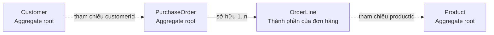
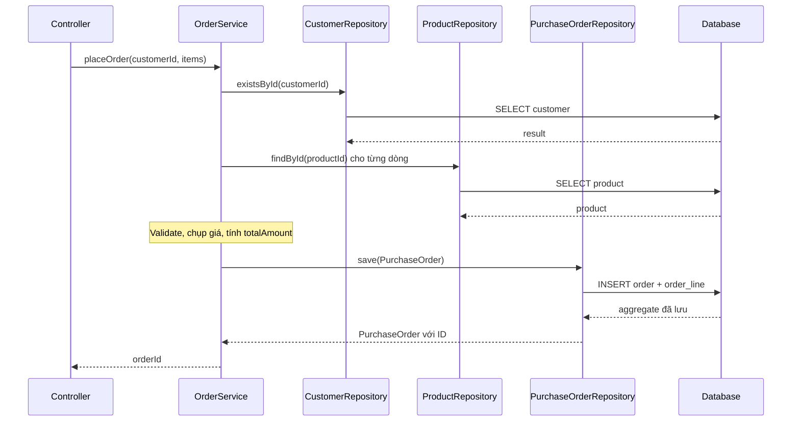

# Lộ trình học Spring Data JDBC và mô hình đơn hàng xuyên suốt

Spring Data JDBC giúp ứng dụng Java lưu và truy vấn dữ liệu quan hệ theo hướng đối tượng, nhưng vẫn giữ mô hình khá gần với bảng và câu lệnh SQL. Để học công nghệ này có hệ thống, tài liệu sử dụng **bài toán quản lý đơn hàng của một cửa hàng** làm tình huống xuyên suốt: khách hàng chọn sản phẩm, tạo đơn hàng có nhiều dòng hàng, xác nhận hoặc hủy đơn, rồi truy vấn lịch sử mua hàng.

Bài này đóng vai trò bản đồ học tập và thống nhất ngôn ngữ miền nghiệp vụ. Các đoạn mã minh họa kiến trúc và cách ánh xạ cơ bản; các bước sau sẽ lần lượt hoàn thiện cấu hình, truy vấn, giao dịch, kiểm thử và tối ưu.

## 1. Sau lộ trình này cần làm được gì?

Người học nên có khả năng:

1. Giải thích Spring Data JDBC thuộc hệ sinh thái Spring Data như thế nào, khi nào phù hợp với ứng dụng dùng cơ sở dữ liệu quan hệ và khác JPA ở điểm quan trọng nào.
2. Chuyển yêu cầu quản lý đơn hàng thành **aggregate**, thực thể, value object, bảng, khóa chính, khóa ngoại và ràng buộc dữ liệu.
3. Sử dụng repository để thêm, đọc, sửa và xóa dữ liệu theo ranh giới aggregate; phân biệt truy vấn có thể suy ra từ tên phương thức với truy vấn SQL cần viết tường minh.
4. Đặt nghiệp vụ tạo/xác nhận/hủy đơn trong giao dịch thích hợp, giữ nhất quán tổng tiền và trạng thái.
5. Viết bài kiểm thử tích hợp có cơ sở dữ liệu, phát hiện sai lệch ánh xạ và truy vấn, đồng thời nhận biết vấn đề hiệu năng và cập nhật đồng thời.

**Kiến thức nên có trước:** Java cơ bản, class/record/interface, collection, SQL (`SELECT`, `INSERT`, `UPDATE`, `DELETE`, `JOIN`), khóa chính/khóa ngoại, dependency injection và cấu trúc tối thiểu của ứng dụng Spring Boot. Biết JDBC thuần sẽ giúp thấy rõ Spring Data JDBC đang giảm bớt phần mã lặp nào.

## 2. Bối cảnh nghiệp vụ cố định

Giả sử cửa hàng bán nhiều sản phẩm. Một khách hàng có thể đặt nhiều đơn; mỗi đơn có từ một dòng hàng trở lên. Mỗi dòng ghi lại sản phẩm được mua, số lượng và **đơn giá tại thời điểm đặt**. Đơn hàng giữ tổng tiền và trạng thái xử lý.

Các đối tượng có vai trò sau:

| Khái niệm | Ý nghĩa | Dữ liệu tiêu biểu |
| --- | --- | --- |
| `Customer` | Khách hàng có danh tính riêng, tồn tại độc lập với từng đơn hàng. | `id`, `name`, `email` |
| `Product` | Sản phẩm trong danh mục, có giá bán hiện hành. | `id`, `sku`, `name`, `currentPrice` |
| `PurchaseOrder` | Đơn hàng, chịu trách nhiệm tính hợp lệ và vòng đời của các dòng hàng. | `id`, `customerId`, `status`, `totalAmount`, `lines` |
| `OrderLine` | Một dòng mua hàng thuộc đúng một đơn; không có vòng đời độc lập. | `productId`, `productNameSnapshot`, `quantity`, `unitPrice` |

Ví dụ: khách hàng **Lan** mua 2 bàn phím giá **120.000 đ/cái** và 1 chuột giá **45.000 đ/cái**. Đơn hàng có hai dòng; tổng tiền là:

`2 × 120.000 + 1 × 45.000 = 285.000 đ`.

Nếu ngày mai giá bàn phím tăng lên 130.000 đ, đơn cũ vẫn có `unitPrice = 120000.00`. Đây là lý do dòng hàng lưu **snapshot** của tên sản phẩm và đơn giá, thay vì luôn đọc lại giá hiện hành từ `Product`.

### Quy tắc nghiệp vụ dùng chung

- Một đơn phải có ít nhất một dòng hàng.
- `quantity > 0`, `unitPrice >= 0`, tổng tiền không âm; tiền dùng `BigDecimal`, không dùng `double`/`float`.
- `totalAmount = Σ(quantity × unitPrice)`; hệ thống tính tổng từ các dòng, không tin tổng tiền do máy khách gửi lên.
- Khách hàng và sản phẩm được tham chiếu bằng ID hợp lệ.
- Đơn mới mang trạng thái `CREATED`. Trong mô hình đơn giản này, `CREATED → CONFIRMED` hoặc `CREATED → CANCELLED`; `CONFIRMED` và `CANCELLED` là trạng thái cuối. Quy tắc đổi trạng thái sẽ được kiểm tra trong tầng nghiệp vụ.
- Chỉ cho phép sửa danh sách dòng và tính lại tổng khi đơn còn `CREATED`. Việc hoàn tiền, giao hàng, tồn kho, giảm giá và thuế nằm ngoài phạm vi mô hình khởi đầu; có thể mở rộng khi đã vững nền tảng.

Những quy tắc này vừa là yêu cầu thiết kế, vừa là cơ sở viết test sau này.

## 3. Ranh giới aggregate: quyết định quan trọng nhất

Spring Data JDBC xây dựng việc lưu dữ liệu theo **aggregate**. Aggregate là một cụm đối tượng có ranh giới nhất quán; thay đổi các đối tượng bên trong đi qua **aggregate root**.

Trong ví dụ này có ba aggregate root độc lập: `Customer`, `Product` và `PurchaseOrder`. `OrderLine` là thành phần thuộc aggregate `PurchaseOrder`.



**Quy tắc ánh xạ:** `PurchaseOrder` sở hữu các `OrderLine` và lưu `customerId` để tham chiếu sang `Customer`. Mỗi `OrderLine` lưu `productId` để tham chiếu sang `Product`. Việc có khóa ngoại ở SQL **không tự động biến** `Customer` hay `Product` thành đối tượng con của đơn hàng.

Tại sao chọn ranh giới này?

- Khi lưu đơn, toàn bộ danh sách dòng và tổng tiền cần nhất quán với nhau.
- Cập nhật giá một sản phẩm không được tự động viết lại các đơn đã đặt.
- Khách hàng và sản phẩm có thể được thay đổi mà không cần lưu lại mọi đơn hàng liên quan.
- Repository chính được tổ chức theo root: `CustomerRepository`, `ProductRepository`, `PurchaseOrderRepository`. Không cần `OrderLineRepository` cho trường hợp dòng hàng chỉ tồn tại trong đơn.

Đừng nhầm cấu trúc này với đồ thị entity tùy ý của ORM. Spring Data JDBC **không cung cấp cơ chế lazy loading và dirty checking kiểu JPA/Hibernate**. Khi lưu một aggregate có collection con, Spring Data JDBC có thể xóa và chèn lại các hàng con để đồng bộ trạng thái hiện tại. Vì vậy, chọn aggregate quá lớn hoặc coi mọi bảng liên quan là con sẽ dẫn đến thao tác ghi dư thừa và ranh giới nghiệp vụ không rõ.

## 4. Từ miền nghiệp vụ sang cơ sở dữ liệu quan hệ

Một cách thiết kế lược đồ ban đầu là:

| Bảng | Vai trò | Khóa và liên kết |
| --- | --- | --- |
| `customer` | Lưu hồ sơ khách hàng. | PK `id`; `email` duy nhất |
| `product` | Lưu danh mục và giá hiện hành. | PK `id`; `sku` duy nhất |
| `purchase_order` | Lưu header đơn, khách hàng, trạng thái, tổng tiền. | PK `id`; FK `customer_id → customer.id` |
| `order_line` | Lưu danh sách dòng và snapshot giá/tên. | PK ghép `(order_id, line_no)`; FK `order_id → purchase_order.id`, `product_id → product.id` |

Tên `purchase_order` được chọn thay vì `order` để tránh nhầm với từ khóa `ORDER BY` trong SQL. Mỗi dòng được nhận diện bằng cặp `(order_id, line_no)`, với `line_no` là vị trí trong danh sách của đơn.

Ví dụ DDL dưới đây dùng **PostgreSQL**; cú pháp tự sinh ID, kiểu timestamp và một số ràng buộc có thể khác ở H2, MySQL hoặc hệ quản trị khác:

```sql
CREATE TABLE customer (
    id BIGINT GENERATED BY DEFAULT AS IDENTITY PRIMARY KEY,
    name VARCHAR(150) NOT NULL,
    email VARCHAR(255) NOT NULL UNIQUE
);

CREATE TABLE product (
    id BIGINT GENERATED BY DEFAULT AS IDENTITY PRIMARY KEY,
    sku VARCHAR(50) NOT NULL UNIQUE,
    name VARCHAR(180) NOT NULL,
    current_price NUMERIC(19, 2) NOT NULL
        CHECK (current_price >= 0)
);

CREATE TABLE purchase_order (
    id BIGINT GENERATED BY DEFAULT AS IDENTITY PRIMARY KEY,
    customer_id BIGINT NOT NULL REFERENCES customer(id),
    status VARCHAR(20) NOT NULL,
    total_amount NUMERIC(19, 2) NOT NULL
        CHECK (total_amount >= 0),
    created_at TIMESTAMPTZ NOT NULL DEFAULT CURRENT_TIMESTAMP
);

CREATE TABLE order_line (
    order_id BIGINT NOT NULL REFERENCES purchase_order(id),
    line_no INTEGER NOT NULL,
    product_id BIGINT NOT NULL REFERENCES product(id),
    product_name_snapshot VARCHAR(180) NOT NULL,
    quantity INTEGER NOT NULL CHECK (quantity > 0),
    unit_price NUMERIC(19, 2) NOT NULL CHECK (unit_price >= 0),
    PRIMARY KEY (order_id, line_no)
);

CREATE INDEX idx_purchase_order_customer_created
    ON purchase_order (customer_id, created_at DESC);
```

Các `CHECK` và `FOREIGN KEY` bảo vệ dữ liệu ngay tại cơ sở dữ liệu; validation trong Java vẫn cần thiết để thông báo lỗi nghiệp vụ rõ ràng. Trong hệ thống thực tế, migration lược đồ nên có phiên bản và được chạy có kiểm soát (chẳng hạn bằng Flyway/Liquibase), thay vì sửa bảng thủ công mỗi khi ứng dụng khởi động.

**Điểm cần ghi nhớ:** thiết kế trên chọn sản phẩm/khách hàng là dữ liệu được tham chiếu. Nếu sản phẩm đã xuất hiện trong đơn, không nên xóa cứng sản phẩm tùy tiện; cách quản lý thường phù hợp hơn là đánh dấu ngừng kinh doanh, để khóa ngoại và lịch sử mua hàng còn nguyên.

## 5. Hình dung ánh xạ Java với Spring Data JDBC

Đoạn mã sau trình bày mô hình ở dạng Java `record`. Đây là ví dụ tối thiểu để đọc được sơ đồ ánh xạ, chưa bao gồm validation, service, API và xử lý lỗi:

```java
import java.math.BigDecimal;
import java.util.List;
import org.springframework.data.annotation.Id;
import org.springframework.data.relational.core.mapping.MappedCollection;
import org.springframework.data.relational.core.mapping.Table;

@Table("customer")
public record Customer(
    @Id Long id,
    String name,
    String email
) {}

@Table("product")
public record Product(
    @Id Long id,
    String sku,
    String name,
    BigDecimal currentPrice
) {}

public enum OrderStatus {
    CREATED, CONFIRMED, CANCELLED
}

// Thuộc aggregate PurchaseOrder; không có repository độc lập.
@Table("order_line")
public record OrderLine(
    Long productId,
    String productNameSnapshot,
    int quantity,
    BigDecimal unitPrice
) {}

@Table("purchase_order")
public record PurchaseOrder(
    @Id Long id,
    Long customerId,
    OrderStatus status,
    BigDecimal totalAmount,
    @MappedCollection(idColumn = "order_id", keyColumn = "line_no")
    List<OrderLine> lines
) {
    public PurchaseOrder {
        lines = List.copyOf(lines);
    }
}
```

Trong dự án Java thực tế, mỗi kiểu `public` sẽ nằm ở file riêng có cùng tên. Các dòng mã trên được đặt chung để tiện so sánh.

Giải thích những annotation và quy ước đáng chú ý:

| Thành phần | Công dụng |
| --- | --- |
| `@Table("purchase_order")` | Chỉ định bảng ánh xạ của aggregate root. |
| `@Id Long id` | Đánh dấu khóa chính; `null` ở object mới nghĩa là chưa có ID. |
| `@MappedCollection(idColumn = "order_id", keyColumn = "line_no")` | Nối các `OrderLine` thuộc đơn hiện tại qua cột `order_id`, với thứ tự list ở `line_no`. |
| `customerId`, `productId` | Tham chiếu bằng giá trị khóa; không khai báo quan hệ `@ManyToOne` kiểu JPA. |
| `BigDecimal` | Biểu diễn tiền chính xác theo thang số thập phân đã thỏa thuận. |
| `OrderStatus` | Enum được lưu theo tên trạng thái trong cách ánh xạ mặc định thường dùng. |

Vì `OrderLine` ở đây không có `@Id` riêng, vị trí `line_no` của collection được dùng cùng với `order_id` làm định danh hàng SQL. Nếu về sau chọn thêm ID riêng cho dòng, phải cập nhật cả Java mapping, lược đồ và cách quản lý vòng đời để chúng nhất quán.

Repository của aggregate root có thể rất gọn:

```java
import java.util.List;
import org.springframework.data.repository.CrudRepository;

public interface PurchaseOrderRepository
        extends CrudRepository<PurchaseOrder, Long> {

    List<PurchaseOrder> findByCustomerId(Long customerId);
}
```

Ở ví dụ này, `save(order)` lưu aggregate, `findById(id)` tải aggregate, `deleteById(id)` xóa aggregate theo chính sách repository; `findByCustomerId(...)` là một derived query dựa trên thuộc tính `customerId` của root. Cần kiểm tra SQL thực thi, hiệu quả tải child collection và tác động xóa dữ liệu trong các bài chuyên sâu.

### Cách tạo một đơn hàng

Quy trình ở tầng service có thể diễn đạt như sau:

1. Nhận `customerId` và các cặp `(productId, quantity)` từ request; từ chối danh sách rỗng hoặc số lượng không hợp lệ.
2. Xác nhận khách hàng tồn tại; tải từng sản phẩm từ `ProductRepository` để lấy **tên và giá tại thời điểm đặt**.
3. Tạo các `OrderLine` với snapshot dữ liệu; tính tổng bằng `BigDecimal`.
4. Tạo `PurchaseOrder(id = null, status = CREATED, ...)` rồi gọi `PurchaseOrderRepository.save(...)` trong giao dịch.
5. Trả về ID của **giá trị được repository trả lại**; với record bất biến, object lưu xong có thể là instance mới chứa ID đã được sinh.

Phần tính tổng có dạng:

```java
BigDecimal total = lines.stream()
    .map(line -> line.unitPrice()
        .multiply(BigDecimal.valueOf(line.quantity())))
    .reduce(BigDecimal.ZERO, BigDecimal::add);
```

Chẳng hạn:

```java
var lines = List.of(
    new OrderLine(11L, "Bàn phím", 2, new BigDecimal("120000.00")),
    new OrderLine(12L, "Chuột",     1, new BigDecimal("45000.00"))
);

var order = new PurchaseOrder(
    null, 1L, OrderStatus.CREATED,
    new BigDecimal("285000.00"), lines
);

PurchaseOrder saved = purchaseOrderRepository.save(order);
Long newOrderId = saved.id();
```

Đoạn cuối giả định khách hàng `id = 1` và hai sản phẩm tương ứng đã tồn tại; biến repository đã được inject vào service. Đây là minh họa thao tác lưu, **không thay thế bước xác thực ID, lấy giá từ database và tính tổng trong service**. Trong bài thực hành hoàn chỉnh, client chỉ gửi mã sản phẩm và số lượng; tuyệt đối không lấy `unitPrice` hay `totalAmount` trực tiếp từ client làm nguồn sự thật.

## 6. Luồng đọc/ghi và giao dịch

Một đơn hàng đi qua các lớp theo chuỗi:



Khi một nghiệp vụ cần nhiều thao tác ghi phải thành công hoặc thất bại cùng nhau, tầng service dùng `@Transactional`. Ví dụ, nếu tạo header đơn thành công nhưng chèn một dòng hàng bị lỗi, transaction phải rollback để không lưu đơn dang dở. Với JDBC blocking, transaction thường gắn với thread đang thực thi; không suy luận rằng cơ chế này tự động hoạt động giống luồng reactive/R2DBC.

Việc chuyển `CREATED → CONFIRMED` nên thực hiện theo thứ tự: tải đơn, kiểm tra trạng thái hiện tại, tạo trạng thái mới, lưu lại, trả kết quả. Trong ứng dụng có nhiều request đồng thời, hai transaction có thể cùng đọc trạng thái cũ; khi đi đến chủ đề concurrency, ta sẽ cân nhắc `@Version` để khóa lạc quan (và cột version tương ứng trong bảng), hoặc chiến lược khóa khác theo yêu cầu.

### Ba loại tính nhất quán cần phân biệt

- **Trong một aggregate:** danh sách dòng và tổng tiền phải khớp; đây là trách nhiệm trực tiếp của `PurchaseOrder` và service.
- **Giữa các aggregate:** order tham chiếu customer/product bằng ID; constraint cơ sở dữ liệu bảo vệ tồn tại, còn service quyết định quy tắc nghiệp vụ.
- **Khi hai request cùng sửa:** transaction bảo đảm tính nguyên tử, nhưng không tự loại trừ mọi dạng lost update. Có thể cần version, khóa hoặc điều kiện cập nhật.

## 7. Lộ trình học từ nền tảng đến triển khai

Lộ trình dưới đây sắp xếp các kiến thức theo phụ thuộc: hiểu SQL và aggregate trước, sau đó mới mở rộng truy vấn và kiểm thử.

| Chặng | Nội dung trọng tâm | Thực hành trên mô hình đơn hàng | Kết quả cần đạt |
| --- | --- | --- | --- |
| **1. Nền tảng** | JDBC, Spring Data Relational, Spring Data JDBC so với JPA/R2DBC; aggregate root. | Vẽ ranh giới `Customer`, `Product`, `PurchaseOrder` và `OrderLine`. | Giải thích được vì sao `OrderLine` thuộc đơn nhưng `Product` độc lập. |
| **2. Khởi tạo ứng dụng** | Starter Data JDBC, driver, datasource, cấu hình môi trường, schema/migration. | Tạo bảng `customer`, `product`, `purchase_order`, `order_line`. | Kết nối DB thành công và nhận diện được lỗi cấu hình/schema. |
| **3. Mapping** | `@Table`, `@Id`, property naming, `@MappedCollection`, immutable object, converter khi cần. | Ánh xạ bốn kiểu Java với các bảng và danh sách dòng hàng. | Lưu và đọc lại một đơn cùng toàn bộ dòng đúng giá trị. |
| **4. Repository & SQL** | `CrudRepository`, derived query, `@Query`, phân trang/sắp xếp, projection và giới hạn ánh xạ quan hệ. | Tìm đơn theo khách, xem đơn theo ID, lọc theo trạng thái hoặc ngày tạo. | Chọn được nơi dùng repository method hay SQL tường minh. |
| **5. Nghiệp vụ & transaction** | Service, validation, `@Transactional`, atomicity, rollback, thay đổi trạng thái. | Tạo đơn, tính tổng, xác nhận/hủy; thử request sai. | Không có đơn/dòng được ghi dở; trạng thái đổi theo quy tắc. |
| **6. Vòng đời aggregate** | Cập nhật collection con, delete/reinsert, xóa aggregate, ID và khóa ngoại. | Sửa số lượng khi đơn `CREATED`, tính lại tổng, kiểm tra child rows. | Hiểu SQL phát sinh và tránh sửa dữ liệu bên ngoài ranh giới root. |
| **7. Độ tin cậy & hiệu năng** | Optimistic locking, index, truy vấn tải nhiều aggregate, batching, đo SQL. | Thử xác nhận đồng thời; truy vấn lịch sử nhiều đơn và dòng. | Phát hiện lost update, truy vấn dư thừa và đề xuất hướng xử lý. |
| **8. Kiểm thử & vận hành** | `@DataJdbcTest`, integration test, test database, migration, logging và phân tích lỗi. | Kiểm tra mapping, rollback, constraint, truy vấn và quy tắc trạng thái. | Có bộ test tái lập được và lược đồ thay đổi có kiểm soát. |

Chặng đầu không cần học mọi annotation. Đích chính là xây một đường đi đúng: **SQL schema → Java mapping → repository → nghiệp vụ → transaction → test**. Chỉ sau khi đường đi hoạt động ổn định mới mở rộng tối ưu, cập nhật đồng thời và những mối quan hệ phức tạp.

### Phân biệt ba công nghệ dễ bị nhầm

| Công nghệ | Cách tiếp cận | Điều cần ghi nhớ khi học |
| --- | --- | --- |
| **Spring JDBC / JdbcTemplate** | Tự viết SQL và chủ động xử lý ánh xạ, tham số, kết quả. | Kiểm soát truy vấn trực tiếp, cần tự viết nhiều mã kết nối dữ liệu hơn. |
| **Spring Data JDBC** | Repository + mapping aggregate, dựa trên SQL/JDBC blocking. | Mô hình đơn giản, rõ vòng đời aggregate; không kỳ vọng lazy loading hoặc persistence context của JPA. |
| **Spring Data JPA** | ORM theo entity/persistence context (thường dùng Hibernate). | Có quan hệ entity, dirty checking và lựa chọn fetch; hành vi lưu/cập nhật khác JDBC. |

**Spring Data R2DBC** lại là hướng truy cập cơ sở dữ liệu quan hệ theo giao diện reactive, không phải biến thể annotation của cùng một repository JDBC. Trong phạm vi lộ trình này, các ví dụ chủ yếu dùng JDBC synchronous/blocking.

## 8. Chuỗi bài thực hành xuyên suốt

Để mỗi chủ đề đều có bằng chứng quan sát được, dùng cùng một bộ dữ liệu mẫu:

| Dữ liệu | Giá trị minh họa |
| --- | --- |
| Khách hàng | `Customer(id=1, name="Lan", email="lan@example.test")` |
| Sản phẩm 1 | `Product(id=11, sku="KB-01", name="Bàn phím", currentPrice=120000.00)` |
| Sản phẩm 2 | `Product(id=12, sku="MS-01", name="Chuột", currentPrice=45000.00)` |
| Yêu cầu tạo đơn | `customerId=1`, `(productId=11, quantity=2)`, `(productId=12, quantity=1)` |
| Kết quả ban đầu | 1 đơn `CREATED`, 2 dòng, tổng `285000.00` |

Thực hành gợi ý theo thứ tự:

1. **Lưu và đọc lại:** gọi `save`, `findById`; xác minh hai dòng được ánh xạ cùng một đơn, `line_no` giữ thứ tự mong đợi.
2. **Truy vấn lịch sử:** tìm các đơn theo `customerId`, thử lọc trạng thái và sắp xếp theo `created_at` với câu SQL phù hợp.
3. **Bảo toàn giá lịch sử:** cập nhật `product.current_price` từ `120000.00` lên `130000.00`; nạp lại đơn đã tạo và kiểm tra snapshot `unitPrice` vẫn là `120000.00`.
4. **Sửa đơn chưa xác nhận:** đổi số lượng bàn phím từ 2 thành 3, tính lại tổng `405000.00`; quan sát tác động ghi xuống `order_line`.
5. **Kiểm tra dữ liệu lỗi:** thử danh sách dòng rỗng, số lượng bằng 0, ID sản phẩm không tồn tại và tổng tiền giả mạo. Không được phát sinh đơn hàng hợp lệ từ request sai.
6. **Kiểm tra quy tắc trạng thái:** xác nhận đơn một lần; thử sửa dòng hoặc xác nhận lại và đối chiếu với quy tắc nghiệp vụ.
7. **Kiểm tra rollback và tranh chấp:** cố ý tạo lỗi ở một bước ghi; sau đó thử hai request cập nhật đồng thời để nhận biết cần cơ chế phiên bản hay khóa.

Mỗi bài nên có ít nhất một quan sát cụ thể: trạng thái object trả về, dữ liệu các bảng, câu SQL được log hoặc assertion của test. Đừng chỉ dựa vào phản hồi HTTP `200` để kết luận repository đã lưu đúng.

## 9. Những quyết định kỹ thuật phải luôn nhất quán

**Tên và ID.** Dùng `PurchaseOrder` cho lớp Java và `purchase_order` cho bảng, dùng `OrderLine`/`order_line` cho dòng. ID đơn là `Long`, các tham chiếu sang khách hàng/sản phẩm là ID scalar. Ví dụ dùng `List<OrderLine>`; vì vậy collection cần cột chỉ vị trí `line_no`.

**Giá và tổng.** Giá hiện hành nằm ở `Product.currentPrice`; giá chốt theo giao dịch nằm ở `OrderLine.unitPrice`. `PurchaseOrder.totalAmount` là giá trị được tính lại từ danh sách dòng khi tạo/sửa đơn, không là tham số tin cậy từ client. Trong thực tế phải xác định quy tắc làm tròn, tiền tệ, thuế và khuyến mãi trước khi mở rộng công thức.

**Vòng đời.** Sửa và xóa `OrderLine` thông qua `PurchaseOrder`; không tạo một API tùy ý để xóa hàng con độc lập. Việc save aggregate có thể ghi lại collection con; các bảng con hoặc transaction quan trọng cần được quan sát SQL để tránh kết luận sai về chi phí ghi.

**Truy vấn khác với cập nhật.** Màn hình lịch sử có thể cần projection, SQL join hoặc câu truy vấn chuyên biệt để lấy dữ liệu hiển thị hiệu quả. Kết quả truy vấn dạng báo cáo không nhất thiết phải được xem như aggregate đầy đủ rồi lưu ngược lại.

**Tính đúng đắn ở nhiều lớp.** API kiểm tra dữ liệu đầu vào, domain/service kiểm tra quy tắc, database bảo vệ FK và constraint, transaction bảo đảm nguyên tử, test chứng minh hành vi. Không lớp nào thay thế hoàn toàn các lớp còn lại.

## 10. Bản đồ kiến thức để tự kiểm tra trước bài tiếp theo

Khi hoàn thành phần tổng quan, hãy tự trả lời:

- Tại sao `OrderLine` được lưu theo `PurchaseOrder`, còn `Product` chỉ được tham chiếu qua `productId`?
- Nếu giá sản phẩm thay đổi, những cột nào của một đơn cũ **không được đổi**?
- Bảng nào có khóa chính ghép, và cột nào liên kết dòng hàng với đơn?
- Tại sao cần `BigDecimal` và tính tổng trong ứng dụng thay vì nhận sẵn tổng từ request?
- `@Transactional` giải quyết việc ghi dở như thế nào, và vì sao nó chưa đủ để xử lý mọi cập nhật đồng thời?
- Điểm khác biệt giữa cách Spring Data JDBC lưu aggregate và cách JPA theo dõi entity là gì?

Nếu giải thích được những câu hỏi này bằng chính luồng **khách hàng → tạo đơn → các dòng hàng → lưu/đọc/truy vấn → xác nhận**, bạn đã có mô hình chung để học những phần kỹ thuật tiếp theo mà không phải thay đổi ví dụ nghiệp vụ mỗi lần gặp một khái niệm mới.
