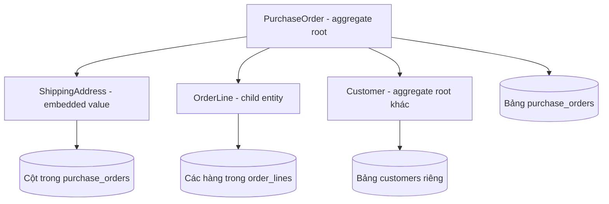

# Phân biệt đối tượng nhúng cùng bảng và entity ở bảng riêng

Trong **Spring Data Relational JDBC**, một object Java có thể được ánh xạ theo ba cách: các field được làm phẳng vào **cùng hàng và cùng bảng** với object sở hữu; object được lưu thành **hàng riêng trong bảng khác nhưng vẫn thuộc cùng aggregate**; hoặc object là **aggregate root độc lập**, được aggregate hiện tại tham chiếu bằng ID.

Ba trường hợp này có thể trông giống nhau trong Java vì đều được biểu diễn bằng field có kiểu object. Tuy nhiên, chúng khác nhau về schema, vòng đời, cách lưu, truy vấn và ranh giới nhất quán. Chọn sai mô hình dễ dẫn đến bảng dư thừa, quan hệ khó quản lý, ghi dữ liệu ngoài ý muốn hoặc hiểu nhầm hành vi của Spring Data JDBC.

Bài học tập trung vào cách phân biệt **embedded value object cùng bảng** và **entity ở bảng riêng**, đồng thời đặt chúng trong mô hình aggregate của Spring Data JDBC.

## 1. Ba cách biểu diễn một object trong mô hình relational

Giả sử hệ thống bán hàng có đơn hàng, địa chỉ giao hàng, các dòng hàng và khách hàng:



| Kiểu quan hệ | Nơi lưu dữ liệu | Vòng đời | Cơ chế Spring Data JDBC |
|---|---|---|---|
| Embedded value object | Các cột trên cùng bảng với root | Đi cùng object sở hữu; không có identity độc lập | `@Embedded` |
| Child entity trong cùng aggregate | Hàng ở bảng riêng, có khóa ngoại về root | Được root sở hữu và lưu qua root | `@MappedCollection` |
| Tham chiếu aggregate root khác | Bảng riêng của aggregate được tham chiếu | Có lifecycle và thao tác lưu độc lập | ID scalar hoặc `AggregateReference` |

Điểm cần nhớ: **bảng riêng không tự động đồng nghĩa với aggregate root riêng**. Một child entity có thể ở bảng riêng nhưng vẫn là một phần của aggregate root. Ngược lại, aggregate root khác cũng có bảng riêng nhưng chỉ được tham chiếu qua khóa, không bị root hiện tại sở hữu.

## 2. Embedded value object là gì?

**Embedded value object** là object mô tả một giá trị có ý nghĩa trong domain, nhưng không cần identity riêng và không có vòng đời độc lập với object sở hữu.

Ví dụ địa chỉ giao hàng có các thành phần đường/phố, thành phố và mã bưu chính:

```java
public record ShippingAddress(
        String street,
        String city,
        String postalCode
) {
}
```

`ShippingAddress` không có `@Id`, không cần repository riêng và không cần bảng `shipping_addresses`. Nó chỉ là một value object được nhúng vào aggregate root.

### 2.1. Dùng `@Embedded` của Spring Data Relational

Spring Data JDBC hỗ trợ embedded object qua annotation:

```java
import org.springframework.data.relational.core.mapping.Embedded;

@Embedded(
    onEmpty = Embedded.OnEmpty.USE_NULL,
    prefix = "shipping_"
)
private ShippingAddress shippingAddress;
```

Annotation đúng là `org.springframework.data.relational.core.mapping.Embedded`. Nó hướng dẫn Spring Data Relational làm phẳng property của `ShippingAddress` thành các cột của bảng chứa `PurchaseOrder`.

Ví dụ aggregate root:

```java
import org.springframework.data.annotation.Id;
import org.springframework.data.relational.core.mapping.Embedded;
import org.springframework.data.relational.core.mapping.Table;

@Table("purchase_orders")
public class PurchaseOrder {

    @Id
    private Long id;

    private String orderCode;

    @Embedded(
        onEmpty = Embedded.OnEmpty.USE_NULL,
        prefix = "shipping_"
    )
    private ShippingAddress shippingAddress;

    protected PurchaseOrder() {
    }

    public PurchaseOrder(String orderCode, ShippingAddress shippingAddress) {
        this.orderCode = orderCode;
        this.shippingAddress = shippingAddress;
    }

    public Long getId() {
        return id;
    }

    public ShippingAddress getShippingAddress() {
        return shippingAddress;
    }
}
```

Nếu naming strategy chuyển tên property sang snake_case, các property của embedded object được ánh xạ với prefix tương ứng:

| Property Java | Cột trong `purchase_orders` |
|---|---|
| `shippingAddress.street` | `shipping_street` |
| `shippingAddress.city` | `shipping_city` |
| `shippingAddress.postalCode` | `shipping_postal_code` |

Prefix giúp tránh xung đột tên cột khi root có nhiều embedded object chứa property trùng tên.

### 2.2. Schema cho embedded object

Địa chỉ không có bảng riêng. Các cột nằm trực tiếp trong bảng đơn hàng:

```sql
CREATE TABLE purchase_orders (
    id BIGINT GENERATED BY DEFAULT AS IDENTITY PRIMARY KEY,
    order_code VARCHAR(40) NOT NULL,
    shipping_street VARCHAR(180),
    shipping_city VARCHAR(100),
    shipping_postal_code VARCHAR(20)
);
```

Một hàng có thể trông như sau:

| id | order_code | shipping_street | shipping_city | shipping_postal_code |
|---:|---|---|---|---|
| 101 | PO-101 | 12 Main Street | Hanoi | 100000 |
| 102 | PO-102 | 5 Lake Road | Da Nang | 550000 |

Khi đọc hàng `PO-101`, Spring Data JDBC tạo `PurchaseOrder` và dựng `ShippingAddress` từ ba cột `shipping_*`. Không có truy vấn đọc bảng địa chỉ riêng vì bảng đó không tồn tại trong mô hình này.

### 2.3. Khi nào nên dùng embedded?

Dùng embedded value object khi:

- Object chỉ có ý nghĩa trong ngữ cảnh aggregate sở hữu.
- Object không cần ID riêng.
- Object không được truy cập/lưu độc lập qua repository.
- Các thuộc tính của object thường được đọc cùng root.
- Các thay đổi của object nên được lưu như một phần của thao tác lưu root.
- Cấu trúc object biểu đạt một khái niệm domain có nhiều field, thay vì chỉ là một field đơn.

Ví dụ phù hợp: địa chỉ giao hàng được chụp tại thời điểm đặt đơn; khoảng thời gian hiệu lực; thông tin tiền tệ gồm số tiền và đơn vị tiền; tọa độ gồm vĩ độ và kinh độ.

Ví dụ ít phù hợp: khách hàng có lifecycle riêng, nhiều đơn hàng cùng tham chiếu; sản phẩm được cập nhật độc lập; danh sách lịch sử dài cần truy vấn riêng.

**Embedded không phải một cách tạo quan hệ giữa hai bảng.** Nó là cách tổ chức object Java, trong khi dữ liệu của object được làm phẳng vào cùng bảng.

## 3. Quy tắc `onEmpty`: xử lý embedded object rỗng

Một câu hỏi quan trọng khi đọc dữ liệu là: nếu tất cả cột của embedded object đều `NULL`, Spring Data JDBC nên khôi phục property thành `null` hay tạo một object rỗng?

`@Embedded` có thuộc tính `onEmpty` với hai lựa chọn chính:

| Giá trị | Ý nghĩa khi tất cả cột embedded đều `NULL` |
|---|---|
| `Embedded.OnEmpty.USE_NULL` | Property embedded được khôi phục thành `null` |
| `Embedded.OnEmpty.USE_EMPTY` | Spring Data cố tạo embedded object rỗng theo mapping/constructor của kiểu đó |

Ví dụ:

```java
@Embedded(
    onEmpty = Embedded.OnEmpty.USE_NULL,
    prefix = "shipping_"
)
private ShippingAddress shippingAddress;
```

Với `USE_NULL`, nếu `shipping_street`, `shipping_city` và `shipping_postal_code` đều `NULL`, `shippingAddress` có thể là `null`.

Nếu dùng `USE_EMPTY`, framework tạo một instance embedded rỗng khi tất cả cột đều không có giá trị. Cách này hữu ích khi domain muốn phân biệt object rỗng với `null`, nhưng constructor và kiểu property phải hỗ trợ khởi tạo tương ứng.

### 3.1. Phân biệt null và object rỗng

```java
ShippingAddress absent = null;

ShippingAddress empty = new ShippingAddress(
        null,
        null,
        null
);
```

Hai trạng thái này không giống nhau:

- `null`: không có địa chỉ được khai báo.
- Object rỗng: có một giá trị địa chỉ, nhưng các thành phần chưa được điền.

Hãy chọn theo quy tắc nghiệp vụ. Nếu địa chỉ bắt buộc, nên validation khi tạo đơn hàng thay vì dựa vào `onEmpty` để đảm bảo dữ liệu hợp lệ.

### 3.2. Cẩn thận với primitive trong embedded object

Ví dụ không nên dùng primitive nếu cột có thể `NULL`:

```java
public record GeoPoint(
        double latitude,
        double longitude
) {
}
```

`double` không thể biểu diễn `null`; khi mapping dữ liệu SQL null, kiểu primitive có thể nhận giá trị mặc định hoặc phát sinh vấn đề tùy đường chuyển đổi. Nếu cần phân biệt “không có tọa độ” với giá trị 0, dùng wrapper:

```java
public record GeoPoint(
        Double latitude,
        Double longitude
) {
}
```

Điều này đặc biệt quan trọng với `USE_EMPTY`: object rỗng cần có khả năng biểu diễn trạng thái không có dữ liệu.

### 3.3. Embedded lồng nhau

Một value object có thể chứa value object khác, tùy khả năng mapping của phiên bản Spring Data Relational. Khi dùng embedded lồng nhau, hãy làm rõ prefix ở từng tầng để tránh tên cột trùng nhau và kiểm tra mapping metadata/schema thực tế.

Không nên tạo cấu trúc embedded quá sâu. Nếu object có nhiều phần thay đổi độc lập, cần ID riêng hoặc được truy vấn riêng, đó có thể là dấu hiệu nên tách thành bảng/aggregate khác.

## 4. Entity ở bảng riêng nhưng vẫn thuộc cùng aggregate

Không phải object con nào cũng nên được làm phẳng vào bảng root. Một đơn hàng có thể có nhiều dòng hàng, mỗi dòng gồm SKU, số lượng và đơn giá. Đây là dữ liệu lặp, có thể cần một hàng riêng cho mỗi dòng.

Trong Spring Data JDBC, collection con thuộc aggregate root có thể được ánh xạ qua `@MappedCollection`.

Ví dụ:

```java
import java.util.ArrayList;
import java.util.List;

import org.springframework.data.annotation.Id;
import org.springframework.data.relational.core.mapping.MappedCollection;
import org.springframework.data.relational.core.mapping.Table;

@Table("purchase_orders")
public class PurchaseOrder {

    @Id
    private Long id;

    private String orderCode;

    @MappedCollection(
        idColumn = "order_id",
        keyColumn = "line_index"
    )
    private List<OrderLine> lines = new ArrayList<>();

    protected PurchaseOrder() {
    }

    public PurchaseOrder(String orderCode) {
        this.orderCode = orderCode;
    }

    public void addLine(String sku, int quantity, long unitPriceCents) {
        if (quantity <= 0 || unitPriceCents < 0) {
            throw new IllegalArgumentException("Invalid order line");
        }
        lines.add(new OrderLine(sku, quantity, unitPriceCents));
    }

    public Long getId() {
        return id;
    }

    public List<OrderLine> getLines() {
        return List.copyOf(lines);
    }
}
```

Child entity:

```java
import org.springframework.data.annotation.Id;
import org.springframework.data.relational.core.mapping.Table;

@Table("order_lines")
public class OrderLine {

    @Id
    private Long id;

    private String sku;

    private int quantity;

    private long unitPriceCents;

    protected OrderLine() {
    }

    public OrderLine(String sku, int quantity, long unitPriceCents) {
        this.sku = sku;
        this.quantity = quantity;
        this.unitPriceCents = unitPriceCents;
    }

    public Long getId() {
        return id;
    }

    public String getSku() {
        return sku;
    }

    public int getQuantity() {
        return quantity;
    }

    public long getUnitPriceCents() {
        return unitPriceCents;
    }
}
```

Ở đây:

- `PurchaseOrder` là aggregate root.
- `OrderLine` là entity con được root sở hữu.
- Mỗi `OrderLine` được lưu thành hàng trong bảng `order_lines`.
- `order_id` là cột liên kết về root.
- `line_index` giữ thứ tự của phần tử trong `List`.

### 4.1. Schema cho child entity

```sql
CREATE TABLE purchase_orders (
    id BIGINT GENERATED BY DEFAULT AS IDENTITY PRIMARY KEY,
    order_code VARCHAR(40) NOT NULL
);

CREATE TABLE order_lines (
    id BIGINT GENERATED BY DEFAULT AS IDENTITY PRIMARY KEY,
    order_id BIGINT NOT NULL REFERENCES purchase_orders(id),
    line_index INTEGER NOT NULL,
    sku VARCHAR(64) NOT NULL,
    quantity INTEGER NOT NULL CHECK (quantity > 0),
    unit_price_cents BIGINT NOT NULL CHECK (unit_price_cents >= 0),
    UNIQUE (order_id, line_index)
);
```

Một đơn hàng có thể có nhiều dòng:

| order_id | line_index | sku | quantity | unit_price_cents |
|---:|---:|---|---:|---:|
| 101 | 0 | BOOK-01 | 2 | 15000 |
| 101 | 1 | PEN-02 | 3 | 5000 |
| 102 | 0 | BAG-03 | 1 | 250000 |

Khác với embedded, mỗi dòng hàng có một hàng dữ liệu riêng. Tuy nhiên, chúng vẫn thuộc aggregate `PurchaseOrder`, vì thao tác nghiệp vụ thêm/xóa dòng hàng được thực hiện thông qua root và dữ liệu con được lưu cùng root.

### 4.2. Ý nghĩa `idColumn` và `keyColumn`

`@MappedCollection` có các thuộc tính cấu hình quan trọng:

- **`idColumn`:** tên cột ở bảng child lưu ID của aggregate root. Trong ví dụ là `order_id`.
- **`keyColumn`:** tên cột lưu vị trí/khóa của phần tử trong collection, thường dùng cho `List` hoặc `Map`. Trong ví dụ là `line_index`.

Đừng nhầm `idColumn` với ID riêng của child. `order_id` là foreign key về `PurchaseOrder`; `OrderLine.id` là identifier của từng dòng hàng.

Nếu dùng `Set` thay cho `List`, không có thứ tự vị trí như list nên `keyColumn` thường không cần cho mục đích lưu thứ tự. Nếu dùng `Map`, key column có thể lưu key của entry theo mapping phù hợp.

### 4.3. Child entity không phải aggregate root riêng

Dù `OrderLine` có bảng và có `@Id`, điều đó không tự biến nó thành aggregate root độc lập.

Trong mô hình trên:

- Code nghiệp vụ thay đổi dòng hàng thông qua `PurchaseOrder`.
- Repository lưu trữ chính là `PurchaseOrderRepository`.
- Khóa ngoại `order_id` liên kết child với root.
- Child có vòng đời phụ thuộc vào root.
- Không nên cho nhiều aggregate root khác cùng sở hữu/chỉnh sửa một child.

Nếu `OrderLine` cần được cập nhật độc lập, có quyền truy cập riêng, được nhiều quy trình tham chiếu hoặc có lifecycle không phụ thuộc đơn hàng, hãy đánh giá lại ranh giới aggregate.

## 5. Aggregate root khác ở bảng riêng: tham chiếu bằng ID

Giả sử mỗi đơn hàng thuộc về một khách hàng. Khách hàng có thể được sử dụng bởi nhiều đơn hàng, được cập nhật độc lập và có lifecycle riêng. Khi đó `Customer` là aggregate root khác, không phải embedded object và cũng không phải child của `PurchaseOrder`.

Một cách biểu diễn đơn giản:

```java
import org.springframework.data.annotation.Id;
import org.springframework.data.relational.core.mapping.Column;
import org.springframework.data.relational.core.mapping.Table;

@Table("purchase_orders")
public class PurchaseOrder {

    @Id
    private Long id;

    @Column("customer_id")
    private Long customerId;
}
```

Schema:

```sql
CREATE TABLE customers (
    id BIGINT GENERATED BY DEFAULT AS IDENTITY PRIMARY KEY,
    display_name VARCHAR(160) NOT NULL
);

CREATE TABLE purchase_orders (
    id BIGINT GENERATED BY DEFAULT AS IDENTITY PRIMARY KEY,
    order_code VARCHAR(40) NOT NULL,
    customer_id BIGINT NOT NULL REFERENCES customers(id)
);
```

`PurchaseOrder` giữ `customerId`. Khi cần thông tin khách hàng, service hoặc query đọc `Customer` qua repository tương ứng. Spring Data JDBC không tự tạo JPA-style lazy proxy để truy cập `order.getCustomer().getName()`.

### 5.1. Dùng `AggregateReference`

Spring Data JDBC có kiểu tham chiếu rõ nghĩa:

```java
import org.springframework.data.jdbc.core.mapping.AggregateReference;
import org.springframework.data.relational.core.mapping.Column;

@Column("customer_id")
private AggregateReference<Customer, Long> customer;
```

Tạo reference từ ID:

```java
AggregateReference<Customer, Long> customerRef =
        AggregateReference.to(customerId);
```

`AggregateReference<Customer, Long>` biểu diễn một tham chiếu tới aggregate `Customer` thông qua ID kiểu `Long`. Nó không chứa object `Customer` đã load và không tự tạo truy vấn lấy khách hàng.

Có thể dùng `Long customerId` nếu muốn mô hình đơn giản và không cần kiểu tham chiếu có generic. `AggregateReference` hữu ích khi muốn biểu đạt rõ ranh giới aggregate trong domain model.

### 5.2. Vì sao không nhúng Customer vào PurchaseOrder?

Nếu đưa toàn bộ object khách hàng vào `PurchaseOrder` như embedded:

- Các cột khách hàng có thể bị lặp lại ở mọi đơn hàng.
- Khi tên/địa chỉ khách hàng thay đổi, các đơn hàng cũ có thể chứa snapshot hoặc dữ liệu lặp không nhất quán.
- Không còn ranh giới rõ giữa dữ liệu thuộc khách hàng và dữ liệu thuộc đơn hàng.
- Việc lưu đơn hàng có thể ghi cả dữ liệu không thuộc quyền sở hữu của đơn hàng.

Nếu nghiệp vụ cần snapshot địa chỉ giao hàng tại thời điểm đặt đơn, hãy lưu một **value object riêng của đơn hàng** (ví dụ `ShippingAddress`) thay vì tham chiếu địa chỉ hiện tại của Customer. Snapshot và reference phục vụ hai ý nghĩa khác nhau.

## 6. So sánh sâu ba mô hình

| Tiêu chí | Embedded (`@Embedded`) | Child entity (`@MappedCollection`) | Aggregate reference |
|---|---|---|---|
| Có bảng riêng? | Không | Có | Có, ở aggregate được tham chiếu |
| Có ID riêng? | Không | Có thể có ID child | Aggregate được tham chiếu có ID riêng |
| Có foreign key? | Không cần cho embedded | Child table có FK về root | Root có thể lưu FK/ID tới aggregate khác |
| Ai sở hữu lifecycle? | Root sở hữu hoàn toàn | Root sở hữu child | Aggregate được tham chiếu sở hữu chính nó |
| Lưu qua repository nào? | Repository của root | Repository của root | Repository của mỗi aggregate theo thao tác riêng |
| Có thể truy cập độc lập? | Không theo mô hình persistence | Thông thường thao tác qua root | Có, qua repository riêng của aggregate đích |
| Phù hợp với | Value object | Collection child thuộc root | Quan hệ giữa hai aggregate độc lập |

Ví dụ cụ thể:

- `ShippingAddress`: embedded trong `PurchaseOrder`, vì là snapshot thuộc đơn hàng.
- `OrderLine`: child entity trong bảng riêng, vì có nhiều dòng và thuộc lifecycle đơn hàng.
- `Customer`: aggregate root độc lập, vì có thể được nhiều đơn hàng tham chiếu và cập nhật riêng.

**Đừng chọn mô hình chỉ dựa vào số lượng field hoặc việc có bảng riêng.** Hãy bắt đầu từ identity, lifecycle và ranh giới nhất quán của domain.

## 7. Embedded và child table ảnh hưởng tới việc lưu như thế nào?

### 7.1. Khi lưu embedded

Khi gọi repository save root, các thuộc tính của `ShippingAddress` được ánh xạ thành cột của hàng `purchase_orders`. Không có insert/update vào bảng địa chỉ riêng.

Ví dụ SQL khái quát:

```sql
INSERT INTO purchase_orders (
    order_code,
    shipping_street,
    shipping_city,
    shipping_postal_code
)
VALUES (?, ?, ?, ?);
```

Khi cập nhật root, các giá trị embedded cũng được ghi theo mapping của root. Không cần repository riêng cho `ShippingAddress`.

### 7.2. Khi lưu child collection

Với `@MappedCollection`, lưu root có thể kéo theo thao tác ghi các hàng child trong bảng riêng. Ví dụ:

```java
PurchaseOrder order = new PurchaseOrder("PO-2026-101");
order.addLine("BOOK-01", 2, 15000);
order.addLine("PEN-02", 3, 5000);

PurchaseOrder saved = purchaseOrderRepository.save(order);
```

Spring Data JDBC quản lý liên kết giữa root và child theo metadata collection. Các câu SQL cụ thể phụ thuộc trạng thái aggregate, database, ID và phiên bản framework; không nên giả định nó hoạt động như JPA dirty checking từng child.

Với aggregate collection, việc lưu lại root có thể bao gồm thao tác xóa/chèn lại các hàng dependent theo chiến lược của Spring Data JDBC. Do đó:

- Giữ aggregate ở kích thước hợp lý.
- Tránh collection quá lớn nếu chỉ cần cập nhật từng phần tử thường xuyên.
- Không lưu root chỉ để thay một child nếu chi phí ghi lại collection quá cao.
- Xem xét tách aggregate khi child có nhu cầu truy cập/lifecycle riêng.

### 7.3. Khi lưu aggregate reference

Nếu `PurchaseOrder` chứa `customerId`, thao tác lưu đơn hàng chỉ ghi ID tham chiếu vào cột `customer_id`; nó không đồng nghĩa với việc lưu toàn bộ `Customer`.

Nếu muốn tạo khách hàng mới và đơn hàng mới, service có thể gọi hai repository một cách rõ ràng trong transaction phù hợp:

```java
@Transactional
public PurchaseOrder createOrder(String customerName, String orderCode) {
    Customer customer = customers.save(new Customer(customerName));

    PurchaseOrder order = new PurchaseOrder(
            orderCode,
            customer.getId()
    );

    return orders.save(order);
}
```

Đây là hai aggregate root được lưu qua hai thao tác repository. Cùng một transaction JDBC có thể bao các thao tác khi chúng dùng cùng transaction manager/DataSource và cùng ngữ cảnh thread; ranh giới này cần được cấu hình đúng. Aggregate reference không tự tạo cascade persistence.

## 8. Đọc dữ liệu: object nào được dựng và khi nào?

### 8.1. Embedded được dựng từ cùng hàng

Khi đọc `PurchaseOrder`, Spring Data JDBC lấy các cột `shipping_*` và dựng `ShippingAddress`. Không cần truy vấn bổ sung cho embedded object.

### 8.2. Child entity được đọc cùng aggregate

Khi đọc aggregate root, Spring Data JDBC cũng cần khôi phục các thành phần thuộc aggregate theo mapping. `OrderLine` được dựng từ các hàng trong `order_lines` có `order_id` tương ứng.

Spring Data JDBC không cung cấp mô hình lazy-loading relationship proxy kiểu JPA. Vì vậy hãy cân nhắc kích thước aggregate và truy vấn thực tế khi thiết kế collection con.

### 8.3. Aggregate reference không tự load object đích

Khi đọc `PurchaseOrder` có `customerId`, framework khôi phục giá trị ID/reference. Nó không tự động tải `Customer` chỉ vì property có kiểu `AggregateReference<Customer, Long>`.

Nếu cần thông tin khách hàng:

```java
PurchaseOrder order = orders.findById(orderId).orElseThrow();

Customer customer = customers.findById(order.getCustomerId())
        .orElseThrow();
```

Trong ứng dụng thực tế, có thể dùng query join hoặc projection khi cần dữ liệu hiển thị từ nhiều aggregate. Điều đó là một lựa chọn truy vấn; không biến các aggregate thành một aggregate duy nhất.

## 9. Cách quyết định một object nên embedded hay ở bảng riêng

Có thể dùng các câu hỏi sau khi thiết kế domain.

### 9.1. Object có identity độc lập không?

Nếu không có identity riêng và chỉ mang ý nghĩa như một giá trị, embedded thường phù hợp.

Ví dụ: địa chỉ snapshot, khoảng thời gian, thông tin tiền tệ.

Nếu object cần ID để được tham chiếu, cập nhật hoặc xóa độc lập, cân nhắc entity ở bảng riêng. Nhưng hãy hỏi tiếp liệu nó là child hay aggregate root.

### 9.2. Object có thể tồn tại ngoài root không?

- Không thể tồn tại hợp lý nếu thiếu root → thường là embedded hoặc child entity.
- Có lifecycle độc lập, được nhiều root tham chiếu → thường là aggregate root riêng.

Ví dụ `OrderLine` không có ý nghĩa ngoài `PurchaseOrder`; `Customer` có thể tồn tại trước và sau nhiều đơn hàng.

### 9.3. Dữ liệu có lặp nhiều lần không?

Một object nhỏ gồm vài field có thể làm phẳng vào bảng root. Nếu cùng một thực thể được nhiều root tham chiếu, lưu lặp toàn bộ dữ liệu có thể gây cập nhật không nhất quán. Khi đó lưu ID tham chiếu thường hợp lý hơn.

### 9.4. Có cần truy vấn hoặc cập nhật độc lập không?

Nếu nghiệp vụ cần tìm kiếm, phân trang, cập nhật hoặc phân quyền trên child mà không tải root, đây có thể là tín hiệu child đang là aggregate root riêng. Một collection rất lớn cũng có thể cho thấy aggregate boundary hiện tại quá rộng.

### 9.5. Thay đổi có cần atomic cùng root không?

Nếu thay đổi object phải luôn đi cùng thay đổi root, embedded hoặc child entity có thể phù hợp. Nếu dữ liệu có transaction/lifecycle riêng, nên tách aggregate và thiết kế cơ chế phối hợp.

| Câu hỏi | Nghiêng về embedded | Nghiêng về bảng riêng |
|---|---|---|
| Có identity riêng? | Không | Có |
| Có lifecycle độc lập? | Không | Có thể có |
| Có cần truy cập qua repository riêng? | Không | Có |
| Có nhiều phần tử cùng loại? | Không hoặc ít | Collection nhiều phần tử |
| Có được nhiều aggregate tham chiếu? | Không | Có thể có |
| Có cần query/phân trang độc lập? | Hiếm khi | Thường xuyên |
| Có thuộc tính được lưu cùng root? | Có | Có thể không |

Các câu trả lời là gợi ý thiết kế, không phải luật máy móc. Child entity trong bảng riêng vẫn có thể không có lifecycle độc lập.

## 10. Các lỗi thiết kế và mapping thường gặp

| Triệu chứng/thiết kế | Nguyên nhân | Hướng xử lý |
|---|---|---|
| Embedded object tạo ra tên cột không đúng | Prefix hoặc naming strategy không khớp schema | Dùng prefix, kiểm tra tên cột và migration |
| Embedded object luôn null | Tất cả cột embedded đều NULL và onEmpty=USE_NULL | Xác định có cần USE_EMPTY hoặc dữ liệu cột |
| Embedded object rỗng nhưng domain mong null | Dùng USE_EMPTY | Chọn USE_NULL nếu đúng ý nghĩa |
| Địa chỉ được lưu ở bảng riêng ngoài ý muốn | Thiết kế entity/repository riêng thay vì embedded | Dùng @Embedded và cột cùng bảng |
| Child collection không được lưu | Thiếu @MappedCollection hoặc FK column không khớp | Kiểm tra idColumn, schema và mapping |
| Child rows không đúng thứ tự | List không có keyColumn phù hợp hoặc cột index không khớp | Cấu hình keyColumn và unique constraint |
| Root bị ghi lại nhiều child rows | Aggregate collection lớn, cập nhật root thường xuyên | Thu nhỏ aggregate hoặc tách lifecycle |
| Customer bị lưu lặp trên nhiều đơn hàng | Nhúng toàn bộ dữ liệu customer thay vì tham chiếu root | Lưu ID/AggregateReference |
| Mong order.getCustomer() tự truy vấn | Nhầm với lazy-loading JPA | Đọc aggregate đích qua repository hoặc query/projection |
| Dùng @OneToMany/@ManyToOne nhưng JDBC không xử lý như mong muốn | Dùng annotation JPA trong Spring Data JDBC | Dùng @MappedCollection hoặc ID/reference |
| Dùng @Embeddable/@Embedded JPA | Import sai package | Dùng org.springframework.data.relational.core.mapping.Embedded |
| Nhầm child entity với aggregate root | Thấy child có ID/bảng riêng nên cho rằng độc lập | Xác định ai sở hữu lifecycle và repository boundary |
| FK không hợp lệ khi lưu | ID tham chiếu chưa tồn tại hoặc schema thiếu quan hệ đúng | Lưu aggregate đích trước, kiểm tra FK và transaction |

## 11. Các ví dụ lựa chọn mô hình

### Tình huống A: Địa chỉ giao hàng của đơn hàng

Địa chỉ được ghi nhận tại thời điểm đặt đơn và không được cập nhật độc lập qua repository. Khi khách hàng đổi địa chỉ mặc định, địa chỉ của đơn hàng cũ vẫn phải giữ nguyên.

**Chọn embedded value object** hoặc snapshot value object trong aggregate:

```java
@Embedded(prefix = "shipping_")
private ShippingAddress shippingAddress;
```

Dữ liệu được lưu cùng bảng `purchase_orders`. Nó không phải tham chiếu tới địa chỉ hiện tại của Customer.

### Tình huống B: Nhiều dòng hàng trong đơn

Một đơn có nhiều dòng hàng, mỗi dòng gồm SKU, số lượng và đơn giá tại thời điểm đặt. Dòng hàng thuộc vòng đời đơn hàng, được thao tác qua đơn hàng.

**Chọn child entity ở bảng riêng**:

```java
@MappedCollection(idColumn = "order_id", keyColumn = "line_index")
private List<OrderLine> lines;
```

Các hàng nằm trong `order_lines`, có foreign key về `purchase_orders`.

### Tình huống C: Khách hàng dùng bởi nhiều đơn hàng

Khách hàng được tạo/sửa độc lập và nhiều đơn hàng tham chiếu. Khi đổi tên khách hàng, không cần ghi lại mọi đơn hàng.

**Chọn aggregate reference**:

```java
private AggregateReference<Customer, Long> customer;
```

Hoặc lưu trực tiếp `customerId`. Bảng `purchase_orders` giữ khóa tham chiếu sang bảng `customers`.

### Tình huống D: Phương thức thanh toán có lifecycle riêng

Nếu phương thức thanh toán có ID, trạng thái xác minh, lịch sử và được dùng bởi nhiều đơn hàng, nó có thể là aggregate root riêng. Nếu đơn hàng chỉ lưu một snapshot như `paymentMethodLabel` tại thời điểm mua, snapshot đó có thể là embedded value.

**Quyết định dựa vào ý nghĩa dữ liệu**: reference mô tả đối tượng hiện tại; embedded snapshot mô tả giá trị đã được ghi nhận trong quá khứ.

## 12. Kiểm thử mapping cho từng loại quan hệ

Nên kiểm thử riêng từng cách ánh xạ với database thử nghiệm. Một test có thể dùng `@DataJdbcTest` và repository:

```java
@DataJdbcTest
class PurchaseOrderMappingTest {

    @Autowired
    PurchaseOrderRepository orders;

    @Test
    void savesEmbeddedAddressAndChildLines() {
        PurchaseOrder order = new PurchaseOrder(
                "PO-101",
                new ShippingAddress(
                        "12 Main Street",
                        "Hanoi",
                        "100000"
                )
        );

        order.addLine("BOOK-01", 2, 15000);
        order.addLine("PEN-02", 3, 5000);

        PurchaseOrder saved = orders.save(order);

        PurchaseOrder loaded = orders.findById(saved.getId())
                .orElseThrow();

        assertThat(loaded.getShippingAddress().city()).isEqualTo("Hanoi");
        assertThat(loaded.getLines()).hasSize(2);
        assertThat(loaded.getLines().get(0).getSku()).isEqualTo("BOOK-01");
    }
}
```

Test cần schema có bảng `purchase_orders` và `order_lines` khớp mapping. Ví dụ trên tập trung vào embedded và child collection; repository, constructor và getter cần phù hợp với code domain hoàn chỉnh của dự án.

Một số ca nên kiểm tra:

- Embedded có dữ liệu đầy đủ được lưu và đọc lại.
- Embedded có tất cả cột `NULL` được khôi phục theo `onEmpty`.
- Prefix không tạo xung đột khi root có hai embedded object cùng tên property.
- Child collection rỗng và collection nhiều phần tử.
- Thứ tự `List` được giữ theo `keyColumn`.
- Child rows liên kết đúng root ID.
- Aggregate reference chỉ lưu ID; đọc aggregate không tự load object tham chiếu.
- FK ngăn tham chiếu tới ID không tồn tại.
- Transaction rollback khi lưu root/child thất bại giữa chừng (nếu service đặt ranh giới transaction phù hợp).

Đối với embedded và child entity, kiểm tra SQL hoặc dữ liệu bảng sau khi lưu giúp xác nhận object mapping đúng schema. Test unit thuần Java không chứng minh repository tạo đúng hàng database.

## 13. Những điều không nên mang từ JPA sang Spring Data JDBC

| Thói quen JPA | Cách nghĩ phù hợp với Spring Data JDBC |
|---|---|
| Gắn @Embeddable lên value type | Dùng relational @Embedded trên property của root |
| Dùng @OneToMany(cascade = ALL) cho collection con | Dùng @MappedCollection và xác định aggregate ownership |
| Dùng @ManyToOne(fetch = LAZY) để liên kết root | Lưu ID hoặc AggregateReference, truy vấn root khác riêng |
| Mong entity tự dirty-check | Gọi repository save(...) để lưu aggregate |
| Dùng cascade persist để tự lưu object tham chiếu | Lưu aggregate root độc lập bằng repository tương ứng |
| Dùng @JoinColumn để điều khiển mọi quan hệ | Dùng mapping relational và @MappedCollection phù hợp |
| Mong lazy proxy tự truy vấn khi gọi getter | Đọc rõ aggregate cần thiết hoặc dùng query/projection |
| Dùng persistence context để theo dõi object | Hiểu mỗi lần repository đọc/lưu là thao tác JDBC theo aggregate |

Spring Data JDBC có mô hình đơn giản hơn về persistence context, nhưng điều đó đòi hỏi ranh giới aggregate phải được thiết kế rõ ràng.

## 14. Nguyên tắc ghi nhớ

Khi quyết định một object nên nhúng cùng bảng hay nằm ở bảng riêng, hãy phân biệt ba khái niệm:

1. **Embedded value object:** không có identity riêng; các property được làm phẳng thành cột của root; dùng `@Embedded`, prefix và `onEmpty` để điều khiển mapping.
2. **Child entity trong aggregate:** có thể có ID riêng và bảng riêng; root sở hữu lifecycle; dùng `@MappedCollection` để ánh xạ collection và khóa ngoại.
3. **Aggregate root độc lập:** có repository/lifecycle riêng; root khác lưu ID hoặc `AggregateReference`, không tự cascade/lazy-load như JPA.

Địa chỉ snapshot của đơn hàng thường phù hợp với embedded; các dòng hàng thuộc đơn hàng thường phù hợp với child table; khách hàng được nhiều đơn hàng sử dụng thường là aggregate root độc lập.

**Bắt đầu từ identity, ownership và lifecycle của domain, sau đó mới chọn annotation và schema.** Khi mô hình được xác định đúng, `@Embedded`, `@MappedCollection` và `AggregateReference` sẽ thể hiện chính xác cách dữ liệu được lưu và ranh giới mà Spring Data JDBC quản lý.
