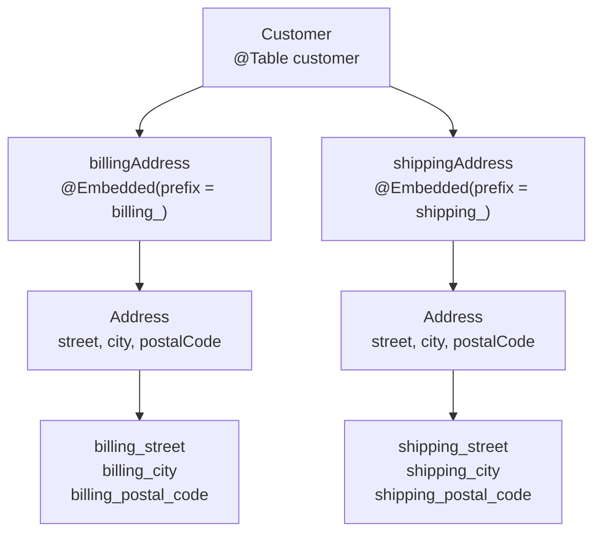

# Nhúng nhiều thuộc tính cùng kiểu mà không trùng tên cột

Trong một ứng dụng quản lý đơn hàng, khách hàng có thể có địa chỉ thanh toán và địa chỉ giao hàng. Hai địa chỉ có cùng cấu trúc gồm đường, thành phố và mã bưu chính, nhưng mang ý nghĩa nghiệp vụ khác nhau. Nếu cả hai cùng được lưu trong một bảng `customer`, ta cần một cách ánh xạ để các thuộc tính không cùng ghi vào một nhóm tên cột.

Spring Data JDBC giải quyết trường hợp này bằng `@Embedded` kết hợp thuộc tính `prefix`. Mỗi object nhúng được trải phẳng thành các cột trong hàng của aggregate root; prefix tạo không gian tên riêng cho từng object. Bài này trình bày cách dùng nhiều thuộc tính cùng kiểu, thiết kế schema SQL, xử lý object rỗng/null và kiểm thử mapping.

## 1. Bài toán: một kiểu địa chỉ, nhiều vai trò

Giả sử bảng khách hàng lưu hai địa chỉ:

- `billingAddress`: địa chỉ dùng cho hóa đơn.
- `shippingAddress`: địa chỉ nhận hàng.

Cả hai đều có cấu trúc:

| Thuộc tính Java | Ý nghĩa |
| --- | --- |
| `street` | Số nhà, tên đường hoặc địa chỉ chi tiết. |
| `city` | Thành phố/quận theo quy ước dữ liệu ứng dụng. |
| `postalCode` | Mã bưu chính. |

Một value object Java có thể được khai báo một lần:

```java
public record Address(
    String street,
    String city,
    String postalCode
) {}
```

Nếu chỉ nhúng một `Address` mà không chỉ định prefix, các cột theo quy ước có thể là `street`, `city`, `postal_code`. Nhưng nếu nhúng hai object cùng kiểu vào một bảng, cả hai cùng muốn dùng những tên cột đó. Cấu trúc bảng không thể có hai cột trùng tên.

Ta cần biến các tên thuộc tính thành hai nhóm:

| Object nhúng | Prefix | Các cột được tạo theo quy ước |
| --- | --- | --- |
| `billingAddress` | `billing_` | `billing_street`, `billing_city`, `billing_postal_code` |
| `shippingAddress` | `shipping_` | `shipping_street`, `shipping_city`, `shipping_postal_code` |

Đây là trường hợp sử dụng trực tiếp của `@Embedded(prefix = "...")`.

## 2. `@Embedded` và `prefix`

`@Embedded` thuộc Spring Data Relational:

```java
import org.springframework.data.relational.core.mapping.Embedded;
```

Annotation này được đặt trên thuộc tính của aggregate root để chỉ ra rằng giá trị của thuộc tính được lưu cùng hàng với root, bằng cách ánh xạ các thuộc tính bên trong thành những cột của bảng root.

Ví dụ:

```java
import org.springframework.data.annotation.Id;
import org.springframework.data.relational.core.mapping.Embedded;
import org.springframework.data.relational.core.mapping.Table;

@Table("customer")
public record Customer(
    @Id Long id,
    String name,
    @Embedded(prefix = "billing_")
    Address billingAddress,
    @Embedded(prefix = "shipping_")
    Address shippingAddress
) {}
```

Spring Data JDBC sẽ kết hợp prefix với tên cột được suy ra từ các thuộc tính của `Address`:

- `billingAddress.street` → `billing_street`.
- `billingAddress.postalCode` → `billing_postal_code`.
- `shippingAddress.street` → `shipping_street`.
- `shippingAddress.postalCode` → `shipping_postal_code`.

Prefix được ghép vào tên cột khi mapping; nó không đổi tên property Java và không tạo thêm bảng. Cách đặt prefix có dấu phân tách như dấu gạch dưới giúp tên cột dễ đọc và tránh nhập nhằng.

### Sơ đồ ánh xạ



Hai property có cùng kiểu Java nhưng metadata ánh xạ khác nhau do prefix được đặt tại từng thuộc tính.

## 3. Thiết kế schema SQL tương ứng

Hai object nhúng nằm trong cùng hàng của bảng `customer`. DDL PostgreSQL minh họa:

```sql
CREATE TABLE customer (
    id BIGINT GENERATED BY DEFAULT AS IDENTITY PRIMARY KEY,
    name VARCHAR(150) NOT NULL,

    billing_street VARCHAR(250),
    billing_city VARCHAR(100),
    billing_postal_code VARCHAR(20),

    shipping_street VARCHAR(250),
    shipping_city VARCHAR(100),
    shipping_postal_code VARCHAR(20)
);
```

Không có bảng `address` riêng trong mô hình này. Mỗi địa chỉ chiếm một nhóm cột trong bảng `customer`. Khi tải khách hàng, Spring Data JDBC đọc các cột tương ứng rồi dựng hai giá trị `Address`.

Nếu địa chỉ thanh toán bắt buộc còn địa chỉ giao hàng tùy chọn, schema có thể ràng buộc theo nghiệp vụ:

```sql
CREATE TABLE customer (
    id BIGINT GENERATED BY DEFAULT AS IDENTITY PRIMARY KEY,
    name VARCHAR(150) NOT NULL,

    billing_street VARCHAR(250) NOT NULL,
    billing_city VARCHAR(100) NOT NULL,
    billing_postal_code VARCHAR(20),

    shipping_street VARCHAR(250),
    shipping_city VARCHAR(100),
    shipping_postal_code VARCHAR(20),

    CONSTRAINT ck_customer_shipping_address_all_or_none
    CHECK (
        (shipping_street IS NULL
            AND shipping_city IS NULL
            AND shipping_postal_code IS NULL)
        OR
        (shipping_street IS NOT NULL
            AND shipping_city IS NOT NULL)
    )
);
```

Ràng buộc `CHECK` trên chỉ là một lựa chọn nghiệp vụ: hoặc không có địa chỉ giao hàng, hoặc có đủ các trường bắt buộc. Nếu mã bưu chính cũng bắt buộc khi có địa chỉ, thêm điều kiện `shipping_postal_code IS NOT NULL` vào nhánh thứ hai. Nếu địa chỉ có thể thiếu thành phần theo quy định quốc gia, hãy điều chỉnh constraint tương ứng.

`@Embedded` không tự sinh các cột này. Schema cần được tạo/cập nhật bằng SQL migration, Flyway/Liquibase hoặc quy trình quản trị database.

## 4. Một kiểu value object được dùng lại

`Address` không cần biết nó được nhúng với prefix nào. Nó chỉ mô tả dữ liệu địa chỉ:

```java
package com.example.shop.domain;

public record Address(
    String street,
    String city,
    String postalCode
) {}
```

Aggregate root dùng lại kiểu đó:

```java
package com.example.shop.domain;

import org.springframework.data.annotation.Id;
import org.springframework.data.relational.core.mapping.Embedded;
import org.springframework.data.relational.core.mapping.Table;

@Table("customer")
public record Customer(
    @Id Long id,
    String name,

    @Embedded(prefix = "billing_")
    Address billingAddress,

    @Embedded(prefix = "shipping_")
    Address shippingAddress
) {}
```

Ưu điểm:

- Không phải tạo hai kiểu gần như giống nhau như `BillingAddress` và `ShippingAddress` chỉ để đổi tên cột.
- Quy tắc dữ liệu địa chỉ được tập trung trong một kiểu.
- Tên property ở aggregate root thể hiện vai trò nghiệp vụ.
- Prefix tách biệt tên cột của hai object khi cùng tồn tại trong một hàng.
- Có thể thêm các method miền nghiệp vụ vào `Address` nếu cần, ví dụ định dạng địa chỉ hiển thị hoặc chuẩn hóa chuỗi.

Một value object nên tập trung vào giá trị và quy tắc của chính nó. Nó không cần giữ `customerId`, repository hoặc trạng thái persistence. Nếu địa chỉ có danh tính và vòng đời độc lập, mô hình embedded có thể không còn phù hợp.

## 5. Xử lý object nhúng rỗng bằng `onEmpty`

Một câu hỏi quan trọng là: nếu tất cả cột của một object nhúng đều `NULL`, Spring Data JDBC sẽ tạo object với các thuộc tính null hay đặt property của root thành null?

`@Embedded` có thuộc tính `onEmpty` để chọn hành vi khi toàn bộ cột của embedded value đều null. Hai lựa chọn chính:

| Giá trị | Hành vi khi tất cả cột của object nhúng là SQL NULL |
| --- | --- |
| `Embedded.OnEmpty.USE_NULL` | Property embedded được đặt thành `null`. |
| `Embedded.OnEmpty.USE_EMPTY` | Framework tạo object embedded dù tất cả giá trị thành phần đều null. |

Ví dụ địa chỉ giao hàng tùy chọn:

```java
@Embedded(
    prefix = "shipping_",
    onEmpty = Embedded.OnEmpty.USE_NULL
)
Address shippingAddress
```

Nếu `shipping_street`, `shipping_city` và `shipping_postal_code` đều null, `shippingAddress` sẽ là null.

Nếu muốn biểu diễn “chưa có dữ liệu nhưng vẫn có object rỗng”, dùng:

```java
@Embedded(
    prefix = "shipping_",
    onEmpty = Embedded.OnEmpty.USE_EMPTY
)
Address shippingAddress
```

Với record `Address`, object được dựng với các thành phần null nếu tất cả cột đều null và hành vi `USE_EMPTY` được áp dụng.

`onEmpty` chỉ quyết định trường hợp **toàn bộ các cột của embedded object đều null**. Nếu chỉ một số cột null, framework vẫn có dữ liệu để dựng object và những thuộc tính tương ứng có thể nhận null. Ví dụ `shipping_street` có giá trị nhưng `shipping_city` null thì object không được xem là “empty” theo nghĩa tất cả cột null.

Vì vậy, `USE_NULL` không thay thế validation cho một địa chỉ bị thiếu một phần. Nếu cần địa chỉ đầy đủ, dùng constraint SQL và validation/domain logic để bảo đảm các thành phần bắt buộc.

### Chọn `onEmpty` theo ngữ nghĩa

- Dùng `USE_NULL` khi không có dữ liệu ở tất cả cột có nghĩa là không tồn tại giá trị địa chỉ.
- Dùng `USE_EMPTY` khi domain muốn phân biệt một object hiện diện nhưng các thành phần chưa có giá trị.
- Với object bắt buộc, tốt nhất schema không cho phép toàn bộ cột null; domain cũng nên kiểm tra object không null.

Không chọn `USE_EMPTY` chỉ để né lỗi constructor. Nó có thể tạo ra object không có dữ liệu nhưng lại được các tầng khác hiểu là địa chỉ hợp lệ.

## 6. Prefix phải duy nhất và không gây va chạm

Khi nhúng nhiều property cùng kiểu, mỗi prefix phải tạo ra một tập tên cột riêng. Ví dụ:

```java
@Table("customer")
public record Customer(
    @Id Long id,
    @Embedded(prefix = "billing_") Address billingAddress,
    @Embedded(prefix = "shipping_") Address shippingAddress,
    @Embedded(prefix = "registered_") Address registeredAddress
) {}
```

Các cột theo quy ước:

| Prefix | Các cột |
| --- | --- |
| `billing_` | `billing_street`, `billing_city`, `billing_postal_code` |
| `shipping_` | `shipping_street`, `shipping_city`, `shipping_postal_code` |
| `registered_` | `registered_street`, `registered_city`, `registered_postal_code` |

Tránh prefix chung chung hoặc prefix lồng nhau dễ gây trùng tên:

```java
// Không phù hợp: hai nhóm có thể cùng tạo một số tên cột.
@Embedded(prefix = "address_") Address billingAddress,
@Embedded(prefix = "address_") Address shippingAddress
```

Nếu cả hai property đều dùng `address_`, các thành phần `street`, `city` và `postal_code` bị ánh xạ vào cùng một cột. Đây là xung đột mapping và không thể biểu diễn hai giá trị độc lập.

Ngoài prefix giữa các embedded object, cần kiểm tra va chạm với property trực tiếp của root. Ví dụ root đã có `billing_city` thì embedded prefix `billing_` cũng có thể sinh ra cùng tên. Quy ước tên cột phải được thiết kế cho toàn bộ bảng, không chỉ từng object.

## 7. Kết hợp `@Column` với prefix

Nếu tên cột bên trong value object không theo naming strategy mặc định, có thể đặt `@Column` trên thuộc tính của value type. Prefix ở nơi nhúng giúp phân biệt vai trò, còn tên cột tùy chỉnh mô tả phần tên của thuộc tính.

Ví dụ:

```java
import org.springframework.data.relational.core.mapping.Column;

public record Address(
    @Column("street_name") String street,
    String city,
    String postalCode
) {}
```

Khi nhúng với prefix:

```java
@Embedded(prefix = "billing_")
Address billingAddress,

@Embedded(prefix = "shipping_")
Address shippingAddress
```

Các cột tương ứng theo mapping sẽ có dạng `billing_street_name`, `shipping_street_name` và các cột city/postal code có prefix tương ứng. Hãy đối chiếu SQL log và metadata của phiên bản Spring Data JDBC đang sử dụng nếu schema có nhiều tên tùy chỉnh; DDL phải khớp chính xác với kết quả mapping.

Không dùng `@Column` để thay thế prefix khi cần cùng một value type ở nhiều property. `@Column("street_name")` đặt trên `Address.street` có cùng tên cho mọi nơi nhúng; prefix ở từng property root mới tách các nhóm cột.

## 8. Embedded object khác với entity/aggregate riêng

Một địa chỉ có thể là embedded value object hoặc là entity có bảng riêng. Quyết định phụ thuộc vào danh tính và vòng đời.

| Tiêu chí | Embedded value object | Entity/aggregate riêng |
| --- | --- | --- |
| Nơi lưu | Các cột trong bảng của root. | Bảng riêng. |
| Danh tính riêng | Không có ID độc lập trong mô hình embedded. | Có ID hoặc khóa riêng. |
| Vòng đời | Được đọc/ghi cùng root. | Có thể quản lý độc lập. |
| Repository riêng | Không cần. | Có thể có repository riêng. |
| Tìm kiếm/liên kết | Thường qua root và các cột phẳng. | Có thể truy vấn/join theo ID. |
| Nhiều object cùng kiểu | Dùng prefix để phân biệt cột. | Mỗi hàng có khóa và liên kết riêng. |

Nếu địa chỉ chỉ là tập giá trị mô tả khách hàng và được lưu/cập nhật cùng khách hàng, `@Embedded` phù hợp. Nếu địa chỉ có thể được chia sẻ giữa nhiều khách hàng, có lịch sử độc lập, có trạng thái xác minh hoặc cần quản lý vòng đời riêng, một aggregate/bảng địa chỉ riêng có thể hợp lý hơn.

Không nhầm `@Embedded` với `@MappedCollection`:

- `@Embedded` trải phẳng thuộc tính của value object thành các cột trong cùng hàng.
- `@MappedCollection` biểu diễn collection/map các object con thường được lưu thành hàng trong bảng riêng, liên kết về aggregate root.

Một property cùng kiểu có thể được nhúng nhiều lần; điều đó không tạo thêm aggregate root hay repository.

## 9. Query, repository và cập nhật embedded object

Repository thao tác với root như bình thường:

```java
import org.springframework.data.repository.CrudRepository;

public interface CustomerRepository
        extends CrudRepository<Customer, Long> {
}
```

Khi lưu một khách hàng mới, các cột của hai địa chỉ được ghi vào cùng một hàng `customer`. Khi đọc `findById`, Spring Data JDBC dựng lại `billingAddress` và `shippingAddress` từ các nhóm cột có prefix tương ứng.

Ví dụ:

```java
var customer = new Customer(
    null,
    "Lan",
    new Address("12 Nguyen Hue", "Ho Chi Minh City", "700000"),
    new Address("88 Le Loi", "Ho Chi Minh City", "700000")
);

Customer saved = customerRepository.save(customer);

Customer loaded = customerRepository.findById(saved.id())
    .orElseThrow();
```

Ví dụ trên minh họa object mapping; service thực tế nên chuẩn hóa địa chỉ và xác thực theo quy tắc nghiệp vụ trước khi lưu.

Nếu chỉ thay đổi địa chỉ giao hàng, tạo aggregate mới với `shippingAddress` mới rồi lưu root. Vì embedded object không có ID riêng, không có thao tác repository độc lập như `addressRepository.save(shippingAddress)`. Cách Spring Data JDBC ghi aggregate có thể dẫn đến cập nhật nhiều cột thuộc root; hãy quan sát SQL thực tế và đặt ranh giới transaction ở service khi nghiệp vụ gồm nhiều thao tác.

### Tìm kiếm theo thuộc tính embedded

Nếu cần tìm khách hàng theo thành phố giao hàng, thuộc tính embedded được ánh xạ thành cột có prefix, ví dụ `shipping_city`. Có thể định nghĩa query theo khả năng property path/derived query của phiên bản Spring Data JDBC đang dùng hoặc dùng SQL tường minh khi cần rõ ràng:

```sql
SELECT id, name,
       billing_street, billing_city, billing_postal_code,
       shipping_street, shipping_city, shipping_postal_code
FROM customer
WHERE shipping_city = :city;
```

Nếu query trả về `Customer` đầy đủ, cần cung cấp các cột cần thiết để mapping root và các embedded property. Nếu chỉ cần `id` và `name`, dùng projection/DTO thay vì ánh xạ một tập cột thiếu vào aggregate đầy đủ.

## 10. Quy tắc nullability và validation cho từng embedded object

Hai địa chỉ cùng kiểu nhưng có thể có quy tắc khác nhau:

- Địa chỉ thanh toán bắt buộc.
- Địa chỉ giao hàng tùy chọn.
- Địa chỉ đăng ký doanh nghiệp có thể chỉ xuất hiện với một số loại khách hàng.

`@Embedded` không tự áp đặt tính bắt buộc của một object. Dùng `onEmpty` để định nghĩa hành vi khi toàn bộ cột embedded null, và dùng database/domain validation cho những điều kiện cụ thể.

Ví dụ:

```java
@Table("customer")
public record Customer(
    @Id Long id,
    String name,

    @Embedded(
        prefix = "billing_",
        onEmpty = Embedded.OnEmpty.USE_NULL
    )
    Address billingAddress,

    @Embedded(
        prefix = "shipping_",
        onEmpty = Embedded.OnEmpty.USE_NULL
    )
    Address shippingAddress
) {
    public Customer {
        Objects.requireNonNull(billingAddress, "billingAddress is required");
    }
}
```

Với thiết kế này, nếu tất cả cột billing đều null, mapping tạo `billingAddress == null`; compact constructor từ chối vì địa chỉ thanh toán bắt buộc. Để dữ liệu không hợp lệ không lọt vào database, schema vẫn nên có `NOT NULL` trên các cột billing bắt buộc. Constructor validation bổ sung bảo vệ domain khi object được tạo từ nguồn khác.

Địa chỉ giao hàng cho phép null; các cột tương ứng cho phép SQL NULL. Nếu chỉ một vài thành phần có thể null, cần quyết định rõ object có hợp lệ hay không. Có thể validate trong `Address` hoặc ở service.

## 11. Những lỗi thường gặp khi dùng nhiều embedded object

| Triệu chứng | Nguyên nhân | Cách xử lý |
| --- | --- | --- |
| Hai địa chỉ ghi đè/đọc cùng giá trị | Cả hai property dùng cùng prefix hoặc không có prefix phân biệt. | Đặt prefix riêng, duy nhất cho từng property. |
| Không tìm thấy cột | DDL không khớp tên prefix + property sau naming strategy. | Đối chiếu `@Embedded`, `@Column` và SQL schema. |
| Một object luôn thành null | Tất cả cột của nhóm prefix đều null và `onEmpty = USE_NULL`. | Kiểm tra dữ liệu; chọn `USE_EMPTY` chỉ khi domain muốn object rỗng. |
| Object được tạo nhưng một phần field null | Chỉ một số cột của nhóm embedded có giá trị. | Xác định nullability từng thành phần và validate object. |
| Constructor không tạo được object | Primitive/constructor không chấp nhận null hoặc constructor mapping sai. | Dùng kiểu nullable phù hợp, sửa dữ liệu/schema hoặc cấu hình persistence creator. |
| Thêm field vào `Address` rồi ứng dụng lỗi | Bảng chưa có cột mới hoặc migration chưa chạy. | Tạo migration trước khi deploy code phụ thuộc cột mới. |
| Query báo thiếu cột khi map `Customer` | Custom SELECT không trả đủ cột embedded. | Dùng query đầy đủ hoặc projection riêng. |
| Prefix mới va chạm cột root | Tên cột đã được dùng bởi thuộc tính khác. | Thiết kế lại naming convention toàn bảng. |
| Dùng `@Embedded` nhưng chờ có bảng địa chỉ | Hiểu nhầm embedded với entity/bảng con. | Dùng bảng riêng và mapping quan hệ phù hợp nếu cần vòng đời độc lập. |

Khi debug, bật SQL logging trong môi trường phát triển và kiểm tra tên cột thực tế. Đừng chỉ nhìn tên property Java; Spring Data JDBC áp dụng naming strategy và prefix trước khi gửi SQL.

## 12. Bài thực hành: billing và shipping cùng kiểu Address

Thực hành theo thứ tự:

1. Tạo bảng `customer` với hai nhóm cột `billing_*` và `shipping_*`.
2. Tạo record `Address` chỉ gồm `street`, `city`, `postalCode`.
3. Tạo `Customer` với hai property `Address`, mỗi property có prefix riêng.
4. Dùng repository lưu một khách hàng với hai địa chỉ khác nhau, sau đó đọc lại và so sánh từng giá trị.
5. Lưu một khách hàng không có shipping address; thử `USE_NULL` và quan sát property sau khi đọc.
6. Thử `USE_EMPTY` và so sánh với `USE_NULL`.
7. Tạm dùng cùng prefix cho hai property để nhận biết xung đột tên cột; khôi phục prefix duy nhất.
8. Thêm field `countryCode` vào `Address`, viết migration thêm `billing_country_code` và `shipping_country_code`, rồi kiểm tra mapping.
9. Viết test cho địa chỉ thanh toán bắt buộc, địa chỉ giao hàng tùy chọn và trường hợp embedded object có dữ liệu không đầy đủ.

Kết quả mong đợi là cùng một kiểu `Address` được dựng đúng thành hai property độc lập, không trộn cột và không cần nhân đôi class Java.

## 13. Câu hỏi tự kiểm tra

- Vì sao hai property cùng kiểu `Address` không thể cùng dùng một tập tên cột?
- `@Embedded(prefix = "billing_")` thay đổi tên property Java hay tên cột SQL?
- Prefix được ghép với những thuộc tính nào của embedded value?
- Tại sao cần tạo các cột `billing_*` và `shipping_*` trong cùng bảng?
- `USE_NULL` và `USE_EMPTY` khác nhau thế nào khi toàn bộ cột embedded là SQL NULL?
- Nếu một cột embedded có giá trị còn các cột khác null, `onEmpty` có biến cả object thành null không?
- Khi nào nên dùng embedded value object và khi nào nên tạo bảng/aggregate riêng?
- `@Embedded` khác `@MappedCollection` như thế nào?
- Khi thêm property vào value type, cần thay đổi những gì ở schema?
- Vì sao query tùy chỉnh trả thiếu cột có thể không dựng được aggregate root?

Nắm được `@Embedded(prefix = ...)` giúp tái sử dụng value object trong cùng một hàng mà vẫn giữ được tên cột riêng cho từng vai trò. Khi nhiều property dùng chung kiểu Java, hãy xác định prefix theo ngữ nghĩa domain, tạo schema tương ứng và chọn nullability phù hợp. `@Embedded` giải quyết ánh xạ; DDL/migration và validation mới bảo đảm cấu trúc dữ liệu thực tế đúng với quy tắc nghiệp vụ.
