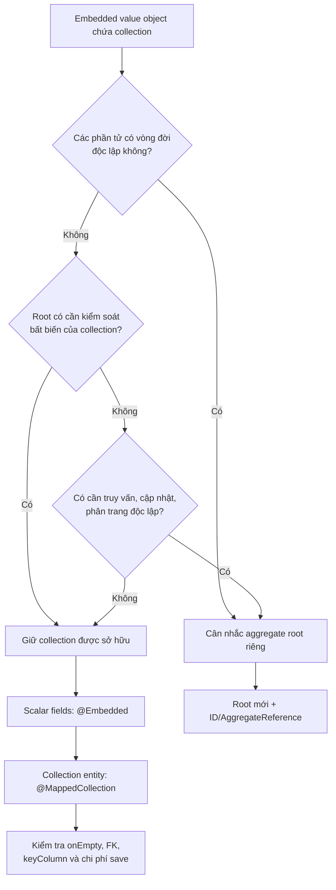

# Lưu ý đối tượng nhúng chứa collection và lựa chọn ranh giới aggregate

Trong Spring Data JDBC, **đối tượng nhúng** (*embedded object*) thường được dùng để biểu diễn một value object thuộc aggregate root. Các thuộc tính đơn giản của nó được ánh xạ vào cùng hàng dữ liệu với aggregate root. Tuy nhiên, một value object cũng có thể chứa collection, chẳng hạn danh sách hướng dẫn giao hàng hoặc các mục cấu hình.

Trường hợp này cần hiểu rõ hai việc:

1. **Đối tượng được nhúng vẫn thuộc aggregate root.** Nó không tự trở thành một aggregate độc lập chỉ vì có cấu trúc Java riêng.
2. **Collection bên trong có thể được lưu thành các hàng ở bảng khác.** Việc các phần tử nằm ở bảng riêng không tự biến chúng thành aggregate root độc lập.

Nếu nhầm lẫn giữa ranh giới object, ranh giới bảng và ranh giới aggregate, mô hình dễ phát sinh thao tác lưu quá lớn, xóa dữ liệu ngoài ý muốn hoặc không còn bảo vệ được quy tắc nghiệp vụ.

Bài học dùng ví dụ đơn hàng có thông tin giao hàng được nhúng và danh sách chỉ dẫn giao hàng. Từ đó, ta phân biệt cách ánh xạ scalar fields, collection, vòng đời và các dấu hiệu cho thấy nên giữ collection bên trong aggregate hay tách thành aggregate riêng.

## 1. Phân biệt ba khái niệm: object, table và aggregate

Trước khi dùng annotation, cần tách ba khái niệm:

- **Object trong Java:** cách tổ chức dữ liệu và hành vi trong mô hình domain.
- **Table trong database:** cấu trúc lưu trữ các hàng và cột.
- **Aggregate:** ranh giới nhất quán nghiệp vụ, nơi một aggregate root kiểm soát các thay đổi liên quan.

Ba khái niệm này không bắt buộc có quan hệ một-một.

Ví dụ:

```text
PurchaseOrder aggregate
┌─────────────────────────────────────────┐
│ PurchaseOrder (aggregate root)          │
│                                         │
│ DeliveryDetails (embedded value object) │
│   recipient                             │
│   phone                                 │
│   street                                │
│   instructions                          │
│     ├── DeliveryInstruction             │
│     └── DeliveryInstruction             │
└─────────────────────────────────────────┘

Database:
  purchase_orders       <- root + scalar fields của embedded object
  delivery_instructions <- collection elements được sở hữu
```

Ở đây:

- `PurchaseOrder` là aggregate root.
- `DeliveryDetails` là value object được nhúng, không có identity hay repository độc lập.
- Các thuộc tính đơn giản của `DeliveryDetails` được lưu ở bảng `purchase_orders`.
- Các phần tử `DeliveryInstruction` là thành phần được sở hữu trong aggregate; chúng được lưu thành các hàng trong bảng `delivery_instructions`.
- Mọi thay đổi đối với collection vẫn được quản lý thông qua `PurchaseOrder`.

**Một object nhúng có thể trải qua nhiều bảng khi nó chứa collection.** Việc dùng `@Embedded` không có nghĩa mọi dữ liệu nằm trong object đó đều phải trở thành các cột của một bảng.

## 2. Đối tượng nhúng trong Spring Data JDBC là gì?

Đối tượng nhúng là cách mô hình hóa một **value object** có ý nghĩa trong domain, nhưng không cần một bảng hoặc identity riêng. Spring Data Relational cung cấp annotation `@Embedded` để ánh xạ các thuộc tính của object đó vào bảng của entity cha.

Ví dụ một địa chỉ giao hàng:

```java
public record DeliveryAddress(
        String recipient,
        String phone,
        String street,
        String city,
        String postalCode
) {
}
```

`DeliveryAddress` mô tả một giá trị có ý nghĩa hoàn chỉnh trong nghiệp vụ. Nó có thể được thay thế như một đơn vị, không nhất thiết có vòng đời độc lập hay được truy vấn bằng repository riêng.

Aggregate root sử dụng nó:

```java
import org.springframework.data.annotation.Id;
import org.springframework.data.relational.core.mapping.Embedded;
import org.springframework.data.relational.core.mapping.Table;

@Table("purchase_orders")
public record PurchaseOrder(
        @Id Long id,
        String status,
        @Embedded(prefix = "delivery_")
        DeliveryAddress deliveryAddress
) {
}
```

Với prefix `delivery_`, các thuộc tính của `DeliveryAddress` được ánh xạ thành các cột cùng bảng:

| Thuộc tính Java | Cột trong bảng `purchase_orders` |
| --- | --- |
| `id` | `id` |
| `status` | `status` |
| `deliveryAddress.recipient` | `delivery_recipient` |
| `deliveryAddress.phone` | `delivery_phone` |
| `deliveryAddress.street` | `delivery_street` |
| `deliveryAddress.city` | `delivery_city` |
| `deliveryAddress.postalCode` | `delivery_postal_code` |

Ví dụ schema PostgreSQL:

```sql
CREATE TABLE purchase_orders (
    id BIGINT GENERATED BY DEFAULT AS IDENTITY PRIMARY KEY,
    status VARCHAR(30) NOT NULL,
    delivery_recipient VARCHAR(150),
    delivery_phone VARCHAR(30),
    delivery_street VARCHAR(250),
    delivery_city VARCHAR(100),
    delivery_postal_code VARCHAR(20)
);
```

Không cần tạo bảng `delivery_addresses` chỉ vì Java có class `DeliveryAddress`. Đây là điểm khác với một entity được tham chiếu bằng quan hệ một-nhiều.

### 2.1. Vì sao dùng value object?

Value object thường có những đặc điểm:

- Được xác định bởi các giá trị bên trong thay vì ID riêng.
- Có ý nghĩa khi nằm trong ngữ cảnh của aggregate sở hữu.
- Không có repository hoặc vòng đời độc lập.
- Có thể được thay thế như một đơn vị khi giá trị thay đổi.
- Giúp nhóm các thuộc tính liên quan thành một khái niệm domain có tên.

Ví dụ, địa chỉ giao hàng có người nhận, số điện thoại, đường, thành phố và mã bưu chính. Đưa chúng vào `DeliveryAddress` giúp code biểu đạt ý nghĩa nghiệp vụ rõ hơn so với một aggregate có năm trường rời rạc.

Tuy nhiên, việc tạo class riêng không tự động khiến nó trở thành embedded value object. **Cách mapping và ranh giới nghiệp vụ** mới quyết định vai trò của nó.

## 3. Collection bên trong object nhúng có gì đặc biệt?

Giả sử `DeliveryDetails` chứa thêm danh sách chỉ dẫn giao hàng:

```java
public record DeliveryInstruction(String text) {
}

public record DeliveryDetails(
        String recipient,
        String phone,
        String street,
        List<DeliveryInstruction> instructions
) {
}
```

Ba thuộc tính đầu là giá trị đơn giản; `instructions` là collection các đối tượng con.

Spring Data JDBC xử lý chúng theo hai cơ chế khác nhau:

| Thành phần | Cách ánh xạ |
| --- | --- |
| `recipient`, `phone`, `street` | Thuộc tính của embedded object, được trải phẳng thành cột trong bảng root. |
| `instructions` | Collection các entity được sở hữu, ánh xạ thành quan hệ một-nhiều và lưu các phần tử ở bảng riêng. |

Sơ đồ:

```text
PurchaseOrder
    |
    +-- DeliveryDetails (embedded)
            |
            +-- recipient  --------> purchase_orders.delivery_recipient
            +-- phone      --------> purchase_orders.delivery_phone
            +-- street     --------> purchase_orders.delivery_street
            |
            +-- instructions
                    |
                    +-- item 1 ----> delivery_instructions row 1
                    +-- item 2 ----> delivery_instructions row 2
```

Collection không được biến thành một cột object duy nhất chỉ vì nó nằm trong object nhúng. Với collection các entity, Spring Data JDBC ánh xạ từng phần tử theo cơ chế collection/relationship của aggregate.

### 3.1. Collection entity khác collection kiểu đơn giản

Cần phân biệt:

- `List<DeliveryInstruction>`: collection các đối tượng entity con, có thể được ánh xạ thành các hàng trong bảng quan hệ.
- `List<String>` hoặc `List<Integer>`: collection kiểu đơn giản. Spring Data Relational có thể ánh xạ array/collection kiểu đơn giản vào cột SQL dạng array nếu database và driver hỗ trợ kiểu đó.

Không nên giả định `List<String>` luôn được lưu thành một bảng con giống `List<DeliveryInstruction>`. Nếu cần lưu mỗi phần tử đơn giản thành một hàng độc lập, hãy cân nhắc mô hình hóa nó thành một kiểu entity con có ý nghĩa hoặc sử dụng cách lưu trữ phù hợp với database.

## 4. Ánh xạ collection bằng @MappedCollection

Annotation `@MappedCollection` cấu hình cách ánh xạ `List`, `Set` hoặc `Map` các đối tượng con trong aggregate.

Hai thuộc tính thường cần biết:

- `idColumn`: tên cột khóa ngoại ở bảng con, trỏ về ID của aggregate root.
- `keyColumn`: tên cột lưu vị trí phần tử trong `List` hoặc key của `Map`. Với `Set`, key column không có tác dụng.

Ví dụ:

```java
import java.util.List;

import org.springframework.data.relational.core.mapping.MappedCollection;

public record DeliveryDetails(
        String recipient,
        String phone,
        String street,

        @MappedCollection(
                idColumn = "order_id",
                keyColumn = "instruction_position"
        )
        List<DeliveryInstruction> instructions
) {
}
```

Trong ví dụ này, `order_id` liên kết mỗi instruction với `PurchaseOrder` sở hữu nó. `instruction_position` lưu vị trí của phần tử trong danh sách.

Một bảng con tương ứng có thể là:

```sql
CREATE TABLE delivery_instructions (
    order_id BIGINT NOT NULL
        REFERENCES purchase_orders(id),
    instruction_position INTEGER NOT NULL,
    text VARCHAR(500) NOT NULL,
    PRIMARY KEY (order_id, instruction_position)
);
```

Một đơn hàng có thể có nhiều instruction:

```text
purchase_orders
---------------
id = 501
status = 'DRAFT'
delivery_recipient = 'Nguyễn An'
delivery_street = '12 Nguyễn Trãi'

delivery_instructions
---------------------
order_id | instruction_position | text
---------+----------------------+-------------------------
501      | 0                    | Gọi trước khi giao
501      | 1                    | Giao tại quầy lễ tân
```

Các hàng trong `delivery_instructions` không cần một ID toàn cục riêng nếu khóa ghép `(order_id, instruction_position)` đáp ứng nhu cầu của mô hình. Nếu nghiệp vụ cần identity riêng cho từng instruction, cần thiết kế khóa và mapping phù hợp; việc có ID riêng vẫn không tự biến instruction thành aggregate root.

### 4.1. List, Set và Map có ý nghĩa khác nhau

| Kiểu collection | Ý nghĩa | Cột quan hệ thường cần |
| --- | --- | --- |
| `List<T>` | Có thứ tự, cho phép phần tử trùng tùy cách domain xử lý. | Khóa ngoại + vị trí/index. |
| `Set<T>` | Tập hợp không biểu diễn thứ tự; phần tử theo equality của Java. | Khóa ngoại; key column không cần thiết. |
| `Map<K,T>` | Mỗi phần tử có key. | Khóa ngoại + cột map key. |

Ví dụ `Map<String, DeliveryInstruction>` có thể dùng key như `"FRONT_DESK"`, `"CONTACT"`. Khi dùng `Map`, key phải là kiểu đơn giản phù hợp và schema cần cột chứa key.

Không nên chọn `List` chỉ vì nó quen thuộc nếu thứ tự không có ý nghĩa. Ngược lại, nếu thứ tự chỉ dẫn giao hàng quan trọng, `List` và cột vị trí giúp bảo toàn thứ tự khi đọc lại.

### 4.2. Vì sao phải khai báo keyColumn cho List?

Một bảng quan hệ chỉ có `order_id` chưa đủ để khôi phục thứ tự danh sách. Nếu một đơn hàng có nhiều instruction, database cần thêm thông tin vị trí:

```text
order_id | instruction_position | text
---------+----------------------+-----------------------
501      | 0                    | Gọi trước khi giao
501      | 1                    | Giao tại quầy lễ tân
501      | 2                    | Không gọi sau 21 giờ
```

`instruction_position` là khóa phần tử trong collection của aggregate. Nó không phải ID aggregate và cũng không nhất thiết là identity nghiệp vụ độc lập.

## 5. Ví dụ đầy đủ: embedded object chứa collection

Ta sẽ xây dựng aggregate `PurchaseOrder` với:

- Thông tin đơn hàng.
- `DeliveryDetails` là embedded value object.
- Các trường người nhận, số điện thoại và địa chỉ được lưu cùng hàng root.
- `List<DeliveryInstruction>` được lưu thành các hàng con.
- Mọi instruction được quản lý thông qua `PurchaseOrder`.

### 5.1. Aggregate root

```java
import java.util.List;

import org.springframework.data.annotation.Id;
import org.springframework.data.relational.core.mapping.Embedded;
import org.springframework.data.relational.core.mapping.Table;

@Table("purchase_orders")
public record PurchaseOrder(
        @Id Long id,
        String status,

        @Embedded(
                prefix = "delivery_",
                onEmpty = Embedded.OnEmpty.USE_NULL
        )
        DeliveryDetails deliveryDetails
) {
}
```

`@Embedded` cho biết `DeliveryDetails` được ánh xạ vào bảng của `PurchaseOrder`. Prefix giúp tránh trùng tên cột nếu aggregate còn một embedded object khác có thuộc tính `phone` hoặc `street`.

### 5.2. Embedded value object

```java
import java.util.List;

import org.springframework.data.relational.core.mapping.MappedCollection;

public record DeliveryDetails(
        String recipient,
        String phone,
        String street,
        String city,

        @MappedCollection(
                idColumn = "order_id",
                keyColumn = "instruction_position"
        )
        List<DeliveryInstruction> instructions
) {
    public DeliveryDetails {
        instructions = instructions == null
                ? List.of()
                : List.copyOf(instructions);
    }
}
```

`DeliveryDetails` không có `@Id` và không cần repository riêng. Constructor chuẩn hóa collection null thành collection rỗng, để domain có quy tắc rõ ràng: object delivery details luôn chứa một danh sách instruction có thể rỗng.

Đây là một quyết định của ví dụ. Nếu domain muốn phân biệt “không có danh sách được cung cấp” với “đã xác định danh sách rỗng”, không nên chuẩn hóa hai trạng thái này một cách tùy tiện.

### 5.3. Phần tử của collection

```java
import org.springframework.data.relational.core.mapping.Table;

@Table("delivery_instructions")
public record DeliveryInstruction(String text) {

    public DeliveryInstruction {
        if (text == null || text.isBlank()) {
            throw new IllegalArgumentException(
                    "Instruction text is required"
            );
        }
    }
}
```

`DeliveryInstruction` được lưu thành hàng trong bảng `delivery_instructions`. Nó là một thành phần được sở hữu của aggregate trong ví dụ này, không phải root độc lập.

### 5.4. Repository chỉ dành cho aggregate root

```java
import org.springframework.data.repository.CrudRepository;

public interface PurchaseOrderRepository
        extends CrudRepository<PurchaseOrder, Long> {
}
```

Không cần tạo `DeliveryDetailsRepository` hoặc `DeliveryInstructionRepository` chỉ để thao tác các thành phần này. Các thay đổi được thực hiện qua aggregate root.

### 5.5. Tạo và lưu aggregate

```java
import java.util.List;

PurchaseOrder order = new PurchaseOrder(
        null,
        "DRAFT",
        new DeliveryDetails(
                "Nguyễn An",
                "0900000000",
                "12 Nguyễn Trãi",
                "Hà Nội",
                List.of(
                        new DeliveryInstruction("Gọi trước khi giao"),
                        new DeliveryInstruction("Giao tại quầy lễ tân")
                )
        )
);

PurchaseOrder saved = purchaseOrderRepository.save(order);
```

Về mặt logic, Spring Data JDBC thực hiện:

1. Chèn hàng root vào `purchase_orders`.
2. Ánh xạ các scalar fields của `DeliveryDetails` vào các cột có prefix `delivery_`.
3. Nhận ID của `PurchaseOrder`.
4. Chèn các phần tử `DeliveryInstruction` vào `delivery_instructions` với `order_id` là ID root và `instruction_position` tương ứng.

Sơ đồ:

```text
PurchaseOrderRepository.save(order)
                |
                v
         INSERT purchase_orders
                |
                +-- id được database cấp
                |
                +-- delivery_recipient
                +-- delivery_phone
                +-- delivery_street
                +-- delivery_city
                |
                v
      INSERT delivery_instructions
                |
                +-- order_id = root id
                +-- instruction_position = 0
                +-- instruction_position = 1
```

Đây là một lần lưu aggregate ở cấp domain, nhưng có thể bao gồm nhiều câu lệnh SQL. Giao dịch phù hợp giúp các thay đổi trong cùng aggregate được commit hoặc rollback nhất quán.

### 5.6. Đọc lại aggregate

```java
PurchaseOrder loaded = purchaseOrderRepository.findById(saved.id())
        .orElseThrow();

DeliveryDetails details = loaded.deliveryDetails();

System.out.println(details.recipient());
System.out.println(details.instructions().size());
System.out.println(details.instructions().get(0).text());
```

Spring Data JDBC khôi phục:

- Các cột `delivery_recipient`, `delivery_phone`, `delivery_street`, `delivery_city` thành `DeliveryDetails`.
- Các hàng trong `delivery_instructions` thành collection `instructions`.
- Quan hệ sở hữu thông qua `order_id` và vị trí của từng phần tử.

Đối tượng Java được khôi phục theo mô hình domain, dù dữ liệu của nó nằm ở nhiều bảng.

## 6. Ý nghĩa của @Embedded.onEmpty khi object có collection

Đây là một lưu ý quan trọng khi embedded object chứa collection.

`@Embedded` có thuộc tính `onEmpty` để quyết định cách khôi phục embedded object khi tất cả các cột của nó đều null:

- `USE_NULL`: embedded property được đặt thành `null` nếu tất cả thuộc tính được ánh xạ của nó đều null.
- `USE_EMPTY`: cố gắng tạo một instance của embedded type với các thuộc tính có thể null, thay vì đặt cả object thành null.

Ví dụ object chỉ có scalar fields:

```java
public record ContactDetails(
        String phone,
        String email
) {
}
```

Nếu các cột `contact_phone` và `contact_email` đều null, với `USE_NULL` thì `contactDetails` có thể được khôi phục thành null.

Nhưng nếu embedded object có collection hoặc map, hành vi có một điểm đặc biệt:

> Embedded entities chứa Collection hoặc Map luôn được xem là non-empty, vì collection/map ít nhất cũng có thể tồn tại dưới dạng collection/map rỗng. Do đó embedded object sẽ không trở thành null chỉ nhờ `onEmpty = USE_NULL`.

Ví dụ:

```java
public record DeliveryDetails(
        String recipient,

        @MappedCollection(
                idColumn = "order_id",
                keyColumn = "instruction_position"
        )
        List<DeliveryInstruction> instructions
) {
}
```

Giả sử:

- `delivery_recipient` trong hàng root là SQL `NULL`.
- Không có hàng nào trong `delivery_instructions`.
- Collection được khôi phục là một collection rỗng.

Vì embedded object có collection, `DeliveryDetails` vẫn được xem là non-empty theo quy tắc mapping. `@Embedded(onEmpty = USE_NULL)` không tự biến nó thành null chỉ vì các scalar fields đều null.

### 6.1. Phân biệt object null và collection rỗng

Hai trạng thái này khác nhau:

| Trạng thái domain | Ý nghĩa |
| --- | --- |
| `deliveryDetails == null` | Không có thông tin giao hàng được biểu diễn như một object. |
| `deliveryDetails != null` và `instructions.isEmpty()` | Có object thông tin giao hàng, nhưng hiện không có instruction. |
| `deliveryDetails != null` và `instructions.size() > 0` | Có object thông tin giao hàng và có các instruction. |

Nếu domain cần phân biệt ba trạng thái này, hãy thiết kế constructor, factory, DTO và mapping theo cách rõ ràng. Đừng dựa vào `onEmpty` để tạo ra một trạng thái null mà collection khiến framework không thể diễn giải theo cách đó.

### 6.2. Khi nào dùng USE_NULL, khi nào dùng USE_EMPTY?

| Nhu cầu | Lựa chọn |
| --- | --- |
| Không có dữ liệu scalar thì muốn embedded property là null. | `USE_NULL` hoặc shortcut `@Embedded.Nullable`. |
| Luôn muốn khôi phục object, kể cả khi các cột đều null. | `USE_EMPTY` hoặc shortcut `@Embedded.Empty`. |
| Embedded object chứa collection/map và muốn object tự thành null khi collection rỗng. | `USE_NULL` không đáp ứng ý nghĩa đó; cần mô hình lại hoặc xử lý rõ ràng ở domain. |
| Collection rỗng là trạng thái hợp lệ của object. | Giữ object và collection rỗng; đây thường là mô hình đơn giản hơn. |

Các shortcut `@Embedded.Nullable` và `@Embedded.Empty` giúp rút gọn cấu hình `onEmpty`. Nếu cần prefix hoặc các thuộc tính khác, dùng dạng `@Embedded(...)` tường minh.

## 7. Collection được sở hữu không đồng nghĩa với aggregate độc lập

Một collection được lưu ở bảng riêng có thể khiến người mới học nghĩ rằng mỗi phần tử nên có repository riêng. Nhưng **ranh giới aggregate không được quyết định bởi số lượng bảng**.

Ví dụ `DeliveryInstruction`:

- Chỉ có ý nghĩa trong ngữ cảnh đơn hàng.
- Không được chia sẻ giữa nhiều đơn hàng.
- Được tạo, sửa, xóa thông qua quy tắc của đơn hàng.
- Không cần được truy vấn như một aggregate root độc lập.
- Khi xóa đơn hàng, các instruction thuộc đơn hàng cũng phải được xử lý theo vòng đời đó.

Vì vậy, collection vẫn thuộc `PurchaseOrder` aggregate.

```text
PurchaseOrder aggregate
    |
    +-- DeliveryDetails (embedded)
            |
            +-- DeliveryInstruction A
            +-- DeliveryInstruction B

Repository:
  PurchaseOrderRepository

Không cần:
  DeliveryDetailsRepository
  DeliveryInstructionRepository
```

Một quan hệ một-nhiều trong database không tự nói rằng entity con là root. Nó có thể chỉ là cách lưu các thành phần được sở hữu.

## 8. Khi nào nên tách collection thành aggregate riêng?

Có những trường hợp collection không còn phù hợp để quản lý như một phần của aggregate hiện tại.

Hãy xem xét tách khi một hoặc nhiều dấu hiệu sau xuất hiện:

### 8.1. Phần tử có vòng đời độc lập

Nếu một phần tử có thể tồn tại trước hoặc sau aggregate cha, được tạo và xóa theo nghiệp vụ riêng, nó có thể cần trở thành aggregate root.

Ví dụ, một `DeliveryTask` có thể được phân công, theo dõi, thử giao lại và lưu lịch sử trạng thái độc lập sau khi đơn hàng đã được xác nhận. Nó có thể là aggregate riêng tham chiếu `orderId`.

### 8.2. Nhiều aggregate cùng tham chiếu một đối tượng

Nếu cùng một đối tượng được chia sẻ bởi nhiều aggregate, không nên mô hình hóa nó như một thành phần được sở hữu đồng thời bởi tất cả các root.

Ví dụ `Carrier` hoặc `Warehouse` có thể được nhiều đơn hàng tham chiếu. Khi đó, `PurchaseOrder` giữ ID tham chiếu đến aggregate khác, thay vì sở hữu toàn bộ đối tượng đó.

### 8.3. Collection quá lớn

Nếu một aggregate chứa hàng chục nghìn hoặc hàng triệu phần tử, mỗi lần tải hoặc lưu aggregate có thể trở nên tốn kém:

- Tải một root có thể phải đọc thêm nhiều hàng con.
- Cập nhật collection được sở hữu có thể phải xóa và chèn lại các hàng con để phản ánh trạng thái aggregate.
- Khó phân trang collection khi tất cả phần tử được truy cập qua một root.
- Giao dịch kéo dài và cạnh tranh ghi có thể tăng.

Đây là dấu hiệu cần xem lại ranh giới aggregate. Một collection lớn không tự động bắt buộc tách, nhưng nếu phần tử được truy vấn, cập nhật và phân trang độc lập thì việc tách thường hợp lý hơn.

### 8.4. Phần tử cần được cập nhật độc lập và thường xuyên

Nếu nhiều luồng xử lý cần cập nhật các phần tử khác nhau trong collection đồng thời, việc mọi thay đổi đều phải đi qua một root có thể gây xung đột và làm tăng phạm vi ghi.

Một aggregate độc lập có thể có repository, version và giao dịch riêng. Root ban đầu giữ ID hoặc tham chiếu để truy vấn khi cần.

### 8.5. Quy tắc nhất quán không cần được bảo vệ cùng nhau

Nếu trạng thái của phần tử không phải là một phần của bất biến phải được kiểm tra đồng thời với root, không cần buộc chúng vào cùng một aggregate chỉ vì chúng có liên quan về mặt màn hình.

Ví dụ, lịch sử theo dõi vận chuyển có thể tăng liên tục sau khi đơn hàng đã xác nhận. Việc thêm một tracking event không nhất thiết cần lưu lại toàn bộ đơn hàng.

### 8.6. Bảng quyết định

| Câu hỏi | Giữ bên trong aggregate | Cân nhắc tách aggregate |
| --- | --- | --- |
| Vòng đời phần tử | Phụ thuộc root | Độc lập |
| Quyền tạo/sửa/xóa | Root kiểm soát | Có nghiệp vụ riêng |
| Chia sẻ | Không chia sẻ giữa nhiều root | Được nhiều root tham chiếu |
| Quy mô collection | Nhỏ/vừa, có thể quản lý cùng root | Rất lớn, cần phân trang |
| Tần suất ghi | Thường cùng thao tác với root | Cập nhật độc lập, thường xuyên |
| Nhất quán | Cần bảo vệ cùng root | Có thể phối hợp ở mức service/quy trình |
| Repository | Root repository quản lý | Root riêng có repository riêng |

Không nên tách chỉ vì một class có nhiều thuộc tính hoặc một collection được lưu ở bảng riêng. Hãy dựa vào **vòng đời, quy tắc nghiệp vụ, cách truy cập và tần suất thay đổi**.

## 9. Mô hình trước và sau khi tách aggregate

Giả sử một đơn hàng có danh sách các tác vụ giao hàng. Ban đầu, nếu các tác vụ chỉ là chỉ dẫn nhỏ được quản lý cùng đơn hàng, mô hình có thể là:

```text
PurchaseOrder aggregate
┌───────────────────────────┐
│ PurchaseOrder             │
│  id                       │
│  status                   │
│                           │
│  DeliveryDetails          │
│    recipient              │
│    instructions[]         │
└───────────────────────────┘
```

Nếu các tác vụ giao hàng có vòng đời độc lập:

```text
PurchaseOrder aggregate             DeliveryTask aggregate
┌──────────────────────┐           ┌─────────────────────────┐
│ PurchaseOrder        │           │ DeliveryTask            │
│ id                   │◄──────────│ orderId                 │
│ status               │ reference │ status                  │
└──────────────────────┘           │ assignedCourierId       │
                                   │ retryCount               │
                                   └─────────────────────────┘
```

Khi tách:

- `DeliveryTask` có ID riêng và repository riêng.
- `orderId` là tham chiếu đến `PurchaseOrder`.
- Cập nhật trạng thái tác vụ không nhất thiết phải lưu lại toàn bộ đơn hàng.
- Nếu một nghiệp vụ cần đồng bộ trạng thái đơn và tác vụ, service phải điều phối giao dịch hoặc sự kiện phù hợp.

Ví dụ Java:

```java
@Table("delivery_tasks")
public record DeliveryTask(
        @Id Long id,
        Long orderId,
        String status,
        int retryCount
) {
}
```

```java
public interface DeliveryTaskRepository
        extends CrudRepository<DeliveryTask, Long> {
}
```

Đây là mô hình tham chiếu độc lập. Nếu `DeliveryTask` vẫn chỉ là một mục nhỏ được quản lý cùng đơn hàng và không có vòng đời riêng, không cần tách theo cách này.

## 10. Tác động của save và xóa collection

Spring Data JDBC lưu trạng thái aggregate theo ranh giới sở hữu. Với collection các entity con, việc cập nhật aggregate có thể bao gồm các thao tác xóa và chèn lại hàng con để phản ánh collection hiện tại.

Ví dụ:

```text
Trạng thái ban đầu:
PurchaseOrder 501
  instructions:
    0: "Gọi trước khi giao"
    1: "Giao tại quầy lễ tân"

Sau khi sửa object:
PurchaseOrder 501
  instructions:
    0: "Gọi trước khi giao"
    1: "Để hàng tại bảo vệ"

Sau save:
  Root được cập nhật theo trạng thái mới
  Collection rows được đồng bộ theo trạng thái mới
```

Không nên mặc định framework chỉ cập nhật đúng một hàng con vừa đổi như một ORM có dirty checking. Chiến lược lưu aggregate của Spring Data JDBC cần được tính đến khi collection lớn hoặc cập nhật thường xuyên.

### 10.1. Xóa một phần tử

Nếu muốn xóa một instruction, hãy tạo trạng thái collection mới thông qua API domain của root, sau đó lưu root. Hàng con không còn trong collection sẽ được xử lý theo mapping aggregate.

```java
List<DeliveryInstruction> revised =
        List.of(new DeliveryInstruction("Gọi trước khi giao"));

DeliveryDetails revisedDetails = new DeliveryDetails(
        "Nguyễn An",
        "0900000000",
        "12 Nguyễn Trãi",
        "Hà Nội",
        revised
);

PurchaseOrder revisedOrder = new PurchaseOrder(
        existing.id(),
        existing.status(),
        revisedDetails
);

purchaseOrderRepository.save(revisedOrder);
```

Đây là minh họa cho object bất biến. Ứng dụng thực tế nên đóng gói thay đổi vào phương thức nghiệp vụ trên aggregate root để kiểm soát trạng thái hợp lệ.

### 10.2. Xóa aggregate root

Khi xóa `PurchaseOrder`, các hàng `DeliveryInstruction` được sở hữu cũng phải được xử lý. Database cần có khóa ngoại và chính sách xóa phù hợp; Spring Data JDBC quản lý các hàng con theo mapping aggregate.

Nếu collection đã được tách thành aggregate riêng, việc xóa đơn hàng không còn đồng nghĩa tự động xóa mọi `DeliveryTask` độc lập. Khi đó, cần chính sách nghiệp vụ rõ ràng: từ chối xóa, đánh dấu hủy, phát sự kiện hoặc thực hiện quy trình dọn dữ liệu riêng.

## 11. Collection của kiểu đơn giản và lựa chọn lưu trữ

Một collection bên trong embedded object có thể là collection của entity hoặc collection của giá trị đơn giản. Cách lưu trữ không giống nhau.

### 11.1. Collection entity

Ví dụ:

```java
List<DeliveryInstruction> instructions;
```

Mỗi phần tử là object có thuộc tính riêng và được mapping thành hàng trong bảng quan hệ. `@MappedCollection` có thể cấu hình khóa ngoại và key column.

### 11.2. Collection kiểu đơn giản

Ví dụ:

```java
List<String> tags;
```

Spring Data Relational hỗ trợ array và collection của các kiểu đơn giản khi database có kiểu cột array tương ứng. Ví dụ một số hệ quản trị hỗ trợ SQL array, nhưng mức hỗ trợ và cách bind phụ thuộc dialect/driver.

Nếu database không hỗ trợ array hoặc ứng dụng cần truy vấn từng phần tử bằng SQL, hãy cân nhắc:

- Mô hình hóa từng phần tử thành entity con và lưu ở bảng riêng.
- Dùng custom converter để lưu một giá trị theo định dạng phù hợp nếu đó thực sự là một value field.
- Dùng một cấu trúc JSON nếu database, driver và yêu cầu truy vấn phù hợp.

Không nên chọn JSON hoặc array chỉ để giảm số bảng nếu nghiệp vụ cần lọc, ràng buộc hoặc cập nhật từng phần tử độc lập.

### 11.3. Khi nào dùng bảng con?

Nếu mỗi phần tử cần:

- Truy vấn riêng bằng điều kiện SQL.
- Có ràng buộc unique hoặc foreign key riêng.
- Có nhiều thuộc tính và quy tắc kiểm tra.
- Được sắp thứ tự hoặc định danh trong collection.
- Được lưu cùng aggregate root theo ownership.

thì một bảng con quan hệ thường là lựa chọn rõ ràng.

## 12. Nhiều embedded object trong cùng aggregate

Một aggregate có thể chứa nhiều value object cùng kiểu. Prefix giúp tránh xung đột tên cột.

Ví dụ đơn hàng có địa chỉ giao hàng và địa chỉ thanh toán:

```java
@Table("purchase_orders")
public record PurchaseOrder(
        @Id Long id,

        @Embedded(prefix = "shipping_")
        Address shippingAddress,

        @Embedded(prefix = "billing_")
        Address billingAddress
) {
}

public record Address(
        String street,
        String city,
        String postalCode
) {
}
```

Bảng root có thể chứa:

```sql
CREATE TABLE purchase_orders (
    id BIGINT GENERATED BY DEFAULT AS IDENTITY PRIMARY KEY,

    shipping_street VARCHAR(250),
    shipping_city VARCHAR(100),
    shipping_postal_code VARCHAR(20),

    billing_street VARCHAR(250),
    billing_city VARCHAR(100),
    billing_postal_code VARCHAR(20)
);
```

Hai object `Address` có cùng kiểu Java nhưng được ánh xạ vào hai nhóm cột khác nhau.

Nếu mỗi embedded object còn chứa collection, cần cấu hình mapping collection sao cho back-reference và key column không xung đột. Với nhiều collection trong cùng aggregate, hãy kiểm tra schema và naming strategy tường minh, thay vì để tên cột mặc định trùng nhau.

## 13. Những sai lầm thường gặp

**“@Embedded làm toàn bộ object và collection nằm trong một cột.”** Không đúng. Các thuộc tính đơn giản được trải phẳng vào hàng của root; collection entity được mapping thành quan hệ riêng, thường ở bảng con.

**“Embedded object có collection thì collection đó trở thành aggregate root.”** Không đúng. Collection vẫn có thể là thành phần được sở hữu của root ban đầu. Một bảng con không đồng nghĩa một aggregate root mới.

**“Có bảng riêng thì phải có repository riêng.”** Không đúng. Repository thường được thiết kế cho aggregate root. Entity con được quản lý qua repository của root khi nó thuộc aggregate.

**“@Embedded.Nullable sẽ khiến object null nếu collection rỗng.”** Không đúng. Embedded entity chứa Collection hoặc Map được xem là non-empty, kể cả khi collection/map rỗng; nó không trở thành null chỉ vì các scalar fields đều null.

**“List<String> luôn được lưu như List<ChildEntity>.”** Không đúng. Collection kiểu đơn giản có thể được ánh xạ thành SQL array nếu database hỗ trợ; collection entity là một quan hệ một-nhiều.

**“Tách collection ra bảng khác là đã tách aggregate.”** Không đúng. Aggregate là ranh giới domain; bảng là cấu trúc lưu trữ. Một aggregate có thể dùng nhiều bảng.

**“Mỗi lần sửa một phần tử trong collection, Spring Data JDBC chỉ update đúng hàng đó.”** Không nên giả định như vậy. Cơ chế lưu collection được sở hữu có thể xóa và chèn lại các hàng con để đồng bộ trạng thái aggregate.

**“Collection càng lớn càng nên để trong root vì nó cùng nghiệp vụ.”** Không nhất thiết. Quy mô, tần suất cập nhật, phân trang, concurrency và vòng đời độc lập đều là tiêu chí cần xem xét.

**“Một object nhúng không thể chứa collection.”** Không đúng. Spring Data Relational có quy tắc mapping cho embedded entities chứa Collection/Map; điểm cần nhớ là semantics của `onEmpty` thay đổi vì collection/map luôn khiến embedded object được xem là non-empty.

## 14. Quy trình chọn ranh giới aggregate cho object nhúng chứa collection

Khi thiết kế một value object có collection, hãy phân tích theo thứ tự:

1. **Xác định ý nghĩa của object nhúng.** Nó là một nhóm giá trị hay một thực thể có identity và vòng đời riêng?
2. **Xác định ai sở hữu collection.** Các phần tử chỉ có ý nghĩa bên trong root hay được quản lý độc lập?
3. **Xác định quy tắc nhất quán.** Những thay đổi của collection có cần được kiểm tra cùng với trạng thái root không?
4. **Chọn kiểu collection.** Dùng List khi thứ tự có ý nghĩa, Set khi là tập hợp, Map khi cần key.
5. **Chọn cách lưu.** Scalar fields dùng @Embedded; collection entity dùng mapping quan hệ như @MappedCollection; collection simple type có thể dùng array nếu database hỗ trợ.
6. **Thiết kế schema.** Đặt prefix cột embedded, FK của bảng con và key column của List/Map rõ ràng.
7. **Kiểm tra onEmpty.** Nếu object nhúng chứa collection/map, nhớ rằng nó luôn được xem là non-empty theo quy tắc mapping.
8. **Đánh giá quy mô và tải.** Nếu collection lớn, cần phân trang hoặc cập nhật độc lập, cân nhắc tách thành aggregate root.
9. **Đóng gói thao tác.** Cho phép thay đổi collection thông qua hành vi domain của root nếu nó vẫn thuộc aggregate.
10. **Kiểm tra SQL và giao dịch.** Quan sát thao tác ghi thực tế, constraint và chi phí đồng bộ collection.



Sơ đồ này hỗ trợ thảo luận thiết kế; quyết định cuối cùng phải dựa trên quy tắc nghiệp vụ và cách hệ thống truy cập dữ liệu.

## 15. Bài tập thực hành

Hãy xây dựng một aggregate đơn hàng có thông tin giao hàng nhúng và collection chỉ dẫn giao hàng.

### Bước 1: Tạo schema

Tạo hai bảng `purchase_orders` và `delivery_instructions` theo ví dụ. Đặt khóa ngoại `order_id` và khóa ghép `(order_id, instruction_position)`.

### Bước 2: Tạo object model

Tạo:

- `PurchaseOrder` là aggregate root.
- `DeliveryDetails` là embedded value object.
- `DeliveryInstruction` là entity con trong collection.
- `PurchaseOrderRepository` là repository quản lý root.

### Bước 3: Lưu và đọc

Tạo đơn hàng với hai chỉ dẫn giao hàng. Gọi `save`, đọc lại theo ID và xác nhận:

- Thông tin người nhận được ánh xạ vào cột prefix `delivery_`.
- Có hai hàng trong `delivery_instructions`.
- Thứ tự hai phần tử được khôi phục đúng.
- Không cần repository riêng cho `DeliveryDetails` hoặc `DeliveryInstruction`.

### Bước 4: Thử collection rỗng và onEmpty

Tạo một `DeliveryDetails` có scalar fields null và collection rỗng. Đặt `@Embedded(onEmpty = USE_NULL)` rồi đọc lại.

Quan sát rằng embedded object chứa Collection/Map được xem là non-empty và không tự thành null chỉ vì các scalar fields null.

### Bước 5: Thử thay đổi collection

Đọc đơn hàng, thay danh sách chỉ dẫn rồi save. Quan sát các câu lệnh SQL và dữ liệu bảng con. Không mặc định rằng chỉ hàng bị sửa mới được cập nhật.

### Bước 6: Đánh giá khả năng tách aggregate

Giả sử số lượng chỉ dẫn tăng lên hàng trăm nghìn và mỗi chỉ dẫn có trạng thái, người xử lý, thời điểm thực hiện riêng. Hãy trả lời:

- Có còn hợp lý khi tải toàn bộ chỉ dẫn cùng đơn hàng không?
- Có cần phân trang và cập nhật từng chỉ dẫn độc lập không?
- Một chỉ dẫn có vòng đời riêng không?
- Có nên tạo `DeliveryTask` root riêng, tham chiếu `orderId` không?

## 16. Ghi nhớ

- `@Embedded` biểu diễn value object trong cùng bảng với entity cha; các thuộc tính đơn giản được trải phẳng thành cột, có thể dùng prefix để tránh trùng tên.
- Embedded object có thể chứa Collection/Map. Collection entity được mapping như quan hệ một-nhiều và lưu ở bảng con; các phần tử vẫn có thể thuộc aggregate root ban đầu.
- `@MappedCollection` cấu hình cột khóa ngoại và key column cho List/Map. Collection Set không cần key column.
- Embedded entity chứa Collection hoặc Map luôn được xem là non-empty, kể cả collection rỗng; `@Embedded(onEmpty = USE_NULL)` không làm object thành null chỉ vì các scalar properties null.
- Collection được sở hữu không tự trở thành aggregate độc lập. Repository nên đặt ở aggregate root.
- Tách collection khi phần tử có vòng đời riêng, được chia sẻ, cần truy vấn/cập nhật/phân trang độc lập hoặc khiến aggregate quá lớn.
- Việc lưu collection có thể tạo nhiều câu lệnh SQL và đồng bộ lại các hàng con; hãy tính đến chi phí khi thiết kế.
- Ranh giới aggregate do nghiệp vụ quyết định; số lượng class, bảng hay khóa ngoại không tự quyết định ownership.

Khi hiểu đúng mối quan hệ giữa **embedded value object, collection được sở hữu và aggregate root**, bạn có thể tổ chức mô hình Java rõ nghĩa mà vẫn kiểm soát được cách Spring Data JDBC lưu dữ liệu trên nhiều bảng. Điều cần quyết định trước annotation là **ai sở hữu vòng đời và quy tắc nghiệp vụ của collection**; sau đó mới chọn cách ánh xạ và schema phù hợp.

