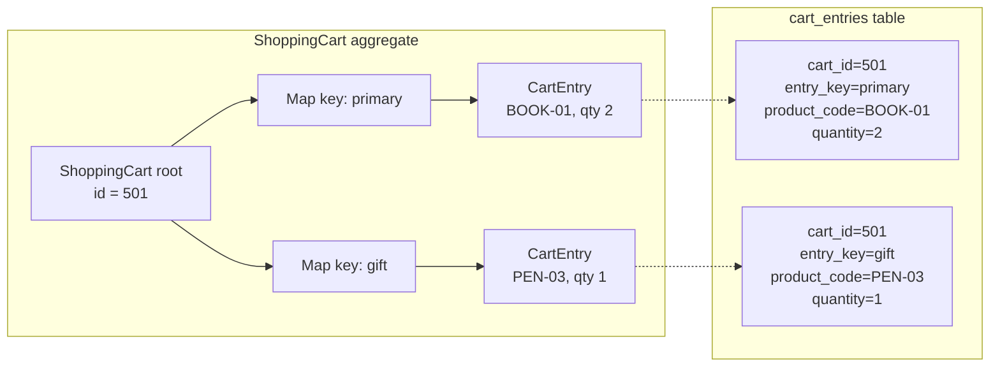
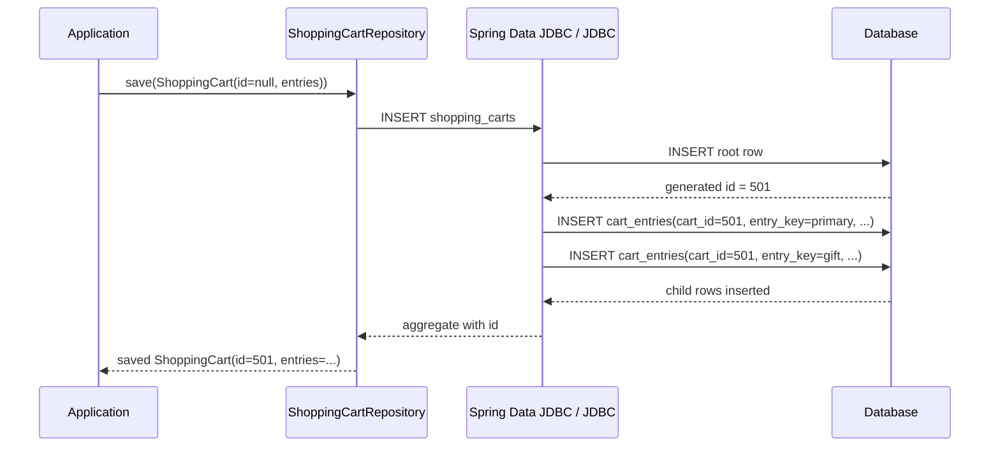

# Ánh xạ `Map` với khóa đơn giản và entity làm giá trị

Trong **Spring Data JDBC**, một `Map<K, V>` có thể biểu diễn một nhóm phần tử thuộc aggregate root: **khóa `K` là kiểu đơn giản có thể lưu thành một giá trị cột**, còn **giá trị `V` là một entity con** với các thuộc tính được lưu thành các cột của bảng collection. Spring Data JDBC cần biết hai điều: cột nào liên kết hàng con với root và cột nào lưu khóa của Map. Annotation `@MappedCollection` cung cấp hai thông tin đó qua `idColumn` và `keyColumn`.

Bài này dùng ví dụ một giỏ hàng có các mục được đặt tên bằng khóa chuỗi. Mỗi mục là một entity con gồm mã sản phẩm và số lượng. Ta sẽ đi từ mô hình Java đến DDL, cách lưu/đọc, SQL phát sinh và các quyết định thiết kế cần cân nhắc.

## 1. Map trong aggregate có hai phần dữ liệu khác nhau

Giả sử một giỏ hàng có các mục như sau:

```text
ShoppingCart
  id = 501
  entries = {
    "primary" -> CartEntry(productCode="BOOK-01", quantity=2),
    "gift"    -> CartEntry(productCode="PEN-03", quantity=1)
  }
```

Trong mỗi cặp Map:

- **Map key** (`"primary"`, `"gift"`) là khóa đơn giản do ứng dụng chọn. Nó định danh vị trí/ý nghĩa của mục trong Map của giỏ hàng.
- **Map value** (`CartEntry`) là entity con chứa các thuộc tính dữ liệu như `productCode` và `quantity`.
- **Aggregate root** (`ShoppingCart`) sở hữu Map và quyết định vòng đời của các mục. Các mục không phải aggregate độc lập chỉ vì mỗi mục được lưu ở một hàng database.

Về mặt quan hệ, bảng lưu Map cần giữ cả ba nhóm thông tin:

1. ID của aggregate root để biết hàng này thuộc giỏ hàng nào.
2. Map key để dựng lại cặp `key -> value` khi đọc.
3. Các cột của entity value để dựng đối tượng `CartEntry`.



Map key không phải tên cột và cũng không tự động là một thuộc tính của `CartEntry`. Nó là **giá trị được lưu trong cột `keyColumn`**. Các thuộc tính của `CartEntry` được lưu ở những cột riêng.

## 2. Khai báo entity root và entity value

Ví dụ sử dụng `String` làm khóa và `CartEntry` làm giá trị:

```java
import java.util.Map;
import org.springframework.data.annotation.Id;
import org.springframework.data.relational.core.mapping.MappedCollection;
import org.springframework.data.relational.core.mapping.Table;

@Table("shopping_carts")
public record ShoppingCart(
        @Id Long id,
        @MappedCollection(idColumn = "cart_id", keyColumn = "entry_key")
        Map<String, CartEntry> entries
) {}

@Table("cart_entries")
public record CartEntry(
        String productCode,
        int quantity
) {}
```

Các annotation quan trọng:

- `@Table("shopping_carts")` chỉ rõ bảng của aggregate root.
- `@Id` đánh dấu khóa chính của root. Spring Data JDBC dùng ID này để lưu và tìm aggregate.
- `@MappedCollection(idColumn = "cart_id", keyColumn = "entry_key")` chỉ rõ cột liên kết về root và cột lưu khóa Map.
- `@Table("cart_entries")` chỉ rõ bảng chứa các giá trị `CartEntry`.

`CartEntry` là entity con được lưu qua `ShoppingCart`. Nó không cần một repository riêng nếu vòng đời của nó thực sự thuộc giỏ hàng. Trong mô hình này, cặp **`cart_id` + `entry_key`** có thể làm khóa nhận diện hàng con trong bảng; không cần thêm một ID độc lập cho từng mục chỉ để Map hoạt động.

`String` là ví dụ đơn giản, dễ đọc và ánh xạ trực tiếp thành `VARCHAR`. Các kiểu khóa đơn giản khác có thể dùng khi Spring Data JDBC có thể chuyển đổi chúng thành kiểu JDBC tương ứng và database có kiểu cột phù hợp. Khóa Map nên là giá trị ổn định, có ý nghĩa và không cần một object graph để biểu diễn.

## 3. Đọc ý nghĩa `idColumn` và `keyColumn`

Trong `@MappedCollection`, hai thuộc tính làm hai nhiệm vụ khác nhau:

| Thuộc tính | Giá trị ví dụ | Ý nghĩa |
|---|---|---|
| `idColumn` | `cart_id` | Cột ở bảng con chứa ID của aggregate root `ShoppingCart`. |
| `keyColumn` | `entry_key` | Cột ở bảng con chứa khóa của từng phần tử trong `Map`. |

Với dữ liệu mẫu:

| cart_id | entry_key | product_code | quantity |
|---:|---|---|---:|
| 501 | `primary` | `BOOK-01` | 2 |
| 501 | `gift` | `PEN-03` | 1 |

Spring Data JDBC đọc các hàng có `cart_id = 501`, lấy `entry_key` làm key và dựng các cột còn lại thành `CartEntry`:

```java
Map<String, CartEntry> entries = Map.of(
        "primary", new CartEntry("BOOK-01", 2),
        "gift", new CartEntry("PEN-03", 1)
);
```

Nếu bỏ `keyColumn` hoặc cấu hình nhầm sang tên cột khác, framework không thể khôi phục đúng khóa Map theo schema mong muốn. Nếu `idColumn` không khớp cột liên kết về root, các hàng con có thể không được tìm thấy hoặc thao tác ghi gặp lỗi cột không tồn tại.

## 4. DDL cho bảng root và bảng Map value

Schema cần có một bảng cho root và một bảng cho entity value:

```sql
CREATE TABLE shopping_carts (
    id BIGINT GENERATED BY DEFAULT AS IDENTITY PRIMARY KEY
);

CREATE TABLE cart_entries (
    cart_id BIGINT NOT NULL,
    entry_key VARCHAR(60) NOT NULL,
    product_code VARCHAR(50) NOT NULL,
    quantity INTEGER NOT NULL,

    CONSTRAINT pk_cart_entries PRIMARY KEY (cart_id, entry_key),
    CONSTRAINT fk_cart_entries_cart
        FOREIGN KEY (cart_id) REFERENCES shopping_carts(id),
    CONSTRAINT ck_cart_entries_quantity CHECK (quantity > 0)
);
```

DDL này minh họa cú pháp identity dùng được trên một số hệ quản trị như H2; cú pháp sinh ID cần điều chỉnh cho database triển khai. Các cột có ý nghĩa:

- `cart_id`: khóa ngoại trỏ đến `shopping_carts.id`, tương ứng với `idColumn`.
- `entry_key`: lưu key của Map, tương ứng với `keyColumn`.
- `product_code`, `quantity`: các thuộc tính của entity `CartEntry`.
- `PRIMARY KEY (cart_id, entry_key)`: bảo đảm một key chỉ xuất hiện một lần trong cùng giỏ hàng.
- `CHECK (quantity > 0)`: bảo vệ ràng buộc dữ liệu ở database.

Khóa chính ghép phù hợp với ngữ nghĩa Map: trong cùng một root, key là duy nhất. Hai giỏ hàng khác nhau vẫn có thể cùng dùng key `primary`, vì `cart_id` là một phần của khóa.

Thứ tự tạo bảng phải tạo root trước bảng con để khóa ngoại có thể tham chiếu đến `shopping_carts(id)`. Khi xóa dữ liệu thủ công, thường phải xóa hàng con trước hàng root, trừ khi đã thiết kế cascade phù hợp.

## 5. Repository chỉ khai báo cho aggregate root

Repository làm việc với `ShoppingCart`:

```java
import org.springframework.data.repository.CrudRepository;

public interface ShoppingCartRepository
        extends CrudRepository<ShoppingCart, Long> {
}
```

Không cần khai báo `CartEntryRepository` khi `CartEntry` chỉ là entity con thuộc giỏ hàng. Nếu cho phép một service cập nhật `CartEntry` độc lập, bỏ qua root, ứng dụng có thể vô tình phá các quy tắc mà aggregate phải bảo vệ.

Tạo Map và lưu aggregate:

```java
import java.util.LinkedHashMap;
import java.util.Map;

Map<String, CartEntry> entries = new LinkedHashMap<>();
entries.put("primary", new CartEntry("BOOK-01", 2));
entries.put("gift", new CartEntry("PEN-03", 1));

ShoppingCart draft = new ShoppingCart(null, entries);
ShoppingCart saved = shoppingCartRepository.save(draft);

Long cartId = saved.id();
```

Vì root mới có `id == null`, Spring Data JDBC thực hiện insert root, nhận generated ID rồi dùng ID đó để lưu các hàng Map value. Với record bất biến, hãy dùng **đối tượng trả về từ `save`** để lấy ID đã sinh.

## 6. Luồng `INSERT`: lưu root trước, rồi lưu các Map entry

Một lời gọi:

```java
ShoppingCart saved = shoppingCartRepository.save(draft);
```

có thể phát sinh nhiều câu SQL. Luồng khái quát:



SQL minh họa:

```sql
INSERT INTO shopping_carts DEFAULT VALUES;
-- Database tạo id = 501.

INSERT INTO cart_entries (cart_id, entry_key, product_code, quantity)
VALUES (501, 'primary', 'BOOK-01', 2);

INSERT INTO cart_entries (cart_id, entry_key, product_code, quantity)
VALUES (501, 'gift', 'PEN-03', 1);
```

Đây là SQL biểu diễn ý nghĩa; cú pháp insert không có cột và cách lấy generated key phụ thuộc dialect/driver. Thứ tự ghi root trước giúp có ID để đặt vào `cart_id` của bảng con.

Vì root và các hàng con thuộc cùng một aggregate, các thao tác lưu cần được thực hiện trong transaction phù hợp để không để lại root không có đủ entry hoặc các hàng con mồ côi khi một bước ghi thất bại. Spring Data JDBC repository có transaction behavior cho các thao tác lưu; nếu use case phối hợp nhiều thao tác khác, đặt `@Transactional` tại application service để xác định ranh giới commit/rollback.

## 7. Luồng `SELECT`: dựng lại Map từ key column và entity fields

Khi gọi:

```java
ShoppingCart cart = shoppingCartRepository.findById(501L)
        .orElseThrow();

CartEntry primary = cart.entries().get("primary");
```

Spring Data JDBC đọc root và các hàng con thuộc root. Một truy vấn có ý nghĩa tương đương để đọc Map value:

```sql
SELECT cart_id, entry_key, product_code, quantity
FROM cart_entries
WHERE cart_id = ?;
-- bind: 501
```

Với từng hàng:

1. `cart_id` xác định hàng thuộc aggregate root nào.
2. `entry_key` trở thành key của Map.
3. `product_code` và `quantity` được ánh xạ thành `CartEntry`.
4. Cặp key/value được thêm vào Map của `ShoppingCart`.

Kết quả:

```java
cart.entries().get("primary")
// CartEntry("BOOK-01", 2)

cart.entries().get("gift")
// CartEntry("PEN-03", 1)
```

Spring Data JDBC không dùng lazy-loading proxy kiểu JPA cho quan hệ này. Khi đọc aggregate, các thành phần thuộc aggregate được nạp để dựng trạng thái aggregate. Vì vậy, một root có Map rất lớn có thể tốn chi phí đọc đáng kể.

## 8. Thay đổi Map và lưu lại aggregate

Map tuân theo quy tắc key duy nhất. Có thể thêm, thay thế hoặc xóa một entry bằng thao tác trên Map trước khi lưu root:

```java
ShoppingCart cart = shoppingCartRepository.findById(501L)
        .orElseThrow();

Map<String, CartEntry> changedEntries = new LinkedHashMap<>(cart.entries());
changedEntries.put("gift", new CartEntry("PEN-03", 2));
changedEntries.put("accessory", new CartEntry("CASE-02", 1));
changedEntries.remove("primary");

ShoppingCart changed = new ShoppingCart(cart.id(), changedEntries);
ShoppingCart savedAgain = shoppingCartRepository.save(changed);
```

Trong ví dụ:

- `gift` được thay giá trị từ số lượng 1 thành 2.
- `accessory` là key mới.
- `primary` bị xóa.

Với entity bất biến, tạo root mới chứa Map mới là cách biểu diễn thay đổi rõ ràng. Sau `save`, nên tiếp tục sử dụng object trả về.

Spring Data JDBC quản lý các thành phần con như một phần của aggregate. Khi cập nhật aggregate có collection, framework có thể xóa các hàng con cũ thuộc root rồi insert lại các entry trong trạng thái hiện tại, thay vì chỉ cập nhật đúng một cột trên đúng một hàng. Vì vậy, **một thay đổi Map nhỏ có thể tạo nhiều câu SQL**. Không nên giả định cơ chế này luôn thực hiện diff tối thiểu giữa hai Map.

Hệ quả:

- Giữ Map ở kích thước phù hợp với một aggregate.
- Tránh Map có hàng trăm nghìn phần tử nếu thường xuyên chỉ cập nhật một entry.
- Nếu entry cần được cập nhật độc lập với root, hãy cân nhắc tách nó thành aggregate riêng.
- Không ghi trực tiếp bảng `cart_entries` từ một đường code khác mà bỏ qua quy tắc của `ShoppingCart`.

## 9. Map key phải đơn giản và ổn định

Map key được ghi vào một cột, vì thế nó nên là giá trị có thể biểu diễn bằng một kiểu SQL đơn giản:

| Kiểu key | Cột DDL gợi ý | Ghi chú |
|---|---|---|
| `String` | `VARCHAR(...)` | Phù hợp với mã, tên vai trò hoặc nhãn ổn định. |
| `Integer` / `Long` | `INTEGER` / `BIGINT` | Phù hợp với số thứ tự hoặc mã số. |
| `UUID` | Kiểu UUID tương ứng hoặc `VARCHAR(36)` | Kiểu vật lý phụ thuộc database/driver. |
| `Enum` | `VARCHAR(...)` hoặc kiểu lưu riêng | Cần thống nhất converter và giá trị lưu. |

Đây là các ví dụ về kiểu có thể chuyển đổi; cần bảo đảm converter và JDBC driver của dự án hỗ trợ cách biểu diễn đã chọn.

Không nên dùng một entity phức tạp làm Map key vì khóa cần được lưu như một giá trị cột đơn giản và so sánh ổn định. Nếu một đối tượng nghiệp vụ phức tạp cần định danh, hãy dùng ID/mã đơn giản của nó làm key.

### Key là một phần của định danh hàng con

Với schema có:

```sql
PRIMARY KEY (cart_id, entry_key)
```

đổi key `primary` thành `main` có ý nghĩa như xóa cặp cũ và tạo cặp mới. Không nên xem key như một thuộc tính hiển thị có thể đổi tùy ý mà không tác động đến định danh của entry.

Ngoài ra, key cần không null. Java `Map` không cho phép hai entry có cùng key; DDL với khóa chính ghép củng cố điều kiện đó ở database. Nếu key là chuỗi phân biệt hoa thường hoặc chịu collation riêng, cần cân nhắc quy tắc so sánh của database để tránh xung đột giữa những giá trị mà Java xem là khác nhau.

## 10. Map không đồng nghĩa với thứ tự hiển thị

`Map` mô hình hóa quan hệ key/value, không mặc nhiên mô hình hóa thứ tự nghiệp vụ. Dù code tạo `LinkedHashMap`, thứ tự hàng trả về từ SQL không được bảo đảm nếu câu query không có `ORDER BY`. Không nên dựa vào thứ tự vật lý của hàng trong database để dựng thứ tự ổn định.

Nếu thứ tự là một phần của nghiệp vụ (ví dụ các bước phải chạy theo vị trí 1, 2, 3), hãy xem xét:

- Dùng `List<Value>` nếu chỉ số/vị trí là ý nghĩa chính.
- Dùng key số có ý nghĩa và một query đọc có `ORDER BY` phù hợp nếu vẫn cần Map.
- Lưu thêm thuộc tính `position` trong value nếu cần cả key định danh lẫn thứ tự hiển thị.

Map key không tự động là thứ tự sắp xếp. Nếu cần thứ tự xác định, phải thiết kế và truy vấn nó một cách tường minh.

## 11. Entity làm value khác với scalar làm value

Có thể phân biệt hai dạng:

```java
Map<String, String> labels;
Map<String, CartEntry> entries;
```

Ở dạng thứ nhất, value là một giá trị đơn giản; mỗi hàng cần cột lưu key và cột lưu value. Ở dạng thứ hai, value là entity có nhiều property; mỗi hàng cần cột key và các cột tương ứng với entity value.

Ví dụ với `Map<String, CartEntry>`, bảng `cart_entries` có các cột:

```text
cart_id       -> aggregate root ID
entry_key     -> Map key
product_code  -> CartEntry.productCode
quantity      -> CartEntry.quantity
```

Map key không thay thế các property của `CartEntry`; cũng không có nghĩa entity value phải được serialize thành một chuỗi JSON. Đây là mapping quan hệ thành các cột của bảng con.

## 12. Quan hệ sở hữu: khi nào entity value nên thuộc aggregate?

Đặt entity làm value của Map thường hợp lý khi:

- Value chỉ có ý nghĩa trong phạm vi root.
- Vòng đời của value phụ thuộc vào root: xóa root thì các entry cũng không còn tồn tại.
- Quy tắc thêm, thay, xóa entry được root bảo vệ.
- Kích thước Map phù hợp với việc nạp/lưu aggregate.

Ví dụ `CartEntry` là một phần của giỏ hàng. Một entry không nhất thiết cần repository độc lập vì nghiệp vụ thêm sản phẩm, đổi số lượng hoặc xóa mục được thực hiện qua `ShoppingCart`.

Ngược lại, nếu value là một sản phẩm trong catalog được nhiều giỏ hàng tham chiếu và có vòng đời độc lập, không nên nhúng toàn bộ `Product` mutable vào mỗi giỏ hàng. Map có thể lưu `productId` hoặc SKU trong value, rồi application service truy vấn `ProductRepository` riêng khi cần. Khi đó, `Product` là aggregate root độc lập; `CartEntry` vẫn là thành phần của `ShoppingCart`.

Phân biệt **entity value được sở hữu** và **aggregate khác được tham chiếu** giúp tránh việc một lần `save(root)` vô tình trở thành đường cập nhật cho dữ liệu dùng chung.

## 13. Transaction và ràng buộc khóa ngoại

Khi lưu root và Map value, thứ tự thao tác thường cần:

1. Insert root để có ID.
2. Insert các hàng con mang `idColumn` bằng ID root và `keyColumn` bằng key Map.
3. Commit transaction khi toàn bộ thao tác thành công.

Nếu một hàng con vi phạm `CHECK`, `NOT NULL`, `UNIQUE` hoặc kiểu dữ liệu, transaction cần rollback các thay đổi liên quan để aggregate không ở trạng thái lưu dở. Khi một use case thực hiện thêm thao tác repository khác cùng cần nguyên tử, có thể đặt `@Transactional` trên service điều phối.

Ví dụ:

```java
import org.springframework.stereotype.Service;
import org.springframework.transaction.annotation.Transactional;

@Service
public class ShoppingCartService {
    private final ShoppingCartRepository carts;

    public ShoppingCartService(ShoppingCartRepository carts) {
        this.carts = carts;
    }

    @Transactional
    public ShoppingCart addEntry(Long cartId, String key, CartEntry entry) {
        ShoppingCart current = carts.findById(cartId).orElseThrow();
        Map<String, CartEntry> entries = new LinkedHashMap<>(current.entries());
        entries.put(key, entry);
        return carts.save(new ShoppingCart(current.id(), entries));
    }
}
```

Đây là ví dụ minh họa ranh giới transaction và thao tác Map; trong dự án thực tế nên bổ sung kiểm tra key, quantity, trạng thái giỏ hàng và xử lý lỗi không tìm thấy root.

## 14. Những lỗi thường gặp khi ánh xạ Map

| Triệu chứng | Nguyên nhân thường gặp | Cách kiểm tra |
|---|---|---|
| Database báo thiếu cột `cart_id` | `idColumn` không khớp DDL | So sánh `@MappedCollection` với tên cột bảng con. |
| Không khôi phục đúng key | `keyColumn` thiếu hoặc sai tên | Kiểm tra cột lưu key và dữ liệu thực tế. |
| Lỗi duplicate key | Cặp root ID + Map key bị trùng | Kiểm tra khóa chính ghép và logic tạo key. |
| Lỗi khóa ngoại khi lưu child | Root chưa có ID hoặc cột tham chiếu sai | Kiểm tra ID sinh và thứ tự insert. |
| Entity value không được ánh xạ | Tên bảng/cột của value type không khớp | Kiểm tra `@Table`, `@Column`, naming strategy và DDL. |
| Map đọc thiếu entry | Query tùy chỉnh không lấy đủ dữ liệu hoặc điều kiện liên kết sai | Kiểm tra `cart_id` và các cột được select. |
| Map update tạo nhiều SQL hơn mong đợi | Aggregate collection được đồng bộ theo root | Xem log SQL và đánh giá kích thước aggregate. |
| Thứ tự entry thay đổi | SQL không có thứ tự đảm bảo | Dùng `ORDER BY` hoặc mô hình `List` nếu thứ tự là nghiệp vụ. |
| Muốn cập nhật value riêng nhưng phải nạp root | Value thực tế có vòng đời độc lập nhưng đang mô hình như child | Cân nhắc tách aggregate và tham chiếu bằng ID. |

Khi debug, nên đối chiếu ba lớp: **Map trong object Java**, **`idColumn`/`keyColumn` trong metadata**, và **các cột vật lý của bảng value**. Từ SQL log có thể biết framework đang truy vấn bảng nào, dùng cột nào để lọc root và lấy key từ cột nào.

## 15. Bài thực hành: kiểm tra key và value được lưu riêng

Với `ShoppingCart`, `CartEntry` và hai bảng đã định nghĩa, có thể thực hiện:

1. Tạo một Map gồm hai cặp `primary -> CartEntry(...)` và `gift -> CartEntry(...)`; gọi `save` và lấy ID từ object trả về.
2. Truy vấn trực tiếp `cart_entries` theo `cart_id` để xem hai hàng có `entry_key` tương ứng cùng các cột `product_code`, `quantity`.
3. Gọi `findById` để nạp lại root; dùng `entries().get("primary")` và `entries().get("gift")` để xác nhận key/value được dựng lại.
4. Thay value của key `gift`, thêm key `accessory`, xóa key `primary`; lưu lại aggregate và quan sát SQL của bảng con.
5. Thử thêm cùng key hai lần vào một Java Map: lần put sau thay value của key hiện có. Thử insert hai hàng trùng `(cart_id, entry_key)` trực tiếp ở database để thấy khóa chính ghép ngăn duplicate.
6. Thử một key dài hơn giới hạn `VARCHAR(60)` hoặc quantity không hợp lệ để quan sát ràng buộc database và cách lỗi được trả về tầng ứng dụng.

Mục tiêu của bài tập là thấy rõ **key và entity value được lưu thành các cột khác nhau**, và root ID nối các hàng đó thành một aggregate. Không cần repository riêng cho Map entry khi nó thuộc vòng đời của root.

## 16. Nguyên tắc ghi nhớ

Với `Map<SimpleKey, EntityValue>` trong Spring Data JDBC:

- Map là một collection được sở hữu bởi aggregate root.
- `idColumn` lưu ID của root trong bảng entity value.
- `keyColumn` lưu Map key trong bảng entity value.
- Các property của entity value trở thành các cột còn lại.
- Root repository là đường truy cập và lưu aggregate; entity value không mặc nhiên có repository riêng.
- Khóa đơn giản phải chuyển đổi được sang kiểu JDBC và có ý nghĩa ổn định.
- Khóa Map thường kết hợp với root ID để bảo đảm tính duy nhất của hàng con.
- Lưu aggregate có thể tạo nhiều SQL và đồng bộ lại collection; cân nhắc kích thước Map, transaction và vòng đời.

Khi cần Map có key đơn giản và value là entity, hãy mô hình hóa bảng con với **cột tham chiếu root, cột key và các cột của value**, rồi khai báo `@MappedCollection(idColumn = ..., keyColumn = ...)` khớp DDL. Cách này giữ được cấu trúc key/value của Java Map trong mô hình quan hệ, đồng thời tôn trọng ranh giới aggregate mà Spring Data JDBC sử dụng khi đọc và ghi dữ liệu.
