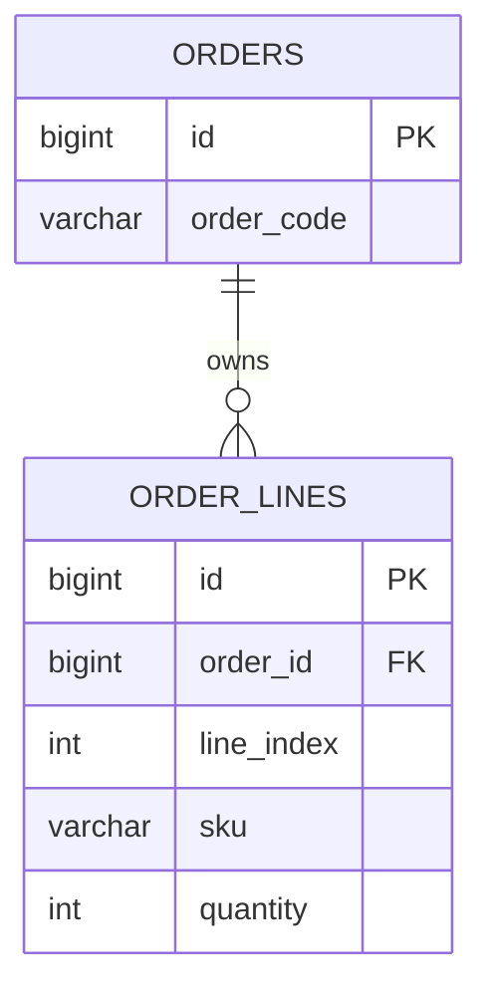

# Phân biệt cơ chế xóa con của Spring Data JDBC và ON DELETE CASCADE

Trong **Spring Data Relational JDBC**, một aggregate root có thể sở hữu các entity con được lưu ở bảng riêng. Khi xóa aggregate qua repository, Spring Data JDBC thực hiện các thao tác xóa cần thiết cho những thành phần thuộc aggregate. Trong khi đó, **ON DELETE CASCADE** là hành vi do hệ quản trị cơ sở dữ liệu thực thi khi một hàng được tham chiếu bị xóa theo ràng buộc foreign key.

Hai cơ chế đều có thể khiến hàng ở bảng con biến mất, nhưng chúng khác nhau về nơi điều khiển, phạm vi, thời điểm và trường hợp được kích hoạt. Hiểu nhầm hai cơ chế dễ dẫn đến dữ liệu mồ côi, xóa nhầm aggregate khác, hoặc tin rằng một lệnh DELETE trực tiếp sẽ được Spring Data JDBC xử lý giống repository delete.

Bài học giải thích cách Spring Data JDBC quản lý lifecycle của child entity, cách database cascade hoạt động, cách hai cơ chế phối hợp, và cách lựa chọn chính sách xóa phù hợp.

## 1. Bắt đầu từ mô hình aggregate

Giả sử ứng dụng quản lý đơn hàng. Một đơn hàng có nhiều dòng hàng. Dòng hàng chỉ có ý nghĩa trong đơn hàng sở hữu nó, được thêm hoặc xóa thông qua đơn hàng và được lưu cùng aggregate root.

```java
import java.util.ArrayList;
import java.util.List;

import org.springframework.data.annotation.Id;
import org.springframework.data.relational.core.mapping.MappedCollection;
import org.springframework.data.relational.core.mapping.Table;

@Table("orders")
public class PurchaseOrder {

    @Id
    private Long id;

    private String orderCode;

    @MappedCollection(idColumn = "order_id", keyColumn = "line_index")
    private List<OrderLine> lines = new ArrayList<>();

    protected PurchaseOrder() {
    }

    public PurchaseOrder(String orderCode) {
        this.orderCode = orderCode;
    }

    public void addLine(String sku, int quantity) {
        lines.add(new OrderLine(sku, quantity));
    }

    public void removeLine(Long lineId) {
        lines.removeIf(line -> line.getId().equals(lineId));
    }
}
```

```java
import org.springframework.data.annotation.Id;
import org.springframework.data.relational.core.mapping.Table;

@Table("order_lines")
public class OrderLine {

    @Id
    private Long id;

    private String sku;
    private int quantity;

    protected OrderLine() {
    }

    public OrderLine(String sku, int quantity) {
        this.sku = sku;
        this.quantity = quantity;
    }

    public Long getId() {
        return id;
    }
}
```

Trong mô hình này:

- **PurchaseOrder** là aggregate root.
- **OrderLine** là child entity thuộc aggregate.
- **@MappedCollection** mô tả collection con được lưu ở bảng riêng.
- **order_id** là cột ở bảng child liên kết về ID của root.
- Repository công khai cho thao tác aggregate thường là **PurchaseOrderRepository**.



Schema cơ bản:

```sql
CREATE TABLE orders (
    id BIGINT GENERATED BY DEFAULT AS IDENTITY PRIMARY KEY,
    order_code VARCHAR(40) NOT NULL
);

CREATE TABLE order_lines (
    id BIGINT GENERATED BY DEFAULT AS IDENTITY PRIMARY KEY,
    order_id BIGINT NOT NULL REFERENCES orders(id),
    line_index INTEGER NOT NULL,
    sku VARCHAR(64) NOT NULL,
    quantity INTEGER NOT NULL CHECK (quantity > 0),
    UNIQUE (order_id, line_index)
);
```

Trong DDL này, foreign key bảo đảm mỗi dòng hàng trỏ tới một đơn hàng hợp lệ. Tuy nhiên, vì chưa khai báo **ON DELETE CASCADE**, database không tự xóa dòng hàng khi đơn hàng bị xóa trực tiếp. Spring Data JDBC vẫn có thể quản lý việc xóa child khi aggregate được xóa qua repository.

## 2. Spring Data JDBC xóa child theo aggregate lifecycle

Spring Data JDBC xem các entity được tham chiếu qua mapping của aggregate root là các thành phần thuộc aggregate. Khi xóa aggregate root qua repository, framework biết những bảng dependent nào cần xử lý dựa trên mapping metadata.

Repository:

```java
public interface PurchaseOrderRepository
        extends CrudRepository<PurchaseOrder, Long> {
}
```

Xóa qua repository:

```java
orders.deleteById(orderId);
```

Với một aggregate có collection child được ánh xạ bằng **@MappedCollection**, Spring Data JDBC thực hiện các câu lệnh cần thiết để xóa các hàng dependent trước khi xóa root. Về mặt logic, thứ tự thường là:

1. Xác định ID aggregate root cần xóa.
2. Xóa các hàng child thuộc root trong những bảng collection đã mapping.
3. Xóa hàng aggregate root.
4. Hoàn tất transaction theo transaction manager đang sử dụng.

SQL khái quát có thể tương tự:

```sql
DELETE FROM order_lines
WHERE order_id = ?;

DELETE FROM orders
WHERE id = ?;
```

Đây là mô tả logic, không phải cam kết về câu SQL chính xác hoặc số statement cho mọi phiên bản, mapping và database. Spring Data JDBC có thể phát sinh câu lệnh theo cấu trúc aggregate và metadata cụ thể. Điều quan trọng là framework **biết child nào thuộc aggregate** và thực hiện thao tác xóa theo lifecycle đó.

### 2.1. Cơ chế này đến từ đâu?

Cơ chế xóa child xuất phát từ **aggregate mapping của Spring Data JDBC**:

- Repository thao tác với aggregate root.
- Spring Data Relational biết property nào là embedded, collection child hay reference.
- Các dependent entity được xử lý như một phần của persistence operation trên aggregate.
- Khi xóa root, framework thực hiện thao tác xóa cần thiết cho các thành phần được quản lý trong aggregate.

Đây là hành vi ở tầng ứng dụng/framework. Nó không phải thuộc tính của foreign key và không cần database tự cascade mới có thể thực hiện được.

### 2.2. Xóa child khỏi collection cũng thuộc aggregate persistence

Giả sử đơn hàng có ba dòng, bạn xóa một dòng khỏi collection rồi lưu lại root:

```java
PurchaseOrder order = orders.findById(orderId)
        .orElseThrow();

order.removeLine(lineId);

orders.save(order);
```

Spring Data JDBC đồng bộ trạng thái aggregate với database và thực hiện các thao tác SQL cần thiết để collection trong database phản ánh aggregate được lưu. Hàng child bị loại khỏi aggregate sẽ được xóa theo cơ chế persistence của collection.

Điều này khác với việc xóa cả root. Root vẫn tồn tại, chỉ một child bị loại bỏ.

Không nên giả định Spring Data JDBC luôn phát ra đúng một câu DELETE cho đúng child hoặc luôn dùng chiến lược SQL giống JPA. Cách thực thi chi tiết phụ thuộc mapping và phiên bản. Khi cần tối ưu SQL hoặc xử lý collection lớn, hãy quan sát câu lệnh thực tế.

## 3. ON DELETE CASCADE là gì?

**ON DELETE CASCADE** là một referential action được khai báo trên foreign key. Nó yêu cầu database tự động xóa các hàng tham chiếu khi hàng được tham chiếu ở bảng cha bị xóa.

Ví dụ:

```sql
CREATE TABLE orders (
    id BIGINT GENERATED BY DEFAULT AS IDENTITY PRIMARY KEY,
    order_code VARCHAR(40) NOT NULL
);

CREATE TABLE order_lines (
    id BIGINT GENERATED BY DEFAULT AS IDENTITY PRIMARY KEY,
    order_id BIGINT NOT NULL,
    line_index INTEGER NOT NULL,
    sku VARCHAR(64) NOT NULL,
    quantity INTEGER NOT NULL CHECK (quantity > 0),

    CONSTRAINT fk_order_lines_order
        FOREIGN KEY (order_id)
        REFERENCES orders(id)
        ON DELETE CASCADE
);
```

Bây giờ nếu một lệnh SQL xóa đơn hàng được thực hiện trực tiếp:

```sql
DELETE FROM orders
WHERE id = 101;
```

Database tự xóa những hàng **order_lines** có **order_id = 101**. Ứng dụng không cần phát thêm lệnh DELETE child.

### 3.1. Database thực thi cascade ở thời điểm nào?

Cascade là hành vi của database khi một hàng cha bị xóa và foreign key tương ứng có **ON DELETE CASCADE**. Nó không phải listener của Spring, không cần repository được gọi và không phụ thuộc class Java có **@MappedCollection** hay không.

Các đường xóa có thể kích hoạt database cascade gồm:

- SQL DELETE trực tiếp qua SQL client.
- Lệnh DELETE từ **JdbcTemplate** hoặc JDBC connection.
- Một ứng dụng khác xóa hàng cha.
- Một câu lệnh DML tùy chỉnh trong ứng dụng.
- Một lệnh xóa được phát ra từ framework, nếu nó xóa hàng cha trong khi các hàng child vẫn còn.

Nếu child đã bị xóa trước bởi Spring Data JDBC, khi parent bị xóa database không còn child tương ứng để cascade. Cả hai cơ chế có thể cùng được cấu hình, nhưng không nhất thiết cùng thực hiện xóa một hàng trong một lần repository delete.

### 3.2. Cascade là quy tắc của foreign key

Database có thể cung cấp các hành vi khác ngoài CASCADE:

| Referential action | Ý nghĩa khi xóa hàng được tham chiếu |
|---|---|
| **CASCADE** | Tự xóa hàng đang tham chiếu |
| **RESTRICT** | Ngăn xóa hàng cha khi còn hàng con tham chiếu, theo quy tắc DB |
| **NO ACTION** | Kiểm tra ràng buộc; thời điểm kiểm tra phụ thuộc database và khả năng deferrable |
| **SET NULL** | Đặt cột foreign key ở hàng con thành NULL nếu schema cho phép |
| **SET DEFAULT** | Đặt cột foreign key về default nếu database hỗ trợ và giá trị thỏa ràng buộc |

Mặc định nếu không khai báo referential action thường là hành vi tương đương **NO ACTION** hoặc **RESTRICT** tùy database. Hãy xem tài liệu của hệ quản trị đang dùng; không giả định tất cả database có cùng thời điểm kiểm tra hoặc cú pháp.

## 4. So sánh trực tiếp hai cơ chế

| Tiêu chí | Spring Data JDBC aggregate deletion | Database ON DELETE CASCADE |
|---|---|---|
| Nơi điều khiển | Spring Data JDBC mapping/repository | Foreign key trong database |
| Điều kiện kích hoạt | Thao tác repository trên aggregate root hoặc persistence operation tương ứng | Một hàng cha bị DELETE và FK có cascade |
| Biết child nào thuộc aggregate | Có, từ mapping metadata | Không cần biết Java aggregate; dựa trên FK |
| Có phụ thuộc @MappedCollection? | Có đối với collection child được quản lý như aggregate | Không |
| Có hoạt động với SQL xóa trực tiếp? | Không tự chạy aggregate lifecycle | Có, nếu FK được khai báo cascade |
| Có áp dụng cho mọi hàng tham chiếu qua FK? | Chỉ những dependent được mapping của aggregate quản lý | Có, theo ràng buộc FK được kích hoạt |
| Có xóa aggregate root được tham chiếu? | Không tự động xóa aggregate khác chỉ vì có reference | Chỉ khi FK của aggregate khác được cấu hình CASCADE; cần cân nhắc kỹ |
| Có phụ thuộc repository? | Có | Không |
| Phạm vi | Mô hình persistence aggregate | Tính toàn vẹn tham chiếu trong DB |

Cách ghi nhớ:

- **Spring Data JDBC:** “Đây là các child thuộc aggregate này; khi xóa aggregate, framework xử lý chúng.”
- **ON DELETE CASCADE:** “Nếu hàng được tham chiếu bị xóa, database tự xóa các hàng đang tham chiếu theo foreign key.”

Cả hai đều có thể dẫn tới child rows bị xóa, nhưng lý do và đường kích hoạt khác nhau.

## 5. Hai cơ chế có thể phối hợp như thế nào?

Có thể khai báo cả **@MappedCollection** và **ON DELETE CASCADE** cho cùng quan hệ:

```java
@Table("orders")
public class PurchaseOrder {

    @Id
    private Long id;

    @MappedCollection(idColumn = "order_id", keyColumn = "line_index")
    private List<OrderLine> lines = new ArrayList<>();
}
```

DDL:

```sql
FOREIGN KEY (order_id)
REFERENCES orders(id)
ON DELETE CASCADE
```

Khi gọi repository delete, Spring Data JDBC quản lý các dependent rows theo aggregate. Nếu nó xóa child trước rồi mới xóa parent, database cascade không còn child nào để xóa thêm. Đây là tình huống bình thường, không phải lỗi.

Khi một tiến trình khác xóa parent trực tiếp mà không biết aggregate mapping, database cascade bảo đảm child rows không bị bỏ lại.

### 5.1. Khi nào nên dùng cả hai?

Kết hợp có thể hợp lý nếu:

- Ứng dụng dùng Spring Data JDBC làm đường truy cập chính.
- Database còn được truy cập bởi script, batch job hoặc ứng dụng khác.
- Muốn bảo vệ tính toàn vẹn khi parent bị xóa ngoài repository.
- Child thực sự thuộc quyền sở hữu của parent và việc parent bị xóa phải xóa child.

Cần kiểm tra tác động của trigger, audit table, CDC hoặc logic phụ thuộc vào thao tác delete. Khi Spring Data JDBC xóa child tường minh, trigger trên bảng child có thể chạy trong thao tác đó; khi database cascade xóa child, trigger/CDC behavior phụ thuộc hệ quản trị. Đừng giả định hai đường xóa tạo ra cùng dấu vết vận hành.

### 5.2. Khi nào không nên dùng CASCADE?

Không nên đặt **ON DELETE CASCADE** một cách máy móc nếu:

- Bảng child có dữ liệu cần giữ lại sau khi root bị xóa.
- Hàng child được chia sẻ hoặc tham chiếu bởi đối tượng khác.
- Việc xóa parent có thể kéo theo xóa một lượng lớn dữ liệu ngoài ý muốn.
- Có yêu cầu lưu trữ/audit hoặc retention.
- Hàng được tham chiếu thực chất là aggregate root độc lập.

Nếu một hàng là child thực sự thuộc aggregate, xóa theo root thường hợp lý. Nếu là aggregate độc lập, nên thiết kế reference và chính sách xóa riêng.

## 6. Phân biệt child entity và aggregate reference khi xóa

Đây là điểm rất dễ nhầm. Một object có foreign key không nhất thiết là child thuộc aggregate.

### 6.1. Child thuộc aggregate

Ví dụ **OrderLine** thuộc **PurchaseOrder**:

```java
@MappedCollection(idColumn = "order_id")
private List<OrderLine> lines;
```

Khi xóa **PurchaseOrder** qua repository, Spring Data JDBC xử lý các hàng **OrderLine** theo aggregate lifecycle.

### 6.2. Aggregate root được tham chiếu

Ví dụ **PurchaseOrder** tham chiếu **Customer**:

```java
@Column("customer_id")
private Long customerId;
```

Hoặc:

```java
private AggregateReference<Customer, Long> customer;
```

**Customer** là aggregate root độc lập. Xóa đơn hàng **không có nghĩa là xóa khách hàng**. Spring Data JDBC không cascade delete sang aggregate khác chỉ vì root lưu ID/reference.

Nếu database khai báo:

```sql
FOREIGN KEY (customer_id)
REFERENCES customers(id)
ON DELETE CASCADE
```

thì hướng cascade này có nghĩa: **xóa Customer sẽ xóa các PurchaseOrder đang tham chiếu Customer đó**. Đây thường là chính sách nguy hiểm và không phù hợp với đơn hàng cần giữ lịch sử. Thường nên dùng **RESTRICT**/**NO ACTION** hoặc chính sách khác theo nghiệp vụ.

Một chiều cascade trên foreign key có ý nghĩa theo **hướng xóa hàng được tham chiếu**. Hãy đọc kỹ bảng nào là bảng chứa FK và bảng nào là bảng được tham chiếu.

### 6.3. Snapshot value object không có foreign key

Địa chỉ giao hàng được chụp tại thời điểm đặt đơn có thể là embedded value object. Khi xóa đơn hàng, các cột địa chỉ biến mất cùng hàng đơn hàng. Không có bảng con và cũng không cần FK cascade.

Đây là ví dụ cho thấy không phải mọi dữ liệu liên quan tới đơn hàng đều cần bảng riêng.

## 7. Xóa aggregate qua repository và xóa bằng SQL trực tiếp

### 7.1. Repository delete

```java
orders.deleteById(orderId);
```

Đây là đường đi Spring Data JDBC biết aggregate mapping. Framework xử lý dependent entities thuộc aggregate trước khi xóa root.

### 7.2. JdbcTemplate hoặc JDBC trực tiếp

```java
jdbcTemplate.update(
        "DELETE FROM orders WHERE id = ?",
        orderId
);
```

Đây là câu lệnh SQL trực tiếp. Spring Data JDBC không tự tải aggregate, không phân tích **@MappedCollection** và không chạy aggregate deletion plan chỉ vì câu lệnh được gọi trong cùng ứng dụng Spring.

Kết quả phụ thuộc database constraint:

- FK có **ON DELETE CASCADE**: database xóa child.
- FK không cascade và vẫn còn child: database thường từ chối xóa parent do vi phạm FK.
- Không có FK: parent có thể bị xóa và child trở thành dữ liệu mồ côi.

### 7.3. Custom DML query

Một câu DELETE tùy chỉnh qua repository query cũng là DML trực tiếp ở tầng database, không nên coi nó tương đương với repository delete aggregate-aware.

Ví dụ khái quát:

```java
@Modifying
@Query("DELETE FROM orders WHERE id = :id")
void deleteOrderRow(@Param("id") Long id);
```

Cú pháp và hỗ trợ annotation cụ thể tùy phiên bản Spring Data JDBC. Dù dùng custom modifying query, bạn đang yêu cầu database thực thi DML. Aggregate child cleanup không tự được suy ra từ câu query. Hãy bảo đảm FK/cascade hoặc tự tổ chức các lệnh xóa theo transaction phù hợp.

**Không dùng bulk DELETE thay cho repository aggregate delete nếu bạn cần giữ nguyên lifecycle semantics của aggregate.**

## 8. Điều gì xảy ra nếu không khai báo ON DELETE CASCADE?

Xét DDL:

```sql
CREATE TABLE orders (
    id BIGINT PRIMARY KEY
);

CREATE TABLE order_lines (
    id BIGINT PRIMARY KEY,
    order_id BIGINT NOT NULL REFERENCES orders(id),
    sku VARCHAR(64) NOT NULL
);
```

Nếu có dữ liệu child:

```sql
INSERT INTO orders(id) VALUES (1);
INSERT INTO order_lines(id, order_id, sku)
VALUES (10, 1, 'BOOK-01');
```

Xóa parent trực tiếp:

```sql
DELETE FROM orders WHERE id = 1;
```

Database từ chối thao tác trong các cấu hình FK thông thường vì còn hàng **order_lines** tham chiếu đến **orders.id = 1**.

Đây là **bảo vệ referential integrity**, không phải lỗi của Spring Data JDBC. Nếu muốn xóa bằng SQL trực tiếp mà không dùng cascade, bạn phải xóa child trước:

```sql
BEGIN;

DELETE FROM order_lines WHERE order_id = 1;
DELETE FROM orders WHERE id = 1;

COMMIT;
```

Hai câu lệnh phải ở cùng transaction để tránh trạng thái dở dang khi câu thứ hai thất bại. Cũng cần xử lý các bảng child khác nếu aggregate có nhiều loại dependent entity.

Với repository delete của Spring Data JDBC, framework đã có mapping để xử lý dependent entities; FK không cascade vẫn có thể hoạt động đúng.

## 9. Cascade và transaction: atomicity của việc xóa

Dù Spring Data JDBC xóa child bằng các statement riêng hay database xóa child qua FK cascade, các thao tác cần nằm trong transaction phù hợp để bảo đảm tính atomic.

Ví dụ:

```java
import org.springframework.stereotype.Service;
import org.springframework.transaction.annotation.Transactional;

@Service
public class OrderDeletionService {

    private final PurchaseOrderRepository orders;

    public OrderDeletionService(PurchaseOrderRepository orders) {
        this.orders = orders;
    }

    @Transactional
    public void deleteOrder(long orderId) {
        orders.deleteById(orderId);
    }
}
```

Khi repository và transaction manager dùng cùng DataSource, thao tác xóa dependent và root được thực hiện trong transaction của Spring. Nếu một bước thất bại, transaction có thể rollback theo quy tắc exception/rollback của Spring.

Với SQL trực tiếp, database cascade diễn ra bên trong statement DELETE và transaction của statement/connection đó. Nếu transaction rollback, các hàng bị cascade xóa cũng được phục hồi theo tính chất transaction của database.

### 9.1. Cascade không phải cơ chế xóa bất đồng bộ

**ON DELETE CASCADE** không xếp hàng tác vụ để xóa sau. Nó là hành vi ràng buộc tham chiếu được database xử lý trong quá trình xóa hàng cha. Với một số lượng child rất lớn, thao tác xóa có thể mất thời gian, giữ lock và tạo lượng log đáng kể.

Nếu cần xóa hàng triệu child, hãy lập kế hoạch hiệu năng, lock, transaction size, index trên foreign key và khả năng batch/partition. Không nên giả định cascade luôn nhanh chỉ vì code ứng dụng chỉ có một câu DELETE.

### 9.2. Transaction boundary khi nhiều aggregate hoặc nhiều store

Một transaction JDBC đơn nguồn dữ liệu có thể bao các thao tác trên nhiều bảng trong cùng database. Nhưng nó không tự rollback email, message broker, API hoặc database khác.

Nếu xóa order đồng thời phải phát sự kiện hoặc cập nhật hệ thống khác, cần thiết kế cơ chế phối hợp (ví dụ transactional outbox hoặc workflow bù). **ON DELETE CASCADE** chỉ quản lý hàng liên quan qua foreign key trong database đó.

## 10. Các kiểu xóa khác: soft delete và archival

Cần phân biệt physical delete với soft delete.

### 10.1. Physical delete

SQL DELETE loại bỏ hàng khỏi bảng. Đây là thao tác có thể kích hoạt **ON DELETE CASCADE**.

### 10.2. Soft delete

Soft delete thường cập nhật cờ hoặc timestamp:

```sql
UPDATE orders
SET deleted_at = CURRENT_TIMESTAMP
WHERE id = ?;
```

Đây là UPDATE, không phải DELETE. Vì vậy **ON DELETE CASCADE không được kích hoạt**. Các child rows vẫn còn nguyên, trừ khi ứng dụng chủ động cập nhật chúng hoặc có cơ chế riêng.

Nếu nghiệp vụ muốn soft-delete cả aggregate, cần định nghĩa rõ child có cùng trạng thái hay vẫn được giữ để truy vấn/audit. Có thể lưu trạng thái trên root và lọc khi đọc, hoặc cập nhật trạng thái child theo quy tắc riêng.

### 10.3. Archive thay vì delete

Nếu phải giữ dữ liệu đơn hàng theo yêu cầu nghiệp vụ hoặc pháp lý, có thể chuyển trạng thái archive hoặc chuyển dữ liệu sang vùng lưu trữ. Đặt FK cascade trong trường hợp này có thể không phù hợp vì physical delete root sẽ xóa child vĩnh viễn.

## 11. Những lỗi thường gặp khi phối hợp hai cơ chế

| Hiện tượng | Nguyên nhân có thể | Hướng xử lý |
|---|---|---|
| Repository delete xóa child, direct SQL không xóa child | Spring Data JDBC xử lý aggregate; FK không khai báo CASCADE | Thêm FK ON DELETE CASCADE nếu direct delete cũng phải xóa child, hoặc xóa child tường minh |
| Direct SQL báo lỗi foreign key | FK mặc định ngăn xóa parent khi còn child | Xóa child trước trong transaction hoặc cấu hình CASCADE nếu đúng nghiệp vụ |
| Child mồ côi sau direct SQL | Không có FK hoặc không có cascade và constraint bị bỏ qua | Tạo FK, kiểm tra dữ liệu hiện tại và chính sách delete |
| Xóa order làm mất customer | FK từ order tới customer đặt ON DELETE CASCADE theo hướng không mong muốn | Dùng RESTRICT/NO ACTION hoặc thay đổi hướng/ý nghĩa quan hệ |
| Dùng @MappedCollection nhưng mong SQL trực tiếp tự hiểu | Mapping chỉ được Spring Data JDBC sử dụng qua persistence operations | Dùng repository aggregate delete hoặc khai báo database FK action |
| Xóa root bị lỗi dù có CASCADE | Constraint khác, trigger, child table khác hoặc database config | Đọc lỗi DB, kiểm tra toàn bộ FK/trigger và câu SQL |
| Soft delete nhưng child vẫn còn | UPDATE không kích hoạt ON DELETE CASCADE | Thiết kế soft-delete policy cho aggregate |
| Child bị trigger/audit ghi nhận khác nhau | Framework explicit delete và database cascade/trigger cùng can thiệp theo các đường khác nhau | Xác định đường xóa thực tế, kiểm tra trigger và audit |
| Xóa aggregate reference ngoài ý muốn | Nhầm child ownership với reference sang aggregate độc lập | Dùng ID/reference, không cascade delete aggregate đích |
| Xóa collection child nhưng root vẫn còn | Đây là thay đổi aggregate collection, không phải xóa root | Cập nhật collection và save root theo domain method |

## 12. Thiết kế chính sách xóa cho từng quan hệ

Hãy định nghĩa chính sách riêng cho từng liên kết:

| Quan hệ | Ví dụ | Spring Data JDBC | FK policy thường cân nhắc |
|---|---|---|---|
| Embedded | Địa chỉ snapshot trong order | Lưu cùng root, không có bảng child | Không có FK riêng |
| Child thuộc aggregate | OrderLine thuộc Order | @MappedCollection; repository root quản lý | ON DELETE CASCADE có thể bổ sung cho direct SQL |
| Aggregate reference bắt buộc | Order tham chiếu Customer | Lưu ID/AggregateReference; không xóa Customer khi xóa Order | RESTRICT/NO ACTION thường phù hợp hơn |
| Aggregate reference tùy chọn | Ticket tham chiếu Agent có thể bị xóa | Lưu ID nullable hoặc reference | Có thể dùng SET NULL nếu nghiệp vụ cho phép |
| Shared lookup/reference data | Order tham chiếu Currency | Không cascade delete dữ liệu dùng chung | Thường ngăn xóa khi còn tham chiếu |

Không có một chính sách cascade dùng được cho mọi quan hệ. Hãy trả lời:

1. Ai sở hữu lifecycle của hàng con?
2. Hàng con có thể tồn tại độc lập sau khi root bị xóa không?
3. Những ứng dụng nào có quyền xóa trực tiếp bảng root?
4. Database có cần bảo vệ khi thao tác ngoài Spring Data JDBC không?
5. Có yêu cầu audit, retention, archive hoặc soft delete không?

## 13. Ví dụ thực hành: repository delete và direct SQL

Giả sử hai bảng có dữ liệu:

```sql
INSERT INTO orders (id, order_code)
VALUES (101, 'PO-101');

INSERT INTO order_lines (id, order_id, line_index, sku, quantity)
VALUES
    (1001, 101, 0, 'BOOK-01', 2),
    (1002, 101, 1, 'PEN-02', 3);
```

### Trường hợp A: FK không có ON DELETE CASCADE

- Gọi **orders.deleteById(101)** qua Spring Data JDBC: framework xử lý child theo aggregate mapping rồi xóa root.
- Chạy **DELETE FROM orders WHERE id = 101** trực tiếp: database từ chối nếu child vẫn còn vì foreign key.

### Trường hợp B: FK có ON DELETE CASCADE

- Gọi repository delete: Spring Data JDBC có thể xóa child tường minh trước; database sau đó xóa root và không còn child để cascade.
- Chạy SQL DELETE trực tiếp trên orders: database xóa root và tự cascade xóa các order_lines tham chiếu.
- Chạy delete từ một ứng dụng khác: database vẫn thực thi FK action, không cần Spring Data JDBC.

### Trường hợp C: order_lines là bảng dùng chung, không phải child

Nếu các dòng dữ liệu thực tế được nhiều order tham chiếu (một mô hình khác với order line thông thường), không nên cấu hình cascade xóa hàng dùng chung chỉ vì một root có foreign key. Hãy mô hình hóa quan hệ đúng ownership, thường là một aggregate root riêng và bảng liên kết có lifecycle được xác định rõ.

### Câu hỏi tự kiểm tra

1. Vì sao repository delete có thể xóa child dù FK không khai báo **ON DELETE CASCADE**?
2. Vì sao lệnh DELETE trực tiếp có thể bị FK từ chối trong cùng schema?
3. Nếu Order tham chiếu Customer, có nên để FK **orders.customer_id** dùng **ON DELETE CASCADE** không?
4. Soft delete bằng UPDATE có kích hoạt database cascade không?
5. Khi một child bị loại khỏi **@MappedCollection** rồi lưu root, đó là database cascade hay aggregate persistence?
6. Nếu có một batch job ngoài ứng dụng xóa orders, cơ chế nào bảo vệ child rows?

Gợi ý:

- Repository aggregate deletion sử dụng mapping metadata của Spring Data JDBC để xử lý dependent entities.
- Direct SQL chỉ kích hoạt hành vi do database constraint định nghĩa.
- Cascade theo hướng xóa Customer có thể xóa tất cả order tham chiếu Customer, thường không phù hợp với dữ liệu đơn hàng lịch sử.
- UPDATE không phải DELETE, nên không kích hoạt **ON DELETE CASCADE**.
- Xóa child khỏi collection là thao tác đồng bộ aggregate.
- FK cascade hoặc quy trình xóa child tường minh bảo vệ dữ liệu khi thao tác ngoài repository.

## 14. Nguyên tắc ghi nhớ

Khi thiết kế xóa dữ liệu trong Spring Data JDBC, hãy tách hai trách nhiệm:

1. **Spring Data JDBC quản lý aggregate lifecycle.** Các child được ánh xạ như thành phần của aggregate được xử lý khi lưu/xóa root qua repository. **@MappedCollection** mô tả collection child; aggregate reference không phải child sở hữu.
2. **Database quản lý referential integrity.** **ON DELETE CASCADE** là hành vi của foreign key khi hàng cha bị xóa, bất kể lệnh xóa đến từ Spring, SQL client hay ứng dụng khác.

Với Order và OrderLine, repository aggregate delete có thể xóa dòng hàng theo mapping. Nếu database cũng cần tự dọn child khi có SQL trực tiếp, có thể khai báo **ON DELETE CASCADE** trên **order_lines.order_id**. Với Order và Customer, xóa Order không nên xóa Customer chỉ vì có tham chiếu; hãy chọn FK policy bảo vệ aggregate độc lập.

**Xác định ownership trước, sau đó chọn cơ chế xóa ở tầng ứng dụng và ràng buộc ở tầng database.** Khi hai tầng cùng được thiết kế có chủ đích, ứng dụng vừa giữ đúng aggregate semantics vừa bảo vệ được dữ liệu trước các thao tác SQL ngoài repository.
