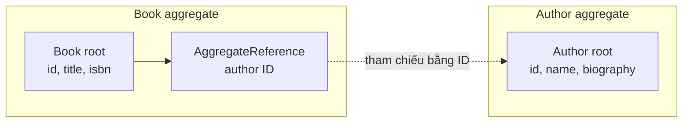

# Sử dụng AggregateReference để biểu diễn tham chiếu có kiểu

Trong Domain-Driven Design (DDD), một aggregate có ranh giới và vòng đời riêng. Khi một aggregate cần biết tới aggregate khác, ta thường lưu **định danh của aggregate được tham chiếu** thay vì nhúng toàn bộ object vào mô hình sở hữu. Trong Spring Data JDBC, kiểu **`AggregateReference<T, ID>`** biểu diễn ý định đó một cách tường minh và có kiểm tra kiểu ở thời điểm biên dịch.

Ví dụ, một `Book` cần biết tác giả của nó. `Book` và `Author` là hai aggregate độc lập: sách có vòng đời đặt mua/xuất bản riêng, tác giả có hồ sơ riêng và có thể được nhiều sách tham chiếu. Thuộc tính `author` của `Book` có thể dùng `AggregateReference<Author, Long>` để biểu diễn rằng nó chứa ID của một aggregate root kiểu `Author`.

Bài học này giải thích cách khai báo, tạo, lưu, đọc và kiểm thử AggregateReference; phân biệt nó với collection entity con được sở hữu bằng `@MappedCollection`; đồng thời làm rõ những việc AggregateReference **không** tự thực hiện như tải object đích, cascade persistence hay tạo foreign key trong database.

## 1. Vì sao cần một kiểu tham chiếu aggregate?

Giả sử ứng dụng thư viện có hai nhóm nghiệp vụ:

- **Author aggregate:** quản lý tên, tiểu sử, thông tin liên hệ và trạng thái hồ sơ tác giả.
- **Book aggregate:** quản lý tiêu đề, ISBN, trạng thái xuất bản và các thông tin thuộc vòng đời của sách.

Một tác giả có thể có nhiều sách. Một sách tham chiếu tới một tác giả chính. Tuy nhiên, việc đổi tiểu sử tác giả không có nghĩa phải tải rồi lưu lại tất cả sách của người đó.

Nếu mô hình hóa cả object `Author` bên trong `Book`:

```java
public class Book {
    private Long id;
    private String title;
    private Author author;
}
```

người đọc code có thể hiểu nhầm rằng `Author` là object con thuộc quyền sở hữu của `Book`. Điều này làm mờ ranh giới aggregate và dễ dẫn tới kỳ vọng sai về việc tải/lưu dữ liệu.

Một cách rõ nghĩa hơn là lưu tham chiếu:

```java
private AggregateReference<Author, Long> author;
```

Thuộc tính này diễn đạt: “Book tham chiếu tới một Author bằng định danh Long”. Nó không tuyên bố rằng Book sở hữu Author hoặc quản lý vòng đời của Author.

### 1.1. Plain ID và AggregateReference

Có thể dùng một property kiểu `Long authorId`:

```java
private Long authorId;
```

Đây là cách đơn giản và hoàn toàn hợp lệ khi ứng dụng chỉ cần lưu ID. Tuy nhiên, tên property không mang đầy đủ thông tin kiểu của aggregate được tham chiếu. Hai thuộc tính `authorId` và `publisherId` đều có thể là `Long`, nên dễ truyền nhầm ID khi viết code.

`AggregateReference<T, ID>` bổ sung ý nghĩa kiểu:

- `T`: kiểu aggregate root được tham chiếu.
- `ID`: kiểu định danh của aggregate root đó.

Ví dụ:

```java
AggregateReference<Author, Long> author;
AggregateReference<Publisher, Long> publisher;
```

Cả hai đều chứa ID kiểu Long, nhưng kiểu tham chiếu thể hiện rõ đích đến khác nhau. Compiler có thể giúp phát hiện việc truyền nhầm một tham chiếu Author vào vị trí cần Publisher.

### 1.2. AggregateReference thuộc package nào?

Trong Spring Data JDBC, import:

```java
import org.springframework.data.jdbc.core.mapping.AggregateReference;
```

Đây là kiểu hỗ trợ biểu diễn tham chiếu aggregate của Spring Data JDBC. Nó làm rõ ý nghĩa domain và hỗ trợ mapping ID của aggregate đích vào property trong bảng đang lưu.

## 2. AggregateReference<T, ID> hoạt động như thế nào?

`AggregateReference` là một abstraction mang ID của aggregate khác. Có thể hiểu cấu trúc generic như sau:

```java
AggregateReference<Author, Long> authorReference;
```

| Thành phần | Ý nghĩa |
| --- | --- |
| `AggregateReference` | Kiểu wrapper biểu diễn một tham chiếu tới aggregate khác. |
| `Author` | Kiểu aggregate root được tham chiếu. |
| `Long` | Kiểu ID của aggregate root `Author`. |
| `getId()` | Lấy ID được chứa trong tham chiếu. |
| `AggregateReference.to(id)` | Tạo một tham chiếu từ ID đã biết. |

Tạo tham chiếu:

```java
AggregateReference<Author, Long> reference =
    AggregateReference.to(42L);
```

Lấy ID:

```java
Long authorId = reference.getId();
```

Điểm quan trọng: `AggregateReference` **không phải proxy lazy-loading**. Khi gọi `getId()`, framework không tự truy vấn database để lấy object Author. Nó chỉ trả về ID được lưu trong tham chiếu.

Muốn lấy thông tin tác giả, ứng dụng gọi repository tương ứng:

```java
Author author = authorRepository.findById(reference.getId())
    .orElseThrow();
```

Điều này giữ quyền quyết định việc truy xuất dữ liệu ở application/service layer.

## 3. Mô hình hai aggregate độc lập

Ví dụ domain:



Hai aggregate có repository và vòng đời độc lập:

- `AuthorRepository` thao tác với Author root.
- `BookRepository` thao tác với Book root.
- `Book` chỉ lưu định danh Author.
- Thay đổi thông tin Author không tự động yêu cầu lưu lại Book.
- Muốn hiển thị thông tin tác giả cùng sách, ứng dụng quyết định truy vấn Author khi cần.

Ranh giới này đặc biệt hữu ích khi một aggregate được nhiều aggregate khác tham chiếu. Một `Author` có thể được nhiều `Book` cùng trỏ tới, nhưng vẫn chỉ có một nơi chịu trách nhiệm cập nhật hồ sơ tác giả.

## 4. Khai báo domain model với AggregateReference

Giả sử bảng tác giả:

```sql
CREATE TABLE authors (
    id BIGINT GENERATED BY DEFAULT AS IDENTITY PRIMARY KEY,
    name VARCHAR(160) NOT NULL,
    biography TEXT
);
```

Bảng sách:

```sql
CREATE TABLE books (
    id BIGINT GENERATED BY DEFAULT AS IDENTITY PRIMARY KEY,
    title VARCHAR(255) NOT NULL,
    isbn VARCHAR(32) NOT NULL UNIQUE,
    author_id BIGINT NOT NULL,
    CONSTRAINT fk_books_author
        FOREIGN KEY (author_id) REFERENCES authors(id)
);
```

Domain model Author:

```java
package example.library.domain;

import org.springframework.data.annotation.Id;
import org.springframework.data.relational.core.mapping.Table;

@Table("authors")
public record Author(
    @Id Long id,
    String name,
    String biography
) {}
```

Domain model Book:

```java
package example.library.domain;

import org.springframework.data.annotation.Id;
import org.springframework.data.relational.core.mapping.Column;
import org.springframework.data.relational.core.mapping.Table;
import org.springframework.data.jdbc.core.mapping.AggregateReference;

@Table("books")
public record Book(
    @Id Long id,
    String title,
    String isbn,
    @Column("author_id")
    AggregateReference<Author, Long> author
) {}
```

Ở đây:

- `Author` là aggregate root độc lập.
- `Book` là aggregate root độc lập.
- `author` là tham chiếu có kiểu tới Author.
- `@Column("author_id")` ánh xạ property `author` tới cột foreign key vật lý `author_id`.
- Giá trị lưu trong cột `author_id` là ID của Author, không phải toàn bộ object Author.

`@Column` thuộc Spring Data Relational. `@Id` thuộc Spring Data Commons. `AggregateReference` được cung cấp trong Spring Data JDBC.

### 4.1. Có thể dùng kiểu ID khác Long

Nếu Author dùng UUID:

```java
@Table("authors")
public record Author(
    @Id UUID id,
    String name
) {}
```

Book khai báo:

```java
AggregateReference<Author, UUID> author;
```

Kiểu ID trong generic phải tương ứng với kiểu ID của aggregate root được tham chiếu. Database column và JDBC mapping cũng phải hỗ trợ kiểu đó.

Generic giúp biểu đạt mối quan hệ kiểu ở Java; nó không tự chuyển một schema dùng BIGINT thành UUID hay ngược lại.

## 5. Tạo tham chiếu và lưu aggregate

Để tạo một Book mới, trước tiên ứng dụng cần biết ID của Author. Với ID do database sinh, thường lưu Author trước, lấy ID từ object trả về, rồi tạo AggregateReference.

Repository:

```java
import org.springframework.data.repository.ListCrudRepository;

public interface AuthorRepository
        extends ListCrudRepository<Author, Long> {
}

public interface BookRepository
        extends ListCrudRepository<Book, Long> {
}
```

Application service:

```java
import org.springframework.data.jdbc.core.mapping.AggregateReference;
import org.springframework.stereotype.Service;
import org.springframework.transaction.annotation.Transactional;

@Service
public class BookApplicationService {

    private final AuthorRepository authors;
    private final BookRepository books;

    public BookApplicationService(
        AuthorRepository authors,
        BookRepository books
    ) {
        this.authors = authors;
        this.books = books;
    }

    @Transactional
    public Book createBook(
        String title,
        String isbn,
        String authorName
    ) {
        Author author = authors.save(
            new Author(null, authorName, null)
        );

        AggregateReference<Author, Long> authorReference =
            AggregateReference.to(author.id());

        Book book = new Book(
            null,
            title,
            isbn,
            authorReference
        );

        return books.save(book);
    }
}
```

Luồng xử lý:

1. Tạo và lưu Author aggregate.
2. Database sinh ID cho Author.
3. Lấy ID từ object trả về bởi `authors.save`.
4. Tạo `AggregateReference<Author, Long>` bằng `AggregateReference.to(author.id())`.
5. Tạo Book với tham chiếu đó.
6. Lưu Book; Spring Data JDBC ghi ID Author vào cột `author_id`.

`@Transactional` bao quanh use case vì ví dụ muốn việc tạo tác giả và sách cùng thành công hoặc cùng rollback. Đây là lựa chọn nghiệp vụ cho thao tác tạo mới này; trong hệ thống thực tế, Author có thể đã tồn tại và service chỉ cần nhận author ID.

### 5.1. Khi Author đã tồn tại

Nếu người dùng chọn tác giả có sẵn:

```java
@Transactional
public Book createBookForExistingAuthor(
    String title,
    String isbn,
    Long authorId
) {
    Author author = authors.findById(authorId)
        .orElseThrow(() ->
            new IllegalArgumentException("Không tìm thấy tác giả")
        );

    return books.save(new Book(
        null,
        title,
        isbn,
        AggregateReference.to(author.id())
    ));
}
```

Có thể kiểm tra Author tồn tại trước khi tạo Book để trả lỗi nghiệp vụ rõ ràng. Database foreign key vẫn là lớp bảo vệ cuối cùng trước một ID không có hàng tương ứng, đặc biệt khi có transaction đồng thời hoặc một writer khác thay đổi dữ liệu.

Nếu use case chỉ cần lưu một tham chiếu đã được xác thực ở nơi khác, có thể tạo trực tiếp bằng ID. `AggregateReference.to(id)` không tự gọi repository để xác minh ID tồn tại.

### 5.2. ID được cấp trước

Nếu ứng dụng tự tạo UUID cho Author:

```java
UUID authorId = UUID.randomUUID();

Author author = authors.save(
    new Author(authorId, "Nguyen An", null)
);

Book book = new Book(
    null,
    "Spring Data JDBC",
    "ISBN-001",
    AggregateReference.to(authorId)
);

books.save(book);
```

Trong ví dụ này ID đã biết trước, nhưng việc lưu Author vẫn phải thành công trước khi Book được ghi nếu có foreign key yêu cầu Author tồn tại. Trình tự và transaction cần phù hợp với schema.

## 6. Đọc tham chiếu và truy xuất aggregate đích

Khi đọc Book:

```java
Book book = bookRepository.findById(bookId)
    .orElseThrow();

Long authorId = book.author().getId();
```

`book.author()` trả về AggregateReference chứa ID. Không có truy vấn Author nào tự động được thực hiện chỉ vì Book được đọc.

Muốn lấy Author:

```java
Author author = authorRepository.findById(
    book.author().getId()
).orElseThrow();
```

Nếu response API cần thông tin cả Book và Author, application service có thể điều phối hai repository rồi tạo DTO:

```java
public record BookDetails(
    Long id,
    String title,
    String isbn,
    Long authorId,
    String authorName
) {}

@Transactional(readOnly = true)
public BookDetails getBookDetails(Long bookId) {
    Book book = books.findById(bookId)
        .orElseThrow();

    Author author = authors.findById(book.author().getId())
        .orElseThrow();

    return new BookDetails(
        book.id(),
        book.title(),
        book.isbn(),
        author.id(),
        author.name()
    );
}
```

Cách này rõ ràng nhưng thực hiện hai lần truy xuất. Với màn hình cần lấy nhiều Book và Author, cần cân nhắc query chuyên biệt để tránh N+1 queries. Có thể dùng custom SQL JOIN hoặc projection cho read model mà không cần biến hai aggregate thành một aggregate lớn.

## 7. AggregateReference khác @MappedCollection

Hai cơ chế này có ý nghĩa khác nhau và không nên thay thế lẫn nhau.

### 7.1. @MappedCollection: phần tử con thuộc root

Ví dụ đơn hàng có nhiều dòng hàng:

```java
@Table("purchase_orders")
public class PurchaseOrder {

    @Id
    private Long id;

    @MappedCollection(idColumn = "order_id")
    private Set<OrderLine> lines = new HashSet<>();
}
```

`OrderLine` là một phần của PurchaseOrder aggregate. Root quản lý vòng đời và thay đổi của collection. Spring Data JDBC lưu/nạp các entity con theo aggregate root.

### 7.2. AggregateReference: tham chiếu tới root độc lập

Ví dụ Book tham chiếu Author:

```java
@Table("books")
public record Book(
    @Id Long id,
    String title,
    AggregateReference<Author, Long> author
) {}
```

Author là aggregate độc lập. Book chỉ giữ ID tham chiếu. Lưu Book không có nghĩa là lưu hoặc xóa Author.

| Tiêu chí | `@MappedCollection` | `AggregateReference` |
| --- | --- | --- |
| Ý nghĩa | Collection object được root sở hữu. | Tham chiếu tới aggregate root khác. |
| Vòng đời | Gắn với aggregate owner. | Độc lập với aggregate chứa tham chiếu. |
| Dữ liệu được lưu | Các property của entity/value object con ở bảng liên quan. | ID của aggregate đích. |
| Tải dữ liệu | Mapping aggregate khôi phục thành phần con theo root. | Không tự tải object đích. |
| Cascade persistence | Thành phần con được xử lý trong persistence của root theo mapping. | Không tự cascade sang aggregate được tham chiếu. |
| Ví dụ | PurchaseOrder → OrderLine. | Book → Author. |

Quy tắc thực dụng: **nếu object có vòng đời thuộc root, xem xét @MappedCollection; nếu object là aggregate độc lập, tham chiếu root bằng ID hoặc AggregateReference.**

## 8. AggregateReference không phải JPA relationship

Người đã làm với Spring Data JPA có thể quen các annotation:

```java
@ManyToOne
@JoinColumn(name = "author_id")
private Author author;
```

Đây là mapping association của JPA. Spring Data JDBC không dùng persistence context và association semantics của JPA.

Với Spring Data JDBC:

```java
@Column("author_id")
private AggregateReference<Author, Long> author;
```

Sự khác biệt quan trọng:

- AggregateReference giữ ID, không phải một entity proxy.
- Không có lazy loading tự động khi gọi getter.
- Không có cascade persist/remove tự động sang aggregate đích.
- Không có dirty checking trên Author khi lưu Book.
- Application service quyết định khi nào cần đọc hoặc thay đổi Author.
- Database foreign key là constraint riêng do schema quản lý.

Không nên thay `AggregateReference` bằng một object JPA association rồi kỳ vọng Spring Data JDBC tự xử lý tương tự Hibernate.

## 9. Mapping column và schema có sẵn

Theo naming convention, tên property `author` có thể được ánh xạ thành một tên cột mặc định theo quy tắc của Spring Data Relational. Tuy nhiên, schema thực tế có thể dùng `author_id`, `writer_no` hoặc một tên legacy khác.

Dùng `@Column` để chỉ rõ tên cột:

```java
@Column("author_id")
AggregateReference<Author, Long> author
```

Với record, annotation đặt trên record component như ví dụ ở phần 4.

Database schema cần có cột tương ứng:

```sql
ALTER TABLE books
ADD COLUMN author_id BIGINT;

ALTER TABLE books
ADD CONSTRAINT fk_books_author
FOREIGN KEY (author_id) REFERENCES authors(id);
```

Đây chỉ là ví dụ migration cho bảng đã tồn tại; nếu cột cần NOT NULL, phải xử lý dữ liệu hiện có trước khi thêm constraint. Ví dụ:

1. Thêm cột nullable.
2. Backfill author ID hợp lệ cho các sách hiện tại.
3. Kiểm tra không còn giá trị NULL hoặc ID mồ côi.
4. Đặt NOT NULL.
5. Thêm/kiểm tra foreign key.

`@Column` chỉ hướng dẫn mapping tên cột. Nó không thực thi DDL hoặc tự tạo foreign key.

### 9.1. Foreign key có bắt buộc không?

AggregateReference có thể lưu một ID mà database không có foreign key constraint, nhưng trong schema quan hệ thông thường nên dùng foreign key nếu quy tắc dữ liệu yêu cầu tham chiếu phải hợp lệ.

Nếu không có constraint, ứng dụng có thể lưu ID không tồn tại do bug, thao tác trực tiếp hoặc race condition. Khi đọc Book, truy vấn Author có thể không tìm thấy hàng tương ứng.

Quyết định về constraint cần cân nhắc:

- Có cho phép tham chiếu tạm thời tới aggregate chưa được tạo không?
- Khi xóa Author, các Book đang tham chiếu sẽ được xử lý thế nào?
- Có cần soft delete Author để giữ lịch sử sách không?
- Database có được nhiều ứng dụng cùng ghi không?

Không nên mặc định dùng `ON DELETE CASCADE` cho mọi foreign key. Xóa Author không nhất thiết đồng nghĩa xóa tất cả Book; thường cần policy nghiệp vụ như restrict, soft delete hoặc thay đổi tham chiếu có kiểm soát.

## 10. AggregateReference và kiểu định danh

Generic `ID` nên khớp với ID của aggregate root đích.

### 10.1. ID kiểu Long

```java
AggregateReference<Author, Long> author;
```

### 10.2. ID kiểu UUID

```java
AggregateReference<Author, UUID> author;
```

### 10.3. ID kiểu String

```java
AggregateReference<ExternalAccount, String> account;
```

Kiểu dữ liệu phải có mapping/conversion tương ứng trong JDBC và schema. Generic không tự chuyển đổi giá trị ID; nó chủ yếu biểu đạt quan hệ kiểu ở Java.

### 10.4. Phân biệt hai aggregate cùng kiểu ID

```java
AggregateReference<Author, Long> author;
AggregateReference<Publisher, Long> publisher;
```

Mặc dù cả hai ID đều là Long, kiểu generic làm rõ loại aggregate đích. Điều này giảm lỗi truyền nhầm ID trong code service và constructor.

Ví dụ:

```java
AggregateReference<Author, Long> authorRef =
    AggregateReference.to(authorId);

AggregateReference<Publisher, Long> publisherRef =
    AggregateReference.to(publisherId);
```

Không nên dùng một property chung kiểu `Long relatedId` cho nhiều loại quan hệ khác nhau nếu domain cần thể hiện rõ đích tham chiếu.

## 11. Tham chiếu aggregate trong entity con

AggregateReference không chỉ hữu ích ở root. Một entity con cũng có thể tham chiếu một aggregate độc lập khác.

Ví dụ, một `OrderLine` thuộc PurchaseOrder nhưng tham chiếu Product aggregate:

```java
@Table("order_lines")
public class OrderLine {

    @Id
    private Long id;

    @Column("product_id")
    private AggregateReference<Product, Long> product;

    private int quantity;
}
```

Mô hình:

```text
PurchaseOrder aggregate
    |
    +-- OrderLine
            |
            +-- AggregateReference<Product, Long>
                    |
                    +-- Product aggregate (độc lập)
```

OrderLine được lưu như thành phần thuộc PurchaseOrder; Product vẫn độc lập. Khi đọc PurchaseOrder, Spring Data JDBC có thể materialize OrderLine và giá trị AggregateReference chứa product ID. Nó không tự tải Product.

Nếu cần snapshot thông tin sản phẩm tại thời điểm đặt hàng (ví dụ tên, đơn giá, mã SKU), OrderLine có thể lưu các giá trị snapshot cần thiết bên cạnh tham chiếu Product. Khi Product thay đổi trong tương lai, dữ liệu lịch sử của đơn hàng không nhất thiết phải thay đổi theo.

## 12. Truy vấn và JOIN khi có AggregateReference

AggregateReference không tự tạo JOIN khi đọc repository. Ví dụ:

```java
Book book = books.findById(bookId).orElseThrow();
```

thao tác này tải Book và ID Author được lưu trong cột tương ứng. Nếu response cần Author, service phải gọi repository Author hoặc một query chuyên biệt.

Có thể viết SQL cho read model:

```sql
SELECT
    b.id,
    b.title,
    b.isbn,
    a.id AS author_id,
    a.name AS author_name
FROM books b
JOIN authors a ON a.id = b.author_id
WHERE b.id = :bookId;
```

Query có thể được triển khai qua `@Query` hoặc custom repository dùng `NamedParameterJdbcOperations`. Kết quả nên được ánh xạ vào DTO/projection phục vụ đọc, không nhất thiết phải dựng một object graph lồng nhau và lưu nó như một aggregate.

### 12.1. Tránh N+1 queries

Nếu tải 100 Book rồi lần lượt gọi `authorRepository.findById` cho từng Book, ứng dụng có thể tạo 101 truy vấn (một truy vấn sách và 100 truy vấn tác giả).

Một số hướng xử lý:

- Truy vấn JOIN trả DTO cho use case đọc cần dữ liệu kết hợp.
- Truy vấn danh sách Author theo tập ID nếu repository/query phù hợp.
- Cache dữ liệu tham chiếu có tính ổn định nếu chính sách nhất quán cho phép.
- Tách read model khỏi write model khi màn hình có yêu cầu đọc phức tạp.

Những tối ưu đọc này không làm thay đổi ranh giới aggregate trong mô hình ghi.

## 13. Xử lý vòng đời và tính nhất quán giữa các aggregate

Hai aggregate độc lập không tự động cùng thay đổi trong một lần save. Nếu Book tham chiếu Author:

- Sửa tiêu đề Book: chỉ cần xử lý Book aggregate.
- Sửa tiểu sử Author: chỉ cần xử lý Author aggregate.
- Xóa Author: cần policy xác định các Book đang tham chiếu.
- Đổi Author chính của Book: thay đổi tham chiếu trong Book aggregate theo quy tắc nghiệp vụ.

Nếu một use case cần thay đổi nhiều aggregate, application service điều phối các repository và transaction phù hợp. Trong một database, có thể dùng cùng transaction nếu yêu cầu atomicity và cấu hình transaction manager cho phép. Với hệ thống phân tán, cần cơ chế phối hợp như domain event, outbox hoặc saga thay vì kỳ vọng một transaction JDBC bao trùm nhiều service.

AggregateReference không tự cung cấp eventual consistency, event publication hay distributed transaction. Nó chỉ biểu diễn quan hệ tham chiếu có kiểu.

### 13.1. Xóa aggregate được tham chiếu

Giả sử Author ID 42 đang được nhiều Book tham chiếu. Nếu database có foreign key với hành vi mặc định restrict/no action, lệnh xóa Author có thể bị từ chối khi còn Book tham chiếu.

Đây thường là điều tốt vì ngăn tạo dữ liệu mồ côi. Ứng dụng có thể:

- Không cho xóa Author khi còn Book.
- Đánh dấu Author là inactive/deleted (soft delete).
- Chuyển Book sang Author khác qua use case có kiểm soát.
- Cho phép xóa tham chiếu khi domain cho phép và cập nhật dữ liệu liên quan rõ ràng.

Không nên trông chờ Spring Data JDBC tự cascade xóa các aggregate khác khi xóa root có AggregateReference.

## 14. Kiểm thử AggregateReference

Test repository nên xác nhận rằng tham chiếu được lưu dưới dạng ID và đọc lại thành đúng kiểu tham chiếu.

Ví dụ test slice:

```java
@DataJdbcTest
class BookRepositoryTest {

    @Autowired
    AuthorRepository authors;

    @Autowired
    BookRepository books;

    @Test
    void storesAndReadsAuthorReference() {
        Author author = authors.save(
            new Author(null, "Nguyen An", "Writer")
        );

        Book book = books.save(new Book(
            null,
            "Spring Data JDBC",
            "ISBN-001",
            AggregateReference.to(author.id())
        ));

        Book loaded = books.findById(book.id())
            .orElseThrow();

        assertThat(loaded.author().getId())
            .isEqualTo(author.id());
    }
}
```

Bài test cần có schema gồm bảng `authors` và `books` cùng cột `author_id`. Nếu dùng test slice, phải cấu hình database test và schema phù hợp với dialect đang sử dụng.

Một số trường hợp nên kiểm thử thêm:

- Lưu Book với Author ID hợp lệ.
- Tham chiếu tới ID không tồn tại khi database có foreign key: xác nhận database từ chối ghi.
- Đọc Book rồi lấy Author qua repository riêng.
- Thay đổi Book không làm thay đổi Author.
- Xóa Author đang được tham chiếu tuân theo policy/constraint đã thiết kế.
- Dùng UUID hoặc ID type khác để xác nhận mapping đúng.
- Đảm bảo query DTO/JOIN hoạt động khi use case cần thông tin kết hợp.

### 14.1. Kiểm thử tính an toàn kiểu

Có thể xem generic như một lớp bảo vệ ở thời điểm biên dịch. Ví dụ:

```java
AggregateReference<Author, Long> authorRef =
    AggregateReference.to(10L);

AggregateReference<Publisher, Long> publisherRef =
    AggregateReference.to(20L);
```

Khi gán vào property có kiểu `AggregateReference<Author, Long>`, một tham chiếu Publisher không tương thích về kiểu generic. IDE/compiler giúp phát hiện sớm lỗi này trước khi chạy truy vấn.

Tuy nhiên, generic không xác minh rằng ID thực sự tồn tại trong database. Kiểm tra sự tồn tại vẫn thuộc repository/application logic hoặc foreign key constraint.

## 15. Những nhầm lẫn thường gặp

| Nhầm lẫn | Thực tế |
| --- | --- |
| AggregateReference chứa toàn bộ object aggregate khác. | Nó chứa ID và metadata kiểu của aggregate được tham chiếu. |
| Đọc Book tự tải Author. | Không; cần truy vấn Author qua repository hoặc query riêng. |
| AggregateReference tự tạo foreign key. | Không; schema/migration phải định nghĩa constraint nếu cần. |
| Lưu Book sẽ cascade lưu Author. | Không; hai aggregate có lifecycle persistence riêng. |
| AggregateReference tương đương JPA `@ManyToOne`. | Không; nó không cung cấp entity association/proxy/lazy loading của JPA. |
| Generic bảo đảm ID tồn tại. | Không; generic chỉ hỗ trợ kiểm tra kiểu ở Java. |
| Dùng AggregateReference cho mọi collection. | Không; entity con thuộc root thường dùng `@MappedCollection`. |
| AggregateReference tự thực hiện JOIN. | Không; query kết hợp cần được thiết kế riêng. |
| Xóa aggregate root sẽ tự xóa các root đang tham chiếu. | Không; phải xác định policy và database constraints. |

## 16. Khi nào nên dùng AggregateReference?

Nên cân nhắc AggregateReference khi:

- Một aggregate cần lưu quan hệ tới aggregate root độc lập.
- Muốn thể hiện loại aggregate đích và kiểu ID ngay trong Java.
- Muốn tránh nhúng object graph lớn vào aggregate.
- Muốn tránh hiểu nhầm rằng một object tham chiếu thuộc vòng đời của object sở hữu.
- Có nhiều loại ID cùng primitive type và muốn tăng tính rõ ràng của code.
- Muốn ánh xạ một cột foreign key trong Spring Data JDBC mà không dùng JPA association.

Không cần dùng AggregateReference khi:

- Quan hệ thực chất là entity/value object con thuộc cùng aggregate; dùng mapping collection phù hợp.
- Chỉ có một ID đơn giản và kiểu wrapper không mang thêm giá trị đáng kể cho domain.
- Đang cần read model JOIN phức tạp; dùng query/DTO chuyên biệt.
- Cần lazy loading/cascade ORM theo semantics JPA; đó là một mô hình persistence khác.

### Bảng quyết định

| Tình huống | Cách biểu diễn |
| --- | --- |
| Book tham chiếu Author aggregate | `AggregateReference<Author, Long>` |
| PurchaseOrder sở hữu OrderLine collection | `@MappedCollection` |
| Chỉ lưu một giá trị ID đơn giản, không cần typed reference | `Long authorId` hoặc kiểu ID phù hợp |
| Cần JOIN Book và Author cho báo cáo | SQL query/projection/DTO |
| Cần lưu snapshot tên tác giả tại thời điểm xuất bản | Value object/field snapshot thuộc Book, có thể kèm reference |
| Cần nhiều aggregate phối hợp một use case | Application service/domain events/transaction phù hợp |

## 17. Quy trình triển khai

1. Xác định object đích có thực sự là **aggregate root độc lập** hay chỉ là child thuộc aggregate hiện tại.
2. Xác định kiểu ID của root đích.
3. Khai báo property `AggregateReference<AggregateRoot, ID>`.
4. Dùng `AggregateReference.to(id)` để tạo tham chiếu từ ID đã biết.
5. Dùng `@Column` nếu tên cột foreign key khác tên property hoặc convention.
6. Quản lý foreign key và migration bằng schema/database tooling; không kỳ vọng annotation tạo DDL.
7. Lưu aggregate được tham chiếu trước nếu ID do database sinh và constraint yêu cầu hàng đó tồn tại.
8. Khi cần object đích, gọi repository tương ứng hoặc query chuyên biệt; không giả định tự load.
9. Thiết kế delete policy, transaction và concurrency theo ranh giới aggregate.
10. Kiểm thử round-trip ID, foreign key và use case đọc kết hợp.

> **AggregateReference<T, ID> biểu diễn tham chiếu có kiểu tới một aggregate root độc lập bằng ID của nó.** Nó làm rõ ranh giới domain trong code Java, trong khi persistence của hai aggregate vẫn độc lập. Việc tải object đích, kiểm tra tồn tại, JOIN, cascade hay tạo foreign key đều cần được thiết kế ở lớp phù hợp.

### Tài liệu tham khảo

- [Spring Data JDBC — Reference Documentation](https://docs.spring.io/spring-data/relational/reference/jdbc.html): tổng quan persistence và aggregate trong Spring Data JDBC.
- [Spring Data JDBC — Mapping](https://docs.spring.io/spring-data/relational/reference/jdbc/mapping.html): ánh xạ domain object, aggregate và tham chiếu.
- [Spring Data Relational — Reference Documentation](https://docs.spring.io/spring-data/relational/reference/): metadata và các khái niệm quan hệ.
- [Domain-Driven Design — Martin Fowler](https://martinfowler.com/bliki/DomainDrivenDesign.html): tư duy mô hình hóa domain và ranh giới nghiệp vụ.
