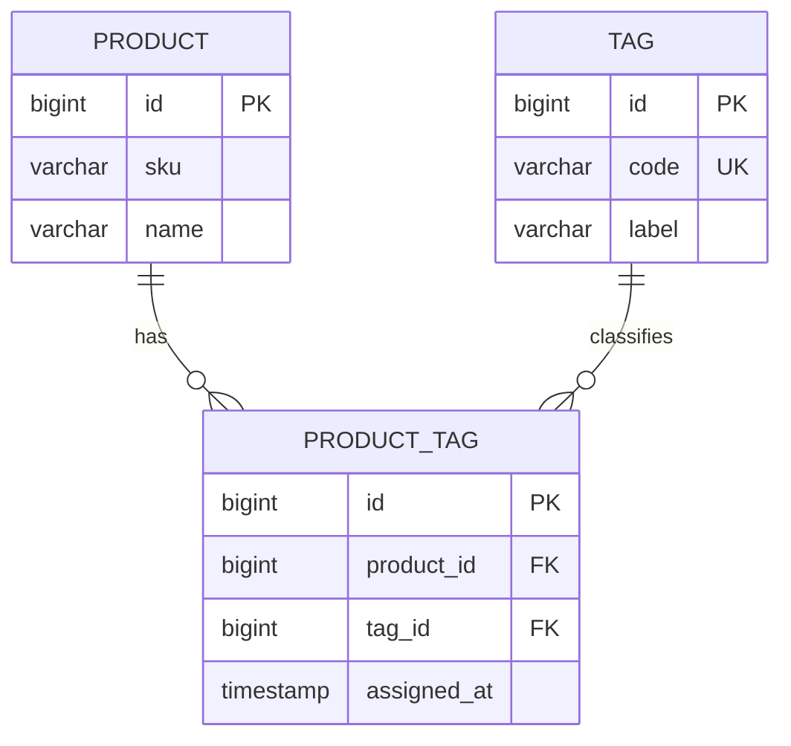

# Mô hình hóa nhiều-nhiều bằng aggregate liên kết hoặc bảng nối phù hợp

Trong mô hình quản lý cửa hàng, một sản phẩm có thể mang nhiều nhãn (tag), và một nhãn có thể được gắn cho nhiều sản phẩm. Đây là quan hệ **nhiều-nhiều (many-to-many)** quen thuộc trong cơ sở dữ liệu quan hệ. Tuy nhiên, Spring Data JDBC tổ chức dữ liệu theo ranh giới aggregate, nên không nên bê nguyên cách nghĩ về `@ManyToMany` của JPA sang.

Cách thiết kế phù hợp bắt đầu từ vòng đời của quan hệ. Nếu liên kết có dữ liệu và quy tắc riêng, có thể mô hình hóa nó thành **aggregate liên kết**. Nếu liên kết chỉ là bảng nối kỹ thuật, có thể quản lý bảng nối bằng custom repository/JDBC. Nếu các dòng liên kết chỉ là thành phần phụ thuộc một phía, có thể để chúng là collection con của đúng một aggregate root. Bài này dùng `Product` và `Tag` để giải thích từng lựa chọn.

## 1. Từ quan hệ miền nghiệp vụ đến bảng nối

Giả sử cửa hàng có:

- `Product`: sản phẩm trong danh mục.
- `Tag`: nhãn phân loại như `wireless`, `office`, `gaming`.
- Một sản phẩm có thể gắn nhiều tag.
- Một tag có thể được dùng cho nhiều sản phẩm.

Quan hệ:



Trong mô hình quan hệ, một quan hệ nhiều-nhiều thường được triển khai bằng bảng nối `product_tag`. Mỗi hàng trong bảng nối biểu diễn một liên kết giữa đúng một sản phẩm và một tag.

Ví dụ dữ liệu:

| product_id | tag_id | Ý nghĩa |
| ---: | ---: | --- |
| 101 | 1 | Sản phẩm 101 có tag `wireless`. |
| 101 | 2 | Sản phẩm 101 có tag `office`. |
| 102 | 1 | Sản phẩm 102 cũng có tag `wireless`. |
| 103 | 3 | Sản phẩm 103 có tag `gaming`. |

Không lưu danh sách ID thành chuỗi như `"1,2,3"` trong một cột nếu cần truy vấn, kiểm tra khóa ngoại hoặc cập nhật từng liên kết. Bảng nối giữ được tính quan hệ và cho phép database bảo vệ tính hợp lệ của từng cặp.

## 2. Ranh giới aggregate trong Spring Data JDBC

Spring Data JDBC không cung cấp mô hình quan hệ entity tùy ý kiểu JPA với `@ManyToMany`. Thay vào đó, nó tập trung vào aggregate root và các object thuộc vòng đời aggregate đó.

Với `Product` và `Tag`:

- `Product` là một aggregate độc lập.
- `Tag` là một aggregate độc lập.
- Quan hệ giữa chúng được biểu diễn bằng ID và dữ liệu liên kết.
- Không nên nhúng toàn bộ `Tag` vào `Product` như thể tag thuộc quyền sở hữu riêng của sản phẩm, vì một tag được dùng lại bởi nhiều sản phẩm.

Một nguyên tắc quan trọng: **mỗi hàng liên kết chỉ nên có một chủ sở hữu aggregate rõ ràng**. Không để cả `Product` lẫn `Tag` cùng khai báo và ghi cùng một tập hàng nối như collection con. Điều đó làm cho việc lưu aggregate có thể ghi đè hoặc xóa dữ liệu do phía còn lại quản lý.

Có ba lựa chọn thường gặp:

| Mô hình | Ai sở hữu hàng liên kết? | Khi phù hợp |
| --- | --- | --- |
| Aggregate liên kết độc lập `ProductTag` | Chính aggregate `ProductTag`. | Quan hệ có thuộc tính, trạng thái, hành vi hoặc cần quản lý độc lập. |
| Collection con của một root | Một phía, ví dụ `Product`. | Liên kết chỉ phụ thuộc một root và không có vòng đời độc lập. |
| Bảng nối kỹ thuật | Custom repository/JDBC hoặc SQL chuyên biệt. | Quan hệ chỉ là membership đơn giản, không cần object domain riêng. |

Không có lựa chọn đúng cho mọi bài toán. Cần dựa vào ngữ nghĩa và cách cập nhật, truy vấn quan hệ.

## 3. Thiết kế schema cho Product, Tag và ProductTag

Ví dụ PostgreSQL:

```sql
CREATE TABLE product (
    id BIGINT GENERATED BY DEFAULT AS IDENTITY PRIMARY KEY,
    sku VARCHAR(50) NOT NULL UNIQUE,
    name VARCHAR(180) NOT NULL
);

CREATE TABLE tag (
    id BIGINT GENERATED BY DEFAULT AS IDENTITY PRIMARY KEY,
    code VARCHAR(50) NOT NULL UNIQUE,
    label VARCHAR(100) NOT NULL
);

CREATE TABLE product_tag (
    id BIGINT GENERATED BY DEFAULT AS IDENTITY PRIMARY KEY,
    product_id BIGINT NOT NULL
        REFERENCES product(id) ON DELETE CASCADE,
    tag_id BIGINT NOT NULL
        REFERENCES tag(id) ON DELETE CASCADE,
    assigned_at TIMESTAMPTZ NOT NULL DEFAULT CURRENT_TIMESTAMP,
    CONSTRAINT uq_product_tag UNIQUE (product_id, tag_id)
);

CREATE INDEX idx_product_tag_tag_product
    ON product_tag (tag_id, product_id);
```

Các quyết định quan trọng:

- Hai khóa ngoại bảo đảm mỗi liên kết trỏ đến một sản phẩm và một tag có thật.
- `UNIQUE (product_id, tag_id)` ngăn cùng một tag bị gắn lặp vào cùng một sản phẩm.
- ID riêng của `product_tag` giúp quan hệ có thể được quản lý như một aggregate độc lập.
- `assigned_at` là thuộc tính của chính mối liên kết, ghi nhận thời điểm gắn tag.
- Index `(tag_id, product_id)` hỗ trợ truy vấn ngược từ tag sang các sản phẩm. Unique constraint trên `(product_id, tag_id)` đã hỗ trợ truy vấn theo product trước; index ngược phục vụ chiều còn lại.

`ON DELETE CASCADE` ở hai khóa ngoại có nghĩa khi xóa sản phẩm hoặc tag, các hàng liên kết tương ứng bị xóa. Nó **không xóa các tag khác hoặc sản phẩm khác**. Nếu nghiệp vụ yêu cầu lưu lịch sử liên kết, cần dùng soft delete/audit hoặc chính sách khác thay vì cascade xóa vật lý.

Có thể chọn khóa chính ghép `(product_id, tag_id)` thay cho ID riêng. Khóa ghép hợp lý với bảng nối thuần, nhưng nếu muốn dùng `CrudRepository<ProductTag, Long>` hoặc tham chiếu liên kết như một đối tượng có ID đơn giản, khóa surrogate `id` thường thuận tiện hơn. Unique constraint vẫn cần để bảo vệ cặp liên kết.

## 4. Phương án A: mô hình hóa liên kết thành aggregate riêng

Dùng `ProductTag` khi quan hệ có ý nghĩa nghiệp vụ riêng. Ví dụ ngoài hai ID, liên kết còn có:

- Thời điểm gắn nhãn.
- Người tạo liên kết.
- Thứ tự hiển thị tag trên sản phẩm.
- Trạng thái phê duyệt.
- Nguồn gắn tag hoặc ghi chú kiểm duyệt.

Khi đó `ProductTag` không chỉ là một dòng kỹ thuật mà là một đối tượng miền nghiệp vụ có vòng đời.

### Entity liên kết

```java
package com.example.catalog.domain;

import java.time.Instant;

import org.springframework.data.annotation.Id;
import org.springframework.data.relational.core.mapping.Table;

@Table("product_tag")
public record ProductTag(
    @Id Long id,
    Long productId,
    Long tagId,
    Instant assignedAt
) {}
```

Ở đây `productId` và `tagId` là scalar ID. Spring Data JDBC không tự tải `Product` và `Tag` khi đọc một `ProductTag`; service sẽ truy vấn aggregate tương ứng khi cần kiểm tra hoặc hiển thị.

Repository:

```java
package com.example.catalog.repository;

import java.util.List;
import java.util.Optional;

import com.example.catalog.domain.ProductTag;
import org.springframework.data.repository.CrudRepository;

public interface ProductTagRepository
        extends CrudRepository<ProductTag, Long> {

    List<ProductTag> findByProductId(Long productId);

    List<ProductTag> findByTagId(Long tagId);

    Optional<ProductTag> findByProductIdAndTagId(
        Long productId,
        Long tagId
    );
}
```

`ProductRepository` và `TagRepository` vẫn là repository riêng cho hai aggregate root tương ứng. Không tạo một repository giả định có thể tự động điều hướng hai chiều như JPA.

### Service điều phối thao tác gắn tag

Ví dụ service:

```java
package com.example.catalog.service;

import java.time.Instant;

import com.example.catalog.domain.ProductTag;
import com.example.catalog.repository.ProductRepository;
import com.example.catalog.repository.ProductTagRepository;
import com.example.catalog.repository.TagRepository;

import org.springframework.stereotype.Service;
import org.springframework.transaction.annotation.Transactional;

@Service
public class ProductTagService {

    private final ProductRepository products;
    private final TagRepository tags;
    private final ProductTagRepository links;

    public ProductTagService(
            ProductRepository products,
            TagRepository tags,
            ProductTagRepository links) {
        this.products = products;
        this.tags = tags;
        this.links = links;
    }

    @Transactional
    public ProductTag attach(Long productId, Long tagId) {
        products.findById(productId).orElseThrow();
        tags.findById(tagId).orElseThrow();

        return links.findByProductIdAndTagId(productId, tagId)
            .orElseGet(() -> links.save(
                new ProductTag(null, productId, tagId, Instant.now())
            ));
    }

    @Transactional
    public void detach(Long productId, Long tagId) {
        links.findByProductIdAndTagId(productId, tagId)
            .ifPresent(link -> links.deleteById(link.id()));
    }
}
```

Đây là luồng minh họa; ứng dụng thực tế cần exception nghiệp vụ cụ thể cho trường hợp không tìm thấy sản phẩm/tag, kiểm tra quyền của người gọi và xử lý lỗi unique constraint khi có request đồng thời.

Tại sao dùng `@Transactional`?

- Kiểm tra tồn tại hai aggregate và tạo liên kết thuộc cùng một đơn vị nghiệp vụ.
- Nếu insert thất bại, transaction có thể rollback thao tác thuộc cùng database/transaction.
- Khi xóa liên kết, thao tác xóa được thực hiện trong transaction nhất quán với các bước nghiệp vụ liên quan.

Tuy nhiên, hai request đồng thời có thể cùng kiểm tra “chưa tồn tại” rồi cùng insert. Chỉ kiểm tra bằng Java không ngăn được race condition. Unique constraint `(product_id, tag_id)` ở database là lớp bảo vệ cuối cùng; service cần xử lý duplicate theo chính sách idempotent hoặc trả lỗi xung đột thích hợp.

### Khi nào ProductTag nên là aggregate root?

Chọn aggregate riêng nếu:

- Liên kết có hành vi và invariant riêng.
- Liên kết cần được tạo, xác nhận, hủy hoặc audit độc lập.
- Có nhiều thuộc tính trên liên kết.
- API hoặc quy trình nghiệp vụ làm việc trực tiếp với từng liên kết.
- Cần truy vấn hoặc phân trang liên kết như một nguồn dữ liệu độc lập.

Không nên tạo aggregate root chỉ để bọc mọi hàng nối nếu liên kết hoàn toàn là chi tiết kỹ thuật, không có quy tắc hoặc vòng đời riêng. Mỗi aggregate root bổ sung thêm repository, transaction boundary và thao tác tải/lưu cần quản lý.

## 5. Phương án B: hàng nối là collection con của một aggregate

Nếu liên kết chỉ phụ thuộc một phía, ví dụ tag assignment chỉ được thêm/xóa thông qua thao tác quản lý Product, có thể để các dòng liên kết là collection con của `Product`.

Trong cách này:

- `Product` sở hữu các dòng trong `product_tag`.
- Mỗi dòng giữ `tagId` để tham chiếu `Tag` độc lập.
- `Tag` không khai báo collection ngược để ghi cùng các dòng đó.
- Repository thao tác với Product; không cần repository riêng cho child link.

Ví dụ:

```java
package com.example.catalog.domain;

import org.springframework.data.relational.core.mapping.Table;

@Table("product_tag")
public record ProductTagEntry(
    Long tagId
) {}
```

```java
package com.example.catalog.domain;

import java.util.List;

import org.springframework.data.annotation.Id;
import org.springframework.data.relational.core.mapping.MappedCollection;
import org.springframework.data.relational.core.mapping.Table;

@Table("product")
public record Product(
    @Id Long id,
    String sku,
    String name,
    @MappedCollection(idColumn = "product_id", keyColumn = "position")
    List<ProductTagEntry> tags
) {}
```

Schema tương ứng:

```sql
CREATE TABLE product (
    id BIGINT GENERATED BY DEFAULT AS IDENTITY PRIMARY KEY,
    sku VARCHAR(50) NOT NULL UNIQUE,
    name VARCHAR(180) NOT NULL
);

CREATE TABLE tag (
    id BIGINT GENERATED BY DEFAULT AS IDENTITY PRIMARY KEY,
    code VARCHAR(50) NOT NULL UNIQUE,
    label VARCHAR(100) NOT NULL
);

CREATE TABLE product_tag (
    product_id BIGINT NOT NULL REFERENCES product(id) ON DELETE CASCADE,
    position INTEGER NOT NULL,
    tag_id BIGINT NOT NULL REFERENCES tag(id),
    PRIMARY KEY (product_id, position),
    UNIQUE (product_id, tag_id)
);
```

`@MappedCollection` ánh xạ collection con thành hàng trong bảng `product_tag`, với `product_id` là cột liên kết đến root và `position` là key/index của phần tử trong list. `tag_id` vẫn chỉ là ID tham chiếu; Spring Data JDBC không tự tải object Tag.

Cách này phù hợp khi sửa danh sách tag luôn là sửa aggregate Product. Khi lưu Product, Spring Data JDBC quản lý collection con theo vòng đời aggregate; việc cập nhật collection có thể dẫn đến xóa/chèn lại các hàng con. Nếu danh sách rất lớn hoặc chỉ cần thêm/xóa một liên kết, cần cân nhắc hiệu quả và có thể chọn association aggregate hoặc custom repository thao tác một hàng cụ thể.

**Điều cần tránh:** đừng đồng thời cho `Product` và `Tag` cùng sở hữu `product_tag`. Một phía là chủ sở hữu collection; phía kia chỉ tham chiếu bằng ID và truy vấn qua repository/SQL khi cần.

## 6. Phương án C: bảng nối thuần qua custom repository/JDBC

Nếu bảng nối chỉ thể hiện quan hệ membership, không có thuộc tính hoặc vòng đời miền nghiệp vụ riêng, có thể không cần tạo `ProductTag` domain object. Một custom repository sử dụng `JdbcTemplate` sẽ thao tác trực tiếp trên bảng nối.

Ví dụ:

```java
@Repository
public class ProductTagJdbcRepository {

    private final JdbcTemplate jdbc;

    public ProductTagJdbcRepository(JdbcTemplate jdbc) {
        this.jdbc = jdbc;
    }

    public int attach(long productId, long tagId) {
        return jdbc.update("""
            INSERT INTO product_tag (product_id, tag_id)
            VALUES (?, ?)
            """, productId, tagId);
    }

    public int detach(long productId, long tagId) {
        return jdbc.update("""
            DELETE FROM product_tag
            WHERE product_id = ? AND tag_id = ?
            """, productId, tagId);
    }

    public List<Long> findTagIds(long productId) {
        return jdbc.queryForList("""
            SELECT tag_id
            FROM product_tag
            WHERE product_id = ?
            ORDER BY tag_id
            """, Long.class, productId);
    }
}
```

Ví dụ này dùng schema bảng nối thuần với khóa chính/unique cặp `(product_id, tag_id)` và không có ID riêng hoặc `assigned_at`. Nếu database có schema riêng, bổ sung tên schema trong SQL hoặc dùng cơ chế schema/search path đã được thống nhất.

Ưu điểm:

- SQL rõ ràng và chỉ thêm/xóa đúng liên kết cần thiết.
- Không phải tải toàn bộ aggregate để thêm một hàng nối.
- Có thể dùng câu SQL riêng theo database để tối ưu hoặc xử lý idempotent.

Đổi lại:

- Tầng ứng dụng phải tự quản lý SQL, tham số và kết quả.
- Không nhận được aggregate mapping tự động cho bảng nối.
- Phải bảo đảm custom JDBC dùng cùng transaction manager/datasource với các repository khác nếu nghiệp vụ cần một transaction chung.
- Không được cập nhật bảng nối qua custom JDBC đồng thời với một collection mapping cũng đang sở hữu cùng hàng dữ liệu.

Với PostgreSQL, có thể dùng `ON CONFLICT DO NOTHING` để tạo thao tác attach idempotent; cú pháp này là vendor-specific. Nếu cần portability, xử lý unique violation theo cách phù hợp với database hoặc dùng cơ chế chung có kiểm soát.

## 7. So sánh ba phương án

| Tiêu chí | Aggregate liên kết độc lập | Collection con của Product | Custom bảng nối |
| --- | --- | --- | --- |
| Có class domain cho liên kết | Có `ProductTag`. | Có child entry. | Không bắt buộc. |
| Repository riêng | Có. | Không; thao tác qua Product root. | Có adapter/custom repository. |
| Liên kết có thuộc tính riêng | Rất phù hợp. | Có thể có nếu vẫn thuộc Product. | Có thể nhưng SQL/DTO phải tự quản lý. |
| Cập nhật một liên kết | Qua repository của association. | Có thể phải save lại Product aggregate. | SQL trực tiếp, thường gọn. |
| Ranh giới vòng đời | Liên kết độc lập. | Phụ thuộc Product. | Được quản lý trong adapter. |
| Truy vấn hai chiều | Derived query theo productId/tagId hoặc SQL. | Thường cần query SQL cho chiều ngược. | Tự viết truy vấn theo nhu cầu. |
| Quy tắc nghiệp vụ riêng | Thể hiện rõ trong service/domain association. | Đặt trong Product aggregate/service. | Đặt ở service và database. |
| Phù hợp nhất | Quan hệ có ý nghĩa domain. | Quan hệ phụ thuộc một root. | Membership thuần, cần thao tác hàng nối trực tiếp. |

Một nguyên tắc lựa chọn thực tế:

- Có `assignedAt`, `role`, `position`, trạng thái hoặc audit riêng: cân nhắc aggregate liên kết.
- Dòng nối chỉ tồn tại trong phạm vi một Product và được cập nhật cùng Product: collection con có thể phù hợp.
- Quan hệ chỉ là một cặp ID cần thêm/xóa/truy vấn: bảng nối và custom JDBC thường đơn giản.

## 8. Truy vấn nhiều-nhiều theo hai chiều

Với bảng nối, tìm các tag của sản phẩm:

```sql
SELECT t.id, t.code, t.label
FROM tag t
JOIN product_tag pt ON pt.tag_id = t.id
WHERE pt.product_id = :productId
ORDER BY t.code;
```

Tìm các sản phẩm có tag cụ thể:

```sql
SELECT p.id, p.sku, p.name
FROM product p
JOIN product_tag pt ON pt.product_id = p.id
WHERE pt.tag_id = :tagId
ORDER BY p.name;
```

Nếu muốn tìm sản phẩm có **tất cả** tag trong danh sách, truy vấn cần nhóm và đếm số tag khớp:

```sql
SELECT p.id, p.sku, p.name
FROM product p
JOIN product_tag pt ON pt.product_id = p.id
WHERE pt.tag_id IN (:tagIds)
GROUP BY p.id, p.sku, p.name
HAVING COUNT(DISTINCT pt.tag_id) = :requestedTagCount;
```

Cách bind collection cho `IN (:tagIds)` phụ thuộc API `NamedParameterJdbcTemplate`/driver; câu SQL trên mô tả logic, không phải cú pháp tham số của mọi JDBC template. Khi danh sách đầu vào rỗng, xử lý riêng ở service vì `IN ()` không phải SQL hợp lệ trên nhiều database.

Kết quả truy vấn join để hiển thị thường phù hợp với DTO/projection, không nhất thiết là aggregate đầy đủ. Ví dụ DTO:

```java
public record ProductTagView(
    Long productId,
    String productName,
    Long tagId,
    String tagCode,
    String tagLabel
) {}
```

Một custom repository có thể dùng `RowMapper<ProductTagView>` để ánh xạ từng dòng join. Điều này tránh cố dựng một đồ thị object nhiều-nhiều không nằm trong ranh giới aggregate.

## 9. Xóa và cập nhật quan hệ an toàn

Xóa liên kết không đồng nghĩa xóa một trong hai aggregate được liên kết. Nếu bỏ tag `wireless` khỏi sản phẩm 101, thao tác chỉ xóa hàng `(101, wirelessTagId)` trong bảng nối.

```sql
DELETE FROM product_tag
WHERE product_id = 101
  AND tag_id = 1;
```

Hai bản ghi `product` và `tag` vẫn tồn tại. Khi xóa sản phẩm hoặc tag, chính sách FK quyết định hàng nối được cascade, bị chặn hay phải xử lý thủ công.

Nếu quan hệ có trạng thái hoặc lịch sử, không nên xóa cứng khi người dùng chỉ muốn bỏ liên kết. Có thể thêm `removed_at`, `status` hoặc bảng audit theo yêu cầu. Khi đó unique constraint có thể cần thiết kế lại để cho phép lưu nhiều lần gắn/bỏ theo thời gian mà vẫn chỉ có một liên kết đang hoạt động.

Khi dùng association aggregate, thao tác cập nhật nên đi qua service chịu trách nhiệm invariant. Ví dụ chỉ cho phép gắn tag đang active, hoặc không cho gắn tag thuộc nhóm cấm. Không nên đặt toàn bộ logic đó vào controller hoặc chỉ dựa vào foreign key.

## 10. Transaction, race condition và tính nhất quán

Một thao tác attach có thể gồm:

1. Xác nhận Product tồn tại và đang được phép chỉnh sửa.
2. Xác nhận Tag tồn tại và đang active.
3. Kiểm tra liên kết đã có chưa.
4. Tạo hàng liên kết.
5. Ghi audit/event nếu nghiệp vụ yêu cầu.

Nếu các thao tác dùng cùng database, có thể đặt ranh giới transaction ở service:

```java
@Transactional
public void attachTag(Long productId, Long tagId) {
    // Load/validate product.
    // Load/validate tag.
    // Insert association row.
    // Persist any related database state.
}
```

Transaction bảo đảm các thao tác tham gia transaction commit/rollback cùng nhau. Nhưng transaction ở isolation mặc định không đảm bảo hai request đồng thời không tạo cùng liên kết. Cả hai có thể đọc thấy chưa có cặp `(product_id, tag_id)` rồi cùng insert.

Do đó cần kết hợp:

- `UNIQUE(product_id, tag_id)` ở database.
- Xử lý duplicate/unique violation trong service theo chính sách API.
- Có thể dùng insert idempotent theo dialect nếu nghiệp vụ cho phép.
- Dùng optimistic locking hoặc khóa phù hợp nếu thao tác đồng thời còn thay đổi trạng thái aggregate khác.

Không thay thế unique constraint bằng đoạn `if (!exists) save(...)` ở Java. Đoạn kiểm tra đó hữu ích cho trải nghiệm và idempotency nhưng không đủ chống race condition.

## 11. Các lỗi thiết kế thường gặp

| Sai lầm | Hậu quả | Hướng điều chỉnh |
| --- | --- | --- |
| Dùng `@ManyToMany` như JPA trong Spring Data JDBC | Kỳ vọng mapping quan hệ không được cung cấp theo cách đó. | Dùng ID scalar, bảng nối hoặc association aggregate. |
| Nhúng toàn bộ Tag vào Product | Product bị kéo theo object thuộc aggregate độc lập. | Lưu `tagId` trong liên kết. |
| Product và Tag cùng sở hữu collection hàng nối | Hai aggregate cùng ghi một tập dữ liệu. | Chỉ chọn một owner hoặc tạo association root riêng. |
| Không có unique constraint trên cặp ID | Có thể tạo liên kết trùng. | Thêm `UNIQUE(product_id, tag_id)`. |
| Chỉ kiểm tra tồn tại bằng Java | Race condition vẫn có thể tạo duplicate. | Dùng constraint database và xử lý lỗi. |
| Xóa ProductTag rồi xóa Product/Tag | Có thể xóa dữ liệu gốc ngoài ý muốn. | Chỉ xóa hàng liên kết khi detach; áp dụng FK cascade theo chính sách. |
| Collection con quá lớn | Mỗi lần save root có thể tốn nhiều thao tác đồng bộ child rows. | Cân nhắc association aggregate hoặc custom SQL cập nhật từng liên kết. |
| Truy vấn join rồi map thành aggregate đầy đủ | Kết quả có thể thiếu cột hoặc không khớp ranh giới aggregate. | Dùng DTO/projection/RowMapper cho màn hình đọc. |
| Bảng nối có thuộc tính nghiệp vụ nhưng vẫn coi là quan hệ thuần | Không có nơi rõ ràng quản lý trạng thái/audit/quy tắc liên kết. | Mô hình hóa `ProductTag` thành association aggregate. |

## 12. Bài thực hành trên mô hình Product–Tag

Thực hiện theo thứ tự:

1. Tạo ba bảng `product`, `tag`, `product_tag` với FK và unique constraint.
2. Tạo hai aggregate root `Product` và `Tag` với repository riêng.
3. Tạo `ProductTag` như aggregate liên kết, lưu ID hai phía và thời điểm gắn tag.
4. Viết service attach/detach trong transaction; kiểm tra trường hợp product/tag không tồn tại.
5. Gắn cùng một tag vào hai sản phẩm; xác minh một tag được chia sẻ mà không bị nhân đôi thành hai aggregate.
6. Thử gắn cùng cặp hai lần; kiểm tra unique constraint và chính sách idempotent.
7. Truy vấn tag theo product và product theo tag bằng join; ánh xạ kết quả sang DTO.
8. Xóa một liên kết và xác nhận hai aggregate gốc vẫn còn.
9. Thử xóa Product hoặc Tag để quan sát FK cascade theo DDL.
10. So sánh association root với custom repository dùng `JdbcTemplate`; chọn một mô hình sở hữu hàng nối rõ ràng và không ghi cùng bảng qua hai đường không phối hợp.

Có thể mở rộng bài thực hành bằng thuộc tính `assignedBy`, `position` hoặc `status` trên liên kết để thấy thời điểm nào một bảng nối thuần bắt đầu có ý nghĩa domain và nên trở thành association aggregate.

## 13. Câu hỏi tự kiểm tra

- Vì sao Spring Data JDBC không nên được mô hình hóa như JPA `@ManyToMany`?
- Bảng nối nhiều-nhiều có những khóa ngoại nào và tại sao cần unique constraint trên cặp khóa?
- Khi nào `ProductTag` nên là aggregate root độc lập?
- Khi nào hàng nối có thể là collection con của `Product`?
- Vì sao `Tag` không nên đồng thời sở hữu cùng các hàng liên kết?
- Khi nào custom repository với `JdbcTemplate` đơn giản hơn association entity?
- Làm thế nào truy vấn hai chiều mà không cần tải toàn bộ aggregate graph?
- Transaction có ngăn được hai request tạo cùng một liên kết không? Constraint nào mới bảo vệ được?
- Khi xóa liên kết, vì sao không được xóa luôn Product hoặc Tag?
- Nếu bảng nối có trạng thái và lịch sử, schema cần thay đổi ra sao?

Mô hình nhiều-nhiều trong Spring Data JDBC bắt đầu từ câu hỏi **ai sở hữu vòng đời của hàng liên kết?** Nếu liên kết có quy tắc riêng, hãy cho nó một aggregate root. Nếu nó phụ thuộc một phía, để nó là collection con của root đó. Nếu nó chỉ là bảng nối kỹ thuật, thao tác bằng custom repository/SQL. Dù chọn cách nào, ID tham chiếu, foreign key, unique constraint và transaction phải phản ánh đúng quy tắc nghiệp vụ.
