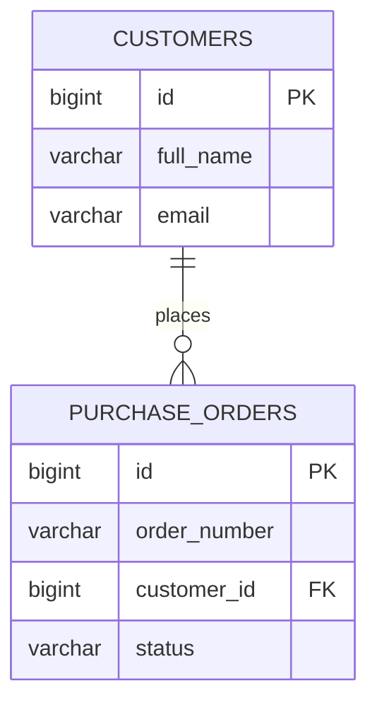

# Tải dữ liệu liên quan tường minh qua repository hoặc truy vấn đọc

Trong **Spring Data Relational JDBC**, một aggregate root là ranh giới mà Spring Data JDBC quản lý khi đọc và ghi dữ liệu. Khi một aggregate tham chiếu đến aggregate khác, tham chiếu đó thường chỉ lưu **ID** của aggregate được tham chiếu. Việc tải object liên quan vì thế là một quyết định rõ ràng của ứng dụng.

Ví dụ, một `PurchaseOrder` lưu `customerId` để tham chiếu đến `Customer`. Khi gọi `orderRepository.findById(id)`, ứng dụng nhận được đơn hàng theo mapping của aggregate đó. Nếu cần tên và email của khách hàng, service có thể gọi tiếp `customerRepository.findById(customerId)`. Nếu cần một màn hình báo cáo kết hợp đơn hàng, khách hàng và tổng tiền, một truy vấn đọc dùng JOIN có thể phù hợp hơn.

Bài học này trình bày hai hướng tải dữ liệu liên quan:

1. **Repository loading:** tải aggregate liên quan bằng repository của chính aggregate đó.
2. **Read query:** viết truy vấn đọc kết hợp nhiều bảng và ánh xạ kết quả thành DTO/read model.

Lựa chọn phụ thuộc vào việc ứng dụng cần làm việc với **các aggregate domain** hay cần một **hình dạng dữ liệu đọc** được tổng hợp từ nhiều bảng.

## 1. Aggregate reference không đồng nghĩa với object graph được tải tự động

Giả sử hệ thống bán hàng có hai aggregate:

- `Customer`: thông tin khách hàng, được quản lý độc lập.
- `PurchaseOrder`: đơn hàng, tham chiếu đến khách hàng đã đặt đơn.



Một mô hình Java đơn giản:

```java
@Table("customers")
public record Customer(
    @Id Long id,
    String fullName,
    String email
) {}

@Table("purchase_orders")
public record PurchaseOrder(
    @Id Long id,
    String orderNumber,
    @Column("customer_id") Long customerId,
    String status
) {}
```

`customerId` là giá trị tham chiếu đến khóa chính của `Customer`. Khi tải `PurchaseOrder`, Spring Data JDBC đọc cột `customer_id` thành giá trị ID; nó không tự động tải toàn bộ object `Customer` theo cách lazy-loading proxy thường gặp trong JPA.

Điều này là có chủ đích. Spring Data JDBC không duy trì một persistence context với object graph được nạp ngầm. Aggregate được đọc theo mapping của nó; dữ liệu của aggregate khác được ứng dụng yêu cầu tường minh khi cần.

### 1.1. Tham chiếu bằng ID

```java
PurchaseOrder order = orderRepository.findById(42L)
    .orElseThrow();

Long customerId = order.customerId();

Customer customer = customerRepository.findById(customerId)
    .orElseThrow();
```

Hai thao tác đọc là rõ ràng: đọc đơn hàng theo ID, sau đó đọc khách hàng theo ID được lưu trong đơn hàng. Không có câu lệnh ngầm nào được kích hoạt chỉ vì service gọi `order.customerId()`; đó là đọc một giá trị ID đã có trong object.

Nếu một aggregate cần tham chiếu đến nhiều aggregate khác, mỗi tham chiếu vẫn có thể được lưu dưới dạng ID. Ứng dụng chọn thời điểm tải và số lượng dữ liệu cần lấy.

### 1.2. Dùng AggregateReference để biểu đạt quan hệ

Spring Data JDBC cung cấp `AggregateReference` để biểu diễn một tham chiếu có kiểu đến aggregate khác:

```java
import org.springframework.data.jdbc.core.mapping.AggregateReference;

@Table("purchase_orders")
public record PurchaseOrder(
    @Id Long id,
    String orderNumber,

    @Column("customer_id")
    AggregateReference<Customer, Long> customer,

    String status
) {}
```

Tạo tham chiếu:

```java
PurchaseOrder order = new PurchaseOrder(
    null,
    "ORD-0042",
    AggregateReference.to(7L),
    "NEW"
);
```

`AggregateReference<Customer, Long>` diễn đạt rằng property tham chiếu đến aggregate `Customer` bằng ID kiểu `Long`. Nó **không có nghĩa** Spring Data JDBC sẽ tự tải `Customer` khi tải `PurchaseOrder`.

Với ứng dụng đơn giản, một property ID như `Long customerId` cũng có thể phù hợp. `AggregateReference` hữu ích khi muốn thể hiện rõ kiểu aggregate đích và ý nghĩa tham chiếu trong domain model.

### 1.3. Phân biệt với object thuộc cùng aggregate

| Loại dữ liệu | Cách biểu diễn thường gặp | Khi đọc aggregate root |
|---|---|---|
| Value object nhúng cùng hàng | `@Embedded` | Các cột được đọc cùng hàng |
| Entity con thuộc cùng aggregate | Mapping quan hệ aggregate, ví dụ collection các dòng đơn hàng | Được tải theo quy tắc mapping aggregate |
| Aggregate root khác | ID hoặc `AggregateReference` | Chỉ có tham chiếu; muốn nội dung phải tải riêng |
| Read model kết hợp nhiều aggregate | DTO/projection từ truy vấn đọc | Chỉ tải các cột và hàng được truy vấn |

Ranh giới này quan trọng khi thiết kế repository. Nếu `Customer` là aggregate độc lập, không nên coi nó như một entity con chỉ vì `PurchaseOrder` có khóa ngoại `customer_id`.

## 2. Khai báo repository cho từng aggregate

Với mô hình hai aggregate, mỗi aggregate có repository riêng:

```java
import org.springframework.data.repository.CrudRepository;

public interface CustomerRepository
        extends CrudRepository<Customer, Long> {
}

public interface PurchaseOrderRepository
        extends CrudRepository<PurchaseOrder, Long> {
}
```

Service có thể phối hợp chúng:

```java
import org.springframework.stereotype.Service;
import org.springframework.transaction.annotation.Transactional;

@Service
public class OrderQueryService {

    private final PurchaseOrderRepository orders;
    private final CustomerRepository customers;

    public OrderQueryService(
            PurchaseOrderRepository orders,
            CustomerRepository customers) {
        this.orders = orders;
        this.customers = customers;
    }

    @Transactional(readOnly = true)
    public OrderWithCustomer findOrder(long orderId) {
        PurchaseOrder order = orders.findById(orderId)
            .orElseThrow(() -> new IllegalArgumentException("Order not found"));

        Customer customer = customers.findById(order.customerId())
            .orElseThrow(() -> new IllegalArgumentException("Customer not found"));

        return new OrderWithCustomer(order, customer);
    }
}
```

DTO kết quả:

```java
public record OrderWithCustomer(
    PurchaseOrder order,
    Customer customer
) {}
```

Cách này phù hợp khi cần domain object đầy đủ của từng aggregate, muốn dùng logic repository/mapping của chúng, hoặc cần thực hiện nghiệp vụ dựa trên cả đơn hàng và khách hàng. Việc đặt các lời gọi trong service giữ orchestration ở tầng ứng dụng; repository của `PurchaseOrder` không cần biết cách tải mọi thông tin của `Customer`.

## 3. Tải tường minh nhiều aggregate bằng repository

Một tình huống thường gặp là hiển thị danh sách đơn hàng cùng thông tin khách hàng. Cách đơn giản nhất là tải từng khách hàng theo từng đơn, nhưng cách đó có thể tạo vấn đề hiệu năng.

### 3.1. Cách tải từng ID trong vòng lặp

```java
List<PurchaseOrder> orders = loadOrders();

List<OrderWithCustomer> result = new ArrayList<>();

for (PurchaseOrder order : orders) {
    Customer customer = customerRepository
        .findById(order.customerId())
        .orElseThrow();

    result.add(new OrderWithCustomer(order, customer));
}
```

Nếu có một truy vấn để tải danh sách đơn và N truy vấn để tải N khách hàng, tổng số truy vấn có thể là `1 + N`. Đây thường được gọi là vấn đề **N+1 queries**. Với danh sách 100 đơn thuộc 100 khách hàng, service có thể thực hiện 1 truy vấn lấy đơn và 100 truy vấn lấy khách hàng.

Không phải lúc nào N+1 cũng là lỗi: nếu chỉ có một vài bản ghi, cách đọc từng ID rất dễ hiểu. Nhưng khi danh sách tăng, độ trễ mạng, connection usage và tải database có thể tăng đáng kể.

### 3.2. Dùng findAllById để tải theo lô

`CrudRepository` cung cấp `findAllById(Iterable<ID>)`. Ta có thể gom các ID khách hàng duy nhất rồi tải một lần:

```java
import java.util.ArrayList;
import java.util.HashMap;
import java.util.HashSet;
import java.util.List;
import java.util.Map;
import java.util.Set;

public List<OrderWithCustomer> loadOrdersWithCustomers() {
    List<PurchaseOrder> orders = loadOrders();

    Set<Long> customerIds = new HashSet<>();
    for (PurchaseOrder order : orders) {
        customerIds.add(order.customerId());
    }

    Map<Long, Customer> customerById = new HashMap<>();

    for (Customer customer : customerRepository.findAllById(customerIds)) {
        customerById.put(customer.id(), customer);
    }

    List<OrderWithCustomer> result = new ArrayList<>();

    for (PurchaseOrder order : orders) {
        Customer customer = customerById.get(order.customerId());

        if (customer == null) {
            throw new IllegalStateException(
                "Missing customer " + order.customerId()
            );
        }

        result.add(new OrderWithCustomer(order, customer));
    }

    return result;
}
```

Số truy vấn logic thường giảm còn một truy vấn tải đơn và một thao tác tải các khách hàng có ID trong tập hợp. Việc triển khai cụ thể có thể chia nhỏ truy vấn theo giới hạn driver/database.

`findAllById` trả về các entity tìm được; không nên dựa vào thứ tự kết quả trùng với thứ tự ID đầu vào. Vì vậy, ví dụ lập `Map<Long, Customer>` theo ID rồi ghép lại theo thứ tự đơn hàng ban đầu.

### 3.3. Loại bỏ ID trùng lặp

Nhiều đơn có thể cùng thuộc một khách hàng. Dùng `Set` giúp mỗi ID chỉ được gửi một lần trong truy vấn:

```java
Set<Long> customerIds = orders.stream()
    .map(PurchaseOrder::customerId)
    .collect(Collectors.toSet());
```

Nếu `customerId` có thể null theo mô hình dữ liệu, cần quyết định rõ cách xử lý trước khi gọi `findAllById`. Với khóa ngoại bắt buộc, schema `NOT NULL` và domain validation nên ngăn trạng thái tham chiếu thiếu.

### 3.4. Giới hạn kích thước batch

Gom tất cả ID vào một truy vấn không phải lúc nào cũng phù hợp. Database và driver có giới hạn về số lượng bind parameters hoặc kích thước câu SQL. Với danh sách rất lớn:

- Chia ID thành các batch có kích thước hợp lý.
- Dùng truy vấn đọc theo trang hoặc theo khoảng ID.
- Cân nhắc một JOIN query nếu kết quả thực chất là read model.
- Đo hiệu năng trên database và driver thực tế.

Batch loading tránh một query cho mỗi hàng, nhưng không có một kích thước batch tối ưu cho mọi hệ thống.

## 4. Repository query để tải aggregate theo điều kiện

Không phải lúc nào cũng cần tải tất cả rồi mới lọc trong Java. Có thể khai báo query method để database chỉ trả về aggregate liên quan.

Ví dụ tìm đơn theo khách hàng:

```java
import java.util.List;
import org.springframework.data.repository.CrudRepository;

public interface PurchaseOrderRepository
        extends CrudRepository<PurchaseOrder, Long> {

    List<PurchaseOrder> findByCustomerId(Long customerId);

    List<PurchaseOrder> findByStatus(String status);
}
```

Derived query method được Spring Data phân tích từ property path và tạo truy vấn phù hợp. Cột tham chiếu vẫn là ID; kết quả là các aggregate `PurchaseOrder`, không tự kèm toàn bộ object `Customer`.

### 4.1. Dùng @Query khi cần SQL tường minh

Nếu điều kiện phức tạp hoặc cần tận dụng cú pháp SQL cụ thể, có thể khai báo câu truy vấn:

```java
import java.util.List;
import org.springframework.data.jdbc.repository.query.Query;
import org.springframework.data.repository.CrudRepository;
import org.springframework.data.repository.query.Param;

public interface PurchaseOrderRepository
        extends CrudRepository<PurchaseOrder, Long> {

    @Query("""
        SELECT id, order_number, customer_id, status
        FROM purchase_orders
        WHERE customer_id = :customerId
          AND status = :status
        ORDER BY id DESC
        """)
    List<PurchaseOrder> findCustomerOrders(
        @Param("customerId") Long customerId,
        @Param("status") String status
    );
}
```

Khi query trả về aggregate `PurchaseOrder`, phải trả đủ các cột cần để ánh xạ aggregate đó. Không nên bỏ `customer_id` hoặc cột bắt buộc khác chỉ vì màn hình hiện tại chưa hiển thị chúng.

Nếu chỉ cần một vài trường để hiển thị, DTO/read model thường phù hợp hơn việc tải entity rồi bỏ hầu hết dữ liệu.

## 5. Truy vấn đọc kết hợp nhiều aggregate bằng JOIN

Một màn hình danh sách có thể cần ID và mã đơn hàng, trạng thái, tên khách hàng và tổng tiền. Đây là dữ liệu kết hợp từ nhiều bảng, nhưng màn hình không nhất thiết cần các aggregate Java đầy đủ. Có thể viết một **read query** dùng JOIN và trả về DTO.

### 5.1. Schema minh họa

```sql
CREATE TABLE customers (
    id BIGINT PRIMARY KEY,
    full_name VARCHAR(120) NOT NULL,
    email VARCHAR(255) NOT NULL
);

CREATE TABLE purchase_orders (
    id BIGINT PRIMARY KEY,
    order_number VARCHAR(40) NOT NULL,
    customer_id BIGINT NOT NULL REFERENCES customers(id),
    status VARCHAR(20) NOT NULL
);

CREATE TABLE order_items (
    order_id BIGINT NOT NULL REFERENCES purchase_orders(id),
    product_id BIGINT NOT NULL,
    quantity INTEGER NOT NULL CHECK (quantity > 0),
    unit_price NUMERIC(19, 2) NOT NULL CHECK (unit_price >= 0),
    PRIMARY KEY (order_id, product_id)
);
```

### 5.2. JOIN và tổng hợp dữ liệu

```sql
SELECT
    o.id AS order_id,
    o.order_number,
    o.status,
    c.full_name AS customer_name,
    COALESCE(SUM(oi.quantity * oi.unit_price), 0) AS total_amount
FROM purchase_orders o
JOIN customers c
    ON c.id = o.customer_id
LEFT JOIN order_items oi
    ON oi.order_id = o.id
GROUP BY
    o.id,
    o.order_number,
    o.status,
    c.full_name
ORDER BY o.id DESC;
```

Ý nghĩa:

- `JOIN customers` lấy tên khách hàng từ aggregate khác.
- `LEFT JOIN order_items` giữ đơn chưa có dòng sản phẩm.
- `SUM(quantity * unit_price)` tính tổng các dòng.
- `COALESCE(..., 0)` chuyển tổng rỗng thành 0.
- `GROUP BY` tạo một hàng kết quả cho mỗi đơn hàng.

Truy vấn này là một **read model**. Nó không có nghĩa `PurchaseOrder` được tải cùng toàn bộ `Customer` hoặc được save như một aggregate duy nhất.

### 5.3. Ánh xạ sang DTO bằng NamedParameterJdbcTemplate

```java
import java.math.BigDecimal;

public record OrderSummary(
    long orderId,
    String orderNumber,
    String status,
    String customerName,
    BigDecimal totalAmount
) {}
```

Repository đọc:

```java
import java.util.List;
import java.util.Map;
import org.springframework.jdbc.core.namedparam.NamedParameterJdbcTemplate;
import org.springframework.stereotype.Repository;

@Repository
public class OrderSummaryRepository {

    private final NamedParameterJdbcTemplate jdbc;

    public OrderSummaryRepository(NamedParameterJdbcTemplate jdbc) {
        this.jdbc = jdbc;
    }

    public List<OrderSummary> findAllSummaries() {
        String sql = """
            SELECT
                o.id AS order_id,
                o.order_number,
                o.status,
                c.full_name AS customer_name,
                COALESCE(
                    SUM(oi.quantity * oi.unit_price),
                    0
                ) AS total_amount
            FROM purchase_orders o
            JOIN customers c ON c.id = o.customer_id
            LEFT JOIN order_items oi ON oi.order_id = o.id
            GROUP BY
                o.id, o.order_number, o.status, c.full_name
            ORDER BY o.id DESC
            """;

        return jdbc.query(
            sql,
            Map.of(),
            (rs, rowNum) -> new OrderSummary(
                rs.getLong("order_id"),
                rs.getString("order_number"),
                rs.getString("status"),
                rs.getString("customer_name"),
                rs.getBigDecimal("total_amount")
            )
        );
    }
}
```

Dùng `getBigDecimal` cho cột `NUMERIC` để giữ kiểu decimal chính xác; tránh chuyển tổng tiền qua `double`.

Lớp này dùng Spring JDBC vì nó thực hiện một truy vấn đọc có JOIN/GROUP BY và kết quả không phải một aggregate root thuần. Đây là một cách tách biệt rõ ràng giữa repository quản lý aggregate và repository chuyên đọc báo cáo.

### 5.4. Truy vấn có tham số

Khi lọc theo trạng thái hoặc khách hàng, bind parameter thay vì nối chuỗi:

```java
public List<OrderSummary> findByStatus(String status) {
    String sql = """
        SELECT
            o.id AS order_id,
            o.order_number,
            o.status,
            c.full_name AS customer_name,
            COALESCE(SUM(oi.quantity * oi.unit_price), 0) AS total_amount
        FROM purchase_orders o
        JOIN customers c ON c.id = o.customer_id
        LEFT JOIN order_items oi ON oi.order_id = o.id
        WHERE o.status = :status
        GROUP BY
            o.id, o.order_number, o.status, c.full_name
        ORDER BY o.id DESC
        """;

    return jdbc.query(
        sql,
        Map.of("status", status),
        (rs, rowNum) -> new OrderSummary(
            rs.getLong("order_id"),
            rs.getString("order_number"),
            rs.getString("status"),
            rs.getString("customer_name"),
            rs.getBigDecimal("total_amount")
        )
    );
}
```

`:status` là named bind parameter. Không ghép trực tiếp dữ liệu từ request vào SQL string. Nếu cần thay đổi tên bảng/cột hoặc hướng sắp xếp, các identifier không thể bind như giá trị thông thường; hãy chọn chúng từ danh sách cho phép ở phía ứng dụng.

## 6. Một JOIN query có thể tạo nhiều hàng cho cùng aggregate

Khi JOIN một-nhiều, một đơn có nhiều dòng sản phẩm sẽ tạo nhiều hàng trung gian. Ví dụ:

```sql
SELECT o.id, o.order_number, oi.product_id, oi.quantity
FROM purchase_orders o
JOIN order_items oi ON oi.order_id = o.id
WHERE o.id = 42;
```

Nếu đơn 42 có ba dòng sản phẩm, kết quả có ba hàng cùng `o.id = 42`. Điều đó bình thường đối với SQL JOIN.

Khi mục tiêu là một `OrderSummary` cho mỗi đơn, cần GROUP BY và aggregate function như `SUM`. Khi mục tiêu là danh sách chi tiết, có thể map mỗi hàng thành một dòng chi tiết rồi nhóm trong Java.

### 6.1. Tránh đếm hoặc cộng trùng khi JOIN nhiều tập con

Giả sử đơn có nhiều `order_items` và nhiều `order_notes`. Nếu nối cả hai tập con trực tiếp, mỗi item có thể kết hợp với mỗi note; số hàng trung gian tăng theo tích số lượng. Khi đó `SUM(oi.quantity * oi.unit_price)` có thể bị nhân lên.

Có thể tổng hợp từng tập con trước rồi JOIN:

```sql
WITH item_totals AS (
    SELECT order_id,
           SUM(quantity * unit_price) AS total_amount
    FROM order_items
    GROUP BY order_id
),
note_counts AS (
    SELECT order_id,
           COUNT(*) AS total_notes
    FROM order_notes
    GROUP BY order_id
)
SELECT
    o.id,
    COALESCE(it.total_amount, 0) AS total_amount,
    COALESCE(nc.total_notes, 0) AS total_notes
FROM purchase_orders o
LEFT JOIN item_totals it ON it.order_id = o.id
LEFT JOIN note_counts nc ON nc.order_id = o.id;
```

Kỹ thuật này giữ mỗi bảng con ở đúng mức tổng hợp trước khi kết hợp. Hãy xác định *grain* của kết quả: một hàng cho mỗi đơn, mỗi dòng sản phẩm hay mỗi ghi chú.

## 7. Đọc aggregate và đọc projection là hai mục đích khác nhau

| Nhu cầu ứng dụng | Kết quả phù hợp | Hướng tải |
|---|---|---|
| Sửa thông tin đơn hàng | Aggregate `PurchaseOrder` | `PurchaseOrderRepository.findById` |
| Xử lý nghiệp vụ dựa trên khách hàng | Aggregate `Customer` | `CustomerRepository.findById` |
| Danh sách đơn cùng tên khách hàng | DTO `OrderSummary` | JOIN query/read repository |
| Tổng doanh thu theo trạng thái | DTO/projection tổng hợp | GROUP BY query |
| Chi tiết một đơn gồm các dòng con thuộc cùng aggregate | Aggregate root và các entity con theo mapping | Repository aggregate |
| Danh sách nhiều đơn cùng khách hàng | Aggregate + batch-loaded customers hoặc JOIN projection | Chọn theo mục tiêu sử dụng |

Một nguyên tắc hữu ích: **nếu định thay đổi và lưu aggregate, hãy tải aggregate; nếu chỉ cần trình bày dữ liệu kết hợp, hãy cân nhắc read model.**

Đừng tải một graph object rất lớn chỉ để lấy ba cột cho màn hình. Ngược lại, đừng lấy một DTO rút gọn rồi dùng nó thay thế aggregate khi cần thực hiện nghiệp vụ cập nhật.

## 8. Tổ chức service: orchestration ở tầng ứng dụng

Service có thể chọn cách tải theo từng use case.

### 8.1. Một aggregate và một tham chiếu

```java
@Transactional(readOnly = true)
public OrderWithCustomer getOrder(long orderId) {
    PurchaseOrder order = orders.findById(orderId)
        .orElseThrow(() -> new OrderNotFoundException(orderId));

    Customer customer = customers.findById(order.customerId())
        .orElseThrow(() -> new CustomerNotFoundException(order.customerId()));

    return new OrderWithCustomer(order, customer);
}
```

Đây là cách đơn giản, dễ đọc khi chỉ tải một đơn và một khách hàng.

### 8.2. Danh sách aggregate với batch loading

```java
@Transactional(readOnly = true)
public List<OrderWithCustomer> getOrdersWithCustomers() {
    List<PurchaseOrder> orders = loadCurrentPageOfOrders();

    Set<Long> customerIds = orders.stream()
        .map(PurchaseOrder::customerId)
        .collect(Collectors.toSet());

    Map<Long, Customer> customerById = new HashMap<>();

    for (Customer customer : customers.findAllById(customerIds)) {
        customerById.put(customer.id(), customer);
    }

    return orders.stream()
        .map(order -> {
            Customer customer = customerById.get(order.customerId());

            if (customer == null) {
                throw new IllegalStateException(
                    "Customer reference cannot be resolved"
                );
            }

            return new OrderWithCustomer(order, customer);
        })
        .toList();
}
```

Đây là ví dụ orchestration ở mức service. Có thể tách thành helper hoặc một query service riêng khi logic tải liên quan được dùng lại.

### 8.3. Read model cho màn hình danh sách

```java
@Transactional(readOnly = true)
public List<OrderSummary> getOrderSummaries() {
    return orderSummaryRepository.findAllSummaries();
}
```

Màn hình danh sách không cần tự tải từng aggregate. Query đã lấy đúng cột cần thiết và trả về DTO phù hợp.

## 9. Transaction và tính nhất quán khi tải nhiều nguồn

Khi service gọi hai repository liên tiếp, hai câu SELECT có thể tham gia cùng transaction nếu được gọi trong cùng transaction context và dùng cùng datasource/transaction manager.

```java
@Transactional(readOnly = true)
public OrderWithCustomer load(long orderId) {
    PurchaseOrder order = orders.findById(orderId).orElseThrow();
    Customer customer = customers.findById(order.customerId()).orElseThrow();

    return new OrderWithCustomer(order, customer);
}
```

Tuy nhiên, `readOnly = true` không có nghĩa mọi database đều tự cung cấp một snapshot bất biến cho toàn bộ các truy vấn. Mức isolation thực tế phụ thuộc transaction manager và hệ quản trị. Với isolation mặc định kiểu READ COMMITTED, dữ liệu có thể thay đổi giữa hai câu SELECT trong một transaction tùy database.

Nếu yêu cầu màn hình phải phản ánh một snapshot nhất quán, hãy xem xét isolation level, một truy vấn JOIN duy nhất hoặc chiến lược đọc snapshot phù hợp. Đừng mặc định rằng gom hai repository calls vào một transaction luôn làm chúng nhìn thấy cùng một phiên bản dữ liệu.

### 9.1. Dữ liệu liên quan có thể biến mất hoặc không còn hợp lệ

Ngay cả khi bảng dùng foreign key, dữ liệu tham chiếu có thể được thay đổi theo chính sách xóa, trạng thái soft delete hoặc dữ liệu lịch sử. Service cần xác định cách xử lý khi không tìm thấy aggregate liên quan:

- Báo lỗi dữ liệu không nhất quán.
- Hiển thị trạng thái tham chiếu đã bị xóa/ẩn nếu nghiệp vụ cho phép.
- Dùng snapshot thông tin tại thời điểm giao dịch, ví dụ lưu tên khách hàng trên đơn hàng nếu yêu cầu lịch sử hóa đơn cần giữ nguyên tên lúc mua.

Không phải mọi màn hình đều nên lấy thông tin khách hàng hiện tại. Hóa đơn lịch sử thường cần giữ snapshot tên/địa chỉ tại thời điểm phát hành, còn màn hình quản trị khách hàng có thể cần dữ liệu hiện tại.

## 10. Phân trang khi tải dữ liệu liên quan

Với danh sách lớn, hãy phân trang aggregate root trước khi tải dữ liệu liên quan.

### 10.1. Tải trang đơn hàng rồi batch khách hàng

Một quy trình phổ biến:

1. Tải trang `PurchaseOrder` theo thứ tự ổn định.
2. Thu thập ID khách hàng trong trang.
3. Gọi `CustomerRepository.findAllById` một lần (hoặc chia batch nếu quá lớn).
4. Ghép dữ liệu bằng map theo ID.

Không nên tải toàn bộ đơn hàng rồi mới gom ID nếu danh sách có thể lên đến hàng trăm nghìn bản ghi.

### 10.2. Cẩn trọng với LIMIT/OFFSET sau JOIN một-nhiều

```sql
SELECT o.id, o.order_number, oi.product_id
FROM purchase_orders o
LEFT JOIN order_items oi ON oi.order_id = o.id
ORDER BY o.id
LIMIT 20 OFFSET 0;
```

`LIMIT 20` đang giới hạn **hàng JOIN**, không phải 20 đơn hàng. Nếu một đơn có nhiều dòng sản phẩm, trang có thể chứa ít hơn 20 đơn hoặc cắt mất một phần dòng chi tiết của đơn cuối.

Một cách an toàn là phân trang ID root trước:

```sql
WITH page_orders AS (
    SELECT id
    FROM purchase_orders
    ORDER BY id DESC
    LIMIT :pageSize OFFSET :offset
)
SELECT o.id, o.order_number, oi.product_id, oi.quantity
FROM page_orders p
JOIN purchase_orders o ON o.id = p.id
LEFT JOIN order_items oi ON oi.order_id = o.id
ORDER BY o.id DESC, oi.product_id;
```

Nếu dùng keyset pagination, có thể thay OFFSET bằng điều kiện trên khóa sắp xếp và ID. Điều quan trọng là **phân trang trên tập root**, rồi mới mở rộng sang các hàng con.

## 11. Index và hiệu năng của truy vấn đọc

Khi tải aggregate liên quan bằng ID, các cột khóa chính đã có index trong hầu hết schema chuẩn. Khi tìm đơn theo `customer_id`, nên xem xét index:

```sql
CREATE INDEX idx_purchase_orders_customer_id
    ON purchase_orders(customer_id);
```

Nếu thường lọc theo cả khách hàng và trạng thái:

```sql
CREATE INDEX idx_purchase_orders_customer_status
    ON purchase_orders(customer_id, status);
```

Index phải dựa trên workload thật và kế hoạch thực thi. Không tạo index cho mọi cột vì index làm tăng dung lượng và chi phí INSERT/UPDATE/DELETE.

Với JOIN, cần xem cột nối có index phù hợp không, bộ lọc có chọn lọc tốt không, có JOIN làm tăng số hàng trung gian ngoài dự kiến không, và kết quả có trả nhiều cột không dùng đến không. Sử dụng `EXPLAIN`/`EXPLAIN ANALYZE` theo hệ quản trị để hiểu query plan khi cần tối ưu. Đo trên dữ liệu gần thực tế; một truy vấn chạy nhanh với 10 hàng chưa nói lên hiệu năng khi có hàng triệu bản ghi.

## 12. Tổ chức read repository và custom query

Một cách tổ chức rõ ràng là giữ repository aggregate và read repository tách biệt:

```text
application/
  order/
    PurchaseOrderRepository.java
    CustomerRepository.java
    OrderQueryService.java
    OrderWithCustomer.java
    read/
      OrderSummaryRepository.java
      OrderSummary.java
```

- `PurchaseOrderRepository` quản lý aggregate đơn hàng.
- `CustomerRepository` quản lý aggregate khách hàng.
- `OrderQueryService` điều phối việc tải tường minh qua repository.
- `OrderSummaryRepository` thực hiện truy vấn đọc nhiều bảng và map DTO.
- `OrderSummary` là kết quả đọc, không phải aggregate dùng để lưu.

Tên package và cách chia folder có thể khác theo dự án; điều quan trọng là không trộn trách nhiệm quản lý aggregate với báo cáo đọc nếu hai luồng có yêu cầu khác nhau.

### 12.1. Custom repository fragment

Nếu một query đọc phức tạp thuộc sát ngữ cảnh order, có thể tạo fragment:

```java
public interface PurchaseOrderReadOperations {
    List<OrderSummary> findSummariesForStatus(String status);
}
```

```java
@Repository
public class PurchaseOrderReadOperationsImpl
        implements PurchaseOrderReadOperations {

    private final NamedParameterJdbcTemplate jdbc;

    public PurchaseOrderReadOperationsImpl(
            NamedParameterJdbcTemplate jdbc) {
        this.jdbc = jdbc;
    }

    @Override
    public List<OrderSummary> findSummariesForStatus(String status) {
        // Thực hiện SQL JOIN và map OrderSummary tại đây.
        return List.of();
    }
}
```

```java
public interface PurchaseOrderRepository
        extends CrudRepository<PurchaseOrder, Long>,
                PurchaseOrderReadOperations {
}
```

Đoạn implementation để trống phần SQL chỉ mô tả cấu trúc fragment. Nếu query chuyên phục vụ nhiều màn hình hoặc báo cáo, một class read repository độc lập cũng là lựa chọn tốt.

### 12.2. Không dùng read query để âm thầm cập nhật aggregate

Truy vấn JOIN/DTO nên tập trung vào đọc. Nếu cần thay đổi trạng thái, số dư hoặc các bất biến domain, hãy dùng API cập nhật phù hợp với aggregate và transaction. SQL update trực tiếp vẫn có chỗ đứng, nhưng cần xác định rõ cách nó tương tác với optimistic locking, version, audit và lifecycle callbacks.

## 13. Những lỗi thường gặp

| Triệu chứng | Nguyên nhân có thể | Cách xử lý |
|---|---|---|
| Tải order nhưng không có customer object | Aggregate chỉ lưu ID tham chiếu | Gọi customer repository hoặc read query tường minh |
| Mỗi order tạo thêm một SELECT customer | N+1 queries | Gom ID và dùng `findAllById` |
| Ghép sai customer vào order | Dựa vào thứ tự trả về của `findAllById` | Tạo map theo ID |
| Query summary trả một order nhiều lần | JOIN một-nhiều làm nhân hàng | GROUP BY, aggregate hoặc nhóm DTO theo root |
| Tổng tiền bị nhân đôi | JOIN nhiều tập con độc lập | Tổng hợp từng tập con trước khi JOIN |
| Trang có ít order hơn page size | LIMIT/OFFSET áp dụng sau JOIN | Phân trang root trước, rồi tải dữ liệu liên quan |
| Dữ liệu customer thay đổi giữa hai SELECT | Transaction isolation không cung cấp snapshot mong muốn | Xem xét isolation hoặc một read query |
| Dùng DTO để cập nhật aggregate | Read model không có đầy đủ lifecycle/bất biến domain | Tải aggregate bằng repository trước khi cập nhật |
| Dữ liệu lịch sử hiển thị tên khách hiện tại | Đơn chỉ lưu customer ID | Lưu snapshot thông tin cần giữ tại thời điểm nghiệp vụ |
| Query JOIN trả quá nhiều cột | Dùng SELECT * hoặc join không cần thiết | Chỉ chọn cột cần cho read model |
| SQL injection ở bộ lọc | Ghép input vào SQL string | Dùng bind parameters |

## 14. Bài thực hành

Dùng mô hình `Customer` và `PurchaseOrder` ở phần đầu.

**Bài 1. Tải một khách hàng theo tham chiếu**

Đơn hàng có `customerId = 7`. Hãy viết đoạn service tải khách hàng bằng repository.

```java
Customer customer = customerRepository.findById(7L)
    .orElseThrow(() -> new IllegalArgumentException("Customer not found"));
```

Điểm cần nhớ: việc lấy `customerId` từ order không tự kích hoạt truy vấn.

**Bài 2. Tải theo lô để tránh N+1**

Cho danh sách đơn hàng, hãy thu thập customer ID duy nhất và gọi `findAllById` một lần. Sau đó lập map theo ID để ghép lại với đơn.

```java
Set<Long> ids = orders.stream()
    .map(PurchaseOrder::customerId)
    .collect(Collectors.toSet());

Map<Long, Customer> byId = new HashMap<>();

for (Customer customer : customerRepository.findAllById(ids)) {
    byId.put(customer.id(), customer);
}
```

**Bài 3. Viết read query**

Viết một SQL trả về mã đơn, trạng thái và tên khách hàng bằng JOIN.

```sql
SELECT o.id, o.order_number, o.status, c.full_name
FROM purchase_orders o
JOIN customers c ON c.id = o.customer_id
WHERE o.status = :status
ORDER BY o.id DESC;
```

Dùng named parameter cho `status`, ánh xạ sang DTO và chỉ chọn cột màn hình cần.

**Bài 4. Phân tích vấn đề JOIN một-nhiều**

Một đơn có 4 dòng sản phẩm. Truy vấn JOIN order với order_items trả về bao nhiêu hàng?

**Đáp án:** 4 hàng cho đơn đó. Nếu cần một dòng cho mỗi đơn, phải tổng hợp hoặc nhóm các dòng sản phẩm.

**Bài 5. Phân trang**

Vì sao không nên áp dụng `LIMIT 20` trực tiếp lên kết quả JOIN giữa đơn hàng và dòng sản phẩm nếu mục tiêu là 20 đơn?

**Đáp án:** LIMIT giới hạn hàng JOIN, không giới hạn root aggregate. Hãy lấy 20 ID đơn trước rồi JOIN các dòng của các đơn đó.

**Bài 6. Chọn repository hay read query**

Màn hình cần sửa email của khách hàng và xác thực các quy tắc domain. Nên dùng DTO JOIN hay tải Customer aggregate?

**Đáp án:** Tải Customer aggregate bằng `CustomerRepository` để thao tác domain. DTO read model chỉ nên phục vụ đọc/trình bày.

**Bài 7. Giữ lịch sử hóa đơn**

Một đơn hàng cần hiển thị tên và địa chỉ khách hàng đúng như lúc phát hành hóa đơn, dù khách hàng đổi địa chỉ sau này. Chỉ lưu `customerId` có đủ không?

**Đáp án:** Không. Cần lưu snapshot các trường lịch sử cần bảo toàn trên đơn/hóa đơn hoặc một cấu trúc snapshot phù hợp. Đọc customer hiện tại chỉ cho biết dữ liệu hiện tại.

## 15. Điều cần ghi nhớ

- Trong Spring Data JDBC, tham chiếu đến aggregate khác thường lưu **ID**; tải aggregate liên quan là hành động tường minh.
- **Repository loading** phù hợp khi cần domain object và logic của từng aggregate.
- Dùng `findAllById` với ID đã gom để giảm N+1 queries; ghép kết quả theo ID, không dựa vào thứ tự.
- **Read query dùng JOIN** phù hợp khi màn hình/báo cáo cần một projection từ nhiều bảng.
- Dùng DTO/read model cho kết quả đọc; tải aggregate thật khi cần thay đổi và lưu domain state.
- Khi JOIN một-nhiều, xác định rõ mức một hàng và tránh cộng/đếm trùng.
- Phân trang root trước khi JOIN dữ liệu con.
- Transaction và isolation level quyết định mức nhất quán giữa nhiều lần đọc; `readOnly` tự nó không bảo đảm snapshot.
- Nếu cần giữ thông tin tại thời điểm giao dịch, lưu snapshot thay vì luôn đọc giá trị hiện tại qua reference.

### Tài liệu tham khảo

- [Spring Data JDBC — Reference Documentation](https://docs.spring.io/spring-data/relational/reference/jdbc.html)
- [Spring Data Relational — Aggregate Roots](https://docs.spring.io/spring-data/relational/reference/jdbc/mapping.html)
- [Spring Data JDBC — Query Methods](https://docs.spring.io/spring-data/relational/reference/jdbc/query-methods.html)
- [Spring Framework — JDBC Core](https://docs.spring.io/spring-framework/reference/data-access/jdbc/core.html)
- [Spring Data Commons — CrudRepository API](https://docs.spring.io/spring-data/commons/docs/current/api/org/springframework/data/repository/CrudRepository.html)

Khi triển khai, đối chiếu tài liệu đúng phiên bản Spring Data Relational và hệ quản trị của dự án, đặc biệt với cách khai báo aggregate reference, query mapping, phân trang và transaction isolation.
