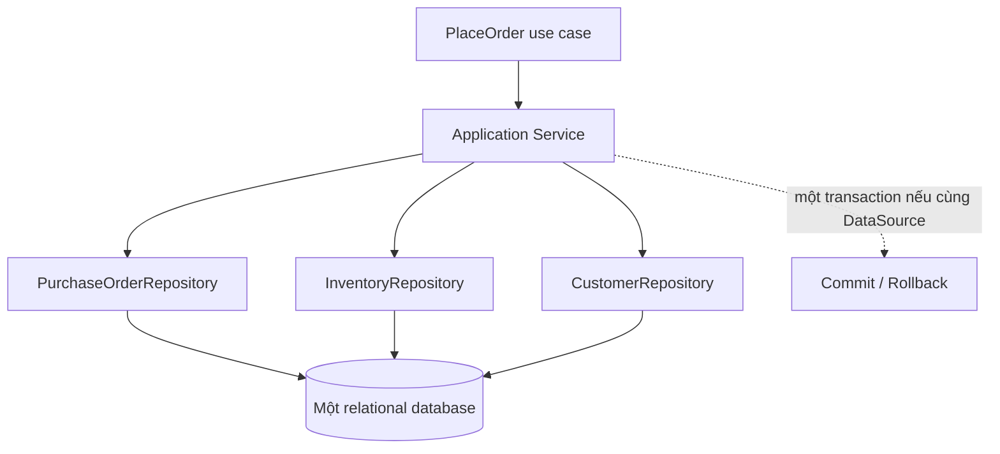
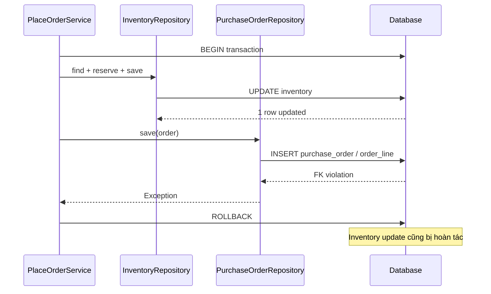
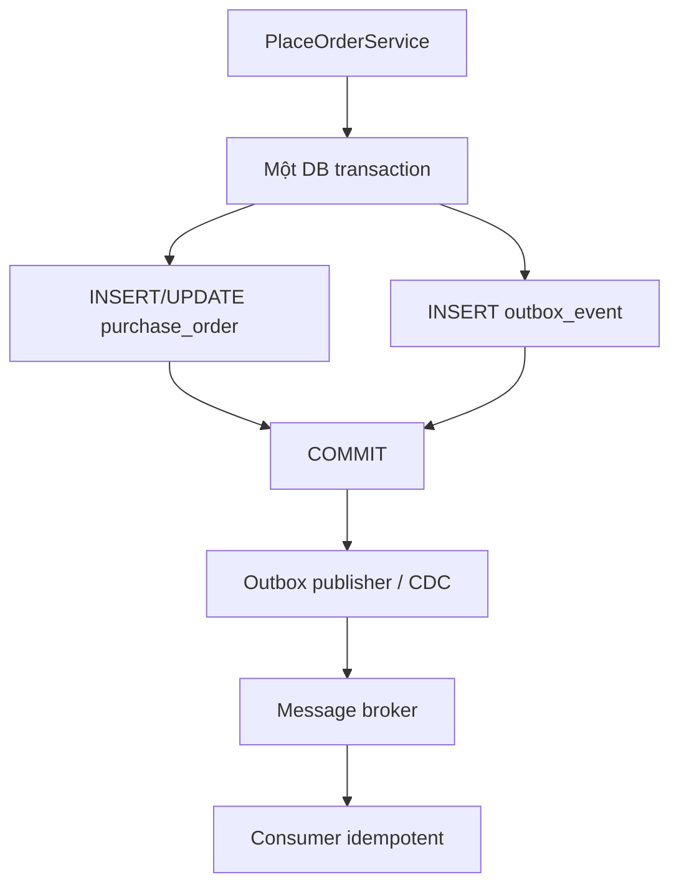

# Ranh giới giao dịch và lựa chọn nhất quán giữa nhiều aggregate

Trong **Spring Data Relational JDBC**, mỗi aggregate có một root và là ranh giới sở hữu dữ liệu trong mô hình domain. Tuy nhiên, một use case có thể phải thay đổi **nhiều aggregate**: đặt đơn hàng vừa tạo `PurchaseOrder`, vừa giảm tồn kho của `Inventory`, có thể còn cập nhật trạng thái hạn mức của `Customer`.

Lúc này cần phân biệt hai khái niệm:

- **Aggregate boundary** xác định nhóm entity nào phải được bảo vệ bởi các invariant và vòng đời của một root.
- **Transaction boundary** xác định tập thao tác database nào phải commit hoặc rollback cùng nhau.

Hai ranh giới này có liên quan nhưng không bắt buộc trùng nhau. Một transaction database có thể cập nhật nhiều aggregate root trong cùng một database. Ngược lại, nếu các aggregate nằm ở nhiều service/database độc lập, một `@Transactional` JDBC thông thường không thể biến chúng thành một giao dịch ACID phân tán.

Bài học trình bày cách chọn mức nhất quán phù hợp: transaction cục bộ khi cần tính nguyên tử, optimistic locking và constraint để bảo vệ dữ liệu đồng thời, transactional outbox để phát sự kiện đáng tin cậy, và saga khi quy trình trải qua nhiều bước/dịch vụ.

## 1. Aggregate boundary khác transaction boundary như thế nào?

Giả sử một hệ thống bán hàng có ba aggregate root:

```text
PurchaseOrder (root)
  - trạng thái đơn hàng
  - các OrderLine được sở hữu

Inventory (root)
  - số lượng còn có thể bán của một sản phẩm

Customer (root)
  - trạng thái khách hàng
  - hạn mức tín dụng
```

`PurchaseOrder` có thể tham chiếu `Customer` và `Product` bằng ID hoặc `AggregateReference`. `Inventory` là root riêng. Đặt hàng là một use case phối hợp các repository:



Mỗi repository vẫn thao tác với aggregate root của nó. Việc cùng nằm trong một transaction không có nghĩa `Inventory` trở thành entity con của `PurchaseOrder`, cũng không có nghĩa `PurchaseOrder` được phép sở hữu `Customer`.

| Khái niệm | Câu hỏi trả lời | Ví dụ |
|---|---|---|
| Aggregate boundary | Ai sở hữu entity và chịu trách nhiệm giữ invariant nội bộ? | `PurchaseOrder` sở hữu `OrderLine` |
| Transaction boundary | Các thao tác database nào cùng commit/rollback? | Reserve tồn kho và lưu đơn trong một transaction |
| Service/use-case boundary | Hành động nghiệp vụ nào cần phối hợp nhiều aggregate? | `PlaceOrderService.place(...)` |
| Distributed workflow boundary | Quy trình qua nhiều service/database được tiếp tục và phục hồi ra sao? | Saga đặt hàng, thanh toán, giao hàng |

**Quy tắc thiết kế:** trước hết xác định invariant thuộc aggregate nào; sau đó quyết định use case cần một transaction database hay một quy trình phối hợp nhiều transaction. Không mở rộng aggregate chỉ để tránh phải điều phối nhiều repository.

## 2. Chọn mức nhất quán theo yêu cầu nghiệp vụ

Không phải mọi thay đổi giữa nhiều aggregate đều cần cùng một mức đồng bộ. Hãy hỏi điều gì phải đúng ngay khi use case trả về thành công.

| Tình huống | Mức nhất quán thường phù hợp | Cơ chế gợi ý |
|---|---|---|
| Sửa một aggregate và các entity con được sở hữu | Ngay lập tức trong cùng transaction | `repository.save(root)` |
| Hai aggregate trong cùng relational database phải cùng thành công/thất bại | ACID cục bộ | `@Transactional` ở application service |
| Hai transaction đồng thời sửa cùng một aggregate | Phát hiện xung đột hoặc khóa có chủ đích | `@Version`, constraint, conditional update hoặc row lock |
| Cập nhật database rồi phát event ra broker | Không để mất event sau commit | Transactional outbox + publisher/retry |
| Quy trình qua nhiều service/database, có thể kéo dài | Eventual consistency có trạng thái và bù trừ | Saga/process manager |
| Dữ liệu chỉ cần cập nhật cho màn hình báo cáo sau một khoảng trễ | Eventual consistency/read model | Projection, consumer idempotent |

Ví dụ, việc **không bán vượt tồn kho** là invariant quan trọng. Nếu order đã được xác nhận nhưng reserve tồn kho thất bại, hệ thống không được trả về kết quả “đặt hàng thành công” như thể mọi việc đã hoàn tất. Có thể giải quyết bằng một transaction chung nếu hai aggregate nằm trong cùng database, hoặc bằng saga nếu reserve diễn ra ở dịch vụ tồn kho độc lập.

Ngược lại, cập nhật thống kê số đơn của khách hàng có thể được xử lý bất đồng bộ nếu độ trễ vài giây không làm vi phạm nghiệp vụ. Chọn mức nhất quán dựa trên hậu quả khi dữ liệu chưa đồng bộ, không dựa trên sở thích kỹ thuật.

## 3. Nhiều aggregate trong cùng database: dùng transaction cục bộ

Spring Data JDBC dùng Spring transaction management và JDBC `DataSource`. Khi các repository cùng dùng **một DataSource và cùng transaction manager**, một transaction mở ở application service có thể bao trùm nhiều lệnh `save()` và truy vấn JDBC.

Ví dụ luồng đặt hàng:

1. Đọc `Inventory` và kiểm tra số lượng còn lại.
2. Reserve số lượng trong aggregate `Inventory`.
3. Tạo và lưu `PurchaseOrder`.
4. Nếu tất cả thành công, commit; nếu một bước lỗi và lỗi được rollback, cả hai thay đổi được rollback.

### Application service điều phối transaction

```java
package com.example.sales;

import org.springframework.stereotype.Service;
import org.springframework.transaction.annotation.Transactional;

@Service
public class PlaceOrderService {

    private final InventoryRepository inventoryRepository;
    private final PurchaseOrderRepository orderRepository;

    public PlaceOrderService(
            InventoryRepository inventoryRepository,
            PurchaseOrderRepository orderRepository) {
        this.inventoryRepository = inventoryRepository;
        this.orderRepository = orderRepository;
    }

    @Transactional
    public PurchaseOrder place(long productId, int quantity, long customerId) {
        if (quantity <= 0) {
            throw new IllegalArgumentException("quantity must be positive");
        }

        Inventory inventory = inventoryRepository.findById(productId)
                .orElseThrow(() -> new IllegalArgumentException("Product not found"));

        inventory.reserve(quantity);
        inventoryRepository.save(inventory);

        PurchaseOrder order = new PurchaseOrder(customerId);
        order.addLine(productId, quantity, inventory.getUnitPriceCents());

        return orderRepository.save(order);
    }
}
```

`@Transactional` đặt ở **application service**, nơi nhìn thấy toàn bộ use case. Không cần đặt transaction riêng cho từng lệnh repository; transaction ngoài bao trùm các lời gọi bên trong. Repository method có thể có transaction metadata mặc định, nhưng transaction đang hoạt động ở service sẽ được tham gia theo propagation mặc định `REQUIRED`.

`Inventory` và `PurchaseOrder` vẫn là hai aggregate root độc lập. Service điều phối thứ tự thao tác và transaction, còn mỗi root tự bảo vệ invariant nội bộ qua hành vi domain như `inventory.reserve(quantity)` và `order.addLine(...)`.

### Điều kiện để hai repository thực sự dùng chung transaction

- Cùng kết nối tới **cùng database resource/DataSource**.
- Cùng được quản lý bởi transaction manager tương thích với JDBC `DataSource` đó, thường là `JdbcTransactionManager` hoặc `DataSourceTransactionManager`.
- Các thao tác JDBC lấy connection qua cơ chế Spring quản lý (Spring Data JDBC, `JdbcTemplate`, `NamedParameterJdbcTemplate` hoặc code tích hợp tương ứng).
- Method được gọi qua Spring transaction proxy trong một bean được quản lý; không tự gọi method `@Transactional` khác trên `this` rồi kỳ vọng proxy mở transaction mới.

Nếu hai repository dùng hai `DataSource` khác nhau hoặc hai transaction manager khác nhau, `@Transactional` mặc định không tự động hợp nhất chúng thành một transaction phân tán. Cần cấu hình rõ transaction manager được chọn, hoặc dùng một kiến trúc điều phối phù hợp với nhiều resource.

### Rollback khi bước sau thất bại

Giả sử `inventoryRepository.save(inventory)` đã chạy thành công, nhưng `orderRepository.save(order)` gặp lỗi khóa ngoại. Nếu cả hai thao tác nằm trong cùng transaction database, transaction rollback sẽ hoàn tác cả thay đổi tồn kho và đơn hàng.



Rollback mặc định của Spring `@Transactional` xảy ra với `RuntimeException` và `Error`. Checked exception không mặc định gây rollback; nếu nghiệp vụ ném checked exception mà cần rollback, khai báo `rollbackFor` phù hợp:

```java
@Transactional(rollbackFor = OrderRejectedException.class)
public PurchaseOrder place(...) throws OrderRejectedException {
    // phối hợp các repository
}
```

Không bắt exception rồi nuốt nó nếu transaction phải rollback. Nếu cần chuyển exception thành kết quả nghiệp vụ, hãy đánh dấu rollback rõ ràng hoặc để exception thoát khỏi ranh giới transaction rồi chuyển đổi ở tầng gọi bên ngoài.

## 4. Kiểm soát đồng thời khi nhiều use case sửa cùng aggregate

Một transaction chung giải quyết tính nguyên tử của các thao tác bên trong nó, nhưng chưa tự giải quyết mọi cuộc đua giữa hai transaction khác nhau.

Giả sử tồn kho đang có 5 đơn vị. Hai request đồng thời đều đọc giá trị 5 và muốn reserve 4. Nếu cả hai cùng tính `available = 1` dựa trên bản đọc cũ rồi ghi đè, hệ thống có thể bán vượt số lượng thực tế.

### Optimistic locking với `@Version`

```java
@Table("inventory")
public class Inventory {

    @Id
    private Long productId;

    @Version
    private Long version;

    private int available;

    private long unitPriceCents;

    protected Inventory() {}

    public void reserve(int quantity) {
        if (quantity <= 0 || quantity > available) {
            throw new InsufficientStockException();
        }
        available -= quantity;
    }

    public int getAvailable() { return available; }
    public long getUnitPriceCents() { return unitPriceCents; }
}
```

Spring Data JDBC tạo câu update có điều kiện theo ID và version. Về mặt logic:

```sql
UPDATE inventory
SET available = :newAvailable,
    version = :newVersion
WHERE product_id = :productId
  AND version = :oldVersion;
```

Nếu transaction khác đã cập nhật cùng row trước, điều kiện `version = :oldVersion` không còn khớp. Spring Data JDBC phát hiện số row được update không đúng và ném lỗi optimistic locking. Transaction hiện tại phải rollback; application service có thể trả lỗi xung đột hoặc retry có kiểm soát sau khi đọc lại trạng thái mới.

`@Version` bảo vệ cập nhật của aggregate root. Nếu dữ liệu tồn kho bị thay đổi bằng SQL tùy chỉnh, batch job hoặc một service khác mà không tăng version, optimistic locking của repository có thể không phát hiện được những thay đổi đó. Tất cả đường ghi phải tuân theo cùng quy ước version, hoặc dùng cơ chế database-level khác.

### Conditional update và constraint database

Với một invariant đơn giản như “available không được âm”, có thể dùng câu SQL nguyên tử:

```sql
UPDATE inventory
SET available = available - :quantity
WHERE product_id = :productId
  AND available >= :quantity;
```

Nếu số row cập nhật là 1, reserve thành công; nếu là 0, sản phẩm không tồn tại hoặc không đủ hàng. Phân biệt hai trường hợp bằng một query bổ sung nếu nghiệp vụ cần. Có thể thêm constraint:

```sql
ALTER TABLE inventory
ADD CONSTRAINT ck_inventory_available_nonnegative
CHECK (available >= 0);
```

Conditional update thường phù hợp cho một phép biến đổi số lượng nguyên tử. Tuy nhiên, custom SQL trực tiếp phải được thiết kế cùng optimistic locking/version và mapping entity; nếu nó bypass version mà repository dựa vào, trạng thái concurrency có thể không còn nhất quán.

### Pessimistic locking

Nếu use case cần đọc rồi ra quyết định trên dữ liệu được khóa, có thể cân nhắc `SELECT ... FOR UPDATE` trong một transaction. Cách khóa, thời hạn, deadlock và hỗ trợ cú pháp phụ thuộc database. Pessimistic locking hữu ích khi xung đột thường xuyên và chi phí retry cao, nhưng giữ lock lâu sẽ làm giảm throughput.

**Không chọn isolation level cao nhất theo mặc định.** Hãy dùng constraint để bảo vệ invariant đơn giản, optimistic locking khi xung đột tương đối hiếm, và row lock/serializable khi có lý do rõ ràng. Kiểm thử bằng các transaction thực sự chạy đồng thời trên database mục tiêu.

## 5. Vì sao transaction không nên bao trùm lời gọi HTTP hoặc công việc lâu?

Một transaction JDBC giữ connection và có thể giữ row lock cho đến commit/rollback. Nếu bên trong `@Transactional` thực hiện HTTP call đến dịch vụ thanh toán, chờ người dùng, upload file lớn hoặc chạy tác vụ kéo dài, database resource bị giữ trong thời gian không cần thiết.

Ví dụ không nên:

```java
@Transactional
public void checkout(...) {
    inventoryRepository.save(...);
    paymentClient.charge(...); // gọi mạng trong lúc DB transaction đang mở
    orderRepository.save(...);
}
```

Nếu payment service timeout, transaction có thể giữ lock lâu và rollback database, nhưng không thể chắc chắn giao dịch thanh toán bên ngoài cũng đã được hoàn tác. Có thể xảy ra tình trạng **thanh toán thành công nhưng database rollback**.

Đối với tích hợp bên ngoài, nên tách thành các bước có trạng thái rõ ràng:

1. Ghi trạng thái yêu cầu thanh toán hoặc sự kiện cần phát trong transaction cục bộ.
2. Commit database.
3. Gửi yêu cầu ra hệ thống ngoài bằng worker hoặc orchestrator, có idempotency key.
4. Nhận kết quả và cập nhật trạng thái trong transaction cục bộ khác.
5. Nếu bước sau thất bại, retry hoặc chạy hành động bù trừ theo quy tắc nghiệp vụ.

## 6. Transactional outbox: ghi dữ liệu và sự kiện trong cùng transaction

Một lỗi phổ biến là cập nhật aggregate xong rồi publish event trực tiếp:

```java
@Transactional
public PurchaseOrder place(...) {
    PurchaseOrder order = orderRepository.save(...);
    eventPublisher.publishEvent(new OrderPlaced(order.getId()));
    return order;
}
```

Nếu event được gửi ra broker trước khi database commit, consumer có thể nhận `OrderPlaced` trong khi transaction database sau đó rollback. Nếu commit trước rồi process chết trước khi publish, event lại bị mất. Đây là **dual-write problem**: database và message broker là hai resource độc lập.

Transactional outbox giải quyết bằng cách lưu bản ghi sự kiện trong **cùng database transaction** với aggregate:



Ví dụ bảng outbox:

```sql
CREATE TABLE outbox_event (
    event_id UUID PRIMARY KEY,
    aggregate_type VARCHAR(100) NOT NULL,
    aggregate_id VARCHAR(100) NOT NULL,
    event_type VARCHAR(150) NOT NULL,
    payload TEXT NOT NULL,
    occurred_at TIMESTAMP NOT NULL,
    published_at TIMESTAMP NULL
);
```

Trong cùng service transaction:

```java
@Transactional
public PurchaseOrder place(...) {
    PurchaseOrder order = orderRepository.save(...);

    outboxRepository.save(new OutboxEvent(
            UUID.randomUUID(),
            "PurchaseOrder",
            order.getId().toString(),
            "OrderPlaced",
            serialize(new OrderPlacedPayload(order.getId())),
            Instant.now()
    ));

    return order;
}
```

Nếu transaction rollback, cả order và outbox row đều không tồn tại. Nếu commit, publisher có thể đọc outbox và gửi event sau đó. Publisher có thể chạy theo lịch, dùng `FOR UPDATE SKIP LOCKED` nếu database hỗ trợ, hoặc dùng CDC để đọc transaction log.

### Outbox không đảm bảo gửi đúng một lần

Publisher có thể gửi message thành công nhưng chết trước khi đánh dấu `published_at`. Khi khởi động lại, nó gửi lại cùng event. Vì vậy outbox thường cung cấp **at-least-once delivery**, không phải exactly-once end-to-end.

Consumer nên idempotent:

- Mỗi event có `event_id` duy nhất.
- Consumer lưu ID đã xử lý trong bảng inbox/deduplication cùng transaction với thay đổi dữ liệu của nó.
- Nếu nhận lại cùng event, consumer bỏ qua tác dụng nghiệp vụ đã hoàn tất.
- Retry phải có backoff và giới hạn/đưa message lỗi vào dead-letter flow phù hợp.

Outbox cũng cần chính sách giữ/xóa event đã publish, theo dõi độ trễ và xử lý event poison. Nếu nhiều event của cùng aggregate phải theo thứ tự, cần sequence/version hoặc partition key phù hợp; chỉ dựa vào thời điểm `occurred_at` có thể không đủ để đảm bảo ordering.

## 7. Saga khi use case đi qua nhiều service/database

Giả sử `Order Service`, `Inventory Service` và `Payment Service` dùng database riêng. Không thể dùng một JDBC transaction manager cục bộ để commit cả ba database. Một quy trình phù hợp có thể là saga:

```mermaid
flowchart TD
    A["Order: tạo Pending"] --> B["Inventory: reserve stock"]
    B --> C{ "Reserve thành công?" }
    C -->|Có| D["Payment: authorize/charge"]
    C -->|Không| X["Order: Rejected"]
    D --> E{ "Payment thành công?" }
    E -->|Có| F["Order: Confirmed"]
    E -->|Không| G["Inventory: release stock"]
    G --> H["Order: PaymentFailed"]
```

Mỗi bước là một **local transaction** của service sở hữu dữ liệu. Khi bước sau thất bại, saga gọi hành động bù trừ (*compensation*) cho các bước đã hoàn thành, ví dụ `releaseReservation` sau khi reserve tồn kho thành công nhưng thanh toán thất bại.

Compensation không phải rollback database theo nghĩa kỹ thuật. Nó là một hành động nghiệp vụ mới, có thể thất bại, retry và cần idempotency. Ví dụ nếu hàng đã được đóng gói/giao đi, “hoàn tác giao hàng” có thể là quy trình trả hàng chứ không thể xóa lịch sử đã xảy ra.

### Choreography và orchestration

| Kiểu saga | Cách điều phối | Phù hợp khi |
|---|---|---|
| Choreography | Service phát/nhận event và tự thực hiện bước tiếp theo | Luồng ngắn, ít nhánh, trách nhiệm rõ |
| Orchestration | Một process manager/orchestrator theo dõi trạng thái và gửi command | Luồng nhiều bước, timeout, nhánh lỗi và compensation phức tạp |

Với saga, cần lưu trạng thái workflow để khôi phục sau restart. Không giữ một database transaction mở trong suốt thời gian chờ nhiều service. Mỗi service dùng outbox để phát event/command đáng tin cậy, consumer xử lý idempotent, và saga có timeout/retry/compensation rõ ràng.

## 8. Chọn transaction boundary ở tầng nào trong ứng dụng?

Trong ứng dụng Spring, transaction thường nên bắt đầu tại **application service** — nơi thực hiện một use case hoàn chỉnh. Repository tập trung vào persistence của aggregate; domain method bảo vệ invariant nội bộ.

```text
Controller
   |
   v
PlaceOrderService (@Transactional)
   |-- InventoryRepository.findById/save
   |-- PurchaseOrderRepository.save
   |-- OutboxRepository.save (nếu cần phát event)
   |
   v
Commit / Rollback
```

Không nên để controller tự mở transaction cho nhiều service call hoặc đặt `@Transactional` trên mọi domain method. Transaction là concern của application/persistence boundary; domain object nên giữ các hành vi nghiệp vụ mà không cần biết transaction manager.

### Một số thuộc tính `@Transactional` cần hiểu

```java
@Transactional(
    propagation = Propagation.REQUIRED,
    isolation = Isolation.READ_COMMITTED,
    timeout = 10
)
public PurchaseOrder place(...) {
    // use case
}
```

| Thuộc tính | Ý nghĩa | Lưu ý |
|---|---|---|
| `propagation = REQUIRED` | Dùng transaction hiện có hoặc tạo transaction mới | Mặc định của Spring; repository thường tham gia transaction service |
| `REQUIRES_NEW` | Tạm treo transaction hiện tại và mở transaction độc lập | Có thể commit dù transaction ngoài rollback; không dùng tùy tiện cho một phần phải atomic cùng aggregate |
| `NESTED` | Transaction lồng nhau dựa trên savepoint nếu manager/resource hỗ trợ | Không phải mọi transaction manager đều hỗ trợ |
| `isolation` | Chọn mức cô lập cho transaction mới | Giá trị thực tế phụ thuộc database; isolation không thay thế invariant/constraint |
| `timeout` | Giới hạn thời gian transaction theo hỗ trợ của manager | Không phải cơ chế hủy chắc chắn một HTTP call bên ngoài |
| `readOnly = true` | Gợi ý transaction chỉ đọc cho manager/driver | Không phải bảo đảm bảo mật hay cơ chế chặn mọi lệnh ghi |
| `rollbackFor` | Chỉ định exception bổ sung gây rollback | Mặc định RuntimeException/Error; checked exception cần cấu hình nếu muốn rollback |

`@Transactional` thường hoạt động thông qua proxy. Method phải được gọi qua bean proxy; self-invocation như `this.innerTransactionalMethod()` không kích hoạt một transaction interceptor mới. Với Spring Data JDBC, ưu tiên transaction manager gắn với đúng `DataSource` của repository.

## 9. Cẩn trọng khi có nhiều DataSource hoặc nhiều transaction manager

Nếu ứng dụng có database nghiệp vụ và database audit riêng:

```text
BusinessDataSource → businessTransactionManager
AuditDataSource    → auditTransactionManager
```

Một annotation `@Transactional` không mặc nhiên commit/rollback đồng thời hai database. Cần chỉ rõ manager được dùng (`@Transactional("businessTransactionManager")`) và thiết kế cách ghi audit phù hợp. Nếu audit bắt buộc cùng commit với nghiệp vụ nhưng nằm ở database khác, đây là bài toán đa resource; cân nhắc outbox hoặc cơ chế phân tán có chủ đích thay vì giả định hai JDBC transaction cục bộ tự liên kết.

XA/2-phase commit có thể điều phối nhiều resource trong môi trường hỗ trợ, nhưng kéo theo coordinator, cấu hình driver/database, khả năng phục hồi và chi phí vận hành. Với hệ thống service hiện đại, outbox + saga thường dễ kiểm soát hơn cho workflow nghiệp vụ dài. Không nên triển khai distributed transaction chỉ vì hai repository khác nhau.

## 10. Idempotency và retry là một phần của tính nhất quán

Khi request bị timeout, client không biết server đã commit hay chưa. Nếu client gửi lại cùng lệnh đặt hàng, có thể tạo hai order hoặc reserve tồn kho hai lần. Transaction đảm bảo tính nguyên tử của **một lần thực thi**, nhưng không tự nhận diện hai request là cùng một ý định.

Một giải pháp là idempotency key:

```sql
CREATE TABLE command_deduplication (
    idempotency_key VARCHAR(100) PRIMARY KEY,
    command_type VARCHAR(100) NOT NULL,
    result_reference VARCHAR(100),
    created_at TIMESTAMP NOT NULL
);
```

Trong transaction đặt hàng, kiểm tra/ghi idempotency key và tạo order. Unique constraint bảo vệ trước hai request đồng thời dùng cùng key. Request lặp lại có thể trả lại kết quả đã lưu thay vì chạy lại tác dụng nghiệp vụ.

Retry cần phân loại lỗi:

- **Optimistic lock conflict:** có thể đọc lại trạng thái mới và retry toàn bộ use case với giới hạn, nếu nghiệp vụ cho phép.
- **Deadlock/serialization failure:** database có thể yêu cầu retry transaction; phải retry toàn bộ transaction, không chỉ lặp câu lệnh cuối.
- **Validation/business rejection:** không retry tự động vì trạng thái nghiệp vụ không thay đổi chỉ nhờ thử lại.
- **Network timeout khi gọi service ngoài:** kết quả có thể chưa rõ; cần idempotency key và trạng thái workflow, không phát lệnh thanh toán mới với ID khác.

Không đặt vòng retry bên trong transaction đã bị đánh dấu rollback-only rồi tiếp tục dùng cùng transaction. Hãy để transaction kết thúc, sau đó mở transaction mới cho lần thử lại.

## 11. Kiểm thử ranh giới transaction và tính nhất quán

Một test chỉ xác nhận repository A và B đều save thành công chưa đủ để chứng minh chúng dùng cùng transaction. Hãy kiểm tra cả tình huống thất bại giữa chừng.

### Test rollback nhiều aggregate

Trong integration test:

1. Chuẩn bị `Inventory.available = 5`.
2. Gọi `PlaceOrderService.place(...)` với quantity hợp lệ để inventory được giảm.
3. Cố ý làm bước lưu order thất bại (ví dụ vi phạm một constraint kiểm thử).
4. Sau khi transaction kết thúc, đọc lại inventory và xác nhận `available` vẫn là 5.
5. Xác nhận không có order được tạo.

Test này chứng minh hai thao tác thực sự nằm trong cùng transaction. Dùng cùng database engine và DataSource như cấu hình ứng dụng; không thay repository bằng mock nếu mục tiêu là xác nhận rollback JDBC.

### Test optimistic locking đồng thời

Tạo hai transaction độc lập cùng đọc một `Inventory` với cùng version. Cả hai cùng giảm tồn kho rồi save. Kết quả mong đợi: một transaction commit; transaction còn lại nhận optimistic locking failure và rollback. Kiểm tra số lượng cuối cùng không âm và chỉ có một reservation thành công.

### Test outbox

- Nếu lưu aggregate thất bại, outbox event không được commit.
- Nếu aggregate và outbox cùng commit, publisher có thể đọc event.
- Gửi lại một event cùng `event_id` không làm consumer áp dụng nghiệp vụ hai lần.
- Publisher chết sau khi gửi nhưng trước khi đánh dấu published không làm mất event; consumer xử lý duplicate an toàn.

### Test saga

- Mỗi bước local transaction có thể retry.
- Timeout không tạo lệnh trùng.
- Compensation có thể chạy lại mà không gây tác dụng kép.
- Trạng thái workflow có thể khôi phục sau khi process restart.

Với các test concurrency, nên dùng hai connection/transaction thực sự, có synchronization barrier để điều khiển thứ tự, và chạy trên database thật bằng Testcontainers. Test tuần tự trong một transaction test duy nhất không mô phỏng được race condition.

## 12. Các lỗi thiết kế thường gặp

| Biểu hiện | Nguyên nhân | Hướng xử lý |
|---|---|---|
| Hai repository save thành công nhưng lỗi ở bước sau không rollback dữ liệu bước trước | Mỗi thao tác chạy trong transaction riêng hoặc dùng DataSource/manager khác nhau | Đặt transaction ở application service; xác nhận cùng DataSource và transaction manager |
| `@Transactional` không có tác dụng | Self-invocation, bean không qua Spring proxy, method không được quản lý | Gọi qua Spring bean proxy và kiểm tra transaction configuration |
| Inventory âm khi hai request đồng thời | Chỉ kiểm tra số lượng trong memory, không bảo vệ cập nhật cạnh tranh | `@Version`, conditional update, row lock và CHECK constraint |
| Event được gửi nhưng order rollback | Publish ra broker trước database commit | Transactional outbox hoặc after-commit flow có cơ chế khôi phục phù hợp |
| Order commit nhưng không có event | Commit DB xong process chết trước publish | Outbox ghi cùng transaction với order |
| Consumer xử lý event hai lần | Outbox publisher retry sau khi không nhận được xác nhận | Event ID và consumer idempotent/inbox |
| Gọi thanh toán thành công nhưng database rollback | HTTP call nằm trong transaction DB; hai resource không cùng ACID | Saga, idempotency và compensation |
| Retry làm reserve tồn kho hai lần | Không có idempotency key hoặc retry chỉ một phần use case | Idempotency ở command và retry toàn transaction |
| Transaction giữ connection/lock quá lâu | Gọi HTTP, chờ user hoặc xử lý lớn trong transaction | Thu ngắn transaction, chuyển việc ngoài DB sang workflow riêng |
| Dùng `REQUIRES_NEW` làm một phần nghiệp vụ vẫn commit khi phần còn lại rollback | Transaction con độc lập ngoài ranh giới atomic mong muốn | Chỉ dùng khi tính độc lập là chủ đích, nếu không dùng `REQUIRED` |

## 13. Quy trình chọn ranh giới giao dịch

Khi thiết kế một use case nhiều aggregate, đi theo thứ tự:

1. **Liệt kê invariant.** Điều kiện nào phải đúng ngay khi use case báo thành công?
2. **Gán invariant cho aggregate root.** Mỗi root bảo vệ dữ liệu và entity con được sở hữu của nó.
3. **Xác định resource.** Các aggregate nằm trong cùng database/DataSource hay ở nhiều service/database?
4. **Nếu cùng database:** đặt `@Transactional` ở application service để các repository cùng commit/rollback khi cần.
5. **Nếu khác resource:** xác định bước nào có thể eventual consistent, sự kiện nào cần outbox, workflow nào cần saga và compensation.
6. **Bảo vệ concurrency.** Chọn `@Version`, unique/check constraint, conditional update hoặc lock theo invariant.
7. **Bảo vệ retry.** Dùng idempotency key cho command và event; phân biệt lỗi retry được với lỗi nghiệp vụ.
8. **Kiểm thử failure path.** Cố ý làm một bước giữa chừng thất bại, kiểm tra rollback/outbox/compensation và khởi động lại workflow.

### Bảng quyết định nhanh

| Câu hỏi | Lựa chọn phù hợp |
|---|---|
| Mọi thay đổi ở cùng một aggregate? | Một lần `repository.save(root)` trong transaction cục bộ |
| Nhiều aggregate cùng database phải cùng thành công? | `@Transactional` tại application service |
| Cần bảo vệ một phép cập nhật khỏi race condition? | Optimistic/pessimistic locking, conditional SQL và constraint |
| Cần phát event sau khi commit mà không mất event? | Transactional outbox |
| Quy trình đi qua nhiều service và có bước bù trừ? | Saga/process manager |
| Request/event có thể được gửi lại? | Idempotency key, inbox/deduplication và retry có kiểm soát |

**Điểm cốt lõi:** aggregate xác định quyền sở hữu và invariant; transaction xác định thao tác nào commit/rollback cùng nhau. Dùng một transaction JDBC khi nhiều aggregate cùng database cần tính nguyên tử. Khi workflow vượt qua nhiều database hoặc service, chuyển sang outbox và saga với idempotency, retry và compensation được thiết kế rõ ràng.

## Tài liệu tham khảo chính thức

- [Spring Framework — Declarative Transaction Management](https://docs.spring.io/spring-framework/reference/data-access/transaction/declarative.html): `@Transactional`, proxy và rollback rules.
- [Spring Framework — Transaction Propagation](https://docs.spring.io/spring-framework/reference/data-access/transaction/declarative/tx-propagation.html): `REQUIRED`, `REQUIRES_NEW`, `NESTED`.
- [Spring Framework — Transaction Isolation](https://docs.spring.io/spring-framework/reference/data-access/transaction/declarative/tx-isolation.html): isolation level và cấu hình transaction.
- [Spring Data JDBC — Transactionality](https://docs.spring.io/spring-data/relational/reference/jdbc/transactions.html): transaction mặc định của repository và transaction ở service layer.
- [Spring Data JDBC — Optimistic Locking](https://docs.spring.io/spring-data/relational/reference/jdbc/mapping.html): `@Version` và xử lý xung đột khi cập nhật.
- [Spring Framework — JDBC Transaction Management](https://docs.spring.io/spring-framework/reference/data-access/jdbc/connections.html): quản lý JDBC connection theo transaction.
