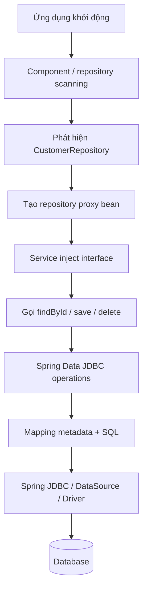

# Khai báo Repository, `CrudRepository` và `ListCrudRepository`

Trong **Spring Data JDBC**, repository là API mà tầng service sử dụng để đọc và ghi aggregate trong database. Thay vì tự viết một class DAO cho từng entity, ứng dụng khai báo một **interface repository** và kế thừa một interface nền tảng như `CrudRepository` hoặc `ListCrudRepository`. Spring Data tạo implementation tại runtime, kết nối các phương thức repository với metadata ánh xạ, thao tác JDBC và câu SQL tương ứng.

Hai interface thường gặp có quan hệ kế thừa với nhau:

- **`CrudRepository<T, ID>`** cung cấp các thao tác CRUD cơ bản. Các phương thức đọc nhiều bản ghi như `findAll()` và `findAllById(...)` trả về `Iterable`.
- **`ListCrudRepository<T, ID>`** mở rộng `CrudRepository` và khai báo lại một số phương thức trả về `List`, phù hợp khi ứng dụng muốn làm việc trực tiếp với collection có thứ tự truy cập theo API List.

Điểm cốt lõi là repository Spring Data JDBC làm việc ở **ranh giới aggregate root**. Nếu một class là entity con được root sở hữu, thông thường thao tác lưu/nạp nó đi qua repository của root. Repository không phải là một class Java tự động được tạo bảng; schema vẫn cần được quản lý bằng SQL script hoặc migration.

## 1. Repository interface là gì?

Trong cách tiếp cận DAO truyền thống, lập trình viên có thể tự tạo interface và class implementation:

```java
public interface CustomerDao {
    Customer findById(Long id);
    void insert(Customer customer);
    void update(Customer customer);
    void delete(Long id);
}
```

Sau đó phải tự viết implementation bằng `JdbcTemplate`, chuẩn bị câu SQL, bind tham số, đọc `ResultSet` và chuyển thành object. Spring Data JDBC cung cấp một cơ chế repository để giảm phần code lặp lại này.

Khai báo repository:

```java
import org.springframework.data.repository.CrudRepository;

public interface CustomerRepository
        extends CrudRepository<Customer, Long> {
}
```

Interface trên chưa có method nào do ứng dụng tự viết, nhưng đã có các phương thức CRUD được kế thừa. Spring Data đăng ký repository bean và tạo implementation proxy khi ứng dụng khởi động. Service có thể inject interface này như một dependency bình thường.

```java
import org.springframework.stereotype.Service;

@Service
public class CustomerService {
    private final CustomerRepository customers;

    public CustomerService(CustomerRepository customers) {
        this.customers = customers;
    }

    public Customer getCustomer(Long id) {
        return customers.findById(id).orElseThrow();
    }
}
```

Service phụ thuộc vào hợp đồng `CustomerRepository`; nó không cần biết implementation JDBC cụ thể tạo `PreparedStatement` như thế nào.

## 2. Generic type của repository: `T` và `ID`

Khai báo tổng quát của `CrudRepository` có dạng:

```java
public interface CrudRepository<T, ID> {
    // Các phương thức CRUD tổng quát.
}
```

Hai tham số kiểu có ý nghĩa:

| Generic | Ý nghĩa | Ví dụ trong `CustomerRepository` |
|---|---|---|
| `T` | Kiểu aggregate root mà repository quản lý | `Customer` |
| `ID` | Kiểu dữ liệu của ID root | `Long` |

Với:

```java
public interface CustomerRepository
        extends CrudRepository<Customer, Long> {
}
```

Spring Data biết repository này thao tác với `Customer`, còn khóa định danh có kiểu `Long`. Vì thế, `findById` nhận `Long`; `save` nhận `Customer` hoặc subtype phù hợp và trả về object đã lưu.

ID có thể là `Long`, `Integer`, `UUID`, `String` hoặc kiểu khác nếu mapping và database hỗ trợ. Kiểu generic phải thống nhất với thuộc tính `@Id` của aggregate root. Không nên khai báo repository dùng `Long` trong khi root có ID kiểu `UUID`.

## 3. Chuẩn bị aggregate để repository quản lý

Ví dụ dùng bảng `customers`:

```sql
CREATE TABLE customers (
    id BIGINT GENERATED BY DEFAULT AS IDENTITY PRIMARY KEY,
    name VARCHAR(120) NOT NULL,
    email VARCHAR(200) NOT NULL
);
```

Entity:

```java
import org.springframework.data.annotation.Id;
import org.springframework.data.relational.core.mapping.Table;

@Table("customers")
public record Customer(
        @Id Long id,
        String name,
        String email
) {}
```

`@Table` xác định tên bảng; `@Id` đánh dấu khóa chính. Nếu không có `@Table`, Spring Data Relational có thể suy ra tên bảng theo naming strategy, nhưng khai báo tường minh giúp ví dụ dễ đối chiếu với DDL.

Lưu ý:

- `@Id` ở đây là `org.springframework.data.annotation.Id`, không phải annotation JPA.
- `@Table` ở đây là `org.springframework.data.relational.core.mapping.Table`.
- Entity cần có cách khởi tạo tương thích với mapping, ví dụ constructor hoặc record canonical constructor.
- Repository không tự tạo bảng `customers`; DDL phải được chạy trước khi CRUD được thực thi.

## 4. `CrudRepository`: các phương thức cơ bản

`CrudRepository<T, ID>` cung cấp những thao tác phổ biến để lưu, đọc, kiểm tra và xóa aggregate. Các chữ ký dưới đây là dạng khái quát; kiểu `T`, `ID` được thay bằng kiểu cụ thể của repository.

### Nhóm lưu dữ liệu

```java
<S extends T> S save(S entity);
<S extends T> Iterable<S> saveAll(Iterable<S> entities);
```

- `save(entity)` lưu một aggregate và trả về aggregate sau khi lưu. Kết quả có thể chứa ID database sinh hoặc version mới.
- `saveAll(entities)` lưu nhiều aggregate và trả về `Iterable` chứa các kết quả đã lưu.
- Generic `<S extends T>` cho phép lưu một kiểu con của `T` khi mô hình kiểu của ứng dụng cần điều đó.

Với Spring Data JDBC, `save` thường chọn `INSERT` hoặc `UPDATE` dựa trên cơ chế nhận diện entity mới. Khi aggregate có các thành phần con được ánh xạ, một lần lưu có thể sinh nhiều câu SQL.

### Nhóm tìm kiếm

```java
Optional<T> findById(ID id);
boolean existsById(ID id);
Iterable<T> findAll();
Iterable<T> findAllById(Iterable<ID> ids);
long count();
```

- `findById` trả `Optional<T>` vì bản ghi có thể không tồn tại.
- `existsById` trả `boolean` để kiểm tra sự tồn tại.
- `findAll` trả tất cả aggregate theo repository.
- `findAllById` tìm các aggregate có ID nằm trong tập được truyền vào.
- `count` trả số lượng bản ghi phù hợp với repository.

Không nên dùng `findAll()` để tải toàn bộ bảng rất lớn chỉ nhằm tìm một vài bản ghi. Khi dữ liệu tăng, hãy cân nhắc query theo điều kiện, phân trang/sắp xếp hoặc một read model phù hợp.

### Nhóm xóa dữ liệu

```java
void deleteById(ID id);
void delete(T entity);
void deleteAllById(Iterable<? extends ID> ids);
void deleteAll(Iterable<? extends T> entities);
void deleteAll();
```

Các phương thức xóa tác động đến aggregate được repository quản lý. Với aggregate có child, việc xóa root có thể kéo theo thao tác xóa các hàng thuộc aggregate theo mapping và ràng buộc database. Hãy hiểu vòng đời aggregate trước khi gọi xóa hàng loạt.

## 5. `ListCrudRepository`: kết quả kiểu `List`

`ListCrudRepository<T, ID>` mở rộng `CrudRepository<T, ID>` và thay đổi kiểu trả về của các thao tác đọc nhiều bản ghi (đồng thời cung cấp `List` cho `saveAll`):

```java
public interface ListCrudRepository<T, ID>
        extends CrudRepository<T, ID> {

    @Override
    <S extends T> List<S> saveAll(Iterable<S> entities);

    @Override
    List<T> findAll();

    @Override
    List<T> findAllById(Iterable<ID> ids);
}
```

Do đó có thể khai báo:

```java
import org.springframework.data.repository.ListCrudRepository;

public interface CustomerRepository
        extends ListCrudRepository<Customer, Long> {
}
```

Với repository này:

```java
List<Customer> all = customers.findAll();
List<Customer> selected = customers.findAllById(List.of(1L, 2L, 3L));
List<Customer> saved = customers.saveAll(newCustomers);
```

Caller nhận trực tiếp `List<Customer>` nên có thể dùng các thao tác collection như `get(index)`, `size()`, `stream()` hoặc truyền vào API yêu cầu `List` mà không cần tự chuyển từ `Iterable`.

### So sánh nhanh

| Phương thức | `CrudRepository` | `ListCrudRepository` |
|---|---|---|
| `save(entity)` | `S` | `S` (kế thừa) |
| `saveAll(entities)` | `Iterable<S>` | `List<S>` |
| `findById(id)` | `Optional<T>` | `Optional<T>` (kế thừa) |
| `findAll()` | `Iterable<T>` | `List<T>` |
| `findAllById(ids)` | `Iterable<T>` | `List<T>` |
| `existsById(id)` | `boolean` | `boolean` (kế thừa) |
| `count()` | `long` | `long` (kế thừa) |
| Các phương thức delete | `void` | `void` (kế thừa) |

Khác biệt chủ yếu nằm ở **kiểu collection trả về**, không phải một mô hình SQL hay cách ánh xạ database hoàn toàn khác. Cả hai đều là repository CRUD của Spring Data.

## 6. Khi nào chọn `CrudRepository`, khi nào chọn `ListCrudRepository`?

Chọn `CrudRepository` khi:

- API hiện tại chỉ cần `Iterable` và muốn phụ thuộc vào hợp đồng tối thiểu.
- Mã gọi repository đã xử lý kết quả theo `Iterable`.
- Dự án đang dùng các interface repository dựa trên `CrudRepository` và không cần đổi chữ ký.

Chọn `ListCrudRepository` khi:

- Các phương thức `findAll`, `findAllById` và `saveAll` được sử dụng như `List`.
- Tầng service thường cần `size`, truy cập theo index hoặc truyền `List` sang API khác.
- Muốn kiểu trả về thể hiện rõ collection được materialize thành danh sách.

Ví dụ cả hai interface có thể dùng cùng một aggregate:

```java
public interface CustomerCrudRepository
        extends CrudRepository<Customer, Long> {
}

public interface CustomerListRepository
        extends ListCrudRepository<Customer, Long> {
}
```

Trong ứng dụng thực tế, thông thường chỉ cần **một repository interface** cho aggregate. Hai khai báo trên chỉ để minh họa lựa chọn; không nên đăng ký hai repository cùng quản lý một aggregate nếu không có mục đích rõ ràng.

`List` không có nghĩa là query tự động được phân trang hoặc streaming. `findAll()` vẫn là thao tác đọc toàn bộ kết quả theo repository. Nếu bảng lớn, hãy dùng cơ chế truy vấn có giới hạn dữ liệu thay vì chọn `CrudRepository` với hy vọng `Iterable` sẽ tự đọc từng hàng lười.

## 7. Spring Data JDBC tạo repository bean như thế nào?

Khi ứng dụng Spring Boot có dependency `spring-boot-starter-data-jdbc`, auto-configuration có thể phát hiện repository interfaces trong vùng package được scan và đăng ký bean tương ứng. Khi service inject `CustomerRepository`, Spring cung cấp proxy triển khai hợp đồng repository.

Luồng khái quát:



Ứng dụng không tự `new CustomerRepository()` vì interface không có constructor. Bean được Spring quản lý và được tạo bởi cơ chế repository infrastructure.

Với cấu hình thông thường trong Spring Boot, repository được scan từ package của lớp `@SpringBootApplication` trở xuống. Nếu repository nằm ngoài vùng scan, có thể tổ chức lại package hoặc cấu hình `@EnableJdbcRepositories` với base package phù hợp.

Ví dụ cấu trúc:

```text
com.example.shop
├── ShopApplication.java
├── customer
│   ├── Customer.java
│   ├── CustomerRepository.java
│   └── CustomerService.java
└── order
    ├── PurchaseOrder.java
    └── PurchaseOrderRepository.java
```

Đặt lớp ứng dụng ở `com.example.shop` giúp các package con được phát hiện theo cấu hình scan mặc định.

## 8. Khai báo method riêng ngoài CRUD

Repository interface có thể bổ sung method truy vấn theo tên property:

```java
import java.util.List;
import java.util.Optional;
import org.springframework.data.repository.ListCrudRepository;

public interface CustomerRepository
        extends ListCrudRepository<Customer, Long> {

    Optional<Customer> findByEmail(String email);

    List<Customer> findByNameContaining(String keyword);

    boolean existsByEmail(String email);
}
```

Spring Data phân tích tên method để xác định property của entity và tạo query tương ứng. `findByEmail` tham chiếu property Java `email`, không phải tên bảng hoặc cột viết trực tiếp trong chuỗi SQL. Với naming strategy mặc định, property `email` ánh xạ tới cột `email`; nếu property có `@Column` đổi tên cột, metadata được dùng để tạo truy vấn.

Nếu cần SQL tường minh, Spring Data JDBC hỗ trợ `@Query`:

```java
import org.springframework.data.jdbc.repository.query.Query;
import org.springframework.data.repository.query.Param;

@Query("SELECT id, name, email FROM customers WHERE LOWER(email) = LOWER(:email)")
List<Customer> findEmailIgnoringCase(@Param("email") String email);
```

SQL trong `@Query` là SQL database, vì vậy tên bảng/cột phải là identifier vật lý. Query tùy chỉnh cần trả về đủ cột để dựng kiểu kết quả được khai báo. Không nhầm `@Query` của Spring Data JDBC với JPQL/HQL của JPA.

## 9. CRUD method có ý nghĩa gì trong Spring Data JDBC?

Tên CRUD khá quen thuộc, nhưng cần hiểu hành vi theo mô hình aggregate của Spring Data JDBC.

### `save` không phải lúc nào cũng là `INSERT`

```java
Customer saved = customers.save(
        new Customer(null, "Lan", "lan@example.com")
);
```

Với ID `null`, entity thường được nhận diện là mới và được insert. Nếu entity có ID đã tồn tại, framework thường đi theo nhánh update. Quy tắc nhận diện có thể chịu ảnh hưởng của `@Version` hoặc `Persistable.isNew()`.

Không có dirty checking như JPA: sửa object trong bộ nhớ không tự chạy SQL; cần gọi `save`. Hãy dùng object trả về để nhận ID/version đã cập nhật, đặc biệt với immutable entity.

### `findById` trả `Optional`

```java
Optional<Customer> found = customers.findById(42L);
```

Không tìm thấy bản ghi thì kết quả rỗng; không nên giả định `findById` luôn trả object. Tầng service thường chuyển trường hợp không có thành lỗi nghiệp vụ hoặc response phù hợp.

### `deleteById` và `delete` xóa aggregate

```java
customers.deleteById(42L);
```

Với aggregate có các thành phần con, thao tác xóa cần xét các bảng child và khóa ngoại. Spring Data JDBC quản lý dữ liệu theo root; việc xóa có thể phát sinh các lệnh SQL phụ thuộc mapping. Không nên coi repository root chỉ xóa đúng một hàng bảng gốc trong mọi trường hợp.

### `findAll` là thao tác không giới hạn

```java
List<Customer> all = customers.findAll();
```

Phương thức này phù hợp cho tập dữ liệu nhỏ hoặc tác vụ quản trị có giới hạn rõ ràng. Với bảng tăng trưởng liên tục, nên khai báo query có điều kiện, giới hạn kết quả hoặc sử dụng cơ chế phân trang/sắp xếp phù hợp.

## 10. Repository quản lý aggregate root, không nhất thiết mỗi bảng một repository

Giả sử một đơn hàng có nhiều dòng hàng:

```java
@Table("purchase_orders")
public record PurchaseOrder(
        @Id Long id,
        @MappedCollection(idColumn = "order_id", keyColumn = "line_no")
        List<OrderLine> lines
) {}
```

Nếu `OrderLine` chỉ là child thuộc vòng đời của `PurchaseOrder`, repository thường được khai báo cho root:

```java
public interface PurchaseOrderRepository
        extends CrudRepository<PurchaseOrder, Long> {
}
```

Không cần một `OrderLineRepository` chỉ vì DDL có bảng `order_lines`. `@MappedCollection` mô tả các hàng child thuộc root; `save(order)` có thể ghi root và child như một aggregate. Nếu tạo repository CRUD độc lập cho child, service có thể sửa child mà bỏ qua invariant của đơn hàng.

Ngược lại, nếu `Product` là aggregate root độc lập được nhiều đơn hàng tham chiếu, `ProductRepository` là hợp lý. Một repository cho mỗi **aggregate root** thường gần với ranh giới nghiệp vụ hơn là một repository cho mỗi bảng.

## 11. `ListCrudRepository` không thay thế query chuyên biệt hoặc phân trang

Một nhầm lẫn thường gặp là nghĩ `ListCrudRepository` giúp tải dữ liệu theo từng trang vì kết quả là `List`. Thực tế, `List` chỉ là kiểu collection trả về; nó không chứa thông tin page number, total pages hay total elements.

Nếu cần phân trang/sắp xếp, Spring Data cung cấp các abstraction riêng như `PagingAndSortingRepository` và các khả năng query tương ứng, tùy phiên bản và module. Từ Spring Data 3.0, `PagingAndSortingRepository` không còn kế thừa `CrudRepository`; nếu cần cả CRUD và paging/sorting, có thể kết hợp các interface phù hợp thay vì giả định paging đã có sẵn trong `ListCrudRepository`.

Ví dụ về ý tưởng kết hợp interface:

```java
public interface CustomerRepository extends
        ListCrudRepository<Customer, Long>,
        PagingAndSortingRepository<Customer, Long> {
}
```

Khả năng query phân trang cụ thể cần kiểm tra theo phiên bản Spring Data JDBC đang dùng và kiểu truy vấn được khai báo. Không nên suy ra rằng mọi query method hoặc custom `@Query` đều tự hỗ trợ `Page<T>` chỉ vì repository kế thừa interface paging.

## 12. Các lỗi thường gặp khi khai báo repository

| Triệu chứng | Nguyên nhân có thể | Cách xử lý |
|---|---|---|
| Không inject được repository bean | Interface nằm ngoài package scan hoặc repository infrastructure chưa được cấu hình | Kiểm tra package của `@SpringBootApplication`, dependency và `@EnableJdbcRepositories` nếu cần |
| `findById` nhận sai kiểu | Generic `ID` không khớp kiểu `@Id` | Đồng bộ `CrudRepository<Customer, Long>` với ID `Long` |
| Không tìm thấy property trong derived query | Method dùng tên cột DB thay vì property Java hoặc gõ sai property | Đặt tên method theo property entity |
| SQL báo không có bảng | Chưa tạo schema hoặc `@Table` sai | Kiểm tra DDL và mapping bảng |
| `save` không insert như kỳ vọng | ID/version khiến entity được nhận diện là đã tồn tại | Kiểm tra trạng thái mới/cũ, `@Version` và `Persistable` |
| `findAll` trả `Iterable` gây bất tiện | Repository kế thừa `CrudRepository` | Dùng `ListCrudRepository` nếu API cần `List` |
| `ListCrudRepository` không giải quyết dữ liệu quá lớn | `List` không phải pagination/streaming | Thiết kế query giới hạn, phân trang hoặc đọc theo lô |
| Child không được lưu như mong đợi | Child không được mapping như phần sở hữu của root | Kiểm tra `@MappedCollection`, ID/key column và aggregate boundary |
| SQL tùy chỉnh không map được entity | Query thiếu cột hoặc dùng sai tên vật lý | Đối chiếu DDL, `@Column` và kiểu trả về |

Khi điều tra, nên kiểm tra theo thứ tự: **repository bean đã được tạo chưa → generic root/ID có đúng không → method được phân giải ra sao → metadata bảng/cột → SQL và DDL thực tế**. Cách này giúp khoanh vùng lỗi ở cấu hình Spring, khai báo interface hay mapping/database.

## 13. Ví dụ hoàn chỉnh: CRUD qua service

Một service có thể sử dụng các method nền tảng như sau:

```java
import java.util.List;
import org.springframework.stereotype.Service;
import org.springframework.transaction.annotation.Transactional;

@Service
public class CustomerService {
    private final CustomerRepository customers;

    public CustomerService(CustomerRepository customers) {
        this.customers = customers;
    }

    @Transactional
    public Customer create(String name, String email) {
        Customer draft = new Customer(null, name, email);
        return customers.save(draft);
    }

    public Customer get(Long id) {
        return customers.findById(id)
                .orElseThrow(() -> new IllegalArgumentException("Customer not found"));
    }

    public List<Customer> list() {
        return customers.findAll();
    }

    @Transactional
    public Customer rename(Long id, String newName) {
        Customer current = get(id);
        Customer changed = new Customer(
                current.id(), newName, current.email());
        return customers.save(changed);
    }

    @Transactional
    public void remove(Long id) {
        customers.deleteById(id);
    }
}
```

Trong ví dụ, `CustomerRepository` kế thừa `ListCrudRepository<Customer, Long>`, vì vậy `list()` có thể trả thẳng `List<Customer>`. Nếu đổi sang `CrudRepository`, cần điều chỉnh kiểu trả về hoặc chuyển đổi `Iterable` theo cách phù hợp.

`@Transactional` ở service thể hiện ranh giới nghiệp vụ. Một thao tác CRUD đơn giản có thể đã có transaction ở repository infrastructure, nhưng khi service phối hợp nhiều bước cần commit/rollback cùng nhau, transaction ở application service giúp xác định rõ phạm vi.

## 14. Bài thực hành phân biệt hai interface

Với entity `Customer`, DDL và dependency Spring Data JDBC ở các phần trước, có thể thực hiện:

1. Khai báo `CustomerRepository extends CrudRepository<Customer, Long>`; gọi `findAll()` và quan sát kiểu trả về được khai báo là `Iterable<Customer>`.
2. Đổi repository thành `CustomerRepository extends ListCrudRepository<Customer, Long>`; gọi lại `findAll()` và quan sát kiểu trả về là `List<Customer>`.
3. Thử `findAllById(List.of(1L, 2L))` và `saveAll(...)` để thấy các phương thức này cũng trả `List` qua `ListCrudRepository`.
4. Gọi `findById` với ID không tồn tại và xử lý `Optional.empty()`.
5. Tạo method `findByEmail` theo property Java, sau đó đối chiếu SQL được log với tên cột trong DDL.
6. Tạo một aggregate có child được `@MappedCollection`; gọi `save(root)` và quan sát một interface repository root có thể quản lý nhiều bảng thuộc aggregate.

Không cần tạo hai repository khác nhau cùng quản lý một aggregate trong ứng dụng để so sánh; có thể đổi interface kế thừa trong bài thực hành hoặc viết test riêng cho từng kiểu trả về.

## 15. Nguyên tắc ghi nhớ

- Repository là **interface mô tả thao tác trên aggregate root**; Spring Data JDBC cung cấp implementation thông qua proxy bean.
- `T` là kiểu aggregate root; `ID` là kiểu ID của root.
- `CrudRepository<T, ID>` cung cấp CRUD cơ bản, với các thao tác đọc nhiều bản ghi trả về `Iterable`.
- `ListCrudRepository<T, ID>` mở rộng `CrudRepository` và trả `List` cho `saveAll`, `findAll`, `findAllById`.
- `List` không đồng nghĩa với phân trang hoặc streaming; `findAll()` vẫn có thể tải tập dữ liệu lớn.
- Derived query dùng **tên property Java**; SQL trong `@Query` dùng **tên bảng/cột vật lý**.
- Repository Spring Data JDBC quản lý aggregate theo root; không mặc định tạo repository riêng cho mỗi bảng child.
- DDL phải tồn tại và khớp metadata; khai báo repository không tự tạo schema.

Khi bắt đầu một repository Spring Data JDBC, hãy xác định aggregate root và kiểu ID trước, sau đó chọn `CrudRepository` nếu hợp đồng `Iterable` là đủ hoặc `ListCrudRepository` nếu caller cần `List`. Từ interface đó, Spring Data cung cấp CRUD nhất quán với mapping và SQL của aggregate, giúp tầng service tập trung vào quy tắc nghiệp vụ thay vì lặp lại mã JDBC.
