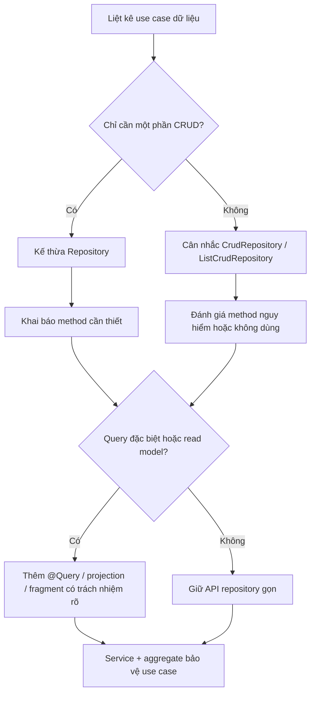

# Chọn tập phương thức được công khai và tránh repository quá rộng

Trong **Spring Data JDBC**, repository interface là hợp đồng mà application service sử dụng để đọc và ghi aggregate. Khi kế thừa `CrudRepository` hoặc `ListCrudRepository`, ứng dụng nhận được một tập thao tác CRUD khá đầy đủ. Điều đó tiện cho ví dụ nhỏ, nhưng không phải aggregate nào cũng nên công khai mọi thao tác như `findAll()`, `deleteAll()` hay `saveAll()` cho toàn bộ mã ứng dụng.

Thiết kế repository tốt bắt đầu từ câu hỏi: **Use case thực sự cần những thao tác dữ liệu nào, và những thao tác nào có thể làm sai quy tắc nghiệp vụ nếu được gọi tùy ý?** Spring Data cho phép chọn một tập phương thức hẹp hơn bằng cách kế thừa `Repository<T, ID>` và chỉ khai báo các method cần thiết. Khi cần, có thể chia hợp đồng đọc/ghi, dùng query theo ý nghĩa nghiệp vụ hoặc ghép repository fragments cho phần xử lý chuyên biệt.

## 1. Repository là hợp đồng truy cập aggregate

Ví dụ một aggregate `Customer`:

```java
import org.springframework.data.annotation.Id;
import org.springframework.data.relational.core.mapping.Table;

@Table("customers")
public record Customer(
        @Id Long id,
        String name,
        String email,
        boolean active
) {
    public Customer rename(String newName) {
        if (newName == null || newName.isBlank()) {
            throw new IllegalArgumentException("Tên không được để trống");
        }
        return new Customer(id, newName, email, active);
    }

    public Customer deactivate() {
        return new Customer(id, name, email, false);
    }
}
```

Và bảng tương ứng:

```sql
CREATE TABLE customers (
    id BIGINT GENERATED BY DEFAULT AS IDENTITY PRIMARY KEY,
    name VARCHAR(120) NOT NULL,
    email VARCHAR(200) NOT NULL UNIQUE,
    active BOOLEAN NOT NULL
);
```

Repository có thể được khai báo bằng `CrudRepository`:

```java
import org.springframework.data.repository.CrudRepository;

public interface CustomerRepository
        extends CrudRepository<Customer, Long> {
}
```

Chỉ với một dòng kế thừa, API đã có `save`, `saveAll`, `findById`, `existsById`, `findAll`, `findAllById`, `count`, `deleteById`, `delete`, `deleteAllById`, `deleteAll` và các thao tác CRUD liên quan. Những method đó hữu ích trong nhiều tình huống, nhưng một ứng dụng nghiệp vụ có thể chỉ cần một phần nhỏ.

Repository là **API kỹ thuật cho persistence**; nó không tự động trở thành nơi định nghĩa toàn bộ quy tắc nghiệp vụ. Aggregate root vẫn cần bảo vệ invariant, còn application service điều phối use case và transaction.

## 2. Vì sao không nên công khai mọi phương thức CRUD?

Một interface quá rộng khiến bất kỳ lớp nào inject repository cũng có thể gọi các thao tác mà use case không cần:

```java
customers.deleteAll();
customers.findAll();
customers.saveAll(importedCustomers);
```

Các lời gọi trên có thể gây ra vấn đề:

- **Xóa quá rộng**: `deleteAll()` không thể hiện rõ nghiệp vụ nào cho phép xóa toàn bộ khách hàng. Một lỗi gọi nhầm có thể gây hậu quả lớn.
- **Đọc quá nhiều**: `findAll()` có thể materialize toàn bộ aggregate, tốn bộ nhớ và thời gian khi bảng tăng trưởng.
- **Ghi bỏ qua quy trình**: `saveAll()` với dữ liệu được nhập trực tiếp có thể bỏ qua các bước xác thực hoặc chuyển trạng thái mà use case yêu cầu.
- **Phụ thuộc kỹ thuật lan rộng**: nhiều service biết và sử dụng các thao tác CRUD tổng quát, khiến việc thay đổi chính sách dữ liệu khó kiểm soát.
- **Ý định không rõ**: `deleteById(id)` chỉ nói xóa theo ID, trong khi nghiệp vụ có thể yêu cầu đóng tài khoản, lưu dấu vết hoặc từ chối xóa khi còn đơn hàng.

Ẩn một phương thức khỏi interface không phải là cơ chế phân quyền database hay ranh giới bảo mật. Nó là cách thu hẹp **hợp đồng mà mã ứng dụng được khuyến khích sử dụng**. Quyền truy cập thật sự vẫn phải được bảo vệ ở tầng ứng dụng, transaction, database và hệ thống phân quyền phù hợp.

## 3. Dùng `Repository<T, ID>` để chỉ công khai các method cần thiết

`Repository<T, ID>` là marker interface nền tảng của Spring Data. Nó cung cấp thông tin về domain type và ID nhưng không kế thừa toàn bộ CRUD methods. Có thể khai báo repository chỉ với các thao tác cần dùng:

```java
import java.util.List;
import java.util.Optional;
import org.springframework.data.repository.Repository;

public interface CustomerRepository
        extends Repository<Customer, Long> {

    Optional<Customer> findById(Long id);

    <S extends Customer> S save(S customer);

    boolean existsByEmail(String email);

    List<Customer> findByActiveTrue();
}
```

Ở đây repository chỉ công khai:

- `findById`: lấy một aggregate theo ID.
- `save`: lưu aggregate sau khi use case đã áp dụng thay đổi hợp lệ.
- `existsByEmail`: kiểm tra điều kiện tồn tại theo property nghiệp vụ.
- `findByActiveTrue`: lấy tập khách hàng đang hoạt động.

Các phương thức như `deleteAll`, `findAll` và `saveAll` không nằm trong hợp đồng này. Spring Data vẫn nhận diện các method CRUD được khai báo theo chữ ký phù hợp và cung cấp implementation từ repository infrastructure. Các method query khác được xử lý theo cơ chế query derivation hoặc query khai báo.

Generic `<S extends Customer> S save(S customer)` giữ chữ ký tổng quát thường dùng của CRUD repository. Nếu domain không cần subtype, một chữ ký đơn giản `Customer save(Customer customer)` cũng có thể diễn đạt API hẹp hơn; hãy chọn chữ ký tương thích với cách Spring Data repository được cấu hình trong dự án.

### `@RepositoryDefinition` là một cách khai báo khác

Thay vì kế thừa `Repository`, có thể đánh dấu interface bằng `@RepositoryDefinition` và chỉ rõ domain type cùng ID type:

```java
import java.util.Optional;
import org.springframework.data.repository.RepositoryDefinition;

@RepositoryDefinition(domainClass = Customer.class, idClass = Long.class)
public interface CustomerRepository {
    Optional<Customer> findById(Long id);
    Customer save(Customer customer);
}
```

Hai kiểu khai báo đều hướng đến việc xác định một repository domain cụ thể mà không cần công khai toàn bộ `CrudRepository`. Trong đa số dự án, kế thừa `Repository<T, ID>` dễ thể hiện quan hệ kiểu và thuận tiện hơn khi tạo interface cơ sở dùng chung.

## 4. Tạo base repository tối thiểu cho một nhóm aggregate

Nếu nhiều aggregate đều cần cùng một tập thao tác nhỏ, có thể tạo interface generic dùng chung. Đánh dấu `@NoRepositoryBean` để Spring Data không cố tạo bean trực tiếp cho interface generic chưa gắn domain type cụ thể:

```java
import java.util.Optional;
import org.springframework.data.repository.NoRepositoryBean;
import org.springframework.data.repository.Repository;

@NoRepositoryBean
public interface AggregateRepository<T, ID> extends Repository<T, ID> {
    Optional<T> findById(ID id);

    <S extends T> S save(S aggregate);
}
```

Repository cụ thể:

```java
public interface CustomerRepository
        extends AggregateRepository<Customer, Long> {
    boolean existsByEmail(String email);
}

public interface InvoiceRepository
        extends AggregateRepository<Invoice, Long> {
    Optional<Invoice> findByInvoiceNumber(String invoiceNumber);
}
```

Base interface chỉ công khai thao tác chung cần thiết. Nó không nên trở thành nơi tập hợp mọi method mà một aggregate nào đó có thể cần. Nếu thêm `deleteAll`, `findAll`, `saveAll`, `count`, `deleteById` chỉ vì “có thể sau này dùng”, base repository sẽ dần trở nên quá rộng và mọi repository con đều phải mang theo hợp đồng đó.

Khi có những nhóm use case khác nhau, hãy tạo các capability nhỏ hơn hoặc khai báo method riêng ở repository cụ thể.

## 5. Chia hợp đồng đọc và ghi khi hai nhu cầu khác nhau

Một số ứng dụng có thể muốn giới hạn nơi nào được đọc và nơi nào được ghi. Có thể mô hình hóa hai interface nhỏ:

```java
import java.util.Optional;
import org.springframework.data.repository.NoRepositoryBean;
import org.springframework.data.repository.Repository;

@NoRepositoryBean
public interface AggregateReader<T, ID> extends Repository<T, ID> {
    Optional<T> findById(ID id);
}

@NoRepositoryBean
public interface AggregateWriter<T, ID> extends Repository<T, ID> {
    <S extends T> S save(S aggregate);
}
```

Một repository cụ thể có thể ghép hai capability:

```java
public interface CustomerRepository
        extends AggregateReader<Customer, Long>,
                AggregateWriter<Customer, Long> {
    boolean existsByEmail(String email);
}
```

Điều này hữu ích để diễn đạt API rõ hơn trong codebase có nhiều service hoặc module. Tuy nhiên, việc tách interface **không tự tạo read database và write database riêng**; cả hai vẫn có thể dùng cùng repository bean và cùng DataSource. Đây là cách tổ chức hợp đồng, không phải triển khai CQRS hoàn chỉnh.

Nếu một module chỉ cần đọc, có thể inject một abstraction chỉ có `findById`/query. Module khác được phép điều phối thay đổi thông qua application service có quyền ghi. Cách phân chia này giúp người đọc code nhìn ra trách nhiệm mà không cần suy luận từ mọi method CRUD có sẵn.

## 6. Chọn method theo use case thay vì theo bảng

Một repository không cần có method cho mọi câu SQL hoặc mọi cột. Hãy bắt đầu từ use case:

| Use case | Hợp đồng repository có thể cần | Lý do |
|---|---|---|
| Xem chi tiết khách hàng | `findById(id)` | Một aggregate theo ID |
| Kiểm tra email đã dùng chưa | `existsByEmail(email)` | Chỉ cần kết quả boolean |
| Liệt kê khách đang hoạt động | `findByActiveTrue()` hoặc query có giới hạn | Diễn đạt điều kiện nghiệp vụ |
| Đổi tên khách hàng | `findById` + `save` | Nạp root, áp dụng hành vi domain, lưu lại |
| Vô hiệu hóa tài khoản | `findById` + `save` sau `deactivate()` | Bảo vệ quy tắc chuyển trạng thái |
| Xóa toàn bộ khách hàng | Không nên có method công khai chung nếu không phải use case được phép | Thao tác nguy hiểm cần quy trình riêng |

Tên method query nên diễn đạt điều kiện truy vấn theo property của entity. Nếu query phức tạp hoặc cần projection, dùng `@Query` hoặc custom repository fragment thay vì thêm hàng loạt method CRUD không có ý nghĩa use case.

## 7. Ví dụ application service bảo vệ quy tắc nghiệp vụ

Với repository tối thiểu ở phần 3:

```java
import org.springframework.stereotype.Service;
import org.springframework.transaction.annotation.Transactional;

@Service
public class CustomerService {
    private final CustomerRepository customers;

    public CustomerService(CustomerRepository customers) {
        this.customers = customers;
    }

    @Transactional
    public Customer rename(Long id, String newName) {
        Customer current = customers.findById(id)
                .orElseThrow(() -> new IllegalArgumentException("Customer not found"));

        Customer changed = current.rename(newName);
        return customers.save(changed);
    }

    @Transactional
    public Customer deactivate(Long id) {
        Customer current = customers.findById(id)
                .orElseThrow(() -> new IllegalArgumentException("Customer not found"));

        Customer changed = current.deactivate();
        return customers.save(changed);
    }
}
```

Repository cung cấp hai thao tác persistence. Aggregate `Customer` thực hiện hành vi domain như kiểm tra tên hợp lệ và tạo trạng thái mới; service điều phối tìm kiếm, thay đổi và lưu trong transaction. Người gọi không có method `deleteAll()` để vô tình xóa toàn bộ bảng.

Nếu nghiệp vụ yêu cầu xóa tài khoản, có thể triển khai use case `closeAccount` hoặc `deleteCustomer` trong service, với các kiểm tra đơn hàng, dữ liệu liên quan, audit và chính sách retention. Không nên biến `deleteById` thành API nghiệp vụ mặc định chỉ vì CRUD interface có sẵn method đó.

## 8. Không dùng repository quá rộng để thay thế domain service

Một thiết kế không tốt thường có một repository kiểu “mọi thứ cho mọi nơi”:

```java
public interface CustomerRepository extends CrudRepository<Customer, Long> {
    List<Customer> findBy...(...);
    void deleteBy...(...);
    long countBy...(...);
    // Rất nhiều method chỉ phục vụ một vài use case đặc biệt.
}
```

Một repository lớn không nhất thiết sai chỉ vì có nhiều method. Vấn đề là khi nó trộn nhiều trách nhiệm: CRUD aggregate, báo cáo, tìm kiếm tùy biến, bulk update, import, xóa dữ liệu và các thao tác không cùng ranh giới nghiệp vụ.

Có thể chia theo trách nhiệm:

- **Aggregate repository**: tải/lưu aggregate root và các truy vấn phục vụ use case ghi.
- **Read query/projection**: truy vấn báo cáo hoặc màn hình danh sách, có thể trả DTO thay vì materialize aggregate.
- **Repository fragment/custom implementation**: thao tác JDBC chuyên biệt, batch hoặc query phức tạp cần code riêng.
- **Application service**: điều phối nhiều repository, transaction và quy tắc use case.

Đừng tạo một repository mới chỉ để có một interface ít method hơn nếu hai interface vẫn làm cùng một việc và không mang lại ranh giới trách nhiệm rõ ràng. Tách khi có sự khác biệt thật về quyền thao tác, kiểu kết quả, vòng đời hoặc lý do thay đổi.

## 9. Truy vấn đọc chuyên biệt: không phải lúc nào cũng cần `findAll()`

Màn hình quản trị có thể chỉ cần ID, tên và email của khách hàng đang hoạt động. Tải toàn bộ aggregate qua `findAll()` rồi lọc trong Java là không cần thiết.

Một query chuyên biệt có thể trả projection:

```java
public record CustomerSummary(Long id, String name, String email) {}
```

Tùy khả năng projection và phiên bản Spring Data JDBC đang dùng, có thể khai báo query đọc phù hợp:

```java
import java.util.List;
import org.springframework.data.jdbc.repository.query.Query;
import org.springframework.data.repository.query.Param;

@Query("""
    SELECT id, name, email
    FROM customers
    WHERE active = :active
    ORDER BY name
    """)
List<CustomerSummary> findSummariesByActive(@Param("active") boolean active);
```

SQL tùy chỉnh dùng tên bảng/cột vật lý. Kiểu trả về cần được Spring Data JDBC hỗ trợ ánh xạ; nếu projection phức tạp hoặc phụ thuộc nhiều query, có thể dùng custom repository fragment/JdbcTemplate để kiểm soát mapping rõ hơn.

Đây là ví dụ cho thấy API repository có thể cung cấp **một thao tác đọc theo mục đích** thay vì công khai `findAll()` cho mọi nơi. Nó cũng tránh nạp các aggregate hoặc thành phần con không cần thiết cho một màn hình tóm tắt.

## 10. Repository fragment cho thao tác chuyên biệt

Khi cần một phần xử lý không phù hợp với query derivation hoặc `@Query` đơn giản, có thể tạo repository fragment.

Interface fragment:

```java
public interface CustomerSearchOperations {
    List<CustomerSummary> searchActiveCustomers(String keyword, int limit);
}
```

Implementation dùng `NamedParameterJdbcTemplate` hoặc `JdbcTemplate`:

```java
import java.util.List;
import org.springframework.jdbc.core.namedparam.NamedParameterJdbcTemplate;
import org.springframework.jdbc.core.namedparam.MapSqlParameterSource;

public class CustomerSearchOperationsImpl implements CustomerSearchOperations {
    private final NamedParameterJdbcTemplate jdbc;

    public CustomerSearchOperationsImpl(NamedParameterJdbcTemplate jdbc) {
        this.jdbc = jdbc;
    }

    @Override
    public List<CustomerSummary> searchActiveCustomers(String keyword, int limit) {
        String sql = """
            SELECT id, name, email
            FROM customers
            WHERE active = TRUE
              AND LOWER(name) LIKE LOWER(:pattern)
            ORDER BY name
            LIMIT :limit
            """;

        var params = new MapSqlParameterSource()
                .addValue("pattern", "%" + keyword + "%")
                .addValue("limit", limit);

        return jdbc.query(sql, params, (rs, rowNum) ->
                new CustomerSummary(
                        rs.getLong("id"),
                        rs.getString("name"),
                        rs.getString("email")));
    }
}
```

Ghép fragment vào repository:

```java
public interface CustomerRepository
        extends AggregateRepository<Customer, Long>, CustomerSearchOperations {
}
```

Spring Data repository infrastructure kết hợp fragment implementation với repository proxy. Theo quy ước đặt tên thông dụng, implementation có tên fragment cộng hậu tố `Impl`; dự án có thể cấu hình postfix khác. Câu SQL `LIMIT` trong ví dụ phụ thuộc dialect; cần đổi theo database triển khai.

Fragment giúp phần SQL chuyên biệt có ranh giới riêng, thay vì thêm nhiều chi tiết vào interface CRUD. Tuy nhiên, đừng dùng fragment như nơi gom tất cả nghiệp vụ; mỗi fragment nên có một trách nhiệm truy cập dữ liệu rõ ràng.

## 11. Không để custom update phá invariant của aggregate

Một repository method như:

```java
@Modifying
@Query("UPDATE customers SET active = FALSE WHERE id = :id")
int deactivateDirectly(@Param("id") Long id);
```

có thể cập nhật database trực tiếp mà không tải aggregate và gọi `Customer.deactivate()`. Nếu thao tác cần kiểm tra trạng thái hiện tại, ghi audit hoặc phối hợp dữ liệu khác, cách viết này có thể bỏ qua quy tắc domain.

Custom modifying query còn cần tự chịu trách nhiệm về:

- Điều kiện `WHERE` và số hàng bị ảnh hưởng.
- Cột version nếu aggregate dùng optimistic locking.
- Transaction và tác dụng phụ liên quan.
- Đồng bộ dữ liệu cache hoặc read model nếu ứng dụng có.
- Các hàng child thuộc aggregate nếu thao tác tác động đến chúng.

Bulk update trực tiếp vẫn hữu ích cho thao tác được thiết kế rõ, ví dụ cập nhật trạng thái hàng loạt theo một chính sách đơn giản. Nhưng cần coi đó là một đường ghi riêng có chủ đích, kiểm soát được invariant và concurrency. Không thêm method bulk chỉ để tiết kiệm vài lần gọi `save`.

## 12. Phân biệt API hẹp với phân quyền bảo mật

Khi repository chỉ khai báo `findById` và `save`, điều đó làm API Java gọn hơn, nhưng không có nghĩa người dùng bên ngoài không thể truy cập database. Nếu một lớp khác có `JdbcTemplate`, một repository khác hoặc quyền SQL trực tiếp, nó vẫn có thể thực hiện thao tác tương ứng.

Vì vậy, các lớp bảo vệ có trách nhiệm riêng:

| Lớp | Trách nhiệm |
|---|---|
| Repository interface | Hạn chế hợp đồng persistence mà module sử dụng |
| Application service | Kiểm soát use case và điều phối transaction |
| Aggregate/domain model | Bảo vệ invariant và chuyển trạng thái hợp lệ |
| Authorization | Kiểm tra người gọi có quyền thực hiện hành động không |
| Database constraints/permissions | Bảo vệ tính hợp lệ và quyền truy cập ở tầng lưu trữ |

Không nên dựa vào việc “không khai báo `deleteAll`” như một biện pháp bảo mật. Nhưng việc không công khai thao tác nguy hiểm vẫn có ích để giảm lỗi lập trình và làm rõ ý định của code.

## 13. Dấu hiệu repository đang quá rộng

Một số dấu hiệu để cân nhắc thiết kế lại:

- Hầu hết service chỉ dùng `findById` và `save`, nhưng tất cả đều được cấp `deleteAll`, `findAll`, `saveAll`.
- Một interface chứa query báo cáo, thao tác batch, CRUD aggregate và logic tìm kiếm đặc thù của nhiều module.
- Các method bulk update thay đổi child trực tiếp, không qua aggregate root.
- Method có tên kỹ thuật chung chung như `updateStatus` nhưng thực tế có nhiều quy tắc nghiệp vụ khác nhau.
- `findAll()` được gọi rồi lọc/sắp xếp trong Java ở nhiều nơi.
- Nhiều module phụ thuộc vào repository cụ thể và gọi các method không thuộc use case của chúng.
- Mỗi thay đổi ở một nhóm query làm nhiều service không liên quan phải sửa hoặc test lại.

Không có số lượng method tối đa cho một repository. Hãy đánh giá theo **cohesion**: các method có cùng lý do tồn tại, cùng aggregate và cùng trách nhiệm truy cập dữ liệu hay không?

## 14. Quy trình thiết kế tập method công khai

Khi tạo repository mới, có thể đi theo các bước:

1. **Xác định aggregate root và ID type.** Repository nên quản lý một root có ranh giới rõ.
2. **Liệt kê use case.** Ví dụ xem chi tiết, kiểm tra tồn tại, đổi tên, vô hiệu hóa, tìm danh sách.
3. **Ánh xạ use case sang query/command cần thiết.** `findById`, `existsByEmail`, `findByActiveTrue`, `save`.
4. **Không kế thừa CRUD rộng theo thói quen.** Nếu chỉ cần một phần, kế thừa `Repository<T, ID>` và khai báo các method cần dùng.
5. **Tách query đọc chuyên biệt khi cần.** Dùng projection, `@Query` hoặc fragment cho báo cáo và màn hình danh sách.
6. **Giữ invariant trong aggregate/service.** Repository không nên trở thành đường vòng để thay đổi dữ liệu ngoài quy trình.
7. **Xem lại quyền xóa và bulk update.** Chỉ công khai khi có use case, kiểm tra và transaction tương ứng.
8. **Đánh giá lại khi yêu cầu thay đổi.** Thêm method khi có use case thật, không thêm trước mọi khả năng giả định.

Sơ đồ lựa chọn:



## 15. Bài thực hành: thu hẹp `CustomerRepository`

Bắt đầu với repository rộng:

```java
public interface CustomerRepository
        extends CrudRepository<Customer, Long> {
    List<Customer> findByActiveTrue();
    boolean existsByEmail(String email);
}
```

Thực hiện các bước:

1. Tìm nơi sử dụng repository trong service và xác định method thực sự được gọi.
2. Nếu các use case chỉ cần `findById`, `save`, `existsByEmail` và `findByActiveTrue`, đổi interface sang `Repository<Customer, Long>` và khai báo đúng bốn method đó.
3. Xử lý việc đổi tên/đóng tài khoản trong application service bằng cách nạp aggregate, gọi hành vi domain và lưu kết quả.
4. Xem các nơi đang gọi `findAll` hoặc `deleteAll`. Nếu đó là chức năng quản trị thực sự cần thiết, thiết kế một use case có quyền và điều kiện rõ ràng; nếu chỉ là code thử nghiệm, loại bỏ lời gọi không cần.
5. Nếu màn hình danh sách chỉ cần một vài cột, tạo projection/query chuyên biệt thay vì nạp toàn bộ aggregate.
6. Kiểm tra SQL được thực thi để chắc chắn các method query vẫn ánh xạ đúng property và cột.

Mục tiêu là để interface thể hiện đúng khả năng mà các use case được phép dùng. Một repository nhỏ không phải mục tiêu tự thân; nó có ích khi làm cho trách nhiệm và đường ghi dữ liệu rõ hơn.

## 16. Nguyên tắc ghi nhớ

- `CrudRepository` và `ListCrudRepository` tiện lợi nhưng công khai một tập CRUD tương đối rộng.
- `Repository<T, ID>` cho phép chỉ khai báo các phương thức mà module cần; `@RepositoryDefinition` là lựa chọn khai báo tương đương.
- `@NoRepositoryBean` dùng cho interface cơ sở generic không phải repository bean cụ thể.
- Chọn method theo use case và aggregate root, không theo số lượng bảng.
- Tách read query/projection hoặc repository fragment khi có trách nhiệm truy cập dữ liệu khác biệt.
- Application service điều phối transaction; aggregate/domain model bảo vệ invariant.
- Thu hẹp interface giúp giảm lỗi sử dụng, nhưng không thay thế authorization hay database permissions.
- `findAll`, `deleteAll`, bulk update và custom SQL cần được công khai khi có lý do nghiệp vụ và cách kiểm soát phù hợp.

Trong Spring Data JDBC, một repository nên công khai **đúng tập thao tác mà các use case của aggregate cần**. Bắt đầu từ `Repository<T, ID>` khi muốn hợp đồng hẹp; thêm method theo nhu cầu đọc/ghi có thật; tách phần query chuyên biệt khi trách nhiệm khác nhau. Cách thiết kế đó giữ repository dễ hiểu, tránh biến CRUD interface thành một API tổng hợp quá rộng và giúp mọi đường thay đổi dữ liệu vẫn tôn trọng ranh giới aggregate.
