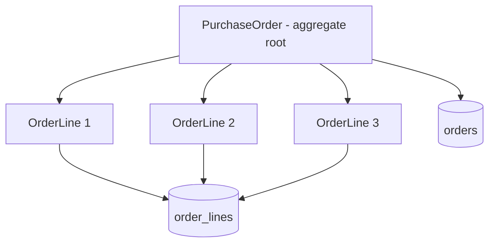

# Vì sao cập nhật có thể xóa và chèn lại các hàng con?

Trong **Spring Data Relational JDBC**, khi lưu một aggregate root đã tồn tại, Spring Data JDBC có thể cập nhật hàng của root nhưng **xóa các hàng entity con đang được ánh xạ trong aggregate rồi chèn lại các hàng con theo trạng thái hiện tại của object**. Đây là chiến lược persistence có chủ đích của Spring Data JDBC, không phải một lỗi SQL và cũng không phải database tự suy đoán rằng dữ liệu con đã thay đổi.

Điều này khác với cách nhiều người quen thuộc trong JPA: persistence context theo dõi entity managed và dirty checking có thể cập nhật từng entity thay đổi. Spring Data JDBC không duy trì một persistence context để so sánh toàn bộ trạng thái object trước và sau. Repository nhận aggregate hiện tại và lưu nó theo ranh giới aggregate.

Hiểu cơ chế này giúp bạn dự đoán được SQL, tác động của trigger/audit, chi phí khi collection lớn, ràng buộc foreign key và cách thiết kế aggregate phù hợp.

## 1. Bắt đầu từ aggregate root và các entity con

Giả sử một đơn hàng có nhiều dòng hàng. Đơn hàng là aggregate root; các dòng hàng chỉ được thay đổi thông qua đơn hàng và được lưu như một phần của aggregate.

```java
import java.util.ArrayList;
import java.util.List;

import org.springframework.data.annotation.Id;
import org.springframework.data.relational.core.mapping.MappedCollection;
import org.springframework.data.relational.core.mapping.Table;

@Table("orders")
public class PurchaseOrder {

    @Id
    private Long id;

    private String orderCode;

    @MappedCollection(
        idColumn = "order_id",
        keyColumn = "line_index"
    )
    private List<OrderLine> lines = new ArrayList<>();

    protected PurchaseOrder() {
    }

    public PurchaseOrder(String orderCode) {
        this.orderCode = orderCode;
    }

    public void addLine(String sku, int quantity, long unitPriceCents) {
        if (quantity <= 0 || unitPriceCents < 0) {
            throw new IllegalArgumentException("Invalid order line");
        }
        lines.add(new OrderLine(sku, quantity, unitPriceCents));
    }

    public void changeQuantity(int index, int quantity) {
        if (quantity <= 0) {
            throw new IllegalArgumentException("Quantity must be positive");
        }
        lines.get(index).changeQuantity(quantity);
    }

    public List<OrderLine> getLines() {
        return List.copyOf(lines);
    }

    public Long getId() {
        return id;
    }
}
```

```java
import org.springframework.data.annotation.Id;
import org.springframework.data.relational.core.mapping.Table;

@Table("order_lines")
public class OrderLine {

    @Id
    private Long id;

    private String sku;
    private int quantity;
    private long unitPriceCents;

    protected OrderLine() {
    }

    public OrderLine(String sku, int quantity, long unitPriceCents) {
        this.sku = sku;
        this.quantity = quantity;
        this.unitPriceCents = unitPriceCents;
    }

    public void changeQuantity(int quantity) {
        this.quantity = quantity;
    }

    public Long getId() {
        return id;
    }

    public String getSku() {
        return sku;
    }

    public int getQuantity() {
        return quantity;
    }

    public long getUnitPriceCents() {
        return unitPriceCents;
    }
}
```

Repository thao tác với root:

```java
import org.springframework.data.repository.CrudRepository;

public interface PurchaseOrderRepository
        extends CrudRepository<PurchaseOrder, Long> {
}
```

Mapping quan trọng là `@MappedCollection`. Nó cho Spring Data JDBC biết `lines` là collection entity con thuộc aggregate `PurchaseOrder`, được lưu trong bảng riêng và liên kết về root qua cột `order_id`.

Schema minh họa:

```sql
CREATE TABLE orders (
    id BIGINT GENERATED BY DEFAULT AS IDENTITY PRIMARY KEY,
    order_code VARCHAR(40) NOT NULL
);

CREATE TABLE order_lines (
    id BIGINT GENERATED BY DEFAULT AS IDENTITY PRIMARY KEY,
    order_id BIGINT NOT NULL REFERENCES orders(id),
    line_index INTEGER NOT NULL,
    sku VARCHAR(64) NOT NULL,
    quantity INTEGER NOT NULL CHECK (quantity > 0),
    unit_price_cents BIGINT NOT NULL CHECK (unit_price_cents >= 0),
    UNIQUE (order_id, line_index)
);
```

Aggregate có thể được hình dung:



Các hàng `order_lines` là dependent rows thuộc aggregate. Chúng không phải những aggregate root độc lập chỉ vì mỗi hàng có một khóa chính riêng.

## 2. Khi lưu aggregate mới và aggregate đã tồn tại

Cần phân biệt hai trường hợp.

### 2.1. Insert aggregate mới

Khi root chưa có trong database, Spring Data JDBC tạo root trước để có ID, sau đó lưu các thành phần con phụ thuộc vào ID đó.

Luồng khái quát:

1. Insert hàng `orders`.
2. Nhận ID của root nếu database sinh ID.
3. Insert các hàng `order_lines` với `order_id` bằng ID của root.
4. Hoàn tất thao tác trong transaction phù hợp.

SQL minh họa:

```sql
INSERT INTO orders (order_code)
VALUES ('PO-100');

-- Giả sử database sinh id = 100.
INSERT INTO order_lines (
    order_id, line_index, sku, quantity, unit_price_cents
)
VALUES
    (100, 0, 'BOOK-01', 2, 15000),
    (100, 1, 'PEN-02', 3, 5000);
```

Các câu lệnh trên chỉ minh họa ý nghĩa mapping; câu SQL thực tế và cách lấy generated key phụ thuộc database/driver.

### 2.2. Update aggregate đã tồn tại

Khi aggregate root đã tồn tại và được lưu lại, Spring Data JDBC không thực hiện một phép so sánh toàn bộ collection để chỉ cập nhật những child thay đổi. Chiến lược đối với các entity được tham chiếu trong aggregate là **xóa các dependent rows đã lưu rồi chèn lại các entity con có trong aggregate hiện tại**.

Ví dụ aggregate ban đầu có ba dòng:

| order_id | line_index | sku | quantity |
|---:|---:|---|---:|
| 100 | 0 | BOOK-01 | 2 |
| 100 | 1 | PEN-02 | 3 |
| 100 | 2 | BAG-03 | 1 |

Bạn chỉ sửa số lượng dòng đầu:

```java
PurchaseOrder order = orders.findById(100L)
        .orElseThrow();

order.changeQuantity(0, 4);

orders.save(order);
```

Về mặt nghiệp vụ, chỉ có một giá trị thay đổi. Nhưng ở tầng persistence, Spring Data JDBC có thể thực hiện logic tương đương:

```sql
-- Cập nhật aggregate root theo trạng thái hiện tại.
UPDATE orders
SET order_code = ?
WHERE id = ?;

-- Xóa các dependent rows thuộc collection đã mapping.
DELETE FROM order_lines
WHERE order_id = ?;

-- Chèn lại các child hiện có trong aggregate.
INSERT INTO order_lines (
    order_id, line_index, sku, quantity, unit_price_cents
)
VALUES (?, 0, 'BOOK-01', 4, 15000);

INSERT INTO order_lines (
    order_id, line_index, sku, quantity, unit_price_cents
)
VALUES (?, 1, 'PEN-02', 3, 5000);

INSERT INTO order_lines (
    order_id, line_index, sku, quantity, unit_price_cents
)
VALUES (?, 2, 'BAG-03', 1, 250000);
```

Đây là mô tả **chiến lược logic**, không phải bản ghi SQL chính xác của mọi phiên bản hoặc mọi kiểu aggregate. Các câu lệnh thực tế có thể khác về thứ tự, cách batch và số lượng statement. Ý chính là các dependent entities trong aggregate được đồng bộ theo trạng thái aggregate được lưu, thay vì dựa trên dirty tracking từng child.

**Vì vậy, một child không thay đổi vẫn có thể bị xóa và chèn lại khi root được save.**

## 3. Vì sao Spring Data JDBC chọn chiến lược này?

### 3.1. Không duy trì persistence context

JPA thường có persistence context chứa các entity managed. Khi một entity được load, persistence provider có thể theo dõi trạng thái ban đầu và trạng thái hiện tại. Đến lúc flush, dirty checking xác định entity/property nào thay đổi để phát UPDATE phù hợp.

Spring Data JDBC có cách tiếp cận khác:

- Repository đọc dữ liệu và trả về object Java.
- Object không nằm trong một persistence context dài hạn để framework theo dõi.
- Khi gọi `save(aggregate)`, framework nhận aggregate hiện tại.
- Framework không có snapshot tự động của mọi child trước khi object bị sửa để so sánh từng child.
- Aggregate được lưu theo mapping và lifecycle của nó.

Không có persistence context không có nghĩa Spring Data JDBC không thể ánh xạ object. Nó có metadata và conversion để đọc/ghi object, nhưng không duy trì trạng thái managed như JPA.

### 3.2. Aggregate là đơn vị nhất quán

Spring Data JDBC coi aggregate root là điểm truy cập persistence cho các thành phần thuộc aggregate. Một thao tác lưu root phải đồng bộ các dependent entities theo trạng thái của aggregate hiện tại.

Chiến lược xóa và chèn lại collection giúp framework áp dụng một quy tắc nhất quán tương đối đơn giản:

- Những child còn trong aggregate hiện tại được lưu.
- Những child đã bị loại khỏi aggregate không còn được lưu.
- Các child mới được thêm vào aggregate sẽ được chèn.
- Framework không cần một cơ chế so sánh graph object cũ/mới phức tạp như ORM có persistence context.

Điều này phù hợp với mô hình aggregate nhỏ, nơi root và các child được thao tác như một đơn vị.

### 3.3. JDBC tập trung vào câu lệnh SQL rõ ràng

Spring Data JDBC dựa trên JDBC và mapping relational. Nó không mô phỏng đầy đủ hành vi của một ORM quản lý object graph trong bộ nhớ. Việc đồng bộ dependent rows bằng delete/insert là một chiến lược đơn giản và dễ dự đoán ở cấp aggregate.

Đổi lại, ứng dụng phải thiết kế aggregate hợp lý. Nếu một root chứa hàng chục nghìn child và chỉ một child thay đổi mỗi lần, lưu lại toàn bộ collection có thể tốn kém. Đây là dấu hiệu cần xem lại ranh giới aggregate hoặc cách truy cập dữ liệu.

## 4. Xóa và chèn lại không có nghĩa root cũng bị xóa

Cần phân biệt hai loại hàng:

- **Aggregate root row:** hàng trong bảng `orders`. Khi root đã tồn tại, Spring Data JDBC thường cập nhật hàng này bằng UPDATE.
- **Dependent child rows:** hàng trong bảng `order_lines` thuộc collection đã mapping. Chúng có thể được xóa và chèn lại khi save aggregate.

| Thành phần | Khi lưu aggregate mới | Khi lưu aggregate đã tồn tại |
|---|---|---|
| Root row | INSERT | UPDATE |
| Embedded value object | Ghi vào các cột của root | Cập nhật các cột của root |
| Child collection trong `@MappedCollection` | INSERT các child | Xóa dependent rows và INSERT trạng thái child hiện tại |
| Aggregate reference | Ghi ID tham chiếu trong root | Cập nhật ID nếu reference thay đổi |
| Aggregate root được tham chiếu | Không tự insert chỉ vì reference | Không tự update/delete chỉ vì root lưu reference |

Embedded object được làm phẳng vào các cột của bảng root nên không có bảng child để xóa/chèn. Aggregate reference là liên kết tới aggregate khác; nó không phải collection child thuộc root.

## 5. Tác động khi child rows bị xóa và chèn lại

### 5.1. Child không đổi vẫn phát sinh ghi database

Giả sử một đơn hàng có 200 dòng. Bạn chỉ sửa số lượng một dòng và gọi save root. Spring Data JDBC có thể xóa và chèn lại toàn bộ 200 dòng.

Tác động:

- Nhiều câu lệnh DELETE/INSERT hơn số thay đổi nghiệp vụ.
- Tăng lượng ghi và transaction log.
- Tăng thời gian giữ lock.
- Tăng lượng công việc cho index và constraint.
- Tăng tải trên database và connection pool.

Đây là lý do aggregate nên giữ kích thước vừa phải, phù hợp với một đơn vị nhất quán nghiệp vụ.

### 5.2. Trigger và audit ở bảng child có thể chạy lại

Nếu bảng child có trigger:

```sql
CREATE TRIGGER order_lines_audit_trigger
AFTER INSERT OR DELETE ON order_lines
FOR EACH ROW
EXECUTE FUNCTION audit_order_line_change();
```

thì chiến lược delete/insert có thể kích hoạt trigger DELETE và INSERT cho các child, kể cả child có giá trị nghiệp vụ không đổi.

Điều này có thể tạo audit event hoặc CDC event mà người đọc hiểu nhầm là người dùng xóa rồi tạo lại mọi dòng hàng. Khi thiết kế audit, hãy phân biệt:

- Một thao tác nghiệp vụ “sửa một dòng”.
- Các statement kỹ thuật mà persistence layer phát ra.
- Event mà trigger hoặc CDC ghi nhận.

Nếu audit cần phản ánh ý định nghiệp vụ, có thể ghi domain event riêng ở tầng service thay vì suy luận mọi hành vi từ INSERT/DELETE vật lý.

### 5.3. Cột mặc định và timestamp ở child

Giả sử child table có cột:

```sql
created_at TIMESTAMP NOT NULL DEFAULT CURRENT_TIMESTAMP
```

Nếu hàng child bị xóa và chèn lại, database default có thể được áp dụng khi insert mới. Timestamp tạo hàng có thể thay đổi dù nội dung dòng hàng không đổi.

Tương tự, trigger cập nhật `updated_at`, sequence, audit table hoặc CDC có thể phản ánh các lần insert/delete kỹ thuật.

Nếu cần giữ nguyên thời điểm tạo child qua các lần save aggregate, hãy mô hình hóa rõ property đó và kiểm tra câu INSERT thực tế có ghi lại giá trị hay không. Không dựa vào default database để giữ lịch sử nếu hàng bị tạo lại.

### 5.4. Foreign key từ bảng khác tham chiếu child

Đây là hệ quả kiến trúc quan trọng.

Giả sử một bảng khác tham chiếu `order_lines.id`:

```sql
CREATE TABLE shipment_line_links (
    id BIGINT PRIMARY KEY,
    order_line_id BIGINT NOT NULL REFERENCES order_lines(id)
);
```

Nếu Spring Data JDBC xóa child row trước khi chèn lại, foreign key từ `shipment_line_links` có thể ngăn việc xóa do hàng đang được tham chiếu. Nếu cấu hình cascade, các hàng liên kết có thể bị xóa theo, điều thường không mong muốn. Nếu dùng SET NULL, dữ liệu liên kết có thể mất tham chiếu.

Điều này cho thấy child entity thuộc aggregate không nên bị nhiều aggregate khác tham chiếu trực tiếp như một đối tượng độc lập. Nếu dữ liệu cần được tham chiếu độc lập, cân nhắc biến nó thành aggregate root riêng và thiết kế reference ổn định.

**Một bảng riêng không tự biến child thành aggregate root.** Ownership và lifecycle mới quyết định điều đó.

### 5.5. ID của child và generated value

Nếu child có ID, hãy phân biệt ID do ứng dụng gán trước với ID do database sinh. Chiến lược lưu child có thể phát sinh INSERT lại và quá trình xử lý ID phụ thuộc mapping, giá trị ID hiện tại, kiểu ID và database.

Không nên tự suy luận rằng mọi lần save đều cấp ID mới hoặc mọi lần save chắc chắn giữ nguyên ID. Hãy kiểm tra generated-key behavior của phiên bản Spring Data JDBC và schema cụ thể nếu ID child có ý nghĩa bên ngoài aggregate.

Nguyên tắc thiết kế an toàn là **không dùng ID của dependent child như một định danh công khai ổn định cho các aggregate khác** nếu child được quản lý như một phần của aggregate root.

## 6. Phân biệt với ON DELETE CASCADE

Việc Spring Data JDBC xóa và chèn lại child khi save aggregate không giống `ON DELETE CASCADE`.

| Tiêu chí | Save aggregate trong Spring Data JDBC | Database ON DELETE CASCADE |
|---|---|---|
| Khi nào chạy | Khi lưu aggregate đã tồn tại có dependent entities | Khi xóa hàng được tham chiếu theo FK cascade |
| Hành vi | Xóa dependent rows hiện có rồi chèn trạng thái child hiện tại | Xóa các hàng tham chiếu khi parent bị DELETE |
| Ai điều khiển | Spring Data JDBC mapping/persistence operation | Database foreign key |
| Có cần xóa root không? | Không; root có thể chỉ được UPDATE | Có; hàng được tham chiếu bị DELETE |
| Có thể chạy khi root vẫn tồn tại? | Có, khi save root | Không do parent delete cascade; chỉ khi có DELETE parent tương ứng |
| Phụ thuộc `@MappedCollection`? | Có đối với dependent collection | Không |
| Có tác động tới trigger child? | Có thể, do DELETE/INSERT child | Có thể, do database cascade DELETE child |

Ví dụ: gọi `orders.save(order)` để sửa một dòng hàng có thể tạo DELETE/INSERT child trong khi hàng `orders` vẫn tồn tại. Ngược lại, `ON DELETE CASCADE` không chạy khi chỉ UPDATE hàng root.

Đừng dùng ON DELETE CASCADE như cách giải thích cho mọi lần child biến mất. Hãy xem statement SQL thực tế và thao tác repository đã gọi.

## 7. Transaction bảo vệ tính nhất quán khi xóa và chèn lại

Nếu Spring Data JDBC xóa child rồi quá trình insert child mới thất bại, ứng dụng không nên để aggregate ở trạng thái chỉ còn một phần child. Các thao tác lưu aggregate cần được thực hiện trong transaction phù hợp để rollback các thay đổi khi lỗi.

Ví dụ service:

```java
import org.springframework.stereotype.Service;
import org.springframework.transaction.annotation.Transactional;

@Service
public class OrderService {

    private final PurchaseOrderRepository orders;

    public OrderService(PurchaseOrderRepository orders) {
        this.orders = orders;
    }

    @Transactional
    public PurchaseOrder changeQuantity(
            long orderId,
            int lineIndex,
            int newQuantity
    ) {
        PurchaseOrder order = orders.findById(orderId)
                .orElseThrow();

        order.changeQuantity(lineIndex, newQuantity);

        return orders.save(order);
    }
}
```

Khi transaction manager và repository dùng cùng DataSource, các thao tác root/child có thể tham gia cùng transaction JDBC. Nếu một statement insert child thất bại do constraint, transaction rollback sẽ phục hồi trạng thái trước transaction theo khả năng transactional của database.

Một số điểm cần lưu ý:

- Lời gọi phải đi qua Spring bean/proxy để transaction annotation được áp dụng trong chế độ proxy thông thường.
- Không tự mở connection JDBC tách rời khỏi transaction.
- Không để các thao tác DB trong cùng aggregate chạy trên các thread khác nhau với kỳ vọng tự chia sẻ transaction.
- Exception cần rollback phải thoát khỏi ranh giới transaction hoặc được đánh dấu rollback-only phù hợp.
- Transaction JDBC không rollback được email, HTTP request hoặc message đã gửi ra hệ thống ngoài.

Nếu không có transaction bao toàn bộ thao tác, lỗi giữa chuỗi statement có thể để lại dữ liệu không nhất quán tùy cách từng thao tác được thực thi. Hãy giữ transaction boundary quanh đơn vị nghiệp vụ cần atomic.

## 8. Vì sao Spring Data JDBC không chỉ UPDATE child đã đổi?

Một câu hỏi thường gặp là: “Tại sao framework không so sánh các dòng hàng rồi chỉ UPDATE một dòng?”

Để làm việc đó một cách tổng quát, persistence layer cần biết ít nhất:

1. Trạng thái child ban đầu trong database.
2. Trạng thái hiện tại trong object.
3. Identity của từng child giữa hai trạng thái.
4. Child nào được thêm, xóa hoặc sửa.
5. Các thay đổi nào ảnh hưởng đến thứ tự collection hoặc foreign key.
6. Những thao tác nào phải được thực hiện để giữ invariant aggregate.

Nếu framework giữ snapshot của object graph hoặc persistence context, nó có thể theo dõi thay đổi nhưng phải duy trì state, identity map, lifecycle và nhiều quy tắc ORM phức tạp hơn.

Spring Data JDBC chọn mô hình không giữ session dài hạn. Khi save, aggregate hiện tại là mô tả đầy đủ của dữ liệu cần lưu. Với aggregate vừa phải, chiến lược này dễ hiểu và phù hợp với cách tiếp cận aggregate-centric. Đổi lại, ứng dụng không nên tạo một aggregate khổng lồ chỉ để gom các dữ liệu có lifecycle khác nhau.

## 9. Tối ưu thiết kế khi collection child lớn

### 9.1. Giữ aggregate nhỏ và có ý nghĩa nghiệp vụ

Nếu một root chứa hàng chục nghìn child nhưng các child thường được cập nhật độc lập, việc xóa/chèn lại toàn collection có thể rất tốn kém.

Ví dụ một `Customer` có hàng triệu `LoginHistory`. Nếu lịch sử đăng nhập được coi là child collection của Customer, mọi lần save Customer có thể phải đồng bộ một collection rất lớn.

Hãy cân nhắc tách `LoginHistory` thành aggregate root riêng với repository riêng. Khi đó thao tác thêm một lịch sử chỉ ghi một aggregate nhỏ, không phải save Customer cùng toàn bộ lịch sử.

### 9.2. Tách dữ liệu có lifecycle độc lập

Một child có thể nên trở thành aggregate root riêng nếu:

- Có thể được tạo/xóa/cập nhật độc lập.
- Có truy vấn phân trang riêng.
- Có số lượng lớn.
- Được nhiều thành phần khác tham chiếu.
- Có quy tắc audit/retention riêng.
- Cần tối ưu thao tác cập nhật một phần tử.

Khi tách, root cũ lưu ID/reference tới aggregate mới thay vì sở hữu collection đó.

### 9.3. Dùng câu SQL có mục tiêu cho thao tác cập nhật hẹp

Nếu một thao tác chỉ cần tăng một counter hoặc cập nhật một trạng thái trên một hàng child, có thể cân nhắc custom SQL/JdbcTemplate thay vì load và save toàn bộ aggregate lớn.

Ví dụ:

```java
@Repository
public class OrderLineCommands {

    private final JdbcTemplate jdbc;

    public OrderLineCommands(JdbcTemplate jdbc) {
        this.jdbc = jdbc;
    }

    public int changeQuantity(long lineId, int quantity) {
        return jdbc.update(
                "UPDATE order_lines SET quantity = ? WHERE id = ?",
                quantity,
                lineId
        );
    }
}
```

Đây là một command SQL trực tiếp. Nó **không tự đồng bộ aggregate object đang được giữ trong bộ nhớ**. Nếu sau đó save một aggregate cũ có collection chưa phản ánh thay đổi này, dữ liệu có thể bị ghi đè theo trạng thái collection đó.

Vì vậy, chỉ dùng targeted SQL khi bạn kiểm soát rõ ownership và trạng thái aggregate. Có thể tải lại aggregate sau thao tác, hoặc thiết kế child thành aggregate root riêng để command repository cập nhật trực tiếp đúng ranh giới.

Custom SQL cũng phải tham gia transaction phù hợp và bảo toàn constraint/invariant nghiệp vụ. Đừng cập nhật trực tiếp child của aggregate từ nhiều nơi mà không có quy tắc ownership.

### 9.4. Không biến aggregate thành một batch container

Nếu root chỉ được dùng để gom nhiều dữ liệu cho tiện lưu, hãy xem lại domain. Aggregate không phải một thư mục chứa mọi bảng có foreign key. Nó là ranh giới nhất quán nơi các invariant cần được bảo vệ khi ghi.

Collection child lớn thường là tín hiệu để xem lại mô hình trước khi tìm cách né chiến lược delete/insert.

## 10. Tác động của thứ tự collection

Với `List`, thứ tự có thể được lưu qua key column:

```java
@MappedCollection(
    idColumn = "order_id",
    keyColumn = "line_index"
)
private List<OrderLine> lines;
```

Khi collection được lưu lại, Spring Data JDBC phải đồng bộ các phần tử và vị trí theo trạng thái list hiện tại. Ví dụ đổi vị trí hai dòng có thể khiến key/index của nhiều hàng thay đổi. Với collection lớn, việc ghi lại các hàng phụ thuộc có thể nhiều hơn một UPDATE đơn giản.

Nếu thứ tự không có ý nghĩa nghiệp vụ, cân nhắc `Set` hoặc một mô hình collection phù hợp. Nếu thứ tự có ý nghĩa, giữ `List` và key column rõ ràng; không nên giả định thứ tự đọc từ SQL nếu không có mapping/order semantics tương ứng.

Đừng dùng thứ tự vật lý của hàng trong database làm thứ tự nghiệp vụ. Cần một cột thứ tự hoặc query có ORDER BY phù hợp.

## 11. Child row có generated ID: cần hiểu đúng vai trò

Ví dụ `OrderLine` có:

```java
@Id
private Long id;
```

ID này có thể hữu ích cho mapping và nhận diện hàng trong bảng, nhưng nếu `OrderLine` vẫn là child được lưu qua aggregate root thì lifecycle của nó phụ thuộc vào root.

Nếu một hệ thống bên ngoài lưu `order_line_id` để tham chiếu lâu dài, chiến lược xóa/chèn lại dependent rows có thể gây xung đột với FK hoặc kỳ vọng identity. Hãy hỏi:

- Có thực sự cần bảng khác tham chiếu child trực tiếp không?
- Child có nên là aggregate root riêng?
- Có thể tham chiếu root và dùng một business key ổn định thay vì ID child không?
- Có cần lưu snapshot hoặc association entity có lifecycle riêng không?

Không nên dựa vào việc ID tình cờ được giữ lại trong một cấu hình cụ thể để biến child thành đối tượng tham chiếu độc lập.

## 12. Phân biệt các loại quan hệ khi save

Không phải mọi object lồng nhau đều bị xóa/chèn lại như child collection.

| Thành phần | Mapping | Hành vi khi save root |
|---|---|---|
| Root row | `@Table`, `@Id` | Insert nếu mới; update nếu đã tồn tại |
| Embedded value | `@Embedded` | Các cột embedded được ghi cùng hàng root |
| Child collection | `@MappedCollection` | Dependent rows có thể bị xóa và chèn lại theo trạng thái collection hiện tại |
| Aggregate reference | ID hoặc `AggregateReference` | Root lưu ID/reference; aggregate đích không tự được lưu/xóa |
| Entity không thuộc mapping aggregate | Không được tham chiếu như dependent | Không tự động tham gia thao tác save root |

Ví dụ `ShippingAddress` embedded không tạo bảng riêng. `OrderLine` là child collection có bảng riêng. `Customer` là aggregate root khác được tham chiếu bằng ID. Chỉ nhìn thấy field có kiểu object không đủ để kết luận Spring Data JDBC sẽ xử lý nó thế nào.

## 13. Chẩn đoán khi thấy DELETE/INSERT bất ngờ

Nếu log SQL hiển thị DELETE rồi INSERT nhiều hàng child trong một lần save, hãy điều tra theo trình tự:

1. **Xác định repository method:** code gọi `save(root)`, delete, custom query hay JdbcTemplate?
2. **Xác định trạng thái root:** root mới hay đã tồn tại?
3. **Kiểm tra mapping:** property nào dùng `@MappedCollection`?
4. **Kiểm tra aggregate size:** collection có bao nhiêu child?
5. **Đọc SQL theo bảng:** DELETE xảy ra trên bảng child hay root?
6. **Kiểm tra trigger/audit:** trigger nào chạy trên child DELETE/INSERT?
7. **Kiểm tra FK:** có bảng nào tham chiếu trực tiếp child không?
8. **Kiểm tra transaction:** các statement có cùng transaction và rollback khi lỗi không?
9. **Xem lại ownership:** child có thực sự thuộc root hay nên là aggregate riêng?

| Triệu chứng | Giải thích có thể | Hướng xử lý |
|---|---|---|
| Chỉ sửa một child nhưng log DELETE nhiều child | Aggregate save đồng bộ collection theo chiến lược delete/insert | Đánh giá kích thước aggregate và tần suất save |
| Trigger audit ghi DELETE/INSERT cho child không đổi | Trigger phản ánh statement vật lý | Phân biệt kỹ thuật persistence với domain event |
| Child created_at đổi sau save root | DB default được áp dụng khi child insert lại | Lưu timestamp cần giữ hoặc thay đổi mô hình/audit |
| FK từ bảng khác ngăn save root | Child đang bị tham chiếu bên ngoài aggregate | Tách child thành aggregate riêng hoặc thiết kế reference khác |
| Child collection lớn làm save chậm | Nhiều hàng dependent bị ghi lại | Thu nhỏ aggregate, targeted SQL có kiểm soát hoặc tách aggregate |
| Direct SQL update child bị ghi đè sau save root | Aggregate object cũ chứa state cũ và save đồng bộ lại collection | Reload root, điều chỉnh ownership hoặc tách repository |
| Root row vẫn tồn tại sau DELETE child | Child rows bị đồng bộ; root chỉ UPDATE | Phân biệt statement trên bảng root và bảng child |
| Lỗi giữa chừng để lại collection không đầy đủ | Transaction boundary không bao trọn các thao tác | Dùng transaction phù hợp và kiểm tra rollback |

## 14. Kiểm thử hành vi lưu aggregate

Một integration test có thể chứng minh dữ liệu sau save, nhưng muốn hiểu chiến lược SQL thì cần quan sát log SQL hoặc dùng datasource proxy/test instrumentation phù hợp.

Ví dụ test chức năng:

```java
@DataJdbcTest
class PurchaseOrderRepositoryTest {

    @Autowired
    PurchaseOrderRepository orders;

    @Test
    void savesUpdatedAggregateState() {
        PurchaseOrder order = new PurchaseOrder("PO-100");
        order.addLine("BOOK-01", 2, 15000);
        order.addLine("PEN-02", 3, 5000);

        PurchaseOrder saved = orders.save(order);

        PurchaseOrder loaded = orders.findById(saved.getId())
                .orElseThrow();

        loaded.changeQuantity(0, 4);

        PurchaseOrder updated = orders.save(loaded);

        PurchaseOrder reloaded = orders.findById(updated.getId())
                .orElseThrow();

        assertThat(reloaded.getLines()).hasSize(2);
        assertThat(reloaded.getLines().get(0).getQuantity()).isEqualTo(4);
    }
}
```

Đoạn test giả định domain có method `changeQuantity(...)` tương ứng. Nó xác nhận trạng thái aggregate được lưu, không tự chứng minh số statement DELETE/INSERT. Để kiểm tra SQL, bật log phù hợp hoặc dùng công cụ quan sát JDBC và xác nhận các statement thực tế của phiên bản đang chạy.

### 14.1. Test trigger/audit

Nếu bảng child có trigger, viết integration test kiểm tra số lượng audit row sau:

- Insert aggregate mới.
- Save aggregate không đổi.
- Save aggregate chỉ đổi một child.
- Xóa aggregate.

Test này giúp biết trigger phản ánh thao tác persistence hay nghiệp vụ. Không suy luận số audit event chỉ từ số thay đổi field Java.

### 14.2. Test foreign key và rollback

Tạo một bảng khác tham chiếu child để xác nhận schema có ngăn xóa child hay không. Nếu FK đó khiến save aggregate thất bại, kiểm tra transaction rollback và cân nhắc lại aggregate boundary.

Không nên thêm `ON DELETE CASCADE` một cách vội vàng để làm test qua; cascade có thể xóa dữ liệu liên quan mà nghiệp vụ cần giữ.

## 15. Câu hỏi tự kiểm tra

1. **Vì sao save aggregate đã tồn tại có thể xóa và chèn lại tất cả child rows?** Vì Spring Data JDBC không duy trì persistence context/snapshot để dirty-check từng child; nó đồng bộ dependent entities theo trạng thái aggregate hiện tại.
2. **Root row có bị xóa và chèn lại không?** Thông thường root đã tồn tại được UPDATE; chiến lược xóa/chèn lại áp dụng cho dependent entities được quản lý.
3. **Child không đổi có thể bị ghi lại không?** Có, child trong mapped collection có thể vẫn bị xóa và chèn lại.
4. **Đây có phải ON DELETE CASCADE không?** Không. Đây là persistence strategy của Spring Data JDBC; FK cascade chỉ chạy khi hàng được tham chiếu bị DELETE.
5. **Embedded value object có bị xóa/chèn lại như child table không?** Không có hàng child riêng; các cột embedded nằm trên bảng root.
6. **AggregateReference có bị save cùng aggregate đích không?** Không. Root lưu ID/reference; aggregate đích có repository/lifecycle riêng.
7. **Tại sao trigger có thể ghi nhận nhiều event?** Vì trigger phản ứng với DELETE/INSERT vật lý, kể cả khi dữ liệu nghiệp vụ của child không đổi.
8. **Nếu child được nhiều bảng khác tham chiếu thì sao?** FK có thể ngăn việc xóa child; đó là dấu hiệu cần xem lại ownership hoặc aggregate boundary.
9. **Có nên dùng custom UPDATE để tránh ghi lại collection?** Có thể cho thao tác hẹp, nhưng phải kiểm soát transaction, invariant và trạng thái aggregate để tránh save root cũ ghi đè.
10. **Khi nào nên tách child thành aggregate riêng?** Khi child có lifecycle, truy vấn, cập nhật hoặc tham chiếu độc lập, hoặc collection quá lớn.

## 16. Nguyên tắc ghi nhớ

Khi gọi `save` trên aggregate đã tồn tại trong Spring Data JDBC, hãy hiểu rằng framework đồng bộ trạng thái aggregate theo chiến lược của nó: root được cập nhật, còn các dependent entities trong collection được quản lý có thể bị xóa và chèn lại theo trạng thái hiện tại. Điều đó xảy ra vì Spring Data JDBC không giữ persistence context để so sánh từng child như JPA dirty checking.

Hệ quả quan trọng là một thay đổi nhỏ trong Java có thể tạo nhiều thao tác ghi ở database. Trigger, audit, timestamp mặc định, foreign key và hiệu năng đều có thể bị ảnh hưởng. Với child collection nhỏ và thực sự thuộc lifecycle của root, cách tiếp cận này phù hợp với mô hình aggregate. Với child lớn, được tham chiếu độc lập hoặc cần cập nhật từng hàng thường xuyên, hãy xem xét tách aggregate hoặc dùng lệnh SQL có mục tiêu với quy tắc ownership rõ ràng.

**Thiết kế aggregate theo ranh giới nhất quán nghiệp vụ, không theo mong muốn gom nhiều bảng vào một lần save.** Khi hiểu đúng chiến lược delete/insert, bạn sẽ dự đoán được SQL và tránh các bất ngờ khi vận hành Spring Data Relational JDBC.
