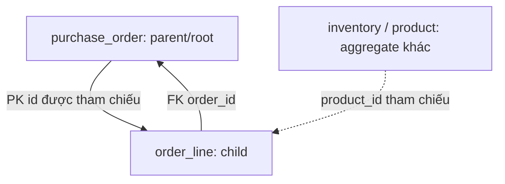
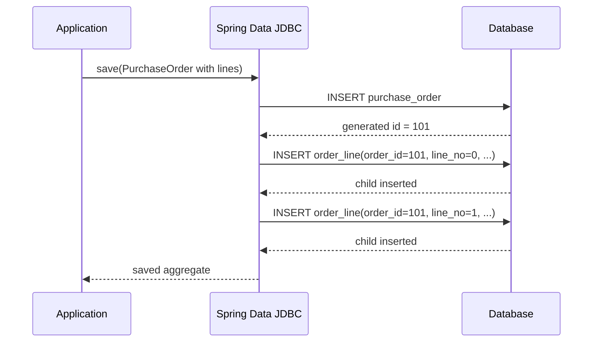
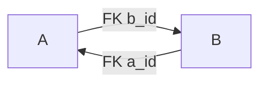

# Thứ tự lệnh SQL và tác động của ràng buộc khóa ngoại

Trong **Spring Data Relational JDBC**, một lần `repository.save(aggregate)` có thể tạo nhiều câu lệnh SQL cho aggregate root và các entity con được sở hữu. Thứ tự các câu lệnh phải phù hợp với quan hệ giữa các bảng. Nếu bảng con có khóa ngoại trỏ đến bảng cha, database thường yêu cầu **cha tồn tại trước khi chèn con** và **con được xóa trước khi xóa cha**.

Vì vậy, khi thiết kế aggregate và schema, cần hiểu đồng thời ba lớp:

- **Aggregate mapping:** Spring Data JDBC biết root sở hữu collection/entity nào.
- **SQL action ordering:** các thao tác insert, update, delete được sắp xếp để lưu aggregate.
- **Database constraints:** foreign key, unique/check constraint và cascade quyết định database chấp nhận hay từ chối từng statement.

Bài này giải thích cách đọc thứ tự SQL theo quan hệ cha-con, cách thiết kế FK cho aggregate và tham chiếu giữa các aggregate, cũng như cách xử lý lỗi constraint trong transaction.

## 1. Mô hình cha-con và khóa ngoại

Giả sử một `PurchaseOrder` sở hữu nhiều `OrderLine`:

```text
PurchaseOrder (aggregate root)
  id = 101
  lines
    ├── OrderLine (id = 501)
    └── OrderLine (id = 502)
```

Schema quan hệ:

```sql
CREATE TABLE purchase_order (
    id BIGINT GENERATED BY DEFAULT AS IDENTITY PRIMARY KEY,
    status VARCHAR(30) NOT NULL
);

CREATE TABLE order_line (
    id BIGINT GENERATED BY DEFAULT AS IDENTITY PRIMARY KEY,
    order_id BIGINT NOT NULL,
    product_id BIGINT NOT NULL,
    quantity INTEGER NOT NULL CHECK (quantity > 0),
    CONSTRAINT fk_order_line_order
        FOREIGN KEY (order_id) REFERENCES purchase_order(id)
);
```

`order_line.order_id` là FK trỏ đến `purchase_order.id`. Đây là quan hệ sở hữu bên trong aggregate. Khi database kiểm tra FK ngay tại statement, mỗi hàng `order_line` phải tham chiếu đến một `purchase_order` đã tồn tại.

Sơ đồ phụ thuộc:



Chiều phụ thuộc của FK là từ bảng con đến bảng cha. Vì vậy thứ tự thao tác SQL thường đi theo chiều ngược lại với việc xóa:

| Thao tác | Thứ tự phù hợp với FK thông thường |
|---|---|
| Insert aggregate mới | Insert root/parent trước, insert child sau |
| Xóa aggregate | Delete child trước, delete root/parent sau |
| Thay thế collection con khi lưu aggregate hiện có | Xóa các hàng con cũ trước khi insert lại các hàng con mới |
| Thay đổi FK sang parent khác | Đảm bảo parent đích tồn tại trước khi cập nhật FK |

Đây là thứ tự theo **phụ thuộc dữ liệu**. Số lượng statement, câu SQL cụ thể và cách xử lý generated key có thể khác nhau theo database, dialect và phiên bản Spring Data JDBC.

## 2. Insert aggregate mới: root trước, child sau

Khi lưu một aggregate mới, Spring Data JDBC cần ghi root để có ID, sau đó mới có thể ghi các entity con với FK trỏ về ID đó.

Ví dụ domain model:

```java
@Table("purchase_order")
public class PurchaseOrder {

    @Id
    private Long id;

    private String status;

    @MappedCollection(idColumn = "order_id", keyColumn = "line_no")
    private List<OrderLine> lines = new ArrayList<>();

    protected PurchaseOrder() {}

    public PurchaseOrder(String status) {
        this.status = status;
    }

    public void addLine(Long productId, int quantity) {
        lines.add(new OrderLine(productId, quantity));
    }
}
```

```java
@Table("order_line")
public class OrderLine {

    @Id
    private Long id;

    @Column("product_id")
    private Long productId;

    private int quantity;

    protected OrderLine() {}

    public OrderLine(Long productId, int quantity) {
        this.productId = productId;
        this.quantity = quantity;
    }
}
```

Lưu root:

```java
PurchaseOrder order = new PurchaseOrder("DRAFT");
order.addLine(10L, 2);
order.addLine(15L, 1);

PurchaseOrder saved = purchaseOrderRepository.save(order);
```

Với database sinh ID identity, luồng logic thường là:



Nếu ID được ứng dụng cấp trước (ví dụ UUID), root ID đã có sẵn nhưng thứ tự phụ thuộc FK vẫn giữ nguyên: root phải được insert trước child để FK child hợp lệ. ID đã có không có nghĩa child có thể được insert trước root.

Nếu child tham chiếu thêm một aggregate root khác qua `product_id`, sản phẩm đó cũng phải tồn tại trước khi insert `OrderLine`, trừ khi database dùng FK deferred và các điều kiện liên quan được thỏa mãn. Với aggregate độc lập, thông thường ứng dụng tạo/lưu root tham chiếu trước rồi mới lưu aggregate sử dụng ID đó.

## 3. Xóa aggregate: child trước, root sau

Với FK `order_line.order_id REFERENCES purchase_order(id)` không cho phép xóa parent khi child vẫn còn, việc xóa aggregate cần loại bỏ các hàng con trước.

```sql
DELETE FROM order_line WHERE order_id = 101;
DELETE FROM purchase_order WHERE id = 101;
```

Đó là thứ tự phụ thuộc cần có khi database kiểm tra FK ngay tại statement. Spring Data JDBC biết collection nào thuộc aggregate và thực hiện thao tác xóa các entity được sở hữu theo mapping trước khi xóa root.

Với collection lồng nhau:

```text
PurchaseOrder
  └── OrderLine
        └── LineNote
```

Nếu `line_note.order_line_id` trỏ đến `order_line.id`, và `order_line.order_id` trỏ đến `purchase_order.id`, thứ tự xóa phải đi từ sâu ra ngoài:

```sql
DELETE FROM line_note WHERE order_line_id IN (...);
DELETE FROM order_line WHERE order_id = 101;
DELETE FROM purchase_order WHERE id = 101;
```

Quy tắc tổng quát: **xóa các node phụ thuộc trước node được tham chiếu**. Trong một cây aggregate, thao tác xóa đi theo thứ tự ngược với thứ tự insert.

Không nên giả định framework chỉ gửi một lệnh `DELETE FROM purchase_order ...` rồi database tự xóa tất cả child. Điều đó chỉ xảy ra nếu schema có `ON DELETE CASCADE` và thao tác xóa thực tế dựa vào cascade. Spring Data JDBC quản lý vòng đời các entity được sở hữu; hãy xem SQL log và DDL thực tế thay vì dựa vào giả định cascade.

## 4. Lưu aggregate đã tồn tại: cập nhật root và đồng bộ entity con

Spring Data JDBC không hoạt động như một ORM giữ persistence context và dirty-checking cho từng child. Khi lưu một aggregate đã tồn tại, framework có thể **xóa các entity con được tham chiếu rồi chèn lại trạng thái collection hiện tại**. Root được cập nhật theo trạng thái của nó. Điều này ảnh hưởng đến thứ tự SQL và chi phí ghi.

Ví dụ:

```java
PurchaseOrder order = purchaseOrderRepository.findById(orderId)
        .orElseThrow();

order.changeStatus("CONFIRMED");
order.addLine(20L, 1);

purchaseOrderRepository.save(order);
```

Với aggregate có collection child, các bước logic có thể gồm:

1. Xóa các hàng con hiện đang thuộc root để thay thế collection.
2. Cập nhật hàng root (bao gồm kiểm tra version nếu có `@Version`).
3. Chèn các hàng con đại diện cho collection hiện tại.

Thứ tự cụ thể giữa một số action có thể phụ thuộc implementation/version và cấu trúc aggregate. Điều bắt buộc với FK thông thường là không insert child trước khi parent đã tồn tại, và không delete parent khi child còn tham chiếu. Nếu cần xác định chính xác thứ tự statement trong ứng dụng, bật log và kiểm tra với đúng phiên bản Spring Data JDBC cùng database mục tiêu.

### Vì sao delete/reinsert child?

Spring Data JDBC coi aggregate là đơn vị ghi. Khi nhận trạng thái mới của aggregate, framework không giữ snapshot cũ để tính diff từng child như Hibernate. Thay vì so sánh toàn bộ đồ thị object, nó đồng bộ các entity được tham chiếu theo chiến lược của Spring Data JDBC.

Hệ quả:

- Một thay đổi nhỏ ở root có thể kéo theo nhiều statement cho collection lớn.
- ID của child có thể được sinh lại nếu child dùng generated key.
- Trigger, audit table hoặc bảng khác tham chiếu ID child có thể bị tác động.
- FK từ bảng bên ngoài trỏ trực tiếp đến child có thể khiến delete/reinsert thất bại hoặc làm thay đổi semantics.

Nếu child có vòng đời độc lập, được nhiều nơi tham chiếu hoặc cần cập nhật riêng, hãy cân nhắc biến nó thành aggregate root riêng và tham chiếu bằng ID. Đừng để một entity vừa là owned child vừa là đối tượng dùng chung được nhiều aggregate khác tham chiếu.

## 5. FK đến aggregate root khác: không phải quan hệ sở hữu

Giả sử `PurchaseOrder` tham chiếu `Customer` và mỗi `OrderLine` tham chiếu `Product`:

```text
Customer (root độc lập)
  id = 42

Product (root độc lập)
  id = 10

PurchaseOrder (root độc lập)
  customerId = 42
  lines
    OrderLine(productId = 10)
```

Schema có thể định nghĩa FK:

```sql
CREATE TABLE purchase_order (
    id BIGINT GENERATED BY DEFAULT AS IDENTITY PRIMARY KEY,
    customer_id BIGINT NOT NULL REFERENCES customer(id)
);

CREATE TABLE order_line (
    id BIGINT GENERATED BY DEFAULT AS IDENTITY PRIMARY KEY,
    order_id BIGINT NOT NULL REFERENCES purchase_order(id),
    product_id BIGINT NOT NULL REFERENCES product(id),
    quantity INTEGER NOT NULL
);
```

Trong domain model, lưu `customerId`/`productId` hoặc `AggregateReference<Customer, Long>`/`AggregateReference<Product, Long>` thay vì property entity trực tiếp nếu đó là root độc lập.

Điều này có hai hệ quả về thứ tự:

- Khi tạo order, `Customer` phải tồn tại trước khi insert order nếu FK được kiểm tra ngay. `Product` phải tồn tại trước khi insert line.
- Khi xóa `Customer` hoặc `Product`, database có thể từ chối nếu còn order/line tham chiếu. Đó thường là hành vi đúng vì root tham chiếu có vòng đời độc lập; không nên tự động xóa lịch sử đơn hàng chỉ vì khách hàng hoặc sản phẩm bị xóa.

FK giữa aggregate root là **ràng buộc tham chiếu dữ liệu**, không chuyển quyền sở hữu từ root này sang root kia. Spring Data JDBC không tự cascade `save()` sang aggregate độc lập chỉ vì field chứa `AggregateReference`.

## 6. FK được kiểm tra ngay hay được trì hoãn?

Nhiều database kiểm tra FK ngay khi statement thực thi (*immediate constraint*). Một số database hỗ trợ FK có thể khai báo `DEFERRABLE`, cho phép trì hoãn kiểm tra đến cuối transaction.

Ví dụ PostgreSQL:

```sql
ALTER TABLE order_line
ADD CONSTRAINT fk_order_line_order
FOREIGN KEY (order_id)
REFERENCES purchase_order(id)
DEFERRABLE INITIALLY DEFERRED;
```

Với constraint này, PostgreSQL có thể cho phép statement tạm thời tạo trạng thái tham chiếu chưa hợp lệ bên trong transaction, miễn là tất cả FK hợp lệ khi kiểm tra ở cuối transaction/commit. Có thể thay đổi trạng thái bằng `SET CONSTRAINTS` khi cần.

Tuy nhiên:

- Không phải database nào cũng hỗ trợ FK deferrable.
- Không phải mọi loại constraint đều có thể trì hoãn.
- Deferred constraint chỉ trì hoãn **thời điểm kiểm tra**, không sửa một quan hệ sai cuối transaction.
- Spring Data JDBC không tự cấu hình tất cả FK thành deferred; việc này thuộc DDL và transaction SQL của database.
- Nếu transaction commit với FK không hợp lệ, commit vẫn thất bại và toàn transaction rollback.

Vì vậy, hãy thiết kế thứ tự parent-before-child và child-before-parent làm mặc định. Chỉ dựa vào deferred FK khi có yêu cầu cụ thể, database hỗ trợ và integration test chứng minh hành vi đó.

## 7. `ON DELETE CASCADE`, `RESTRICT` và `SET NULL`

FK có thể quy định hành động khi hàng được tham chiếu bị xóa:

| Hành động | Tác dụng | Trường hợp cân nhắc |
|---|---|---|
| `NO ACTION` | Từ chối nếu vẫn còn hàng tham chiếu tại thời điểm kiểm tra | Mặc định phổ biến; bảo vệ dữ liệu tham chiếu |
| `RESTRICT` | Từ chối xóa parent khi còn child; khác biệt thời điểm kiểm tra tùy database | Muốn ngăn xóa root đang được sử dụng |
| `CASCADE` | Database tự xóa hàng child khi parent bị xóa | Quan hệ sở hữu thuần túy, khi semantics được kiểm soát rõ |
| `SET NULL` | Đặt FK ở child thành `NULL` | Quan hệ tùy chọn, cột FK nullable và domain cho phép mất liên kết |

Ví dụ:

```sql
FOREIGN KEY (order_id)
REFERENCES purchase_order(id)
ON DELETE CASCADE
```

`ON DELETE CASCADE` có thể hữu ích cho dữ liệu phụ thuộc hoàn toàn vào root, nhưng cần hiểu tương tác với SQL mà Spring Data JDBC phát ra. Nếu framework đã xóa child trước, cascade có thể không còn hàng nào để xóa; nếu có đường xóa trực tiếp ở database, cascade sẽ tự dọn child. Điều quan trọng là **không dùng cascade để xóa nhầm aggregate độc lập**.

Đặc biệt, không nên đặt `ON DELETE CASCADE` từ `purchase_order.customer_id` đến `customer.id` nếu xóa một khách hàng sẽ kéo theo toàn bộ đơn hàng lịch sử. Đó là hai aggregate root độc lập; `RESTRICT`/`NO ACTION` thường phù hợp hơn, hoặc dùng soft delete/anonymization theo chính sách dữ liệu.

`SET NULL` cũng cần cột nullable và mô hình domain chấp nhận việc tham chiếu biến mất. Nếu `customer_id` là bắt buộc để hiểu lịch sử đơn hàng, đặt `NOT NULL` và không dùng `SET NULL`.

## 8. Vòng tham chiếu và chu trình FK

Xét hai bảng có FK bắt buộc trỏ lẫn nhau:

```text
Table A: b_id NOT NULL → Table B.id
Table B: a_id NOT NULL → Table A.id
```

Khi cả hai hàng chưa tồn tại, với FK kiểm tra ngay, không thể insert A trước B vì B chưa tồn tại; cũng không thể insert B trước A vì A chưa tồn tại. Đây là **chu trình phụ thuộc** trong schema.



Các cách giải quyết có thể gồm:

1. **Thiết kế lại quan hệ:** bỏ một chiều FK hoặc thay một cạnh bằng ID tham chiếu không bắt buộc ở thời điểm tạo.
2. **Cho phép nullable một phía:** insert A với `b_id = NULL`, insert B với `a_id = A.id`, sau đó update A gán `b_id = B.id` trong cùng transaction.
3. **Deferred FK:** chỉ khi database hỗ trợ và tất cả constraint cần thiết được khai báo deferrable; insert hai hàng trong một transaction và kiểm tra khi commit.
4. **Dùng bảng liên kết:** biểu diễn quan hệ sau khi hai root đã tồn tại thay vì nhúng FK bắt buộc hai chiều.

Trong Spring Data JDBC, giải pháp bền vững thường là **tránh vòng ownership và tránh FK bắt buộc tạo chu trình**. Aggregate nên có cấu trúc sở hữu rõ ràng; tham chiếu giữa các aggregate bằng ID, và quy trình tạo hai root được điều phối theo thứ tự khả thi.

## 9. FK đến bảng liên kết và quan hệ nhiều-nhiều

Với quan hệ nhiều-nhiều giữa `Student` và `Course`, bảng liên kết `Enrollment` có hai FK:

```sql
CREATE TABLE enrollment (
    student_id BIGINT NOT NULL REFERENCES student(id),
    course_id BIGINT NOT NULL REFERENCES course(id),
    enrolled_at TIMESTAMP NOT NULL,
    status VARCHAR(30) NOT NULL,
    PRIMARY KEY (student_id, course_id)
);
```

Thứ tự insert phải bảo đảm cả `Student` và `Course` đã tồn tại trước khi tạo `Enrollment`. Khi xóa một enrollment, xóa row liên kết trước; khi xóa student/course, phải xử lý các enrollment còn tham chiếu theo chính sách FK.

Nếu `Enrollment` có trạng thái và vòng đời nghiệp vụ, có thể mô hình nó thành aggregate root riêng. Nếu bảng liên kết chỉ là persistence detail, có thể thao tác bằng repository/query phù hợp. Không tạo hai collection entity trực tiếp hai chiều và kỳ vọng Spring Data JDBC tự quản lý many-to-many như một ORM.

## 10. Thứ tự SQL, transaction và rollback khi FK vi phạm

Các statement trong một lần save aggregate thường được thực thi trong transaction. Nếu một statement vi phạm FK, unique constraint hoặc check constraint, database trả lỗi. Spring chuyển lỗi JDBC thành nhóm exception dữ liệu, thường gặp là `DataIntegrityViolationException` hoặc một subtype liên quan.

Ví dụ:

```java
@Transactional
public PurchaseOrder placeOrder(Long customerId, Long productId) {
    // Nếu customerId không tồn tại, INSERT purchase_order có thể vi phạm FK.
    PurchaseOrder order = new PurchaseOrder(customerId);
    order.addLine(productId, 1);
    return orderRepository.save(order);
}
```

Nếu lỗi xảy ra và thoát khỏi transaction theo dạng `RuntimeException`, Spring mặc định rollback. Không nên bắt `DataIntegrityViolationException` rồi tiếp tục commit các thao tác trước đó như thể aggregate đã được lưu thành công.

Một lưu ý quan trọng: nếu application service bắt exception và chuyển thành kết quả bình thường ngay bên trong method transactional, transaction interceptor có thể thấy method kết thúc bình thường. Nếu transaction đã bị đánh dấu rollback-only bởi tầng dưới, commit cuối cùng có thể gây `UnexpectedRollbackException`. Hãy để exception thoát khỏi ranh giới transaction hoặc đánh dấu rollback rõ ràng theo thiết kế.

### FK không thay thế validation nghiệp vụ

FK có thể đảm bảo `product_id` tồn tại, nhưng không đảm bảo:

- Sản phẩm đang được phép bán.
- Sản phẩm còn hàng.
- Khách hàng không bị khóa.
- Giá sản phẩm đúng tại thời điểm đặt hàng.
- Đơn hàng chuyển trạng thái theo quy tắc domain.

Những invariant này cần được kiểm tra ở application/domain layer và bảo vệ concurrency phù hợp. FK bảo vệ **toàn vẹn tham chiếu**, không thay thế nghiệp vụ.

## 11. Quan sát thứ tự SQL trong thực tế

Trong môi trường development/test, bật log JDBC để xem các statement:

```yaml
logging:
  level:
    org.springframework.jdbc.core: DEBUG
```

Với driver cụ thể, có thể bật thêm logging của driver/database khi cần. Không bật log bind value nhạy cảm trong production.

Khi kiểm tra, tập trung vào các câu hỏi:

1. Root đã được insert trước child chưa?
2. ID do database sinh đã được lấy trước khi bind FK child chưa?
3. Khi xóa, các bảng con sâu nhất có được xử lý trước bảng cha không?
4. Khi save aggregate hiện có, child cũ được thay thế theo đúng FK không?
5. Một FK đến aggregate root độc lập có tham chiếu ID đã tồn tại không?
6. Nếu constraint thất bại ở statement cuối, các statement trước có được rollback không?

Đừng suy luận thứ tự SQL chỉ từ thứ tự field trong class Java. Thứ tự được tạo bởi mapping, action planner, dialect và các ràng buộc database.

## 12. Integration test với FK thật

Một test có giá trị nên xác nhận cả insert, delete và rollback trên database có enforcement FK. H2 có thể hữu ích cho test nhanh, nhưng khác biệt về DDL, deferred constraint, generated key, identifier và SQL dialect khiến test trên database mục tiêu quan trọng.

Ví dụ kiểm tra lưu root và child:

```java
@DataJdbcTest
class PurchaseOrderRepositoryTest {

    @Autowired PurchaseOrderRepository repository;
    @Autowired JdbcTemplate jdbcTemplate;

    @Test
    void savesRootBeforeOwnedLinesAndLoadsThemBack() {
        PurchaseOrder order = new PurchaseOrder("DRAFT");
        order.addLine(10L, 2);
        order.addLine(15L, 1);

        PurchaseOrder saved = repository.save(order);

        Integer rootCount = jdbcTemplate.queryForObject(
                "SELECT COUNT(*) FROM purchase_order WHERE id = ?",
                Integer.class,
                saved.getId()
        );
        Integer lineCount = jdbcTemplate.queryForObject(
                "SELECT COUNT(*) FROM order_line WHERE order_id = ?",
                Integer.class,
                saved.getId()
        );

        assertThat(rootCount).isEqualTo(1);
        assertThat(lineCount).isEqualTo(2);

        PurchaseOrder loaded = repository.findById(saved.getId()).orElseThrow();
        assertThat(loaded.getLines()).hasSize(2);
    }
}
```

Đoạn test cần schema và dữ liệu `product` tương ứng nếu `order_line.product_id` có FK. Nếu test chỉ muốn xác minh FK order-child, có thể bỏ FK product khỏi fixture hoặc chèn trước các product root hợp lệ. Không bỏ qua một FK đang có trong production schema rồi kết luận test đại diện đầy đủ.

### Test rollback khi FK không hợp lệ

Trong test tích hợp, có thể tạo một thao tác làm insert child tham chiếu đến root không tồn tại bằng JDBC trực tiếp và xác nhận database từ chối. Với use case qua nhiều repository, cố ý làm bước sau vi phạm constraint rồi xác nhận dữ liệu bước trước không còn sau rollback.

Không dùng test method mặc định luôn chạy trong transaction và tự rollback cuối test để kết luận transaction service hoạt động đúng; test cần điều khiển transaction boundary rõ ràng (ví dụ gọi service trong transaction riêng rồi kiểm tra bằng transaction khác sau khi method kết thúc).

## 13. Những lỗi thường gặp

| Biểu hiện | Nguyên nhân thường gặp | Hướng xử lý |
|---|---|---|
| Insert child báo FK violation | Parent chưa tồn tại hoặc FK bind sai ID | Kiểm tra parent insert, generated key và `idColumn` |
| Xóa root báo FK violation | Child hoặc aggregate khác vẫn tham chiếu root | Xóa owned child trước; xử lý reference độc lập theo nghiệp vụ |
| Save aggregate hiện có lỗi khi thay collection | Bảng ngoài tham chiếu child ID bị framework xóa/chèn lại | Tách child có vòng đời độc lập thành root riêng hoặc thay đổi schema/reference |
| Chèn hai root mới có FK trỏ lẫn nhau thất bại | Chu trình FK bắt buộc với immediate constraints | Thiết kế lại một chiều, nullable+update hoặc deferred FK nếu hỗ trợ |
| Hàng con bị xóa ngoài dự kiến | `ON DELETE CASCADE` quá rộng | Xem lại ownership và hành động FK; tránh cascade qua aggregate độc lập |
| Test H2 pass nhưng production fail | Khác dialect, FK timing, generated key hoặc DDL | Test bằng đúng database/driver production |
| `DataIntegrityViolationException` nhưng vẫn có dữ liệu một phần | Các thao tác không nằm trong cùng transaction hoặc exception bị xử lý sai | Đặt transaction ở service và xác minh rollback |
| Child insert dùng ID root cũ hoặc null | Root ID generation/aggregate mapping không đúng | Kiểm tra generated key và thời điểm bind FK |
| Xóa collection mất nhiều statement | Aggregate chứa nhiều cấp child | Xem lại kích thước aggregate, truy vấn SQL và nhu cầu vòng đời |

## 14. Quy trình thiết kế thứ tự SQL và FK

Khi thêm một quan hệ mới, hãy thực hiện theo trình tự:

1. **Xác định ownership:** entity con thuộc aggregate nào hay là aggregate root độc lập?
2. **Vẽ dependency FK:** bảng nào tham chiếu bảng nào; xác định có chu trình hay không.
3. **Chọn DDL:** PK, FK, nullability, unique/check constraints và hành động `ON DELETE` phù hợp.
4. **Ánh xạ collection:** dùng `@MappedCollection(idColumn, keyColumn)` cho entity được sở hữu; dùng ID/`AggregateReference` cho root khác.
5. **Xác định thứ tự ghi:** parent trước child; child trước parent khi xóa; root tham chiếu phải tồn tại trước khi ghi FK.
6. **Chọn transaction:** gom các thao tác cần nguyên tử vào một transaction JDBC; hiểu rollback rules.
7. **Quan sát SQL:** kiểm tra câu lệnh thực tế, generated IDs và thứ tự phụ thuộc.
8. **Kiểm thử database thật:** insert, update collection, delete, FK violation, rollback và concurrency.

### Bảng quyết định nhanh

| Quan hệ | Mapping domain | Thứ tự cần chú ý |
|---|---|---|
| Root sở hữu child | `@MappedCollection` | Insert root trước child; xóa child trước root |
| Child sở hữu grandchild | `@MappedCollection` trên child | Insert theo tầng từ owner xuống; xóa từ tầng sâu lên |
| Order tham chiếu Customer | `customerId`/`AggregateReference` | Customer phải tồn tại trước order nếu FK immediate |
| OrderLine tham chiếu Product | `productId`/`AggregateReference` | Product phải tồn tại trước line nếu FK immediate |
| Hai root tham chiếu vòng bắt buộc | Xem lại model/schema | Phá chu trình hoặc dùng deferred FK có chủ đích |
| Nhiều-nhiều | Bảng liên kết/aggregate liên kết | Cả hai parent tồn tại trước row liên kết |

**Điểm cốt lõi:** Spring Data JDBC lập các thao tác ghi dựa trên aggregate mapping, còn database quyết định chúng có hợp lệ theo FK hay không. Thiết kế root-child rõ ràng giúp framework có thể insert từ cha xuống con và xóa từ con lên cha. Với tham chiếu giữa aggregate độc lập, hãy bảo đảm root được tham chiếu đã tồn tại và tránh cascade làm xóa nhầm dữ liệu có vòng đời riêng. Transaction giúp toàn bộ thay đổi cùng thành công hoặc rollback khi constraint thất bại.

## Tài liệu tham khảo chính thức

- [Spring Data JDBC — Mapping](https://docs.spring.io/spring-data/relational/reference/jdbc/mapping.html): aggregate mapping, `@MappedCollection` và quan hệ entity.
- [Spring Data JDBC — Persisting Entities](https://docs.spring.io/spring-data/relational/reference/jdbc/entity-persistence.html): cách insert/update/delete aggregate và entity được sở hữu.
- [Spring Data JDBC — Transactionality](https://docs.spring.io/spring-data/relational/reference/jdbc/transactions.html): transaction trong repository và service layer.
- [Spring Framework — Declarative Transaction Management](https://docs.spring.io/spring-framework/reference/data-access/transaction/declarative.html): `@Transactional` và rollback rules.
- [PostgreSQL — Constraints](https://www.postgresql.org/docs/current/ddl-constraints.html): foreign key, `ON DELETE` và deferrable constraints.
- [MySQL — InnoDB Foreign Key Constraints](https://dev.mysql.com/doc/refman/8.4/en/innodb-foreign-key-constraints.html): kiểm tra FK và referential actions.
