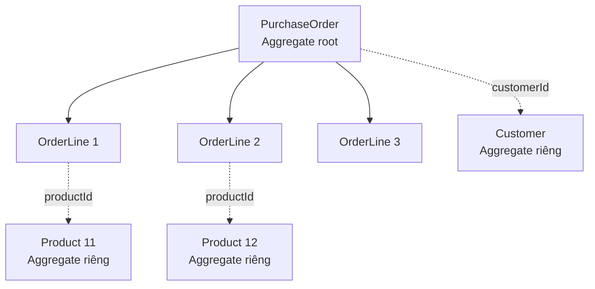
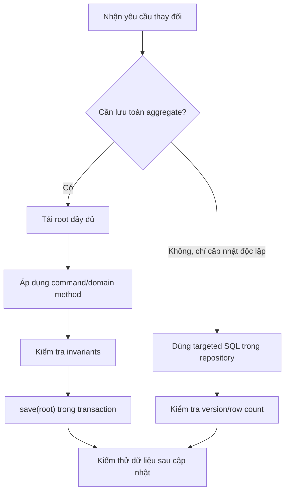

# Nguy cơ mất dữ liệu khi save aggregate chỉ được tải một phần

Spring Data JDBC lưu dữ liệu theo **aggregate root**. Khi lưu một aggregate đã tồn tại, framework làm việc với trạng thái hiện tại của object được truyền vào. Vì vậy, nếu ứng dụng chỉ tải hoặc dựng được một phần aggregate rồi gọi `save(...)`, những thành phần bị bỏ sót có thể bị hiểu là không còn thuộc aggregate.

Rủi ro thường thấy nhất nằm ở collection con được ánh xạ bằng `@MappedCollection`: khi cập nhật root, Spring Data JDBC có thể xóa các hàng con hiện có rồi chèn lại những phần tử có trong object hiện tại. Nếu object chỉ chứa một phần danh sách, các hàng bị bỏ qua có thể mất. Những thuộc tính scalar của root cũng có thể bị ghi bằng `null` hoặc giá trị mặc định nếu ứng dụng dựng object không đầy đủ.

Bài này dùng `PurchaseOrder` và `OrderLine` để chỉ ra cách sự cố xảy ra, phân biệt dữ liệu được sở hữu với aggregate được tham chiếu, và lựa chọn cách cập nhật an toàn.

## 1. Aggregate là một đơn vị dữ liệu có ranh giới rõ ràng

Trong Spring Data JDBC, một aggregate root đại diện cho đơn vị mà repository tải và lưu. Các object con nằm trong ranh giới root được quản lý cùng root. Ví dụ:

- `PurchaseOrder` là aggregate root.
- `OrderLine` là thành phần thuộc đơn hàng.
- `Customer` và `Product` là aggregate độc lập; đơn hàng giữ ID tham chiếu đến chúng.



`OrderLine` thuộc quyền sở hữu của đơn hàng. Khi lưu đơn, framework đồng bộ cả tập dòng hàng thuộc đơn. `Customer` và `Product` được tham chiếu bằng ID; chúng có vòng đời riêng và không tự trở thành object con bị xóa khi lưu `PurchaseOrder`.

Đây là điểm quan trọng để hiểu tác động của `save(...)`: framework cần biết **toàn bộ trạng thái hiện tại của phần aggregate mà root sở hữu** để đồng bộ xuống database.

## 2. Ví dụ aggregate đơn hàng

Mô hình đơn giản:

```java
package com.example.orders.domain;

import java.math.BigDecimal;

public record OrderLine(
    Long productId,
    int quantity,
    BigDecimal unitPrice
) {}
```

```java
package com.example.orders.domain;

import java.util.List;

import org.springframework.data.annotation.Id;
import org.springframework.data.relational.core.mapping.MappedCollection;
import org.springframework.data.relational.core.mapping.Table;

@Table("purchase_order")
public record PurchaseOrder(
    @Id Long id,
    Long customerId,
    String status,
    String note,
    @MappedCollection(
        idColumn = "order_id",
        keyColumn = "line_no"
    )
    List<OrderLine> lines
) {}
```

Schema minh họa:

```sql
CREATE TABLE purchase_order (
    id BIGINT GENERATED BY DEFAULT AS IDENTITY PRIMARY KEY,
    customer_id BIGINT NOT NULL,
    status VARCHAR(20) NOT NULL,
    note VARCHAR(500)
);

CREATE TABLE order_line (
    order_id BIGINT NOT NULL
        REFERENCES purchase_order(id) ON DELETE CASCADE,
    line_no INTEGER NOT NULL,
    product_id BIGINT NOT NULL,
    quantity INTEGER NOT NULL CHECK (quantity > 0),
    unit_price NUMERIC(19, 2) NOT NULL CHECK (unit_price >= 0),
    PRIMARY KEY (order_id, line_no)
);
```

Một đơn hàng đã tồn tại:

| order_id | customer_id | status | note |
| ---: | ---: | --- | --- |
| 1001 | 7 | `CREATED` | `Giao giờ hành chính` |

Các dòng hàng hiện tại:

| order_id | line_no | product_id | quantity | unit_price |
| ---: | ---: | ---: | ---: | ---: |
| 1001 | 0 | 11 | 2 | 120000.00 |
| 1001 | 1 | 12 | 1 | 45000.00 |

Đơn có hai dòng. Khi repository tải đầy đủ aggregate, object phản ánh cả hai dòng hàng.

## 3. Spring Data JDBC lưu aggregate đã tồn tại như thế nào?

Ở mức khái quát, thao tác lưu có hai trường hợp:

- **Aggregate mới:** ID chưa có, framework chèn root và các object con thuộc root.
- **Aggregate đã tồn tại:** ID đã có, framework cập nhật root và đồng bộ các object con theo trạng thái collection hiện tại.

Đối với các entity phụ thuộc được lưu trong collection của aggregate, Spring Data JDBC không hoạt động như JPA/Hibernate với persistence context và dirty checking từng phần tử. Khi cập nhật aggregate hiện hữu, cơ chế lưu có thể xóa các hàng phụ thuộc hiện có của root rồi chèn lại các hàng con đang có trong object được truyền vào.

Ví dụ về ý nghĩa của SQL có thể phát sinh:

```sql
-- Root đã tồn tại.
UPDATE purchase_order
SET customer_id = ?,
    status = ?,
    note = ?
WHERE id = ?;

-- Đồng bộ collection con của root.
DELETE FROM order_line
WHERE order_id = ?;

-- Chèn lại các dòng hiện diện trong aggregate hiện tại.
INSERT INTO order_line
    (order_id, line_no, product_id, quantity, unit_price)
VALUES
    (?, ?, ?, ?, ?);
```

Đây là sơ đồ hành vi để hiểu tác động, không phải cam kết thứ tự hoặc chính xác từng câu SQL cho mọi phiên bản/dialect. Hãy bật SQL logging và quan sát câu lệnh thực tế của phiên bản đang dùng nếu cần chẩn đoán.

Hệ quả: collection con trong object được đưa vào `save(...)` phải được xem là **trạng thái đầy đủ mà ứng dụng muốn lưu cho root**. Nếu object chứa hai dòng thì hai dòng đó là danh sách hiện tại; nếu object chứa danh sách rỗng thì ứng dụng đang biểu diễn root không còn dòng con nào.

## 4. Sự cố: dựng object một phần rồi gọi save

Giả sử API chỉ cho phép sửa ghi chú đơn hàng. Request:

```json
{
  "note": "Giao trước 17:00"
}
```

Một cách làm nguy hiểm là dựng một aggregate mới từ ID và request:

```java
PurchaseOrder partial = new PurchaseOrder(
    1001L,
    7L,
    "CREATED",
    request.note(),
    List.of()
);

purchaseOrderRepository.save(partial);
```

Object này có `id = 1001`, nên nó đại diện một aggregate đã tồn tại. Nhưng `lines` đang là danh sách rỗng. Framework không biết rằng request chỉ muốn đổi ghi chú; nó nhìn thấy trạng thái hiện tại của collection là rỗng.

Sau khi đồng bộ, các hàng `order_line` thuộc đơn 1001 có thể bị xóa. Hai dòng hàng cũ không xuất hiện trong object mới nên không được chèn lại.

Trước khi lưu:

```text
PurchaseOrder 1001
  note = "Giao giờ hành chính"
  lines:
    - product 11, quantity 2
    - product 12, quantity 1
```

Object được dựng một phần:

```text
PurchaseOrder 1001
  note = "Giao trước 17:00"
  lines:
    (empty)
```

Kết quả có nguy cơ:

```text
PurchaseOrder 1001
  note = "Giao trước 17:00"
  lines:
    (empty)

order_line:
  Không còn hàng nào cho order_id = 1001
```

Một thao tác sửa một trường đã vô tình xóa dữ liệu con của aggregate.

### Null và empty collection không phải lúc nào cũng có cùng ý nghĩa

Đối với collection, đừng giả định `null` có nghĩa là “giữ nguyên dữ liệu cũ”. Cách framework xử lý null phụ thuộc kiểu property, mapping và phiên bản; collection null cũng có thể gây lỗi khi mapping/lưu. `List.of()` rõ ràng biểu diễn collection rỗng và có thể dẫn đến xóa các hàng con hiện có.

Quy tắc an toàn là không dùng object partial làm đầu vào cho `save(root)` nếu chưa đảm bảo nó chứa đầy đủ state của aggregate. Không dùng null hoặc empty để ngầm biểu diễn “field không được gửi trong PATCH”.

## 5. Rủi ro thứ hai: các thuộc tính scalar của root bị ghi đè

Mất dữ liệu không chỉ xảy ra ở collection con. Giả sử `PurchaseOrder` có các trường `customerId`, `status`, `note`. Request chỉ gửi `note`, nhưng mapper tạo object với các trường không có trong request thành null/default:

```java
PurchaseOrder partial = new PurchaseOrder(
    1001L,
    null,          // Không có trong request
    null,          // Không có trong request
    "Giao trước 17:00",
    List.of()
);
purchaseOrderRepository.save(partial);
```

Khi lưu root, những thuộc tính được mapping có thể được ghi xuống database theo giá trị của object. Nếu `customer_id` hoặc `status` nhận null, có thể xảy ra một trong hai tình huống:

- Database từ chối vì cột có `NOT NULL` hoặc foreign key.
- Nếu cột nullable, giá trị cũ có thể bị ghi đè bằng SQL NULL.

Nếu dùng primitive, giá trị bị thiếu có thể bị chuyển thành `0` hoặc `false`, cũng không phải là “giữ nguyên giá trị trước đó”.

Vì vậy, một object có ID không đồng nghĩa với một lệnh cập nhật một phần. `save(...)` lưu trạng thái object; nó không tự biết field nào đã được gửi trong HTTP request và field nào bị bỏ qua.

## 6. Những tình huống dễ tạo ra aggregate không đầy đủ

| Nguồn tạo object | Cách sự cố xuất hiện |
| --- | --- |
| API PATCH | Chỉ map các trường có trong request sang object root mới; trường không gửi trở thành null/default/empty. |
| DTO cập nhật | Mapper chuyển DTO một phần thành entity thay vì tải aggregate hiện tại trước. |
| Query tùy chỉnh | Query chỉ lấy một số cột rồi kết quả được dùng như aggregate đầy đủ. |
| Batch job | Job chỉ biết ID và một trường cần đổi, sau đó dựng root mới rồi gọi save. |
| Event/message | Event chứa delta như `statusChanged` nhưng consumer dựng một aggregate thiếu các child rows. |
| Cache | Cache chỉ giữ summary/projection nhưng được dùng lại làm đầu vào lưu root. |
| Test fixture | Test dựng root có ID đã tồn tại nhưng không tạo collection con tương ứng. |

### Repository load đầy đủ và projection là hai mục đích khác nhau

Một lệnh repository như:

```java
PurchaseOrder order = purchaseOrderRepository.findById(id)
    .orElseThrow();
```

được thiết kế để đọc aggregate theo mapping của nó, bao gồm các thành phần phụ thuộc mà Spring Data JDBC quản lý. Đây là cách thích hợp khi chuẩn bị thay đổi aggregate rồi lưu lại.

Ngược lại, một màn hình danh sách có thể chỉ cần ID, trạng thái và tổng tiền. Không nên dùng một projection/DTO rút gọn rồi coi nó là `PurchaseOrder` đầy đủ. Hãy giữ kiểu đọc và kiểu ghi tách biệt:

```java
public record OrderSummary(
    Long id,
    String status,
    BigDecimal totalAmount
) {}
```

`OrderSummary` là dữ liệu đọc phục vụ hiển thị. Nó không đại diện cho toàn bộ `PurchaseOrder` và không nên được truyền vào repository `save` của aggregate.

Với query tùy chỉnh trả về entity/aggregate, phải kiểm tra hợp đồng mapping của query và bảo đảm kết quả có đủ dữ liệu cần thiết. Nếu mục tiêu chỉ lấy một phần dữ liệu, dùng DTO, projection hoặc `RowMapper` riêng.

## 7. Phân biệt object con được sở hữu với aggregate được tham chiếu

Không phải mọi ID xuất hiện trong aggregate đều là object con bị xóa khi lưu root.

| Quan hệ | Cách biểu diễn | Tác động khi save root |
| --- | --- | --- |
| Object con được sở hữu | `@MappedCollection` | Spring Data JDBC quản lý vòng đời hàng con theo aggregate root; child bị bỏ khỏi trạng thái collection có thể bị xóa. |
| Value object nhúng | `@Embedded` | Các thuộc tính được trải phẳng thành cột của hàng root; object partial có thể ghi đè các cột tương ứng. |
| Aggregate khác được tham chiếu | ID scalar hoặc `AggregateReference` | Root giữ tham chiếu; save root không có nghĩa lưu/xóa aggregate được tham chiếu. |

Ví dụ `PurchaseOrder.customerId` tham chiếu khách hàng. Lưu đơn không đồng nghĩa xóa khách hàng nếu object đơn không chứa thông tin customer. Ngược lại, `PurchaseOrder.lines` là collection con được sở hữu, nên trạng thái collection có tác động trực tiếp đến các hàng `order_line`.

Tương tự, nếu `Product` tham chiếu một `Category` độc lập qua ID, không nên đưa toàn bộ category vào một collection con chỉ để tiện lưu. Chọn đúng ranh giới aggregate ngay từ đầu giúp tránh cascade ngoài ý muốn.

## 8. Cách an toàn thứ nhất: tải đầy đủ aggregate, thay đổi rồi lưu

Với thao tác nghiệp vụ cần cập nhật aggregate, cách thông thường là:

1. Tải root bằng repository.
2. Thay đổi thuộc tính hoặc child collection qua hành vi domain.
3. Giữ nguyên các thành phần không thay đổi.
4. Lưu lại aggregate đầy đủ.

Ví dụ với record bất biến, có thể tạo phương thức trả về bản sao nhưng giữ collection:

```java
@Table("purchase_order")
public record PurchaseOrder(
    @Id Long id,
    Long customerId,
    String status,
    String note,
    @MappedCollection(idColumn = "order_id", keyColumn = "line_no")
    List<OrderLine> lines
) {
    public PurchaseOrder withNote(String newNote) {
        return new PurchaseOrder(
            id,
            customerId,
            status,
            newNote,
            lines
        );
    }
}
```

Service:

```java
@Service
public class OrderService {

    private final PurchaseOrderRepository orders;

    public OrderService(PurchaseOrderRepository orders) {
        this.orders = orders;
    }

    @Transactional
    public PurchaseOrder changeNote(Long orderId, String newNote) {
        PurchaseOrder current = orders.findById(orderId)
            .orElseThrow(() -> new OrderNotFoundException(orderId));

        PurchaseOrder changed = current.withNote(newNote);
        return orders.save(changed);
    }
}
```

Ở đây `findById` tải aggregate hiện tại, bao gồm các dòng hàng. `withNote` giữ nguyên `lines` và những scalar khác, chỉ đổi `note`. Khi `save`, trạng thái collection được gửi xuống vẫn chứa hai dòng ban đầu.

Nếu dùng class mutable thay vì record, có thể gọi method `changeNote(...)` trên object đã tải. Dù dùng mutable hay immutable, nguyên tắc không đổi: phải cập nhật trên một aggregate có đủ state cần bảo toàn.

`@Transactional` giúp thao tác tải-thay đổi-lưu nằm trong một transaction. Nhưng transaction không tự biến object partial thành object đầy đủ; ứng dụng vẫn phải tải đúng aggregate và xử lý concurrency.

## 9. Cách an toàn thứ hai: dùng command/DTO cho PATCH

HTTP PUT và PATCH có ý nghĩa khác nhau:

- PUT thường thay thế representation của tài nguyên theo hợp đồng API.
- PATCH chỉ thay đổi một phần tài nguyên; field không xuất hiện trong patch thường phải được giữ nguyên.

Đừng ánh xạ trực tiếp request PATCH thành aggregate. Hãy dùng command/DTO thể hiện đúng ý định thay đổi:

```java
public record ChangeOrderNoteRequest(
    String note
) {}
```

Service tải aggregate đầy đủ rồi áp dụng command:

```java
@Transactional
public PurchaseOrder changeNote(
        Long orderId,
        ChangeOrderNoteRequest request) {

    PurchaseOrder current = orders.findById(orderId)
        .orElseThrow(() -> new OrderNotFoundException(orderId));

    return orders.save(current.withNote(request.note()));
}
```

Nếu PATCH cần phân biệt ba trường hợp:

1. Không gửi field: giữ nguyên.
2. Gửi field với giá trị null: xóa giá trị nếu domain cho phép.
3. Gửi field có giá trị: cập nhật.

thì DTO cần một cách biểu diễn **field presence** riêng. Một field Java reference thông thường không đủ phân biệt “không gửi” và “gửi null” sau khi deserialize nếu cả hai cùng thành null. Có thể dùng kiểu patch wrapper, JSON Merge Patch hoặc thư viện hỗ trợ nullable/presence phù hợp với API.

Ví dụ khái niệm:

```java
public sealed interface PatchField<T>
        permits Missing, Present {}

public record Missing<T>() implements PatchField<T> {}

public record Present<T>(T value) implements PatchField<T> {}
```

`Missing` nghĩa là không yêu cầu thay đổi; `Present(null)` có thể biểu diễn yêu cầu xóa giá trị nếu nghiệp vụ cho phép. Đây chỉ là mô hình minh họa; cần cấu hình JSON deserialization để giữ được thông tin field có xuất hiện trong payload hay không.

## 10. Cách an toàn thứ ba: cập nhật có mục tiêu bằng SQL

Không phải thay đổi nào cũng cần tải và lưu toàn bộ aggregate. Nếu chỉ cập nhật một scalar và không cần đồng bộ child collection, có thể dùng câu SQL tường minh qua custom repository/JdbcTemplate:

```java
@Repository
public class OrderUpdateRepository {

    private final JdbcTemplate jdbc;

    public OrderUpdateRepository(JdbcTemplate jdbc) {
        this.jdbc = jdbc;
    }

    public int updateNote(Long orderId, String note) {
        return jdbc.update("""
            UPDATE purchase_order
            SET note = ?
            WHERE id = ?
            """, note, orderId);
    }
}
```

Câu lệnh này chỉ cập nhật `note`; nó không đồng bộ `order_line`, do đó giữ nguyên các dòng hàng. Giá trị trả về cho biết số hàng bị tác động; service nên xử lý trường hợp bằng 0 theo hợp đồng API.

Khi dùng cách này, cần:

- Đặt SQL trong adapter/repository riêng, không rải câu lệnh khắp controller.
- Dùng cùng datasource/transaction manager nếu thao tác thuộc transaction với Spring Data repository.
- Kiểm tra quyền và invariant nghiệp vụ trước khi cập nhật.
- Nếu có optimistic locking, tăng/kiểm tra version trong câu SQL.
- Nếu thay đổi scalar làm thay đổi invariant liên quan child rows, cập nhật mọi dữ liệu cần thiết trong cùng transaction.

Ví dụ update có version:

```sql
UPDATE purchase_order
SET note = :note,
    version = version + 1
WHERE id = :id
  AND version = :expectedVersion;
```

Nếu số hàng cập nhật bằng 0, có thể không tìm thấy đơn hoặc version đã thay đổi; cần truy vấn/đối chiếu để trả lỗi đúng. Không được bỏ qua version chỉ vì dùng SQL tùy chỉnh.

### Khi nào nên dùng targeted SQL?

- Một trường độc lập cần cập nhật thường xuyên.
- Collection con lớn, không muốn ghi lại toàn bộ.
- Một thao tác batch cập nhật nhiều root theo điều kiện.
- Truy vấn/ghi có tính chất vendor-specific hoặc tối ưu riêng.

Nhưng targeted SQL làm cho ứng dụng tự chịu trách nhiệm về invariants và các quy tắc mà `save(aggregate)` thường điều phối. Chọn nó có chủ đích và kiểm thử kỹ.

## 11. Cách an toàn thứ tư: tách association thành aggregate độc lập

Nếu child collection rất lớn hoặc từng liên kết cần được cập nhật độc lập, có thể xem xét thay đổi ranh giới mô hình. Ví dụ, thay vì để `OrderLine` là child của `PurchaseOrder`, trong một domain phù hợp có thể mô hình hóa từng dòng thành aggregate riêng với ID và repository riêng.

Khi đó:

- Root đơn hàng tham chiếu các dòng theo ID hoặc truy vấn qua repository/SQL.
- Thay đổi một dòng không yêu cầu save toàn bộ collection của đơn.
- Service phải đảm bảo các invariant vốn trước đây được bảo vệ bên trong một aggregate.
- Transaction có thể cần điều phối nhiều aggregate nếu nghiệp vụ yêu cầu nhất quán.

Không tách aggregate chỉ để né một lần xóa/reinsert. Aggregate boundary là quyết định domain: nếu tổng tiền, số lượng và trạng thái đơn phải nhất quán với toàn bộ dòng, giữ `OrderLine` trong aggregate đơn hàng có thể vẫn là thiết kế đúng. Nếu dòng hàng có vòng đời/khối lượng độc lập, mới cân nhắc tách.

## 12. Optimistic locking giúp gì và không giúp gì?

Spring Data JDBC hỗ trợ optimistic locking với thuộc tính `@Version`. Khi hai transaction cùng tải một phiên bản root và cùng cập nhật, thao tác lưu của transaction dùng phiên bản cũ có thể thất bại vì version đã thay đổi.

Ví dụ:

```java
@Table("purchase_order")
public record PurchaseOrder(
    @Id Long id,
    @Version Long version,
    Long customerId,
    String status,
    String note,
    @MappedCollection(idColumn = "order_id", keyColumn = "line_no")
    List<OrderLine> lines
) {}
```

DDL cần có cột version phù hợp, ví dụ:

```sql
ALTER TABLE purchase_order
ADD COLUMN version BIGINT NOT NULL DEFAULT 0;
```

Optimistic locking giúp phát hiện **ghi đè do hai bản đọc cùng phiên bản**, nhưng nó không tự phát hiện rằng ứng dụng cố ý tạo một aggregate thiếu child rows. Nếu object partial có version hiện tại hợp lệ và được lưu trước các thay đổi khác, thao tác vẫn có thể xóa child rows bị bỏ sót.

Phân biệt hai loại lỗi:

| Vấn đề | Cơ chế bảo vệ phù hợp |
| --- | --- |
| Một request lưu state cũ sau khi request khác đã cập nhật root | `@Version` và xử lý optimistic locking failure. |
| Object hiện tại ngay từ đầu đã thiếu child rows do API/mapper bỏ qua | Tải đầy đủ aggregate, dùng PATCH command hoặc targeted SQL. |
| Hai request cùng tạo một liên kết trùng | Unique constraint ở database và xử lý duplicate. |
| Một thao tác gồm nhiều lệnh phải thành công/thất bại cùng nhau | Transaction trên cùng datasource. |

Không xem `@Version` là giải pháp thay thế cho việc tải đầy đủ aggregate.

## 13. Kiểm thử để phát hiện nguy cơ mất dữ liệu

Một integration test hữu ích nên tạo aggregate có nhiều child rows, sau đó thực hiện thao tác thay đổi một trường. Test phải chứng minh các dòng hàng được giữ nguyên.

Kịch bản:

1. Tạo đơn 1001 với hai dòng.
2. Lưu và xác nhận có hai hàng trong `order_line`.
3. Gọi service `changeNote` theo cách tải root đầy đủ rồi lưu.
4. Đọc lại đơn, xác nhận note mới và vẫn có hai dòng.
5. Thực hiện targeted SQL update note, xác nhận số dòng không đổi.
6. Dựng một object partial với ID đã tồn tại và collection rỗng trong một test riêng để minh họa hành vi nguy hiểm; xác minh SQL/log và dữ liệu sau save.
7. Nếu dùng `@Version`, tạo hai bản đọc cùng version, lưu bản thứ nhất rồi xác nhận bản thứ hai gặp optimistic locking failure.

Ví dụ assertion theo ý nghĩa:

```java
PurchaseOrder loaded = orders.findById(orderId).orElseThrow();

assertThat(loaded.note()).isEqualTo("Giao trước 17:00");
assertThat(loaded.lines()).hasSize(2);
```

Nếu kiểm thử tác động của object partial, nên dùng fixture tách biệt và transaction/test database có thể rollback hoặc được dọn dẹp rõ ràng. Mục đích là chứng minh dữ liệu bị bỏ khỏi snapshot có thể bị mất, không đưa cách làm nguy hiểm vào service production.

Có thể kiểm tra trực tiếp bảng con:

```sql
SELECT order_id, line_no, product_id, quantity
FROM order_line
WHERE order_id = 1001
ORDER BY line_no;
```

Không chỉ kiểm tra response API. Một response thành công không chứng minh collection con vẫn còn nguyên.

## 14. Quy trình quyết định trước khi gọi save

Trước mỗi thao tác `save(root)`, hãy trả lời:

1. Root này là mới hay đã tồn tại?
2. Nếu đã tồn tại, object được tải đầy đủ từ repository hay được dựng từ DTO/query/cache/event?
3. Các collection `@MappedCollection` có chứa đầy đủ những child rows cần giữ không?
4. Các scalar bị bỏ khỏi request có được giữ lại từ root đã tải không?
5. Các value object `@Embedded` có đang bị dựng thành null/default ngoài ý muốn không?
6. Có cần cập nhật đúng một trường bằng SQL thay vì save toàn bộ aggregate không?
7. Có concurrency cần optimistic locking hoặc constraint bảo vệ không?
8. Các thao tác có cần nằm trong một transaction không?

Có thể tóm tắt luồng an toàn:



## 15. Những hiểu lầm cần tránh

- **“Có ID là save chỉ cập nhật những field thay đổi.”** Không đúng. `save` lưu trạng thái object được truyền vào; framework không tự biết field nào có trong PATCH.
- **“Collection rỗng nghĩa là không thay đổi collection.”** Không đúng trong ngữ nghĩa aggregate snapshot. Danh sách rỗng có thể biểu diễn aggregate hiện tại không có child rows.
- **“Không tải child rows thì framework sẽ tự giữ nguyên.”** Không nên giả định như vậy. Nếu object được lưu không chứa các child rows cần giữ, chúng có thể bị xóa khi đồng bộ.
- **“`@Transactional` ngăn mất dữ liệu do object partial.”** Không đúng. Transaction làm thao tác nguyên tử; nó không bổ sung state bị thiếu.
- **“`@Version` ngăn mọi lỗi ghi.”** Không đúng. Version phát hiện một số cập nhật đồng thời; không phát hiện object hiện tại thiếu dữ liệu ngay từ đầu.
- **“Aggregate reference và child collection đều bị cascade như nhau.”** Không đúng. Hàng con thuộc root có vòng đời do root quản lý; aggregate được tham chiếu có vòng đời riêng.
- **“Projection có thể dùng trực tiếp để save entity.”** Không nên. Projection chỉ chứa dữ liệu phục vụ một mục đích đọc cụ thể.
- **“Tách child thành aggregate riêng luôn tốt hơn.”** Không đúng. Tách aggregate làm thay đổi ranh giới nhất quán và trách nhiệm nghiệp vụ.

## 16. Câu hỏi tự kiểm tra

- Vì sao Spring Data JDBC cần xem collection con là trạng thái hiện tại của aggregate?
- Khi save một root đã tồn tại, chuyện gì có thể xảy ra với các hàng `@MappedCollection` không xuất hiện trong object?
- Vì sao request PATCH chỉ đổi `note` không nên được ánh xạ trực tiếp thành một `PurchaseOrder` mới?
- Sự khác nhau giữa `List.of()` và “field không được gửi” trong API là gì?
- Tại sao một scalar bị bỏ khỏi DTO cũng có thể bị ghi đè bằng null/default?
- Repository `findById` đầy đủ khác projection `OrderSummary` ở mục đích nào?
- Vì sao aggregate được tham chiếu bằng ID không có cùng vòng đời với child collection?
- Khi nào nên dùng targeted SQL thay vì `save(root)`?
- `@Version` phát hiện loại lỗi nào, và vì sao nó không sửa được object partial?
- Cần kiểm tra những gì trong database sau một thao tác cập nhật aggregate?

Khi làm việc với Spring Data JDBC, hãy coi `save(aggregate)` là thao tác lưu **trạng thái aggregate mà ứng dụng đang có**. Trước khi gọi save cho root đã tồn tại, bảo đảm object chứa đủ các child rows và scalar cần bảo toàn. Với thay đổi một phần, tải root đầy đủ rồi áp dụng command; nếu chỉ cần cập nhật một trường độc lập, dùng câu SQL có mục tiêu. Cách làm này giữ đúng ranh giới aggregate và tránh biến một thao tác PATCH nhỏ thành việc xóa dữ liệu ngoài ý muốn.
