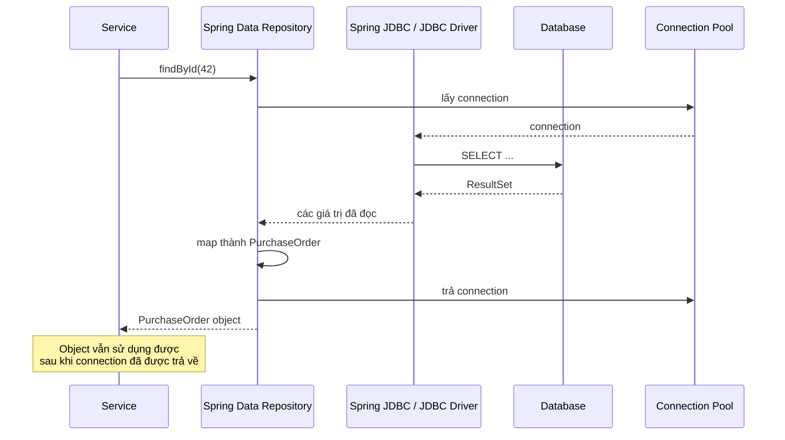
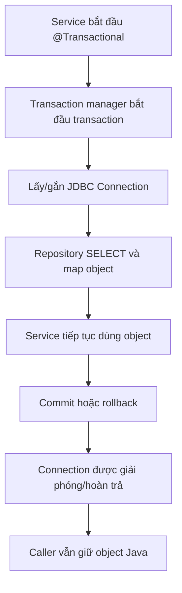
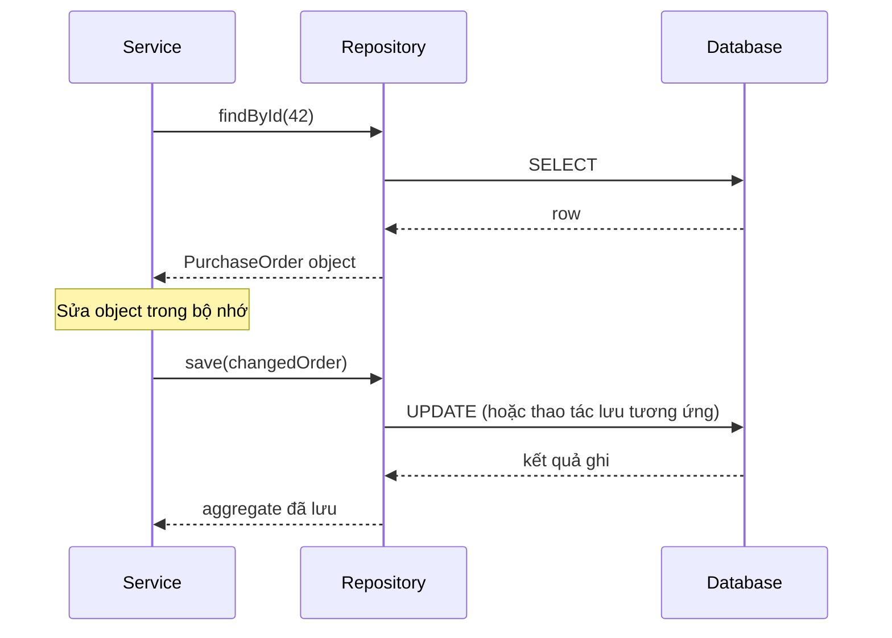
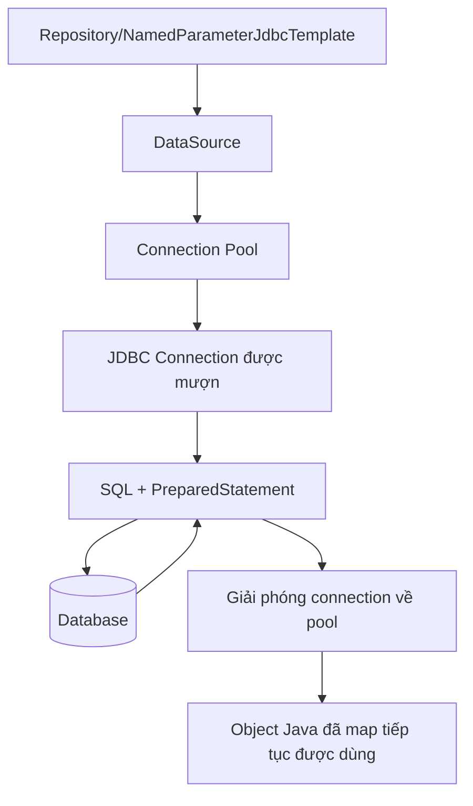

# Đối tượng đã tải và vòng đời tách rời khỏi kết nối

Trong **Spring Data Relational JDBC**, khi gọi repository để tải một aggregate, kết quả là một object Java thông thường chứa dữ liệu đã được đọc từ database. Object đó có thể tiếp tục được sử dụng sau khi câu truy vấn kết thúc và JDBC connection được trả về pool. Nó **không cần giữ connection mở** để đọc property, và việc thay đổi object trong bộ nhớ cũng không tự động ghi dữ liệu trở lại database.

Đây là một đặc điểm quan trọng của Spring Data JDBC: framework không duy trì một persistence context/session dài hạn để quản lý các object đã tải. Nó ánh xạ dữ liệu khi thực hiện thao tác repository, giải phóng tài nguyên JDBC theo phạm vi thao tác hoặc transaction, rồi trả object cho ứng dụng.

Vì vậy, cần phân biệt ba vòng đời:

1. **Object Java:** sống theo tham chiếu và phạm vi sử dụng của chương trình; có thể tồn tại lâu sau khi truy vấn kết thúc.
2. **JDBC Connection:** tài nguyên dùng để giao tiếp với database; được quản lý và giải phóng/hoàn trả theo phạm vi thao tác hoặc transaction.
3. **Transaction:** phạm vi commit hoặc rollback các thao tác database; có thời điểm bắt đầu và kết thúc riêng.

Hiểu sự tách biệt này giúp tránh các giả định thường gặp từ JPA/Hibernate như lazy loading tự động, dirty checking, persistence context, hoặc tự động flush thay đổi khi transaction kết thúc.

## 1. Ba vòng đời khác nhau

Một luồng đọc đơn hàng có thể được hình dung:



Trình tự trên minh họa trường hợp không có một transaction service dài bao trùm nhiều thao tác. Nếu có transaction, connection thường được giữ gắn với transaction cho đến khi transaction kết thúc. Trong cả hai trường hợp, object Java không trở thành một phần của connection.

| Thành phần | Vai trò | Khi nào kết thúc? |
|---|---|---|
| Object đã tải | Dữ liệu Java mà ứng dụng đang sử dụng | Khi không còn tham chiếu và được garbage collector thu hồi, hoặc khi ứng dụng chủ động bỏ tham chiếu |
| JDBC Connection | Tài nguyên giao tiếp database | Khi thao tác/transaction giải phóng; connection pool có thể nhận lại để tái sử dụng |
| JDBC Statement/ResultSet | Thực thi câu SQL và đọc kết quả | Sau khi xử lý kết quả và đóng tài nguyên |
| Transaction | Nhóm các thao tác database thành đơn vị commit/rollback | Khi commit, rollback hoặc hoàn tất theo transaction manager |

**Điểm cốt lõi:** object đã tải không phải là connection, không sở hữu connection và không cần connection để đọc các trường đã được ánh xạ vào nó.

## 2. Object sau khi tải là object Java bình thường

Ví dụ domain:

```java
import org.springframework.data.annotation.Id;
import org.springframework.data.relational.core.mapping.Table;

@Table("purchase_orders")
public record PurchaseOrder(
    @Id Long id,
    String orderNumber,
    String status
) {}
```

Repository:

```java
import org.springframework.data.repository.CrudRepository;

public interface PurchaseOrderRepository
        extends CrudRepository<PurchaseOrder, Long> {
}
```

Service:

```java
PurchaseOrder order = repository.findById(42L)
    .orElseThrow();

// Đọc property sau khi phương thức repository đã trả về.
System.out.println(order.orderNumber());
System.out.println(order.status());
```

Khi `findById` hoàn tất, các giá trị đã được ánh xạ vào object. Đọc `order.orderNumber()` không gửi thêm SQL và không cần connection còn mở.

Điều này cũng đúng nếu object được truyền sang một lớp khác, đặt trong một collection hoặc dùng để tạo response DTO:

```java
PurchaseOrder order = repository.findById(42L)
    .orElseThrow();

String orderNumber = order.orderNumber();

OrderResponse response = new OrderResponse(
    order.id(),
    orderNumber,
    order.status()
);
```

`OrderResponse` được tạo từ dữ liệu Java đã có. Nó không cần truy cập database chỉ để đọc các property của `order`.

### 2.1. Không giữ ResultSet để sử dụng sau

Cần phân biệt object domain đã được map với tài nguyên JDBC thô. Một `ResultSet` phụ thuộc vào `Statement` và connection dùng để thực thi query. Không nên trả `ResultSet` ra khỏi callback rồi sử dụng sau khi thao tác JDBC kết thúc.

Không an toàn:

```java
// Ý tưởng sai: ResultSet là tài nguyên JDBC, không phải dữ liệu domain độc lập.
ResultSet result = executeQueryAndReturnResultSet();
return result;
```

Cách đúng là ánh xạ kết quả ngay trong phạm vi xử lý JDBC:

```java
List<PurchaseOrder> orders = jdbc.query(
    "SELECT id, order_number, status FROM purchase_orders",
    (rs, rowNum) -> new PurchaseOrder(
        rs.getLong("id"),
        rs.getString("order_number"),
        rs.getString("status")
    )
);
```

Danh sách `orders` chứa object Java độc lập với `ResultSet`. Sau khi Spring JDBC hoàn tất callback và đóng/giải phóng tài nguyên cần thiết, ứng dụng vẫn dùng được danh sách đó.

## 3. Spring Data JDBC không duy trì persistence context

Trong JPA/Hibernate, một entity có thể được quản lý bởi persistence context trong thời gian một session/entity manager hoạt động. Thay đổi property của entity managed có thể được phát hiện bằng dirty checking và ghi xuống database khi flush.

Spring Data JDBC có mô hình đơn giản hơn:

- Repository tải aggregate và trả object đã ánh xạ.
- Framework không giữ một identity map/session dài hạn cho object đó.
- Thay đổi object trong bộ nhớ không tự động được phát hiện để ghi xuống database.
- Muốn lưu thay đổi, ứng dụng gọi repository hoặc aggregate operations một cách tường minh.

Do không có persistence context quản lý trạng thái object, việc gọi cùng một repository method hai lần có thể tạo hai object Java riêng biệt, dù chúng biểu diễn cùng một hàng database.

```java
PurchaseOrder first = repository.findById(42L).orElseThrow();
PurchaseOrder second = repository.findById(42L).orElseThrow();

System.out.println(first.id().equals(second.id())); // true
System.out.println(first == second);                // false
```

Đây là hai instance khác nhau trong bộ nhớ. Spring Data JDBC không hứa rằng hai lần đọc cùng ID sẽ trả về cùng một object instance.

### 3.1. Không có lazy-loading proxy cho aggregate reference

Giả sử `PurchaseOrder` lưu ID của khách hàng:

```java
@Table("purchase_orders")
public record PurchaseOrder(
    @Id Long id,
    String orderNumber,
    Long customerId
) {}
```

Khi đọc:

```java
PurchaseOrder order = orderRepository.findById(42L)
    .orElseThrow();

Long customerId = order.customerId();
```

`customerId` là một giá trị đã có trong object. Không có proxy được cài vào property để tự động tải `Customer` khi bạn truy cập một phương thức.

Nếu cần thông tin khách hàng:

```java
Customer customer = customerRepository.findById(order.customerId())
    .orElseThrow();
```

Đây là truy vấn tường minh. Ứng dụng quyết định khi nào tải aggregate khác và có thể dùng batch loading hoặc một read query nếu cần dữ liệu từ nhiều bảng.

### 3.2. Không có dirty checking tự động

Với một mutable class:

```java
PurchaseOrder order = repository.findById(42L).orElseThrow();

order.setStatus("PAID");
```

Nếu `PurchaseOrder` là class mutable, câu lệnh setter chỉ thay đổi object trong bộ nhớ. Nó **không tự chạy UPDATE** và không có một persistence context theo dõi thay đổi này.

Phải lưu tường minh:

```java
repository.save(order);
```

Với Java record immutable, ta tạo một instance mới:

```java
PurchaseOrder before = repository.findById(42L).orElseThrow();

PurchaseOrder changed = new PurchaseOrder(
    before.id(),
    before.orderNumber(),
    "PAID"
);

PurchaseOrder saved = repository.save(changed);
```

Dùng object trả về từ `save` để tiếp tục xử lý, đặc biệt nếu entity có ID được database sinh hoặc có version được cập nhật.

## 4. Connection được quản lý theo thao tác và transaction

JDBC connection là tài nguyên hữu hạn. Ứng dụng không nên giữ connection mở chỉ vì đang giữ một object domain.

Trong ứng dụng Spring Boot thông thường, `DataSource` có thể sử dụng connection pool. Spring JDBC và transaction manager lấy connection khi cần, dùng connection phù hợp với transaction hiện tại và giải phóng nó về pool khi hoàn tất.

### 4.1. Khi không có service transaction bao trùm

Một lời gọi repository hoàn tất công việc đọc của nó rồi giải phóng tài nguyên JDBC theo cơ chế framework. Connection vật lý có thể không bị đóng hoàn toàn; nếu có pool, nó thường được trả về pool để tái sử dụng.

```text
repository.findById(42)
    → lấy connection từ DataSource/pool
    → thực hiện SELECT
    → map ResultSet thành object
    → giải phóng connection về pool
    → trả object cho service
    → service tiếp tục sử dụng object
```

Không nên diễn giải “connection được giải phóng” thành “socket TCP chắc chắn bị đóng”. Với pool, connection vật lý thường được giữ lại để tái sử dụng; điều được giải phóng là quyền sử dụng connection của thao tác hiện tại.

### 4.2. Khi có @Transactional

Nếu service có transaction:

```java
@Transactional
public PurchaseOrder loadAndProcess(long id) {
    PurchaseOrder order = repository.findById(id).orElseThrow();

    // Thực hiện thêm các thao tác trong cùng transaction nếu cần.
    return order;
}
```

Transaction manager điều phối transaction. Với JDBC transaction thông thường, connection được gắn với transaction context và giữ đến khi transaction commit hoặc rollback. Các thao tác JDBC tham gia transaction có thể dùng connection transaction-bound đó.

Sau khi phương thức service hoàn tất và transaction được commit/rollback, connection được giải phóng/hoàn trả theo cơ chế DataSource. Object trả về vẫn là object Java bình thường và tiếp tục tồn tại nếu caller còn tham chiếu.



### 4.3. Transaction không làm object thành managed object

`@Transactional` điều khiển ranh giới giao dịch database. Nó không tạo persistence context kiểu JPA và không khiến mọi object đã tải trong phương thức tự động được theo dõi.

Ví dụ:

```java
@Transactional
public void process(long id) {
    PurchaseOrder order = repository.findById(id).orElseThrow();

    // Thay đổi object không tự động ghi xuống database.
    // Cần gọi save hoặc một thao tác ghi rõ ràng.
}
```

Khi phương thức kết thúc, transaction có thể commit thành công nhưng nếu không có thao tác ghi, thay đổi chỉ tồn tại trong bộ nhớ rồi biến mất khi object không còn được tham chiếu.

## 5. Vòng đời object không đồng nhất với vòng đời transaction

Hãy xem ba trường hợp:

| Trường hợp | Object | Connection/transaction |
|---|---|---|
| Đọc không có transaction service dài | Được trả về sau thao tác đọc và dùng tiếp | Connection được giải phóng theo thao tác |
| Đọc trong transaction | Được trả về trong khi transaction còn hoạt động | Connection thường được giữ đến cuối transaction |
| Trả object ra khỏi phương thức transactional | Object tiếp tục tồn tại nếu caller giữ tham chiếu | Transaction đã kết thúc; connection được giải phóng |

Ví dụ:

```java
public PurchaseOrder load(long id) {
    return repository.findById(id).orElseThrow();
}

PurchaseOrder order = load(42L);

// Có thể đọc property tại đây.
System.out.println(order.status());
```

Không cần giữ transaction mở để đọc property của object đã map. Nếu sau đó cần truy vấn thêm, ứng dụng bắt đầu thao tác database mới với transaction/connection phù hợp.

### 5.1. Không giữ transaction mở cho các công việc không cần database

Một anti-pattern là mở transaction lâu chỉ vì muốn giữ object trong phạm vi xử lý:

```java
@Transactional
public Report buildReport(long id) {
    PurchaseOrder order = repository.findById(id).orElseThrow();

    callRemoteService();       // Có thể mất nhiều giây
    renderLargeDocument();     // Không cần database
    return createReport(order);
}
```

Nếu công việc bên ngoài database không cần tham gia transaction, giữ transaction mở trong suốt thời gian đó có thể chiếm connection lâu, tăng áp lực connection pool và kéo dài thời gian giữ lock.

Có thể tách bước đọc dữ liệu thành một transaction ngắn, sau đó xử lý dữ liệu Java ngoài transaction:

```java
public Report buildReport(long id) {
    PurchaseOrderSnapshot snapshot = orderReader.loadSnapshot(id);

    callRemoteService();
    renderLargeDocument();

    return createReport(snapshot);
}
```

`PurchaseOrderSnapshot` là DTO chỉ chứa dữ liệu cần cho công việc tiếp theo. Tách như vậy còn giúp giới hạn những gì được truyền ra ngoài tầng persistence.

## 6. Thay đổi object đã tải phải được lưu tường minh

Một luồng cập nhật điển hình:



### 6.1. Mutable entity

```java
PurchaseOrder order = repository.findById(42L).orElseThrow();

order.setStatus("PAID");

// Chỉ thay đổi object trong bộ nhớ đến đây.
repository.save(order);
```

### 6.2. Immutable record

```java
PurchaseOrder before = repository.findById(42L).orElseThrow();

PurchaseOrder changed = new PurchaseOrder(
    before.id(),
    before.orderNumber(),
    "PAID"
);

PurchaseOrder saved = repository.save(changed);
```

Record không cho phép thay đổi field sau khi tạo, nên ta tạo object mới. Việc lưu vẫn là tường minh.

### 6.3. save không đồng nghĩa native UPSERT

`save` là API repository/aggregate. Spring Data JDBC xác định entity mới hay đã tồn tại theo cơ chế nhận biết trạng thái (ví dụ ID/version hoặc `Persistable` nếu được tùy chỉnh), sau đó thực hiện thao tác lưu phù hợp.

Không nên giả định `save` luôn là một câu lệnh database kiểu `INSERT ... ON CONFLICT DO UPDATE` hoặc `MERGE`. Nếu nghiệp vụ cần cập nhật có điều kiện nguyên tử, hãy dùng SQL update phù hợp và kiểm tra số hàng ảnh hưởng, hoặc cơ chế optimistic locking.

## 7. Object đã tải có thể trở nên cũ (stale)

Việc object không gắn với connection có một hệ quả: object là **snapshot dữ liệu tại thời điểm đọc**, không phải cửa sổ tự động cập nhật theo database.

Ví dụ:

```text
Thời điểm T1:
  Request A đọc Order 42, status = NEW

Thời điểm T2:
  Request B cập nhật Order 42, status = PAID

Thời điểm T3:
  Request A vẫn giữ object có status = NEW
```

Object trong Request A không tự đổi thành `PAID` khi Request B cập nhật database. Nếu Request A cần giá trị mới, phải truy vấn lại hoặc dùng cơ chế kiểm soát đồng thời.

### 7.1. Đọc lại để lấy trạng thái mới nhất

```java
PurchaseOrder current = repository.findById(42L).orElseThrow();
```

Đây là truy vấn mới, có thể nhìn thấy thay đổi đã commit theo isolation level của transaction hiện tại. Nếu đang ở một transaction có snapshot isolation/repeatable read, kết quả có thể vẫn theo snapshot transaction; phải hiểu isolation level của database.

### 7.2. Lost update khi lưu object cũ

Một tình huống nguy hiểm:

```text
A đọc status = NEW
B đọc status = NEW
B lưu status = PAID
A lưu object cũ với status = CANCELLED
```

Nếu không có cơ chế bảo vệ, lần lưu của A có thể ghi đè trạng thái mà B vừa cập nhật. Đây là dạng **lost update**.

Để phát hiện xung đột, có thể dùng optimistic locking với `@Version`:

```java
import org.springframework.data.annotation.Id;
import org.springframework.data.annotation.Version;
import org.springframework.data.relational.core.mapping.Table;

@Table("purchase_orders")
public record PurchaseOrder(
    @Id Long id,
    String orderNumber,
    String status,
    @Version Long version
) {}
```

Spring Data JDBC sử dụng version để kiểm tra phiên bản khi cập nhật aggregate. Nếu một transaction khác đã cập nhật version trước đó, thao tác lưu có thể thất bại với lỗi optimistic locking thay vì âm thầm ghi đè.

Schema cần có cột version tương ứng, ví dụ:

```sql
ALTER TABLE purchase_orders
    ADD COLUMN version BIGINT NOT NULL DEFAULT 0;
```

Tên và kiểu cột phải khớp mapping thực tế. Với entity mới, Spring Data JDBC quản lý version ban đầu và tăng version theo quy trình lưu.

### 7.3. @Version không giữ connection lâu hơn

Optimistic locking là cơ chế kiểm tra trạng thái dữ liệu khi ghi. Nó không yêu cầu object giữ connection từ lúc đọc đến lúc save. Object vẫn độc lập với connection; version chỉ mang thông tin cần thiết để phát hiện dữ liệu đã bị thay đổi.

## 8. Truyền object qua thread hoặc lưu trong cache

Vì object Java đã tải không phụ thuộc connection, có thể truyền object/DTO sang thread khác về mặt bộ nhớ. Nhưng điều đó **không làm transaction tự truyền theo** và cũng không đảm bảo object còn mới.

### 8.1. Không truyền ResultSet hoặc connection sang background task

Không làm:

```java
executor.submit(() -> {
    // Dùng ResultSet/Connection của request thread sau khi scope đã kết thúc.
});
```

Tài nguyên JDBC thuộc cơ chế quản lý của thao tác/transaction; không giữ và sử dụng sau khi framework đã giải phóng.

Nếu background task cần dữ liệu, hãy truyền DTO/object đã map:

```java
OrderSnapshot snapshot = orderReader.loadSnapshot(orderId);

executor.execute(() -> {
    notificationService.sendOrderUpdate(snapshot);
});
```

Task nhận dữ liệu Java đã được đọc. Nếu task cần đọc thêm hoặc cập nhật database, nó phải thực hiện thao tác repository/JDBC của riêng nó trong transaction phù hợp.

### 8.2. Object trong cache không tự đồng bộ với database

Nếu cache lưu `PurchaseOrder`, lần đọc sau có thể trả object cũ sau khi một transaction khác cập nhật database. Cần chính sách cache eviction, TTL, invalidation hoặc version phù hợp.

Không có persistence context đồng nghĩa với việc không có cơ chế tự động đồng bộ tất cả object đang nằm trong bộ nhớ. Cache là một lớp riêng, phải được thiết kế riêng.

### 8.3. Object mutable và chia sẻ giữa nhiều thread

Một object Java mutable có thể bị nhiều thread thay đổi đồng thời. Spring Data JDBC không cung cấp khóa bộ nhớ hoặc đồng bộ hóa cho object domain đã tải. Hãy tránh chia sẻ object mutable không kiểm soát; ưu tiên immutable DTO/record cho dữ liệu truyền giữa các tầng hoặc thread.

## 9. Phân biệt Spring Data JDBC với JPA/Hibernate

Đây là bảng so sánh quan trọng khi chuyển từ JPA sang Spring Data JDBC:

| Khái niệm | Spring Data JDBC | JPA/Hibernate |
|---|---|---|
| Persistence context/session | Không có persistence context dài hạn theo mô hình JPA | Có persistence context/Session |
| Object sau khi load | Object Java độc lập với connection | Entity có thể ở trạng thái managed trong persistence context |
| Dirty checking | Không tự theo dõi thay đổi property để tự ghi | Có với managed entity |
| Lazy loading | Không có lazy-loading proxy quan hệ kiểu JPA | Có thể dùng proxy/collection lazy |
| Flush tự động | Không có cơ chế flush persistence context kiểu JPA | Có flush đồng bộ managed state |
| Identity map | Không giữ một instance duy nhất cho mỗi ID trong session | Persistence context quản lý identity |
| Thay đổi dữ liệu | Gọi repository/aggregate operations rõ ràng | Có thể sửa managed entity rồi flush/commit |
| Kết nối JDBC | Do Spring JDBC/transaction manager quản lý | Do provider và transaction integration quản lý |

Không nên dùng thuật ngữ “detached entity” theo đúng nghĩa JPA để mô tả object Spring Data JDBC đã tải. Spring Data JDBC không đưa object vào một persistence context để sau đó detach nó; object được ánh xạ và trả về như dữ liệu Java thông thường ngay từ đầu.

### 9.1. Cùng một ví dụ, hai cách suy nghĩ khác nhau

**Cách nghĩ JPA:**

```java
@Transactional
public void markPaid(long id) {
    PurchaseOrder order = entityManager.find(PurchaseOrder.class, id);
    order.setStatus("PAID");

    // Với entity managed, dirty checking có thể ghi khi flush.
}
```

**Cách nghĩ Spring Data JDBC:**

```java
@Transactional
public void markPaid(long id) {
    PurchaseOrder order = repository.findById(id).orElseThrow();

    PurchaseOrder changed = new PurchaseOrder(
        order.id(),
        order.orderNumber(),
        "PAID"
    );

    repository.save(changed);
}
```

Trong Spring Data JDBC, lời gọi `save` là bước ghi rõ ràng. Không có chuyện chỉ vì phương thức transactional kết thúc mà framework tự phát hiện mọi thay đổi trong object.

## 10. Connection pool, transaction manager và tài nguyên

Một ứng dụng web có thể xử lý nhiều request đồng thời, trong khi số connection database có giới hạn. Connection pool quản lý việc tái sử dụng connection vật lý để tránh tạo mới liên tục.

Luồng thường gặp:



Trong transaction, transaction manager có thể giữ connection được mượn đến khi commit/rollback. Nếu service gọi nhiều repository method trong cùng transaction và cùng DataSource, các thao tác có thể dùng connection gắn với transaction đó.

### 10.1. Không tự đóng connection do Spring quản lý

Khi dùng Spring Data JDBC repository hoặc `JdbcTemplate`, không tự lấy connection rồi đóng connection do framework quản lý. Nếu viết JDBC thuần, dùng `DataSourceUtils` hoặc cơ chế Spring phù hợp để tham gia transaction, thay vì luôn gọi `dataSource.getConnection()` rồi tự đóng theo cách tách rời transaction manager.

JDBC code tự quản lý tài nguyên phải dùng try-with-resources cho `Connection`, `Statement` và `ResultSet` khi các tài nguyên đó do chính đoạn code tạo và sở hữu.

### 10.2. Connection pool không phải object cache

Connection pool giữ các connection để tái sử dụng. Nó không giữ `PurchaseOrder` hoặc tự đồng bộ object domain. Hai khái niệm hoàn toàn khác nhau:

- Pool tối ưu tài nguyên giao tiếp database.
- Cache ứng dụng giữ dữ liệu/object trong bộ nhớ.
- Persistence context (nếu công nghệ có) quản lý trạng thái entity trong phạm vi session.

Spring Data JDBC dựa vào DataSource/connection management của Spring, nhưng không biến connection pool thành persistence context.

## 11. Khi nào cần DTO snapshot thay cho aggregate?

Nếu cần truyền dữ liệu ra khỏi service, sang background task hoặc API, hãy cân nhắc DTO chỉ chứa các trường cần thiết.

```java
public record OrderSnapshot(
    Long orderId,
    String orderNumber,
    String status,
    Long customerId
) {}
```

Mapper:

```java
public OrderSnapshot toSnapshot(PurchaseOrder order) {
    return new OrderSnapshot(
        order.id(),
        order.orderNumber(),
        order.status(),
        order.customerId()
    );
}
```

DTO có các lợi ích:

- Không làm lộ toàn bộ domain model ra API.
- Giảm khả năng vô tình dùng object cũ như aggregate để cập nhật.
- Không kéo theo các collection/entity con không cần thiết.
- Dễ serialize và truyền qua message/background job.
- Thể hiện rõ dữ liệu được chụp tại thời điểm đọc.

Snapshot vẫn có thể cũ theo thời gian. Nếu background task cần trạng thái mới nhất, nó phải đọc lại database bằng ID thay vì tin rằng DTO luôn là dữ liệu hiện tại.

## 12. Một quy trình xử lý aggregate rõ ràng

Một use case cập nhật đơn hàng có thể được tổ chức:

```java
@Service
public class PurchaseOrderService {

    private final PurchaseOrderRepository repository;

    public PurchaseOrderService(PurchaseOrderRepository repository) {
        this.repository = repository;
    }

    @Transactional
    public PurchaseOrder markPaid(long orderId) {
        PurchaseOrder current = repository.findById(orderId)
            .orElseThrow(() -> new IllegalArgumentException("Order not found"));

        if (!"NEW".equals(current.status())) {
            throw new IllegalStateException("Only NEW orders can be paid");
        }

        PurchaseOrder changed = new PurchaseOrder(
            current.id(),
            current.orderNumber(),
            "PAID",
            current.version()
        );

        return repository.save(changed);
    }
}
```

Ví dụ này giả định model có `version` như phần optimistic locking. Trong ứng dụng thực tế, nên đặt quy tắc chuyển trạng thái trong domain/service và xác định cách xử lý lỗi optimistic locking. Nếu cần bảo đảm điều kiện trạng thái nguyên tử ở database, có thể dùng câu UPDATE có điều kiện và kiểm tra số hàng ảnh hưởng.

Các bước:

1. Bắt đầu transaction ở service.
2. Tải aggregate qua repository.
3. Kiểm tra trạng thái và quy tắc domain.
4. Tạo trạng thái mới trong bộ nhớ.
5. Gọi `save` tường minh.
6. Transaction commit hoặc rollback.
7. Object trả về tiếp tục tồn tại sau khi transaction kết thúc; connection được giải phóng theo transaction manager.

## 13. Những lỗi và hiểu nhầm thường gặp

| Triệu chứng/nhận định | Nguyên nhân | Cách hiểu hoặc xử lý |
|---|---|---|
| Nghĩ object sẽ không dùng được sau khi connection đóng | Nhầm object Java với ResultSet | Object đã map độc lập; tiếp tục đọc property bình thường |
| Thay đổi field nhưng database không đổi | Mong đợi dirty checking | Gọi repository/aggregate operation để lưu |
| Gọi getter làm phát sinh query | Mong đợi lazy loading như JPA | Spring Data JDBC không tự tải aggregate khác qua proxy |
| Hai lần findById trả về hai instance | Mong đợi identity map | Không có persistence context đảm bảo cùng instance |
| Dữ liệu object cũ sau khi request khác cập nhật | Object là snapshot lúc đọc | Đọc lại hoặc dùng optimistic locking khi ghi |
| Transaction kết thúc mà thay đổi không lưu | Không có thao tác ghi tường minh | Gọi save/update |
| Connection bị giữ lâu | Transaction bao trùm tác vụ ngoài DB | Rút ngắn transaction, xử lý ngoài DB sau khi đọc snapshot |
| ResultSet không còn dùng được | Đã đóng statement/connection | Map ResultSet thành object/DTO ngay trong callback |
| Background task dùng connection của request | Chia sẻ tài nguyên JDBC sai phạm vi | Truyền DTO/ID; task tự thực hiện truy vấn của nó |
| Object cache không phản ánh database | Không có cache invalidation | Thiết kế TTL/eviction/invalidation |
| Hai request ghi đè nhau | Object cũ được save mà không kiểm tra version | Dùng `@Version` hoặc update có điều kiện |

## 14. Bài thực hành

### Bài 1. Object có cần connection để đọc property?

Một service gọi `repository.findById(42L)` và nhận `PurchaseOrder`. Sau khi phương thức repository trả về, connection được trả về pool. Có thể gọi `order.status()` không?

**Đáp án:** Có. Giá trị đã được ánh xạ vào object Java; getter không cần connection.

### Bài 2. Thay đổi object có tự động UPDATE?

```java
PurchaseOrder order = repository.findById(42L).orElseThrow();
order.setStatus("PAID");
```

Database có tự thay đổi không?

**Đáp án:** Không. Thay đổi chỉ ở bộ nhớ. Phải gọi `repository.save(order)` hoặc thao tác ghi tường minh phù hợp.

### Bài 3. Hai lần đọc cùng ID có cùng object instance không?

```java
PurchaseOrder a = repository.findById(42L).orElseThrow();
PurchaseOrder b = repository.findById(42L).orElseThrow();
```

**Đáp án:** Không được đảm bảo. Hai lần đọc có thể tạo hai instance khác nhau. Spring Data JDBC không có identity map/session như JPA persistence context.

### Bài 4. Transaction kết thúc, object trả về có biến mất không?

**Đáp án:** Không. Object tiếp tục tồn tại nếu còn tham chiếu. Transaction và connection kết thúc theo cơ chế của chúng; garbage collector chỉ thu hồi object khi không còn được tham chiếu và đủ điều kiện thu hồi.

### Bài 5. Khi nào dùng @Version?

**Đáp án:** Khi cần phát hiện object được tải từ một phiên bản cũ đã bị transaction khác cập nhật trước lúc lưu. Optimistic locking giúp tránh ghi đè âm thầm trong các tình huống phù hợp.

### Bài 6. Có nên giữ transaction mở khi gửi email hoặc gọi HTTP?

**Đáp án:** Thường không cần nếu công việc đó không phải một phần của transaction database. Hãy đọc dữ liệu cần thiết, kết thúc transaction, rồi gửi email/gọi HTTP bằng DTO snapshot hoặc ID. Nếu nghiệp vụ cần bảo đảm sự kiện chỉ được phát sau commit, cân nhắc cơ chế after-commit hoặc outbox.

### Bài 7. ResultSet có thể trả về cho controller không?

**Đáp án:** Không nên. ResultSet phụ thuộc statement/connection. Hãy map thành entity hoặc DTO trước khi tài nguyên JDBC được giải phóng.

## 15. Điều cần ghi nhớ

- Object được Spring Data JDBC tải là **object Java độc lập với JDBC connection**.
- Connection và statement là tài nguyên ngắn hạn; object có thể tồn tại lâu hơn.
- Transaction xác định phạm vi commit/rollback, không tạo persistence context kiểu JPA.
- Spring Data JDBC không có lazy loading proxy, dirty checking hoặc auto-flush theo mô hình JPA.
- Thay đổi object chỉ ở bộ nhớ; muốn ghi phải gọi repository/aggregate operation hoặc câu SQL tường minh.
- Object có thể stale sau khi một request khác cập nhật database; dùng đọc lại, optimistic locking hoặc update có điều kiện tùy nghiệp vụ.
- Không giữ transaction/connection mở cho công việc ngoài database không cần tham gia transaction.
- Map ResultSet thành entity/DTO trong phạm vi callback; không giữ tài nguyên JDBC sau khi thao tác kết thúc.

### Tài liệu tham khảo

- [Spring Data Relational — JDBC Reference](https://docs.spring.io/spring-data/relational/reference/jdbc.html)
- [Spring Data Relational — Entity Persistence](https://docs.spring.io/spring-data/relational/reference/jdbc/entity-persistence.html)
- [Spring Framework — JDBC Core](https://docs.spring.io/spring-framework/reference/data-access/jdbc/core.html)
- [Spring Framework — Data Access and Transactions](https://docs.spring.io/spring-framework/reference/data-access/transaction.html)
- [Spring Data Commons — CrudRepository API](https://docs.spring.io/spring-data/commons/docs/current/api/org/springframework/data/repository/CrudRepository.html)

Khi áp dụng, đối chiếu hành vi transaction và connection pool theo cấu hình thực tế của ứng dụng. Hãy phân biệt rõ object domain đã được map, tài nguyên JDBC và transaction context để thiết kế vòng đời dữ liệu an toàn.
