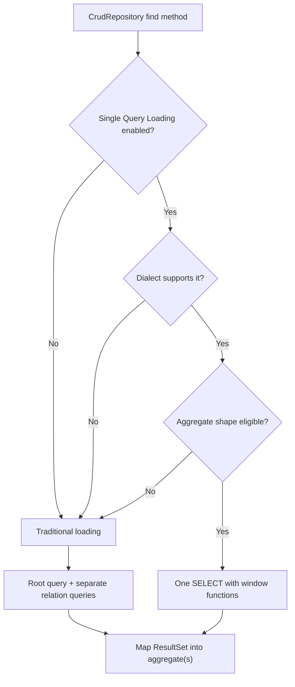

# Giới hạn Single Query Loading theo phiên bản, dialect và cấu trúc aggregate

**Single Query Loading** là cơ chế đọc một aggregate hoặc nhiều aggregate bằng một câu `SELECT`, thay vì tải root rồi phát thêm các câu truy vấn cho từng collection. Tính năng này giúp giảm số round-trip và hạn chế mẫu truy vấn N+1 trong những trường hợp phù hợp.

Tuy nhiên, không phải mọi repository method, database hay cấu trúc aggregate đều sử dụng được cơ chế này. Spring Data JDBC chỉ thử áp dụng khi **được bật trong `JdbcMappingContext`**, dialect hỗ trợ và aggregate đáp ứng các điều kiện về cấu trúc. Nếu một điều kiện không đạt, framework tự quay về cách tải mặc định bằng nhiều câu SQL.

Điều cần hiểu khi thiết kế là: một câu SQL không đồng nghĩa với mọi aggregate đều được tải nhanh hơn. Single Query Loading vẫn phải đọc đủ dữ liệu con, xử lý result set và dựng object graph. Với aggregate lớn hoặc query không phù hợp, cần đo hiệu năng và chọn chiến lược đọc riêng.

## 1. Single Query Loading giải quyết vấn đề gì?

Theo cách tải truyền thống, Spring Data JDBC đọc aggregate root trước. Nếu root sở hữu collection, framework chạy thêm các truy vấn để tải entity con. Khi đọc nhiều root, số câu truy vấn có thể tăng theo số aggregate.

Ví dụ một trang quản trị đọc 50 đơn hàng, mỗi đơn có danh sách `OrderLine`:

```text
SELECT ... FROM purchase_order;

SELECT ... FROM order_line WHERE order_id = 101;
SELECT ... FROM order_line WHERE order_id = 102;
SELECT ... FROM order_line WHERE order_id = 103;
...
SELECT ... FROM order_line WHERE order_id = 150;
```

Nếu mỗi aggregate có nhiều collection trực tiếp, có thể phát sinh thêm nhóm truy vấn tương ứng. Đây là dạng N+1: một câu truy vấn lấy root, sau đó nhiều câu khác lấy các phần tử được sở hữu.

Single Query Loading tạo một câu `SELECT` phức tạp hơn để đọc root và các collection đủ điều kiện cùng lúc. Kết quả vẫn là một bảng quan hệ, nhưng framework tổ chức các hàng sao cho có thể dựng lại cấu trúc aggregate.



**Một câu query** ở đây nói về số statement dùng để tải aggregate trong thao tác được hỗ trợ. Nó không có nghĩa database chỉ đọc một row, hoặc toàn bộ dữ liệu được lưu trong một cột JSON.

## 2. Cơ chế tạo một result set từ nhiều collection

Giả sử `PurchaseOrder` có hai collection trực tiếp: `lines` và `payments`.

```java
@Table("purchase_order")
public class PurchaseOrder {

    @Id
    private Long id;

    private String status;

    @MappedCollection(idColumn = "order_id", keyColumn = "line_no")
    private List<OrderLine> lines = new ArrayList<>();

    @MappedCollection(idColumn = "order_id", keyColumn = "payment_no")
    private List<Payment> payments = new ArrayList<>();
}
```

Nếu nối trực tiếp hai bảng con bằng `LEFT JOIN`, database có thể tạo tích Descartes giữa các collection. Ví dụ một đơn có 4 dòng và 3 lần thanh toán có thể tạo 12 hàng kết quả, lặp lại dữ liệu của từng dòng và từng payment.

Single Query Loading sử dụng **window/analytic functions** như `row_number()` và `count(*)` để đánh số phần tử theo từng parent. Ý tưởng tổng quát:

```sql
SELECT
    order_id,
    line_no,
    row_number() OVER (PARTITION BY order_id ORDER BY line_no) AS line_row,
    count(*) OVER (PARTITION BY order_id) AS line_count
FROM order_line;
```

Một subquery tương tự được tạo cho collection khác. Các collection được kết hợp theo thứ tự hàng đã đánh số, cùng điều kiện xử lý hàng thiếu để tránh tích Descartes đầy đủ. Result set có thể biểu diễn các phần tử của nhiều collection trong cùng một luồng hàng, rồi mapper dựng lại từng collection.

Đây là mô tả nguyên lý, không phải SQL nguyên văn do mọi phiên bản Spring Data JDBC phát ra. SQL thực tế khá phức tạp, phụ thuộc dialect và cách framework xử lý các cột cần ánh xạ. Không nên tự sao chép câu SQL nội bộ vào repository.

Điểm quan trọng là kỹ thuật này cần **window functions** và một cấu trúc aggregate có thể biểu diễn theo thuật toán hiện tại. Đó là lý do dialect và hình dạng object graph quyết định tính đủ điều kiện.

## 3. Phiên bản Spring Data JDBC nào có Single Query Loading?

Single Query Loading được giới thiệu từ **Spring Data JDBC 3.2**. Trước 3.2, cơ chế tải aggregate mặc định là tải root rồi dùng các câu truy vấn riêng cho entity được sở hữu.

Tại thời điểm biên soạn (tháng 11/2026), tài liệu ổn định của Spring Data Relational **3.5.13** và **4.1.2** đều công bố cùng nhóm giới hạn chính:

| Phiên bản | Trạng thái tính năng | Ghi chú |
|---|---|---|
| Trước 3.2 | Không có Single Query Loading | Dùng cách tải truyền thống nhiều statement |
| 3.2 trở lên | Có cơ chế Single Query Loading | Phải bật trong mapping context; chỉ chạy khi dialect, query method và aggregate đủ điều kiện |
| 3.5.13 (stable) | Có, vẫn còn các giới hạn cấu trúc và method | Tài liệu chính thức giữ các giới hạn nested collections, `AggregateReference`, embedded và dialect |
| 4.1.2 (stable) | Có, cùng các giới hạn chính | Tài liệu hiện hành vẫn đánh dấu tính năng experimental |

Điều cần lưu ý về lịch sử: bài giới thiệu ban đầu cho bản 3.2.0-M2 mô tả ví dụ đơn giản với một collection. Tài liệu ổn định hiện nay mô tả khả năng tổng quát hơn, gồm nhiều collection trực tiếp, nhưng vẫn cấm **collection lồng nhau**. Khi nâng phiên bản, hãy dùng tài liệu của đúng release đang chạy thay vì lấy ví dụ từ bài blog milestone làm toàn bộ contract.

Không nên suy luận rằng nâng từ 3.5 lên 4.1 sẽ tự loại bỏ mọi giới hạn. Tài liệu stable 4.1.2 vẫn nêu các điều kiện trên và vẫn coi tính năng là experimental. Khi xem release mới hơn hoặc bản preview, phải kiểm tra lại tài liệu phát hành và API thực tế.

## 4. Giới hạn theo dialect và database

Single Query Loading cần dialect có khả năng biểu diễn SQL với analytic/window functions. Tài liệu Spring Data JDBC 4.1.2 nêu rằng trong các dialect được Spring Data JDBC cung cấp, **tất cả trừ H2 và HSQL** hỗ trợ Single Query Loading. H2 và HSQL không hỗ trợ các analytic functions cần thiết cho cơ chế này.

| Database / dialect tích hợp | Single Query Loading theo tài liệu hiện hành | Lý do / lưu ý |
|---|---|---|
| PostgreSQL | Có | Dialect hỗ trợ window functions |
| MySQL | Có | Dialect hỗ trợ window functions ở các phiên bản phù hợp |
| MariaDB | Có | Dialect hỗ trợ window functions ở các phiên bản phù hợp |
| Microsoft SQL Server | Có | Dialect hỗ trợ analytic/window functions |
| Oracle | Có | Dialect hỗ trợ analytic/window functions |
| DB2 | Có | Dialect hỗ trợ analytic/window functions |
| H2 | Không | Dialect không hỗ trợ Single Query Loading do thiếu analytic functions cần thiết theo tài liệu Spring Data JDBC |
| HSQLDB | Không | Cùng giới hạn analytic functions |

Đây là danh sách theo **dialect Spring Data JDBC tích hợp**, không phải danh sách mọi phiên bản server mà vendor từng phát hành. Với database có dialect riêng hoặc dialect tự triển khai, cần kiểm tra khả năng thực thi SQL thực tế và feature flag `supportsSingleQueryLoading()`.

### Vì sao H2 test pass không chứng minh Single Query Loading chạy ở production?

Nhiều dự án dùng H2 cho `@DataJdbcTest` vì cấu hình nhẹ. Nhưng H2 không hỗ trợ Single Query Loading theo dialect Spring Data JDBC. Khi bật flag trong test, framework vẫn có thể quay về cách tải truyền thống.

Do đó:

- Test chức năng mapping bằng H2 vẫn có giá trị.
- Test H2 không chứng minh production database dùng Single Query Loading.
- Nếu cần kiểm chứng số statement hoặc performance, chạy integration test bằng cùng engine/dialect production, ví dụ PostgreSQL Testcontainers.
- Kiểm tra SQL thực tế; đừng chỉ dựa vào việc ứng dụng khởi động thành công hoặc repository trả đúng object.

## 5. Giới hạn theo cấu trúc aggregate

Tại tài liệu stable 3.5.13 và 4.1.2, aggregate phải đáp ứng các điều kiện chính sau:

| Cấu trúc | Có thể dùng Single Query Loading? | Giải thích |
|---|---|---|
| Root không có collection | Không có lợi ích tải collection; query root thông thường | Không có entity con cần ghép |
| Root có một collection trực tiếp | Có, nếu các điều kiện khác đạt | Cấu trúc cơ bản được hỗ trợ |
| Root có nhiều collection trực tiếp | Có, nếu các điều kiện khác đạt | Thuật toán dùng window functions để ghép các collection cùng cấp |
| Collection nằm trong một child collection khác | Không | Nested collections chưa được hỗ trợ |
| Nested `Map` trong aggregate | Không | `Map` cũng nằm trong giới hạn nested collection |
| Aggregate dùng `AggregateReference` | Không | Chưa nằm trong tập cấu trúc được hỗ trợ |
| Aggregate dùng embedded entity | Không | Embedded entities chưa được hỗ trợ |
| Aggregate có collection và scalar property thông thường | Có thể | Scalar property không tự làm aggregate mất điều kiện |

### 5.1. Collection trực tiếp được hỗ trợ

Ví dụ root sở hữu hai collection trực tiếp:

```java
@Table("purchase_order")
public class PurchaseOrder {

    @Id
    private Long id;

    private String status;

    @MappedCollection(idColumn = "order_id", keyColumn = "line_no")
    private List<OrderLine> lines;

    @MappedCollection(idColumn = "order_id", keyColumn = "payment_no")
    private List<Payment> payments;
}
```

`OrderLine` và `Payment` không sở hữu collection tiếp theo. Đây là dạng aggregate có nhiều collection ở cùng một cấp. Với dialect hỗ trợ và thao tác `CrudRepository` phù hợp, framework có thể dùng Single Query Loading.

### 5.2. Collection lồng nhau chưa được hỗ trợ

Ví dụ:

```java
@Table("purchase_order")
public class PurchaseOrder {

    @Id
    private Long id;

    @MappedCollection(idColumn = "order_id")
    private List<OrderLine> lines;
}

@Table("order_line")
public class OrderLine {

    @Id
    private Long id;

    @MappedCollection(idColumn = "order_line_id")
    private List<LineNote> notes;
}
```

Đường đi `PurchaseOrder → lines → notes` có collection ở cấp lồng nhau. Theo giới hạn được công bố, aggregate này không đủ điều kiện Single Query Loading. Spring Data JDBC quay về cách tải mặc định với các statement riêng cho những phần tử liên quan.

### 5.3. `AggregateReference` và embedded entity

Ví dụ root có tham chiếu đến một aggregate khác:

```java
@Table("purchase_order")
public class PurchaseOrder {

    @Id
    private Long id;

    private AggregateReference<Customer, Long> customer;

    @MappedCollection(idColumn = "order_id")
    private List<OrderLine> lines;
}
```

Hoặc root có embedded value:

```java
@Embedded(onEmpty = Embedded.OnEmpty.USE_NULL)
private DeliveryAddress deliveryAddress;
```

Cả hai cấu trúc đều nằm trong danh sách giới hạn của Single Query Loading hiện tại. Nếu nghiệp vụ cần các mapping này, vẫn có thể dùng Spring Data JDBC bình thường; chỉ không nên kỳ vọng cơ chế một query được áp dụng cho lần tải aggregate đó.

**Fallback không có nghĩa mapping bị lỗi.** Một aggregate có nested collection, `AggregateReference` hoặc embedded entity vẫn có thể được đọc bằng cách tải truyền thống. Đây là giới hạn của tối ưu hóa, không phải lệnh cấm sử dụng cấu trúc domain đó.

## 6. Giới hạn theo loại repository method

Single Query Loading hiện chỉ áp dụng cho **các phương thức find của `CrudRepository`**. Tài liệu chính thức nêu rõ không áp dụng cho:

- Derived query methods, ví dụ `findByStatus(...)`.
- Annotated query methods, ví dụ method có `@Query`.

Ví dụ repository:

```java
public interface PurchaseOrderRepository
        extends CrudRepository<PurchaseOrder, Long> {

    // Phương thức find của CrudRepository: có thể đủ điều kiện.
    // purchaseOrderRepository.findById(id)
    // purchaseOrderRepository.findAll()
    // purchaseOrderRepository.findAllById(ids)

    // Derived query: không dùng Single Query Loading.
    List<PurchaseOrder> findByStatus(String status);

    // Annotated query: không dùng Single Query Loading.
    @Query("SELECT * FROM purchase_order WHERE status = :status")
    List<PurchaseOrder> findAllByStatus(@Param("status") String status);
}
```

Ngay cả khi hai method cuối trả về `PurchaseOrder`, điều đó không có nghĩa chúng được chạy bằng cơ chế Single Query Loading. Chúng sử dụng đường thực thi query riêng; các entity liên quan có thể được tải bằng các câu SQL bổ sung.

Đừng nhầm **query trả về aggregate root** với **query đủ điều kiện Single Query Loading**. Cả kiểu kết quả và nguồn method đều quan trọng.

## 7. Bật Single Query Loading trong `JdbcMappingContext`

Single Query Loading không nên được coi là tự bật chỉ vì dùng Spring Data JDBC 3.2 trở lên. Cần gọi:

```java
mappingContext.setSingleQueryLoadingEnabled(true);
```

Trong cấu hình dựa trên `AbstractJdbcConfiguration`, có thể override bean `jdbcMappingContext(...)`, gọi implementation mặc định rồi bật flag:

```java
package com.example.config;

import java.util.Optional;

import org.springframework.context.annotation.Bean;
import org.springframework.context.annotation.Configuration;
import org.springframework.data.jdbc.core.mapping.JdbcMappingContext;
import org.springframework.data.jdbc.repository.config.AbstractJdbcConfiguration;
import org.springframework.data.relational.core.mapping.NamingStrategy;
import org.springframework.data.jdbc.core.convert.JdbcCustomConversions;
import org.springframework.data.relational.core.mapping.RelationalManagedTypes;

@Configuration
public class JdbcConfiguration extends AbstractJdbcConfiguration {

    @Override
    @Bean
    public JdbcMappingContext jdbcMappingContext(
            Optional<NamingStrategy> namingStrategy,
            JdbcCustomConversions customConversions,
            RelationalManagedTypes jdbcManagedTypes) {

        JdbcMappingContext context = super.jdbcMappingContext(
                namingStrategy,
                customConversions,
                jdbcManagedTypes
        );

        context.setSingleQueryLoadingEnabled(true);
        return context;
    }
}
```

Ví dụ sử dụng API `AbstractJdbcConfiguration` của Spring Data Relational 4.1.x. Nếu ứng dụng đã có subclass cấu hình JDBC riêng, hãy thêm flag vào bean `JdbcMappingContext` hiện có; tránh tạo thêm một bean mapping context thứ hai hoặc thay thế naming strategy/custom conversions đang được dùng.

Khi dùng Spring Boot, starter có thể tự cấu hình phần lớn hạ tầng. Việc thêm subclass `AbstractJdbcConfiguration` là một cách tùy biến infrastructure có chủ đích; hãy kiểm tra cấu hình hiện có để không đăng ký trùng các bean repository, converter hoặc dialect. Cấu hình phải dùng đúng `JdbcMappingContext` mà repository thực tế đang nhận.

### Dialect có hỗ trợ không?

Dialect cung cấp feature flag `supportsSingleQueryLoading()`. Khi flag mapping context bật, Spring Data JDBC chỉ thử Single Query Loading nếu dialect hỗ trợ. Bạn có thể kiểm tra bean `JdbcDialect` trong ứng dụng để hiểu capability của database đang chạy:

```java
import org.springframework.data.jdbc.core.dialect.JdbcDialect;

@Component
public class JdbcCapabilityReporter {

    public JdbcCapabilityReporter(JdbcDialect dialect) {
        boolean supported = dialect.supportsSingleQueryLoading();
        // Ghi nhận/log capability trong môi trường development nếu cần.
    }
}
```

Không ép `supportsSingleQueryLoading()` thành `true` cho một dialect không hỗ trợ window functions hoặc không sinh đúng SQL. Feature flag là mô tả khả năng thực tế của dialect, không phải nút bật tùy ý.

## 8. Điều gì xảy ra khi aggregate không đủ điều kiện?

Spring Data JDBC **fallback về cách tải aggregate mặc định** nếu một điều kiện không thỏa mãn. Ví dụ:

| Tình huống | Kết quả mong đợi |
|---|---|
| Không bật flag | Traditional loading |
| Bật flag nhưng dùng H2/HSQL dialect | Traditional loading |
| Bật flag, PostgreSQL dialect, aggregate có nested collection | Traditional loading |
| Bật flag, dialect phù hợp, aggregate dùng `AggregateReference` | Traditional loading |
| Bật flag, dialect phù hợp, method là derived query | Traditional loading |
| Bật flag, dialect phù hợp, method là `CrudRepository.findById` và aggregate hợp lệ | Có thể dùng Single Query Loading |

Fallback là hành vi có chủ đích để giữ tính đúng đắn. Framework không cần ném exception chỉ vì tối ưu hóa không thể áp dụng. Vì thế một ứng dụng có thể hoạt động đúng về mặt dữ liệu nhưng vẫn phát nhiều query hơn dự kiến.

## 9. Một query không đảm bảo luôn nhanh hơn

Single Query Loading giảm số lần round-trip giữa ứng dụng và database, nhưng câu SQL có thể phức tạp và result set vẫn chứa toàn bộ dữ liệu cần dựng aggregate.

Các yếu tố ảnh hưởng hiệu năng:

- Số root được tải trong một lần gọi.
- Số collection trực tiếp và cardinality của mỗi collection.
- Độ rộng mỗi row, đặc biệt các cột text/blob lớn.
- Index trên PK và FK dùng để lọc/join/partition.
- Khả năng tối ưu window functions của database.
- Chi phí truyền result set qua mạng và dựng object trong JVM.
- Bộ nhớ cần thiết để giữ toàn bộ aggregate trong collection.

Nếu một query tải 1.000 aggregate, mỗi aggregate có hàng nghìn child, số statement có thể giảm mạnh nhưng lượng dữ liệu truyền vẫn rất lớn. Single Query Loading không phải cơ chế phân trang collection con và cũng không biến một aggregate khổng lồ thành dữ liệu nhỏ.

Với màn hình chỉ cần vài cột hoặc tổng hợp từ nhiều aggregate, một DTO/projection query chuyên biệt có thể phù hợp hơn việc tải đầy đủ aggregate. Với collection lớn cần phân trang, nên dùng query riêng cho child thay vì cố tải toàn bộ aggregate.

## 10. Chọn index và đọc execution plan

Các query Single Query Loading sử dụng quan hệ giữa root và các collection. Index trên FK child thường hữu ích cho truy vấn lọc theo root ID và có thể giúp database thực hiện join/partition hiệu quả.

Ví dụ:

```sql
CREATE INDEX idx_order_line_order_id
    ON order_line(order_id);

CREATE INDEX idx_payment_order_id
    ON payment(order_id);
```

Không tạo index theo suy đoán. Dùng `EXPLAIN` hoặc `EXPLAIN ANALYZE` trên database mục tiêu với dữ liệu đại diện để xem:

- Root filter có tận dụng index không?
- Join child theo FK có scan quá nhiều row không?
- Window function có cần sort lớn hoặc spill ra disk không?
- Cardinality estimate có sát với dữ liệu thực tế không?
- Result set có chuyển quá nhiều cột không?

Single Query Loading có thể là lựa chọn tốt cho một aggregate có vài collection trực tiếp và số phần tử vừa phải. Nhưng nếu một collection tăng không giới hạn, cần xem lại aggregate boundary hoặc dùng truy vấn đọc phân trang.

## 11. Kiểm chứng Single Query Loading bằng SQL thực tế

Spring Data JDBC không tự log toàn bộ SQL ở tầng riêng; các statement được thực thi qua Spring JDBC. Có thể bật log trong môi trường development/test:

```yaml
logging:
  level:
    org.springframework.jdbc: DEBUG
```

Sau đó gọi các method đủ điều kiện và quan sát:

```java
PurchaseOrder one = repository.findById(101L).orElseThrow();
List<PurchaseOrder> all = repository.findAll();
```

Khi Single Query Loading được áp dụng, phần tải root và collection đủ điều kiện được thực hiện bằng một câu `SELECT` thay vì root query cộng các relation query. SQL sinh ra thường có subquery/window functions; không nên so sánh bằng cách chỉ đếm tổng số log có cả transaction, metadata hoặc truy vấn nghiệp vụ khác.

Để đo chính xác số statement, có thể dùng datasource proxy hoặc công cụ instrumentation trong test. Hãy chạy test với database thật/dialect mục tiêu, tắt các truy vấn không liên quan, và xác nhận cả hai mặt:

1. Kết quả object graph có đúng các phần tử, thứ tự collection và giá trị mong đợi.
2. Số statement thực tế giảm theo kỳ vọng và thời gian tổng thể tốt hơn trên bộ dữ liệu đại diện.

Một bài test chỉ xác nhận `findById()` trả về đúng aggregate không chứng minh Single Query Loading đã chạy; fallback cũng có thể trả đúng kết quả.

## 12. Ma trận tình huống minh họa

| Phiên bản | Database | Cấu trúc | Method | Flag | Kết quả |
|---|---|---|---|---|---|
| 3.1.x | PostgreSQL | Root + collection trực tiếp | `CrudRepository.findById` | Không có | Traditional loading |
| 3.5.x | PostgreSQL | Root + collection trực tiếp | `CrudRepository.findById` | Bật | Có thể Single Query Loading |
| 4.1.x | PostgreSQL | Root + hai collection trực tiếp | `CrudRepository.findAll` | Bật | Có thể Single Query Loading |
| 4.1.x | H2 | Root + collection trực tiếp | `CrudRepository.findAll` | Bật | Traditional loading do dialect không hỗ trợ |
| 4.1.x | PostgreSQL | Root + nested collection | `CrudRepository.findById` | Bật | Traditional loading do cấu trúc không đủ điều kiện |
| 4.1.x | PostgreSQL | Root + `AggregateReference` | `CrudRepository.findById` | Bật | Traditional loading do cấu trúc không đủ điều kiện |
| 4.1.x | PostgreSQL | Root + embedded entity | `CrudRepository.findById` | Bật | Traditional loading do cấu trúc không đủ điều kiện |
| 4.1.x | PostgreSQL | Root + collection trực tiếp | `findByStatus` | Bật | Traditional loading do method là derived query |
| 4.1.x | PostgreSQL | Root + collection trực tiếp | Method `@Query` | Bật | Traditional loading do annotated query |

“Có thể Single Query Loading” nghĩa là thỏa các giới hạn được công bố; vẫn cần xác nhận đúng mapping, dialect và SQL runtime. Bảng này mô tả các điều kiện chính, không thay thế kiểm thử trên đúng patch version và database.

## 13. Khi nào nên dùng và khi nào nên chọn cách khác?

| Nhu cầu | Lựa chọn gợi ý | Lý do |
|---|---|---|
| Đọc nhiều aggregate có một vài collection trực tiếp | Thử Single Query Loading | Giảm round-trip khi method và dialect đủ điều kiện |
| Test nhanh bằng H2 | Traditional loading trong test | H2 dialect không hỗ trợ Single Query Loading |
| Aggregate có nested collection hoặc embedded entity | Chấp nhận fallback hoặc thiết kế query riêng | Chưa nằm trong tập cấu trúc được hỗ trợ |
| Cần `findByStatus()` với aggregate phức tạp | Derived query/`@Query` + đánh giá query riêng | Method không được Single Query Loading áp dụng |
| Cần đọc màn hình báo cáo nhiều bảng, chỉ một phần field | DTO/projection query | Không cần dựng full aggregate |
| Collection con rất lớn, cần pagination | Repository/query riêng cho child | Single Query Loading không phân trang collection bên trong aggregate |
| Database/dialect tự triển khai | Kiểm tra feature flag và SQL capability | Phải đảm bảo analytic functions và SQL sinh ra tương thích |

Không nên làm cho domain model phức tạp hơn chỉ để đạt điều kiện tối ưu hóa. Ranh giới aggregate trước hết phải đúng với invariant nghiệp vụ. Single Query Loading là một lựa chọn tối ưu hóa ở tầng persistence; khi cấu trúc domain không phù hợp, fallback vẫn giữ khả năng tải aggregate đúng.

## 14. Quy trình triển khai an toàn

1. **Xác nhận version:** dùng Spring Data JDBC 3.2 trở lên; đọc tài liệu đúng nhánh stable đang chạy.
2. **Xác nhận dialect:** database thuộc dialect hỗ trợ và driver/server có window functions phù hợp.
3. **Kiểm tra aggregate shape:** không nested collections/Map, không `AggregateReference`, không embedded entity theo giới hạn hiện hành.
4. **Kiểm tra method:** bắt đầu với các find method của `CrudRepository`; không mặc định derived query hoặc `@Query` được tối ưu.
5. **Bật mapping context:** gọi `setSingleQueryLoadingEnabled(true)` trên bean `JdbcMappingContext` thực tế.
6. **Kiểm thử đúng database:** dùng Testcontainers hoặc môi trường tích hợp cùng dialect production; H2 không chứng minh tính năng này.
7. **Quan sát SQL:** xác nhận một câu SELECT đang tải root và collection, thay vì suy luận từ kết quả object.
8. **Đo hiệu năng:** so sánh số statement, thời gian, CPU database, dữ liệu truyền và heap JVM trên bộ dữ liệu thực tế.
9. **Giữ phương án fallback:** nếu aggregate thay đổi cấu trúc hoặc query method đổi, kiểm tra lại điều kiện; framework có thể trở về cách tải mặc định.

**Điểm cốt lõi:** Single Query Loading bắt đầu từ Spring Data JDBC 3.2, cần được bật trong `JdbcMappingContext`, cần dialect hỗ trợ window functions, và hiện chỉ áp dụng cho các find method của `CrudRepository` cùng aggregate không có nested collections, `AggregateReference` hoặc embedded entities. Nếu không thỏa điều kiện, Spring Data JDBC tự dùng cách tải truyền thống. Hãy xác nhận SQL và hiệu năng trên database mục tiêu trước khi coi đây là một tối ưu hóa đã có hiệu lực.

## Tài liệu tham khảo chính thức

- [Spring Data Relational 4.1 — Persisting Entities / Loading Aggregates](https://docs.spring.io/spring-data/relational/reference/4.1/jdbc/entity-persistence.html): giới thiệu Single Query Loading và danh sách giới hạn hiện hành.
- [Spring Data Relational 3.5 — Persisting Entities / Loading Aggregates](https://docs.spring.io/spring-data/relational/reference/3.5/jdbc/entity-persistence.html): đối chiếu giới hạn trong nhánh 3.5.
- [Spring Data JDBC — `RelationalMappingContext` API](https://docs.spring.io/spring-data/relational/reference/api/java/org/springframework/data/relational/core/mapping/RelationalMappingContext.html): `setSingleQueryLoadingEnabled(boolean)` và `isSingleQueryLoadingEnabled()`.
- [Spring Data JDBC — `JdbcMappingContext` API](https://docs.spring.io/spring-data/relational/reference/api/java/org/springframework/data/jdbc/core/mapping/JdbcMappingContext.html): mapping context chuyên biệt cho JDBC.
- [Spring Data JDBC — `Dialect` API](https://docs.spring.io/spring-data/relational/reference/api/java/org/springframework/data/relational/core/dialect/Dialect.html): feature flag `supportsSingleQueryLoading()`.
- [Spring Blog — Introducing Single Query Loading](https://spring.io/blog/2023/08/31/this-is-the-beginning-of-the-end-of-the-n-1-problem-introducing-single-query/): lịch sử ra mắt 3.2, nguyên lý window functions và cách xử lý nhiều collection.
