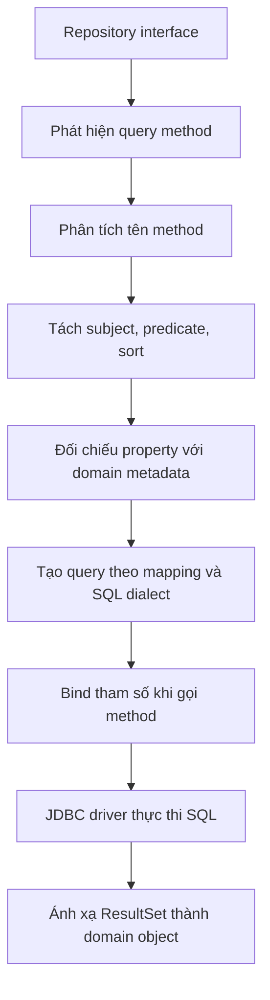

# Cấu trúc tên phương thức và cơ chế sinh truy vấn

## 1. Từ tên method Java đến câu SQL

Spring Data JDBC cho phép khai báo nhiều truy vấn ngay trên repository interface mà không cần tự viết câu SQL cho từng trường hợp đơn giản. Thay vì tạo implementation cho mỗi method, ta mô tả ý định truy vấn bằng **tên phương thức theo quy ước**:

```java
public interface CustomerRepository
        extends CrudRepository<Customer, Long> {

    List<Customer> findByLastName(String lastName);

    Optional<Customer> findByEmail(String email);

    List<Customer> findByStatusAndLastNameOrderByCreatedAtDesc(
            CustomerStatus status,
            String lastName
    );
}
```

Spring Data phân tích tên method, đối chiếu các phần trong tên với thuộc tính của domain type và tạo truy vấn phù hợp với mapping, dialect và kiểu dữ liệu. Khi gọi method, các tham số được bind vào câu SQL; ứng dụng không cần nối chuỗi giá trị đầu vào vào câu truy vấn.

Cơ chế này thường được gọi là **query derivation** hoặc **derived query**. Nó hữu ích với các điều kiện lọc và sắp xếp phổ biến, giúp repository gọn và dễ đọc. Khi truy vấn trở nên phức tạp, có nhiều phép JOIN, biểu thức SQL đặc thù hoặc yêu cầu tối ưu chi tiết, nên chuyển sang `@Query`, `JdbcTemplate` hoặc công cụ SQL chuyên dụng.

Trong bài này, ta sẽ tìm hiểu:

- Cấu trúc một tên method derived query.
- Cách parser tách subject, predicate, toán tử và `OrderBy`.
- Cách tên thuộc tính Java được ánh xạ thành cột SQL.
- Các keyword thường dùng và cách chọn kiểu trả về.
- Câu SQL được tạo và bind tham số như thế nào.
- Khi nào query derivation không còn phù hợp.

## 2. Cấu trúc tổng quát của tên phương thức

Một tên derived query thường có hai phần lớn, ngăn cách bởi từ khóa `By`:

```text
<Subject><By><Predicate><OrderBy><SortDirection>
```

Ví dụ:

```java
findTop10DistinctByStatusAndCreatedAtAfterOrderByCreatedAtDesc(...)
```

Có thể đọc theo từng phần:

| Phần | Ví dụ | Ý nghĩa |
| --- | --- | --- |
| Subject/prefix | `find` | Loại thao tác truy vấn |
| Modifier | `Top10Distinct` | Giới hạn kết quả và yêu cầu distinct |
| Delimiter | `By` | Bắt đầu điều kiện lọc |
| Predicate | `StatusAndCreatedAtAfter` | Điều kiện theo thuộc tính |
| Sort property | `CreatedAt` | Thuộc tính dùng để sắp xếp |
| Direction | `Desc` | Thứ tự giảm dần |

Tên method tương đương ý định SQL:

```sql
SELECT DISTINCT ...
FROM customers
WHERE status = ?
  AND created_at > ?
ORDER BY created_at DESC
LIMIT 10;
```

Đây là cách diễn giải khái niệm. SQL cụ thể phụ thuộc database dialect, cách giới hạn số dòng của database, tên bảng/cột và phiên bản Spring Data JDBC.

### 2.1. Subject: phần đứng trước `By`

Subject cho biết repository muốn đọc, đếm, kiểm tra hay xóa dữ liệu. Các prefix phổ biến trong query derivation của Spring Data gồm:

| Prefix | Ý nghĩa thường gặp |
| --- | --- |
| `find...By` | Tìm và trả về dữ liệu |
| `read...By` | Đọc dữ liệu |
| `get...By` | Lấy dữ liệu |
| `query...By` | Truy vấn dữ liệu |
| `search...By` | Truy vấn dữ liệu |
| `count...By` | Đếm số bản ghi phù hợp |
| `exists...By` | Kiểm tra có bản ghi phù hợp hay không |
| `delete...By` / `remove...By` | Xóa dữ liệu phù hợp, nếu phương thức và kiểu trả về được module hỗ trợ |

Trong thực tế, `find...By` là dạng dễ nhận biết và được dùng nhiều nhất. Không cần thay đổi prefix chỉ để tạo cảm giác đa dạng; hãy chọn tên thể hiện rõ ý định.

Ví dụ:

```java
List<Customer> findByStatus(CustomerStatus status);
long countByStatus(CustomerStatus status);
boolean existsByEmail(String email);
```

Các method trên vẫn là query method được suy diễn từ tên; chúng không phải những method CRUD kế thừa có sẵn.

### 2.2. Modifier: phần bổ sung trong subject

Một số modifier có thể xuất hiện trước `By`:

- `Distinct`: yêu cầu kết quả không trùng lặp theo semantics của truy vấn.
- `Top` hoặc `First`: giới hạn số kết quả.
- Có thể kèm số lượng, ví dụ `Top5`, `First10`.

Ví dụ:

```java
Optional<Customer> findFirstByStatusOrderByCreatedAtDesc(
        CustomerStatus status
);

List<Customer> findTop5ByStatusOrderByCreatedAtDesc(
        CustomerStatus status
);
```

Method thứ nhất lấy tối đa một kết quả đầu tiên theo thứ tự ngày tạo giảm dần. Method thứ hai lấy tối đa năm kết quả. Nếu cần kết quả xác định, hãy luôn chỉ rõ `OrderBy`; không dựa vào thứ tự tự nhiên của database.

### 2.3. `By`: ranh giới giữa thao tác và điều kiện

`By` là dấu mốc để parser nhận biết phần predicate. Ví dụ:

```java
findByEmail(String email)
```

`find` là subject; `Email` là property trong predicate.

Một số method dài có thể khó đọc:

```java
findTop10DistinctByStatusAndCreatedAtAfterOrderByCreatedAtDesc(...)
```

Nếu tên method bắt đầu chứa nhiều điều kiện và modifier, hãy cân nhắc đặt tên ngắn hơn hoặc dùng `@Query` để câu SQL thể hiện trực tiếp ý định.

## 3. Predicate: mô tả điều kiện lọc

Phần sau `By` được chia thành các điều kiện theo property. Các từ khóa `And`, `Or` kết hợp điều kiện:

```java
List<Customer> findByFirstNameAndLastName(
        String firstName,
        String lastName
);

List<Customer> findByStatusOrPriority(
        CustomerStatus status,
        Integer priority
);
```

Ý nghĩa tương đương:

```sql
WHERE first_name = ?
  AND last_name = ?

WHERE status = ?
   OR priority = ?
```

### 3.1. Kết hợp And và Or

Ví dụ:

```java
List<Customer> findByStatusAndCityOrPriority(
        CustomerStatus status,
        String city,
        Integer priority
);
```

Không nên dựa vào cách đọc tiếng Việt để tự suy luận nhóm điều kiện. Parser chia predicate thành các nhóm `Or` (mỗi nhóm có thể chứa nhiều phần `And`); ví dụ trên được hiểu về mặt logic là:

```sql
WHERE (status = ? AND city = ?)
   OR priority = ?
```

Tên method không cung cấp cú pháp ngoặc tùy ý như một biểu thức Boolean tổng quát. Với điều kiện phức tạp, nhiều nhánh lồng nhau hoặc yêu cầu ngoặc khác dự kiến, hãy dùng `@Query` để thể hiện rõ SQL.

## 4. Các keyword điều kiện thường dùng

Spring Data có một tập keyword chuẩn cho query derivation. Tập hỗ trợ cụ thể có thể khác nhau giữa các module và phiên bản; dưới đây là các nhóm thường gặp khi làm việc với repository quan hệ. Khi sử dụng một keyword ít phổ biến, đối chiếu tài liệu Spring Data Relational của phiên bản dự án và xác nhận câu SQL thực tế.

### 4.1. So sánh bằng và khác

| Keyword | Ví dụ method | Ý nghĩa |
| --- | --- | --- |
| Không ghi toán tử, hoặc `Is`, `Equals` | `findByStatus(status)` | Bằng |
| `Not` | `findByStatusNot(status)` | Khác |

Ví dụ:

```java
List<Customer> findByStatus(CustomerStatus status);
List<Customer> findByStatusNot(CustomerStatus status);
```

### 4.2. So sánh số và ngày

| Keyword | Ví dụ | Ý nghĩa |
| --- | --- | --- |
| `LessThan` | `findByAgeLessThan(int age)` | Nhỏ hơn |
| `LessThanEqual` | `findByAgeLessThanEqual(int age)` | Nhỏ hơn hoặc bằng |
| `GreaterThan` | `findByAgeGreaterThan(int age)` | Lớn hơn |
| `GreaterThanEqual` | `findByAgeGreaterThanEqual(int age)` | Lớn hơn hoặc bằng |
| `Between` | `findByCreatedAtBetween(a, b)` | Nằm trong khoảng |
| `Before` | `findByCreatedAtBefore(time)` | Trước thời điểm |
| `After` | `findByCreatedAtAfter(time)` | Sau thời điểm |

Ví dụ với ngày:

```java
List<Customer> findByCreatedAtAfter(LocalDateTime from);

List<Customer> findByCreatedAtBetween(
        LocalDateTime from,
        LocalDateTime to
);
```

Hãy xác định rõ biên bao gồm hay không bao gồm theo semantics của keyword và kiểu truy vấn. Nếu nghiệp vụ cần khoảng nửa mở `[start, end)`, viết SQL tường minh hoặc dùng hai điều kiện `GreaterThanEqual` và `LessThan` để tránh nhập nhằng.

### 4.3. Kiểm tra null

| Keyword | Ví dụ | Ý nghĩa |
| --- | --- | --- |
| `IsNull` / `Null` | `findByPhoneIsNull()` | Cột có giá trị NULL |
| `IsNotNull` / `NotNull` | `findByPhoneIsNotNull()` | Cột không phải NULL |

Ví dụ:

```java
List<Customer> findByPhoneIsNull();
List<Customer> findByPhoneIsNotNull();
```

Đây là cách biểu đạt rõ ràng khi muốn lọc theo null. Trong SQL, không dùng `= NULL`; điều kiện đúng là `IS NULL` hoặc `IS NOT NULL`.

### 4.4. Tìm kiếm chuỗi

| Keyword | Ví dụ | Ý nghĩa |
| --- | --- | --- |
| `Like` | `findByNameLike(pattern)` | So khớp mẫu SQL LIKE |
| `NotLike` | `findByNameNotLike(pattern)` | Không khớp mẫu |
| `StartingWith` | `findByNameStartingWith(prefix)` | Bắt đầu bằng chuỗi |
| `EndingWith` | `findByNameEndingWith(suffix)` | Kết thúc bằng chuỗi |
| `Containing` | `findByNameContaining(part)` | Có chứa chuỗi |
| `IgnoreCase` | `findByNameIgnoreCase(name)` | So sánh không phân biệt hoa thường, nếu kiểu/cơ sở dữ liệu hỗ trợ |

Ví dụ:

```java
List<Customer> findByNameStartingWith(String prefix);
List<Customer> findByNameContaining(String part);
List<Customer> findByNameIgnoreCase(String name);
```

`Like` thường cho phép truyền pattern có `%` và `_`. Các keyword `StartingWith`, `EndingWith`, `Containing` biểu diễn ý định cụ thể hơn và framework xây dựng pattern tương ứng.

Hiệu năng tìm kiếm chuỗi phụ thuộc database, collation và index. `Containing` thường tạo pattern có wildcard ở cả hai đầu (`%value%`), khiến index B-tree thông thường khó được tận dụng như truy vấn prefix. Với tìm kiếm toàn văn hoặc tìm kiếm gần đúng, cần giải pháp chuyên biệt.

### 4.5. Tìm trong tập giá trị

| Keyword | Ví dụ | Ý nghĩa |
| --- | --- | --- |
| `In` | `findByStatusIn(statuses)` | Giá trị nằm trong tập |
| `NotIn` | `findByStatusNotIn(statuses)` | Giá trị không nằm trong tập |

Ví dụ:

```java
List<Customer> findByStatusIn(
        Collection<CustomerStatus> statuses
);
```

Tham số có thể là collection các giá trị phù hợp với kiểu property. Cần quy định rõ hành vi khi collection rỗng; không tự giả định mọi database hoặc mọi phiên bản đều tạo cùng một câu SQL cho danh sách rỗng.

### 4.6. Boolean

| Keyword | Ví dụ | Ý nghĩa |
| --- | --- | --- |
| `True` | `findByActiveTrue()` | Cột boolean đúng |
| `False` | `findByActiveFalse()` | Cột boolean sai |

Ví dụ:

```java
List<Customer> findByActiveTrue();
List<Customer> findByActiveFalse();
```

## 5. Kết hợp điều kiện và sắp xếp

Một method có thể kết hợp nhiều property:

```java
List<Customer> findByStatusAndCityOrderByCreatedAtDesc(
        CustomerStatus status,
        String city
);
```

Phần `OrderByCreatedAtDesc` chỉ định thứ tự giảm dần theo thuộc tính `createdAt`. Để sắp xếp tăng dần, dùng `Asc`:

```java
List<Customer> findByStatusOrderByLastNameAscFirstNameAsc(
        CustomerStatus status
);
```

Có thể sắp xếp theo nhiều thuộc tính; thứ tự các thuộc tính trong tên method là thứ tự ưu tiên của `ORDER BY`.

### 5.1. Sắp xếp động bằng Sort

Khi caller cần chọn thứ tự lúc chạy, Spring Data JDBC hỗ trợ dùng `Sort` trong các query method phù hợp:

```java
import org.springframework.data.domain.Sort;

List<Customer> findByStatus(
        CustomerStatus status,
        Sort sort
);
```

Gọi:

```java
List<Customer> result = repository.findByStatus(
        CustomerStatus.ACTIVE,
        Sort.by(
                Sort.Order.desc("createdAt"),
                Sort.Order.asc("lastName")
        )
);
```

Tên thuộc tính trong `Sort` là property của domain model, không nhất thiết là tên cột SQL. Kiểm tra khả năng và cú pháp sorting theo phiên bản Spring Data JDBC đang sử dụng. Không nhận trực tiếp chuỗi tên cột tùy ý từ client rồi đưa vào Sort mà không giới hạn danh sách property được phép; tên cột/order không phải bind parameter như giá trị lọc.

## 6. Property name trong Java và tên cột SQL

Derived query được xây dựng dựa trên **tên thuộc tính của domain type**, không phải tên cột SQL tùy ý.

Ví dụ:

```java
@Table("customers")
public record Customer(
        @Id Long id,
        @Column("first_name") String firstName,
        @Column("last_name") String lastName,
        String email
) {
}
```

Repository:

```java
List<Customer> findByLastName(String lastName);
```

Tên method dùng `LastName`, là thuộc tính Java. Spring Data mapping metadata biết thuộc tính đó được ánh xạ tới cột `last_name`, vì vậy query được tạo dựa trên mapping đã khai báo.

Không viết:

```java
// Sai ý nghĩa query derivation nếu domain không có property last_name:
List<Customer> findByLast_name(String value);
```

Tên cột SQL được xử lý bởi `@Column`/naming strategy, còn tên method phải tham chiếu property Java.

### 6.1. Property path lồng nhau

Spring Data Commons hỗ trợ phân tích property path qua tên camel case. Ví dụ với một value object được mapping phù hợp:

```java
findByAddressZipCode(String zipCode)
```

Parser có thể tách thành đường dẫn `address.zipCode` nếu model có các thuộc tính tương ứng và mapping/dialect hỗ trợ biểu diễn chúng.

Khi có tên property mơ hồ, dấu gạch dưới có thể dùng làm dấu phân tách rõ path:

```java
findByAddress_ZipCode(String zipCode)
```

Đừng hiểu property traversal là Spring Data JDBC tự sinh mọi JOIN qua quan hệ aggregate. Spring Data JDBC tập trung vào aggregate mapping và không cung cấp cơ chế association/lazy-loading giống JPA. Với truy vấn qua nhiều bảng hoặc reference tới aggregate khác, hãy kiểm tra SQL được hỗ trợ và thường nên dùng `@Query` với JOIN tường minh.

### 6.2. Tên method CRUD được dành riêng

Một số method kế thừa từ `CrudRepository`, như `findById`, `existsById` và `deleteById`, có ý nghĩa đặc biệt: chúng thao tác theo thuộc tính được đánh dấu `@Id`.

Nếu domain có một thuộc tính bình thường tên `id` nhưng khóa chính thực tế là `pk`, method `findById(...)` vẫn là method CRUD dành riêng để tìm theo ID của entity. Nếu muốn truy vấn property `id` thông thường, dùng một tên method có token mô tả ở giữa, ví dụ:

```java
Optional<Customer> findCustomerById(String businessId);
```

Tên `findCustomerById` không trùng chữ ký dành riêng `findById` của repository cơ sở; parser có thể hiểu `Id` phía sau token `Customer` là property predicate. Hãy chọn tên rõ ràng và kiểm tra domain metadata để tránh nhầm khóa chính với mã nghiệp vụ.

## 7. Cách Spring Data tạo truy vấn

Ở mức khái niệm, quy trình có thể mô tả như sau:



Các bước chính:

1. **Repository discovery:** Spring Data tìm các interface repository trong phạm vi cấu hình.
2. **Query method discovery:** các method không phải CRUD có thể được nhận diện là derived query hoặc được xử lý theo annotation/configuration.
3. **Parsing:** tên method được phân tích thành subject, điều kiện, toán tử và sắp xếp.
4. **Property resolution:** tên thuộc tính được đối chiếu với domain model; property không tồn tại có thể khiến repository khởi tạo thất bại.
5. **SQL generation:** Spring Data JDBC dùng mapping metadata và dialect để tạo câu SQL phù hợp.
6. **Parameter binding:** giá trị tham số được bind qua JDBC, tách khỏi cấu trúc câu SQL.
7. **Execution and mapping:** JDBC driver chạy truy vấn; kết quả được chuyển thành kiểu trả về của repository.

Điều này giải thích vì sao lỗi chính tả trong property name thường xuất hiện ngay lúc ứng dụng khởi tạo repository, thay vì đợi đến khi có dữ liệu phù hợp. Tên method không được coi là một chuỗi SQL tự do.

## 8. SQL sinh ra và bind parameter

Ví dụ:

```java
List<Customer> findByStatusAndLastNameOrderByCreatedAtDesc(
        CustomerStatus status,
        String lastName
);
```

Ý định SQL:

```sql
SELECT ...
FROM customers
WHERE status = ?
  AND last_name = ?
ORDER BY created_at DESC;
```

Khi gọi:

```java
repository.findByStatusAndLastNameOrderByCreatedAtDesc(
        CustomerStatus.ACTIVE,
        "Nguyen"
);
```

Giá trị `ACTIVE` và `Nguyen` được bind thành tham số cho câu lệnh JDBC. Framework không cần nối chúng trực tiếp vào SQL:

```text
SQL template:
  WHERE status = ? AND last_name = ?

Parameters:
  1 -> ACTIVE
  2 -> Nguyen
```

Bind parameter giúp tách dữ liệu đầu vào khỏi cú pháp SQL, giảm rủi ro SQL injection đối với **giá trị**. Nó không áp dụng cho tên bảng, tên cột hoặc hướng sắp xếp; những thành phần cấu trúc này phải được kiểm soát bởi mapping và danh sách lựa chọn hợp lệ.

### Tại sao SQL không giống hệt ở mọi database?

Dialect có thể ảnh hưởng:

- Cách quote identifier.
- Cách giới hạn kết quả `Top`/`First`.
- Cú pháp boolean và kiểu dữ liệu.
- Cách biểu diễn `LIKE`, case-insensitive hoặc các biểu thức đặc thù.
- Cách bind và chuyển đổi một số kiểu Java.

Vì vậy, câu SQL ở bài học là hình dạng minh họa. Khi cần xác nhận, bật log `org.springframework.jdbc` ở mức DEBUG hoặc dùng công cụ quan sát SQL trong môi trường phát triển.

## 9. Kiểu trả về ảnh hưởng cách dùng method

Chọn kiểu trả về theo số lượng kết quả mong đợi:

| Kiểu trả về | Cách dùng |
| --- | --- |
| `Optional<Customer>` | Mong đợi không hoặc một kết quả; nếu có nhiều hơn một hàng, framework báo lỗi cardinality thay vì âm thầm chọn một hàng. |
| `Customer` | Mong đợi đúng một kết quả; trường hợp không có hoặc có nhiều kết quả cần được xử lý theo semantics của repository. |
| `List<Customer>` | Không hoặc nhiều kết quả. |
| `Iterable<Customer>` | Tập kết quả có thể duyệt. |
| `long` | Thường dùng cho `count...By`. |
| `boolean` | Thường dùng cho `exists...By`. |

Ví dụ:

```java
Optional<Customer> findByEmail(String email);
List<Customer> findByStatus(CustomerStatus status);
long countByStatus(CustomerStatus status);
boolean existsByEmail(String email);
```

Nếu email được bảo đảm unique bởi database và nghiệp vụ, `Optional<Customer>` là một lựa chọn rõ ràng. Nhưng nếu database không có unique constraint, method có thể phát hiện dữ liệu trùng bằng lỗi kết quả không duy nhất. Không dùng `Optional` chỉ vì muốn lấy “một kết quả bất kỳ”.

### Giới hạn kết quả bằng First/Top

```java
Optional<Customer> findFirstByStatusOrderByCreatedAtDesc(
        CustomerStatus status
);

List<Customer> findTop10ByStatusOrderByCreatedAtDescIdAsc(
        CustomerStatus status
);
```

`First`/`Top` biểu diễn giới hạn số kết quả. Để kết quả lặp lại ổn định khi nhiều hàng có cùng `createdAt`, thêm một tiêu chí phụ như ID vào thứ tự:

```java
List<Customer> findTop10ByStatusOrderByCreatedAtDescIdAsc(
        CustomerStatus status
);
```

Thứ tự phụ giúp tránh kết quả thay đổi không xác định giữa các lần chạy khi timestamp trùng nhau.

## 10. Ví dụ repository hoàn chỉnh

Model:

```java
package com.example.customer;

import java.time.LocalDateTime;
import org.springframework.data.annotation.Id;
import org.springframework.data.relational.core.mapping.Column;
import org.springframework.data.relational.core.mapping.Table;

@Table("customers")
public record Customer(
        @Id Long id,
        @Column("first_name") String firstName,
        @Column("last_name") String lastName,
        String email,
        CustomerStatus status,
        @Column("created_at") LocalDateTime createdAt
) {
}
```

Enum:

```java
package com.example.customer;

public enum CustomerStatus {
    ACTIVE,
    INACTIVE,
    BLOCKED
}
```

Repository:

```java
package com.example.customer;

import java.time.LocalDateTime;
import java.util.List;
import java.util.Optional;

import org.springframework.data.domain.Sort;
import org.springframework.data.repository.CrudRepository;

public interface CustomerRepository
        extends CrudRepository<Customer, Long> {

    List<Customer> findByLastName(String lastName);

    Optional<Customer> findByEmail(String email);

    List<Customer> findByStatusAndLastNameOrderByCreatedAtDesc(
            CustomerStatus status,
            String lastName
    );

    List<Customer> findByCreatedAtBetween(
            LocalDateTime from,
            LocalDateTime to
    );

    List<Customer> findByFirstNameStartingWith(String prefix);

    List<Customer> findByStatusIn(List<CustomerStatus> statuses);

    List<Customer> findTop5ByStatusOrderByCreatedAtDescIdAsc(
            CustomerStatus status
    );

    long countByStatus(CustomerStatus status);

    boolean existsByEmail(String email);

    List<Customer> findByStatus(CustomerStatus status, Sort sort);
}
```

Các method trên minh họa các dạng derived query thường gặp. Khi thêm method mới, Spring Data cần resolve được tất cả property và keyword. Nếu một kiểu trả về hoặc keyword không được module/phiên bản đang dùng hỗ trợ, repository có thể không khởi tạo được hoặc query không có semantics mong muốn; hãy kiểm tra tài liệu và integration test trên database đích.

## 11. Khi nào nên dùng @Query?

Query derivation phù hợp khi tên method vẫn diễn đạt được ý định một cách ngắn gọn. Chuyển sang `@Query` khi:

- Có JOIN giữa nhiều bảng hoặc truy vấn vượt ranh giới aggregate.
- Có biểu thức SQL, CTE, window function, subquery hoặc hàm database đặc thù.
- Predicate có nhiều nhánh Boolean cần ngoặc rõ ràng.
- Cần kiểm soát chính xác projection, thứ tự, grouping hoặc tối ưu SQL.
- Tên method dài tới mức khó hiểu hơn câu SQL.

Ví dụ:

```java
package com.example.customer;

import java.time.LocalDateTime;
import java.util.List;

import org.springframework.data.jdbc.repository.query.Query;
import org.springframework.data.repository.query.Param;
import org.springframework.data.repository.CrudRepository;

public interface CustomerRepository
        extends CrudRepository<Customer, Long> {

    @Query("""
        SELECT *
        FROM customers
        WHERE status = :status
          AND created_at >= :fromTime
        ORDER BY created_at DESC, id ASC
        """)
    List<Customer> findRecentByStatus(
            @Param("status") CustomerStatus status,
            @Param("fromTime") LocalDateTime fromTime
    );
}
```

Ví dụ này minh họa named parameter trong SQL query. Tên bảng/cột phải khớp schema thật; kiểu trả về phải ánh xạ được từ các cột được chọn.

### 11.1. DML tùy chỉnh

Với một câu lệnh cập nhật trực tiếp, Spring Data JDBC hỗ trợ `@Modifying` cùng `@Query`:

```java
@Modifying
@Query("""
    UPDATE customers
    SET status = :status
    WHERE id = :id
    """)
int updateStatus(
        @Param("id") Long id,
        @Param("status") CustomerStatus status
);
```

Kiểu trả về số hàng bị ảnh hưởng giúp caller biết có bản ghi nào được cập nhật hay không. Câu lệnh DML trực tiếp có thể bỏ qua hành vi aggregate, validation trong domain model hoặc quy trình audit do ứng dụng thiết kế. Chỉ dùng khi thao tác SQL trực tiếp phù hợp với quy tắc nghiệp vụ và transaction.

## 12. Giới hạn và lưu ý khi dùng query derivation

### 12.1. Tên method có thể quá dài

Ví dụ:

```java
findByStatusAndRegionAndCreatedAtBetweenAndEmailEndingWith(...)
```

Nếu tên method trở thành một câu mô tả khó đọc, hãy dùng `@Query` với SQL rõ ràng hoặc tách use case thành những phương thức nhỏ hơn.

### 12.2. Derived query không tự tạo mọi JOIN

Spring Data JDBC có mô hình aggregate và mapping quan hệ khác JPA. Việc parser nhận ra property path không có nghĩa nó sẽ tự tạo mọi JOIN qua các aggregate reference. Khi truy vấn cần dữ liệu từ nhiều bảng, hãy kiểm tra khả năng hỗ trợ cụ thể; thường `@Query` với JOIN tường minh hoặc một công cụ SQL phù hợp dễ dự đoán hơn.

### 12.3. Tên property sai sẽ làm repository lỗi

Nếu entity có `lastName` nhưng method viết `findByLastname` hoặc `findByLastNmae`, parser có thể không resolve được property. Lỗi thường xuất hiện khi repository được khởi tạo. Dùng đúng tên Java property, không đoán từ tên cột SQL.

### 12.4. Null và ba trạng thái Boolean

Một cột nullable có thể có ba trạng thái: true, false, null. `findByActiveTrue()` và `findByActiveFalse()` không đồng nghĩa với việc bao phủ toàn bộ dữ liệu nếu có null. Nếu nghiệp vụ phân biệt “chưa xác định”, hãy truy vấn null rõ ràng.

### 12.5. IgnoreCase và collation

Không giả định so sánh không phân biệt hoa thường giống nhau trên mọi database, locale và collation. Kiểm tra SQL được sinh và quy tắc collation thực tế; với dữ liệu đa ngôn ngữ, chữ hoa/chữ thường có thể phức tạp hơn ASCII.

### 12.6. Limit và sort phải có tính xác định

`Top` hoặc `First` mà không có `OrderBy` không đảm bảo chọn cùng bản ghi giữa các lần chạy. Nếu thứ tự quan trọng, khai báo một hoặc nhiều tiêu chí sắp xếp, thường có thêm khóa duy nhất làm tiêu chí cuối.

### 12.7. Derived delete và bulk update cần hiểu tác động

Phương thức `deleteBy...` hoặc SQL `@Modifying` có thể tạo thao tác ghi trực tiếp. Với aggregate có quan hệ sở hữu hoặc domain invariant, phải cân nhắc liệu xóa trực tiếp có bỏ qua quy tắc cần bảo vệ hay không. Không dùng bulk DML thay cho hành vi miền nếu việc xóa cần kiểm tra trạng thái, cascade nghiệp vụ hoặc phát sự kiện.

## 13. Quy trình đọc và thiết kế một method

Khi gặp một method chưa quen, hãy đọc theo thứ tự:

1. **Tìm subject:** method đang tìm, đếm, kiểm tra hay xóa?
2. **Tìm `By`:** phần sau nó là điều kiện nào?
3. **Tách property:** mỗi token camel case tham chiếu property Java nào?
4. **Nhận diện keyword:** `Between`, `IsNull`, `Containing`, `In`, `GreaterThan`...?
5. **Tách `And`/`Or`:** các điều kiện được nhóm ra sao?
6. **Đọc sort:** có `OrderBy`, property nào và hướng nào?
7. **Đối chiếu tham số:** số lượng, thứ tự và kiểu Java có khớp các predicate không?
8. **Đọc kiểu trả về:** một kết quả, nhiều kết quả, count hay exists?
9. **Xem mapping và SQL:** property có `@Column` không, dialect tạo câu SQL gì?
10. **Đánh giá độ phức tạp:** nếu tên method khó hiểu, chuyển sang `@Query`.

Ví dụ:

```java
List<Customer> findTop10ByStatusAndCreatedAtAfterOrderByCreatedAtDesc(
        CustomerStatus status,
        LocalDateTime from
);
```

Đọc thành câu:

> Tìm tối đa 10 Customer có status bằng giá trị truyền vào và createdAt sau thời điểm from, sắp xếp createdAt giảm dần.

Đây là cách kiểm tra nhanh xem tên method có khớp use case hay không.

## 14. Kiểm thử derived query

Đừng chỉ kiểm tra ứng dụng khởi động được. Một integration test với database phù hợp giúp xác nhận parser, mapping và SQL thực tế:

```java
@DataJdbcTest
class CustomerRepositoryTest {

    @Autowired
    CustomerRepository repository;

    @Test
    void findsActiveCustomersByLastName() {
        repository.save(new Customer(
                null,
                "Lan",
                "Nguyen",
                "lan@example.test",
                CustomerStatus.ACTIVE,
                LocalDateTime.parse("2026-01-01T10:00:00")
        ));

        List<Customer> result =
                repository.findByStatusAndLastNameOrderByCreatedAtDesc(
                        CustomerStatus.ACTIVE,
                        "Nguyen"
                );

        assertThat(result).hasSize(1);
        assertThat(result.get(0).firstName()).isEqualTo("Lan");
    }
}
```

Đây là skeleton minh họa; test cần schema và dependency test phù hợp trong dự án. Nên có thêm dữ liệu không khớp để xác nhận điều kiện lọc thực sự hoạt động, kiểm tra sắp xếp với nhiều hàng và kiểm tra trường hợp không có kết quả.

Nếu production dùng PostgreSQL, nên có test tích hợp trên PostgreSQL cho những truy vấn phụ thuộc dialect/collation/kiểu dữ liệu. H2 không thể chứng minh mọi câu SQL hoặc semantics giống hệt database production.

## 15. Bài tập tự thực hành

**Bài tập 1 — Predicate cơ bản.** Tạo `findByStatus`, `findByLastName` và `findByEmail`. Dự đoán SQL tương ứng và kiểm tra bằng log JDBC.

**Bài tập 2 — And và Or.** Tạo `findByStatusAndCityOrPriority`. Viết lại biểu thức Boolean theo cách parser nhóm điều kiện. Sau đó dùng `@Query` với ngoặc tường minh và so sánh.

**Bài tập 3 — Keyword.** Thử `Between`, `GreaterThanEqual`, `IsNull`, `StartingWith`, `Containing`, `In` và `IgnoreCase`. Kiểm tra cả trường hợp biên và database đích.

**Bài tập 4 — Sort và Top.** Viết `findTop5ByStatusOrderByCreatedAtDescIdAsc`. Tạo nhiều hàng có cùng timestamp để kiểm tra vai trò của tiêu chí sắp xếp phụ.

**Bài tập 5 — Property mapping.** Đổi property Java thành `lastName` và cột SQL thành `last_name` bằng `@Column`. Xác nhận method vẫn phải dùng `findByLastName`.

**Bài tập 6 — Reserved method.** Tạo entity có khóa chính `pk` và property nghiệp vụ `id`. So sánh `findById(...)` với `findCustomerById(...)` và xác định method nào tra theo khóa chính.

**Bài tập 7 — Chuyển sang @Query.** Viết một truy vấn JOIN hai bảng. Giải thích vì sao tên method derivation không còn là cách biểu đạt phù hợp.

## 16. Ghi nhớ

Tên method derived query của Spring Data JDBC thường gồm **subject + `By` + predicate + `OrderBy`**. Subject mô tả loại thao tác và modifier như `Top`, `First`, `Distinct`; predicate tham chiếu property Java và kết hợp điều kiện bằng `And`/`Or`; phần sắp xếp nêu property cùng hướng `Asc`/`Desc`.

Spring Data phân tích tên method, resolve property qua mapping metadata, tạo SQL theo dialect rồi bind giá trị tham số qua JDBC. Vì thế, method phải dùng đúng tên property Java, còn tên cột SQL được xử lý bởi mapping. Derived query phù hợp với điều kiện phổ biến; truy vấn nhiều bảng, logic Boolean phức tạp hoặc SQL đặc thù nên được thể hiện bằng `@Query` hay công cụ SQL chuyên dụng.

Khi thiết kế repository, ưu tiên tên method đủ ngắn để người đọc hiểu ngay điều kiện và kết quả. Nếu phải giải mã một tên method dài như một câu đố, đó là tín hiệu nên viết truy vấn tường minh hơn.

### Tài liệu tham khảo

- [Spring Data Relational – Query Methods](https://docs.spring.io/spring-data/relational/reference/jdbc/query-methods.html)
- [Spring Data Commons – Query Methods](https://docs.spring.io/spring-data/commons/reference/repositories/query-methods-details.html)
- [Spring Data Relational – JDBC Repositories](https://docs.spring.io/spring-data/relational/reference/jdbc/repositories.html)
