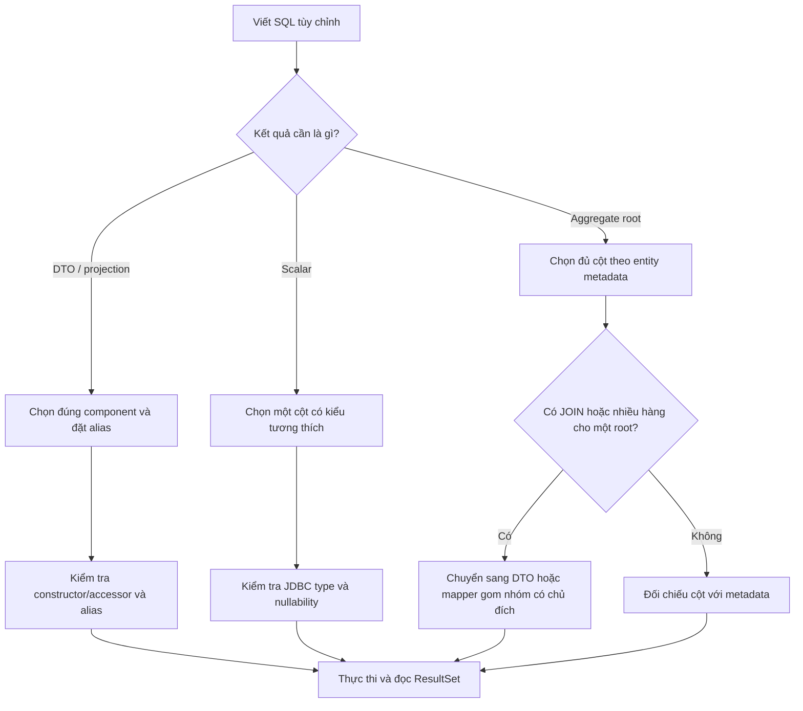

# Chọn cột, alias và dữ liệu bắt buộc để ánh xạ kết quả

Trong **Spring Data JDBC**, một câu SQL tùy chỉnh không chỉ cần chạy đúng ở database. Kết quả trả về còn phải có đủ thông tin và tên cột phù hợp để Spring Data chuyển từng hàng của `ResultSet` thành kiểu Java mà repository khai báo. Vì vậy, khi viết `@Query`, cần thiết kế đồng thời ba phần: **kiểu kết quả**, **danh sách cột/alias**, và **quy tắc chuyển đổi dữ liệu**.

Một truy vấn trả về aggregate root cần các cột persistent mà entity yêu cầu. Một truy vấn phục vụ màn hình báo cáo có thể chỉ cần vài cột, khi đó DTO/projection phù hợp hơn. Với `JOIN` hoặc biểu thức tính toán, alias giúp đặt tên cột kết quả ổn định và tránh trùng tên. Các cột nullable, kiểu SQL và constructor của record cũng phải tương thích với dữ liệu thực tế.

## 1. SQL chạy được chưa đủ để ánh xạ được

Giả sử database có bảng `customers`:

```sql
CREATE TABLE customers (
    id BIGINT GENERATED BY DEFAULT AS IDENTITY PRIMARY KEY,
    display_name VARCHAR(150) NOT NULL,
    email VARCHAR(200) NOT NULL,
    active BOOLEAN NOT NULL
);
```

Entity Java:

```java
import org.springframework.data.annotation.Id;
import org.springframework.data.relational.core.mapping.Column;
import org.springframework.data.relational.core.mapping.Table;

@Table("customers")
public record Customer(
        @Id Long id,
        @Column("display_name") String name,
        String email,
        boolean active
) {}
```

Repository có thể khai báo một truy vấn SQL tường minh:

```java
import java.util.Optional;
import org.springframework.data.jdbc.repository.query.Query;
import org.springframework.data.repository.CrudRepository;
import org.springframework.data.repository.query.Param;

public interface CustomerRepository extends CrudRepository<Customer, Long> {

    @Query("""
        SELECT id, display_name, email, active
        FROM customers
        WHERE id = :id
        """)
    Optional<Customer> findCustomerRow(@Param("id") Long id);
}
```

Ở đây câu SQL phải trả về các cột cần để dựng `Customer`: `id`, `display_name`, `email`, `active`. Metadata `@Column("display_name")` cho Spring Data biết property `name` tương ứng cột vật lý `display_name`.

Một câu SQL có thể hợp lệ với database nhưng không phù hợp với kiểu trả về. Ví dụ, `SELECT id, display_name FROM customers` có thể chạy bình thường, nhưng nó không cung cấp `email` và `active` để dựng đầy đủ `Customer`. Nếu kết quả cần là `Customer`, hãy chọn đủ dữ liệu theo mapping; nếu use case chỉ cần ID và tên, hãy khai báo một projection/DTO biểu diễn đúng hai giá trị đó.

## 2. Chọn kiểu kết quả trước khi viết danh sách cột

Trước tiên hãy xác định repository method cần trả về điều gì:

| Kiểu kết quả | Khi nào phù hợp? | Cột cần trả về |
|---|---|---|
| Aggregate root (`Customer`) | Use case cần làm việc tiếp với aggregate và hành vi domain | Các cột persistent cần thiết để ánh xạ root theo metadata |
| `Optional<Customer>` | Một root có thể không tồn tại | Như trên; không có hàng thì `Optional.empty()` |
| DTO/record projection | Màn hình hoặc báo cáo chỉ cần một tập dữ liệu đọc | Các cột tương ứng với các thành phần DTO |
| Interface projection | Chỉ cần một số thuộc tính qua accessor được hỗ trợ | Alias/cột phải khớp thuộc tính projection |
| Giá trị đơn giản (`Long`, `String`, `boolean`...) | Truy vấn trả một giá trị như count hoặc existence | Một cột tương thích với kiểu kết quả |
| Collection các kết quả | Cần nhiều hàng | Mỗi hàng phải ánh xạ được thành kiểu phần tử |

Không nên chọn `Customer` chỉ vì bảng nguồn là `customers`. Nếu câu query là thống kê tổng hợp, kết quả thực chất có thể không phải một aggregate `Customer`. Dùng DTO để mô tả dữ liệu trả về sẽ rõ nghĩa hơn và tránh giả vờ rằng một hàng báo cáo là một entity đầy đủ.

## 3. Khi trả về entity, chọn các cột theo metadata của entity

Với entity:

```java
@Table("customers")
public record Customer(
        @Id Long id,
        @Column("display_name") String name,
        String email,
        boolean active
) {}
```

Truy vấn đọc entity nên lấy đủ cột:

```sql
SELECT id, display_name, email, active
FROM customers
WHERE active = TRUE;
```

Các nguyên tắc:

- **Khóa chính**: `id` cần có để xác định aggregate root.
- **Property persistent**: các thuộc tính cần để dựng entity phải được trả về với cột phù hợp.
- **Tên cột**: dùng tên vật lý trong database; `@Column` và naming strategy xác định cách property Java được ánh xạ.
- **Kiểu dữ liệu**: kiểu SQL phải chuyển được sang kiểu Java hoặc converter đã đăng ký.
- **Nullability**: cột có thể `NULL` phải tương thích với kiểu property và constructor.

Với custom query, tránh chọn thiếu cột chỉ vì một màn hình hiện tại chưa hiển thị chúng. Nếu kiểu trả về là aggregate root, mục tiêu là dựng aggregate đúng metadata, không chỉ dựng một phần dữ liệu nhìn thấy trên giao diện.

`SELECT *` có thể tiện khi bảng nhỏ, nhưng danh sách cột tường minh giúp người đọc biết query phụ thuộc vào những trường nào, tránh lấy dư cột và làm thay đổi schema dễ phát hiện hơn. Khi thêm cột mới vào bảng, query chọn tường minh không tự động thay đổi; điều này thường giúp hợp đồng đọc ổn định hơn.

## 4. Alias là tên của cột trong kết quả truy vấn

Alias (`AS`) đặt tên cho một cột trong `ResultSet`. Alias không đổi tên cột vật lý trong bảng và cũng không thực hiện migration.

Ví dụ:

```sql
SELECT display_name AS name
FROM customers;
```

Database vẫn đọc cột `display_name`; nhãn cột trong kết quả được đặt thành `name`. Điều này hữu ích khi:

- Dùng biểu thức tính toán (`COUNT`, `SUM`, `CASE`, phép nối chuỗi...).
- Có nhiều bảng trong `JOIN` và trùng tên cột như `id`, `name`, `created_at`.
- Trả DTO có tên property khác tên cột vật lý.
- Muốn kết quả truy vấn có tên rõ ràng, ổn định.

### Alias khi ánh xạ về entity

Với entity có `@Column("display_name")`, cách trực tiếp là trả về đúng tên cột `display_name`:

```sql
SELECT id, display_name, email, active
FROM customers;
```

Nếu alias cột, alias phải phù hợp với metadata mà mapping đang dùng. Ví dụ `display_name AS name` chỉ hợp lệ khi nhãn kết quả `name` được ánh xạ đúng với property đích theo metadata/cấu hình của phiên bản đang dùng. Không nên tự ý alias mọi cột sang tên property Java rồi giả định mapping luôn hiểu được.

Quy tắc an toàn là **giữ tên cột vật lý tương ứng với metadata khi trả entity**, trừ khi có lý do rõ ràng và đã xác nhận cách alias được ánh xạ.

### Alias khi ánh xạ DTO

Với DTO/projection, thiết kế alias theo tên thuộc tính của kiểu kết quả. Ví dụ DTO dùng các property đơn giản:

```java
public record CustomerSummary(Long id, String name, String email) {}
```

Query:

```java
@Query("""
    SELECT id AS id,
           display_name AS name,
           email AS email
    FROM customers
    WHERE active = TRUE
    ORDER BY display_name
    """)
List<CustomerSummary> findActiveSummaries();
```

Ở đây các alias `id`, `name`, `email` khớp với các thành phần của `CustomerSummary`. Việc dùng tên đơn giản giúp kết quả dễ đọc và tránh sự khác biệt về quy tắc chữ hoa/chữ thường giữa các database. Với property phức hợp hoặc alias camelCase, cần chú ý cách DBMS chuẩn hóa identifier không đặt trong dấu quote và cách converter đọc column label.

## 5. Dữ liệu bắt buộc của constructor/record

Spring Data JDBC dùng metadata và cơ chế khởi tạo entity/DTO để chuyển hàng kết quả thành object. Với Java `record`, các component là dữ liệu constructor cần cung cấp.

Ví dụ:

```java
public record CustomerSummary(Long id, String name, String email) {}
```

Khi trả `CustomerSummary`, query phải cung cấp dữ liệu cho các component tương ứng:

```sql
SELECT id AS id,
       display_name AS name,
       email AS email
FROM customers;
```

Nếu query chỉ chọn `id` và `name`, nó không đáp ứng đầy đủ hợp đồng của record có thêm `email`. Tùy kiểu mapping, trường thiếu có thể khiến việc ánh xạ thất bại, constructor nhận giá trị không mong muốn hoặc tạo ra dữ liệu null/default không phù hợp. Không nên dựa vào hành vi ngầm này; hãy chọn đủ cột hoặc tạo một DTO nhỏ hơn với đúng các thành phần cần thiết.

Ví dụ DTO chỉ cần ID và tên:

```java
public record CustomerName(Long id, String name) {}
```

```sql
SELECT id AS id, display_name AS name
FROM customers;
```

Đây là cách thể hiện đúng mục tiêu của truy vấn thay vì trả về `Customer` chưa đầy đủ.

## 6. Kiểu Java, kiểu SQL và nullability phải tương thích

Danh sách cột đúng tên vẫn chưa đủ nếu giá trị không chuyển được sang kiểu Java. Cần đối chiếu kiểu SQL, converter và nullability.

| Kiểu SQL thường gặp | Kiểu Java thường dùng | Điểm cần chú ý |
|---|---|---|
| `BIGINT` | `Long` / `long` | `NULL` phù hợp với `Long`; primitive `long` không biểu diễn null |
| `INTEGER` | `Integer` / `int` | Dùng wrapper nếu cột có thể null |
| `VARCHAR` | `String` | Kiểm tra độ dài và giá trị null |
| `BOOLEAN` | `Boolean` / `boolean` | Primitive không biểu diễn được trạng thái chưa xác định |
| `DECIMAL(p,s)` | `BigDecimal` | Chú ý precision, scale và làm tròn |
| `DATE` | `LocalDate` | Chỉ biểu diễn ngày, không có giờ |
| `TIMESTAMP` | `LocalDateTime` hoặc kiểu thời gian phù hợp | Phân biệt thời gian địa phương và thời điểm có timezone |
| `UUID`/chuỗi UUID | `UUID` hoặc `String` | Hỗ trợ cụ thể tùy database/driver/converter |

Ví dụ query:

```sql
SELECT id, display_name, active
FROM customers
WHERE id = ?;
```

Nếu `active` trong database có thể `NULL`, entity dùng `boolean active` không thể biểu diễn trạng thái đó một cách chính xác. Có thể đổi thành `Boolean`, hoặc sửa DDL thành `NOT NULL` nếu nghiệp vụ yêu cầu giá trị luôn xác định.

Tương tự, `COUNT(*)` thường trả giá trị số nguyên lớn; nên dùng `Long`/`long` cho kết quả count thay vì giả định mọi tập dữ liệu đều vừa `Integer`.

## 7. Ví dụ `JOIN`: alias để tránh trùng tên cột

Giả sử cần báo cáo số đơn hàng của từng khách hàng. Schema có hai bảng:

```sql
CREATE TABLE customers (
    id BIGINT PRIMARY KEY,
    display_name VARCHAR(150) NOT NULL,
    email VARCHAR(200) NOT NULL
);

CREATE TABLE orders (
    id BIGINT PRIMARY KEY,
    customer_id BIGINT NOT NULL,
    total_amount DECIMAL(18, 2) NOT NULL,
    CONSTRAINT fk_orders_customer
        FOREIGN KEY (customer_id) REFERENCES customers(id)
);
```

Cả hai bảng đều có cột `id`. Nếu query trả `SELECT *`, kết quả có hai cột cùng tên `id`; mapping theo column label có thể trở nên mơ hồ hoặc không đúng ý định.

Thay vào đó, dùng alias rõ ràng và trả DTO:

```java
public record CustomerOrderStats(Long id, String name, Long orders) {}
```

```java
@Query("""
    SELECT c.id AS id,
           c.display_name AS name,
           COUNT(o.id) AS orders
    FROM customers c
    LEFT JOIN orders o ON o.customer_id = c.id
    GROUP BY c.id, c.display_name
    ORDER BY c.id
    """)
List<CustomerOrderStats> findOrderStats();
```

Các alias có vai trò:

- `c.id AS id`: ID của khách hàng, không nhầm với `o.id`.
- `c.display_name AS name`: tên hiển thị của khách hàng.
- `COUNT(o.id) AS orders`: số đơn, với alias khớp component `orders`.

`LEFT JOIN` giữ cả khách hàng chưa có đơn; `COUNT(o.id)` trả `0` cho khách không có hàng orders tương ứng. Nếu dùng `COUNT(*)`, hàng được tạo bởi `LEFT JOIN` vẫn tồn tại và kết quả có thể là `1`, không phải `0`.

Vì kết quả là dữ liệu tổng hợp từ hai bảng, `CustomerOrderStats` diễn đạt đúng bản chất hơn việc cố ánh xạ nó thành `Customer`.

## 8. Khi `JOIN` trả nhiều hàng cho cùng một root

Một khách hàng có thể có nhiều đơn hàng. Query:

```sql
SELECT c.id, c.display_name, o.id, o.total_amount
FROM customers c
JOIN orders o ON o.customer_id = c.id;
```

sẽ trả nhiều hàng cho một khách hàng nếu khách đó có nhiều đơn. Đây là cấu trúc kết quả dạng **một-nhiều**, không phải một hàng duy nhất cho mỗi aggregate root.

Không nên giả định Spring Data JDBC sẽ tự gom các hàng `JOIN` đó thành một `Customer` chứa collection `orders` chỉ vì entity có quan hệ hoặc vì SQL đã join hai bảng. Query method tùy chỉnh cần một kiểu kết quả phù hợp với hình dạng rows mà nó trả về. Với báo cáo, hãy trả một DTO cho mỗi hàng; với aggregate cần đầy đủ child theo mapping, hãy dùng cơ chế đọc aggregate phù hợp của Spring Data JDBC hoặc tự triển khai một mapper/fragment có chủ đích.

Nếu muốn một dòng cho mỗi khách hàng, cần tổng hợp hoặc nhóm dữ liệu trong SQL:

```sql
SELECT c.id AS id,
       c.display_name AS name,
       COUNT(o.id) AS orders
FROM customers c
LEFT JOIN orders o ON o.customer_id = c.id
GROUP BY c.id, c.display_name;
```

Nếu muốn một dòng cho mỗi đơn hàng, DTO nên chứa ID khách hàng và ID đơn hàng với alias riêng biệt:

```java
public record CustomerOrderRow(
        Long customerId,
        String customerName,
        Long orderId,
        BigDecimal totalAmount
) {}
```

Khi đó query cần alias rõ ràng cho cả bốn cột, và mapping phải được cấu hình/kiểm tra theo tên component của DTO. Hình dạng kết quả quyết định kiểu trả về; không nên ép nhiều hàng phẳng thành một aggregate nếu không có logic gom nhóm rõ ràng.

## 9. `NULL` trong kết quả và biểu thức tính toán

Các phép `JOIN`, hàm tổng hợp và `CASE` có thể tạo ra `NULL` ngay cả khi cột gốc có ràng buộc `NOT NULL`.

Ví dụ:

```sql
SELECT c.id AS id,
       c.display_name AS name,
       o.total_amount AS amount
FROM customers c
LEFT JOIN orders o ON o.customer_id = c.id;
```

Với khách hàng chưa có đơn, `o.total_amount` là `NULL` vì không có hàng phía `orders`. Nếu DTO khai báo `BigDecimal amount`, kiểu tham chiếu có thể biểu diễn null; nếu dùng kiểu primitive tương ứng hoặc logic bắt buộc có giá trị, cần xử lý rõ.

Nếu nghiệp vụ muốn tổng tiền mặc định là 0, dùng `COALESCE`:

```sql
SELECT c.id AS id,
       c.display_name AS name,
       COALESCE(SUM(o.total_amount), 0) AS total
FROM customers c
LEFT JOIN orders o ON o.customer_id = c.id
GROUP BY c.id, c.display_name;
```

`COALESCE` thay đổi giá trị kết quả SQL; alias `total` xác định tên cột kết quả. Kiểu của biểu thức cần tương thích với kiểu Java, và database có thể suy ra kiểu số từ các đối số. Với tiền tệ, nên bảo toàn `DECIMAL`/`BigDecimal` thay vì chuyển sang `double` để tránh sai số nhị phân.

## 10. Alias cho `CASE`, hàm và biểu thức

Một cột được tính toán không có tên property tự nhiên. Hãy đặt alias để kết quả có tên ổn định:

```sql
SELECT id AS id,
       display_name AS name,
       CASE WHEN active THEN 'ACTIVE' ELSE 'INACTIVE' END AS state
FROM customers;
```

DTO:

```java
public record CustomerState(Long id, String name, String state) {}
```

Alias `state` nối biểu thức `CASE` với component `state`. Nếu không đặt alias, database có thể trả một nhãn biểu thức phụ thuộc driver hoặc DBMS; việc ánh xạ theo tên khi đó khó dự đoán.

Tương tự với hàm:

```sql
SELECT customer_id AS customer_id,
       COUNT(*) AS order_count,
       MAX(total_amount) AS largest_order
FROM orders
GROUP BY customer_id;
```

Các alias cần được thống nhất với kiểu kết quả và kiểu SQL. Đừng dùng alias trùng với cột khác trong cùng result set, nhất là khi query có nhiều bảng.

## 11. Projection khác với aggregate root

Projection là cách biểu diễn một phần dữ liệu cần đọc. Nó hữu ích khi query không cần hoặc không nên dựng toàn bộ aggregate.

### DTO/record projection

```java
public record CustomerContact(Long id, String name, String email) {}
```

```java
@Query("""
    SELECT id AS id,
           display_name AS name,
           email AS email
    FROM customers
    WHERE active = TRUE
    """)
List<CustomerContact> findActiveContacts();
```

DTO có cấu trúc cố định, dễ dùng ở tầng service/API và không mang theo những property không cần thiết của aggregate.

### Interface projection

Một projection dạng interface có thể khai báo accessor cho các giá trị cần đọc:

```java
public interface CustomerContactView {
    Long getId();
    String getName();
    String getEmail();
}
```

```java
@Query("""
    SELECT id AS id,
           display_name AS name,
           email AS email
    FROM customers
    WHERE active = TRUE
    """)
List<CustomerContactView> findActiveContactViews();
```

Khả năng projection và cách ánh xạ alias phụ thuộc phiên bản Spring Data JDBC và dạng projection được hỗ trợ. Hãy giữ alias khớp accessor và kiểm tra integration test với database/driver thực tế. Nếu cần kiểm soát mapping phức tạp, DTO constructor hoặc custom `RowMapper` có thể rõ ràng hơn.

## 12. Truy vấn trả về một giá trị đơn giản

Không phải mọi query đều cần dựng entity. Ví dụ đếm khách hàng đang hoạt động:

```java
@Query("SELECT COUNT(*) FROM customers WHERE active = TRUE")
long countActiveCustomers();
```

SQL trả một cột số, vì vậy kiểu trả về `long` phù hợp với số lượng lớn hơn phạm vi `int`. Với truy vấn kiểm tra tồn tại, có thể trả boolean theo cách mà database và mapping hỗ trợ, hoặc dùng method derived `existsBy...` nếu biểu thức đơn giản.

Nếu SQL trả nhiều cột nhưng method khai báo `Long`, kết quả không còn phù hợp với kiểu scalar. Ngược lại, nếu method trả DTO nhưng SQL chỉ trả một cột, constructor không thể được cung cấp đủ dữ liệu.

## 13. Tham số truy vấn và alias là hai khái niệm khác nhau

Trong `@Query`:

```java
@Query("""
    SELECT id AS id, display_name AS name, email AS email
    FROM customers
    WHERE active = :active
      AND email LIKE :pattern
    """)
List<CustomerContact> search(
        @Param("active") boolean active,
        @Param("pattern") String pattern
);
```

- `:active`, `:pattern` là **tham số đầu vào** được bind vào câu SQL.
- `AS id`, `AS name`, `AS email` là **alias đầu ra** của các cột kết quả.

Tham số không đổi tên cột; alias không truyền giá trị đầu vào. Giữ hai vai trò tách biệt giúp query dễ đọc.

Không nối trực tiếp dữ liệu người dùng vào chuỗi SQL. Dùng tham số bind để giảm nguy cơ SQL injection và để driver xử lý kiểu dữ liệu đúng cách. Tham số bind thường dùng cho giá trị, không thay thế trực tiếp tên bảng, tên cột hoặc từ khóa SQL động; nếu cần lựa chọn cột/sort động, hãy kiểm soát bằng whitelist và xây dựng query an toàn.

## 14. Custom SQL và dữ liệu của aggregate có child

Spring Data JDBC tổ chức đọc/ghi theo aggregate root. Khi repository method dùng cơ chế truy vấn tiêu chuẩn để nạp aggregate, framework biết metadata quan hệ để lấy các thành phần con. Với một câu `@Query` tùy chỉnh, cần hiểu chính xác kiểu kết quả và mapping mà method đó yêu cầu.

Một truy vấn JOIN trả các cột từ root và child không tự động có nghĩa mọi hàng sẽ được gom thành collection child theo ý muốn. Nếu cần báo cáo, hãy ánh xạ từng hàng sang DTO. Nếu cần dựng aggregate đầy đủ, hãy dùng đường nạp aggregate phù hợp hoặc triển khai custom repository fragment/`RowMapper` có logic gom nhóm và kiểm soát quan hệ rõ ràng.

Ví dụ bảng đơn hàng và dòng hàng:

```sql
CREATE TABLE orders (
    id BIGINT PRIMARY KEY,
    order_number VARCHAR(40) NOT NULL
);

CREATE TABLE order_lines (
    id BIGINT PRIMARY KEY,
    order_id BIGINT NOT NULL,
    sku VARCHAR(40) NOT NULL,
    quantity INTEGER NOT NULL,
    FOREIGN KEY (order_id) REFERENCES orders(id)
);
```

Query báo cáo một hàng cho mỗi dòng hàng nên dùng DTO:

```java
public record OrderLineRow(Long orderId, String orderNumber,
                           Long lineId, String sku, Integer quantity) {}
```

SQL:

```sql
SELECT o.id AS order_id,
       o.order_number AS order_number,
       l.id AS line_id,
       l.sku AS sku,
       l.quantity AS quantity
FROM orders o
JOIN order_lines l ON l.order_id = o.id
WHERE o.id = :orderId
ORDER BY l.id;
```

Vì DTO có nhiều property camelCase, alias dùng snake_case ở trên phải được ánh xạ theo naming strategy/DTO mapping mà phiên bản Spring Data JDBC hỗ trợ. Nếu muốn tránh phụ thuộc naming strategy, có thể dùng tên alias đơn giản phù hợp property hoặc triển khai `RowMapper` tường minh. Điều quan trọng là không để `id` của bảng cha và `id` của bảng con cùng xuất hiện dưới một label mơ hồ.

## 15. Khi nào nên dùng custom `RowMapper`?

Nếu kết quả SQL có cấu trúc phức tạp, nhiều bảng, dữ liệu lồng nhau hoặc alias đặc thù, một `RowMapper`/repository fragment tự viết có thể kiểm soát việc chuyển `ResultSet` thành DTO rõ ràng hơn.

Ví dụ JDBC mapper cho DTO đơn giản:

```java
import java.sql.ResultSet;
import java.sql.SQLException;
import org.springframework.jdbc.core.RowMapper;

public class CustomerContactRowMapper implements RowMapper<CustomerContact> {
    @Override
    public CustomerContact mapRow(ResultSet rs, int rowNum) throws SQLException {
        return new CustomerContact(
                rs.getLong("id"),
                rs.getString("name"),
                rs.getString("email")
        );
    }
}
```

Ở đây mapper đọc theo alias chính xác (`id`, `name`, `email`), nên việc đổi tên cột vật lý không ảnh hưởng nếu SQL vẫn giữ các alias đó. Custom mapper cần tự xử lý null với primitive/wrapper, kiểu thời gian, enum, số tiền và trường hợp không có hàng.

Một fragment dùng `NamedParameterJdbcTemplate` có thể gọi mapper:

```java
String sql = """
    SELECT id, display_name AS name, email
    FROM customers
    WHERE active = :active
    """;

return jdbc.query(sql,
        new MapSqlParameterSource("active", true),
        new CustomerContactRowMapper());
```

Đây là đường truy vấn JDBC tùy biến, nên lập trình viên chịu trách nhiệm mapping và transaction semantics. Dùng nó khi cần kiểm soát thực sự; với query đơn giản, `@Query` và projection thường ít code hơn.

## 16. Các lỗi thường gặp khi chọn cột và alias

| Triệu chứng | Nguyên nhân thường gặp | Hướng xử lý |
|---|---|---|
| Không tìm thấy cột khi chạy query | SQL dùng sai tên vật lý hoặc schema khác | Đối chiếu DDL và SQL thực thi |
| Entity trả về thiếu dữ liệu | `SELECT` không lấy đủ property persistent | Chọn đủ cột hoặc trả projection nhỏ hơn |
| Constructor/record không dựng được | Cột/alias không khớp component hoặc kiểu không chuyển được | Đối chiếu constructor, alias và converter |
| Giá trị null ngoài dự kiến | `LEFT JOIN`, `CASE`, aggregate tạo `NULL` | Dùng wrapper/nullable hoặc `COALESCE` theo nghiệp vụ |
| Sai property khi dùng `@Column` | Alias không khớp tên cột mà mapping mong đợi | Trả tên cột vật lý hoặc alias đã kiểm chứng |
| Trùng `id` sau JOIN | Hai bảng có cột cùng tên | Alias riêng cho từng ID và trả DTO |
| DTO không map được alias camelCase | DBMS chuẩn hóa identifier hoặc naming strategy khác | Dùng alias đơn giản, quote phù hợp hoặc RowMapper |
| Dữ liệu child không được gom thành collection | Query phẳng được hiểu như các hàng độc lập | Dùng aggregate-loading path hoặc mapper gom nhóm tường minh |
| Sai kiểu số/thời gian | SQL type không tương thích Java type | Chọn wrapper/`BigDecimal`/time type và converter phù hợp |
| SQL injection khi lọc | Nối input vào SQL string | Dùng bind parameter; whitelist identifier động |

Khi debug, lưu lại bốn thông tin: **kiểu trả về method, danh sách cột/alias trong SQL, nhãn và kiểu dữ liệu trong ResultSet, metadata/constructor của kiểu Java**. Đối chiếu bốn phần này sẽ chỉ ra vấn đề nằm ở câu SQL, schema hay mapping.

## 17. Quy trình thiết kế kết quả của một `@Query`

Trước khi viết query, hãy đi theo trình tự:

1. **Xác định mục đích**: cần aggregate đầy đủ, DTO, projection hay scalar?
2. **Xác định kiểu trả về**: `Customer`, `Optional<Customer>`, `List<CustomerSummary>`, `long`...
3. **Liệt kê dữ liệu bắt buộc**: ID, property persistent, constructor component hoặc giá trị tính toán.
4. **Chọn cột vật lý**: đối chiếu `@Table`, `@Column`, naming strategy và DDL.
5. **Đặt alias rõ ràng**: đặc biệt cho biểu thức, JOIN và projection; tránh label trùng nhau.
6. **Kiểm tra kiểu và nullability**: `NULL`, `COUNT`, `SUM`, `LEFT JOIN`, `CASE`, kiểu ngày giờ và tiền tệ.
7. **Bind tham số**: dùng `@Param` hoặc quy tắc binding phù hợp, không nối input vào SQL.
8. **Quan sát SQL/result thực tế**: thử trên database/driver mà ứng dụng sử dụng, nhất là khi đổi dialect.
9. **Dùng mapper tùy chỉnh khi cần**: nếu cấu trúc kết quả không phù hợp mapping tự động, biểu diễn việc chuyển đổi một cách tường minh.

Sơ đồ lựa chọn:



## 18. Bài thực hành: cùng một bảng, ba kiểu kết quả

Với bảng `customers` ở phần đầu, hãy viết ba method:

**A. Trả aggregate root**

```java
@Query("SELECT id, display_name, email, active FROM customers WHERE id = :id")
Optional<Customer> findFullCustomer(@Param("id") Long id);
```

Method cần đủ cột theo entity.

**B. Trả DTO cho màn hình liên hệ**

```java
public record CustomerContact(Long id, String name, String email) {}
```

```java
@Query("""
    SELECT id AS id, display_name AS name, email AS email
    FROM customers
    WHERE active = TRUE
    """)
List<CustomerContact> findContacts();
```

Method chỉ lấy ba giá trị DTO cần.

**C. Trả scalar**

```java
@Query("SELECT COUNT(*) FROM customers WHERE active = TRUE")
long countActive();
```

Method chỉ trả một giá trị số.

So sánh danh sách cột, alias và kiểu trả về của ba method. Sau đó thêm `LEFT JOIN` tới bảng orders để tạo DTO thống kê; dùng alias cho từng cột và xử lý `COUNT`/`SUM` khi khách hàng chưa có đơn.

## 19. Nguyên tắc ghi nhớ

- Thiết kế **kiểu trả về trước**, sau đó chọn cột phù hợp với kiểu đó.
- Khi trả entity/aggregate root, chọn đủ cột persistent cần cho mapping, gồm cả ID.
- Khi trả DTO/projection, chỉ chọn các cột cần thiết và đặt alias khớp property/constructor.
- Với `@Column`, phân biệt tên property Java và tên cột vật lý; SQL tùy chỉnh dùng identifier database.
- Alias là nhãn cột trong kết quả, không thay đổi schema.
- `JOIN` thường tạo cột trùng tên và có thể tạo nhiều hàng cho cùng root; alias riêng và DTO giúp biểu diễn đúng kết quả.
- Kiểm tra `NULL`, kiểu SQL/Java, converter và constructor; đặc biệt với `LEFT JOIN`, `COUNT`, `SUM` và `CASE`.
- Dùng bind parameter cho giá trị; không nối dữ liệu người dùng vào SQL.
- Nếu kết quả quá phức tạp cho mapping tự động, dùng repository fragment và `RowMapper` tường minh.

Một câu SQL tùy chỉnh chỉ hoàn chỉnh khi **dữ liệu trả về có thể được ánh xạ đúng vào kiểu Java đã khai báo**. Chọn đúng cột, alias và kiểu dữ liệu ngay từ đầu giúp `@Query` dễ đọc, tránh lỗi runtime và giữ ranh giới rõ ràng giữa aggregate dùng để ghi với DTO/projection dùng để đọc.
