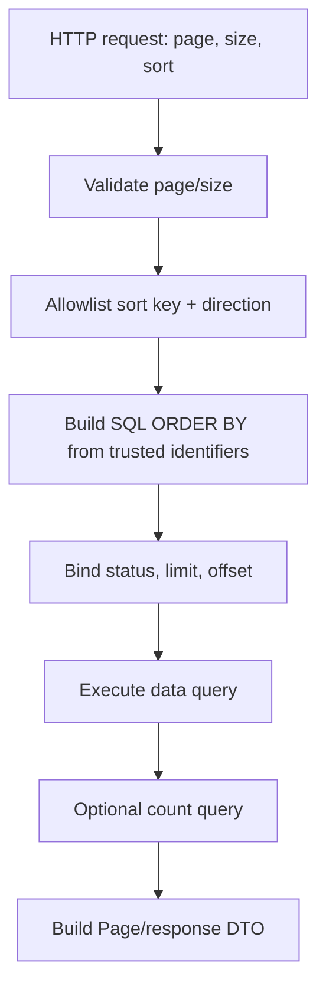

# Giới hạn phân trang, Sort và Limit với truy vấn SQL khai báo

Trong **Spring Data Relational JDBC**, các repository query có thể được tạo từ tên phương thức hoặc được khai báo bằng SQL qua `@Query`. Cả hai cách đều có thể trả về danh sách dữ liệu, nhưng khả năng áp dụng phân trang, sắp xếp và giới hạn kết quả khác nhau.

Điểm quan trọng nhất của bài học là:

- **Derived query** như `findByStatus(...)` có thể nhận các tham số đặc biệt `Pageable`, `Sort` và `Limit` để Spring Data tự áp dụng phân trang, sắp xếp hoặc giới hạn.
- **String-based query** khai báo SQL bằng `@Query` hoặc named query không tự hỗ trợ các tham số động `Pageable`, `PageRequest`, `Sort` và `Limit`. Spring Data JDBC không viết lại câu SQL khai báo để chèn các phần đó.
- Nếu muốn giới hạn hoặc sắp xếp một truy vấn SQL khai báo, hãy thể hiện điều đó trong **SQL**: dùng cú pháp của hệ quản trị, bind các giá trị như số lượng và offset bằng named parameters, và kiểm soát cột/hướng sắp xếp bằng danh sách cho phép.

Sự khác biệt này ảnh hưởng trực tiếp đến cách thiết kế repository, API phân trang và truy vấn báo cáo trong Spring Data JDBC.

## 1. Ba cách định nghĩa truy vấn trong repository

Spring Data JDBC hỗ trợ nhiều cách tạo truy vấn đọc. Cần xác định loại truy vấn trước khi quyết định cách truyền phân trang hoặc sắp xếp.

### 1.1. Derived query: suy ra từ tên phương thức

Ví dụ:

```java
public interface PurchaseOrderRepository
        extends PagingAndSortingRepository<PurchaseOrder, Long> {

    List<PurchaseOrder> findByStatus(String status);

    List<PurchaseOrder> findByStatusOrderByCreatedAtDesc(String status);
}
```

Spring Data phân tích tên phương thức, property của aggregate root và tham số để tạo SQL. Phương thức có thể nhận `Pageable` hoặc `Sort` để áp dụng các tùy chọn động.

```java
Page<PurchaseOrder> findByStatus(
    String status,
    Pageable pageable
);

List<PurchaseOrder> findByStatus(
    String status,
    Sort sort
);
```

Các tham số đặc biệt được repository infrastructure nhận diện. Ứng dụng không cần tự ghép `ORDER BY` hoặc `LIMIT/OFFSET` vào SQL.

### 1.2. String-based query: khai báo SQL trực tiếp

Ví dụ:

```java
public interface PurchaseOrderRepository
        extends CrudRepository<PurchaseOrder, Long> {

    @Query("""
        SELECT id, order_number, customer_id, status, created_at
        FROM purchase_orders
        WHERE status = :status
        ORDER BY created_at DESC, id DESC
        """)
    List<PurchaseOrder> findByStatusSql(
        @Param("status") String status
    );
}
```

Câu SQL được lập trình viên viết rõ trong `@Query`. Spring Data JDBC bind tham số có tên và ánh xạ kết quả theo mapping đã cấu hình.

Tuy nhiên, tài liệu Spring Data JDBC nêu rõ **string-based query không hỗ trợ pagination và không nhận `Sort`, `PageRequest` hoặc `Limit` như query parameters**. Muốn áp dụng giới hạn, cần biểu diễn ý định đó trong SQL và bind các giá trị thích hợp.

Điều này cũng áp dụng cho named query được khai báo trong `META-INF/jdbc-named-queries.properties` vì named query được xử lý theo cách tương tự query khai báo bằng annotation.

### 1.3. Custom read repository dùng Spring JDBC

Với truy vấn đọc phức tạp, có thể tạo class repository riêng dùng `NamedParameterJdbcTemplate`:

```java
@Repository
public class PurchaseOrderReadRepository {

    private final NamedParameterJdbcTemplate jdbc;

    public PurchaseOrderReadRepository(
            NamedParameterJdbcTemplate jdbc) {
        this.jdbc = jdbc;
    }

    // SQL được xây dựng và thực thi tường minh tại đây.
}
```

Cách này cho phép ứng dụng tự điều khiển `LIMIT/OFFSET`, `ORDER BY`, count query, projection và cách ánh xạ DTO. Nó phù hợp với read model hoặc truy vấn báo cáo cần nhiều bảng.

## 2. Pageable, Page, Slice, Sort và Limit có ý nghĩa gì?

Các kiểu đặc biệt thuộc Spring Data Commons, được repository infrastructure của từng module hỗ trợ theo khả năng riêng.

| Kiểu | Vai trò | Thông tin chính |
|---|---|---|
| `Pageable` | Đại diện cho yêu cầu phân trang | Page number, page size, sort |
| `Page<T>` | Kết quả một trang có metadata tổng | Nội dung, số phần tử, tổng trang |
| `Slice<T>` | Kết quả một lát dữ liệu | Nội dung và thông tin còn trang tiếp theo hay không |
| `Sort` | Mô tả thứ tự sắp xếp | Property và hướng ASC/DESC |
| `Limit` | Mô tả giới hạn số kết quả | Số hàng tối đa hoặc không giới hạn |

### 2.1. Pageable

Tạo yêu cầu trang:

```java
Pageable pageable = PageRequest.of(0, 20);
```

Trang được đánh số từ 0. Ví dụ:

- `PageRequest.of(0, 20)`: trang đầu, tối đa 20 phần tử.
- `PageRequest.of(1, 20)`: trang thứ hai, tối đa 20 phần tử.
- `PageRequest.of(2, 50)`: trang thứ ba, tối đa 50 phần tử.

`Pageable` còn có thể mang thông tin sắp xếp:

```java
Pageable pageable = PageRequest.of(
    0,
    20,
    Sort.by(
        Sort.Order.desc("createdAt"),
        Sort.Order.asc("id")
    )
);
```

Tên property trong `Sort` của derived query thường là tên property Java được Spring Data mapping, ví dụ `createdAt`. Đừng nhầm nó với tên cột SQL vật lý `created_at` khi tự viết SQL.

### 2.2. Page và count query

`Page<T>` cung cấp metadata tổng:

```java
Page<PurchaseOrder> findByStatus(
    String status,
    Pageable pageable
);
```

Để tính `totalElements` và `totalPages`, repository infrastructure có thể chạy thêm một count query. Với tập dữ liệu lớn hoặc điều kiện JOIN phức tạp, count query có thể tốn chi phí đáng kể.

Dùng `Page` khi giao diện thật sự cần biết tổng số phần tử hoặc tổng số trang.

### 2.3. Slice không cần tổng số trang

```java
Slice<PurchaseOrder> findByStatus(
    String status,
    Pageable pageable
);
```

`Slice` chỉ cần biết có dữ liệu tiếp theo hay không. Spring Data thường lấy thêm một hàng so với page size để xác định còn trang tiếp theo, thay vì phải tính tổng số hàng của toàn bộ truy vấn.

Dùng `Slice` khi người dùng chỉ cần nút “Tiếp theo” hoặc cuộn tải thêm, không cần hiển thị tổng số trang.

### 2.4. List với Pageable

```java
List<PurchaseOrder> findByStatus(
    String status,
    Pageable pageable
);
```

Có thể trả về `List` nếu chỉ cần nội dung trong khoảng trang. Không tạo đối tượng metadata `Page`, nên không cần count query chỉ để tính tổng trang.

### 2.5. Sort nếu chỉ cần thứ tự

```java
List<PurchaseOrder> findByStatus(
    String status,
    Sort sort
);
```

Nếu không cần offset/page size mà chỉ muốn đổi thứ tự kết quả, `Sort` là lựa chọn gọn hơn `Pageable`.

### 2.6. Limit nếu chỉ cần giới hạn số hàng

Với phiên bản Spring Data Commons hỗ trợ `Limit`:

```java
List<PurchaseOrder> findByStatus(
    String status,
    Limit limit
);
```

Cách gọi:

```java
repository.findByStatus("NEW", Limit.of(10));
repository.findByStatus("NEW", Limit.unlimited());
```

`Limit` không mang page number hoặc offset. Nó chỉ mô tả số hàng tối đa cần lấy. Nếu cần giới hạn và sắp xếp, có thể kết hợp `Sort` với `Limit` trong query method được hỗ trợ.

Các tham số đặc biệt này phụ thuộc phiên bản Spring Data. Hãy đối chiếu version trong dependency của dự án trước khi dùng `Limit` nếu ứng dụng đang ở dòng cũ.

## 3. Derived query hỗ trợ phân trang và sắp xếp động

Với derived query, repository infrastructure biết cách phân tích property và xây dựng truy vấn. Ví dụ:

```java
public interface PurchaseOrderRepository
        extends PagingAndSortingRepository<PurchaseOrder, Long> {

    Page<PurchaseOrder> findByStatus(
        String status,
        Pageable pageable
    );

    Slice<PurchaseOrder> findByCustomerId(
        Long customerId,
        Pageable pageable
    );

    List<PurchaseOrder> findByStatus(
        String status,
        Sort sort
    );

    List<PurchaseOrder> findByStatus(
        String status,
        Sort sort,
        Limit limit
    );
}
```

Gọi repository:

```java
Pageable pageable = PageRequest.of(
    0,
    20,
    Sort.by(Sort.Order.desc("createdAt"))
);

Page<PurchaseOrder> page =
    repository.findByStatus("PAID", pageable);
```

Spring Data JDBC nhận thông tin trang và sort, rồi tạo truy vấn tương ứng với dialect và mapping.

### 3.1. Sort theo nhiều thuộc tính

```java
Sort sort = Sort.by(
    Sort.Order.desc("createdAt"),
    Sort.Order.asc("orderNumber"),
    Sort.Order.asc("id")
);

List<PurchaseOrder> orders =
    repository.findByStatus("PAID", sort);
```

Có thể ghép nhiều điều kiện sắp xếp. Thuộc tính sau chỉ được dùng để phân định thứ tự khi các thuộc tính trước bằng nhau.

Nên thêm một khóa duy nhất làm tie-breaker, ví dụ `id`. Nếu chỉ sort theo thời gian tạo và nhiều đơn có cùng timestamp, thứ tự giữa các đơn đó có thể không ổn định.

### 3.2. Sort.unsorted và Pageable.unpaged

Các tham số đặc biệt cần được truyền giá trị không null. Nếu không muốn sắp xếp hoặc phân trang:

```java
Sort sort = Sort.unsorted();
Pageable pageable = Pageable.unpaged();
```

Với `Limit`, dùng `Limit.unlimited()` nếu muốn không giới hạn.

Không truyền `null` để diễn đạt “không áp dụng sort/paging”; dùng các factory method tương ứng.

### 3.3. Các tham số đặc biệt không thể kết hợp tùy ý

Một query method không nên khai báo các tham số đặc biệt trùng lặp hoặc mâu thuẫn:

```java
// Không hợp lệ: Pageable đã chứa thông tin Sort.
List<PurchaseOrder> findByStatus(
    String status,
    Pageable pageable,
    Sort sort
);

// Không hợp lệ: Pageable đã chứa page size/limit.
List<PurchaseOrder> findByStatus(
    String status,
    Pageable pageable,
    Limit limit
);
```

`Pageable` đã bao gồm page size, offset và sort. `Sort` riêng chỉ dùng khi query không cần Pageable. `Limit` riêng chỉ dùng khi query không dùng Pageable. Một số tổ hợp với keyword `Top`/`First` được Spring Data Commons hỗ trợ, nhưng không nên trộn `Top/First` với `Limit` trong cùng phương thức.

## 4. Giới hạn quan trọng: @Query SQL khai báo không tự nhận Pageable, Sort hoặc Limit

Đây là điểm chính của bài học.

Ví dụ sau **không phải cách dùng được hỗ trợ** cho string-based query trong Spring Data JDBC:

```java
@Query("""
    SELECT id, order_number, customer_id, status, created_at
    FROM purchase_orders
    WHERE status = :status
    """)
List<PurchaseOrder> findByStatusSql(
    @Param("status") String status,
    Pageable pageable
);
```

Tương tự, không khai báo `Sort` hoặc `Limit` rồi mong Spring Data tự sửa câu SQL:

```java
@Query("""
    SELECT id, order_number, customer_id, status, created_at
    FROM purchase_orders
    WHERE status = :status
    """)
List<PurchaseOrder> findByStatusSql(
    @Param("status") String status,
    Sort sort
);
```

```java
@Query("""
    SELECT id, order_number, customer_id, status, created_at
    FROM purchase_orders
    WHERE status = :status
    """)
List<PurchaseOrder> findByStatusSql(
    @Param("status") String status,
    Limit limit
);
```

Tài liệu Spring Data JDBC ghi rõ string-based query không hỗ trợ pagination và không nhận `Sort`, `PageRequest` hoặc `Limit` như tham số query. Nếu cần giới hạn kết quả, hãy viết điều kiện giới hạn trong SQL và bind các giá trị tương ứng.

Lý do thực tế là framework không thể tự động viết lại mọi câu SQL tùy biến một cách an toàn và đúng ngữ nghĩa. Một câu query có thể có JOIN, GROUP BY, DISTINCT, UNION, subquery, CTE, ORDER BY hoặc cú pháp đặc thù database. Việc chèn một đoạn sort/limit vào vị trí bất kỳ có thể làm sai cú pháp hoặc thay đổi ý nghĩa.

### 4.1. Viết LIMIT/OFFSET ngay trong SQL

Ví dụ PostgreSQL:

```java
@Query("""
    SELECT id, order_number, customer_id, status, created_at
    FROM purchase_orders
    WHERE status = :status
    ORDER BY created_at DESC, id DESC
    LIMIT :limit OFFSET :offset
    """)
List<PurchaseOrder> findPageByStatus(
    @Param("status") String status,
    @Param("limit") int limit,
    @Param("offset") long offset
);
```

Ở đây:

- `LIMIT :limit` giới hạn số hàng trả về.
- `OFFSET :offset` bỏ qua số hàng đầu tiên.
- `ORDER BY` được viết tường minh trong SQL.
- `:status`, `:limit` và `:offset` là named bind parameters.

Spring Data JDBC hỗ trợ **named parameters** cho string-based query. Khả năng bind biểu thức LIMIT/OFFSET phải phù hợp với cú pháp và driver của hệ quản trị. Ví dụ trên dùng cú pháp PostgreSQL; với database khác, hãy dùng cú pháp phân trang tương ứng.

### 4.2. Tính offset từ page number và page size

Nếu API bên ngoài nhận page number và page size, có thể chuyển đổi:

```java
int page = 2;
int size = 20;

long offset = (long) page * size;

List<PurchaseOrder> orders =
    repository.findPageByStatus("PAID", size, offset);
```

Kết quả là trang thứ ba theo cách đánh số từ 0, bỏ qua 40 hàng đầu và lấy tối đa 20 hàng tiếp theo.

Ép sang `long` trước phép nhân giúp tránh overflow kiểu `int` khi page number hoặc size lớn. Trong service, vẫn cần kiểm tra page không âm, size dương và size không vượt giới hạn tối đa của API.

### 4.3. Đặt giới hạn an toàn ở service

Không nên cho client yêu cầu tùy ý hàng triệu bản ghi. Ví dụ:

```java
public record PageRequestInput(int page, int size) {}

public List<PurchaseOrder> findPage(
        String status,
        PageRequestInput input) {

    if (input.page() < 0) {
        throw new IllegalArgumentException("Page must be nonnegative");
    }

    if (input.size() < 1 || input.size() > 100) {
        throw new IllegalArgumentException("Page size must be between 1 and 100");
    }

    long offset = (long) input.page() * input.size();

    return repository.findPageByStatus(
        status,
        input.size(),
        offset
    );
}
```

Giới hạn page size bảo vệ database và ứng dụng trước truy vấn quá lớn. Mức tối đa cần dựa trên kích thước DTO, workload và yêu cầu API.

## 5. Sort động với SQL khai báo

Với derived query, Spring Data có thể dùng `Sort` để tạo ORDER BY. Với SQL khai báo, không có cơ chế tự động đó. Câu SQL cần có thứ tự tĩnh hoặc ứng dụng phải tự lựa chọn một đoạn ORDER BY an toàn.

### 5.1. Sắp xếp tĩnh trong @Query

Nếu chỉ cần một thứ tự cố định, viết trực tiếp:

```java
@Query("""
    SELECT id, order_number, customer_id, status, created_at
    FROM purchase_orders
    WHERE customer_id = :customerId
    ORDER BY created_at DESC, id DESC
    LIMIT :limit OFFSET :offset
    """)
List<PurchaseOrder> findRecentOrders(
    @Param("customerId") Long customerId,
    @Param("limit") int limit,
    @Param("offset") long offset
);
```

Đây là cách đơn giản nhất nếu nghiệp vụ luôn cần đơn mới nhất trước.

### 5.2. Không thể bind tên cột như giá trị

Một lỗi phổ biến là thử:

```sql
SELECT *
FROM purchase_orders
ORDER BY :sortColumn :direction;
```

Bind parameter đại diện cho **giá trị**, không thay thế được tên cột hoặc keyword SQL. Database có thể hiểu `:sortColumn` là một giá trị hằng, chứ không phải identifier cần dùng để sắp xếp.

Không nối trực tiếp input từ client vào SQL:

```java
String sql = "SELECT * FROM purchase_orders ORDER BY " + request.sortBy();
```

Nếu client gửi một chuỗi chứa cú pháp SQL, câu truy vấn có thể bị thay đổi ngoài ý muốn. Đây là nguy cơ SQL injection qua identifier.

### 5.3. Dùng allowlist cho cột và hướng sort

Nếu cần sort động, hãy chuyển lựa chọn API thành một trong các identifier SQL được ứng dụng kiểm soát.

```java
public enum OrderSortField {
    CREATED_AT,
    ORDER_NUMBER,
    STATUS
}
```

```java
public enum SortDirection {
    ASC,
    DESC
}
```

Chọn identifier:

```java
private String toSqlColumn(OrderSortField field) {
    return switch (field) {
        case CREATED_AT -> "o.created_at";
        case ORDER_NUMBER -> "o.order_number";
        case STATUS -> "o.status";
    };
}

private String toSqlDirection(SortDirection direction) {
    return switch (direction) {
        case ASC -> "ASC";
        case DESC -> "DESC";
    };
}
```

Sau đó xây dựng câu SQL từ các giá trị allowlist:

```java
public List<PurchaseOrder> findPage(
        String status,
        OrderSortField sortField,
        SortDirection direction,
        int limit,
        long offset) {

    String column = toSqlColumn(sortField);
    String order = toSqlDirection(direction);

    String sql = """
        SELECT o.id, o.order_number, o.customer_id,
               o.status, o.created_at
        FROM purchase_orders o
        WHERE o.status = :status
        ORDER BY %s %s, o.id DESC
        LIMIT :limit OFFSET :offset
        """.formatted(column, order);

    MapSqlParameterSource parameters = new MapSqlParameterSource()
        .addValue("status", status)
        .addValue("limit", limit)
        .addValue("offset", offset);

    return jdbc.query(
        sql,
        parameters,
        purchaseOrderRowMapper
    );
}
```

Trong ví dụ:

- `column` chỉ có thể nhận ba tên cột do code định nghĩa.
- `order` chỉ có thể là `ASC` hoặc `DESC`.
- Các giá trị dữ liệu như status, limit và offset vẫn được bind bằng parameter.
- `o.id DESC` là tie-breaker để thứ tự ổn định khi hai hàng có cùng giá trị sort chính.

Việc định dạng SQL với identifier đã được allowlist là một lựa chọn có kiểm soát. Không dùng raw string từ request để tạo tên cột hoặc hướng sort.

### 5.4. Cho phép API chỉ chọn những sort key có ý nghĩa

Không nhất thiết expose mọi cột trong bảng để sắp xếp. API có thể chỉ cho phép:

```text
createdAt
orderNumber
status
```

Các key đó được map sang identifier SQL trong code. Nếu key không được nhận diện, trả lỗi validation hoặc dùng sort mặc định theo quy định API.

Với SQL khai báo tĩnh, một lựa chọn khác là tạo một số phương thức riêng:

```java
@Query("""
    SELECT id, order_number, customer_id, status, created_at
    FROM purchase_orders
    WHERE status = :status
    ORDER BY created_at DESC, id DESC
    LIMIT :limit
    """)
List<PurchaseOrder> findLatestByStatus(
    @Param("status") String status,
    @Param("limit") int limit
);

@Query("""
    SELECT id, order_number, customer_id, status, created_at
    FROM purchase_orders
    WHERE status = :status
    ORDER BY order_number ASC, id ASC
    LIMIT :limit
    """)
List<PurchaseOrder> findByStatusOrderedByNumber(
    @Param("status") String status,
    @Param("limit") int limit
);
```

Đây là lựa chọn dễ kiểm soát khi số thứ tự sắp xếp ít và cố định.

## 6. Page, Slice và count query với SQL khai báo

Vì string-based query không hỗ trợ `Pageable`, `PageRequest` hoặc `Sort` như tham số query, nếu cần một đối tượng `Page<T>` cho SQL tùy biến, ứng dụng phải tự quản lý phần dữ liệu trang và tổng số phần tử.

Một phương án là dùng `NamedParameterJdbcTemplate` để chạy:

1. Query lấy nội dung trang có ORDER BY, LIMIT và OFFSET.
2. Count query để lấy tổng số hàng phù hợp bộ lọc.
3. Tạo `PageImpl<T>` từ hai kết quả.

### 6.1. DTO và repository đọc

```java
public record OrderSummary(
    long id,
    String orderNumber,
    String status,
    String customerName
) {}
```

```java
@Repository
public class OrderSummaryRepository {

    private final NamedParameterJdbcTemplate jdbc;

    public OrderSummaryRepository(NamedParameterJdbcTemplate jdbc) {
        this.jdbc = jdbc;
    }

    public Page<OrderSummary> findPage(
            String status,
            Pageable pageable) {

        if (pageable.isUnpaged()) {
            throw new IllegalArgumentException(
                "A paged request is required"
            );
        }

        String dataSql = """
            SELECT o.id,
                   o.order_number,
                   o.status,
                   c.full_name AS customer_name
            FROM purchase_orders o
            JOIN customers c ON c.id = o.customer_id
            WHERE o.status = :status
            ORDER BY o.created_at DESC, o.id DESC
            LIMIT :limit OFFSET :offset
            """;

        String countSql = """
            SELECT COUNT(*)
            FROM purchase_orders o
            WHERE o.status = :status
            """;

        MapSqlParameterSource parameters = new MapSqlParameterSource()
            .addValue("status", status)
            .addValue("limit", pageable.getPageSize())
            .addValue("offset", pageable.getOffset());

        List<OrderSummary> content = jdbc.query(
            dataSql,
            parameters,
            (rs, rowNum) -> new OrderSummary(
                rs.getLong("id"),
                rs.getString("order_number"),
                rs.getString("status"),
                rs.getString("customer_name")
            )
        );

        Long total = jdbc.queryForObject(
            countSql,
            new MapSqlParameterSource("status", status),
            Long.class
        );

        return new PageImpl<>(
            content,
            pageable,
            total == null ? 0 : total
        );
    }
}
```

Ví dụ dùng `Pageable` như một object đầu vào của **class Java tự viết**, không phải tham số của phương thức `@Query`. Vì code tự thực hiện SQL, nó có thể đọc `getPageSize()` và `getOffset()` rồi bind vào SQL.

### 6.2. Count query phải cùng điều kiện với data query

Count query phải đếm đúng tập kết quả mà data query phân trang.

Nếu data query lọc theo:

```sql
WHERE o.status = :status
  AND o.customer_id = :customerId
```

thì count query cũng phải có hai điều kiện đó.

Nếu JOIN một-nhiều làm một đơn xuất hiện nhiều hàng, dùng `COUNT(DISTINCT o.id)` khi mục tiêu là đếm số đơn:

```sql
SELECT COUNT(DISTINCT o.id)
FROM purchase_orders o
JOIN order_items i ON i.order_id = o.id
WHERE o.status = :status;
```

Nếu data query trả về một hàng cho mỗi dòng sản phẩm, count cần đếm dòng sản phẩm thay vì đơn hàng. Count query phải khớp **grain** của kết quả.

### 6.3. Khi không cần tổng số hàng, dùng Slice hoặc cursor tự xây dựng

Nếu API chỉ cần biết có trang tiếp theo, có thể lấy `pageSize + 1` hàng:

```sql
SELECT id, order_number, status
FROM purchase_orders
WHERE status = :status
ORDER BY created_at DESC, id DESC
LIMIT :fetchSize OFFSET :offset;
```

Trong code, `fetchSize = pageSize + 1`. Nếu kết quả nhiều hơn page size, có trang tiếp theo; bỏ hàng thừa trước khi trả response.

Cách này tránh count query. Tuy nhiên, vì SQL khai báo không tự tạo `Slice` cho bạn, custom repository cần tự xây dựng DTO/result metadata phù hợp.

## 7. OFFSET pagination và giới hạn của nó

`LIMIT/OFFSET` dễ hiểu và phù hợp với nhiều danh sách nhỏ hoặc vừa:

```sql
SELECT id, order_number, status
FROM purchase_orders
ORDER BY created_at DESC, id DESC
LIMIT 20 OFFSET 40;
```

Nó bỏ qua 40 hàng rồi lấy tối đa 20 hàng tiếp theo.

### 7.1. Offset lớn có thể chậm

Khi offset tăng lên hàng trăm nghìn, database vẫn phải xử lý hoặc đi qua các hàng đứng trước để tìm vị trí bắt đầu của trang. Chi phí có thể tăng theo offset, đặc biệt với query phức tạp hoặc index không phù hợp.

Phân trang offset vẫn hữu ích khi người dùng cần nhảy đến trang bất kỳ và số trang không quá sâu. Với feed lớn hoặc dữ liệu thay đổi liên tục, cân nhắc keyset pagination.

### 7.2. Dữ liệu thay đổi giữa các trang

Giả sử người dùng tải trang đầu, sau đó có một đơn mới được thêm vào trước các hàng cũ. Khi tải trang tiếp theo bằng OFFSET, vị trí hàng có thể dịch chuyển. Người dùng có thể nhìn thấy bản ghi trùng hoặc bỏ sót bản ghi giữa hai lần tải.

Sắp xếp ổn định với khóa duy nhất giúp tránh thứ tự không xác định khi giá trị sort bằng nhau, nhưng **không loại bỏ mọi dịch chuyển do dữ liệu thay đổi** giữa các request.

## 8. Keyset pagination cho tập dữ liệu lớn

Keyset pagination dùng giá trị của hàng cuối trang hiện tại làm cursor để lấy các hàng tiếp theo, thay vì bỏ qua một số lượng lớn hàng.

Giả sử thứ tự là:

```sql
ORDER BY created_at DESC, id DESC
```

Trang tiếp theo sau hàng có `lastCreatedAt` và `lastId`:

```sql
SELECT id, order_number, status, created_at
FROM purchase_orders
WHERE status = :status
  AND (
      created_at < :lastCreatedAt
      OR (
          created_at = :lastCreatedAt
          AND id < :lastId
      )
  )
ORDER BY created_at DESC, id DESC
LIMIT :limit;
```

Cặp `created_at` và `id` tạo thứ tự xác định. Điều kiện cursor dùng cùng hướng sắp xếp để chọn các hàng đứng sau hàng cuối trang trước.

### 8.1. Vì sao cần khóa tie-breaker?

Nếu chỉ dùng:

```sql
ORDER BY created_at DESC
```

nhiều đơn có thể có cùng timestamp. Cursor chỉ chứa timestamp sẽ không phân biệt được các hàng cùng thời điểm. Thêm `id` duy nhất giúp xác định vị trí chính xác.

### 8.2. Khi nào keyset phù hợp?

- Feed hoặc lịch sử đơn hàng có rất nhiều bản ghi.
- Người dùng chủ yếu đi từ trang hiện tại sang trang kế tiếp.
- Sort key có thứ tự ổn định và có thể tạo điều kiện so sánh.
- Muốn tránh offset lớn.

Keyset không thuận tiện cho việc nhảy trực tiếp đến trang thứ 500 vì phải có cursor từ trang trước. Với sort key nullable, nhiều cột hoặc hướng sort hỗn hợp, điều kiện cursor cần được thiết kế kỹ để khớp quy tắc NULL ordering và thứ tự.

## 9. SQL khai báo phải dùng cú pháp phân trang của database

Vì `@Query` không tự viết lại SQL để thêm pagination, câu lệnh phân trang phải phù hợp hệ quản trị đang chạy.

Ví dụ minh họa:

| Database | Cú pháp thường gặp |
|---|---|
| PostgreSQL | `LIMIT :limit OFFSET :offset` |
| MySQL | `LIMIT :limit OFFSET :offset` |
| SQL Server | `ORDER BY ... OFFSET :offset ROWS FETCH NEXT :limit ROWS ONLY` |
| Oracle hiện đại | `OFFSET :offset ROWS FETCH NEXT :limit ROWS ONLY` |

Cú pháp cụ thể và khả năng bind parameter có thể phụ thuộc phiên bản database/driver. Không copy cú pháp PostgreSQL sang mọi hệ quản trị.

### 9.1. OFFSET/FETCH cần ORDER BY

Một số database yêu cầu `ORDER BY` khi dùng `OFFSET ... FETCH`. Dù database có cho phép LIMIT không có ORDER BY, kết quả vẫn không có thứ tự ổn định nếu không chỉ định sắp xếp.

Luôn xác định thứ tự khi phân trang. Nếu hai hàng có cùng sort value, thêm khóa duy nhất làm tie-breaker.

### 9.2. Không hard-code cú pháp database không tương thích

Nếu ứng dụng hỗ trợ nhiều hệ quản trị, hãy cân nhắc:

- Dùng repository derived query cho các trường hợp có thể.
- Dùng dialect hoặc abstraction có sẵn của Spring Data/Spring JDBC khi phù hợp.
- Tách câu SQL theo database nếu cú pháp khác biệt đáng kể.
- Kiểm tra query trên từng database thật trong integration test.

SQL khai báo mang lại quyền kiểm soát cao, đồng thời chuyển trách nhiệm cú pháp phân trang về người viết query.

## 10. SQL injection và sort parameter

Các giá trị dữ liệu phải được bind:

```sql
WHERE status = :status
LIMIT :limit OFFSET :offset
```

Không nối chuỗi:

```java
String sql = "SELECT * FROM purchase_orders WHERE status = '" + status + "'";
```

Với sort, cần nhớ:

- Giá trị như status, customer ID, limit, offset có thể bind.
- Tên bảng, tên cột, ASC/DESC là cú pháp SQL/identifier, không thể thay thế bằng bind parameter thông thường.
- Chỉ tạo identifier từ allowlist trong code.
- Validate giới hạn số hàng và offset trước khi thực thi.

Một API sort an toàn có thể nhận enum thay vì raw column name:

```java
public enum OrderSort {
    NEWEST,
    ORDER_NUMBER,
    STATUS
}
```

Sau đó ánh xạ enum sang đoạn SQL cố định. Client không được gửi trực tiếp `o.created_at DESC; DROP TABLE...` làm sort expression.

## 11. Chọn phương án nào cho từng loại query?

| Trường hợp | Cách nên cân nhắc | Lý do |
|---|---|---|
| Lọc đơn theo status và phân trang thông thường | Derived query + `Pageable` | Spring Data xử lý page/sort |
| Chỉ cần sort theo property | Derived query + `Sort` | Không cần tự ghép ORDER BY |
| Chỉ cần lấy tối đa N bản ghi | Derived query + `Limit` hoặc `Top/First` | Diễn đạt giới hạn ở method signature |
| SQL tùy biến, thứ tự cố định | `@Query` có `ORDER BY` + `LIMIT` | SQL nêu rõ ý định |
| SQL tùy biến, page size/offset động | `@Query` với named parameters trong SQL | Bind limit và offset tường minh |
| SQL tùy biến, sort động | Custom repository + allowlist | Identifier SQL được kiểm soát |
| Cần Page metadata với SQL tùy biến | Custom JDBC repository + count query + `PageImpl` | Tự kiểm soát count và content |
| Tập dữ liệu lớn, cuộn tuần tự | Keyset/cursor query | Tránh offset sâu |
| Báo cáo JOIN/GROUP BY | Custom read query/DTO | Kiểm soát projection và grain |

## 12. Ví dụ tổng hợp: API danh sách đơn hàng

Một endpoint nhận:

```text
GET /orders?status=PAID&page=0&size=20&sort=createdAt,desc
```

Nếu dùng derived query, service có thể chuyển request thành `Pageable`:

```java
Pageable pageable = PageRequest.of(
    page,
    size,
    Sort.by(
        Sort.Order.desc("createdAt"),
        Sort.Order.desc("id")
    )
);

Page<PurchaseOrder> result =
    orderRepository.findByStatus(status, pageable);
```

Nếu dùng `@Query` SQL khai báo, không truyền `Pageable` vào phương thức đó. Thay vào đó, service cần:

1. Kiểm tra page và size.
2. Chuyển sort key API thành cột SQL được allowlist.
3. Chuyển hướng sort thành `ASC` hoặc `DESC` được kiểm soát.
4. Tính offset.
5. Bind status, limit và offset.
6. Chạy count query riêng nếu response cần tổng số.
7. Trả DTO hoặc page response.

Luồng custom read query:



### 12.1. Ví dụ xử lý sort key

```java
public enum OrderSortKey {
    CREATED_AT,
    ORDER_NUMBER
}

private String columnFor(OrderSortKey key) {
    return switch (key) {
        case CREATED_AT -> "o.created_at";
        case ORDER_NUMBER -> "o.order_number";
    };
}
```

API parser nên chuyển chuỗi bên ngoài sang enum. Nếu không nhận ra key, trả lỗi validation hoặc dùng mặc định đã công bố, thay vì nối chuỗi request vào SQL.

### 12.2. Thứ tự ổn định

Nếu sort theo `created_at DESC`, hãy thêm `id DESC`:

```sql
ORDER BY o.created_at DESC, o.id DESC
```

Thứ tự phụ này đảm bảo các hàng có cùng thời gian vẫn có vị trí xác định. Với keyset pagination, cursor phải chứa cả hai giá trị.

## 13. Những lỗi thường gặp

| Triệu chứng | Nguyên nhân | Cách xử lý |
|---|---|---|
| `@Query` không áp dụng Pageable | String-based query không hỗ trợ pagination động | Viết LIMIT/OFFSET trong SQL hoặc dùng derived query |
| Sort parameter không thay ORDER BY trong SQL khai báo | `@Query` không tự chèn Sort | Viết ORDER BY tĩnh hoặc custom repository với allowlist |
| Limit parameter bị từ chối/không có tác dụng | Dùng `Limit` như special parameter trong string-based query | Bind giá trị limit trực tiếp trong SQL |
| Tổng số trang sai | Count query khác điều kiện data query | Đồng bộ filter và đếm đúng grain |
| Một đơn xuất hiện nhiều lần trong kết quả | JOIN một-nhiều | GROUP BY hoặc tạo projection đúng grain |
| Trang bị thiếu/trùng hàng khi dữ liệu đổi | Offset pagination trên dữ liệu biến động | Sort ổn định, cân nhắc keyset |
| Các hàng cùng timestamp đổi thứ tự | ORDER BY không có tie-breaker | Thêm khóa duy nhất như ID |
| Trang sâu chạy chậm | OFFSET lớn | Keyset pagination hoặc chiến lược phân trang khác |
| SQL injection qua sort | Ghép raw sort key vào SQL | Allowlist identifier và direction |
| Truy vấn lỗi trên database khác | Dùng LIMIT/OFFSET không đúng dialect | Viết SQL theo hệ quản trị và kiểm thử tích hợp |
| Page query tốn thêm thời gian | Count query phải đếm toàn tập | Dùng Slice/List nếu không cần tổng số |
| Query SQL khai báo trả entity thiếu dữ liệu | SELECT thiếu cột cần cho mapping | Chọn đủ các cột constructor/mapping cần thiết |

## 14. Bài thực hành

Dùng bảng `purchase_orders` có các cột `id`, `order_number`, `status`, `created_at` và `customer_id`.

### Bài 1. Derived query có phân trang

Khai báo phương thức lấy các đơn `PAID` theo trang, mỗi trang 20 đơn:

```java
Page<PurchaseOrder> findByStatus(
    String status,
    Pageable pageable
);
```

Gọi:

```java
PageRequest.of(
    0,
    20,
    Sort.by(
        Sort.Order.desc("createdAt"),
        Sort.Order.desc("id")
    )
);
```

### Bài 2. SQL khai báo với giới hạn thủ công

Viết query PostgreSQL lấy 20 đơn mới nhất, bỏ qua 40 đơn đầu:

```java
@Query("""
    SELECT id, order_number, customer_id, status, created_at
    FROM purchase_orders
    WHERE status = :status
    ORDER BY created_at DESC, id DESC
    LIMIT :limit OFFSET :offset
    """)
List<PurchaseOrder> findPage(
    @Param("status") String status,
    @Param("limit") int limit,
    @Param("offset") long offset
);
```

### Bài 3. Vì sao không thể ORDER BY :column?

**Đáp án:** Named parameter bind giá trị, không thay thế identifier hoặc keyword SQL. Dùng enum/allowlist để chọn cột và hướng sắp xếp.

### Bài 4. Page hay Slice?

Một màn hình chỉ có nút “Tải thêm” và không cần tổng số trang. Nên dùng gì?

**Đáp án:** Với derived query, `Slice` thường phù hợp vì chỉ cần biết còn dữ liệu tiếp theo. Với string-based SQL, tự giới hạn `pageSize + 1` và tạo metadata tương ứng nếu cần.

### Bài 5. Count query khi JOIN

Data query JOIN `purchase_orders` với `order_items` nhưng màn hình cần đếm số đơn. Dùng `COUNT(*)` có thể sai trong trường hợp nào?

**Đáp án:** Khi một đơn có nhiều dòng sản phẩm, JOIN tạo nhiều hàng cho một đơn. Dùng `COUNT(DISTINCT o.id)` để đếm đơn duy nhất.

### Bài 6. OFFSET sâu

Một API cần đọc hàng triệu đơn theo thứ tự mới nhất. Vì sao OFFSET lớn có thể kém hiệu quả và keyset pagination giúp gì?

**Đáp án:** Database phải xử lý/đi qua nhiều hàng trước offset. Keyset dùng khóa của hàng cuối trang trước để chọn các hàng tiếp theo, tránh bỏ qua một offset lớn.

### Bài 7. Bảo vệ sort

API nhận `sortBy` từ request. Hãy mô tả cách chuyển nó thành SQL an toàn.

**Đáp án:** Chuyển chuỗi sang enum/allowlist, map enum sang tên cột do code kiểm soát và chỉ cho phép ASC/DESC. Không nối raw request vào ORDER BY.

## 15. Điều cần ghi nhớ

1. **Derived query** có thể nhận `Pageable`, `Sort` và `Limit` theo khả năng của Spring Data JDBC version đang dùng.
2. **String-based query** qua `@Query` hoặc named query không tự hỗ trợ pagination và không nhận `Sort`, `PageRequest`, `Limit` làm query parameters.
3. Với SQL khai báo, viết `ORDER BY` và cú pháp giới hạn trong SQL; bind các giá trị như filter, limit và offset bằng named parameters.
4. Không bind tên cột hoặc ASC/DESC như giá trị. Dùng allowlist cho sort key và direction.
5. `Page` có thể cần count query; `Slice` hoặc List có phân trang phù hợp khi không cần tổng số.
6. Offset pagination đơn giản nhưng có thể chậm ở trang sâu và nhạy với thay đổi dữ liệu; keyset pagination là lựa chọn cho việc duyệt tuần tự tập lớn.
7. Luôn dùng ORDER BY ổn định, có tie-breaker duy nhất, và viết cú pháp phân trang đúng dialect database.

### Tài liệu tham khảo chính thức

- [Spring Data JDBC — Query Methods](https://docs.spring.io/spring-data/relational/reference/jdbc/query-methods.html): derived query, Pageable, Page, Slice và giới hạn của string-based query.
- [Spring Data Commons — Paging, Sorting and Limiting](https://docs.spring.io/spring-data/commons/reference/repositories/query-methods-details.html): các kiểu Pageable, Sort, Limit và quy tắc kết hợp tham số đặc biệt.
- [Spring Data Relational — Query API](https://docs.spring.io/spring-data/relational/docs/current/api/org/springframework/data/relational/core/query/Query.html): API Query cho các truy vấn criteria và thao tác limit/offset/sort.
- [Spring Framework — JDBC Core](https://docs.spring.io/spring-framework/reference/data-access/jdbc/core.html): NamedParameterJdbcTemplate và thực thi SQL có tham số.

Khi triển khai, kiểm tra phiên bản Spring Data Relational và hệ quản trị cụ thể. Khả năng của derived query, kiểu `Limit` và cú pháp LIMIT/OFFSET phụ thuộc version và dialect; riêng SQL khai báo cần tự thể hiện giới hạn và thứ tự trong câu truy vấn.
