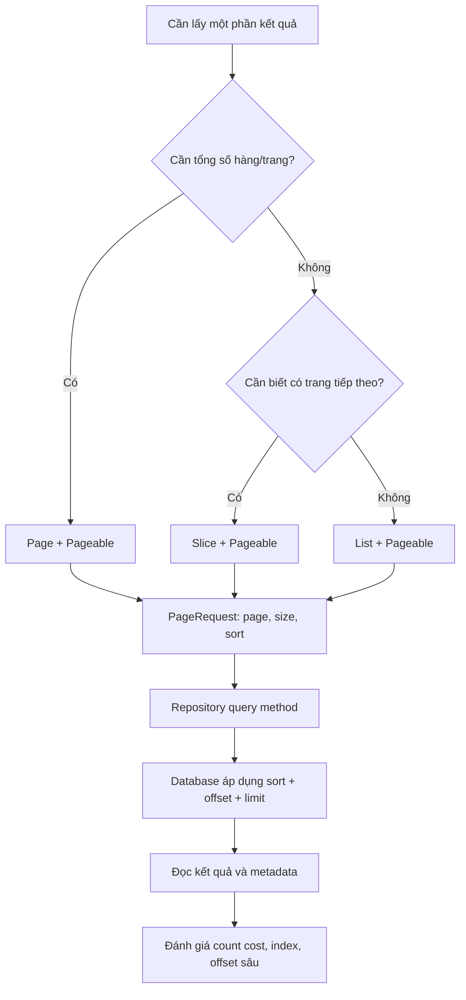

# Phân trang bằng Pageable và PageRequest

Khi một bảng có hàng nghìn hoặc hàng triệu bản ghi, trả về toàn bộ kết quả trong một lần truy vấn thường gây tốn bộ nhớ, thời gian truyền dữ liệu và tài nguyên database. **Phân trang** chia kết quả thành các phần nhỏ để ứng dụng chỉ tải vùng dữ liệu cần hiển thị hoặc xử lý.

Trong Spring Data JDBC, hai kiểu quan trọng là:

- **`Pageable`:** abstraction mô tả yêu cầu phân trang, gồm số trang, kích thước trang và thứ tự sắp xếp.
- **`PageRequest`:** implementation phổ biến của `Pageable`, dùng để tạo yêu cầu như “trang đầu tiên, 20 phần tử, sắp xếp theo tên”.

Repository method nhận `Pageable` để Spring Data JDBC áp dụng offset, giới hạn số hàng và sort vào truy vấn. Kết quả có thể là `Page`, `Slice` hoặc `List` tùy metadata mà ứng dụng cần.

Bài học tập trung vào cách tạo `PageRequest`, khai báo repository method, đọc metadata trang, kết hợp sort và chọn kiểu kết quả phù hợp.

## 1. Vì sao cần phân trang?

Giả sử bảng `products` có 100.000 sản phẩm. Một màn hình quản trị chỉ hiển thị 20 sản phẩm mỗi lần.

Nếu tải tất cả:

```java
List<Product> products = productRepository.findAll();
```

Ứng dụng phải nhận và giữ toàn bộ kết quả trong bộ nhớ, dù màn hình chỉ hiển thị 20 hàng. Khi dữ liệu tăng, cách này có thể làm tăng thời gian phản hồi và áp lực heap.

Phân trang cho phép yêu cầu từng vùng:

```text
Toàn bộ dữ liệu: 100.000 sản phẩm

Page 0: 20 sản phẩm đầu tiên
Page 1: 20 sản phẩm tiếp theo
Page 2: 20 sản phẩm tiếp theo
...
Page 4.999: 20 sản phẩm cuối cùng
```

Với page size 20, mỗi lần truy vấn chỉ lấy tối đa 20 hàng cho nội dung trang. Cách này giúp:

- Giới hạn số đối tượng được tải trong một request.
- Giảm dữ liệu truyền từ database đến ứng dụng.
- Hỗ trợ giao diện có nút trang trước/trang sau hoặc số trang.
- Xử lý từng nhóm dữ liệu thay vì nạp toàn bộ bảng.
- Kết hợp sắp xếp động theo lựa chọn người dùng.

**Phân trang không làm cho một truy vấn tự động nhanh trong mọi trường hợp.** Database vẫn phải tìm và sắp xếp dữ liệu phù hợp; offset rất lớn có thể tốn kém. Cần thiết kế index và thứ tự sắp xếp phù hợp với truy vấn thực tế.

## 2. Pageable là gì?

`org.springframework.data.domain.Pageable` là interface mô tả một yêu cầu phân trang. Nó cung cấp các thông tin chính:

| Phương thức | Ý nghĩa |
| --- | --- |
| `getPageNumber()` | Số trang, bắt đầu từ 0. |
| `getPageSize()` | Số phần tử tối đa trong một trang. |
| `getOffset()` | Số hàng cần bỏ qua trước khi lấy dữ liệu. |
| `getSort()` | Thứ tự sắp xếp của kết quả. |
| `hasPrevious()` | Có trang trước hay không. |
| `next()` | Tạo yêu cầu cho trang kế tiếp. |
| `previousOrFirst()` | Tạo yêu cầu trang trước hoặc trang đầu. |
| `isPaged()` / `isUnpaged()` | Kiểm tra có phân trang hay không. |

Ví dụ:

```java
Pageable pageable = PageRequest.of(0, 20);
```

Yêu cầu này có nghĩa:

- Lấy trang số 0, tức trang đầu tiên.
- Mỗi trang có tối đa 20 phần tử.
- Không chỉ định sort động.

### 2.1. Số trang bắt đầu từ 0

Spring Data dùng **zero-based page numbering**:

| Page number | Ý nghĩa | Với page size 20 |
| --- | --- | --- |
| 0 | Trang đầu tiên | Offset 0, lấy tối đa hàng 1–20 |
| 1 | Trang thứ hai | Offset 20, lấy tối đa hàng 21–40 |
| 2 | Trang thứ ba | Offset 40, lấy tối đa hàng 41–60 |
| 3 | Trang thứ tư | Offset 60, lấy tối đa hàng 61–80 |

Công thức:

\[
\text{offset} = \text{pageNumber} \times \text{pageSize}
\]

Ví dụ page 3, size 25:

\[
\text{offset} = 3 \times 25 = 75
\]

Database bỏ qua 75 hàng theo thứ tự sắp xếp rồi trả về tối đa 25 hàng tiếp theo.

Nếu API bên ngoài dùng trang bắt đầu từ 1, cần chuyển đổi ở ranh giới API:

```java
int springPage = Math.max(requestedPage - 1, 0);
Pageable pageable = PageRequest.of(springPage, pageSize);
```

Không nên truyền trực tiếp số trang 1-based vào `PageRequest` nếu hợp đồng API của bạn định nghĩa trang đầu là 1.

### 2.2. Page size phải lớn hơn 0

`PageRequest` yêu cầu:

- Page number không âm.
- Page size lớn hơn 0.

Ví dụ hợp lệ:

```java
PageRequest.of(0, 20);
PageRequest.of(2, 50);
```

Các trường hợp không hợp lệ:

```java
PageRequest.of(-1, 20); // page number âm
PageRequest.of(0, 0);   // page size bằng 0
PageRequest.of(0, -5);  // page size âm
```

Những trường hợp này phát sinh `IllegalArgumentException` khi tạo yêu cầu. Ở API, nên kiểm tra đầu vào và đặt giới hạn page size tối đa để tránh client yêu cầu một trang quá lớn.

## 3. PageRequest là gì?

`PageRequest` là implementation phổ biến của `Pageable`. Bạn tạo đối tượng bằng các factory method thay vì gọi constructor trực tiếp.

Các cách thường dùng:

```java
PageRequest firstPage = PageRequest.of(0, 20);

PageRequest secondPage = PageRequest.of(1, 20);

PageRequest smallPage = PageRequest.ofSize(10);
```

Có thể chỉ định sort ngay khi tạo:

```java
PageRequest newestFirst = PageRequest.of(
        0,
        20,
        Sort.by(Sort.Direction.DESC, "createdAt")
);
```

Hoặc dùng chuỗi API của `Sort`:

```java
Sort sort = Sort.by("name").ascending();

PageRequest pageable = PageRequest.of(0, 20, sort);
```

`PageRequest` là immutable: các thao tác như `next()`, `previous()`, `withPage(...)` hoặc `withSort(...)` trả về một đối tượng mới. Chúng không sửa instance ban đầu.

```java
PageRequest first = PageRequest.of(0, 20);
PageRequest second = first.next();

System.out.println(first.getPageNumber());  // 0
System.out.println(second.getPageNumber()); // 1
```

## 4. Khai báo repository nhận Pageable

Spring Data JDBC hỗ trợ phân trang trên query methods. Ví dụ repository:

```java
import org.springframework.data.domain.Page;
import org.springframework.data.domain.Pageable;
import org.springframework.data.domain.Slice;
import org.springframework.data.repository.CrudRepository;
import org.springframework.data.repository.PagingAndSortingRepository;

public interface ProductRepository
        extends CrudRepository<Product, Long>,
                PagingAndSortingRepository<Product, Long> {

    Page<Product> findByStatus(String status, Pageable pageable);

    Slice<Product> findByCategoryId(Long categoryId, Pageable pageable);

    List<Product> findByActiveTrue(Pageable pageable);
}
```

Các phương thức thể hiện ba kiểu kết quả khác nhau:

- `Page<Product>`: nội dung trang cùng metadata về tổng số phần tử và tổng số trang.
- `Slice<Product>`: nội dung trang và thông tin có trang tiếp theo hay không.
- `List<Product>`: chỉ trả danh sách phần tử trong vùng được yêu cầu, không tạo metadata trang.

`Pageable` là special parameter được Spring Data nhận diện. Framework sử dụng nó để áp dụng offset, page size và sort.

### 4.1. Vì sao repository kế thừa hai interface?

Trong các phiên bản Spring Data hiện đại, `PagingAndSortingRepository` và `CrudRepository` là hai interface riêng. `PagingAndSortingRepository` cung cấp các thao tác phân trang/sắp xếp; `CrudRepository` cung cấp CRUD.

Nếu cần cả `save`, `findById` và `findAll(Pageable)`, có thể kế thừa cả hai:

```java
public interface ProductRepository
        extends CrudRepository<Product, Long>,
                PagingAndSortingRepository<Product, Long> {
}
```

Nếu chỉ khai báo các query method như `findByStatus(String, Pageable)`, repository base phù hợp vẫn có thể cung cấp query method đó; kế thừa `PagingAndSortingRepository` đặc biệt hữu ích khi muốn dùng method có sẵn `findAll(Pageable)`.

Dự án có thể chọn `ListCrudRepository` và `ListPagingAndSortingRepository` nếu muốn các method CRUD/trang trả về `List` thay vì `Iterable`, tùy phiên bản Spring Data đang sử dụng.

## 5. Sử dụng PageRequest với repository

Sau khi khai báo repository, tạo yêu cầu và truyền vào method:

```java
Pageable pageable = PageRequest.of(0, 20);

Page<Product> page =
        productRepository.findByStatus("ACTIVE", pageable);
```

Spring Data JDBC áp dụng yêu cầu phân trang vào truy vấn. Về mặt SQL, ý tưởng tương đương là:

```sql
SELECT id, name, status
FROM products
WHERE status = ?
ORDER BY id
LIMIT 20 OFFSET 0;
```

Đây là SQL minh họa theo cú pháp PostgreSQL. Spring Data JDBC và dialect chịu trách nhiệm tạo cú pháp phân trang phù hợp với database đang dùng; không phải mọi database đều dùng cùng từ khóa hoặc cùng thứ tự cú pháp.

Đối với trang tiếp theo:

```java
Pageable nextPage = PageRequest.of(1, 20);

Page<Product> page2 =
        productRepository.findByStatus("ACTIVE", nextPage);
```

Truy vấn sẽ bỏ qua 20 hàng đầu theo thứ tự và lấy tối đa 20 hàng tiếp theo.

### 5.1. Dùng method findAll(Pageable)

Nếu repository kế thừa `PagingAndSortingRepository`:

```java
Pageable pageable = PageRequest.of(0, 20);

Page<Product> products = productRepository.findAll(pageable);
```

Phương thức này tải một trang sản phẩm mà không cần tự khai báo query method.

### 5.2. Kết hợp điều kiện lọc và phân trang

`Pageable` có thể được dùng cùng các tham số điều kiện:

```java
Page<Product> findByStatusAndCategoryId(
        String status,
        Long categoryId,
        Pageable pageable
);
```

Gọi:

```java
Pageable pageable = PageRequest.of(0, 15);

Page<Product> result =
        productRepository.findByStatusAndCategoryId(
                "ACTIVE",
                10L,
                pageable
        );
```

Query method lọc theo status và category, sau đó áp dụng phân trang lên tập kết quả phù hợp. Page size 15 là số hàng tối đa được trả về trong trang, không phải số hàng được lọc trước khi phân trang.

## 6. Kết hợp Pageable với Sort

`Pageable` không chỉ mô tả trang và kích thước trang; nó còn mang thông tin sắp xếp thông qua `Sort`.

Ví dụ sắp xếp theo tên tăng dần:

```java
Pageable pageable = PageRequest.of(
        0,
        20,
        Sort.by(Sort.Direction.ASC, "name")
);
```

Sắp xếp theo ngày tạo giảm dần:

```java
Pageable pageable = PageRequest.of(
        0,
        20,
        Sort.by(Sort.Direction.DESC, "createdAt")
);
```

Có thể kết hợp nhiều tiêu chí:

```java
Sort sort = Sort.by(Sort.Order.asc("status"))
        .and(Sort.by(Sort.Order.desc("createdAt")))
        .and(Sort.by(Sort.Order.asc("id")));

Pageable pageable = PageRequest.of(0, 20, sort);
```

Thứ tự ưu tiên là:

1. Status tăng dần.
2. Trong cùng status, ngày tạo giảm dần.
3. Nếu vẫn bằng nhau, ID tăng dần.

### 6.1. Vì sao cần sort ổn định?

Nếu chỉ sắp xếp theo thuộc tính không duy nhất, nhiều hàng có thể có cùng giá trị. Ví dụ 50 sản phẩm cùng status ACTIVE. Database không bảo đảm thứ tự giữa các hàng có cùng status nếu không có tiêu chí bổ sung.

Khi phân trang, thứ tự không ổn định có thể làm một hàng xuất hiện ở hai trang hoặc bị bỏ qua khi truy vấn các trang liên tiếp.

Nên thêm một khóa duy nhất làm tiêu chí cuối:

```java
Sort sort = Sort.by("createdAt").descending()
        .and(Sort.by("id").ascending());

Pageable pageable = PageRequest.of(0, 20, sort);
```

`id` tạo thứ tự phân biệt cho những hàng có cùng `createdAt`. Đây là cách hữu ích để kết quả phân trang ổn định hơn khi dữ liệu không thay đổi trong lúc duyệt.

**Sort ổn định không tạo snapshot dữ liệu.** Nếu có bản ghi mới được chèn hoặc bản ghi cũ bị xóa giữa các lần gọi trang, offset có thể dịch chuyển và kết quả các trang vẫn có thể thay đổi. Nếu yêu cầu duyệt chính xác trên một tập dữ liệu cố định, cần cân nhắc transaction/snapshot hoặc chiến lược cursor/keyset phù hợp.

### 6.2. Dùng Sort riêng khi không cần phân trang

Nếu chỉ cần sắp xếp, repository method có thể nhận `Sort`:

```java
List<Product> findByStatus(String status, Sort sort);
```

Gọi:

```java
List<Product> products = productRepository.findByStatus(
        "ACTIVE",
        Sort.by("name").ascending()
);
```

Không cần tạo `PageRequest` nếu không cần offset và page size.

### 6.3. Không truyền thêm Sort khi đã có Pageable

`Pageable` đã bao gồm sort. Không khai báo đồng thời cả `Pageable` và `Sort` trong cùng query method:

```java
// Không hợp lệ
Page<Product> findByStatus(
        String status,
        Pageable pageable,
        Sort sort
);
```

Tương tự, không kết hợp `Pageable` với `Limit` vì `Pageable` đã định nghĩa giới hạn kết quả. Các special parameter như `Pageable`, `Sort` và `Limit` chỉ nên xuất hiện theo tổ hợp mà Spring Data cho phép.

## 7. Page, Slice và List khác nhau thế nào?

Đây là quyết định quan trọng khi thiết kế repository method. Cả ba có thể nhận cùng một `Pageable`, nhưng lượng metadata và truy vấn bổ sung khác nhau.

| Kiểu kết quả | Dữ liệu trả về | Có total count? | Có biết trang tiếp theo? |
| --- | --- | --- | --- |
| `Page<T>` | Nội dung trang | Có | Có |
| `Slice<T>` | Nội dung lát dữ liệu | Không | Có |
| `List<T>` | Chỉ danh sách phần tử trong vùng được yêu cầu | Không | Không có metadata trang |

### 7.1. Page<T>

`Page<T>` chứa nội dung trang và thông tin tổng thể:

- `getContent()`: danh sách phần tử.
- `getNumber()`: số trang hiện tại.
- `getSize()`: page size yêu cầu.
- `getNumberOfElements()`: số phần tử thực tế trong trang.
- `getTotalElements()`: tổng số phần tử phù hợp với query.
- `getTotalPages()`: tổng số trang.
- `hasNext()`: còn trang tiếp theo không.
- `hasPrevious()`: có trang trước không.
- `isFirst()` / `isLast()`: trang đầu/cuối hay không.

Ví dụ:

```java
Page<Product> page = repository.findByStatus(
        "ACTIVE",
        PageRequest.of(0, 20)
);

List<Product> content = page.getContent();
long total = page.getTotalElements();
int totalPages = page.getTotalPages();

boolean hasNext = page.hasNext();
```

Để biết tổng số phần tử, Spring Data JDBC có thể thực hiện thêm một truy vấn `COUNT`. Truy vấn count thường được suy diễn từ query chính. Nó có thể tốn kém với điều kiện phức tạp hoặc bảng lớn.

Chọn `Page` khi giao diện thực sự cần hiển thị tổng số bản ghi hoặc tổng số trang.

### 7.2. Slice<T>

`Slice<T>` cung cấp nội dung và thông tin điều hướng cơ bản mà không cần biết tổng số bản ghi.

Spring Data lấy `pageSize + 1` phần tử để xác định có dữ liệu tiếp theo hay không. Nếu page size là 20, query có thể lấy tối đa 21 hàng:

- Nếu nhận 21 hàng, trả 20 hàng đầu và `hasNext()` là true.
- Nếu nhận tối đa 20 hàng, `hasNext()` là false.

Ví dụ:

```java
Slice<Product> slice = repository.findByCategoryId(
        10L,
        PageRequest.of(0, 20, Sort.by("id").ascending())
);

List<Product> content = slice.getContent();
boolean hasNext = slice.hasNext();

if (hasNext) {
    Pageable nextPageable = slice.nextPageable();
}
```

Slice phù hợp với giao diện “Tải thêm” hoặc “Trang tiếp theo” khi không cần hiển thị “Tổng cộng 12.345 sản phẩm”.

### 7.3. List<T> kết hợp Pageable

Nếu chỉ cần danh sách trong một vùng, có thể trả `List<T>`:

```java
List<Product> findByActiveTrue(Pageable pageable);
```

Gọi:

```java
List<Product> products = repository.findByActiveTrue(
        PageRequest.of(0, 20, Sort.by("id").ascending())
);
```

Spring Data giới hạn truy vấn theo offset và page size nhưng không tạo object metadata `Page` và không chạy count query chỉ để tính tổng. Ứng dụng không nhận trực tiếp `hasNext()`; nếu cần biết có trang tiếp theo, hãy chọn `Slice`.

### 7.4. Chọn kiểu nào?

| Nhu cầu | Nên dùng |
| --- | --- |
| Hiển thị tổng số kết quả và tổng số trang | `Page<T>` |
| Chỉ cần biết còn dữ liệu để tải tiếp | `Slice<T>` |
| Chỉ cần danh sách trong giới hạn đã yêu cầu | `List<T>` + `Pageable` |
| Chỉ cần sắp xếp, không phân trang | `List<T>` + `Sort` |
| Xử lý toàn bộ dữ liệu lớn theo luồng | Xem xét `Stream<T>` nếu store hỗ trợ và quản lý đóng stream đúng cách; không thay thế mọi nhu cầu phân trang. |

Không chọn `Page` chỉ vì nó có nhiều thông tin hơn. Nếu không cần tổng số, `Slice` có thể tránh chi phí count query.

## 8. PageRequest và Page metadata trong ví dụ thực tế

Giả sử bảng sản phẩm có 237 hàng thỏa điều kiện ACTIVE và page size là 20.

Yêu cầu trang đầu:

```java
Page<Product> page = repository.findByStatus(
        "ACTIVE",
        PageRequest.of(0, 20)
);
```

Metadata có thể có:

| Thuộc tính | Giá trị |
| --- | ---: |
| `getNumber()` | 0 |
| `getSize()` | 20 |
| `getNumberOfElements()` | 20 |
| `getTotalElements()` | 237 |
| `getTotalPages()` | 12 |
| `isFirst()` | true |
| `isLast()` | false |
| `hasNext()` | true |

Tổng số trang được tính:

\[
\text{totalPages} =
\left\lceil \frac{237}{20} \right\rceil = 12
\]

Trang cuối có 17 phần tử vì:

\[
237 - 11 \times 20 = 17
\]

Yêu cầu trang cuối:

```java
Page<Product> lastPage = repository.findByStatus(
        "ACTIVE",
        PageRequest.of(11, 20)
);
```

Kết quả:

- `getNumber()` là 11.
- `getNumberOfElements()` là 17.
- `getTotalElements()` là 237.
- `isLast()` là true.
- `hasNext()` là false.

Không nhầm `getSize()` với `getNumberOfElements()`. Trang cuối có thể được yêu cầu size 20 nhưng chỉ có 17 phần tử thực tế.

## 9. Xây dựng service phân trang

Một service có thể nhận page number, page size rồi tạo `PageRequest`:

```java
import org.springframework.data.domain.Page;
import org.springframework.data.domain.PageRequest;
import org.springframework.data.domain.Pageable;
import org.springframework.data.domain.Sort;
import org.springframework.stereotype.Service;

@Service
public class ProductService {

    private static final int DEFAULT_SIZE = 20;
    private static final int MAX_SIZE = 100;

    private final ProductRepository repository;

    public ProductService(ProductRepository repository) {
        this.repository = repository;
    }

    public Page<Product> findActiveProducts(
            int pageNumber,
            int requestedSize
    ) {
        if (pageNumber < 0) {
            throw new IllegalArgumentException(
                    "Page number must not be negative"
            );
        }

        if (requestedSize < 1) {
            throw new IllegalArgumentException(
                    "Page size must be positive"
            );
        }

        int pageSize = Math.min(requestedSize, MAX_SIZE);

        Sort sort = Sort.by(
                Sort.Order.desc("createdAt"),
                Sort.Order.asc("id")
        );

        Pageable pageable = PageRequest.of(
                pageNumber,
                pageSize,
                sort
        );

        return repository.findByActiveTrue(pageable);
    }
}
```

`DEFAULT_SIZE` có thể được dùng khi API không truyền size; ví dụ này nhận trực tiếp size và giới hạn tối đa. Trong ứng dụng thật, hãy xác định rõ chính sách:

- Thiếu page: mặc định 0.
- Thiếu size: mặc định 20.
- Page âm: trả lỗi đầu vào.
- Size nhỏ hơn 1: trả lỗi đầu vào hoặc dùng default theo contract.
- Size quá lớn: từ chối hoặc giới hạn ở giá trị tối đa.
- Sort: chỉ cho phép các thuộc tính được API công bố.

Không nên cho client tùy ý tạo tên cột SQL từ request. Spring Data Sort dùng property path được mapping; dù vậy, allowlist các trường sort giúp API rõ ràng và tránh yêu cầu sắp xếp theo thuộc tính không phù hợp.

## 10. Nhận Pageable từ Spring MVC

Trong ứng dụng Spring MVC có tích hợp Spring Data Web, controller có thể nhận `Pageable` như một tham số. Spring Data Web phân tích query parameters thành yêu cầu phân trang.

Ví dụ:

```java
@RestController
@RequestMapping("/products")
public class ProductController {

    private final ProductService service;

    public ProductController(ProductService service) {
        this.service = service;
    }

    @GetMapping
    public Page<Product> findProducts(
            @RequestParam(defaultValue = "ACTIVE") String status,
            Pageable pageable
    ) {
        return service.findByStatus(status, pageable);
    }
}
```

Request:

```http
GET /products?status=ACTIVE&page=0&size=20&sort=createdAt,desc
```

Các tham số mặc định thường là:

- `page`: số trang, bắt đầu từ 0.
- `size`: số phần tử mỗi trang.
- `sort`: tên thuộc tính và hướng sắp xếp; có thể lặp để tạo nhiều tiêu chí.

Ví dụ:

```http
GET /products?page=0&size=20&sort=status,asc&sort=id,desc
```

Nếu dùng Spring MVC, cần có hạ tầng Spring Data Web phù hợp trên classpath. Khi không dùng web resolver, hãy tự tạo `PageRequest` trong service hoặc controller.

### 10.1. Giới hạn page size và sort trong API

Client có thể gửi size rất lớn hoặc sort theo trường không phù hợp. Nên giới hạn:

```java
private Pageable normalizePageable(Pageable requested) {
    int size = Math.min(requested.getPageSize(), 100);

    Sort sort = Sort.by(
            Sort.Order.desc("createdAt"),
            Sort.Order.asc("id")
    );

    return PageRequest.of(
            Math.max(requested.getPageNumber(), 0),
            size,
            sort
    );
}
```

Ví dụ trên chủ động áp dụng sort cố định. Nếu API cho phép sort động, hãy kiểm tra từng property trong allowlist trước khi tạo `Sort`.

Có thể cấu hình mặc định và giới hạn resolver bằng `PageableHandlerMethodArgumentResolver` hoặc cấu hình Spring Data Web tương ứng. Chi tiết cấu hình phụ thuộc cách ứng dụng bật Spring Data Web support.

## 11. Pageable trong query method và giới hạn của @Query

Spring Data JDBC hỗ trợ `Pageable` trên query methods được suy diễn từ tên phương thức:

```java
Page<Product> findByStatus(String status, Pageable pageable);

Slice<Product> findByCategoryId(Long categoryId, Pageable pageable);

List<Product> findByActiveTrue(Pageable pageable);
```

Tuy nhiên, cần chú ý một giới hạn quan trọng của Spring Data JDBC:

> Các truy vấn dạng chuỗi khai báo bằng `@Query` hiện không hỗ trợ pagination và không nhận `Sort`, `PageRequest` hoặc `Limit` làm query parameter theo cơ chế tự viết lại truy vấn.

Ví dụ sau không nên được xem là một cách phân trang tự động hợp lệ:

```java
@Query("SELECT * FROM products WHERE status = :status")
Page<Product> findByStatus(
        @Param("status") String status,
        Pageable pageable
);
```

Với string-based query, framework không tự viết lại SQL để thêm offset/limit. Nếu cần phân trang với SQL tùy chỉnh, bạn phải tự quản lý câu SQL có giới hạn và offset phù hợp với database, đồng thời xử lý count query và metadata nếu muốn trả về `Page`.

Nếu query phức tạp cần join, projection hoặc điều kiện đặc thù, hãy cân nhắc custom repository implementation. Không nên chỉ thêm tham số `Pageable` vào method `@Query` rồi kỳ vọng nó hoạt động như derived query.

## 12. Pageable không phải là unbounded query

`Pageable` và `PageRequest` đại diện cho phân trang. Nếu muốn một method có tham số `Pageable` nhưng không phân trang, Spring Data cung cấp:

```java
Pageable unpaged = Pageable.unpaged();
```

Tương tự, nếu method chỉ nhận `Sort` mà không muốn sắp xếp:

```java
Sort unsorted = Sort.unsorted();
```

Các special parameter này nên là giá trị non-null. Không truyền `null` cho `Pageable` hoặc `Sort` để biểu diễn “không áp dụng”.

Cần lưu ý `Pageable.unpaged()` có nghĩa không giới hạn số phần tử; nếu bảng lớn, sử dụng nó có thể tải toàn bộ kết quả và gây áp lực bộ nhớ. Chỉ dùng khi dữ liệu được giới hạn bởi điều kiện khác hoặc thực sự cần toàn bộ.

## 13. Chi phí của offset pagination

PageRequest thông thường sử dụng offset-based pagination. Ví dụ trang 1.000 với size 20:

\[
\text{offset} = 1000 \times 20 = 20.000
\]

Database phải xử lý thứ tự và bỏ qua một số lượng lớn hàng trước khi trả 20 hàng tiếp theo. Với offset rất lớn, chi phí có thể tăng dù số hàng trả về vẫn nhỏ.

### 13.1. Index hỗ trợ truy vấn và sort

Giả sử truy vấn:

```sql
SELECT id, name, status, created_at
FROM products
WHERE status = 'ACTIVE'
ORDER BY created_at DESC, id ASC
LIMIT 20 OFFSET 1000;
```

Có thể xem xét index phù hợp với filter và sort, ví dụ trên PostgreSQL:

```sql
CREATE INDEX idx_products_status_created_id
ON products (status, created_at DESC, id ASC);
```

Index cụ thể cần dựa trên workload, cardinality và execution plan. Không nên tạo index chỉ vì thấy một query có `ORDER BY`; index cũng làm tăng chi phí ghi và dung lượng lưu trữ.

### 13.2. Dữ liệu thay đổi giữa các lần lấy trang

Giả sử người dùng đang ở trang 0, sau đó có một bản ghi mới được chèn vào đầu thứ tự. Khi người dùng yêu cầu trang 1, offset 20 có thể trỏ đến vị trí khác so với trước. Một số hàng có thể lặp hoặc bị bỏ qua giữa các lần request.

Sort ổn định với khóa duy nhất giúp tránh thứ tự không xác định khi dữ liệu đứng yên, nhưng không loại bỏ sự dịch chuyển do dữ liệu thay đổi.

Nếu yêu cầu duyệt một tập dữ liệu đang thay đổi liên tục, hãy cân nhắc:

- Snapshot/transaction phù hợp nếu cần một góc nhìn dữ liệu nhất quán trong phạm vi xử lý.
- Cursor hoặc keyset pagination dựa trên giá trị sort cuối cùng đã đọc.
- Một query model hoặc custom repository phù hợp với database.
- Lưu mốc thời gian hoặc tiêu chí lọc cố định cho một phiên duyệt dữ liệu.

Không nên dùng page number rất lớn như cách duy nhất để xử lý batch hàng triệu bản ghi.

## 14. PageRequest và phân trang trong xử lý batch

Phân trang cũng có thể dùng để xử lý dữ liệu theo từng nhóm, ví dụ đồng bộ 10.000 sản phẩm.

```java
int pageNumber = 0;
int pageSize = 200;

while (true) {
    Pageable pageable = PageRequest.of(
            pageNumber,
            pageSize,
            Sort.by("id").ascending()
    );

    Slice<Product> slice =
            repository.findByActiveTrue(pageable);

    process(slice.getContent());

    if (!slice.hasNext()) {
        break;
    }

    pageNumber++;
}
```

Dùng `Slice` để tránh count query nếu chỉ cần biết còn trang tiếp theo. Trong batch dài, cần cân nhắc dữ liệu có thể thay đổi trong lúc xử lý; nếu các bản ghi bị thêm/xóa, offset có thể dịch chuyển. Một tiêu chí cố định như ID tăng dần và mốc dữ liệu có thể giúp giảm rủi ro.

Nếu xử lý dữ liệu cần bảo đảm không bỏ sót hoặc xử lý trùng, nên thiết kế checkpoint, trạng thái xử lý hoặc cursor rõ ràng thay vì chỉ tăng page number.

## 15. Các lỗi thường gặp

**“Trang đầu tiên là page 1.”** Không đúng với `PageRequest`; page number bắt đầu từ 0. Nếu API dùng 1-based, phải chuyển đổi.

**“Page size bằng 0 nghĩa là không giới hạn.”** Không đúng. `PageRequest` yêu cầu page size lớn hơn 0. Dùng `Pageable.unpaged()` khi thực sự muốn không phân trang.

**“Page và Slice giống nhau.”** Không. Page cung cấp tổng số phần tử/trang và có thể cần count query; Slice chỉ cho biết có trang tiếp theo.

**“List + Pageable cũng có totalPages.”** Không. `List` chỉ có nội dung; không tạo metadata `Page` và không chạy count query cho tổng số.

**“Page luôn chỉ chạy một SQL.”** Không. `Page` có thể cần thêm count query để tính tổng số phần tử.

**“Slice chỉ lấy đúng pageSize hàng.”** Không nhất thiết. Nó có thể lấy pageSize + 1 để xác định `hasNext()`, rồi chỉ trả phần nội dung của trang.

**“Không cần Sort vì database tự trả theo ID.”** Không nên dựa vào thứ tự mặc định. Nếu phân trang cần kết quả ổn định, hãy chỉ định sort rõ ràng và thêm khóa duy nhất làm tie-breaker.

**“Có thể truyền cả Pageable và Sort.”** Không. `Pageable` đã chứa Sort; các special parameter này không nên kết hợp đồng thời trong cùng method.

**“@Query tự thêm LIMIT/OFFSET khi nhận Pageable.”** Không đúng với string-based query của Spring Data JDBC hiện tại. Query dạng chuỗi không hỗ trợ pagination và không nhận PageRequest/Sort/Limit theo cơ chế tự viết lại.

**“Page 100.000 vẫn rẻ vì chỉ trả 20 hàng.”** Không chắc. Offset lớn có thể buộc database xử lý và bỏ qua nhiều hàng. Cân nhắc index và cursor/keyset cho tập lớn.

**“Sort theo createdAt là đủ ổn định.”** Nếu nhiều hàng có cùng timestamp, thứ tự giữa chúng không xác định. Thêm ID duy nhất làm tiêu chí cuối.

**“PageRequest có thể thay đổi tại chỗ.”** Không. Đây là immutable object; các phương thức tạo trang mới trả về instance mới.

## 16. Quy trình thiết kế phân trang

Khi thêm phân trang vào một repository method, hãy quyết định theo thứ tự:

1. **Xác định mục đích:** giao diện cần tổng số trang, chỉ cần nút tiếp theo hay chỉ cần danh sách giới hạn?
2. **Chọn kiểu kết quả:** `Page`, `Slice` hoặc `List`.
3. **Xác định page numbering:** 0-based hay API bên ngoài dùng 1-based.
4. **Đặt page size:** có default và maximum rõ ràng.
5. **Chọn sort:** thuộc tính hợp lệ, thứ tự ổn định và có unique tie-breaker.
6. **Khai báo repository method:** nhận `Pageable` đúng một lần.
7. **Tránh giới hạn query:** với Spring Data JDBC, không giả định string-based `@Query` hỗ trợ PageRequest.
8. **Kiểm tra count query:** nếu dùng Page, đánh giá chi phí count.
9. **Kiểm tra offset sâu:** xem execution plan và index.
10. **Kiểm tra dữ liệu đồng thời:** xác định có cần snapshot hoặc cursor-based traversal không.



## 17. Bài tập thực hành

Tạo bảng `products` và repository Spring Data JDBC với các thuộc tính `id`, `name`, `status`, `createdAt` và `active`.

### Bài 1: Lấy trang đầu

1. Tạo `PageRequest.of(0, 10)`.
2. Gọi `findAll(Pageable)`.
3. In số phần tử trong trang và số trang hiện tại.
4. Gọi trang thứ hai bằng `PageRequest.of(1, 10)`.

### Bài 2: Lọc và phân trang

1. Khai báo `Page<Product> findByStatus(String status, Pageable pageable)`.
2. Truy vấn status ACTIVE với page size 20.
3. Đọc `getTotalElements()` và `getTotalPages()`.
4. So sánh với số hàng thực tế trong database.

### Bài 3: So sánh Page và Slice

1. Khai báo một method trả `Page<Product>`.
2. Khai báo method khác trả `Slice<Product>`.
3. Gọi cùng điều kiện và page size.
4. Quan sát SQL: Page có thể chạy count query; Slice lấy thêm một hàng để xác định hasNext.
5. Giải thích kiểu kết quả nào phù hợp với giao diện “Tải thêm”.

### Bài 4: Sort ổn định

1. Sắp xếp theo `createdAt DESC`.
2. Thêm `id ASC` làm tie-breaker.
3. Lấy hai trang liên tiếp.
4. Tạo nhiều bản ghi có cùng timestamp và quan sát thứ tự.
5. Thử bỏ tiêu chí ID để thấy vì sao sort không duy nhất có thể làm phân trang thiếu ổn định.

### Bài 5: Giới hạn đầu vào API

1. Nhận `page` và `size` từ request.
2. Chuyển trang 1-based thành 0-based nếu contract API cần.
3. Từ chối page âm và size không hợp lệ.
4. Giới hạn size tối đa ở 100.
5. Chỉ cho phép sort theo các property được công bố.

### Bài 6: Đánh giá offset sâu

1. Tạo tập dữ liệu lớn.
2. Đo truy vấn ở trang đầu và trang có offset lớn.
3. Kiểm tra execution plan và index.
4. Đề xuất cách duyệt dữ liệu phù hợp nếu batch cần xử lý hàng triệu bản ghi.

## 18. Ghi nhớ

- `Pageable` mô tả page number, page size, offset và sort.
- `PageRequest` là implementation phổ biến để tạo yêu cầu phân trang; page number bắt đầu từ 0 và page size phải lớn hơn 0.
- `PageRequest.of(page, size, sort)` cho phép kết hợp phân trang và sắp xếp.
- `Page<T>` cung cấp total elements/total pages và có thể cần count query.
- `Slice<T>` không cần total count; lấy page size + 1 để xác định có trang tiếp theo.
- `List<T>` kết hợp `Pageable` chỉ trả nội dung vùng kết quả, không có metadata trang.
- `Pageable` đã chứa sort; không truyền thêm `Sort` hoặc `Limit` cùng method.
- Với Spring Data JDBC, query methods có thể nhận `Pageable`; string-based `@Query` hiện không hỗ trợ pagination hoặc nhận PageRequest/Sort/Limit để framework tự viết lại.
- Hãy chỉ định sort ổn định và thêm khóa duy nhất làm tie-breaker.
- Page size cần có giới hạn; offset quá lớn có thể làm truy vấn chậm.
- Phân trang offset không bảo đảm một snapshot cố định khi dữ liệu thay đổi giữa các request.
- Chọn Page, Slice hay List dựa trên metadata thực sự cần và đo chi phí query trong workload.

Khi sử dụng đúng `Pageable` và `PageRequest`, ứng dụng có thể tải dữ liệu theo từng phần, sắp xếp có kiểm soát và cung cấp metadata điều hướng phù hợp. **Thiết kế phân trang tốt cần đồng thời xem xét kiểu kết quả, count query, thứ tự ổn định và chi phí offset**, chứ không chỉ tạo một đối tượng `PageRequest` rồi truyền vào repository.

## Tài liệu tham khảo

- [Spring Data Relational — Query Methods (JDBC)](https://docs.spring.io/spring-data/relational/reference/jdbc/query-methods.html)
- [Spring Data Commons — Paging, Iterating Large Results, Sorting & Limiting](https://docs.spring.io/spring-data/relational/reference/data-commons/repositories/query-methods-details.html)
- [PageRequest API](https://docs.spring.io/spring-data/relational/reference/data-commons/api/java/org/springframework/data/domain/PageRequest.html)
- [Pageable API](https://docs.spring.io/spring-data/relational/reference/data-commons/api/java/org/springframework/data/domain/Pageable.html)

