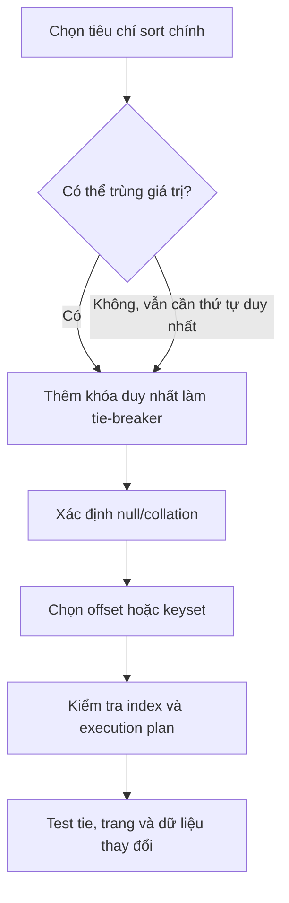

# Sort nhiều cột và thứ tự ổn định khi trùng giá trị

Khi truy vấn nhiều bản ghi, sắp xếp theo một cột thường chưa đủ để xác định thứ tự duy nhất. Ví dụ nhiều đơn hàng có cùng thời điểm tạo; database có thể trả chúng theo bất kỳ thứ tự nào nếu câu SQL không chỉ rõ tiêu chí phụ. Khi kết hợp với phân trang, thứ tự không xác định có thể làm một bản ghi xuất hiện ở hai trang hoặc bị bỏ qua giữa các lần truy vấn.

Trong Spring Data JDBC, có thể sắp xếp theo nhiều thuộc tính bằng `Sort` hoặc khai báo thứ tự trong tên derived query. Để kết quả ổn định khi các giá trị chính bị trùng, hãy thêm một tiêu chí phụ có tính duy nhất, thường là khóa chính `id`. Bài học dùng ví dụ đơn hàng để giải thích cách kết hợp nhiều cột, cách áp dụng vào phân trang offset/keyset và cách kiểm thử thứ tự kết quả.

## 1. Vì sao sắp xếp một cột có thể chưa đủ?

Giả sử bảng `purchase_order` có các đơn hàng sau:

| id | customer_id | status | created_at |
| ---: | ---: | --- | --- |
| 101 | 7 | CREATED | 2026-11-10 09:00 |
| 102 | 7 | CONFIRMED | 2026-11-10 09:00 |
| 103 | 7 | CREATED | 2026-11-10 09:00 |
| 104 | 7 | CANCELLED | 2026-11-09 15:30 |
| 105 | 7 | CREATED | 2026-11-08 12:00 |

Truy vấn:

```sql
SELECT id, status, created_at
FROM purchase_order
WHERE customer_id = 7
ORDER BY created_at DESC;
```

chỉ quy định đơn mới hơn đứng trước. Ba đơn 101, 102 và 103 có cùng `created_at`, nên SQL không quy định thứ tự tương đối giữa chúng. Database có thể trả chúng theo thứ tự khác nhau do execution plan, index, cập nhật dữ liệu hoặc cách lưu vật lý.

SQL chỉ bảo đảm thứ tự theo các biểu thức `ORDER BY` được khai báo. Nếu các biểu thức đó bằng nhau, thứ tự giữa các hàng vẫn không xác định.

## 2. Thêm tiêu chí phụ có tính duy nhất

Một thứ tự ổn định thường có dạng:

```sql
SELECT id, status, created_at
FROM purchase_order
WHERE customer_id = 7
ORDER BY created_at DESC, id DESC;
```

Cách đọc:

1. Sắp xếp `created_at` giảm dần: đơn mới hơn đứng trước.
2. Nếu hai đơn có cùng `created_at`, sắp xếp `id` giảm dần.
3. Vì `id` là khóa chính duy nhất, mỗi hàng có vị trí xác định trong thứ tự kết quả.

Với dữ liệu ví dụ, thứ tự sẽ là 103, 102, 101, 104, 105. Nếu muốn ID nhỏ hơn đứng trước trong nhóm cùng thời điểm, dùng `id ASC`.

Tiêu chí cuối cùng nên tạo ra thứ tự duy nhất trong tập kết quả. Khóa chính là lựa chọn phổ biến vì nó duy nhất và không null. Một mã nghiệp vụ chỉ dùng được nếu database thực sự bảo đảm tính duy nhất trong phạm vi truy vấn.

**Thứ tự ổn định không có nghĩa bản thân dữ liệu bất biến.** Nếu một đơn được cập nhật `created_at` hoặc được thêm/xóa trong lúc người dùng phân trang, vị trí của các đơn vẫn có thể thay đổi. Tiêu chí phụ giải quyết trường hợp các giá trị sắp xếp bằng nhau; nó không khóa snapshot dữ liệu giữa nhiều request.

## 3. Sắp xếp nhiều cột bằng Spring Data Sort

Spring Data cung cấp `Sort` để mô tả nhiều tiêu chí theo thứ tự ưu tiên. Ví dụ repository:

```java
package com.example.orders.repository;

import java.util.List;

import com.example.orders.domain.PurchaseOrder;
import org.springframework.data.domain.Sort;
import org.springframework.data.repository.CrudRepository;

public interface PurchaseOrderRepository
        extends CrudRepository<PurchaseOrder, Long> {

    List<PurchaseOrder> findByCustomerId(
        Long customerId,
        Sort sort
    );
}
```

Gọi repository với hai tiêu chí:

```java
Sort sort = Sort.by(
    Sort.Order.desc("createdAt"),
    Sort.Order.desc("id")
);

List<PurchaseOrder> orders =
    purchaseOrderRepository.findByCustomerId(7L, sort);
```

Thứ tự các `Sort.Order` trong `Sort.by(...)` chính là thứ tự ưu tiên. Tiêu chí đầu tiên được áp dụng trước; tiêu chí thứ hai phân định các hàng bằng nhau theo tiêu chí đầu tiên.

Về mặt SQL, yêu cầu trên tương đương:

```sql
SELECT ...
FROM purchase_order
WHERE customer_id = ?
ORDER BY created_at DESC, id DESC;
```

Đây là cách diễn đạt SQL về mặt ý nghĩa; câu lệnh thực tế còn phụ thuộc mapping, dialect và phiên bản framework.

### Thứ tự tăng/giảm có thể khác nhau giữa các cột

Ví dụ muốn nhóm trạng thái theo alphabet, sau đó đơn mới nhất đứng trước trong mỗi trạng thái:

```java
Sort sort = Sort.by(
    Sort.Order.asc("status"),
    Sort.Order.desc("createdAt"),
    Sort.Order.desc("id")
);
```

SQL tương ứng về ý nghĩa:

```sql
ORDER BY status ASC, created_at DESC, id DESC
```

Không phải mọi cột đều phải cùng chiều. Chọn chiều theo cách người dùng cần đọc kết quả, sau đó thêm khóa duy nhất ở cuối.

### Dùng Sort với các method khác

`Sort` là tham số đặc biệt của Spring Data query methods. Nó không phải giá trị domain cần bind như `customerId`. Có thể kết hợp với điều kiện derived query:

```java
List<PurchaseOrder> findByStatus(
    String status,
    Sort sort
);

List<PurchaseOrder> findByCustomerIdAndStatus(
    Long customerId,
    String status,
    Sort sort
);
```

Tên property trong `Sort.Order` là tên thuộc tính Java của domain model. Nếu Java có `createdAt` và mapping tạo cột `created_at`, hãy dùng `"createdAt"` trong `Sort`, không dùng tên cột SQL `"created_at"`.

## 4. Khai báo thứ tự cố định bằng OrderBy trong method name

Nếu một truy vấn luôn có cùng thứ tự, có thể mã hóa trực tiếp trong tên derived query:

```java
List<PurchaseOrder> findByCustomerIdOrderByCreatedAtDescIdDesc(
    Long customerId
);
```

Method này có thứ tự tương đương `created_at DESC, id DESC`.

Một ví dụ khác:

```java
List<PurchaseOrder> findByStatusOrderByTotalAmountDescIdAsc(
    String status
);
```

Tương ứng với:

```sql
WHERE status = ?
ORDER BY total_amount DESC, id ASC
```

Chọn giữa `OrderBy` và `Sort` theo mục đích:

| Cách | Khi phù hợp |
| --- | --- |
| `OrderByCreatedAtDescIdDesc` | Một method luôn dùng cùng thứ tự, tên vẫn ngắn và dễ hiểu. |
| Tham số `Sort` | Caller cần chọn một trong nhiều thứ tự đã được ứng dụng cho phép. |
| Custom SQL | Cần biểu thức sắp xếp phức tạp, hàm database, null ordering đặc thù hoặc keyset predicate riêng. |

Không nên tạo method name dài đến mức khó đọc chỉ để hỗ trợ mọi tổ hợp sort. Khi thứ tự thay đổi theo màn hình hoặc tùy chọn người dùng, `Sort` thường linh hoạt hơn.

## 5. Sắp xếp nhiều cột và phân trang offset

Phân trang offset thường chia kết quả thành các đoạn theo `LIMIT` và `OFFSET`:

```sql
SELECT id, status, created_at
FROM purchase_order
WHERE customer_id = 7
ORDER BY created_at DESC, id DESC
LIMIT 2 OFFSET 0;

SELECT id, status, created_at
FROM purchase_order
WHERE customer_id = 7
ORDER BY created_at DESC, id DESC
LIMIT 2 OFFSET 2;
```

Với dữ liệu tĩnh và thứ tự duy nhất, trang đầu có thể là 103, 102; trang tiếp theo là 101, 104. Mỗi hàng có một vị trí rõ ràng trong tập kết quả.

Nếu chỉ dùng `ORDER BY created_at DESC`, database có quyền đổi thứ tự của các hàng cùng thời điểm. Khi ranh giới trang cắt ngang nhóm có cùng `created_at`, cùng một đơn có thể xuất hiện ở cả hai trang hoặc không xuất hiện trong trang nào khi truy vấn lại.

Không dùng `LIMIT/OFFSET` mà thiếu `ORDER BY` nếu người dùng kỳ vọng các trang có thứ tự lặp lại. Một tập kết quả không có thứ tự xác định không có khái niệm trang 1 và trang 2 ổn định.

### Ví dụ custom repository với limit/offset

Khi cần kiểm soát rõ câu SQL, có thể dùng `JdbcTemplate`:

```java
public List<OrderSummary> findPage(
        long customerId,
        int page,
        int pageSize) {

    if (page < 0 || pageSize < 1 || pageSize > 100) {
        throw new IllegalArgumentException("Invalid page request");
    }

    long offset = (long) page * pageSize;

    String sql = """
        SELECT id, customer_id, status, total_amount, created_at
        FROM purchase_order
        WHERE customer_id = ?
        ORDER BY created_at DESC, id DESC
        LIMIT ? OFFSET ?
        """;

    return jdbc.query(
        sql,
        rowMapper,
        customerId,
        pageSize,
        offset
    );
}
```

`LIMIT` và `OFFSET` là giá trị số nên có thể bind trên nhiều database/driver; cú pháp và khả năng bind cụ thể vẫn cần kiểm tra theo dialect. Tên bảng, tên cột và thứ tự `ORDER BY` vẫn là cấu trúc SQL đã được xác định trong code.

Nếu dùng `Pageable` trong repository/query path của phiên bản Spring Data JDBC dự án, có thể đặt `Sort` trên đối tượng paging. Hãy kiểm tra API và khả năng hỗ trợ đúng phiên bản đang dùng; dù dùng `Pageable` hay tự viết `LIMIT/OFFSET`, thứ tự phải có khóa phân định duy nhất.

## 6. Vì sao thứ tự ổn định vẫn chưa đủ khi có ghi đồng thời?

Giả sử người dùng đang xem trang đầu:

- Trang 1 lấy hai đơn mới nhất: 103, 102.
- Trước khi người dùng yêu cầu trang 2, một đơn mới có ID 106 được thêm với thời điểm mới nhất.
- Trang 2 vẫn dùng `OFFSET 2`.

Thứ tự mới là 106, 103, 102, 104, 105. Trang 2 bắt đầu từ vị trí thứ ba và có thể trả 102, 104. Đơn 102 bị lặp lại dù câu `ORDER BY` đã có `id` làm tiêu chí phụ.

Đây không phải lỗi tie-breaking. Offset được tính lại trên tập kết quả đã thay đổi; bản ghi mới chèn vào đầu làm dịch chuyển vị trí các hàng cũ.

Nếu dữ liệu thay đổi thường xuyên, cần cân nhắc:

- Chấp nhận tính chất best-effort của offset pagination.
- Giữ một snapshot nhất quán trong cùng transaction khi quy trình cho phép.
- Dùng keyset/seek pagination để trang tiếp theo bắt đầu từ giá trị cuối cùng đã thấy.
- Với báo cáo cần snapshot qua nhiều request, lưu snapshot/version hoặc tạo một tập kết quả cố định theo nghiệp vụ.

## 7. Keyset pagination: dùng các giá trị sort làm con trỏ

Keyset pagination không bỏ qua một số lượng hàng bằng `OFFSET`. Thay vào đó, request trang tiếp theo gửi lại các giá trị sắp xếp của hàng cuối cùng ở trang trước.

Giả sử thứ tự là:

```sql
ORDER BY created_at DESC, id DESC
```

Hàng cuối của trang hiện tại có:

- `lastCreatedAt = 2026-11-10 09:00`
- `lastId = 102`

Trang tiếp theo lấy những hàng đứng sau cặp giá trị đó trong thứ tự giảm dần:

```sql
SELECT id, status, created_at
FROM purchase_order
WHERE customer_id = :customerId
  AND (
       created_at < :lastCreatedAt
       OR (
           created_at = :lastCreatedAt
           AND id < :lastId
       )
  )
ORDER BY created_at DESC, id DESC
LIMIT :pageSize;
```

Điều kiện có hai nhánh vì:

1. Hàng có `created_at` nhỏ hơn nằm sau hàng cuối trong thứ tự giảm dần.
2. Nếu thời điểm bằng nhau, ID nhỏ hơn nằm sau khi cũng sắp xếp ID giảm dần.

Kết quả tiếp theo là 101, 104 trong ví dụ trên. Nếu một đơn mới được thêm ở đầu danh sách sau trang đầu, con trỏ vẫn tiếp tục từ cặp `(lastCreatedAt, lastId)`; hàng mới không làm dịch chuyển vị trí con trỏ như offset.

### Keyset predicate phải khớp chính xác thứ tự

Với thứ tự `status ASC, created_at DESC, id DESC`, điều kiện trang tiếp theo phức tạp hơn:

- `status > :lastStatus`, hoặc
- trạng thái bằng nhau và `created_at < :lastCreatedAt`, hoặc
- trạng thái và thời điểm đều bằng nhau, nhưng `id < :lastId`.

Tổng quát, với các khóa sort nhiều cột, điều kiện seek so sánh từ trái sang phải: giữ tất cả cột trước bằng giá trị cursor, rồi so sánh cột tiếp theo theo chiều sort của nó. Mỗi nhánh tiếp theo thêm điều kiện bằng cho các cột trước đó.

Nếu có `NULL`, collation hoặc biểu thức chuẩn hóa trong `ORDER BY`, cursor predicate cũng phải phản ánh đúng cách database sắp xếp những giá trị đó. Với thứ tự phức tạp, nên viết và kiểm thử custom SQL thay vì tự tạo predicate một cách suy đoán.

### Con trỏ cần mang đủ giá trị sort

Nếu thứ tự là `created_at DESC, id DESC`, cursor phải chứa cả `created_at` lẫn `id`. Chỉ gửi ID là không đủ để tái tạo vị trí theo thứ tự đã chọn.

Cursor API có thể mã hóa hai giá trị đó thành token opaque. Server nên kiểm tra tính hợp lệ, phạm vi filter và thứ tự sort gắn với cursor; không tin một cursor tùy ý do client tự tạo nếu nó có thể thay đổi tenant, điều kiện lọc hoặc dữ liệu nhạy cảm.

Keyset pagination thường hiệu quả hơn offset ở các trang sâu khi có index phù hợp, nhưng nó không tự cung cấp snapshot tuyệt đối. Các bản ghi đã tồn tại vẫn có thể đổi giá trị sort giữa các request. Nếu cần kết quả nhất quán như một snapshot báo cáo, cần cơ chế snapshot riêng.

## 8. Giá trị NULL và thứ tự sắp xếp

Nếu cột sort cho phép `NULL`, thứ tự null có thể khác giữa các database và dialect. Ví dụ `created_at` nullable có thể khiến các hàng không có thời điểm được đặt ở đầu hoặc cuối tùy hệ quản trị.

Spring Data `Sort.Order` có các hint như `nullsFirst()` và `nullsLast()`:

```java
Sort sort = Sort.by(
    Sort.Order.desc("createdAt").nullsLast(),
    Sort.Order.desc("id")
);
```

Đây là yêu cầu/hint về null handling. Khả năng dịch nó thành SQL và mức hỗ trợ phụ thuộc store/dialect; không mặc định mọi database đều áp dụng giống nhau. Nếu quy tắc null là yêu cầu nghiệp vụ quan trọng, hãy kiểm tra SQL thực tế và chạy integration test trên database production.

Một lựa chọn khác là làm cho cột sắp xếp không null bằng schema/domain nếu nghiệp vụ yêu cầu giá trị luôn có. Đừng thêm giá trị mặc định giả chỉ để dễ sort nếu nó làm sai nghĩa dữ liệu.

## 9. Sắp xếp chuỗi, collation và ignoreCase

Sắp xếp chuỗi cũng phụ thuộc collation của database. Ví dụ tên `An`, `an`, `Ánh` và `Anh` có thể được sắp xếp khác nhau tùy cấu hình locale/collation.

Spring Data có thể biểu diễn sort không phân biệt hoa thường với `ignoreCase()`:

```java
Sort sort = Sort.by(
    Sort.Order.asc("status").ignoreCase(),
    Sort.Order.asc("id")
);
```

Việc dịch yêu cầu này thành biểu thức SQL cụ thể phụ thuộc database/dialect và có thể ảnh hưởng khả năng dùng index. Nếu ứng dụng cần thứ tự ngôn ngữ ổn định, hãy xác định collation/normalization ở database và kiểm thử với dữ liệu tiếng Việt thực tế.

Cũng như các cột khác, nếu nhiều chuỗi có cùng kết quả sort sau khi bỏ qua hoa thường, cần thêm tiêu chí duy nhất ở cuối để phân định thứ tự.

## 10. Dynamic sorting từ API: chỉ cho phép lựa chọn đã định nghĩa

Nếu API cho phép người dùng chọn kiểu sắp xếp, không chuyển trực tiếp chuỗi từ request thành property sort. Hãy dùng enum/allowlist:

```java
public enum OrderSort {
    NEWEST,
    HIGHEST_AMOUNT,
    STATUS
}

public static Sort toSort(OrderSort choice) {
    return switch (choice) {
        case NEWEST -> Sort.by(
            Sort.Order.desc("createdAt"),
            Sort.Order.desc("id")
        );
        case HIGHEST_AMOUNT -> Sort.by(
            Sort.Order.desc("totalAmount"),
            Sort.Order.desc("id")
        );
        case STATUS -> Sort.by(
            Sort.Order.asc("status"),
            Sort.Order.desc("createdAt"),
            Sort.Order.desc("id")
        );
    };
}
```

Mỗi lựa chọn đều có tiêu chí phân định cuối cùng. Với `STATUS`, nếu nhiều đơn có cùng trạng thái và thời điểm, `id DESC` xác định thứ tự giữa chúng.

Không làm:

```java
Sort sort = Sort.by(request.sortBy());
```

nếu `sortBy` là chuỗi tùy ý từ client. Hãy xác thực lựa chọn, ánh xạ nó sang `Sort` đã định nghĩa và giữ tiêu chí ID cuối cùng.

## 11. Index cho sort nhiều cột

Sắp xếp đúng chưa đảm bảo truy vấn nhanh. Database có thể phải đọc nhiều hàng rồi sort riêng nếu index không phù hợp.

Với truy vấn thường dùng:

```sql
SELECT ...
FROM purchase_order
WHERE customer_id = ?
ORDER BY created_at DESC, id DESC
LIMIT ?;
```

Có thể xem xét index ghép:

```sql
CREATE INDEX idx_order_customer_created_id
ON purchase_order (customer_id, created_at DESC, id DESC);
```

Thứ tự cột index có ý nghĩa:

- `customer_id` đứng đầu vì là điều kiện equality phổ biến.
- `created_at` và `id` theo sau để hỗ trợ thứ tự kết quả.
- Index có thể giúp database đọc theo đúng thứ tự và giảm bước sort riêng, tùy optimizer và database.

Nếu truy vấn theo trạng thái rồi sắp xếp:

```sql
WHERE customer_id = ?
  AND status = ?
ORDER BY created_at DESC, id DESC
```

một index khác có thể phù hợp:

```sql
CREATE INDEX idx_order_customer_status_created_id
ON purchase_order (customer_id, status, created_at DESC, id DESC);
```

Không tạo mọi tổ hợp index chỉ vì có thể. Index chiếm dung lượng và làm tăng chi phí ghi/cập nhật. Hãy kiểm tra workload thực tế, selectivity, kích thước bảng và execution plan bằng công cụ của database.

## 12. Sắp xếp root khác với sắp xếp collection con

Khi repository trả về danh sách `PurchaseOrder`, `Sort` áp dụng cho thứ tự các aggregate root trong kết quả query.

Nó không tự quy định thứ tự phần tử bên trong `PurchaseOrder.lines`. Nếu collection con có thứ tự nghiệp vụ, cần mô hình hóa thứ tự đó riêng, chẳng hạn cột key/index của `@MappedCollection` hoặc một thuộc tính `position` trong bảng con, rồi kiểm soát việc lưu và đọc theo mapping phù hợp.

Ví dụ:

- Sắp xếp danh sách đơn theo `createdAt DESC, id DESC`: thứ tự giữa các đơn.
- Sắp xếp các dòng hàng theo `lineNo ASC`: thứ tự bên trong một đơn.

Không giả định một `Sort` của repository tự động sắp xếp mọi collection lồng nhau hoặc aggregate khác.

## 13. Kiểm thử thứ tự ổn định

Một test chỉ tạo các hàng có `createdAt` khác nhau sẽ không phát hiện lỗi tie-breaking. Hãy cố ý tạo nhiều hàng có cùng giá trị ở cột sort chính.

Ví dụ dữ liệu:

```sql
INSERT INTO purchase_order (id, customer_id, status, created_at)
VALUES
    (101, 7, 'CREATED',   '2026-11-10 09:00:00'),
    (102, 7, 'CONFIRMED', '2026-11-10 09:00:00'),
    (103, 7, 'CREATED',   '2026-11-10 09:00:00'),
    (104, 7, 'CANCELLED', '2026-11-09 15:30:00');
```

Với sort `createdAt DESC, id DESC`, kỳ vọng ID:

```text
103, 102, 101, 104
```

Các test quan trọng:

1. Nhiều hàng cùng `createdAt` được phân định bằng ID đúng chiều.
2. Nhiều tiêu chí sort có chiều khác nhau được áp dụng theo đúng thứ tự.
3. Các trang offset trên tập dữ liệu tĩnh không trùng và không bỏ sót hàng.
4. Dynamic sort chỉ nhận enum/allowlist hợp lệ.
5. Null handling và case-insensitive sort được kiểm tra trên database đích nếu ứng dụng phụ thuộc vào chúng.
6. Keyset cursor chứa đủ tất cả giá trị sort và trang tiếp theo không lặp hàng ở ranh giới.
7. Khi có insert/update đồng thời, test xác nhận hành vi theo chính sách đã chọn (best-effort, snapshot hoặc keyset).

Ví dụ kiểm tra thứ tự với AssertJ:

```java
List<PurchaseOrder> result =
    repository.findByCustomerId(
        7L,
        Sort.by(
            Sort.Order.desc("createdAt"),
            Sort.Order.desc("id")
        )
    );

assertThat(result)
    .extracting(PurchaseOrder::id)
    .containsExactly(103L, 102L, 101L, 104L);
```

Đây là test minh họa; fixture phải cung cấp các cột bắt buộc khác của aggregate và dùng database/test setup phù hợp với dự án.

### Kiểm tra phân trang offset

Với page size bằng 2 trên tập dữ liệu tĩnh:

- Trang 0: 103, 102.
- Trang 1: 101, 104.

Ghép hai trang phải cho đúng thứ tự đầy đủ và không có ID trùng. Nếu test không có các giá trị sort bị trùng, nó chưa chứng minh tiêu chí phụ hoạt động.

## 14. Quy trình chọn thứ tự sort cho một endpoint

Khi thiết kế endpoint danh sách, hãy xác định:

1. **Cột chính:** người dùng quan tâm điều gì, ví dụ thời gian mới nhất hoặc tổng tiền cao nhất?
2. **Chiều sort:** tăng dần hay giảm dần?
3. **Tie-breaker:** cột nào bảo đảm thứ tự duy nhất, thường là primary key?
4. **Null semantics:** cột có nullable không, null phải nằm ở đâu?
5. **Collation:** nếu sort chuỗi, quy tắc hoa/thường và locale là gì?
6. **Pagination:** offset hay keyset phù hợp với khối lượng và tần suất thay đổi?
7. **Index:** index nào hỗ trợ filter + sort?
8. **API contract:** client được chọn những kiểu sort nào?
9. **Concurrency:** chấp nhận dữ liệu thay đổi giữa các trang hay cần snapshot?
10. **Test:** đã có fixture tạo tie và kiểm tra ranh giới trang chưa?

Sơ đồ quyết định:



## 15. Những hiểu lầm thường gặp

- **`ORDER BY created_at DESC` luôn trả cùng thứ tự khi timestamp trùng.** Không đúng. Thứ tự giữa các hàng có giá trị bằng nhau không được bảo đảm.
- **Chỉ cần thêm một cột bất kỳ làm sort phụ.** Không đủ nếu cột đó vẫn có thể trùng; tiêu chí cuối cùng nên duy nhất trong tập kết quả.
- **`Sort` nhận tên cột SQL.** Spring Data sort thường dùng property của domain model; `createdAt` là property, `created_at` là cột theo mapping.
- **Sắp xếp root sẽ sắp xếp cả collection con.** Không đúng. Thứ tự root và thứ tự child collection là hai yêu cầu khác nhau.
- **Có tie-breaker thì offset pagination không bao giờ lặp/bỏ sót.** Không đúng khi tập dữ liệu thay đổi giữa các request; offset vẫn bị dịch chuyển.
- **Keyset pagination không cần unique sort.** Không đúng. Cursor cần một thứ tự toàn phần, thường có khóa chính ở cuối.
- **`nullsLast()` chắc chắn tạo cùng SQL trên mọi database.** Không đúng. Đây là hint có thể phụ thuộc dialect/store.
- **Index phải có mọi cột trong mọi thứ tự sort.** Không đúng. Thiết kế index dựa trên truy vấn thực tế và execution plan.

## 16. Câu hỏi tự kiểm tra

- Vì sao `ORDER BY created_at DESC` không xác định thứ tự giữa các đơn có cùng timestamp?
- Thêm `id DESC` ở cuối giúp gì nếu `id` là primary key?
- Trong `Sort.by(Order.desc("createdAt"), Order.asc("id"))`, tiêu chí nào được ưu tiên trước?
- Khi nào nên dùng `OrderBy...` trong method name thay vì tham số `Sort`?
- Vì sao `LIMIT/OFFSET` cần một thứ tự xác định?
- Tại sao insert mới ở đầu danh sách có thể làm trang offset tiếp theo lặp bản ghi?
- Keyset pagination dùng giá trị nào làm cursor khi sort theo hai cột?
- Điều kiện seek thay đổi ra sao nếu một cột sort ASC và cột khác DESC?
- `nullsFirst`/`nullsLast` và `ignoreCase` có phụ thuộc database không?
- Index ghép nên phản ánh thứ tự filter và sort như thế nào?
- Làm thế nào kiểm thử thứ tự ổn định khi nhiều hàng có cùng giá trị sort chính?

Khi sắp xếp nhiều cột, hãy coi tiêu chí cuối cùng là phần hoàn thiện thứ tự: các cột nghiệp vụ quyết định nhóm và hướng hiển thị, còn khóa duy nhất phân định những hàng bằng nhau. Kết hợp thứ tự đó với cách phân trang phù hợp, index tương ứng và test có dữ liệu trùng giá trị để kết quả có thể dự đoán được.
