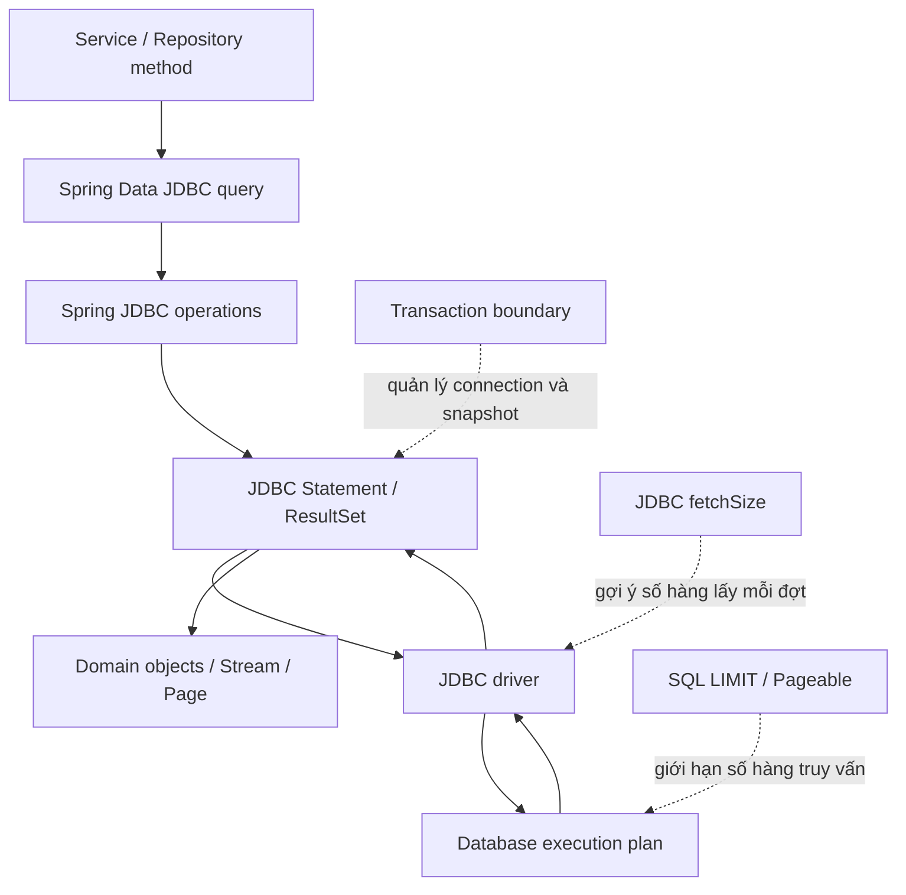
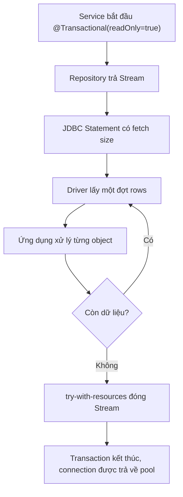

# Lựa chọn fetch size, giới hạn kết quả và phạm vi giao dịch khi đọc

Khi đọc dữ liệu bằng Spring Data JDBC, ba quyết định ảnh hưởng trực tiếp tới hiệu năng và tài nguyên hệ thống là:

- **Fetch size:** JDBC driver lấy kết quả từ database theo từng đợt có kích thước như thế nào.
- **Giới hạn kết quả:** ứng dụng cần bao nhiêu hàng cho một lần truy vấn, một trang hoặc một lô xử lý.
- **Phạm vi transaction:** connection và transaction cần được giữ trong bao lâu để đọc dữ liệu an toàn, đặc biệt khi xử lý kết quả dạng Stream.

Ba khái niệm này liên quan nhưng không thay thế nhau. `fetchSize` không phải giới hạn tổng số hàng; `LIMIT` không quyết định driver lấy dữ liệu theo từng đợt ra sao; transaction xác định vòng đời connection và ảnh hưởng tới khả năng streaming của một số JDBC driver.

Bài học sử dụng Spring Data JDBC và Spring JDBC để giải thích cách lựa chọn từng cơ chế, cách cấu hình trong Spring Boot và cách tổ chức code đọc dữ liệu lớn mà không giữ quá nhiều object trong bộ nhớ hoặc mở connection quá lâu.

## 1. Bức tranh tổng thể của một thao tác đọc

Một repository method như:

```java
List<PurchaseOrder> findByStatus(OrderStatus status);
```

có thể trả về toàn bộ aggregate phù hợp với điều kiện. Spring Data JDBC tạo SQL, dùng `NamedParameterJdbcOperations` để thực thi và ánh xạ dữ liệu thành domain object.

Trong quá trình đó có nhiều tầng:

1. **Query method/repository:** xác định điều kiện, thứ tự, trang hoặc giới hạn kết quả.
2. **Spring Data JDBC:** tạo câu SQL và materialize aggregate.
3. **Spring JDBC:** tạo Statement/PreparedStatement, cấu hình fetch size và thực thi.
4. **JDBC driver:** quyết định cách lấy ResultSet từ database.
5. **Database:** thực hiện execution plan, lọc, sắp xếp và trả các hàng kết quả.



Có thể nhớ sự khác biệt như sau:

| Cơ chế | Câu hỏi được giải quyết | Ví dụ |
| --- | --- | --- |
| SQL limit/pagination | Một truy vấn cần trả tối đa bao nhiêu hàng? | `LIMIT 100`, `Pageable` |
| Fetch size | Driver nên lấy bao nhiêu hàng trong mỗi lần fetch? | `setFetchSize(500)` |
| Transaction | Connection/ResultSet được giữ trong phạm vi nào? | `@Transactional(readOnly = true)` |

## 2. Fetch size là gì?

**Fetch size** là một gợi ý cho JDBC driver về số hàng nên lấy từ database trong mỗi lần cần thêm dữ liệu của ResultSet. Nó thường hữu ích khi query trả về nhiều hàng và ứng dụng muốn xử lý dữ liệu theo từng đợt.

Ví dụ, query có 100.000 hàng và fetch size là 500:

```text
Tổng kết quả: 100.000 hàng

Đợt fetch 1: 500 hàng
Đợt fetch 2: 500 hàng
Đợt fetch 3: 500 hàng
...
Đợt fetch cuối: phần còn lại
```

Con số 500 là ví dụ. Driver có thể diễn giải fetch size khác nhau; đây không phải cam kết rằng mọi database đều gửi chính xác 500 hàng trong mỗi network packet hoặc chỉ giữ đúng 500 object trong bộ nhớ.

### 2.1. Fetch size không giới hạn tổng kết quả

Nếu query trả 100.000 hàng và fetch size bằng 500, ứng dụng vẫn có thể đọc hết 100.000 hàng. Driver chỉ chia việc lấy kết quả thành các đợt khi cơ chế cursor/fetch được hỗ trợ và kích hoạt.

Ngược lại, SQL:

```sql
SELECT id, order_number
FROM purchase_orders
ORDER BY id
LIMIT 100;
```

chỉ yêu cầu database trả tối đa 100 hàng, bất kể fetch size đang là bao nhiêu.

### 2.2. Fetch size là hint, không phải bảo đảm streaming

JDBC định nghĩa `Statement.setFetchSize(int)` như một gợi ý cho driver. Driver có thể bỏ qua hoặc áp dụng theo cách riêng. Một số driver tải toàn bộ ResultSet về client dù fetch size được đặt thành số dương; một số driver hỗ trợ server-side cursor và lấy từng đợt.

Do đó, chỉ đặt `fetch-size: 500` không đủ để kết luận ứng dụng đã streaming dữ liệu. Cần xét đồng thời:

- Kiểu trả về và cách tiêu thụ kết quả ở ứng dụng.
- Cách Spring JDBC tạo Statement.
- Hành vi của JDBC driver.
- Auto-commit và transaction.
- Cấu hình riêng của database/driver.

## 3. Cấu hình fetch size trong Spring Boot

Spring Boot cung cấp các thuộc tính cho `JdbcTemplate`:

```yaml
spring:
  jdbc:
    template:
      fetch-size: 500
      max-rows: -1
      query-timeout: 30s
```

Ý nghĩa:

| Thuộc tính | Ý nghĩa |
| --- | --- |
| `spring.jdbc.template.fetch-size` | Số hàng gợi ý cho mỗi lần driver cần fetch thêm dữ liệu. |
| `spring.jdbc.template.max-rows` | Giới hạn số hàng tối đa của JDBC Statement. |
| `spring.jdbc.template.query-timeout` | Thời gian chờ thực thi query, theo đơn vị thời gian Spring Boot hỗ trợ. |

Giá trị mặc định của `fetch-size` và `max-rows` là `-1`, tức dùng cấu hình mặc định của JDBC driver/Statement.

`NamedParameterJdbcTemplate` của Spring Boot sử dụng lại `JdbcTemplate` bên dưới. Spring Data JDBC truy cập database qua `NamedParameterJdbcOperations`; khi dùng cấu hình Spring Boot mặc định, hãy bảo đảm các operations được cấu hình dùng template đã được tùy chỉnh. Nếu dự án tự khai báo nhiều `JdbcTemplate` hoặc `NamedParameterJdbcOperations`, cần kiểm tra bean thực tế mà Spring Data JDBC sử dụng.

### 3.1. Chọn giá trị fetch size

Không có một con số tối ưu cho mọi ứng dụng. Fetch size lớn có thể giảm số lần round trip, nhưng cũng tăng lượng dữ liệu driver giữ tại một thời điểm. Fetch size nhỏ giảm kích thước mỗi đợt nhưng có thể tăng số lần trao đổi với database.

Một số giá trị thử nghiệm:

| Fetch size | Tình huống có thể cân nhắc |
| --- | --- |
| `0` | Dùng cách xử lý mặc định của driver trong JDBC. |
| `100` | Lô nhỏ, mỗi row tương đối lớn hoặc cần giới hạn dữ liệu client giữ. |
| `500` | Điểm bắt đầu thử nghiệm cho kết quả nhiều hàng có kích thước vừa phải. |
| `1.000` trở lên | Có thể phù hợp khi row nhỏ và chi phí round trip đáng kể; cần đo memory/network. |

Các con số chỉ là điểm bắt đầu để benchmark. Hãy đo thời gian truy vấn, bộ nhớ, số round trip và tải database bằng đúng driver và workload của ứng dụng.

### 3.2. max-rows không phải SQL LIMIT

`spring.jdbc.template.max-rows` cấu hình giới hạn hàng ở cấp JDBC Statement. Nó có thể ngăn ứng dụng nhận quá số hàng được cấu hình, nhưng không thay thế một truy vấn có `WHERE`, `ORDER BY` và `LIMIT` phù hợp.

Nếu đặt `max-rows: 100` ở cấu hình toàn cục, các truy vấn dùng template đó có thể đều bị giới hạn. Đây là thay đổi ảnh hưởng rộng, nên không dùng để thay thế pagination cho một màn hình cụ thể.

Khi muốn giới hạn một use case, hãy ưu tiên giới hạn trong query/repository method. Dùng max-rows khi chủ đích là áp dụng một giới hạn ở tầng Statement cho các query thuộc phạm vi template đó.

## 4. Streaming query results bằng Stream

Spring Data JDBC hỗ trợ query method trả về `Stream<T>`. Khác với `List<T>` cần materialize toàn bộ kết quả, Stream cho phép ứng dụng tiêu thụ các phần tử khi chúng được cung cấp từ database.

Repository:

```java
import java.util.stream.Stream;

import org.springframework.data.jdbc.repository.query.Query;
import org.springframework.data.repository.ListCrudRepository;
import org.springframework.data.repository.query.Param;

public interface PurchaseOrderRepository
        extends ListCrudRepository<PurchaseOrder, Long> {

    @Query("""
        SELECT id, order_number, status
        FROM purchase_orders
        WHERE status = :status
        ORDER BY id
        """)
    Stream<PurchaseOrder> streamByStatus(
        @Param("status") String status
    );
}
```

Spring Data JDBC giữ connection liên quan tới kết quả Stream mở trong khi Stream còn được sử dụng. Vì thế, **phải đóng Stream** để giải phóng ResultSet/Statement/connection.

### 4.1. Dùng try-with-resources

Ví dụ xử lý kết quả trong service:

```java
import java.util.stream.Stream;

import org.springframework.stereotype.Service;
import org.springframework.transaction.annotation.Transactional;

@Service
public class OrderExportService {

    private final PurchaseOrderRepository orders;

    public OrderExportService(PurchaseOrderRepository orders) {
        this.orders = orders;
    }

    @Transactional(readOnly = true)
    public void exportByStatus(String status) {
        try (Stream<PurchaseOrder> stream =
                 orders.streamByStatus(status)) {

            stream.forEach(order -> {
                // Ghi từng đơn hàng ra file hoặc xử lý theo lô.
                process(order);
            });
        }
    }

    private void process(PurchaseOrder order) {
        // Logic xử lý một aggregate.
    }
}
```

Trong ví dụ:

1. Transaction bắt đầu trước khi service thực thi.
2. Repository mở query và trả Stream gắn với tài nguyên JDBC.
3. Ứng dụng tiêu thụ từng phần tử trong transaction.
4. Khối `try-with-resources` đóng Stream khi hoàn tất hoặc khi có exception.
5. Phương thức service kết thúc và transaction được hoàn tất.

Không trả Stream ra khỏi service transaction rồi mới tiêu thụ ở controller hoặc một thread khác. Khi method transaction kết thúc, connection có thể đã được giải phóng; Stream không còn bảo đảm đọc tiếp được.

### 4.2. Stream không tự động có nghĩa là driver fetch theo từng đợt

Stream giúp ứng dụng tiêu thụ kết quả tăng dần, nhưng không bảo đảm JDBC driver không tải toàn bộ ResultSet về client. Muốn giảm bộ nhớ phía driver, cần cấu hình fetch size và đáp ứng điều kiện của driver.

Nói cách khác:

- `Stream<T>` kiểm soát cách code ứng dụng tiêu thụ kết quả.
- `fetchSize` gợi ý cách JDBC driver lấy kết quả.
- Transaction và driver quyết định khả năng sử dụng cursor trong database.

Ba điều kiện cần được cấu hình đồng bộ.

### 4.3. Không dùng Stream nếu chỉ cần một tập nhỏ

Nếu query chỉ trả vài chục hoặc vài trăm hàng, `List<T>` thường đơn giản hơn. Stream mang theo tài nguyên mở và yêu cầu đóng đúng cách; không cần dùng nó cho mọi repository method.

## 5. PostgreSQL: fetch size và transaction

PostgreSQL JDBC driver (pgJDBC) mặc định có thể lấy toàn bộ kết quả query về client. Để sử dụng cursor-based fetching, driver cần một số điều kiện quan trọng:

- Fetch size phải là số dương.
- Connection phải ở chế độ không auto-commit, tức query chạy trong transaction.
- ResultSet cần kiểu forward-only.
- Query phải là một statement phù hợp với cơ chế cursor.

Nếu connection ở auto-commit, cursor phía server có thể bị đóng ngay sau khi statement hoàn tất, khiến driver quay lại cách lấy toàn bộ kết quả.

Vì vậy, với PostgreSQL, cấu hình fetch size nên đi cùng một transaction thực sự bao quanh thời gian tiêu thụ Stream.

Ví dụ:

```yaml
spring:
  jdbc:
    template:
      fetch-size: 500
```

Và service:

```java
@Transactional(readOnly = true)
public void processLargeResult() {
    try (Stream<PurchaseOrder> stream =
             orders.streamAllForExport()) {
        stream.forEach(this::process);
    }
}
```

Transaction manager của Spring JDBC quản lý connection trong phạm vi method được đánh dấu transaction. Hãy xác nhận cấu hình DataSource/transaction manager của ứng dụng đang dùng đúng connection mà repository sử dụng.

Các driver khác có quy tắc riêng. Không áp dụng điều kiện của PostgreSQL cho MySQL, SQL Server, Oracle hoặc H2 nếu chưa xem tài liệu driver tương ứng.

## 6. Giới hạn kết quả bằng query method

Fetch size không giới hạn tổng số hàng. Khi nghiệp vụ chỉ cần một tập kết quả có kích thước xác định, hãy giới hạn ở query.

Spring Data JDBC hỗ trợ các query method với `First` hoặc `Top`:

```java
List<PurchaseOrder> findTop50ByStatusOrderByCreatedAtDescIdDesc(
    OrderStatus status
);
```

Method này yêu cầu tối đa 50 đơn hàng theo trạng thái, sắp xếp mới nhất trước. `Id` được thêm làm tiêu chí phụ để thứ tự ổn định khi nhiều đơn có cùng `createdAt`.

Nếu chỉ cần một phần tử đầu tiên:

```java
Optional<PurchaseOrder> findFirstByStatusOrderByCreatedAtDescIdDesc(
    OrderStatus status
);
```

Giới hạn được áp dụng trong truy vấn, tránh tải toàn bộ dữ liệu rồi mới cắt danh sách trong Java.

### 6.1. Dùng Pageable với query method dẫn xuất

Với query method dẫn xuất, có thể nhận `Pageable` để áp dụng offset, page size và sort:

```java
import org.springframework.data.domain.Pageable;
import org.springframework.data.domain.Slice;
import org.springframework.data.domain.Page;

Slice<PurchaseOrder> findByStatus(
    OrderStatus status,
    Pageable pageable
);

Page<PurchaseOrder> findPageByStatus(
    OrderStatus status,
    Pageable pageable
);
```

Gọi từ service:

```java
Pageable pageable = PageRequest.of(
    0,
    25,
    Sort.by(
        Sort.Order.desc("createdAt"),
        Sort.Order.desc("id")
    )
);

Slice<PurchaseOrder> slice =
    repository.findByStatus(OrderStatus.OPEN, pageable);
```

`Pageable` có offset, kích thước trang và thứ tự sắp xếp. Spring Data JDBC đưa thông tin này vào truy vấn theo khả năng của dialect.

### 6.2. Page và Slice khác nhau thế nào?

| Kiểu trả về | Thông tin có được | Chi phí thường gặp |
| --- | --- | --- |
| `List<T>` + Pageable | Danh sách trong phạm vi trang | Không cần metadata tổng số trang. |
| `Slice<T>` | Nội dung trang và có trang tiếp theo hay không | Thường lấy thêm một hàng để xác định còn dữ liệu. |
| `Page<T>` | Nội dung trang, tổng số phần tử và số trang | Có thể cần thêm COUNT query. |

Nếu giao diện chỉ cần nút “Tiếp theo”, `Slice` thường đủ và tránh chi phí đếm toàn bộ kết quả. Nếu thật sự cần hiển thị “trang 1 trên 50”, `Page` có thể phù hợp hơn, nhưng cần cân nhắc truy vấn đếm.

### 6.3. Sort phải có thứ tự ổn định

Không nên chỉ sắp xếp theo cột có thể trùng:

```java
Sort.by(Sort.Order.desc("createdAt"))
```

Nếu nhiều hàng có cùng timestamp, thứ tự giữa chúng có thể thay đổi. Thêm một khóa duy nhất làm tiêu chí phụ:

```java
Sort.by(
    Sort.Order.desc("createdAt"),
    Sort.Order.desc("id")
)
```

Thứ tự ổn định giúp việc chuyển trang ít bị lặp hoặc bỏ sót hàng khi dữ liệu không đổi. Tuy nhiên, offset pagination vẫn có thể bị ảnh hưởng nếu dữ liệu được thêm/xóa giữa các lần gọi trang.

## 7. @Query dạng chuỗi và giới hạn kết quả

Một điểm đặc biệt của Spring Data JDBC: **string-based query khai báo bằng `@Query` không tự được viết lại để áp dụng `Pageable`, `Sort` hoặc `Limit` như query method dẫn xuất**.

Ví dụ sau không phải cách áp dụng pagination động cho một câu SQL tĩnh:

```java
@Query("""
    SELECT id, order_number, status
    FROM purchase_orders
    WHERE status = :status
    """)
List<PurchaseOrder> findByStatus(
    @Param("status") String status,
    Pageable pageable
);
```

Nếu cần giới hạn với `@Query`, hãy thể hiện giới hạn trực tiếp trong SQL theo dialect và bind giá trị phù hợp:

```java
@Query("""
    SELECT id, order_number, status
    FROM purchase_orders
    WHERE status = :status
    ORDER BY created_at DESC, id DESC
    LIMIT :maxRows
    """)
List<PurchaseOrder> findRecentByStatus(
    @Param("status") String status,
    @Param("maxRows") int maxRows
);
```

Ví dụ dùng cú pháp `LIMIT` của PostgreSQL/MySQL. Database khác có thể dùng `FETCH FIRST ... ROWS ONLY`, `TOP` hoặc cú pháp riêng. Hãy chọn SQL theo dialect thực tế.

Không nên nối chuỗi input vào câu query để tạo `LIMIT` hoặc tên cột. Dùng named parameter cho giá trị; nếu cần thay đổi identifier, hãy chọn từ danh sách được cho phép.

## 8. SQL LIMIT/OFFSET và hiệu năng phân trang

Một trang SQL thường có dạng:

```sql
SELECT id, order_number, status
FROM purchase_orders
WHERE status = 'OPEN'
ORDER BY created_at DESC, id DESC
LIMIT 25 OFFSET 50;
```

Trong ví dụ:

- `LIMIT 25` yêu cầu tối đa 25 hàng.
- `OFFSET 50` bỏ qua 50 hàng trước đó.
- `ORDER BY` xác định thứ tự của tập kết quả.

Offset pagination dễ triển khai, phù hợp khi người dùng cần nhảy tới một trang cụ thể. Nhưng với offset rất lớn, database vẫn phải xử lý/đi qua nhiều hàng trước khi trả phần trang cần thiết. Vì vậy, trang càng sâu có thể càng chậm.

### 8.1. Keyset pagination cho dữ liệu lớn

Nếu use case chỉ cần duyệt tiếp từ vị trí cuối cùng, có thể dùng keyset pagination. Thay vì bỏ qua một offset lớn, query sử dụng giá trị của hàng cuối cùng đã đọc.

Ví dụ sắp xếp theo ID tăng dần:

```sql
SELECT id, order_number, status
FROM purchase_orders
WHERE id > :lastSeenId
ORDER BY id ASC
LIMIT :batchSize;
```

Lần đầu dùng ID mốc phù hợp (hoặc một query riêng); mỗi batch tiếp theo truyền ID cuối cùng của batch trước.

Repository method minh họa:

```java
@Query("""
    SELECT id, order_number, status
    FROM purchase_orders
    WHERE id > :lastSeenId
    ORDER BY id ASC
    LIMIT :batchSize
    """)
List<PurchaseOrder> findNextBatch(
    @Param("lastSeenId") long lastSeenId,
    @Param("batchSize") int batchSize
);
```

Keyset pagination cần thứ tự ổn định và index phù hợp. Nếu sort theo nhiều cột, điều kiện tiếp theo phải so sánh đầy đủ tuple sort (ví dụ `created_at` và `id`) theo đúng thứ tự. Không thể chỉ dùng `id > lastSeenId` nếu thứ tự thực tế là theo một cột khác.

## 9. Phân biệt fetch size, LIMIT và maxRows

Ba thuộc tính thường bị nhầm lẫn:

| Cơ chế | Tầng áp dụng | Ảnh hưởng tới tổng kết quả? | Ví dụ |
| --- | --- | --- | --- |
| SQL `LIMIT` / `FETCH FIRST` | Database query | Có | `LIMIT 100` |
| JDBC fetch size | JDBC Statement/driver | Không; chỉ là gợi ý cách fetch | `setFetchSize(500)` |
| JDBC `maxRows` | JDBC Statement | Có giới hạn số hàng JDBC trả cho ứng dụng | `setMaxRows(100)` |

Ví dụ cùng query 10.000 hàng:

- `LIMIT 100`: database chỉ được yêu cầu trả tối đa 100 hàng.
- `fetchSize = 500`: driver có thể lấy kết quả theo đợt 500 hàng cho tới khi hết.
- `maxRows = 100`: JDBC Statement giới hạn số hàng tối đa mà ứng dụng đọc từ ResultSet; không thay thế kế hoạch lọc/giới hạn tốt ở SQL.

Nếu màn hình chỉ cần 100 kết quả, hãy giới hạn ở SQL/repository method. Nếu cần xử lý tất cả hàng nhưng không muốn driver lấy cả kết quả một lần, hãy xem xét Stream + fetch size + transaction.

## 10. Phạm vi transaction khi đọc

Spring Data JDBC sử dụng transaction của Spring JDBC. Các phương thức CRUD kế thừa từ repository được cấu hình transaction mặc định; thao tác đọc thường có cờ `readOnly = true`, còn thao tác ghi dùng transaction thông thường.

Với query method tự khai báo, nên xác định transaction rõ ràng, nhất là khi việc materialize một aggregate cần nhiều query để đọc các thành phần con.

Ví dụ đánh dấu repository query methods:

```java
@Transactional(readOnly = true)
public interface PurchaseOrderRepository
        extends ListCrudRepository<PurchaseOrder, Long> {

    List<PurchaseOrder> findByStatus(OrderStatus status);

    @Query("""
        SELECT id, order_number, status
        FROM purchase_orders
        WHERE status = :status
        """)
    Stream<PurchaseOrder> streamByStatus(
        @Param("status") String status
    );
}
```

Hoặc đặt transaction ở application service:

```java
@Service
public class PurchaseOrderQueryService {

    private final PurchaseOrderRepository orders;

    public PurchaseOrderQueryService(PurchaseOrderRepository orders) {
        this.orders = orders;
    }

    @Transactional(readOnly = true)
    public PurchaseOrder loadOrder(Long id) {
        return orders.findById(id).orElseThrow();
    }
}
```

Nếu transaction bên ngoài đã tồn tại, cấu hình transaction của repository method được bao bọc bởi transaction bên ngoài; transaction ở service xác định phạm vi cho cả use case.

### 10.1. Vì sao query aggregate cần transaction?

Một aggregate có thể chứa root, collection và các entity con. Spring Data JDBC có thể thực hiện nhiều query để materialize đầy đủ aggregate.

Nếu mỗi query chạy trên một connection/transaction riêng, có thể:

- Tăng số connection cần dùng.
- Tạo áp lực lên connection pool.
- Đọc các phần của aggregate ở những thời điểm khác nhau.
- Làm tăng nguy cơ deadlock hoặc chờ connection khi nhiều thao tác cùng diễn ra.

Transaction ở service hoặc repository giúp những query liên quan dùng chung transaction/connection theo cấu hình Spring.

### 10.2. readOnly là một hint, không phải cơ chế bảo mật

`@Transactional(readOnly = true)` biểu thị ý định đọc và cho phép transaction manager/driver áp dụng tối ưu phù hợp. Nó **không phải một lớp kiểm tra tuyệt đối** bảo đảm code không thể chạy INSERT hoặc UPDATE. Một số database có thể từ chối thao tác ghi trong read-only transaction; hành vi phụ thuộc transaction manager và database.

Không dùng `readOnly = true` như thay thế cho quyền database, validation hay kiểm soát truy cập.

### 10.3. Giữ transaction trong thời gian hợp lý

Transaction đọc dài có thể giữ connection, snapshot và các tài nguyên database trong thời gian xử lý. Đặc biệt khi dùng Stream, không nên:

- Mở Stream rồi chờ người dùng tương tác.
- Giữ transaction trong khi gọi API ngoài lâu.
- Trả Stream ra HTTP response mà không kiểm soát lifecycle.
- Giữ một transaction mở trong suốt một job kéo dài nhiều giờ nếu có thể xử lý theo batch.

Với tác vụ xuất dữ liệu lớn, hãy cân nhắc chia batch, xử lý từng batch trong transaction ngắn và ghi checkpoint để có thể tiếp tục khi job bị gián đoạn.

## 11. Kết hợp Stream, fetch size và transaction

Đối với một tập dữ liệu lớn, ba yếu tố có thể phối hợp như sau:



Ví dụ tổng hợp:

```java
@Service
public class OrderBatchProcessor {

    private final PurchaseOrderRepository orders;

    public OrderBatchProcessor(PurchaseOrderRepository orders) {
        this.orders = orders;
    }

    @Transactional(readOnly = true)
    public long processOpenOrders() {
        long[] count = {0};

        try (Stream<PurchaseOrder> stream =
                 orders.streamByStatus("OPEN")) {

            stream.forEach(order -> {
                process(order);
                count[0]++;
            });
        }

        return count[0];
    }

    private void process(PurchaseOrder order) {
        // Xử lý đồng bộ một đơn hàng.
    }
}
```

Ví dụ này cho thấy cách tiêu thụ Stream trong transaction. Với tác vụ dài, nếu `process` thực hiện network call hoặc xử lý nặng, transaction có thể bị giữ quá lâu. Khi đó nên tách bước đọc thành các batch nhỏ rồi xử lý/commit theo thiết kế phù hợp.

### 11.1. Không gom toàn bộ Stream thành List

Cách sau làm mất lợi ích bộ nhớ của streaming:

```java
try (Stream<PurchaseOrder> stream = repository.streamByStatus("OPEN")) {
    List<PurchaseOrder> all = stream.toList();
    process(all);
}
```

Stream vẫn mở tài nguyên, nhưng `toList()` materialize toàn bộ kết quả trong bộ nhớ. Chỉ dùng cách này nếu tập kết quả đủ nhỏ và việc tạo List là chủ đích.

### 11.2. Tránh trả Stream khỏi transaction

Không nên viết service:

```java
@Transactional(readOnly = true)
public Stream<PurchaseOrder> getOpenOrders() {
    return repository.streamByStatus("OPEN");
}
```

Transaction có thể kết thúc khi method trả về, trong khi caller vẫn chưa tiêu thụ Stream. Khi đó connection/ResultSet có thể đã đóng hoặc không còn transaction cần thiết.

Thay vào đó, tiêu thụ và đóng Stream ngay bên trong method transaction, hoặc thiết kế một API batch trả danh sách hữu hạn.

## 12. Chọn cách đọc theo quy mô dữ liệu

| Tình huống | Cách tiếp cận |
| --- | --- |
| Một vài aggregate theo ID | `findById` hoặc query đơn lẻ. |
| Danh sách nhỏ, caller cần toàn bộ | `List<T>`. |
| Danh sách giao diện theo trang | `Pageable` với `Slice` hoặc `Page`. |
| Chỉ cần N kết quả mới nhất | `Top/First` hoặc SQL limit. |
| Duyệt nhiều hàng và xử lý từng phần tử | `Stream<T>` + fetch size + transaction. |
| Xuất báo cáo lớn, không cần domain aggregate đầy đủ | Custom query + DTO/RowMapper. |
| Batch lớn cần transaction ngắn và khả năng resume | Keyset pagination hoặc batch theo khóa. |
| Query SQL viết tay cần giới hạn | Viết limit/offset trực tiếp theo dialect trong `@Query`. |

Đừng chọn Stream chỉ vì dữ liệu “có vẻ nhiều”. Nếu một query trả 20 hàng, List đơn giản hơn. Nếu cần hàng trăm nghìn hàng, hãy đo bộ nhớ, kích thước object, chi phí materialize aggregate và hành vi driver trước khi quyết định.

## 13. Khi nào nên dùng custom RowMapper thay vì aggregate repository?

Spring Data JDBC repository tập trung vào aggregate. Một báo cáo chỉ cần vài cột có thể không cần dựng toàn bộ domain object.

Ví dụ:

```java
public record OrderReportRow(
    Long id,
    String orderNumber,
    Instant createdAt,
    BigDecimal total
) {}
```

Custom query qua Spring JDBC:

```java
import java.math.BigDecimal;
import java.time.Instant;
import java.util.function.Consumer;

import org.springframework.jdbc.core.JdbcTemplate;
import org.springframework.stereotype.Repository;

@Repository
public class OrderReportRepository {

    private final JdbcTemplate jdbc;

    public OrderReportRepository(JdbcTemplate jdbc) {
        this.jdbc = jdbc;
    }

    public void streamReport(Consumer<OrderReportRow> consumer) {
        jdbc.query("""
            SELECT id, order_number, created_at, total
            FROM order_report_view
            ORDER BY id
            """, rs -> {
                OrderReportRow row = new OrderReportRow(
                    rs.getLong("id"),
                    rs.getString("order_number"),
                    rs.getTimestamp("created_at").toInstant(),
                    rs.getBigDecimal("total")
                );

                consumer.accept(row);
            });
    }
}
```

`RowCallbackHandler` cho phép xử lý từng row mà không cần tạo một List chứa toàn bộ kết quả. Fetch size của JdbcTemplate và transaction của service có thể được cấu hình cho đường đọc này.

Cách này phù hợp với read model/reporting. Không nên dùng nó để bỏ qua invariant khi cập nhật aggregate; query báo cáo và persistence nghiệp vụ có mục tiêu khác nhau.

## 14. Các lỗi thường gặp

| Hiện tượng | Nguyên nhân | Hướng xử lý |
| --- | --- | --- |
| Đặt fetch size nhưng memory vẫn tăng theo toàn bộ kết quả | Driver vẫn buffer toàn bộ ResultSet hoặc code gom Stream thành List. | Kiểm tra driver, transaction, cursor support và cách tiêu thụ. |
| PostgreSQL vẫn tải toàn bộ dữ liệu | Connection ở auto-commit hoặc thiếu transaction/cursor condition. | Tiêu thụ Stream trong transaction, fetch size dương và kiểm tra driver. |
| Stream đọc được vài hàng rồi lỗi connection closed | Transaction kết thúc trước khi Stream được tiêu thụ hoặc Stream đã bị đóng. | Tiêu thụ trong method transaction và dùng try-with-resources. |
| Connection pool cạn khi export | Stream/transaction bị giữ quá lâu hoặc không đóng. | Đóng Stream, chia batch và giới hạn thời gian xử lý. |
| Trang sâu rất chậm | OFFSET lớn khiến database phải đi qua nhiều hàng. | Dùng keyset pagination với index và sort ổn định. |
| Page query chậm hơn dự kiến | Page có thể phát sinh COUNT query. | Dùng Slice nếu chỉ cần biết còn trang tiếp theo. |
| @Query không áp dụng Pageable | String-based query không được rewrite để thêm paging/sort. | Viết LIMIT/OFFSET trong SQL hoặc dùng derived query. |
| max-rows cắt kết quả ở nhiều nơi | Cấu hình JDBC template toàn cục. | Chỉ dùng cho giới hạn có chủ đích; ưu tiên limit theo query. |
| Transaction đọc không bao trùm các query con | Query method không có transaction chung hoặc service boundary chưa đúng. | Đặt transaction ở repository interface hoặc service use case. |
| Dùng Stream cho tác vụ gọi API ngoài lâu | Connection và transaction bị giữ trong lúc chờ network. | Đọc theo batch, đóng transaction rồi xử lý ngoài DB. |

## 15. Quy trình thiết kế một luồng đọc lớn

Khi xây dựng một chức năng đọc nhiều dữ liệu:

1. Xác định use case cần **tất cả dữ liệu**, một trang, N hàng mới nhất hay chỉ một báo cáo.
2. Nếu cần tập hữu hạn, dùng query method có `Top/First`, `Pageable` hoặc SQL limit.
3. Nếu cần duyệt toàn bộ, cân nhắc `Stream<T>` hoặc callback đọc từng hàng.
4. Chọn fetch size theo driver/database và đo bằng workload thực tế.
5. Xác định transaction bao trùm thời gian tiêu thụ ResultSet/Stream.
6. Đóng Stream/ResultSet/Statement đúng cách.
7. Tránh giữ transaction khi thực hiện network call hoặc tác vụ lâu ngoài database.
8. Với offset lớn, xem xét keyset pagination và index phù hợp.
9. Nếu chỉ cần DTO/report, dùng custom query/RowMapper để tránh materialize aggregate không cần thiết.
10. Kiểm thử với đúng database và JDBC driver của môi trường triển khai.

> **Fetch size điều khiển cách driver lấy kết quả theo đợt; SQL limit và Pageable giới hạn số hàng của truy vấn; transaction xác định vòng đời connection và ResultSet.** Với Spring Data JDBC, dùng Stream khi cần tiêu thụ dữ liệu lớn, đóng Stream trong transaction và kiểm tra điều kiện cursor của JDBC driver. Với truy vấn phân trang, ưu tiên giới hạn ở database thay vì tải toàn bộ rồi cắt danh sách trong Java.

### Tài liệu tham khảo

- [Spring Data Relational — Query Methods](https://docs.spring.io/spring-data/relational/reference/jdbc/query-methods.html): Pageable, Slice, Page, query giới hạn và streaming results trong Spring Data JDBC.
- [Spring Data Relational — Transactionality](https://docs.spring.io/spring-data/relational/reference/jdbc/transactions.html): transaction mặc định của repository, query methods và cờ read-only.
- [Spring Boot — SQL Databases](https://docs.spring.io/spring-boot/reference/data/sql.html): cấu hình JdbcTemplate và các thuộc tính `spring.jdbc.template.*`.
- [Spring Boot — Common Application Properties](https://docs.spring.io/spring-boot/appendix/application-properties/): ý nghĩa và giá trị mặc định của fetch-size, max-rows, query-timeout.
- [pgJDBC — Cursor-based fetching](https://jdbc.postgresql.org/documentation/query/#getting-results-based-on-a-cursor): điều kiện sử dụng cursor và fetch size của PostgreSQL JDBC driver.
- [JDBC Statement API — setFetchSize](https://docs.oracle.com/en/java/javase/21/docs/api/java.sql/java/sql/Statement.html#setFetchSize(int)): hợp đồng JDBC cho fetch size.
