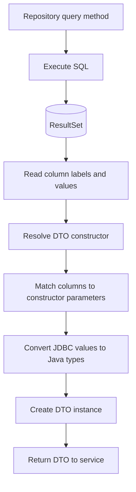

# DTO constructor và Java record cho kết quả truy vấn

Trong **Spring Data Relational JDBC**, repository không nhất thiết phải trả về toàn bộ aggregate root mỗi khi ứng dụng chỉ cần một vài trường dữ liệu. Với các truy vấn đọc, bạn có thể ánh xạ kết quả SQL thành một **DTO (Data Transfer Object)** bằng constructor hoặc dùng **Java record** với canonical constructor.

Cách làm này hữu ích cho danh sách, màn hình tìm kiếm, báo cáo và truy vấn join nhiều bảng. DTO chỉ chứa dữ liệu mà use case cần, giúp tránh đưa toàn bộ mô hình persistence vào tầng API hoặc service đọc.

Điểm cốt lõi là: Spring Data JDBC cần ánh xạ các cột trong ResultSet vào tham số constructor tương ứng. Vì vậy, tên cột/alias, tên tham số, kiểu dữ liệu và constructor được chọn phải tương thích. Record làm việc này thuận tiện vì component names và canonical constructor được Java định nghĩa rõ ràng.

## 1. DTO trong truy vấn JDBC là gì?

DTO là một kiểu dữ liệu dùng để chuyển kết quả giữa các tầng ứng dụng. DTO thường chứa các giá trị cần thiết cho một use case, không đại diện cho một aggregate có lifecycle persistence.

Ví dụ, aggregate `PurchaseOrder` có thể chứa ID, mã đơn hàng, trạng thái, tham chiếu khách hàng, danh sách dòng hàng, địa chỉ giao hàng và các thông tin phục vụ nghiệp vụ khác. Nhưng màn hình danh sách đơn hàng chỉ cần ID, mã đơn, trạng thái và tên khách hàng.

Nếu trả toàn bộ aggregate, ứng dụng có thể phải đọc thêm dữ liệu không cần thiết và sau đó chuyển đổi sang response model. Một DTO có thể chỉ chứa các trường cần thiết:

```java
public record OrderListItem(
        Long id,
        String orderCode,
        String status,
        String customerName
) {
}
```

Kết quả truy vấn được ánh xạ thẳng thành `OrderListItem`. DTO không cần trở thành aggregate root, không cần repository riêng và thường không có `@Id` hoặc `@Table`.

### 1.1. Phân biệt DTO, entity và projection

| Kiểu | Mục đích | Có lifecycle persistence? | Ví dụ |
|---|---|---|---|
| Aggregate/entity | Mô hình domain được lưu và quản lý theo aggregate | Có, thông qua repository/template | `PurchaseOrder` |
| DTO | Chứa dữ liệu phục vụ một use case hoặc tầng ứng dụng | Không nhất thiết | `OrderListItem` |
| Projection | Mô tả tập thuộc tính cần đọc từ kết quả truy vấn | Thường chỉ phục vụ đọc | Interface hoặc DTO projection |
| API response | Hợp đồng dữ liệu trả ra client | Không | `OrderResponse` |

DTO truy vấn và API response có thể là cùng một class nếu cấu trúc phù hợp. Với ứng dụng lớn, tách chúng ra giúp persistence query không bị ràng buộc bởi hợp đồng API.

**DTO không phải aggregate con.** Việc DTO có field `customerName` hoặc `lineCount` không có nghĩa Spring Data JDBC sẽ lưu chúng vào bảng của aggregate.

## 2. Luồng ánh xạ kết quả SQL vào constructor

Khi một query method trả về DTO, quy trình khái quát là:

1. Repository thực thi SQL và nhận ResultSet.
2. Spring Data JDBC đọc các column label/name được trả về.
3. Mapping infrastructure xác định constructor phù hợp của kiểu kết quả.
4. Các giá trị cột được chuyển đổi sang kiểu Java tương ứng.
5. Spring Data tạo DTO bằng constructor.
6. Repository trả DTO cho caller.



Với class DTO, constructor parameters cần tương ứng với các thuộc tính được chọn. Với record, component names xác định các tham số của canonical constructor.

Ví dụ SQL:

```sql
SELECT
    o.id AS id,
    o.order_code AS order_code,
    o.status AS status
FROM orders o
WHERE o.id = ?;
```

DTO:

```java
public record OrderSummary(
        Long id,
        String orderCode,
        String status
) {
}
```

Tên alias `order_code` được dùng theo naming convention snake_case tương ứng với property `orderCode`. Nếu dự án có naming strategy riêng, hãy tạo alias phù hợp với mapping đang sử dụng và kiểm tra bằng integration test.

Không nên giả định mọi JDBC driver đều giữ nguyên cách viết hoa/thường của alias. Một số database chuẩn hóa identifier không quote. Dùng alias rõ ràng, nhất quán và tránh hai cột có cùng label.

## 3. DTO class với constructor

Một DTO class truyền thống có thể được viết bất biến bằng các field `final` và một constructor đầy đủ.

```java
public final class OrderSummary {

    private final Long id;
    private final String orderCode;
    private final String status;

    public OrderSummary(
            Long id,
            String orderCode,
            String status
    ) {
        this.id = id;
        this.orderCode = orderCode;
        this.status = status;
    }

    public Long getId() {
        return id;
    }

    public String getOrderCode() {
        return orderCode;
    }

    public String getStatus() {
        return status;
    }
}
```

Khi DTO chỉ có một constructor phù hợp, Spring Data thường có thể chọn constructor đó. Các tham số cần có tên tương ứng với property/column mapping. Để tên tham số của class Java thông thường được giữ lại ở runtime, nên bật compiler option `-parameters`.

### 3.1. Cấu hình giữ tên tham số constructor

Với Gradle Java project, có thể cấu hình:

```gradle
tasks.withType(JavaCompile).configureEach {
    options.compilerArgs.add("-parameters")
}
```

Nếu dự án đã cấu hình option này qua convention plugin hoặc build logic chung, không cần khai báo lặp lại.

Nếu không giữ tên tham số, framework có thể không xác định được tham số constructor tương ứng với property nào. Lỗi thường xuất hiện khi repository query được khởi tạo hoặc khi kết quả được ánh xạ.

Với constructor-based mapping, hãy tránh các tham số tên chung chung như `value1`, `value2`. Đặt tên theo dữ liệu domain:

```java
public OrderSummary(Long id, String orderCode, String status) {
    // ...
}
```

Tên rõ ràng giúp mapping và code review dễ hiểu hơn.

### 3.2. Dùng @PersistenceCreator khi có nhiều constructor

Nếu DTO có nhiều constructor, Spring Data cần biết constructor nào được dùng để tạo object từ dữ liệu persistence/query.

```java
import org.springframework.data.annotation.PersistenceCreator;

public final class OrderSummary {

    private final Long id;
    private final String orderCode;
    private final String status;

    @PersistenceCreator
    public OrderSummary(
            Long id,
            String orderCode,
            String status
    ) {
        this.id = id;
        this.orderCode = orderCode;
        this.status = status;
    }

    public OrderSummary(Long id, String orderCode) {
        this(id, orderCode, "UNKNOWN");
    }

    public Long getId() {
        return id;
    }

    public String getOrderCode() {
        return orderCode;
    }

    public String getStatus() {
        return status;
    }
}
```

`@PersistenceCreator` thuộc `org.springframework.data.annotation`. Annotation này đánh dấu constructor/factory được Spring Data dùng cho object creation. Nó không phải annotation JPA.

Với DTO truy vấn, thường nên giữ một constructor rõ ràng để giảm sự mơ hồ. Chỉ thêm constructor tiện ích khi có nhu cầu thực tế và đánh dấu constructor persistence nếu cần.

### 3.3. Constructor DTO không cần setter

Nếu constructor nhận đủ dữ liệu, DTO có thể bất biến và không cần setter:

- Caller không thể thay đổi dữ liệu truy vấn sau khi tạo object.
- Không cần constructor rỗng chỉ để mapping.
- Không phải expose API ghi property.
- Dễ dùng làm kết quả đọc hoặc truyền qua các tầng.

Đừng thêm setter chỉ vì quen với JavaBean. Constructor-based mapping được thiết kế để tạo object trực tiếp từ dữ liệu.

## 4. Java record cho kết quả truy vấn

Java record là lựa chọn ngắn gọn cho DTO bất biến. Record tự tạo private final field cho từng component, canonical constructor, accessor cùng tên component, cùng các method `equals`, `hashCode` và `toString`.

Ví dụ:

```java
public record OrderSummary(
        Long id,
        String orderCode,
        String status
) {
}
```

Record có thể được dùng làm kiểu kết quả của query method nếu mapping của Spring Data JDBC và kiểu dữ liệu trả về phù hợp.

### 4.1. Canonical constructor

Với record:

```java
public record CustomerCard(
        Long id,
        String displayName,
        String email
) {
}
```

Java tạo canonical constructor tương đương:

```java
public CustomerCard(
        Long id,
        String displayName,
        String email
) {
    this.id = id;
    this.displayName = displayName;
    this.email = email;
}
```

Spring Data có thể dùng constructor này để tạo record từ dữ liệu truy vấn. Tên component đã được lưu trong metadata của record, vì vậy không cần dựa vào việc giữ tên tham số constructor như class Java thông thường.

Record yêu cầu Java 16 trở lên để dùng ở dạng chuẩn trong production. Nếu dự án dùng Java cũ hơn, dùng DTO class với constructor.

### 4.2. Compact constructor để kiểm tra dữ liệu

Record cho phép khai báo compact constructor để xác thực dữ liệu:

```java
public record CustomerCard(
        Long id,
        String displayName,
        String email
) {
    public CustomerCard {
        if (displayName == null || displayName.isBlank()) {
            throw new IllegalArgumentException(
                    "Display name is required"
            );
        }
    }
}
```

Compact constructor chạy khi Spring Data tạo record từ kết quả query cũng như khi code ứng dụng tự tạo record. Vì vậy, chỉ đặt validation ở đây nếu dữ liệu hiện có trong database cũng phải thỏa điều kiện đó.

Nếu database có dữ liệu legacy không hợp lệ, query có thể thất bại ngay lúc mapping. Hãy làm sạch/migrate dữ liệu hoặc đặt validation ở tầng phù hợp với use case.

### 4.3. Record có property nullable

Nếu cột SQL có thể là NULL, dùng kiểu Java có thể biểu diễn null:

```java
public record UserStatus(
        Long id,
        String email,
        Boolean enabled
) {
}
```

`Boolean` có thể biểu diễn `TRUE`, `FALSE` và `null`. Primitive `boolean` chỉ biểu diễn true/false.

Tương tự:

- SQL `BIGINT` nullable → cân nhắc `Long`, không dùng `long` nếu cần giữ null.
- SQL `INTEGER` nullable → cân nhắc `Integer`.
- SQL `DECIMAL` nullable → cân nhắc `BigDecimal` nullable.
- SQL `TIMESTAMP` nullable → cân nhắc kiểu ngày giờ có thể null.

Nếu query có thể trả NULL nhưng DTO dùng primitive, quá trình mapping có thể không biểu diễn được trạng thái đó hoặc gặp lỗi chuyển đổi. Chọn kiểu DTO theo nullability thực tế của kết quả SQL.

## 5. Dùng @Query để trả về DTO constructor

Với query cần chọn cột rõ ràng, join hoặc tính toán, có thể khai báo SQL qua `@Query` và đặt DTO làm return type.

Giả sử schema:

```sql
CREATE TABLE customers (
    id BIGINT GENERATED BY DEFAULT AS IDENTITY PRIMARY KEY,
    display_name VARCHAR(160) NOT NULL,
    email VARCHAR(255)
);

CREATE TABLE orders (
    id BIGINT GENERATED BY DEFAULT AS IDENTITY PRIMARY KEY,
    order_code VARCHAR(40) NOT NULL,
    customer_id BIGINT NOT NULL REFERENCES customers(id),
    status VARCHAR(30) NOT NULL,
    created_at TIMESTAMP NOT NULL
);
```

Record:

```java
import java.time.LocalDateTime;

public record OrderListItem(
        Long id,
        String orderCode,
        String status,
        String customerName,
        LocalDateTime createdAt
) {
}
```

Repository:

```java
import java.util.List;

import org.springframework.data.jdbc.repository.query.Query;
import org.springframework.data.repository.CrudRepository;
import org.springframework.data.repository.query.Param;

public interface PurchaseOrderRepository
        extends CrudRepository<PurchaseOrder, Long> {

    @Query("""
        SELECT
            o.id AS id,
            o.order_code AS order_code,
            o.status AS status,
            c.display_name AS customer_name,
            o.created_at AS created_at
        FROM orders o
        JOIN customers c ON c.id = o.customer_id
        WHERE o.status = :status
        ORDER BY o.created_at DESC
        """)
    List<OrderListItem> findOrderListItems(
            @Param("status") String status
    );
}
```

Query trả về các cột cần thiết cho `OrderListItem`. Nó không cần trả toàn bộ `PurchaseOrder` hoặc toàn bộ `Customer`.

Điểm quan trọng:

- `o.id AS id` tương ứng component `id`.
- `o.order_code AS order_code` tương ứng `orderCode` theo naming convention.
- `c.display_name AS customer_name` tương ứng `customerName`.
- `o.created_at AS created_at` tương ứng `createdAt`.
- `@Param("status")` liên kết tham số Java với named parameter `:status`.

`@Query` của Spring Data JDBC nhận **SQL**, không phải JPQL. Dùng tên bảng và tên cột thực tế của database.

### 5.1. Vì sao nên chọn cột cụ thể?

Có thể viết `SELECT *`, nhưng DTO thường chỉ cần một phần dữ liệu. Chọn cột tường minh có các lợi ích:

- Giảm lượng dữ liệu truyền từ database.
- Làm rõ DTO được tạo từ những cột nào.
- Tránh va chạm tên cột khi join.
- Giảm phụ thuộc vào thay đổi schema không liên quan.
- Dễ đọc và review query.

Với join nhiều bảng, không nên `SELECT *` rồi hy vọng mapper tự phân biệt hai cột cùng tên như `id`, `name` hoặc `created_at`.

### 5.2. Alias cần khớp với mapping

Nếu record component là `customerName`, có thể dùng alias theo naming strategy:

```sql
SELECT c.display_name AS customer_name
```

Nếu dùng alias quoted camelCase:

```sql
SELECT c.display_name AS "customerName"
```

thì hành vi giữ nguyên chữ hoa/thường phụ thuộc database và dialect. Ví dụ PostgreSQL giữ identifier có quote theo đúng casing. Hãy chọn một quy ước thống nhất và kiểm tra bằng database đang dùng.

Nếu có mapping strategy tùy chỉnh hoặc cột kết quả không thể đặt alias theo quy tắc thông thường, có thể dùng custom RowMapper.

## 6. DTO class và record trong cùng một repository

Một repository có thể có nhiều query method với các kiểu kết quả DTO khác nhau:

```java
public interface PurchaseOrderRepository
        extends CrudRepository<PurchaseOrder, Long> {

    @Query("""
        SELECT id AS id, order_code AS order_code, status AS status
        FROM orders
        WHERE id = :id
        """)
    OrderSummary findSummaryById(@Param("id") Long id);

    @Query("""
        SELECT id AS id, order_code AS order_code, status AS status
        FROM orders
        WHERE status = :status
        ORDER BY id DESC
        """)
    List<OrderSummary> findSummariesByStatus(
            @Param("status") String status
    );

    @Query("""
        SELECT
            o.id AS id,
            o.order_code AS order_code,
            c.display_name AS customer_name
        FROM orders o
        JOIN customers c ON c.id = o.customer_id
        WHERE o.id = :id
        """)
    OrderListItem findListItemById(@Param("id") Long id);
}
```

Ở đây:

- `OrderSummary` có thể là class DTO với constructor.
- `OrderListItem` có thể là record.
- Cả hai đều là kiểu dữ liệu đọc, không phải aggregate root.
- Repository vẫn được định nghĩa theo aggregate root `PurchaseOrder`.

Nếu query không tìm thấy hàng, hãy chọn return type phù hợp với semantics của API. Với một kết quả có thể vắng mặt, `Optional<OrderSummary>` thường diễn đạt rõ hơn việc trả `null`, nếu method/return type được hỗ trợ trong phiên bản đang dùng.

## 7. DTO constructor mapping với kiểu dữ liệu phức tạp

Constructor mapping không chỉ áp dụng cho String và Long. Spring Data JDBC sử dụng conversion infrastructure để chuyển kiểu JDBC sang kiểu Java được hỗ trợ.

Ví dụ DTO báo cáo:

```java
import java.math.BigDecimal;
import java.time.LocalDate;

public record DailySalesSummary(
        LocalDate salesDate,
        Long orderCount,
        BigDecimal totalAmount
) {
}
```

Query:

```java
@Query("""
    SELECT
        CAST(o.created_at AS DATE) AS sales_date,
        COUNT(*) AS order_count,
        SUM(o.total_amount) AS total_amount
    FROM orders o
    WHERE o.created_at >= :start
      AND o.created_at < :end
    GROUP BY CAST(o.created_at AS DATE)
    ORDER BY sales_date
    """)
List<DailySalesSummary> summarizeSales(
        @Param("start") LocalDateTime start,
        @Param("end") LocalDateTime end
);
```

Các kiểu trả về của `COUNT`, `SUM`, `CAST` phụ thuộc database và driver. Ví dụ dùng `Long` và `BigDecimal` theo kiểu kết quả thường gặp; hãy kiểm tra JDBC type thực tế nếu database trả kiểu khác.

### 7.1. Enum

Nếu DTO có enum:

```java
public record OrderStateView(
        Long id,
        OrderStatus status
) {
}
```

thì cột SQL cần có dạng mà converter của ứng dụng có thể chuyển sang `OrderStatus`. Với enum lưu tên, giá trị cột có thể là `NEW`, `PAID` hoặc `CANCELLED`. Nếu database lưu mã riêng như `N`, `P`, `C`, hãy đăng ký converter Spring Data phù hợp hoặc chọn kiểu DTO chứa mã chuỗi.

Đừng dùng annotation JPA `@Enumerated` để điều khiển mapping query của Spring Data JDBC.

### 7.2. Giá trị tính toán và aggregate function

DTO rất phù hợp để nhận kết quả SQL đã tính:

```sql
SELECT
    o.id AS order_id,
    COUNT(l.id) AS line_count,
    COALESCE(SUM(l.quantity), 0) AS total_quantity
FROM orders o
LEFT JOIN order_lines l ON l.order_id = o.id
GROUP BY o.id;
```

Record:

```java
public record OrderLineCount(
        Long orderId,
        Long lineCount,
        Long totalQuantity
) {
}
```

`COALESCE` giúp tổng số lượng trả về 0 thay vì NULL khi không có dòng hàng. Tuy nhiên, kiểu dữ liệu SQL của aggregate function vẫn cần tương thích với component Java.

### 7.3. JSON, array và kiểu database đặc thù

Nếu query trả kiểu đặc thù như JSON, array, UUID hoặc vendor-specific type, mapping có thể cần converter hoặc RowMapper riêng. Không giả định mọi JDBC driver trả kiểu đó dưới cùng một Java class.

Trong trường hợp DTO constructor không thể nhận trực tiếp kiểu JDBC, hãy:

1. Xem metadata/Java class của cột trong ResultSet.
2. Xác định kiểu domain cần có.
3. Viết converter nếu conversion infrastructure phù hợp.
4. Hoặc dùng RowMapper tùy chỉnh để chuyển đổi rõ ràng.

## 8. DTO và projection không tự động tải aggregate graph

Một DTO chỉ chứa những giá trị được query trả về. Nếu SQL join `orders` với `customers`, record `OrderListItem` có thể nhận `customerName`, nhưng điều đó không có nghĩa Spring Data JDBC dựng cả object `Customer` rồi gắn vào `PurchaseOrder`.

Ví dụ:

```java
public record OrderListItem(
        Long id,
        String orderCode,
        String customerName
) {
}
```

Record này chỉ có ba component. Nó không chứa `Customer` entity và không có lazy-loading behavior.

Tương tự, nếu query trả `OrderSummary` gồm `lineCount`, giá trị đó chỉ là kết quả aggregate function. Spring Data JDBC không tự tạo `List<OrderLine>` từ `lineCount`.

| Kết quả | Ý nghĩa |
|---|---|
| DTO có `customerName` | Một scalar được lấy từ bảng customer qua SQL |
| DTO có `lineCount` | Một giá trị tổng hợp từ các child rows |
| Aggregate có Customer reference | Mô hình domain lưu ID/reference |
| Aggregate có `@MappedCollection` | Child collection thuộc aggregate lifecycle |
| Aggregate có `@Embedded` | Value object được làm phẳng vào cột root |

Nếu use case cần cả aggregate và dữ liệu phụ, hãy quyết định rõ: đọc aggregate qua repository rồi truy vấn dữ liệu phụ riêng, hoặc viết query DTO tổng hợp cho màn hình đọc.

## 9. DTO projection so với interface projection

Spring Data ecosystem có hai kiểu projection phổ biến:

- **Class-based projection:** Spring Data tạo instance của class/record qua constructor.
- **Interface-based projection:** Spring Data tạo projection dựa trên interface và accessor.

Bài học này tập trung vào class-based DTO và Java record. Chúng phù hợp khi bạn muốn định nghĩa rõ kiểu dữ liệu, constructor, nullability và hợp đồng kết quả.

Ví dụ interface projection:

```java
public interface OrderNameView {
    Long getId();
    String getOrderCode();
}
```

Interface projection có cơ chế proxy/tuple mapping riêng và khả năng hỗ trợ phụ thuộc module, query type và phiên bản. Không nên tự suy luận rằng mọi dạng interface projection của Spring Data JPA đều hoạt động giống nhau trong Spring Data JDBC. Nếu cần kết quả ổn định với SQL join hoặc tính toán, DTO constructor/record với cột chọn rõ ràng thường dễ kiểm soát hơn.

## 10. Khi nào dùng record, khi nào dùng DTO class?

| Tiêu chí | Java record | DTO class |
|---|---|---|
| Cú pháp | Ngắn gọn | Dài hơn |
| Tính bất biến | Có sẵn | Cần dùng final field và không setter |
| Constructor | Canonical constructor tự sinh | Tự khai báo |
| Tên tham số | Component names rõ ràng | Cần giữ parameter metadata hoặc mapping phù hợp |
| Nhiều constructor | Có thể overload, nhưng canonical constructor vẫn rõ | Có thể cần `@PersistenceCreator` |
| Validation | Compact constructor | Constructor thông thường |
| Java version | Yêu cầu Java 16+ | Phù hợp nhiều phiên bản Java |
| Kế thừa | Record là final, không extends class khác | Class có thể mở rộng nếu thiết kế cho phép |
| API bổ sung | Có thể thêm method, static factory | Linh hoạt hơn với builder/method tùy chỉnh |

### 10.1. Chọn record khi

- DTO chủ yếu là dữ liệu.
- Muốn immutable result.
- Số component vừa phải.
- Dự án dùng Java 16 trở lên.
- Canonical constructor đủ cho mapping.
- Không cần kế thừa DTO.

### 10.2. Chọn class khi

- Dự án chưa dùng Java 16.
- Cần nhiều constructor hoặc factory phức tạp.
- Cần kế thừa hoặc hành vi bổ sung.
- Cần cấu trúc tương thích với thư viện/serialization cũ.
- Cần kiểm soát rõ constructor được Spring Data chọn.

Không nên dùng record chỉ vì nó ngắn. Hãy chọn theo Java version, yêu cầu mapping và cách DTO được sử dụng.

## 11. Lỗi thường gặp khi map DTO constructor

| Triệu chứng | Nguyên nhân có thể | Cách xử lý |
|---|---|---|
| Không tạo được DTO | Không tìm được constructor phù hợp | Cung cấp constructor rõ ràng; dùng `@PersistenceCreator` khi có nhiều constructor |
| Tham số constructor nhận sai/null | Tên parameter không khớp property/column mapping | Giữ tên parameter với `-parameters`; dùng alias phù hợp |
| Record component không được map | Alias SQL không khớp tên component/naming strategy | Đặt alias rõ ràng, kiểm tra column label |
| Query báo thiếu cột | DTO yêu cầu property nhưng SELECT không trả cột tương ứng | Chọn đủ cột cần cho constructor |
| Mapping lỗi kiểu dữ liệu | JDBC type không tương thích component Java | Dùng kiểu phù hợp hoặc converter/RowMapper |
| Cột nullable gây lỗi primitive | Primitive không biểu diễn null | Dùng wrapper như `Long`, `Integer`, `Boolean` |
| Có nhiều constructor và chọn sai | Không đánh dấu constructor persistence | Dùng `@PersistenceCreator` |
| Hai cột join trùng tên | ResultSet có column label trùng | Đặt alias riêng cho từng cột |
| Dùng JPQL trong `@Query` | Nhầm Spring Data JDBC với JPA | Viết SQL theo bảng/cột database |
| Mong DTO tự chứa nested aggregate | Nhầm DTO mapping với aggregate graph mapping | Viết query/RowMapper rõ ràng hoặc truy vấn riêng |
| `SELECT *` làm mapping khó đoán | Cột thừa hoặc trùng tên trong join | Chọn danh sách cột cụ thể và alias |
| Constructor validation làm query thất bại | Dữ liệu DB không thỏa invariant trong constructor | Migration/clean dữ liệu hoặc điều chỉnh validation |

### 11.1. Kiểm tra column label trước

Khi mapping thất bại, kiểm tra câu SQL và column label mà ResultSet thực sự trả về. Alias trong SQL có thể bị database chuẩn hóa chữ hoa/thường.

Ví dụ:

```sql
SELECT
    c.display_name AS customer_name
FROM customers c;
```

DTO:

```java
public record CustomerNameView(String customerName) {
}
```

Đảm bảo mapping strategy của Spring Data nhận diện `customer_name` là `customerName`. Nếu không, điều chỉnh alias theo quy tắc mapping hoặc dùng RowMapper tùy chỉnh.

### 11.2. Kiểm tra tên tham số constructor

Với class DTO:

```java
public OrderSummary(
        Long id,
        String orderCode,
        String status
) {
    // ...
}
```

Nếu build không giữ tên tham số, framework có thể thiếu thông tin để nối tham số với property. Bật `-parameters`, hoặc chọn một cách mapping rõ ràng khác được module hỗ trợ.

Với record:

```java
public record OrderSummary(
        Long id,
        String orderCode,
        String status
) {
}
```

component names là một phần metadata của record nên không cần dựa vào compiler flag cho tên tham số theo cách class thông thường cần.

## 12. Khi nào cần custom RowMapper?

Constructor mapping phù hợp với kết quả có cấu trúc đơn giản, trong đó các cột map trực tiếp vào DTO. Khi cần chuyển đổi đặc biệt hoặc cấu trúc kết quả không khớp một constructor, custom `RowMapper` có thể rõ ràng hơn.

Ví dụ:

```java
public record OrderLineReport(
        Long orderId,
        String orderCode,
        String sku,
        Integer quantity,
        BigDecimal lineTotal
) {
}
```

Repository đọc dữ liệu bằng `NamedParameterJdbcTemplate`:

```java
@Repository
public class OrderReportRepository {

    private final NamedParameterJdbcTemplate jdbc;

    public OrderReportRepository(NamedParameterJdbcTemplate jdbc) {
        this.jdbc = jdbc;
    }

    public List<OrderLineReport> findLines(String sku) {
        String sql = """
            SELECT
                o.id AS order_id,
                o.order_code AS order_code,
                l.sku AS sku,
                l.quantity AS quantity,
                (l.quantity * l.unit_price) AS line_total
            FROM orders o
            JOIN order_lines l ON l.order_id = o.id
            WHERE l.sku = :sku
            ORDER BY o.id
            """;

        var parameters = new MapSqlParameterSource("sku", sku);

        return jdbc.query(sql, parameters, (rs, rowNum) ->
                new OrderLineReport(
                        rs.getLong("order_id"),
                        rs.getString("order_code"),
                        rs.getString("sku"),
                        rs.getObject("quantity", Integer.class),
                        rs.getBigDecimal("line_total")
                )
        );
    }
}
```

Ở đây code tự điều khiển việc đọc từng cột và gọi record constructor. Cách này phù hợp khi:

- Có phép tính hoặc kiểu database đặc thù.
- Cần xử lý NULL theo quy tắc riêng.
- Query join trả nhiều hàng và DTO là projection của từng hàng.
- Muốn kiểm soát rõ alias và chuyển đổi.
- Constructor mapping tự động không đủ linh hoạt.

`JdbcTemplate` và `NamedParameterJdbcTemplate` vẫn có thể tham gia transaction Spring nếu dùng cùng DataSource và transaction manager. Chúng không tự tạo aggregate persistence semantics; đây là một đường đọc SQL tường minh.

## 13. DTO truy vấn và cập nhật dữ liệu

DTO đọc thường được thiết kế chỉ để trả kết quả. Không nên đưa DTO projection trở lại `repository.save(...)` với kỳ vọng Spring Data JDBC sẽ cập nhật aggregate gốc.

Ví dụ:

```java
OrderListItem item = repository.findOrderListItems("PAID")
        .get(0);

// Đây là dữ liệu đọc cho use case, không phải aggregate để lưu.
```

Nếu cần thay đổi đơn hàng:

1. Tải aggregate root qua repository.
2. Gọi domain method để thay đổi trạng thái.
3. Lưu aggregate root.
4. Trả DTO/response mới nếu use case cần dữ liệu hiển thị.

Ví dụ service:

```java
@Service
public class OrderApplicationService {

    private final PurchaseOrderRepository orders;

    public OrderApplicationService(PurchaseOrderRepository orders) {
        this.orders = orders;
    }

    @Transactional
    public OrderSummary markAsPaid(long orderId) {
        PurchaseOrder order = orders.findById(orderId)
                .orElseThrow();

        order.markAsPaid();

        PurchaseOrder saved = orders.save(order);

        return new OrderSummary(
                saved.getId(),
                saved.getOrderCode(),
                saved.getStatus().name()
        );
    }
}
```

Ở đây aggregate được dùng cho hành vi ghi; DTO được tạo để trả dữ liệu đọc. Cách phân chia này giúp persistence model không trở thành API response model.

## 14. Kiểm thử DTO constructor và record mapping

Một integration test với `@DataJdbcTest` có thể kiểm tra query thực tế, alias và constructor mapping.

Ví dụ repository:

```java
public interface PurchaseOrderRepository
        extends CrudRepository<PurchaseOrder, Long> {

    @Query("""
        SELECT
            o.id AS id,
            o.order_code AS order_code,
            o.status AS status
        FROM orders o
        WHERE o.id = :id
        """)
    OrderSummary findSummary(@Param("id") Long id);
}
```

Test:

```java
@DataJdbcTest
class PurchaseOrderProjectionTest {

    @Autowired
    PurchaseOrderRepository orders;

    @Test
    void mapsQueryResultToRecord() {
        OrderSummary summary = orders.findSummary(100L);

        assertThat(summary).isNotNull();
        assertThat(summary.id()).isEqualTo(100L);
        assertThat(summary.orderCode()).isEqualTo("PO-100");
        assertThat(summary.status()).isEqualTo("NEW");
    }
}
```

Test cần có fixture và schema tương ứng. Nó xác nhận:

- Query được thực thi.
- SQL trả các cột cần thiết.
- Alias được ánh xạ tới record component.
- Constructor của record tạo object đúng.
- Kiểu dữ liệu và nullability tương thích.

### 14.1. Test DTO class constructor

Có thể thay record bằng class DTO và giữ nguyên query. Test xác nhận getter:

```java
assertThat(summary.getId()).isEqualTo(100L);
assertThat(summary.getOrderCode()).isEqualTo("PO-100");
```

Nếu class có nhiều constructor, test cũng giúp phát hiện trường hợp Spring Data chọn sai constructor hoặc thiếu parameter metadata.

### 14.2. Test NULL và aggregate function

Đối với query có LEFT JOIN, `COUNT`, `SUM` hoặc nullable column, hãy thêm dữ liệu:

- Order không có dòng hàng.
- Customer có email NULL.
- Cột ngày giờ NULL nếu schema cho phép.
- Aggregate function trả về NULL nếu không dùng `COALESCE`.

Xác nhận DTO dùng wrapper type phù hợp và giá trị null/zero phản ánh đúng nghiệp vụ.

## 15. Quy tắc thiết kế SQL và DTO dễ bảo trì

### 15.1. Một DTO nên phục vụ một use case đọc rõ ràng

Ví dụ:

- `OrderListItem`: danh sách đơn hàng.
- `OrderDetailHeader`: phần đầu trang chi tiết.
- `DailySalesSummary`: báo cáo theo ngày.
- `OrderLineReport`: dữ liệu từng dòng hàng.

Không nên tạo một DTO quá lớn với nhiều field nullable chỉ để dùng cho mọi màn hình. Một DTO cụ thể giúp query chọn đúng dữ liệu và giảm nhầm lẫn.

### 15.2. Tên alias theo component/property

Duy trì quy tắc:

| DTO component | Alias SQL gợi ý |
|---|---|
| `orderId` | `order_id` |
| `orderCode` | `order_code` |
| `customerName` | `customer_name` |
| `createdAt` | `created_at` |
| `lineCount` | `line_count` |

Quy tắc này dễ phối hợp với naming strategy camelCase ↔ snake_case thường dùng trong Spring Data Relational. Nếu dự án cấu hình naming strategy khác, tuân theo strategy đó.

### 15.3. Tránh alias trùng trong join

Không viết:

```sql
SELECT o.id, c.id, o.status, c.status
FROM orders o
JOIN customers c ON c.id = o.customer_id;
```

Kết quả có thể có hai cột cùng label `id` và hai cột cùng label `status`. Hãy alias riêng:

```sql
SELECT
    o.id AS order_id,
    c.id AS customer_id,
    o.status AS order_status,
    c.status AS customer_status
FROM orders o
JOIN customers c ON c.id = o.customer_id;
```

DTO có thể biểu diễn:

```java
public record OrderCustomerView(
        Long orderId,
        Long customerId,
        String orderStatus,
        String customerStatus
) {
}
```

### 15.4. Giữ SQL và DTO đồng bộ

Khi thêm component vào DTO, cần bổ sung cột tương ứng trong SELECT. Khi bỏ component, xem xét bỏ cột khỏi query nếu không còn dùng. SQL và constructor là một hợp đồng mapping; sửa một bên mà quên bên còn lại dễ tạo lỗi runtime.

Nếu một query được nhiều service dùng, hãy cân nhắc đặt DTO và repository method gần nhau về mặt module/package để người đọc tìm được cả hai.

## 16. Bảng lựa chọn nhanh

| Nhu cầu | Lựa chọn |
|---|---|
| Kết quả chỉ gồm vài field, Java 16+ | Java record |
| Kết quả immutable nhưng dự án dùng Java cũ | DTO class với constructor |
| Có nhiều constructor | DTO class + `@PersistenceCreator` |
| Query join và tổng hợp dữ liệu | `@Query` trả DTO/record |
| Kiểu database đặc thù hoặc conversion tùy chỉnh | Custom RowMapper |
| Báo cáo nhiều bảng trả từng dòng | DTO/record projection |
| Cần thay đổi domain state | Load aggregate, gọi domain method, save root |
| Cần trả API response khác persistence projection | Map DTO query sang response model |

## 17. Nguyên tắc ghi nhớ

1. **DTO constructor** cho phép tạo kết quả truy vấn bất biến từ các cột SQL mà không cần setter.
2. **Java record** cung cấp canonical constructor và component names rõ ràng, phù hợp cho projection đọc.
3. **Tên alias** phải khớp với property/component theo mapping convention; dùng alias rõ ràng, tránh cột trùng tên khi join.
4. **Constructor class** cần tên tham số có thể được phân giải; bật `-parameters` và dùng `@PersistenceCreator` khi có nhiều constructor.
5. **Kiểu Java** phải tương thích kiểu JDBC và nullability của kết quả SQL; dùng wrapper khi cột có thể NULL.
6. **`@Query` của Spring Data JDBC là SQL**, không phải JPQL. Chọn cột cần thiết và alias rõ.
7. **DTO không phải aggregate**: nó không tự có lifecycle, collection child hoặc lazy-loading relationship.
8. **Custom RowMapper/JdbcTemplate** là lựa chọn khi mapping tự động không đủ linh hoạt.
9. **Kiểm thử trên database** để xác nhận SQL, alias, constructor, conversion và NULL behavior.

Khi một use case chỉ cần một phần dữ liệu, hãy thiết kế query trả đúng các cột đó và ánh xạ chúng vào DTO constructor hoặc Java record. Record phù hợp với kết quả đọc gọn, bất biến; DTO class hữu ích khi cần constructor hoặc hành vi bổ sung. Giữ alias và kiểu dữ liệu khớp với constructor để mapping rõ ràng, dễ kiểm thử và độc lập với aggregate persistence.
