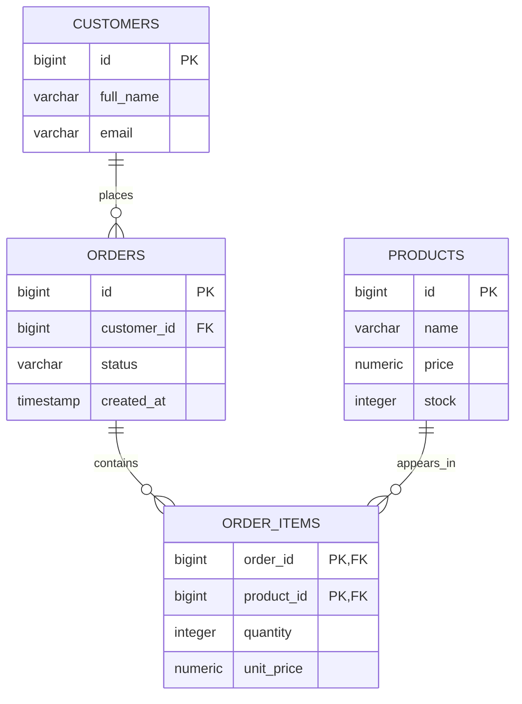

# Ôn SQL: SELECT, JOIN, GROUP BY, INSERT, UPDATE và DELETE

SQL là ngôn ngữ làm việc với dữ liệu quan hệ. Trong **Spring Data Relational JDBC**, dù thao tác thường đi qua repository hoặc các thành phần JDBC của Spring, ứng dụng cuối cùng vẫn phải đọc và ghi các hàng trong bảng theo các quy tắc SQL. Hiểu SQL giúp bạn thiết kế truy vấn đúng, đọc được câu lệnh từ log, nhận ra lỗi trùng dòng khi JOIN, kiểm soát các lệnh UPDATE/DELETE và phân biệt thao tác trên một hàng với thao tác trên cả tập dữ liệu.

Bài này sử dụng **PostgreSQL** làm hệ quản trị minh họa. Các khái niệm SELECT, JOIN, GROUP BY, INSERT, UPDATE, DELETE và ràng buộc khóa có tính phổ biến; một số cú pháp như `LIMIT`, `RETURNING` và `GENERATED ... AS IDENTITY` có thể khác ở hệ quản trị khác.

## 1. Mô hình dữ liệu dùng xuyên suốt bài

Giả sử một cửa hàng có bốn bảng:

| Bảng | Ý nghĩa | Khóa chính | Quan hệ |
|---|---|---|---|
| `customers` | Khách hàng | `id` | Một khách hàng có thể có nhiều đơn hàng |
| `products` | Sản phẩm | `id` | Một sản phẩm có thể xuất hiện trong nhiều dòng đơn hàng |
| `orders` | Đơn hàng | `id` | `customer_id` tham chiếu `customers.id` |
| `order_items` | Các dòng sản phẩm trong đơn | `(order_id, product_id)` | Tham chiếu `orders` và `products` |

Sơ đồ quan hệ:



### Tạo bảng

```sql
CREATE TABLE customers (
    id BIGINT PRIMARY KEY,
    full_name VARCHAR(100) NOT NULL,
    email VARCHAR(255) NOT NULL UNIQUE
);

CREATE TABLE products (
    id BIGINT PRIMARY KEY,
    name VARCHAR(100) NOT NULL,
    price NUMERIC(12, 2) NOT NULL CHECK (price >= 0),
    stock INTEGER NOT NULL CHECK (stock >= 0)
);

CREATE TABLE orders (
    id BIGINT PRIMARY KEY,
    customer_id BIGINT NOT NULL REFERENCES customers(id),
    status VARCHAR(20) NOT NULL
        CHECK (status IN ('NEW', 'PAID', 'CANCELLED')),
    created_at TIMESTAMP NOT NULL
);

CREATE TABLE order_items (
    order_id BIGINT NOT NULL REFERENCES orders(id),
    product_id BIGINT NOT NULL REFERENCES products(id),
    quantity INTEGER NOT NULL CHECK (quantity > 0),
    unit_price NUMERIC(12, 2) NOT NULL CHECK (unit_price >= 0),
    PRIMARY KEY (order_id, product_id)
);
```

**Ý nghĩa của các ràng buộc:**

- `PRIMARY KEY` định danh duy nhất mỗi hàng; `order_items` dùng khóa chính ghép vì cùng một sản phẩm chỉ xuất hiện một lần trong một đơn theo thiết kế ví dụ.
- `FOREIGN KEY` ngăn dòng đơn hàng trỏ đến đơn/sản phẩm không tồn tại và ngăn đơn hàng trỏ đến khách hàng không tồn tại.
- `NOT NULL` yêu cầu phải có giá trị. `UNIQUE` ngăn trùng email. `CHECK` giới hạn trạng thái, giá và số lượng.
- `NUMERIC(12, 2)` phù hợp hơn kiểu dấu phẩy động để biểu diễn tiền; `unit_price` lưu giá **tại lúc mua**, không phụ thuộc giá hiện tại của sản phẩm.

Để các kết quả ví dụ có thể tái lập, dữ liệu minh họa gán ID tường minh. Trong ứng dụng thật, ID cũng có thể được cơ sở dữ liệu tự sinh bằng cột identity.

### Dữ liệu mẫu

```sql
INSERT INTO customers (id, full_name, email) VALUES
    (1, 'An',   'an@example.com'),
    (2, 'Bình', 'binh@example.com'),
    (3, 'Chi',  'chi@example.com'),
    (4, 'Dũng', 'dung@example.com');

INSERT INTO products (id, name, price, stock) VALUES
    (101, 'Cà phê',  50000.00, 20),
    (102, 'Trà',     30000.00, 15),
    (103, 'Bánh',    45000.00,  8),
    (104, 'Ly sứ',   80000.00,  5);

INSERT INTO orders (id, customer_id, status, created_at) VALUES
    (1001, 1, 'PAID',      '2026-11-01 09:00:00'),
    (1002, 1, 'NEW',       '2026-11-02 10:00:00'),
    (1003, 2, 'PAID',      '2026-11-03 11:00:00'),
    (1004, 3, 'CANCELLED', '2026-11-04 12:00:00');

INSERT INTO order_items (order_id, product_id, quantity, unit_price)
VALUES
    (1001, 101, 2, 50000.00),
    (1001, 103, 1, 45000.00),
    (1002, 102, 1, 30000.00),
    (1003, 101, 1, 50000.00),
    (1003, 104, 1, 80000.00);
```

Như vậy:

- Đơn `1001` có hai dòng sản phẩm, tổng cộng `2 × 50.000 + 1 × 45.000 = 145.000`.
- Đơn `1002` có tổng `30.000`, trạng thái `NEW`.
- Đơn `1003` có tổng `130.000`, trạng thái `PAID`.
- Đơn `1004` chưa có dòng sản phẩm; khách hàng Dũng chưa có đơn nào.

> Thực hành trên cơ sở dữ liệu thử nghiệm. Các câu lệnh thay đổi dữ liệu ở phần sau cần được chạy riêng hoặc khôi phục dữ liệu mẫu trước khi đối chiếu kết quả SELECT.

## 2. SELECT: lấy đúng dữ liệu cần đọc

Cấu trúc quen thuộc:

```sql
SELECT [DISTINCT] cot_1, cot_2, ...
FROM bang
WHERE dieu_kien
ORDER BY cot [ASC | DESC]
LIMIT so_luong OFFSET so_luong_bo_qua;
```

Các thành phần trong ngoặc vuông là tùy chọn; ví dụ trên chỉ mô tả hình dạng câu lệnh, không phải SQL có thể chạy nguyên văn.

### 2.1. Chọn cột, bí danh và biểu thức

```sql
SELECT id, full_name, email
FROM customers;

SELECT id, name AS product_name, price,
       price * 2 AS price_for_two
FROM products
ORDER BY id;
```

`AS` đặt tên cho cột kết quả; biểu thức `price * 2` chỉ tính giá trị lúc truy vấn, không cập nhật `price` trong bảng. Khi dùng JDBC `RowMapper` hoặc SQL projection, bí danh rõ ràng giúp lấy cột từ `ResultSet` an toàn và dễ đọc.

Nên liệt kê các cột cần thiết thay vì mặc định `SELECT *`, đặc biệt với JOIN hoặc truy vấn dùng cho API: việc thêm cột vào bảng về sau sẽ không vô tình thay đổi cấu trúc dữ liệu trả về.

### 2.2. WHERE: lọc từng hàng

```sql
-- Một điều kiện
SELECT id, name, price
FROM products
WHERE price >= 45000;

-- Kết hợp nhiều điều kiện
SELECT id, name, price, stock
FROM products
WHERE price BETWEEN 30000 AND 50000
  AND stock > 0
ORDER BY price DESC, id ASC;

-- Trạng thái thuộc một tập
SELECT id, customer_id, status
FROM orders
WHERE status IN ('NEW', 'PAID');

-- Tên bắt đầu bằng một ký tự, phân biệt hoa/thường tùy hệ CSDL
SELECT id, full_name
FROM customers
WHERE full_name LIKE 'A%';
```

Những điểm dễ nhầm:

- `AND` có độ ưu tiên cao hơn `OR`; dùng ngoặc khi điều kiện phức tạp: `WHERE (status = 'NEW' OR status = 'PAID') AND customer_id = 1`.
- `BETWEEN a AND b` bao gồm cả hai đầu mút. Với cột thời gian, nên dùng khoảng nửa mở để tránh bỏ sót bản ghi có giờ, phút, giây: `created_at >= '2026-11-01' AND created_at < '2026-12-01'`.
- Dùng `IS NULL` và `IS NOT NULL` để kiểm tra giá trị thiếu, **không** dùng `= NULL`. Phép so sánh thông thường với `NULL` cho kết quả không xác định (`UNKNOWN`) trong logic SQL ba giá trị.
- `NOT IN (...)` có thể cho kết quả bất ngờ nếu danh sách hoặc truy vấn con chứa `NULL`. Với bài toán loại trừ tập con, cân nhắc `NOT EXISTS`.

### 2.3. DISTINCT, ORDER BY, LIMIT, OFFSET

```sql
-- Danh sách khách hàng đã có ít nhất một đơn
SELECT DISTINCT customer_id
FROM orders
ORDER BY customer_id;

-- Mười đơn mới nhất, thứ tự ổn định khi trùng thời gian
SELECT id, customer_id, status, created_at
FROM orders
ORDER BY created_at DESC, id DESC
LIMIT 10 OFFSET 0;
```

`DISTINCT` loại các hàng kết quả trùng nhau theo **toàn bộ cột đã chọn**, không tự chọn “bản ghi mới nhất” cho từng khách hàng. `ORDER BY` quyết định thứ tự trình bày; nếu không có nó, không được giả định thứ tự trả về. Khi phân trang bằng `OFFSET`, thêm một khóa sắp xếp duy nhất (ví dụ `id`) để kết quả ổn định; với bảng lớn hoặc dữ liệu thay đổi liên tục, phân trang theo khóa (`keyset pagination`) thường phù hợp hơn OFFSET sâu.

## 3. JOIN: kết hợp dữ liệu từ nhiều bảng

JOIN tạo ra tập hàng theo điều kiện nối giữa các bảng. Điều quan trọng là phải hiểu **mỗi hàng của bảng bên trái có thể khớp bao nhiêu hàng ở bảng bên phải**.

### 3.1. INNER JOIN: chỉ lấy các cặp có quan hệ

```sql
SELECT o.id AS order_id,
       c.full_name AS customer_name,
       o.status,
       o.created_at
FROM orders AS o
INNER JOIN customers AS c
    ON c.id = o.customer_id
ORDER BY o.id;
```

Kết quả có bốn đơn `1001–1004`, mỗi đơn đi kèm đúng một khách hàng. Dũng không xuất hiện vì chưa có đơn.

Hai vai trò khác nhau:

- `ON` xác định điều kiện khớp giữa hai nguồn dữ liệu.
- `WHERE` lọc kết quả theo điều kiện sau khi xử lý JOIN.

Ví dụ truy vấn tất cả đơn đã thanh toán cùng tên khách:

```sql
SELECT o.id, c.full_name, o.status
FROM orders o
JOIN customers c ON c.id = o.customer_id
WHERE o.status = 'PAID'
ORDER BY o.id;
```

Kết quả gồm đơn `1001` của An và `1003` của Bình.

### 3.2. LEFT JOIN: vẫn giữ những hàng không khớp

```sql
SELECT c.id AS customer_id,
       c.full_name,
       o.id AS order_id
FROM customers c
LEFT JOIN orders o ON o.customer_id = c.id
ORDER BY c.id, o.id;
```

Bảng `customers` nằm bên trái, nên Dũng vẫn có một hàng kết quả, nhưng `order_id` là `NULL`. An có hai đơn nên xuất hiện **hai hàng**. Điều đó không có nghĩa bản ghi An trong bảng `customers` bị nhân bản: đó là số hàng của **kết quả JOIN**.

Một lỗi thường gặp là lọc bảng bên phải trong `WHERE`:

```sql
-- Không còn giữ khách không có đơn PAID:
SELECT c.id, c.full_name, o.id
FROM customers c
LEFT JOIN orders o ON o.customer_id = c.id
WHERE o.status = 'PAID';
```

Các hàng không khớp có `o.status = NULL` sẽ bị loại. Muốn giữ tất cả khách và chỉ nối các đơn PAID, đặt điều kiện vào `ON`:

```sql
SELECT c.id, c.full_name, o.id AS paid_order_id
FROM customers c
LEFT JOIN orders o
    ON o.customer_id = c.id
   AND o.status = 'PAID'
ORDER BY c.id, o.id;
```

### 3.3. JOIN một-nhiều và hiện tượng nhân hàng

```sql
SELECT o.id AS order_id,
       p.name AS product_name,
       oi.quantity,
       oi.unit_price
FROM orders o
JOIN order_items oi ON oi.order_id = o.id
JOIN products p ON p.id = oi.product_id
WHERE o.id = 1001
ORDER BY p.id;
```

Đơn `1001` xuất hiện hai lần trong kết quả vì có hai `order_items`: cà phê và bánh. Khi đếm đơn sau khi JOIN, dùng `COUNT(DISTINCT o.id)` nếu cần đếm **đơn duy nhất**. `SELECT DISTINCT` không phải cách sửa mọi JOIN sai; trước tiên phải kiểm tra quan hệ và điều kiện nối có đúng không.

Tránh thiếu điều kiện `ON` hoặc nối nhầm cột vì điều đó có thể tạo tập kết quả tích Descartes (số hàng tăng rất lớn). Có thể sử dụng `EXISTS` khi chỉ cần kiểm tra sự tồn tại, không cần lấy từng dòng con:

```sql
-- Các khách có ít nhất một đơn đã thanh toán
SELECT c.id, c.full_name
FROM customers c
WHERE EXISTS (
    SELECT 1
    FROM orders o
    WHERE o.customer_id = c.id
      AND o.status = 'PAID'
)
ORDER BY c.id;
```

## 4. GROUP BY: tổng hợp và thống kê

Các hàm tổng hợp phổ biến:

| Hàm | Ý nghĩa |
|---|---|
| `COUNT(*)` | Đếm số hàng trong tập đang xét |
| `COUNT(cot)` | Đếm các giá trị **khác NULL** của cột |
| `COUNT(DISTINCT cot)` | Đếm số giá trị phân biệt, khác NULL |
| `SUM(cot)` | Tính tổng các giá trị khác NULL |
| `AVG(cot)` | Tính trung bình các giá trị khác NULL |
| `MIN(cot)`, `MAX(cot)` | Giá trị nhỏ nhất/lớn nhất |

### 4.1. Đếm số đơn theo trạng thái

```sql
SELECT status, COUNT(*) AS total_orders
FROM orders
GROUP BY status
ORDER BY status;
```

Với dữ liệu mẫu, `PAID = 2`, `NEW = 1`, `CANCELLED = 1`.

`GROUP BY status` gom những hàng có cùng `status` thành một nhóm; `COUNT(*)` trả về một kết quả cho mỗi nhóm. Khi SELECT vừa có cột thường vừa có hàm tổng hợp, các cột thường cần nằm trong `GROUP BY` (ngoại trừ các quy tắc phụ thuộc hàm mà một số hệ quản trị hỗ trợ).

### 4.2. Đếm cả những khách chưa có đơn

```sql
SELECT c.id,
       c.full_name,
       COUNT(o.id) AS total_orders
FROM customers c
LEFT JOIN orders o ON o.customer_id = c.id
GROUP BY c.id, c.full_name
ORDER BY c.id;
```

| Khách hàng | `total_orders` |
|---|---:|
| An | 2 |
| Bình | 1 |
| Chi | 1 |
| Dũng | 0 |

**Vì sao dùng `COUNT(o.id)` thay vì `COUNT(*)`?** LEFT JOIN vẫn tạo một hàng có các cột `o.*` bằng `NULL` cho Dũng. `COUNT(*)` đếm cả hàng đó và cho kết quả 1; `COUNT(o.id)` bỏ qua giá trị NULL nên cho 0.

### 4.3. SUM, COALESCE và số tiền của từng đơn

```sql
SELECT o.id AS order_id,
       o.status,
       COALESCE(SUM(oi.quantity * oi.unit_price), 0) AS total_amount
FROM orders o
LEFT JOIN order_items oi ON oi.order_id = o.id
GROUP BY o.id, o.status
ORDER BY o.id;
```

| `order_id` | `status` | `total_amount` |
|---:|---|---:|
| 1001 | PAID | 145000.00 |
| 1002 | NEW | 30000.00 |
| 1003 | PAID | 130000.00 |
| 1004 | CANCELLED | 0 |

`SUM` trên tập không có giá trị số cần cộng trả về `NULL`; `COALESCE(..., 0)` biến trường hợp đó thành số 0. Tính tổng bằng `unit_price` trong `order_items` vì đây là giá chốt khi mua, thay vì dùng `products.price` có thể đã đổi sau này.

### 4.4. WHERE và HAVING khác nhau thế nào?

```sql
SELECT o.id AS order_id,
       SUM(oi.quantity * oi.unit_price) AS total_amount
FROM orders o
JOIN order_items oi ON oi.order_id = o.id
WHERE o.status = 'PAID'
GROUP BY o.id
HAVING SUM(oi.quantity * oi.unit_price) >= 100000
ORDER BY total_amount DESC;
```

Truy vấn cho hai đơn `1001` và `1003`:

- `WHERE` lọc **hàng** trước khi gom nhóm: chỉ xét đơn `PAID`.
- `GROUP BY` gom các dòng `order_items` theo đơn.
- `HAVING` lọc **nhóm** sau khi tính tổng: chỉ giữ đơn có tổng từ 100.000.
- `ORDER BY` sắp xếp các hàng kết quả, ở đây theo tổng tiền.

Một cách nhớ *trình tự xử lý logic* (giản lược) của SELECT là:

`FROM / JOIN → WHERE → GROUP BY → HAVING → SELECT → DISTINCT → ORDER BY → LIMIT / OFFSET`.

Đây là thứ tự **logic** để hiểu kết quả, không phải cam kết thứ tự thực thi vật lý: bộ tối ưu truy vấn có thể chọn kế hoạch khác nhưng phải giữ đúng ngữ nghĩa.

### 4.5. Tổng hợp sau nhiều JOIN: chú ý đếm trùng

```sql
SELECT c.id,
       c.full_name,
       COUNT(DISTINCT o.id) AS paid_orders,
       COALESCE(SUM(oi.quantity * oi.unit_price), 0) AS paid_revenue
FROM customers c
LEFT JOIN orders o
    ON o.customer_id = c.id
   AND o.status = 'PAID'
LEFT JOIN order_items oi ON oi.order_id = o.id
GROUP BY c.id, c.full_name
ORDER BY c.id;
```

Kết quả:

| Khách hàng | `paid_orders` | `paid_revenue` |
|---|---:|---:|
| An | 1 | 145000.00 |
| Bình | 1 | 130000.00 |
| Chi | 0 | 0 |
| Dũng | 0 | 0 |

`COUNT(DISTINCT o.id)` cần thiết vì đơn `1001` có hai dòng sản phẩm, nhưng chỉ là **một** đơn. Việc dùng `SUM` ở đây đúng vì mỗi dòng `order_items` được nối đúng một lần với đơn và khách tương ứng. Nếu JOIN thêm một quan hệ một-nhiều độc lập khác (chẳng hạn nhiều phiếu giảm giá trên cùng đơn), các dòng sản phẩm có thể lại bị nhân; khi ấy nên tổng hợp từng quan hệ trước trong truy vấn con hoặc CTE rồi mới JOIN.

## 5. INSERT: thêm hàng và tôn trọng ràng buộc

### 5.1. Thêm một hoặc nhiều hàng

```sql
INSERT INTO products (id, name, price, stock)
VALUES (105, 'Bình nước', 120000.00, 10);

INSERT INTO products (id, name, price, stock)
VALUES
    (106, 'Ống hút', 10000.00, 40),
    (107, 'Túi giấy', 5000.00, 100);
```

Nên viết rõ danh sách cột vì thứ tự cột trong bảng có thể thay đổi; không cần cung cấp giá trị cho cột có `DEFAULT` hoặc được cơ sở dữ liệu tự sinh. Khóa chính đã tồn tại sẽ gây lỗi; giá trị khóa ngoại không có ở bảng cha cũng gây lỗi.

### 5.2. Khóa chính do cơ sở dữ liệu tự sinh

Trong ứng dụng thực tế, bảng có thể định nghĩa cột như sau (minh họa một lựa chọn thiết kế khác với bảng `products` mẫu):

```sql
id BIGINT GENERATED BY DEFAULT AS IDENTITY PRIMARY KEY
```

Khi đó không cần truyền `id` vào INSERT:

```sql
INSERT INTO products (name, price, stock)
VALUES ('Bình nước', 120000.00, 10)
RETURNING id;
```

`RETURNING id` là cú pháp PostgreSQL, lấy ID vừa sinh trong cùng thao tác; trong JDBC cũng có cơ chế lấy generated keys. Cần chọn **một** chiến lược sinh ID nhất quán với mapping `@Id` của Spring Data JDBC và cấu trúc bảng thật, không tự động áp dụng cách INSERT này cho schema mẫu vốn yêu cầu truyền ID.

### 5.3. Thêm dữ liệu có quan hệ

Để tạo đơn cùng dòng sản phẩm, phải có khách hàng và sản phẩm trước; sau đó thêm `orders` rồi `order_items`.

```sql
BEGIN;

INSERT INTO orders (id, customer_id, status, created_at)
VALUES (1005, 4, 'NEW', '2026-11-05 08:30:00');

INSERT INTO order_items (order_id, product_id, quantity, unit_price)
VALUES (1005, 102, 1, 30000.00);

COMMIT;
```

Nếu câu lệnh trong giao dịch thất bại, cần `ROLLBACK` thay vì `COMMIT`. Khi transaction bị lỗi trong PostgreSQL, các câu lệnh tiếp theo không thể tiếp tục thành công trong transaction đó trước khi rollback. Với Spring, thường đặt ranh giới giao dịch ở service bằng `@Transactional` và để exception phù hợp kích hoạt rollback.

## 6. UPDATE: thay đổi dữ liệu đã có

### 6.1. Cấu trúc và điều kiện WHERE

```sql
UPDATE products
SET price = 55000.00
WHERE id = 101;
```

Lệnh sửa giá của sản phẩm `101`. **Không có `WHERE`, UPDATE tác động đến mọi hàng** của bảng. Trước khi chạy thao tác thủ công quan trọng, có thể kiểm tra tập hàng dự kiến bằng SELECT với cùng điều kiện:

```sql
SELECT id, name, price
FROM products
WHERE id = 101;
```

Có thể cập nhật nhiều cột và dùng giá trị hiện tại trong biểu thức:

```sql
UPDATE products
SET price = price + 5000.00,
    stock = stock + 3
WHERE id = 103;
```

`price = price + 5000` là cập nhật tương đối, không phải gán bằng một chuỗi; mỗi hàng dùng giá trị đang có của chính nó.

### 6.2. Cập nhật có điều kiện để tránh tồn kho âm

```sql
UPDATE products
SET stock = stock - 2
WHERE id = 101
  AND stock >= 2;
```

Nếu tồn kho không đủ, lệnh cập nhật **0 hàng**. Ứng dụng cần kiểm tra số hàng cập nhật; nếu bằng 0, hãy xử lý tình huống không có sản phẩm hoặc không đủ tồn kho theo nghiệp vụ. Điều kiện cùng câu lệnh UPDATE giúp thao tác giảm tồn kho có tính nguyên tử tại cơ sở dữ liệu.

Với PostgreSQL, có thể xem giá trị mới ngay lập tức:

```sql
UPDATE products
SET stock = stock - 2
WHERE id = 101 AND stock >= 2
RETURNING id, stock;
```

Không nên áp dụng quy tắc “cứ lấy số tồn kho đã đọc trước đó rồi ghi lại” khi nhiều request có thể mua cùng lúc, vì dễ gây **lost update** nếu thiếu cơ chế khóa/kiểm soát đồng thời.

### 6.3. Số hàng ảnh hưởng và giao dịch

Trong JDBC, `executeUpdate()` hoặc phương thức cập nhật tương ứng trả về số hàng ảnh hưởng. Các kết quả thường cần diễn giải:

- `1`: một hàng khớp và được xử lý.
- `0`: không có hàng nào thỏa WHERE; có thể do ID sai, trạng thái đã đổi, hoặc điều kiện nghiệp vụ không thỏa.
- Nhiều hơn `1`: điều kiện khớp nhiều hàng, cần chắc chắn đây là ý định của thao tác.

Đối với thay đổi liên quan nhiều bảng (ví dụ xác nhận đơn và trừ tồn kho), dùng transaction để cùng thành công hoặc cùng rollback; ngoài ra phải kiểm tra kết quả có đúng kỳ vọng nghiệp vụ.

## 7. DELETE: xóa hàng và xử lý quan hệ

### 7.1. Xóa có điều kiện

```sql
DELETE FROM products
WHERE id = 105;
```

DELETE xóa **hàng**; không chỉ xóa giá trị của một cột. Không có `WHERE`, lệnh sẽ cố xóa tất cả hàng trong bảng. Nếu sản phẩm đã được tham chiếu trong `order_items`, khóa ngoại mặc định có thể chặn thao tác xóa; không nên bỏ ràng buộc chỉ để lệnh chạy.

### 7.2. Xóa theo thứ tự quan hệ trong giao dịch

Ví dụ muốn xóa đơn `1002` và các dòng sản phẩm của đơn đó:

```sql
BEGIN;

DELETE FROM order_items
WHERE order_id = 1002;

DELETE FROM orders
WHERE id = 1002;

COMMIT;
```

Do `order_items.order_id` tham chiếu `orders.id`, xóa bảng con trước rồi xóa bảng cha là cách phù hợp khi khóa ngoại **không** cấu hình `ON DELETE CASCADE`. Nếu dùng cascade, cần hiểu chính xác hàng nào sẽ bị xóa tự động. Với dữ liệu nghiệp vụ cần lịch sử hoặc kiểm toán, đổi `status`/đánh dấu ngừng hoạt động có thể phù hợp hơn xóa vật lý, tùy yêu cầu hệ thống.

### 7.3. Xóa theo điều kiện an toàn hơn

```sql
-- Chỉ xóa đơn bị hủy khi không còn dòng sản phẩm nào
DELETE FROM orders o
WHERE o.id = 1004
  AND o.status = 'CANCELLED'
  AND NOT EXISTS (
      SELECT 1
      FROM order_items oi
      WHERE oi.order_id = o.id
  );
```

`NOT EXISTS` loại các đơn vẫn còn dòng sản phẩm. Điều kiện trạng thái giúp tránh xóa một đơn đã chuyển sang giai đoạn khác. Ứng dụng vẫn phải kiểm tra số hàng bị xóa để báo đúng kết quả.

## 8. Gắn các lệnh SQL với Spring Data JDBC

### 8.1. Từ SQL đến repository

Spring Data JDBC ánh xạ dữ liệu giữa các bảng và aggregate trong Java, đồng thời hỗ trợ các thao tác CRUD qua repository như `save`, `findById`, `findAll` và `deleteById`. Hiểu ý nghĩa SQL bên dưới giúp bạn trả lời:

- `findById` đọc theo khóa nào, và chuyện gì xảy ra khi không tìm thấy?
- `save` tương ứng chèn mới hay cập nhật dựa trên cách Spring Data JDBC nhận biết entity mới?
- Một repository query đang trả về aggregate hay một bản báo cáo tổng hợp nhiều bảng?
- Khi xóa aggregate, quan hệ giữa các bảng con và bảng cha được xử lý ra sao?

**Lưu ý về mô hình:** Spring Data JDBC dùng khái niệm *aggregate root* để quản lý vòng đời của dữ liệu thuộc aggregate. Không nên mặc định mọi quan hệ một-nhiều trong SQL đều sẽ tự động hoạt động như cơ chế lazy loading hoặc entity relationship của JPA. Truy vấn báo cáo ghép nhiều bảng thường thích hợp với DTO/projection hoặc một repository JDBC chuyên biệt.

### 8.2. Truy vấn có tham số: tránh ghép chuỗi dữ liệu người dùng

Ví dụ không an toàn:

```java
String sql = "SELECT * FROM orders WHERE customer_id = " + userInput;
```

Giá trị đi từ request không nên ghép trực tiếp thành câu SQL. JDBC `PreparedStatement` dùng dấu `?` cho tham số; Spring `NamedParameterJdbcTemplate` dùng tham số có tên `:customerId`:

```java
import java.math.BigDecimal;
import java.util.List;
import java.util.Map;
import org.springframework.jdbc.core.namedparam.NamedParameterJdbcTemplate;
import org.springframework.stereotype.Repository;

record PaidOrderTotal(long orderId, BigDecimal totalAmount) {}

@Repository
class PaidOrderReportRepository {
    private final NamedParameterJdbcTemplate jdbc;

    PaidOrderReportRepository(NamedParameterJdbcTemplate jdbc) {
        this.jdbc = jdbc;
    }

    List<PaidOrderTotal> findByCustomer(long customerId) {
        String sql = """
            SELECT o.id AS order_id,
                   COALESCE(SUM(oi.quantity * oi.unit_price), 0) AS total_amount
            FROM orders o
            LEFT JOIN order_items oi ON oi.order_id = o.id
            WHERE o.customer_id = :customerId
              AND o.status = 'PAID'
            GROUP BY o.id
            ORDER BY o.id
            """;

        return jdbc.query(
            sql,
            Map.of("customerId", customerId),
            (rs, rowNum) -> new PaidOrderTotal(
                rs.getLong("order_id"),
                rs.getBigDecimal("total_amount")
            )
        );
    }
}
```

Ở đây `:customerId` là cú pháp tham số được Spring xử lý trước khi gửi câu lệnh xuống JDBC; nó không phải tên cột SQL. `RowMapper` đọc hai cột có bí danh rõ ràng từ `ResultSet` rồi tạo DTO. Mã Java sử dụng cú pháp text block (Java 15+) và record (Java 16+), phù hợp với môi trường Java hiện đại.

Với thao tác UPDATE có điều kiện, kiểm tra số hàng là đặc biệt quan trọng:

```java
int updated = jdbc.update(
    """
    UPDATE products
    SET stock = stock - :quantity
    WHERE id = :productId AND stock >= :quantity
    """,
    Map.of("productId", productId, "quantity", quantity)
);

if (updated != 1) {
    throw new IllegalStateException("Product unavailable or insufficient stock");
}
```

Ví dụ trên minh họa việc ánh xạ kết quả **0/1 hàng** sang quyết định nghiệp vụ; tầng service nên quyết định loại exception, thông điệp và transaction cụ thể.

### 8.3. Transaction và phạm vi bảo đảm

Một thao tác nghiệp vụ như tạo đơn, thêm dòng đơn, giảm tồn kho và đổi trạng thái thanh toán có thể gồm nhiều câu SQL. Nếu chỉ một câu thất bại mà các câu trước đã commit, dữ liệu có thể thiếu nhất quán. Trong Spring, `@Transactional` trên phương thức service tạo ranh giới giao dịch; mặc định rollback khi exception không kiểm tra (`RuntimeException`) phát sinh, còn chính sách rollback cho checked exception có thể cần cấu hình riêng.

Transaction bảo đảm tính nguyên tử cho các thao tác thuộc cùng transaction và cùng tài nguyên quản lý; nó **không tự động** ngăn mọi xung đột đồng thời. Điều kiện UPDATE, khóa hàng, isolation level hoặc optimistic locking cần được chọn theo yêu cầu thực tế.

### 8.4. Phân biệt truy vấn nghiệp vụ và truy vấn báo cáo

| Nhu cầu | Hướng triển khai thường phù hợp |
|---|---|
| Đọc/ghi một aggregate theo ID | `CrudRepository` / repository Spring Data JDBC |
| Lọc theo điều kiện cụ thể | Repository query hoặc truy vấn SQL có tham số |
| Thống kê doanh thu, JOIN nhiều bảng, GROUP BY | Truy vấn SQL riêng trả về DTO/projection |
| Giảm tồn kho có điều kiện | UPDATE nguyên tử, kiểm tra số hàng ảnh hưởng |
| Ghi nhiều bảng trong một nghiệp vụ | Service `@Transactional` với chính sách lỗi rõ ràng |

Cách chọn không dựa trên “SQL thuần hay repository cái nào tốt hơn”, mà dựa trên hình dạng dữ liệu cần nhận và các bất biến nghiệp vụ cần giữ.

## 9. Những lỗi SQL cần nhận ra khi đọc code

| Triệu chứng | Nguyên nhân có thể gặp | Hướng kiểm tra |
|---|---|---|
| JOIN trả về nhiều hàng hơn dự kiến | Nối quan hệ một-nhiều, thiếu điều kiện JOIN | Kiểm tra số hàng của mỗi bảng và khóa dùng trong `ON` |
| Khách không có đơn biến mất khỏi kết quả | Lọc bảng phải của LEFT JOIN trong `WHERE` | Xem xét chuyển điều kiện phù hợp vào `ON` |
| Đếm khách không có đơn thành 1 | Dùng `COUNT(*)` sau LEFT JOIN | Dùng `COUNT(o.id)` khi cần đếm đơn thật |
| Doanh thu bị nhân đôi | JOIN thêm nhiều tập con một-nhiều | Tổng hợp độc lập trước khi JOIN, kiểm tra grain của dữ liệu |
| `SUM` trả về NULL | Nhóm không có giá trị để cộng | Dùng `COALESCE(SUM(...), 0)` nếu nghiệp vụ muốn 0 |
| UPDATE/DELETE sửa quá nhiều hàng | Thiếu/sai `WHERE` | SELECT trước, transaction khi cần, kiểm tra row count |
| INSERT thất bại | Trùng PK/UNIQUE, thiếu FK, vi phạm NOT NULL/CHECK | Đọc tên constraint và kiểm tra dữ liệu liên quan |
| Truy vấn không ổn định khi phân trang | Thiếu thứ tự duy nhất | Bổ sung `ORDER BY` có tie-breaker bằng khóa duy nhất |
| Truy vấn có nguy cơ SQL injection | Ghép tham số người dùng thành SQL | Dùng prepared/named parameters; chỉ cho phép identifier từ danh sách tin cậy |

## 10. Tự thực hành với dữ liệu mẫu

Các bài sau dựa trên **dữ liệu ban đầu**, trước khi chạy INSERT, UPDATE và DELETE ở các phần trên.

**Bài 1.** Lấy ID và tên những sản phẩm giá từ 45.000 trở lên, sắp theo giá giảm dần rồi theo ID tăng dần.

```sql
SELECT id, name
FROM products
WHERE price >= 45000
ORDER BY price DESC, id ASC;
```

Kết quả theo thứ tự: `104 – Ly sứ`, `101 – Cà phê`, `103 – Bánh`.

**Bài 2.** Liệt kê tất cả khách hàng và số đơn đã thanh toán, kể cả khách có 0 đơn.

```sql
SELECT c.id, c.full_name,
       COUNT(o.id) AS paid_orders
FROM customers c
LEFT JOIN orders o
    ON o.customer_id = c.id
   AND o.status = 'PAID'
GROUP BY c.id, c.full_name
ORDER BY c.id;
```

Kết quả: An 1, Bình 1, Chi 0, Dũng 0.

**Bài 3.** Tính tổng tiền các đơn `PAID`, chỉ giữ đơn có tổng tiền từ 140.000 trở lên.

```sql
SELECT o.id,
       SUM(oi.quantity * oi.unit_price) AS total_amount
FROM orders o
JOIN order_items oi ON oi.order_id = o.id
WHERE o.status = 'PAID'
GROUP BY o.id
HAVING SUM(oi.quantity * oi.unit_price) >= 140000
ORDER BY o.id;
```

Chỉ có đơn `1001`, tổng `145.000`.

**Bài 4.** Viết lệnh trừ 3 sản phẩm khỏi kho sản phẩm `102` mà không cho phép tồn kho âm. Sau khi chạy, kiểm tra có đúng một hàng được cập nhật không.

```sql
UPDATE products
SET stock = stock - 3
WHERE id = 102
  AND stock >= 3;
```

Nếu bắt đầu từ dữ liệu mẫu, tồn kho sản phẩm `102` giảm từ `15` xuống `12`; nếu không đủ tồn kho, không có hàng nào được cập nhật. Trong ứng dụng JDBC, đọc giá trị row count trả về để quyết định tiếp tục hay báo lỗi.

**Bài 5.** Xóa đơn `1004` chỉ khi nó vẫn bị hủy và không có dòng sản phẩm.

```sql
DELETE FROM orders o
WHERE o.id = 1004
  AND o.status = 'CANCELLED'
  AND NOT EXISTS (
      SELECT 1 FROM order_items oi
      WHERE oi.order_id = o.id
  );
```

Với dữ liệu ban đầu, đúng một đơn bị xóa. Nếu trạng thái hoặc quan hệ đã thay đổi, kết quả có thể là 0 hàng.

## 11. Ghi nhớ trước khi học sâu Spring Data JDBC

1. **SELECT** đọc dữ liệu; `WHERE` lọc hàng, `ORDER BY` sắp thứ tự, `LIMIT/OFFSET` giới hạn/phân trang.
2. **JOIN** nối dữ liệu theo khóa và làm thay đổi số hàng kết quả; cần kiểm tra quan hệ một-một, một-nhiều và ngữ nghĩa LEFT JOIN.
3. **GROUP BY** tạo thống kê; `HAVING` lọc nhóm. Khi JOIN nhiều bảng, phải xác định bạn đang đếm **đơn**, **dòng đơn**, hay **khách hàng**.
4. **INSERT** phải đáp ứng ràng buộc khóa chính, khóa ngoại và giá trị hợp lệ; dữ liệu nhiều bảng nên ghi trong transaction.
5. **UPDATE/DELETE** cần `WHERE` đúng và kiểm tra số hàng tác động. Các điều kiện nghiệp vụ quan trọng nên được bảo vệ ngay trong câu lệnh hoặc bằng cơ chế đồng thời phù hợp.
6. **Trong Spring Data JDBC**, repository giúp thao tác với aggregate; SQL có tham số và mapping DTO vẫn rất cần cho báo cáo, cập nhật có điều kiện, và giải thích hành vi truy vấn.

Khi đọc một phương thức repository hoặc một câu SQL trong dự án, hãy tự hỏi: **nó đọc/ghi những bảng nào, kết quả có bao nhiêu hàng ở mỗi mức quan hệ, và điều gì bảo đảm dữ liệu vẫn đúng nếu request thất bại hoặc chạy đồng thời?** Trả lời được ba câu đó là nền tảng quan trọng để học các cơ chế cao hơn của Spring Data JDBC.
