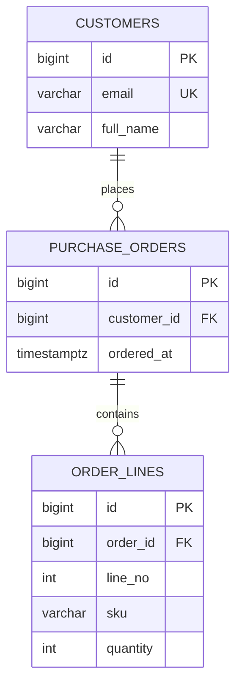

# Khóa chính, khóa ngoại, ràng buộc duy nhất và toàn vẹn tham chiếu

Khi xây dựng ứng dụng với **Spring Data JDBC**, dữ liệu thường được chia thành nhiều bảng có quan hệ với nhau. Một đơn hàng thuộc về một khách hàng, một đơn hàng có nhiều dòng hàng, và email của mỗi khách hàng cần duy nhất. Những quy tắc này phải được bảo vệ ngay tại cơ sở dữ liệu bằng **khóa chính (primary key)**, **khóa ngoại (foreign key)**, **ràng buộc duy nhất (unique constraint)** và các cơ chế bảo đảm **toàn vẹn tham chiếu (referential integrity)**.

Spring Data JDBC giúp ánh xạ đối tượng Java với bảng và thực hiện các thao tác lưu/truy vấn. Tuy nhiên, annotation ánh xạ Java **không thay thế** các ràng buộc SQL. Ứng dụng có thể kiểm tra dữ liệu trước khi ghi, nhưng cơ sở dữ liệu mới là nơi kiểm tra cuối cùng, kể cả khi nhiều yêu cầu cùng chạy hoặc dữ liệu được sửa từ một công cụ khác.

## 1. Bài toán xuyên suốt: khách hàng và đơn hàng

Xét hệ thống bán hàng nhỏ với ba bảng:

| Bảng | Ý nghĩa | Các cột quan trọng |
| --- | --- | --- |
| `customers` | Thông tin khách hàng | `id`, `email`, `full_name` |
| `purchase_orders` | Đơn hàng do khách hàng tạo | `id`, `customer_id`, `ordered_at` |
| `order_lines` | Các dòng hàng của một đơn | `id`, `order_id`, `line_no`, `sku`, `quantity`, `unit_price` |



Các quy tắc cần thực thi:

- Mỗi bản ghi phải có danh tính xác định: `customers.id`, `purchase_orders.id`, `order_lines.id` là khóa chính.
- Không được có hai khách hàng dùng cùng một giá trị `email` theo quy tắc so sánh email đã chọn: `customers.email` là duy nhất.
- Mỗi đơn hàng phải trỏ đến một khách hàng đang tồn tại: `purchase_orders.customer_id` là khóa ngoại, đồng thời `NOT NULL`.
- Mỗi dòng hàng phải thuộc về một đơn hàng đang tồn tại: `order_lines.order_id` là khóa ngoại, đồng thời `NOT NULL`.
- Trong một đơn hàng không có hai dòng cùng vị trí: cặp `(order_id, line_no)` là duy nhất, dù các đơn hàng khác nhau có thể cùng `line_no = 0`.

## 2. Khóa chính (PRIMARY KEY)

**Khóa chính** là cột hoặc nhóm cột dùng để nhận diện duy nhất một hàng trong bảng. Ràng buộc `PRIMARY KEY` kết hợp hai yêu cầu:

1. **Duy nhất:** không thể có hai hàng trùng giá trị khóa chính.
2. **Không rỗng:** tất cả các cột thuộc khóa chính đều không được nhận `NULL`.

Mỗi bảng chỉ khai báo **một ràng buộc khóa chính**, nhưng ràng buộc đó có thể chứa nhiều cột. Ví dụ:

```sql
CREATE TABLE customers (
    id BIGINT GENERATED BY DEFAULT AS IDENTITY PRIMARY KEY,
    email VARCHAR(320) NOT NULL
);
```

`id` là **khóa thay thế (surrogate key)**: một số định danh được tạo cho mục đích kỹ thuật, không phải thông tin nghiệp vụ. Đây là lựa chọn phổ biến trong ứng dụng Spring Data JDBC, vì định danh thường ổn định ngay cả khi email hoặc tên khách hàng thay đổi.

Đôi khi bản thân dữ liệu nghiệp vụ đã đủ duy nhất, chẳng hạn mã quốc gia ISO hoặc một mã được cấp và không bao giờ tái sử dụng; đó là **khóa tự nhiên (natural key)**. Trước khi dùng nó làm khóa chính, cần cân nhắc khả năng thay đổi, tái sử dụng và quy tắc chuẩn hóa giá trị. Những cột nghiệp vụ có thể thay đổi thường phù hợp hơn với `UNIQUE`.

### Khóa chính ghép

Một khóa chính có thể gồm nhiều cột, ví dụ bảng ghi nhận học viên đăng ký khóa học:

```sql
CREATE TABLE enrollments (
    student_id BIGINT NOT NULL,
    course_id BIGINT NOT NULL,
    enrolled_at TIMESTAMP NOT NULL,
    CONSTRAINT pk_enrollments PRIMARY KEY (student_id, course_id)
);
```

Trong thiết kế này, một học viên có thể đăng ký nhiều khóa học, một khóa học có nhiều học viên, nhưng cùng cặp học viên–khóa học không xuất hiện hai lần. Với Spring Data JDBC, việc ánh xạ **định danh ghép** cần xét khả năng hỗ trợ của phiên bản Spring Data đang dùng. Một phương án dễ vận hành là dùng `id` riêng làm `PRIMARY KEY`, sau đó áp dụng `UNIQUE(student_id, course_id)` để giữ quy tắc nghiệp vụ.

### Phân biệt khóa chính với `@Id`

```java
import org.springframework.data.annotation.Id;
import org.springframework.data.relational.core.mapping.Table;

@Table("customers")
public class Customer {
    @Id
    private Long id;
    // Các thuộc tính khác...
}
```

`@Id` cho Spring Data JDBC biết thuộc tính nào là định danh để ánh xạ hàng và nhận khóa được sinh khi lưu. **Annotation này tự nó không tạo lệnh `PRIMARY KEY` trong database.** Nếu bảng thiếu ràng buộc SQL, Spring Data JDBC không thể tự bảo đảm dữ liệu không trùng hoặc không rỗng. Với cột `Long id` để `null` khi tạo đối tượng mới, cơ sở dữ liệu có thể tự sinh giá trị bằng `IDENTITY` như ví dụ trên.

## 3. Ràng buộc duy nhất (UNIQUE)

`UNIQUE` ngăn những hàng khác nhau chứa cùng một giá trị, hoặc cùng một **tổ hợp giá trị** trên các cột đã chỉ định. Nó phù hợp cho quy tắc nghiệp vụ ngoài định danh chính.

```sql
ALTER TABLE customers
ADD CONSTRAINT uq_customers_email UNIQUE (email);

ALTER TABLE order_lines
ADD CONSTRAINT uq_order_lines_position UNIQUE (order_id, line_no);
```

Với ràng buộc thứ hai, hai dòng `(order_id=10, line_no=0)` và `(order_id=10, line_no=1)` là hợp lệ; thêm một dòng khác `(order_id=10, line_no=0)` sẽ bị từ chối. Dòng `(order_id=11, line_no=0)` vẫn hợp lệ vì thuộc đơn hàng khác.

| Tiêu chí | `PRIMARY KEY` | `UNIQUE` |
| --- | --- | --- |
| Mục đích | Định danh mỗi hàng | Bảo vệ một hoặc nhiều quy tắc duy nhất |
| Số lượng trên một bảng | Một ràng buộc, có thể gồm nhiều cột | Có thể có nhiều ràng buộc |
| Giá trị `NULL` | Không cho phép ở cột khóa | Phụ thuộc hệ CSDL và cấu hình; nhiều hệ CSDL cho phép nhiều `NULL` |
| Thường dùng | `id` | Email, mã nghiệp vụ, `(order_id, line_no)` |

**Lưu ý quan trọng về `NULL`:** trên PostgreSQL, `UNIQUE(email)` thông thường vẫn cho phép nhiều hàng có `email IS NULL`, vì các giá trị `NULL` mặc định được xem là khác nhau khi xét tính duy nhất. Nếu email là bắt buộc, phải khai báo **`NOT NULL` kết hợp `UNIQUE`**. Không mặc định áp dụng quy tắc này cho tất cả các hệ quản trị cơ sở dữ liệu; chẳng hạn một số hệ có cách xử lý `NULL` khác.

**Lưu ý về chữ hoa, chữ thường và chuẩn hóa:** `UNIQUE(email)` kiểm tra theo quy tắc so sánh của cột trong database, không tự hiểu rằng `Mai@Example.com` và `mai@example.com` luôn cùng một tài khoản. Nếu nghiệp vụ coi hai giá trị là một, cần thống nhất cách chuẩn hóa (ví dụ lưu email chữ thường) hoặc dùng cơ chế ràng buộc/kiểu dữ liệu phù hợp với database. Việc chỉ kiểm tra trước ở Java không thể thay thế ràng buộc duy nhất khi có ghi đồng thời.

Trong PostgreSQL, `PRIMARY KEY` và `UNIQUE` thường được hỗ trợ bởi chỉ mục duy nhất. Nhưng cần phân biệt **quy tắc dữ liệu** với **hiệu năng truy vấn**: ý nghĩa chính của constraint là từ chối dữ liệu sai, không chỉ để tăng tốc tìm kiếm.

## 4. Khóa ngoại (FOREIGN KEY)

**Khóa ngoại** là một cột hoặc nhóm cột ở bảng con tham chiếu tới một khóa hợp lệ của bảng cha. Nó buộc giá trị tham chiếu phải tồn tại trong bảng đích theo quy tắc ràng buộc.

```sql
ALTER TABLE purchase_orders
ADD CONSTRAINT fk_purchase_orders_customer
FOREIGN KEY (customer_id)
REFERENCES customers(id);
```

Ở đây:

- Bảng **con** là `purchase_orders`, cột tham chiếu là `customer_id`.
- Bảng **cha** là `customers`, cột được tham chiếu là `id`.
- Một khách hàng có thể có nhiều đơn hàng; **khóa ngoại không tự ngăn các đơn cùng trỏ về một khách hàng**.
- Một khóa ngoại có thể trỏ tới khóa chính hoặc một khóa duy nhất phù hợp của bảng cha, tùy hệ quản trị cơ sở dữ liệu.

Nếu chạy:

```sql
INSERT INTO purchase_orders (customer_id) VALUES (999999);
```

và `customers` không có `id = 999999`, database từ chối thao tác vì vi phạm khóa ngoại. Việc có một thuộc tính Java tên `customerId` không tự kiểm tra sự tồn tại này.

### Khóa ngoại có được `NULL` không?

Có, nếu cột được phép `NULL`. Một khóa ngoại đơn với giá trị `NULL` thông thường biểu thị quan hệ chưa xác định/không có và không buộc phải tìm bản ghi cha. Vì vậy, nếu **mọi đơn hàng bắt buộc có khách hàng**, cần **cả hai** điều kiện:

```sql
customer_id BIGINT NOT NULL,
CONSTRAINT fk_purchase_orders_customer
    FOREIGN KEY (customer_id) REFERENCES customers(id)
```

Đối với khóa ngoại ghép, cần xét quy tắc `NULL` của hệ CSDL (ví dụ `MATCH SIMPLE` mặc định ở PostgreSQL có thể bỏ qua kiểm tra khi một thành phần của khóa ghép là `NULL`). Tránh suy luận rằng cứ khai báo `FOREIGN KEY` thì mọi thành phần đều bắt buộc có giá trị.

### Khi sửa hoặc xóa bản ghi cha

Database cần biết phải làm gì nếu một khách hàng bị xóa trong khi đơn hàng vẫn tham chiếu đến khách hàng đó. Quy tắc `ON DELETE` xác định hành vi:

| Chính sách | Hành vi khi xóa hàng cha | Phù hợp khi nào |
| --- | --- | --- |
| `RESTRICT` | Chặn xóa nếu còn hàng con tham chiếu | Phải giữ lịch sử đơn hàng khi khách hàng còn đơn |
| `NO ACTION` | Kiểm tra và từ chối nếu quan hệ bị vi phạm; thời điểm kiểm tra có thể khác `RESTRICT` khi hỗ trợ constraint hoãn | Muốn giữ tính toàn vẹn mà không tự xóa con |
| `CASCADE` | Tự xóa hàng con phụ thuộc | Dòng hàng không còn ý nghĩa khi đơn hàng bị xóa |
| `SET NULL` | Đặt khóa ngoại của hàng con thành `NULL` | Quan hệ là tùy chọn, cột cho phép `NULL` |
| `SET DEFAULT` | Đặt khóa ngoại về giá trị mặc định; giá trị đó vẫn phải hợp lệ | Có hàng cha mặc định được thiết kế rõ ràng |

`ON UPDATE` có các chính sách tương tự khi giá trị khóa được tham chiếu đổi. Tuy nhiên, tốt nhất hạn chế sửa khóa định danh như `customers.id`; các thay đổi nghiệp vụ nên tác động tới cột thông thường, không làm biến động hàng loạt khóa ngoại.

**Không dùng `ON DELETE CASCADE` chỉ vì tiện.** Với dữ liệu cần lưu vết như đơn hàng, việc xóa dây chuyền từ khách hàng có thể làm mất cả lịch sử. Nên chọn chính sách theo vòng đời dữ liệu và phạm vi sở hữu thực tế.

## 5. Toàn vẹn tham chiếu là gì?

**Toàn vẹn tham chiếu** là trạng thái trong đó các quan hệ giữa bảng luôn hợp lệ: không có khóa ngoại khác `NULL` trỏ tới một hàng cha không tồn tại, và thao tác thêm, sửa, xóa không để lại tham chiếu mồ côi. Khóa ngoại là cơ chế cốt lõi thực thi quy tắc này.

Ví dụ, một dòng hàng có `order_id = 42` nhưng bảng `purchase_orders` không có `id = 42` là **bản ghi mồ côi**. Ràng buộc `FOREIGN KEY (order_id) REFERENCES purchase_orders(id)` giúp chặn tình huống đó khi ghi dữ liệu.

Toàn vẹn dữ liệu rộng hơn toàn vẹn tham chiếu: `PRIMARY KEY` bảo vệ danh tính, `UNIQUE` bảo vệ tính duy nhất, `NOT NULL` bảo vệ tính bắt buộc, `CHECK(quantity > 0)` bảo vệ điều kiện giá trị. Chúng bổ sung cho nhau; một khóa ngoại hợp lệ vẫn có thể nằm trên đơn hàng với số lượng âm nếu thiếu `CHECK` hoặc kiểm tra tương ứng.

Sự khác biệt quan trọng giữa kiểm tra ứng dụng và constraint ở database là **ghi đồng thời**. Hai request có thể cùng chạy `SELECT` để kiểm tra email chưa tồn tại, sau đó cùng thử `INSERT`. Nếu không có `UNIQUE`, cả hai có thể tạo bản ghi trùng. Tương tự, việc kiểm tra khách hàng có tồn tại trước khi tạo đơn không ngăn một giao dịch khác xóa khách hàng trước khi đơn được ghi. Các ràng buộc SQL, kết hợp với cơ chế giao dịch và khóa của database, bảo vệ tính đúng đắn tại thời điểm thay đổi thực tế.

## 6. Thiết kế schema hoàn chỉnh bằng PostgreSQL

Ví dụ sau sử dụng cú pháp PostgreSQL. MySQL, SQL Server, H2 và các hệ khác có thể khác nhau ở cú pháp sinh ID, kiểu thời gian, `NULL` trong `UNIQUE` và hành vi constraint; khi chuyển database cần đối chiếu tài liệu của hệ đó.

```sql
CREATE TABLE customers (
    id BIGINT GENERATED BY DEFAULT AS IDENTITY,
    email VARCHAR(320) NOT NULL,
    full_name VARCHAR(150) NOT NULL,
    CONSTRAINT pk_customers PRIMARY KEY (id),
    CONSTRAINT uq_customers_email UNIQUE (email)
);

CREATE TABLE purchase_orders (
    id BIGINT GENERATED BY DEFAULT AS IDENTITY,
    customer_id BIGINT NOT NULL,
    ordered_at TIMESTAMPTZ NOT NULL DEFAULT CURRENT_TIMESTAMP,
    CONSTRAINT pk_purchase_orders PRIMARY KEY (id),
    CONSTRAINT fk_purchase_orders_customer
        FOREIGN KEY (customer_id)
        REFERENCES customers(id)
        ON DELETE RESTRICT
);

CREATE INDEX ix_purchase_orders_customer_id
    ON purchase_orders(customer_id);

CREATE TABLE order_lines (
    id BIGINT GENERATED BY DEFAULT AS IDENTITY,
    order_id BIGINT NOT NULL,
    line_no INTEGER NOT NULL,
    sku VARCHAR(50) NOT NULL,
    quantity INTEGER NOT NULL CHECK (quantity > 0),
    unit_price NUMERIC(12, 2) NOT NULL CHECK (unit_price >= 0),
    CONSTRAINT pk_order_lines PRIMARY KEY (id),
    CONSTRAINT uq_order_lines_position UNIQUE (order_id, line_no),
    CONSTRAINT fk_order_lines_order
        FOREIGN KEY (order_id)
        REFERENCES purchase_orders(id)
        ON DELETE CASCADE
);
```

Ba điểm thiết kế cần chú ý:

1. `purchase_orders.customer_id` chọn `RESTRICT` vì đơn hàng không nên mất đi chỉ vì xóa khách hàng. Ứng dụng cần có chính sách giữ, ẩn danh hóa hoặc xóa dữ liệu phù hợp trước khi xử lý khách hàng.
2. `order_lines.order_id` chọn `CASCADE` vì dòng hàng thuộc vòng đời của đơn; xóa đơn sẽ xóa các dòng liên quan. Việc này chỉ nên dùng nếu nghiệp vụ thực sự cho phép xóa đơn.
3. PostgreSQL **không tự tạo chỉ mục trên cột tham chiếu của bảng con** chỉ vì có foreign key. Chỉ mục `purchase_orders(customer_id)` hỗ trợ truy vấn và thao tác xóa/cập nhật cha. Với `order_lines`, chỉ mục duy nhất do `UNIQUE(order_id, line_no)` tạo đã có `order_id` ở đầu, thường có thể phục vụ truy vấn theo `order_id`; không nhất thiết tạo thêm chỉ mục trùng chức năng.

Tên constraint như `pk_customers`, `uq_customers_email`, `fk_purchase_orders_customer` giúp nhận diện lỗi dễ hơn tên do database tự tạo. Những câu `CREATE TABLE`/`ALTER TABLE` thực tế nên nằm trong migration được quản lý bằng Flyway hoặc Liquibase.

## 7. Thử các tình huống hợp lệ và vi phạm

Các lệnh dưới đây giả định vừa tạo schema và chưa có dữ liệu. ID `1` chỉ mang tính minh họa: trong ứng dụng thật phải dùng giá trị mà database thực sự trả về (`RETURNING id` trong PostgreSQL), không dự đoán ID tự tăng.

```sql
-- Tạo khách hàng và lấy ID được sinh.
INSERT INTO customers (email, full_name)
VALUES ('mai@example.test', 'Mai Nguyen')
RETURNING id;

-- Giả sử ID trả về là 1.
INSERT INTO purchase_orders (customer_id)
VALUES (1)
RETURNING id;

-- Giả sử đơn hàng cũng có ID = 1.
INSERT INTO order_lines (order_id, line_no, sku, quantity, unit_price)
VALUES
    (1, 0, 'BOOK-01', 2, 120000.00),
    (1, 1, 'PEN-02', 3, 15000.00);
```

Sau đó, các tình huống sau minh họa constraint hoạt động:

| Thao tác | Kết quả | Constraint liên quan |
| --- | --- | --- |
| Thêm khách hàng khác có `email = 'mai@example.test'` | Bị từ chối | `uq_customers_email` |
| Thêm đơn với `customer_id = 999999` khi ID này không tồn tại | Bị từ chối | `fk_purchase_orders_customer` |
| Thêm dòng `(order_id = 1, line_no = 0)` lần nữa | Bị từ chối | `uq_order_lines_position` |
| Thêm dòng với `order_id` không tồn tại | Bị từ chối | `fk_order_lines_order` |
| Thêm dòng với `quantity = 0` | Bị từ chối | `CHECK (quantity > 0)` |
| Xóa khách hàng ID `1` khi vẫn còn đơn hàng tham chiếu | Bị từ chối | `ON DELETE RESTRICT` |
| Xóa đơn ID `1` | Đơn bị xóa; các dòng thuộc đơn được xóa theo | `ON DELETE CASCADE` |

Có thể quan sát lỗi bằng các lệnh thử riêng:

```sql
-- Trùng email (PostgreSQL SQLSTATE 23505).
INSERT INTO customers (email, full_name)
VALUES ('mai@example.test', 'Another Customer');

-- Khách hàng không tồn tại (SQLSTATE 23503).
INSERT INTO purchase_orders (customer_id)
VALUES (999999);

-- Không thể xóa khách hàng khi còn đơn (SQLSTATE 23503).
DELETE FROM customers WHERE id = 1;
```

Sau khi thực hành các lệnh gây lỗi, nên chạy từng lệnh trong một transaction riêng hoặc xử lý `ROLLBACK`; ở PostgreSQL, một lỗi SQL có thể khiến transaction hiện tại không tiếp tục nhận lệnh bình thường cho tới khi rollback.

## 8. Ánh xạ sang Spring Data JDBC

Spring Data JDBC dựa trên **aggregate**: một đối tượng gốc (aggregate root) chịu trách nhiệm cho vòng đời của các đối tượng con nằm trong aggregate. Trong ví dụ này, `Customer` là một aggregate root; `PurchaseOrder` là một aggregate root khác; `OrderLine` là thành phần thuộc đơn hàng.

Điểm cần nhớ: **quan hệ khóa ngoại trong database không đồng nghĩa với quan hệ sở hữu aggregate trong Java.** Đơn hàng tham chiếu khách hàng bằng ID, còn các dòng hàng được ánh xạ như collection thuộc đơn. Spring Data JDBC không sử dụng `@ManyToOne`, `@OneToMany`, lazy proxy và persistence context theo cách của JPA.

### `Customer`: `@Id` ánh xạ khóa chính

```java
import org.springframework.data.annotation.Id;
import org.springframework.data.relational.core.mapping.Column;
import org.springframework.data.relational.core.mapping.Table;

@Table("customers")
public class Customer {
    @Id
    private Long id;

    private String email;

    @Column("full_name")
    private String fullName;

    protected Customer() { }

    public Customer(String email, String fullName) {
        this.email = email;
        this.fullName = fullName;
    }

    public Long getId() { return id; }
    public String getEmail() { return email; }
}
```

`@Table` chọn bảng, `@Column` chọn tên cột, còn `@Id` chỉ định trường định danh. Các annotation này không khai báo `UNIQUE(email)` hay `NOT NULL` trong schema: những quy tắc đó phải có trong DDL.

### `PurchaseOrder` và `OrderLine`: khóa ngoại với hai loại quan hệ khác nhau

```java
import java.util.ArrayList;
import java.util.List;
import org.springframework.data.annotation.Id;
import org.springframework.data.relational.core.mapping.Column;
import org.springframework.data.relational.core.mapping.MappedCollection;
import org.springframework.data.relational.core.mapping.Table;

@Table("purchase_orders")
public class PurchaseOrder {
    @Id
    private Long id;

    @Column("customer_id")
    private Long customerId; // Tham chiếu đến aggregate Customer bằng ID.

    @MappedCollection(idColumn = "order_id", keyColumn = "line_no")
    private List<OrderLine> lines = new ArrayList<>();

    protected PurchaseOrder() { }

    public PurchaseOrder(Long customerId) {
        this.customerId = customerId;
    }

    public void addLine(OrderLine line) {
        lines.add(line);
    }

    public Long getId() { return id; }
}
```

```java
import java.math.BigDecimal;
import org.springframework.data.annotation.Id;
import org.springframework.data.relational.core.mapping.Column;
import org.springframework.data.relational.core.mapping.Table;

@Table("order_lines")
public class OrderLine {
    @Id
    private Long id;

    private String sku;
    private int quantity;

    @Column("unit_price")
    private BigDecimal unitPrice;

    protected OrderLine() { }

    public OrderLine(String sku, int quantity, BigDecimal unitPrice) {
        this.sku = sku;
        this.quantity = quantity;
        this.unitPrice = unitPrice;
    }
}
```

Trong ví dụ này:

- `customerId` là ID của **một aggregate khác**, được lưu thành `purchase_orders.customer_id`. Không dùng annotation quan hệ JPA để mô tả khách hàng bên trong đơn.
- `lines` là collection bên trong **cùng aggregate đơn hàng**. `@MappedCollection(idColumn = "order_id")` chỉ ra cột FK của bảng con. Với `List`, `keyColumn = "line_no"` lưu vị trí phần tử (thông thường bắt đầu từ `0`), phù hợp với ràng buộc `UNIQUE(order_id, line_no)`.
- `@Id` trong `OrderLine` ánh xạ `order_lines.id`; Spring Data JDBC lưu các dòng hàng như một phần thao tác lưu aggregate. Việc cập nhật collection phụ thuộc chiến lược lưu aggregate của framework; không giả định hành vi cập nhật từng dòng giống JPA.
- **Các constraint SQL vẫn có hiệu lực** bất kể thao tác đi qua repository, SQL trực tiếp hay một ứng dụng khác.

### Repository và service có transaction

```java
import org.springframework.data.repository.CrudRepository;

public interface CustomerRepository extends CrudRepository<Customer, Long> { }

public interface PurchaseOrderRepository
        extends CrudRepository<PurchaseOrder, Long> { }
```

```java
import java.math.BigDecimal;
import org.springframework.stereotype.Service;
import org.springframework.transaction.annotation.Transactional;

@Service
public class OrderService {
    private final PurchaseOrderRepository orders;

    public OrderService(PurchaseOrderRepository orders) {
        this.orders = orders;
    }

    @Transactional
    public Long placeOrder(Long customerId, String sku,
                           int quantity, BigDecimal unitPrice) {
        PurchaseOrder order = new PurchaseOrder(customerId);
        order.addLine(new OrderLine(sku, quantity, unitPrice));
        return orders.save(order).getId();
    }
}
```

Nếu `customerId` không tồn tại, lệnh ghi sẽ vi phạm FK. Nếu `quantity <= 0`, ràng buộc `CHECK` từ chối dòng hàng. `@Transactional` bảo đảm các thao tác trong service thuộc một giao dịch, nhờ đó khi lưu aggregate gặp lỗi, các thay đổi liên quan có thể được rollback cùng nhau. Nó không thay thế FK/UNIQUE: transaction và constraint xử lý những trách nhiệm bổ sung cho nhau.

Khi ứng dụng cần đọc chi tiết khách hàng của đơn, có thể dùng `customerId` để truy vấn `CustomerRepository` riêng. Một tùy chọn trong Spring Data JDBC là kiểu `AggregateReference<Customer, Long>` để biểu diễn tham chiếu theo ID giữa các aggregate; cách biểu diễn trong Java không làm database tự tạo FK.

## 9. Xử lý lỗi constraint trong ứng dụng

Spring thường chuyển các lỗi ràng buộc từ JDBC thành họ exception truy cập dữ liệu, thường gặp là `DataIntegrityViolationException`. Mã lỗi cụ thể và exception gốc phụ thuộc database/driver. Trên PostgreSQL, những SQLSTATE thường gặp gồm:

| SQLSTATE | Lỗi thường gặp | Ví dụ |
| --- | --- | --- |
| `23505` | `unique_violation` | Email trùng, `(order_id, line_no)` trùng |
| `23503` | `foreign_key_violation` | Đơn trỏ tới khách hàng không có, hoặc xóa cha đang được tham chiếu |
| `23502` | `not_null_violation` | Thiếu `customer_id` bắt buộc |
| `23514` | `check_violation` | `quantity <= 0` |

Ứng dụng nên kiểm tra sớm các lỗi dễ hiểu đối với người dùng (email chưa đúng định dạng, số lượng không dương), nhưng vẫn **bắt và xử lý lỗi constraint** từ database. Khi thiết kế API, có thể chuyển trường hợp trùng email thành HTTP `409 Conflict`, còn dữ liệu không hợp lệ thành `400 Bad Request` theo hợp đồng API. Không nên gộp mọi `DataIntegrityViolationException` thành một thông điệp chung kiểu “email đã tồn tại”: cùng một exception có thể xuất phát từ nhiều constraint. Có thể phân loại theo tên constraint hoặc SQLSTATE được cung cấp bởi driver, đồng thời ghi log đầy đủ và không lộ chi tiết nội bộ database cho client.

Các lỗi tranh chấp đồng thời là lý do không thể chỉ dùng mã kiểu sau:

```java
if (!customerRepository.existsByEmail(email)) {
    customerRepository.save(new Customer(email, fullName));
}
```

Hai request có thể đồng thời vượt qua câu kiểm tra. Dù có kiểm tra trước, **`UNIQUE(email)` vẫn phải tồn tại trong database**, và ứng dụng phải sẵn sàng nhận lỗi ghi trùng. Ví dụ trên chỉ minh họa điểm yếu của cách kiểm tra trước; `existsByEmail` phải là một phương thức query được khai báo thích hợp nếu thật sự sử dụng.

## 10. Thiết kế và vận hành constraint an toàn

**Thêm constraint vào bảng đã có dữ liệu:** cần làm sạch dữ liệu cũ trước, vì `ALTER TABLE ... ADD CONSTRAINT` có thể thất bại nếu hàng hiện tại đã vi phạm quy tắc. Có thể tìm email trùng và đơn hàng mồ côi bằng SQL:

```sql
SELECT email, COUNT(*) AS occurrences
FROM customers
GROUP BY email
HAVING COUNT(*) > 1;

SELECT o.id, o.customer_id
FROM purchase_orders o
LEFT JOIN customers c ON c.id = o.customer_id
WHERE c.id IS NULL;
```

**Migration và môi trường:** dùng Flyway/Liquibase để version hóa schema, giữ tên constraint rõ ràng, có kế hoạch sửa dữ liệu cũ và đưa constraint vào đúng thứ tự bảng cha–con. Spring Data JDBC không dùng cơ chế tự sinh schema của JPA/Hibernate; đừng kỳ vọng `spring.jpa.hibernate.ddl-auto` tạo các bảng và FK cho JDBC.

**Thứ tự tạo/xóa dữ liệu:** thường phải tạo bảng cha rồi bảng con; khi xóa, phải xử lý dữ liệu con trước nếu FK không cho cascade. Với `ON DELETE CASCADE`, database làm việc này theo quy tắc đã khai báo. Với giao dịch nhiều bảng, đảm bảo tất cả thay đổi được commit hoặc rollback nhất quán.

**Hiệu năng khóa ngoại:** khi truy vấn thường xuyên theo FK hoặc xóa/sửa bản ghi cha có nhiều con, đánh giá index phía bảng con bằng kế hoạch truy vấn thực tế. Đừng tạo một index trùng với index đã phục vụ cùng tiền tố cột; ví dụ `UNIQUE(order_id, line_no)` có thể đáp ứng truy vấn bắt đầu bằng `order_id` trên PostgreSQL.

**Đặt câu hỏi đúng về mô hình aggregate:** nếu khách hàng và đơn hàng có vòng đời độc lập, `PurchaseOrder` nên giữ `customerId` thay vì nhúng toàn bộ `Customer` làm đối tượng con. Nếu dòng hàng luôn thay đổi và mất đi cùng đơn, `@MappedCollection` cho `OrderLine` hợp lý hơn. **Aggregate boundary** là quyết định mô hình miền ứng dụng; **foreign key** là ràng buộc quan hệ tại database. Chúng liên quan nhưng không đồng nhất.

## 11. Ghi nhớ và tự kiểm tra

| Quy tắc cần bảo vệ | Công cụ SQL phù hợp | Ánh xạ tương ứng trong Spring Data JDBC |
| --- | --- | --- |
| Mỗi khách hàng có ID duy nhất, không rỗng | `PRIMARY KEY(id)` | `@Id` trên `Customer.id` |
| Không có hai khách hàng cùng email | `NOT NULL` + `UNIQUE(email)` | Thuộc tính `email`; annotation ánh xạ không thay thế constraint |
| Đơn phải thuộc về khách hàng tồn tại | `customer_id NOT NULL` + `FOREIGN KEY` | `Long customerId` hoặc `AggregateReference` |
| Dòng hàng phải thuộc về đơn | `order_id NOT NULL` + `FOREIGN KEY` | `@MappedCollection(idColumn = "order_id")` trong aggregate đơn |
| Vị trí dòng là duy nhất trong từng đơn | `UNIQUE(order_id, line_no)` | `keyColumn = "line_no"` cho `List<OrderLine>` |
| Số lượng phải dương | `CHECK(quantity > 0)` | Kiểm tra nghiệp vụ trong Java, kết hợp với constraint SQL |

Tự kiểm tra bằng các câu hỏi sau:

1. Nếu `customers.email` chỉ có `UNIQUE` nhưng thiếu `NOT NULL`, vì sao vẫn có nguy cơ nhiều khách hàng không có email?
2. Vì sao `purchase_orders.customer_id` vừa cần `FOREIGN KEY`, vừa cần `NOT NULL` nếu mỗi đơn phải có khách hàng?
3. Nếu `order_lines` có `UNIQUE(line_no)` thay vì `UNIQUE(order_id, line_no)`, nghiệp vụ nào bị hạn chế sai?
4. Nếu cho phép xóa khách hàng bằng `ON DELETE CASCADE`, điều gì có thể xảy ra với lịch sử mua hàng?
5. Vì sao `@Id`, `@MappedCollection`, `@Transactional` và bước kiểm tra ở service vẫn không thay thế được `PRIMARY KEY`, `FOREIGN KEY`, `UNIQUE` trong database?

Hiểu được sự phân công giữa **định danh (`PRIMARY KEY`)**, **duy nhất nghiệp vụ (`UNIQUE`)**, **quan hệ hợp lệ (`FOREIGN KEY`)** và **quy tắc xóa/sửa tham chiếu** sẽ giúp thiết kế schema chặt chẽ, ánh xạ Spring Data JDBC đúng ranh giới aggregate, đồng thời tránh lỗi dữ liệu khi ứng dụng hoạt động dưới tải và có nhiều thao tác đồng thời.
