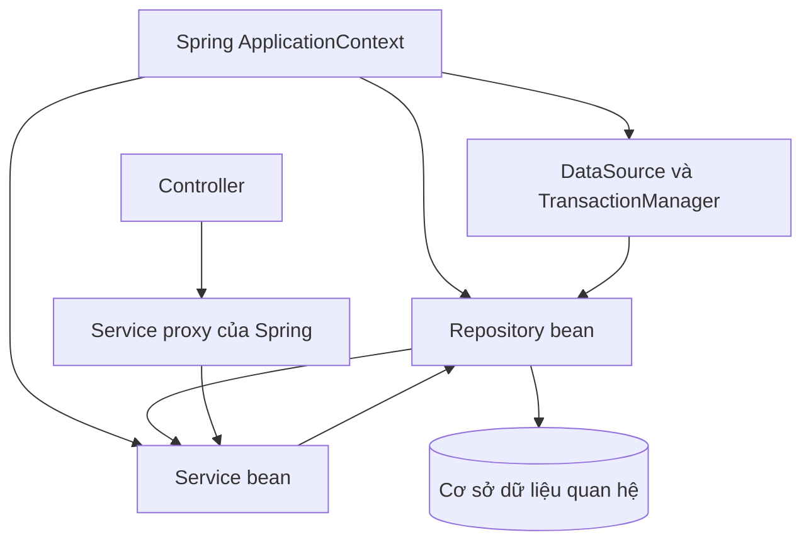
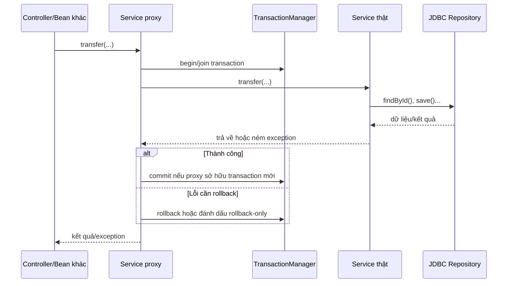

# Ôn Spring IoC, cấu hình bean, proxy và quản lý giao dịch

Trong **Spring Data Relational JDBC** (thường gọi ngắn là **Spring Data JDBC**), repository thực hiện truy cập cơ sở dữ liệu qua JDBC, còn Spring Framework tổ chức các đối tượng ứng dụng và điều phối giao dịch. Muốn hiểu vì sao một lời gọi `repository.save(...)` chạy trong cùng giao dịch với các thao tác khác, cần nắm bốn mắt xích: **IoC container → bean và dependency injection → proxy → transaction manager**.

Sau bài này, bạn có thể tự giải thích:

- Spring tạo và nối các bean như `Service`, `Repository`, `DataSource` như thế nào; khi nào nên dùng `@Component`, `@Service`, `@Repository`, `@Configuration` và `@Bean`.
- Vì sao `@Transactional` thường có hiệu lực khi gọi một phương thức qua Spring bean, nhưng có thể không có hiệu lực khi gọi từ một phương thức khác trong cùng đối tượng.
- Spring gắn nhiều thao tác JDBC vào một giao dịch và quyết định `commit`/`rollback` ra sao.
- Cách đặt ranh giới giao dịch ở tầng service khi dùng Spring Data JDBC, cùng những lỗi cấu hình thường gặp.

## 1. Bức tranh tổng thể: ai tạo đối tượng, ai quản lý giao dịch?

Trong Java thuần, một lớp có thể tự tạo các thành phần phụ thuộc:

```java
class CheckoutService {
    private final PaymentGateway gateway = new PaymentGateway();
}
```

`CheckoutService` bị gắn chặt với cách tạo `PaymentGateway`: khó thay thế triển khai, cấu hình và kiểm thử. Với **Inversion of Control (IoC)**, mã ứng dụng khai báo nó cần gì; **Spring container** chịu trách nhiệm tạo, cấu hình và nối các đối tượng phù hợp. Việc truyền đối tượng phụ thuộc vào một lớp là **Dependency Injection (DI)**.



**Điểm phân biệt quan trọng:** `ApplicationContext` quản lý bean; **proxy** đứng trước một số bean để thêm hành vi như giao dịch; **transaction manager** điều phối giao dịch trên connection JDBC. Chúng phối hợp với nhau nhưng đảm nhiệm các trách nhiệm khác nhau.

### 1.1. `ApplicationContext` và vòng đời bean

`ApplicationContext` là giao diện trung tâm của IoC container. Khi ứng dụng khởi động, Spring thường:

1. Thu thập *bean definitions* từ component scanning, các phương thức `@Bean` và auto-configuration.
2. Tạo bean theo phụ thuộc, chọn constructor, tiêm dependency và áp dụng cấu hình.
3. Gọi các điểm mở rộng của vòng đời như `BeanPostProcessor`; ở đây Spring có thể tạo proxy cho bean cần AOP/transaction.
4. Đưa bean vào sử dụng và gọi các callback hủy phù hợp khi đóng context.

Một **bean** là một đối tượng được Spring container quản lý. Đối tượng tạo bằng `new` trong mã nghiệp vụ thông thường vẫn là đối tượng Java hợp lệ, nhưng không tự động được Spring tiêm dependency, xử lý `@Transactional` hoặc tham gia các callback của container.

Mặc định, bean có **scope `singleton`**: một instance cho mỗi bean definition trong một `ApplicationContext` (không có nghĩa là singleton duy nhất trên toàn JVM). Do nhiều request có thể dùng chung service singleton, **tránh lưu trạng thái thay đổi theo từng request trong field của service**. Biến cục bộ trong phương thức hoặc trạng thái lưu ở cơ sở dữ liệu thường phù hợp hơn.

Các scope thường gặp:

| Scope | Ý nghĩa | Tình huống |
|---|---|---|
| `singleton` | Một instance trong container cho bean đó; mặc định | Service, repository, cấu hình dùng chung |
| `prototype` | Tạo instance mới mỗi lần container được yêu cầu cấp bean | Đối tượng cần vòng đời riêng |
| `request` | Một instance trong phạm vi HTTP request | Trạng thái thực sự thuộc request trong ứng dụng web |
| `session` | Một instance trong phạm vi HTTP session | Dữ liệu theo phiên web khi thật sự cần |

Tiêm một prototype vào singleton **một lần ở constructor** không làm prototype tự thay mới mỗi lần gọi phương thức. Nếu cần lấy instance mới nhiều lần, cân nhắc `ObjectProvider<T>` hoặc thiết kế lại thành phần đó.

## 2. Khai báo và tiêm bean

### 2.1. Component scanning với các stereotype annotation

Spring có thể phát hiện lớp trong vùng quét qua các annotation:

| Annotation | Vai trò thường dùng |
|---|---|
| `@Component` | Thành phần Spring tổng quát |
| `@Service` | Chứa quy tắc và thao tác nghiệp vụ |
| `@Repository` | Tầng truy cập dữ liệu; với lớp DAO do bạn viết, còn hỗ trợ dịch một số ngoại lệ truy cập dữ liệu |
| `@Controller` / `@RestController` | Xử lý request của ứng dụng web |
| `@Configuration` | Lớp khai báo cấu hình và các phương thức `@Bean` |

`@Service`, `@Repository` và `@Controller` đều là các stereotype xây trên `@Component`, giúp diễn đạt rõ trách nhiệm lớp. Với một interface kế thừa `CrudRepository` của **Spring Data JDBC**, Spring Data có thể tự tạo repository proxy; bạn không cần tự viết lớp triển khai hay gắn `@Repository` chỉ để đăng ký interface đó.

`@SpringBootApplication` bao gồm cơ chế component scanning, mặc định lấy package chứa lớp main làm gốc và quét các package con. Nếu đặt service ngoài cây package này, Spring có thể không tìm thấy bean và báo lỗi khi tiêm dependency.

### 2.2. Constructor injection là lựa chọn mặc định tốt

```java
import org.springframework.stereotype.Service;
import java.time.Clock;
import java.time.Instant;

@Service
public class InvoiceService {
    private final Clock clock;

    // Nếu lớp chỉ có một constructor, Spring tự dùng constructor này.
    public InvoiceService(Clock clock) {
        this.clock = clock;
    }

    public Instant issuedAt() {
        return Instant.now(clock);
    }
}
```

Ở đây `InvoiceService` không tạo `Clock`: Spring truyền bean tương ứng vào constructor. `final` cho thấy dependency bắt buộc và không bị thay sau khi khởi tạo. Khi unit test, bạn có thể tự truyền `Clock.fixed(...)` mà không cần khởi động Spring.

### 2.3. `@Bean` cho đối tượng cần cấu hình hoặc lớp bên thứ ba

Không phải đối tượng nào cũng có thể gắn `@Component` (ví dụ `Clock` trong thư viện Java). Khi đó khai báo phương thức `@Bean`:

```java
import org.springframework.context.annotation.Bean;
import org.springframework.context.annotation.Configuration;
import java.time.Clock;

@Configuration
public class TimeConfiguration {
    @Bean
    Clock businessClock() {
        return Clock.systemUTC();
    }
}
```

Spring đăng ký đối tượng trả về thành bean tên `businessClock`. `@Configuration` mô tả nơi khai báo bean, còn `@Bean` đánh dấu phương thức tạo bean; chính bản thân `@Bean` không đồng nghĩa với việc phương thức được gọi lại mỗi khi sử dụng đối tượng. Cách dễ hiểu nhất để dùng bean này là **tiêm qua constructor**, không gọi trực tiếp `timeConfiguration.businessClock()` từ mã nghiệp vụ.

Trong một ứng dụng Spring Boot dùng Spring Data JDBC, auto-configuration thường tạo sẵn `DataSource`, các thành phần Spring JDBC, repository infrastructure và `PlatformTransactionManager` khi có dependency/cấu hình phù hợp. Chỉ khai báo bean thủ công khi cần tùy biến hoặc ứng dụng có nhiều nguồn dữ liệu; tránh tạo thêm transaction manager trùng vai trò với bean đã được Boot cấu hình.

### 2.4. Khi có nhiều bean cùng kiểu

Giả sử tồn tại hai bean thực thi `NotificationSender`, Spring không thể luôn biết nên tiêm cái nào. Bạn có thể dùng:

```java
@Service
class OrderNotificationService {
    private final NotificationSender sender;

    OrderNotificationService(
            @org.springframework.beans.factory.annotation.Qualifier("emailSender")
            NotificationSender sender) {
        this.sender = sender;
    }
}
```

`@Qualifier` chọn bean cụ thể; `@Primary` đánh dấu lựa chọn mặc định trong số nhiều bean cùng kiểu. `@Profile` và các điều kiện cấu hình cho phép đăng ký bean theo môi trường. Khi chỉ có một bean phù hợp, Spring thường chọn dựa trên kiểu mà không cần qualifier.

### 2.5. Một số vấn đề vòng đời và thiết kế

- `@PostConstruct` phù hợp cho khởi tạo sau khi tiêm dependency, nhưng **không nên dựa vào `@Transactional` của chính bean trong callback khởi tạo**: proxy có thể chưa ở vị trí lời gọi như khi ứng dụng vận hành bình thường.
- `@PreDestroy` dùng cho dọn tài nguyên khi bean/container kết thúc vòng đời, không phải cơ chế rollback nghiệp vụ.
- Phụ thuộc vòng (`A` cần `B`, `B` lại cần `A`) qua constructor thường cho thấy hai thành phần đang gánh trách nhiệm chưa tách rõ; nên chỉnh thiết kế thay vì cố ép Spring tạo bean.
- Không lưu `Connection`, `ResultSet` hay trạng thái giao dịch vào field của singleton service: connection thuộc phạm vi thao tác/giao dịch và phải được quản lý đúng cách.

## 3. Proxy: vì sao lời gọi qua Spring bean khác lời gọi nội bộ?

**Proxy** là đối tượng đại diện cho bean đích (*target*). Khi bên ngoài gọi phương thức qua proxy, Spring có thể chạy logic bổ sung trước/sau lời gọi: mở giao dịch, kiểm soát rollback, bảo mật, đo thời gian hoặc các advice AOP khác.



Spring AOP thường dùng hai cơ chế proxy:

| Cơ chế | Cách hoạt động | Giới hạn cần nhớ |
|---|---|---|
| **JDK dynamic proxy** | Proxy triển khai các interface mà bean cung cấp | Lời gọi cần đi qua những phương thức của interface proxy |
| **Class-based proxy** (CGLIB) | Tạo subclass của lớp đích | Không thể override để intercept phương thức `final`; lớp `final` không thể dùng cơ chế subclass này |

Cơ chế nào được dùng còn tùy cấu hình AOP và cách định nghĩa bean. Nên đặt `@Transactional` trên **phương thức `public` của lớp service cụ thể**, tránh phụ thuộc vào khác biệt giữa các cơ chế proxy. Phương thức `private` không thể được proxy kiểu này can thiệp như một lời gọi bên ngoài.

**Đừng nhầm hai loại proxy:** Spring Data JDBC tạo triển khai/proxy cho interface repository; Spring transaction AOP có thể tạo proxy cho service. Domain object như `Account` được Spring Data JDBC ánh xạ từ hàng dữ liệu, không có cơ chế persistence context, dirty checking hay lazy-loading proxy như những khái niệm thường gặp trong JPA.

### 3.1. Bẫy self-invocation

```java
import org.springframework.stereotype.Service;
import org.springframework.transaction.annotation.Propagation;
import org.springframework.transaction.annotation.Transactional;

@Service
class BatchService {
    public void runBatch() {
        saveOne(); // Lời gọi this.saveOne(): đi thẳng vào target.
    }

    @Transactional(propagation = Propagation.REQUIRES_NEW)
    public void saveOne() {
        // Thao tác repository/JDBC.
    }
}
```

Khi một bên ngoài gọi `runBatch()` qua proxy, bên trong đối tượng thực thi `saveOne()` thông qua `this`. Lời gọi đó **không đi lại qua proxy**, nên advice của `@Transactional(REQUIRES_NEW)` trên `saveOne()` không chạy. Nếu `runBatch()` đang có giao dịch, `saveOne()` sẽ tiếp tục thực thi trong ngữ cảnh hiện có thay vì tự mở giao dịch mới như kỳ vọng.

Một thiết kế rõ ràng hơn là đưa thao tác cần ranh giới riêng sang bean khác:

```java
@Service
class ItemWriter {
    @Transactional(propagation = Propagation.REQUIRES_NEW)
    public void saveOne() {
        // Ghi dữ liệu bằng repository.
    }
}

@Service
class BatchService {
    private final ItemWriter itemWriter;

    BatchService(ItemWriter itemWriter) {
        this.itemWriter = itemWriter;
    }

    public void runBatch() {
        itemWriter.saveOne(); // Gọi sang bean khác qua proxy Spring.
    }
}
```

Các tình huống có cùng bản chất: tạo service bằng `new` thay vì lấy bean từ Spring; gọi phương thức qua `this`; gọi phương thức `private` hoặc `final` trong tình huống proxy không thể intercept; gọi logic cần proxy trong thời điểm bean chưa được proxy phù hợp. Hãy kiểm tra **đường đi của lời gọi**, không chỉ sự hiện diện của annotation.

## 4. Giao dịch JDBC trong Spring

### 4.1. Transaction đảm bảo điều gì?

Một transaction gom các thao tác cơ sở dữ liệu vào một đơn vị làm việc. Với ví dụ chuyển tiền, hai cập nhật “trừ tài khoản A” và “cộng tài khoản B” phải cùng thành công, hoặc cùng được hủy. Các thuộc tính ACID thường được nhắc đến là:

- **Atomicity:** hoặc tất cả thay đổi trong transaction được commit, hoặc các thay đổi của transaction bị rollback.
- **Consistency:** transaction tuân thủ các ràng buộc dữ liệu đã thiết kế; DB không tự hiểu mọi quy tắc nghiệp vụ.
- **Isolation:** quy định mức các transaction đồng thời có thể thấy thay đổi của nhau.
- **Durability:** thay đổi đã commit được DB lưu bền vững theo bảo đảm của hệ quản trị.

Spring **không thay thế** cơ chế transaction của database. Spring quyết định **bắt đầu, tham gia, commit và rollback**; JDBC driver, connection và hệ quản trị cơ sở dữ liệu thực hiện phần giao dịch vật lý.

### 4.2. Các thành phần phối hợp

| Thành phần | Công việc |
|---|---|
| `DataSource` | Cung cấp JDBC `Connection` (thường qua connection pool) |
| `PlatformTransactionManager` | Giao diện Spring để bắt đầu/commit/rollback một transaction |
| `JdbcTransactionManager` / `DataSourceTransactionManager` | Triển khai transaction manager cho JDBC với một `DataSource` |
| `TransactionInterceptor` | Advice đọc quy tắc từ `@Transactional` và yêu cầu transaction manager thực thi |
| `TransactionSynchronizationManager` | Gắn tài nguyên giao dịch với luồng thực thi hiện tại |
| `JdbcTemplate` / Spring Data JDBC repository | Truy cập JDBC, phối hợp để dùng connection tham gia transaction hiện có |

Trong trường hợp JDBC thông thường, Spring gắn `Connection` vào **thread** đang xử lý transaction. Các thao tác repository ở cùng thread, dùng cùng `DataSource` và công cụ JDBC có hỗ trợ transaction của Spring, sẽ dùng connection đã được gắn để cùng tham gia giao dịch. Vì vậy không nên tự mở/đóng tùy ý một connection tách biệt bằng `dataSource.getConnection()` trong cùng luồng xử lý nghiệp vụ. Nếu viết DAO JDBC thấp hơn, nên dùng `JdbcTemplate` hoặc `DataSourceUtils` theo đúng hợp đồng của Spring.

Ngữ cảnh transaction gắn với thread không tự động đi qua `@Async`, `new Thread(...)` hay một lời gọi HTTP sang dịch vụ khác. Một giao dịch JDBC đơn nguồn dữ liệu cũng **không tự làm cho thao tác gửi email, gọi API, Kafka hoặc một database khác trở nên atomic**.

### 4.3. `@Transactional` nên nằm ở đâu?

Đối với nhiều bước nghiệp vụ tạo thành một đơn vị nhất quán, hãy đặt transaction ở **phương thức public của service**:

```java
import org.springframework.stereotype.Service;
import org.springframework.transaction.annotation.Transactional;

@Service
public class OrderApplicationService {
    private final OrderRepository orderRepository;
    private final InventoryRepository inventoryRepository;

    public OrderApplicationService(OrderRepository orderRepository,
                                   InventoryRepository inventoryRepository) {
        this.orderRepository = orderRepository;
        this.inventoryRepository = inventoryRepository;
    }

    @Transactional
    public void placeOrder(Order order, Inventory inventory) {
        inventory.reserve(order.quantity());
        inventoryRepository.save(inventory);
        orderRepository.save(order);
    }
}
```

Đoạn mã này minh họa **ranh giới nghiệp vụ**; các kiểu `Order`, `Inventory` và repository là kiểu của ứng dụng. Nếu việc lưu kho thành công nhưng lưu đơn hàng ném lỗi khiến transaction rollback, các thay đổi JDBC đã thực hiện trong transaction sẽ được hủy. Không nên mở transaction quá rộng chỉ để bao gồm xử lý file hoặc chờ API mạng: nó có thể giữ connection/lock lâu và không cung cấp atomicity với tài nguyên bên ngoài.

Lưu ý riêng cho Spring Data JDBC: thay đổi field của entity **không tự được flush như JPA**; bạn phải gọi repository `save(...)` để lưu dữ liệu. Giao dịch không tự biến mọi đối tượng trong bộ nhớ thành bản ghi đã lưu.

### 4.4. Quy tắc commit và rollback mặc định

Với một `@Transactional` bắt đầu transaction mới:

1. Phương thức kết thúc bình thường → Spring yêu cầu `commit`, trừ trường hợp transaction đã được đánh dấu `rollback-only`.
2. Phương thức thoát ra với `RuntimeException` hoặc `Error` → mặc định yêu cầu `rollback`.
3. Phương thức thoát ra với **checked exception** (ví dụ một `IOException`) → mặc định **không** rollback, trừ khi được cấu hình khác.

Thay đổi quy tắc khi yêu cầu nghiệp vụ cần thiết:

```java
@Transactional(rollbackFor = java.io.IOException.class)
public void importData() throws java.io.IOException {
    // Các thao tác JDBC và một bước có thể ném IOException.
}
```

Nếu bạn `catch` lỗi bên trong rồi trả về bình thường, interceptor không tự biết nghiệp vụ thất bại:

```java
@Transactional
public void riskyOperation() {
    try {
        performDatabaseWrite();
    } catch (IllegalStateException ex) {
        // Nuốt lỗi: phương thức vẫn có thể kết thúc bình thường và commit.
    }
}
```

Hãy để exception phù hợp truyền ra ngoài, chuyển thành exception nghiệp vụ cần rollback, hoặc đánh dấu transaction rollback-only một cách có chủ đích. Với transaction đã tham gia từ caller, một tầng bên trong đánh dấu `rollback-only` có thể làm bước `commit` ngoài cùng kết thúc bằng `UnexpectedRollbackException` dù caller đã bắt lỗi ở giữa.

## 5. Các tùy chọn của `@Transactional`

Khai báo `@Transactional` từ `org.springframework.transaction.annotation.Transactional` cho phép bạn cấu hình propagation, isolation, timeout, rollback và read-only.

### 5.1. Propagation: lời gọi này tham gia transaction nào?

| Chế độ | Khi đã có transaction | Khi chưa có transaction |
|---|---|---|
| `REQUIRED` (mặc định) | Tham gia transaction hiện có | Tạo transaction mới |
| `REQUIRES_NEW` | Tạm treo transaction hiện có và tạo transaction độc lập | Tạo transaction mới |
| `SUPPORTS` | Tham gia nếu có | Chạy không có transaction |
| `MANDATORY` | Bắt buộc tham gia | Ném lỗi |
| `NOT_SUPPORTED` | Tạm treo transaction hiện có | Chạy không có transaction |
| `NEVER` | Ném lỗi | Chạy không có transaction |
| `NESTED` | Dùng savepoint bên trong transaction nếu transaction manager/driver hỗ trợ | Thường tạo transaction như `REQUIRED` |

Ví dụ:

```java
@Transactional(propagation = Propagation.REQUIRED)
public void createInvoice() {
    // Tham gia transaction của caller hoặc tự bắt đầu một transaction.
}

@Transactional(propagation = Propagation.REQUIRES_NEW)
public void recordIndependentAttempt() {
    // Transaction riêng khi được gọi qua proxy.
}
```

`REQUIRES_NEW` có thể cần **connection thứ hai** khi transaction ngoài vẫn đang giữ connection; số lượng connection pool không đủ sẽ gây chờ, thậm chí bế tắc khi nhiều luồng cùng dùng cách này. `NESTED` dựa trên savepoint, nên không đồng nghĩa với một transaction vật lý độc lập. Đừng chọn propagation nâng cao chỉ vì muốn “an toàn hơn”; trước hết xác định đúng trách nhiệm commit/rollback của nghiệp vụ.

### 5.2. Isolation: xử lý cạnh tranh dữ liệu

| Mức | Ý nghĩa thực tế ở mức khái quát |
|---|---|
| `DEFAULT` | Dùng isolation mặc định của database |
| `READ_UNCOMMITTED` | Có thể cho phép đọc dữ liệu chưa commit nếu DB hỗ trợ |
| `READ_COMMITTED` | Tránh dirty read; một câu đọc lặp có thể thấy dữ liệu mới được commit |
| `REPEATABLE_READ` | Tăng tính ổn định của các giá trị đã đọc trong transaction; chi tiết phụ thuộc DB |
| `SERIALIZABLE` | Mức bảo vệ mạnh nhất theo mô hình thực thi tương đương tuần tự; có thể tăng contention hoặc phát sinh lỗi cần retry |

Các hiện tượng thường gặp gồm **dirty read** (đọc dữ liệu chưa commit), **non-repeatable read** (đọc lại cùng hàng có giá trị khác) và **phantom read** (một truy vấn theo điều kiện trả về tập hàng khác). Cách từng hệ quản trị triển khai isolation, snapshot, lock và các hiện tượng được phép khác nhau. Vì thế **kiểm tra tài liệu và cấu hình của database đang dùng**, không suy luận chỉ từ tên enum.

```java
@Transactional(isolation = Isolation.READ_COMMITTED)
public void settlePayment() {
    // ...
}
```

### 5.3. `readOnly`, `timeout` và tên transaction manager

```java
@Transactional(readOnly = true)
public AccountView getAccount(long id) {
    // Thực hiện truy vấn đọc và trả về DTO.
}

@Transactional(timeout = 5)
public void updateAccount() {
    // Giới hạn thời gian transaction theo hỗ trợ của transaction manager/driver.
}
```

`readOnly = true` là **gợi ý tối ưu và ý định sử dụng**, không phải cơ chế bảo mật hay rào chắn tuyệt đối ngăn mọi lệnh ghi trên mọi DB. `timeout` không thể ngắt mọi dạng công việc tùy ý trong Java; hiệu lực phụ thuộc transaction manager và tài nguyên bên dưới. Với nhiều `PlatformTransactionManager`, có thể chọn bằng qualifier/tên, chẳng hạn `@Transactional(transactionManager = "ordersTransactionManager")`, và đảm bảo repository/JDBC thực sự dùng đúng `DataSource` tương ứng.

## 6. Ví dụ hoàn chỉnh: chuyển tiền với Spring Data JDBC

Đây là một luồng nhỏ cho thấy IoC, bean, proxy và JDBC transaction phối hợp. Để dễ kiểm tra số học, ví dụ dùng **số tiền theo đơn vị nhỏ nhất** (`long balanceCents`) thay vì số thực dấu phẩy động. `@Version` cung cấp kiểm tra **optimistic locking** khi có giao dịch cạnh tranh sửa cùng tài khoản.

### 6.1. Cấu hình ứng dụng

Với dự án Spring Boot dùng Maven và dependency management của Boot:

```xml
<dependency>
    <groupId>org.springframework.boot</groupId>
    <artifactId>spring-boot-starter-data-jdbc</artifactId>
</dependency>
<dependency>
    <groupId>org.postgresql</groupId>
    <artifactId>postgresql</artifactId>
    <scope>runtime</scope>
</dependency>
```

Ví dụ cấu hình kết nối (thay giá trị theo môi trường thực tế, không đưa mật khẩu thật vào mã nguồn):

```properties
spring.datasource.url=jdbc:postgresql://localhost:5432/learning_db
spring.datasource.username=learning_user
spring.datasource.password=${DB_PASSWORD}
```

Khi dependency và kết nối phù hợp, Spring Boot có thể cấu hình `DataSource`, transaction manager và Spring Data JDBC repositories. Bạn thường **không cần** tự khai báo `@Bean DataSource` hoặc tự triển khai `AccountRepository`.

Một schema PostgreSQL đơn giản:

```sql
CREATE TABLE accounts (
    id BIGINT GENERATED BY DEFAULT AS IDENTITY PRIMARY KEY,
    balance_cents BIGINT NOT NULL CHECK (balance_cents >= 0),
    version BIGINT
);
```

### 6.2. Aggregate root và repository

```java
import org.springframework.data.annotation.Id;
import org.springframework.data.annotation.Version;
import org.springframework.data.relational.core.mapping.Table;

@Table("accounts")
public class Account {
    @Id
    private Long id;

    @Version
    private Long version;

    private long balanceCents;

    protected Account() { } // Spring Data ánh xạ dữ liệu.

    public Account(long openingBalanceCents) {
        if (openingBalanceCents < 0) {
            throw new IllegalArgumentException("Opening balance must not be negative");
        }
        this.balanceCents = openingBalanceCents;
    }

    public long getBalanceCents() {
        return balanceCents;
    }

    public void debit(long amountCents) {
        if (amountCents <= 0 || balanceCents < amountCents) {
            throw new IllegalArgumentException("Invalid amount or insufficient funds");
        }
        balanceCents -= amountCents;
    }

    public void credit(long amountCents) {
        if (amountCents <= 0) {
            throw new IllegalArgumentException("Amount must be positive");
        }
        balanceCents = Math.addExact(balanceCents, amountCents);
    }
}
```

```java
import org.springframework.data.repository.CrudRepository;

public interface AccountRepository extends CrudRepository<Account, Long> {
    // Spring Data JDBC cung cấp triển khai cho CRUD cơ bản.
}
```

`@Table` ánh xạ class với bảng; `@Id` chỉ định khóa chính; `@Version` cho phép phát hiện nhiều cập nhật trên cùng phiên bản dữ liệu. Khi cập nhật một bản ghi có phiên bản đã thay đổi, Spring Data JDBC có thể ném ngoại lệ optimistic locking (một runtime exception), khiến giao dịch bên ngoài rollback. Không có `@Version`, chỉ bao nhiều thao tác trong transaction không đủ để ngăn mọi trường hợp *lost update* khi có truy cập đồng thời.

### 6.3. Service chứa ranh giới giao dịch

```java
import org.springframework.stereotype.Service;
import org.springframework.transaction.annotation.Transactional;

@Service
public class TransferService {
    private final AccountRepository accounts;

    public TransferService(AccountRepository accounts) {
        this.accounts = accounts;
    }

    @Transactional
    public void transfer(long fromId, long toId, long amountCents) {
        if (fromId == toId || amountCents <= 0) {
            throw new IllegalArgumentException("Invalid transfer");
        }

        Account from = accounts.findById(fromId)
                .orElseThrow(() -> new IllegalArgumentException("Source account not found"));
        Account to = accounts.findById(toId)
                .orElseThrow(() -> new IllegalArgumentException("Destination account not found"));

        from.debit(amountCents);
        to.credit(amountCents);

        accounts.save(from);
        accounts.save(to);
    }
}
```

Diễn tiến khi một controller hoặc bean khác gọi `transferService.transfer(...)`:

1. Caller gọi **Spring bean proxy** của `TransferService`.
2. Transaction advice kiểm tra `@Transactional`; với `REQUIRED` mặc định, nếu chưa có transaction, transaction manager bắt đầu giao dịch JDBC.
3. Service sử dụng repository bean do Spring Data JDBC cung cấp; các thao tác đọc và ghi chạy cùng giao dịch hiện có khi dùng chung `DataSource` và thread.
4. `accounts.save(from)` và `accounts.save(to)` phải đều thành công để giao dịch được commit. Nếu bước thứ hai ném runtime exception, cả cập nhật bước thứ nhất cũng bị rollback.
5. Khi service kết thúc bình thường và transaction không bị đánh dấu rollback-only, transaction manager commit, trả connection về pool theo cơ chế quản lý tài nguyên.

Ví dụ tập trung vào tính atomic và IoC. Trong hệ thống tiền tệ thực tế còn cần kiểm tra phân quyền, quy tắc kế toán, idempotency, kiểm soát cạnh tranh và chiến lược retry lỗi phiên bản/serialization. Nếu có những tài nguyên ngoài database tham gia, một giao dịch JDBC riêng không bảo đảm atomicity cho toàn bộ quy trình; cần thiết kế thêm cơ chế như transactional outbox hoặc saga tùy yêu cầu.

## 7. Khi nào cấu hình transaction manager thủ công?

Trong ứng dụng Boot có **một** `DataSource` và starter Spring Data JDBC phù hợp, hãy để auto-configuration đăng ký transaction manager. Nếu cần tự cấu hình, nguyên lý là transaction manager phải tham chiếu **đúng DataSource mà repository/JDBC sử dụng**:

```java
import javax.sql.DataSource;
import org.springframework.context.annotation.Bean;
import org.springframework.context.annotation.Configuration;
import org.springframework.jdbc.support.JdbcTransactionManager;
import org.springframework.transaction.PlatformTransactionManager;

@Configuration
class JdbcTransactionConfiguration {
    @Bean
    PlatformTransactionManager transactionManager(DataSource dataSource) {
        return new JdbcTransactionManager(dataSource);
    }
}
```

**Đây là ví dụ để hiểu cơ chế, không phải cấu hình cần chép thêm vào mọi dự án Boot.** Với nhiều nguồn dữ liệu, bạn cần đảm bảo transaction manager được chọn tương ứng với repository và connection factory; một `JdbcTransactionManager` chỉ điều phối giao dịch JDBC cục bộ trên DataSource mà nó quản lý.

Nếu phải điều khiển transaction theo luồng chương trình thay cho annotation, Spring còn cung cấp `TransactionTemplate`:

```java
import org.springframework.transaction.support.TransactionTemplate;

public class MaintenanceTask {
    private final TransactionTemplate transactions;

    public MaintenanceTask(TransactionTemplate transactions) {
        this.transactions = transactions;
    }

    public void execute() {
        transactions.executeWithoutResult(status -> {
            // Các thao tác JDBC thuộc cùng transaction.
            // status.setRollbackOnly() nếu cần chủ động hủy.
        });
    }
}
```

`TransactionTemplate` cần được đăng ký/khởi tạo với transaction manager phù hợp. Nó hữu ích khi ranh giới giao dịch cần được mô tả trong code, nhưng **không thay thế nhu cầu chọn đúng DataSource và xử lý exception hợp lý**.

## 8. Những lỗi thường gặp khi học Spring Data JDBC

| Triệu chứng | Nguyên nhân đáng kiểm tra | Hướng xử lý |
|---|---|---|
| Có `@Transactional` nhưng không mở giao dịch như kỳ vọng | Tự gọi qua `this`, tạo service bằng `new`, method không đi qua proxy | Gọi qua Spring bean khác; đặt transaction ở public service method được caller gọi |
| Hai lần `save()` không rollback cùng nhau | Không có transaction bao toàn bộ workflow hoặc chạy ở các transaction/DataSource khác nhau | Đặt `@Transactional` tại service; kiểm tra transaction manager và DataSource |
| Ngoại lệ xuất hiện nhưng vẫn commit | Checked exception mặc định không rollback; hoặc đã catch và nuốt lỗi | Dùng `rollbackFor` khi phù hợp hoặc để exception cần rollback truyền ra |
| `REQUIRES_NEW` hoạt động không như mong đợi | Self-invocation; thiếu connection cho transaction độc lập | Gọi qua proxy khác; rà soát giới hạn connection pool |
| Thay đổi field đối tượng mà dữ liệu DB không đổi | Nhầm Spring Data JDBC với dirty checking của JPA | Gọi `repository.save(...)` rõ ràng |
| Truy cập đồng thời làm mất cập nhật | Giao dịch đơn thuần không giải quyết mọi xung đột ghi | Cân nhắc `@Version`, khóa dữ liệu, isolation và retry hợp lý |
| Test pass nhưng chạy thật kết quả commit khác | Test method có transaction tự rollback khi kết thúc | Phân biệt kiểm tra logic trong test transaction với kiểm tra commit thực sự |
| Lỗi `NoSuchBeanDefinitionException` | Lớp ngoài package scan; thiếu stereotype/`@Bean`; có điều kiện cấu hình chưa thỏa | Kiểm tra vùng component scan, cấu hình bean và profile |
| Lỗi `NoUniqueBeanDefinitionException` | Nhiều bean cùng kiểu, Spring không chọn được | `@Qualifier`, `@Primary` hoặc thay đổi thiết kế dependency |
| Connection/lock bị giữ lâu | Transaction bao cả network I/O, thao tác chậm hoặc nested transaction không cần thiết | Thu hẹp giao dịch vào phần thao tác DB cần atomicity |

### 8.1. Quan sát transaction khi chạy ứng dụng

Có thể tăng log tạm thời để xem hoạt động transaction/JDBC (mức log thực tế phụ thuộc phiên bản và thành phần được dùng):

```properties
logging.level.org.springframework.transaction=TRACE
logging.level.org.springframework.jdbc.datasource=DEBUG
```

Khi điều tra lỗi, hãy lần lượt xác định **caller gọi bean nào**, lời gọi có đi qua proxy không, method có annotation và propagation gì, transaction manager nào được chọn, các repository có cùng `DataSource` không, exception nào thật sự thoát ra khỏi method. Các thông tin đó thường quan trọng hơn việc chỉ nhìn thấy dòng `@Transactional` trong source code.

### 8.2. Kiểm thử ý nghĩa commit/rollback

- **Unit test:** khởi tạo service với repository giả để kiểm tra quy tắc nghiệp vụ; loại test này không chứng minh một giao dịch JDBC thật đã rollback.
- **Integration test:** dùng database thử nghiệm và gọi service qua bean lấy từ Spring, kiểm tra trạng thái các hàng sau khi có thao tác lỗi ở giữa quy trình.
- **Lưu ý:** nếu chính test method được bọc `@Transactional`, framework kiểm thử có thể tự rollback lúc kết thúc. Để xác nhận hành vi commit/rollback của service trong điều kiện giống thực tế, cần thiết kế test phù hợp thay vì dựa vào transaction mặc định của test.

Ví dụ kịch bản cần chứng minh: tài khoản A có 100 đơn vị, tài khoản B có 0; khi cố chuyển 120 đơn vị, service ném lỗi và dữ liệu hai tài khoản vẫn giữ 100/0. Với kịch bản gây lỗi **sau khi đã lưu A nhưng trước khi lưu B**, sau khi rollback dữ liệu A cũng phải được khôi phục. Khi cập nhật xung đột `@Version`, toàn bộ transaction chuyển tiền cần được rollback để không có nửa giao dịch được ghi lại.

## 9. Câu hỏi tự kiểm tra

1. **`@Service` có tạo transaction không?** Không. Nó cho phép Spring quản lý service như bean; transaction chỉ xuất hiện khi có cơ chế transaction phù hợp và một lời gọi được intercept theo quy tắc transaction.
2. **Vì sao constructor injection giúp test dễ hơn?** Dependency thể hiện rõ trong constructor; test có thể truyền implementation giả mà không cần container.
3. **Gắn `@Transactional` vào một private method có đảm bảo rollback không?** Không theo mô hình Spring proxy AOP thông thường; private method không được intercept như lời gọi bên ngoài.
4. **Tại sao `REQUIRES_NEW` trong `this.saveOne()` không mở transaction mới?** Vì lời gọi nội bộ không đi qua proxy chứa transaction advice.
5. **Một service có hai lần `repository.save()` có tự động atomic không?** Không thể kết luận chỉ vì có hai lời gọi repository; cần một transaction bao đúng hai thao tác và dùng đúng tài nguyên giao dịch.
6. **Thay `account.balance` trong bộ nhớ có tự ghi xuống DB với Spring Data JDBC không?** Không. Phải yêu cầu repository lưu aggregate.
7. **Checked exception có mặc định rollback không?** Không; dùng `rollbackFor` nếu muốn áp quy tắc rollback tương ứng.
8. **Một transaction JDBC có rollback được email đã gửi không?** Không. Email là tài nguyên bên ngoài transaction DB cục bộ; cần quy trình phối hợp riêng.

## 10. Ghi nhớ mô hình vận hành

Hãy theo dõi **tuyến lời gọi thực tế**: `ApplicationContext` tạo bean và nối dependency → caller nhận service bean (có thể là proxy) → transaction advice mở/tham gia giao dịch → service gọi repository Spring Data JDBC → JDBC sử dụng connection của transaction hiện tại → Spring commit hoặc rollback theo kết quả. Với các thao tác ghi dữ liệu liên quan nhau, ranh giới `@Transactional` tại tầng service là điểm khởi đầu rõ ràng; các trường hợp ngoại lệ tiếp tục được quyết định bởi **proxy, propagation, rollback rule và transaction manager**.
