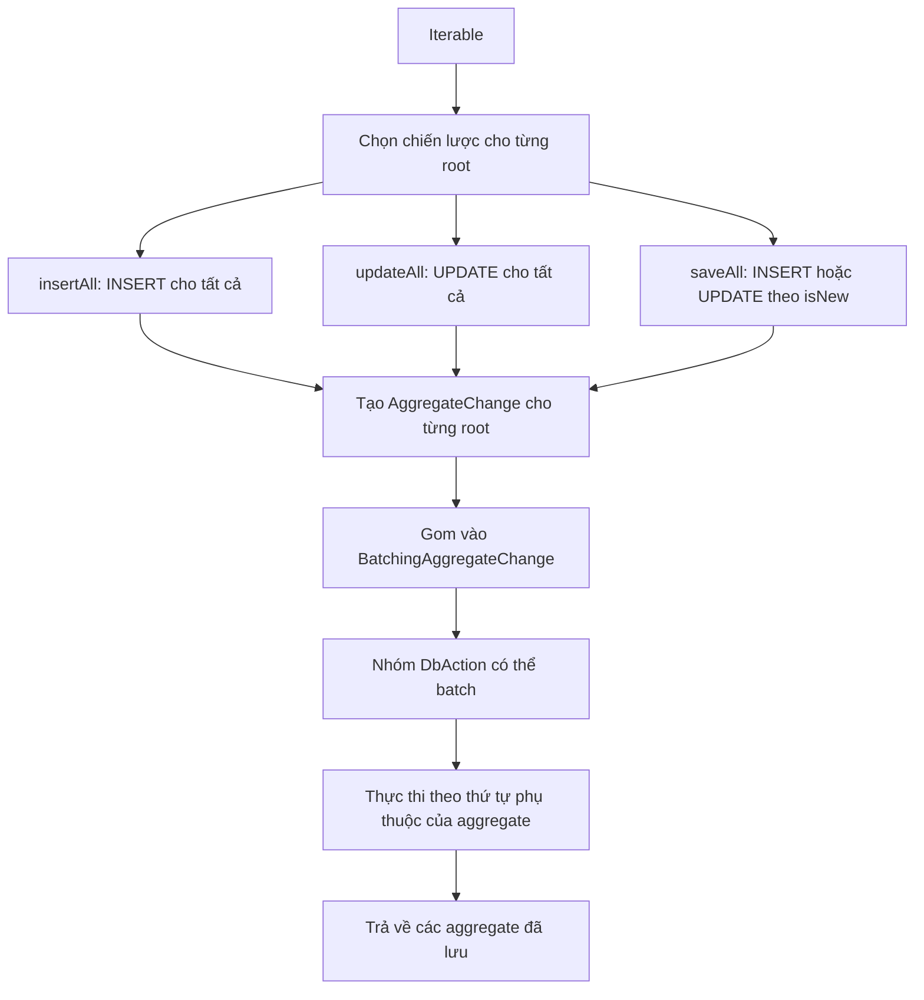

# Thao tác `insertAll`, `updateAll` và `saveAll`

Trong **Spring Data Relational JDBC**, `JdbcAggregateTemplate` cung cấp các thao tác ghi trực tiếp ở cấp aggregate. Ngoài `insert()`, `update()` và `save()` cho một aggregate, template còn có các phiên bản nhận một `Iterable`: **`insertAll()`**, **`updateAll()`** và **`saveAll()`**.

Ba phương thức đều làm việc với **aggregate root và toàn bộ entity được sở hữu trong aggregate**. Khác biệt chính nằm ở cách quyết định thao tác ghi:

- `insertAll()` luôn tạo thao tác insert cho từng aggregate.
- `updateAll()` luôn tạo thao tác update cho từng aggregate.
- `saveAll()` kiểm tra trạng thái mới/cũ của từng aggregate rồi chọn insert hoặc update tương ứng.

Các phương thức `...All` còn gom những thao tác có thể batch để database thực thi hiệu quả hơn. Điều đó không có nghĩa toàn bộ tập aggregate luôn trở thành đúng một câu SQL. Số statement và khả năng batch phụ thuộc cấu trúc aggregate, loại `DbAction`, database và `DataAccessStrategy`.

## 1. `JdbcAggregateTemplate` là gì?

`JdbcAggregateTemplate` là API cấp cao của Spring Data JDBC để lưu và tải aggregate theo domain type. Repository của Spring Data JDBC sử dụng template để triển khai phần lớn chức năng persistence; ứng dụng cũng có thể inject template trực tiếp khi cần thao tác tùy chỉnh.

```java
import org.springframework.data.jdbc.core.JdbcAggregateTemplate;
import org.springframework.stereotype.Service;

@Service
public class OrderImportService {

    private final JdbcAggregateTemplate aggregateTemplate;

    public OrderImportService(JdbcAggregateTemplate aggregateTemplate) {
        this.aggregateTemplate = aggregateTemplate;
    }
}
```

Khi ứng dụng đã cấu hình Spring Data JDBC (thường qua `spring-boot-starter-data-jdbc`), Spring tạo bean template với mapping context, converter và data access strategy phù hợp. Không cần tự khởi tạo `JdbcAggregateTemplate` bằng constructor trong trường hợp thông thường.

Template làm việc với **aggregate root**, không phải một danh sách bảng tùy ý. Nếu root sở hữu `List<OrderLine>`, khi gọi `insertAll` hoặc `saveAll`, Spring Data JDBC lập kế hoạch ghi cả root và các dòng con theo mapping. Một aggregate khác trong cùng danh sách vẫn là một root độc lập, có vòng đời riêng.

## 2. Phân biệt ba phương thức

| Phương thức | Quyết định cho từng aggregate | Khi dùng |
|---|---|---|
| `insertAll(Iterable<T>)` | Luôn insert | Tất cả aggregate đều mới và muốn ép insert, kể cả khi ID đã được cấp trước |
| `updateAll(Iterable<T>)` | Luôn update | Tất cả aggregate đã tồn tại và muốn ép update |
| `saveAll(Iterable<T>)` | Kiểm tra trạng thái mới/cũ rồi chọn insert/update | Tập đầu vào có thể gồm cả aggregate mới và aggregate đã tồn tại |

Đừng hiểu `saveAll()` là một lệnh upsert database cho từng ID. Spring Data JDBC xác định trạng thái mới/cũ từ **trạng thái entity** (ví dụ `@Id`, `@Version` hoặc `Persistable`), không mặc định chạy một câu `SELECT` để kiểm tra row có tồn tại trước khi quyết định.

### Chữ ký API

Trong `JdbcAggregateTemplate` của Spring Data Relational hiện hành, các chữ ký là:

```java
<T> List<T> insertAll(Iterable<T> instances);
<T> List<T> updateAll(Iterable<T> instances);
<T> List<T> saveAll(Iterable<T> instances);
```

Nếu khai báo dependency theo interface `JdbcAggregateOperations`, chữ ký `insertAll` trong interface trả `Iterable<T>`; implementation `JdbcAggregateTemplate` trả `List<T>` cụ thể. `updateAll` và `saveAll` trả `List<T>`.

Các mốc API:

- `saveAll` có từ Spring Data Relational **3.0**.
- `insertAll` và `updateAll` có từ **3.1**.
- `upsert(instance)` là một thao tác riêng; nó không phải ý nghĩa của `insertAll` và API hiện hành không cung cấp `upsertAll` tương ứng.

## 3. Mô hình ví dụ: một đơn hàng có nhiều dòng

Để thấy các phương thức batch xử lý toàn bộ aggregate, dùng `PurchaseOrder` làm root và `OrderLine` làm entity con được sở hữu.

### Aggregate root

```java
package com.example.sales;

import java.util.ArrayList;
import java.util.List;

import org.springframework.data.annotation.Id;
import org.springframework.data.annotation.Version;
import org.springframework.data.relational.core.mapping.MappedCollection;
import org.springframework.data.relational.core.mapping.Table;

@Table("purchase_order")
public class PurchaseOrder {

    @Id
    private Long id;

    @Version
    private Long version;

    private String status;

    @MappedCollection(idColumn = "order_id", keyColumn = "line_no")
    private List<OrderLine> lines = new ArrayList<>();

    protected PurchaseOrder() {}

    public PurchaseOrder(String status) {
        this.status = status;
    }

    public void addLine(Long productId, int quantity) {
        if (productId == null || quantity <= 0) {
            throw new IllegalArgumentException("Invalid order line");
        }
        lines.add(new OrderLine(productId, quantity));
    }

    public Long getId() { return id; }
    public Long getVersion() { return version; }
    public String getStatus() { return status; }
    public List<OrderLine> getLines() { return List.copyOf(lines); }

    public void confirm() {
        if (lines.isEmpty()) {
            throw new IllegalStateException("An empty order cannot be confirmed");
        }
        status = "CONFIRMED";
    }
}
```

### Entity con

```java
package com.example.sales;

import org.springframework.data.annotation.Id;
import org.springframework.data.relational.core.mapping.Column;
import org.springframework.data.relational.core.mapping.Table;

@Table("order_line")
public class OrderLine {

    @Id
    private Long id;

    @Column("product_id")
    private Long productId;

    private int quantity;

    protected OrderLine() {}

    public OrderLine(Long productId, int quantity) {
        this.productId = productId;
        this.quantity = quantity;
    }

    public Long getId() { return id; }
    public Long getProductId() { return productId; }
    public int getQuantity() { return quantity; }
}
```

Trong mô hình này, `PurchaseOrder` sở hữu `OrderLine` thông qua `@MappedCollection`. Khi ghi một danh sách đơn hàng, template xử lý mỗi đơn và các dòng con thuộc đơn đó. `OrderLine` không cần repository riêng nếu vòng đời của nó hoàn toàn nằm trong aggregate `PurchaseOrder`.

DDL PostgreSQL minh họa:

```sql
CREATE TABLE purchase_order (
    id BIGINT GENERATED BY DEFAULT AS IDENTITY PRIMARY KEY,
    version BIGINT NOT NULL,
    status VARCHAR(30) NOT NULL
);

CREATE TABLE order_line (
    id BIGINT GENERATED BY DEFAULT AS IDENTITY PRIMARY KEY,
    order_id BIGINT NOT NULL REFERENCES purchase_order(id),
    line_no INTEGER NOT NULL,
    product_id BIGINT NOT NULL,
    quantity INTEGER NOT NULL CHECK (quantity > 0),
    UNIQUE (order_id, line_no)
);
```

Schema phải được tạo bằng migration hoặc SQL script. Các thao tác template không tự tạo bảng cho aggregate.

## 4. `insertAll()`: luôn insert mọi aggregate đầu vào

`insertAll()` là lựa chọn khi bạn biết chắc mọi aggregate trong `Iterable` đều mới. API bỏ qua bước kiểm tra entity mới/cũ và tạo thao tác insert cho từng aggregate, bao gồm các entity con được sở hữu.

```java
import java.util.List;

import org.springframework.data.jdbc.core.JdbcAggregateTemplate;
import org.springframework.stereotype.Service;
import org.springframework.transaction.annotation.Transactional;

@Service
public class OrderImportService {

    private final JdbcAggregateTemplate template;

    public OrderImportService(JdbcAggregateTemplate template) {
        this.template = template;
    }

    @Transactional
    public List<PurchaseOrder> insertNewOrders(List<PurchaseOrder> orders) {
        return template.insertAll(orders);
    }
}
```

Ví dụ gọi:

```java
List<PurchaseOrder> orders = List.of(
        orderWithLines("DRAFT", 10L, 2, 15L, 1),
        orderWithLines("DRAFT", 20L, 3)
);

List<PurchaseOrder> inserted = orderImportService.insertNewOrders(orders);
```

`insertAll()` phù hợp khi:

- Nhập một tập aggregate mới từ file hoặc hệ thống khác.
- ID của root được cấp trước bởi ứng dụng/client và bạn muốn insert bất kể ID đã có giá trị.
- Bạn có quy trình import mà mọi phần tử được xác nhận là chưa tồn tại.

Vì đây là **insert**, không truyền lại aggregate đã tồn tại. Nếu primary key trùng, database có thể báo lỗi duplicate key. Phương thức không tự chuyển sang update và không tự biến thành upsert.

### ID và version khi insert

Nếu database dùng identity/auto-increment, root có thể bắt đầu với ID `null`; database sinh ID khi insert. ID root được sử dụng để ghi các hàng child có FK trỏ về root.

Nếu client cấp ID trước, `insertAll()` hữu ích vì nó không suy luận “ID khác null tức entity cũ”. Tuy nhiên ID được cung cấp phải hợp lệ và chưa xung đột với dữ liệu hiện có. Nếu aggregate có `@Version`, template chuẩn bị version ban đầu cho thao tác insert.

## 5. `updateAll()`: luôn update mọi aggregate đầu vào

`updateAll()` bỏ qua bước kiểm tra entity mới/cũ và luôn lập kế hoạch update cho từng aggregate. Hãy dùng nó khi mọi root đầu vào chắc chắn đã tồn tại.

```java
@Service
public class OrderUpdateService {

    private final JdbcAggregateTemplate template;

    public OrderUpdateService(JdbcAggregateTemplate template) {
        this.template = template;
    }

    @Transactional
    public List<PurchaseOrder> confirmOrders(List<PurchaseOrder> existingOrders) {
        existingOrders.forEach(PurchaseOrder::confirm);
        return template.updateAll(existingOrders);
    }
}
```

Các aggregate truyền vào thường được tải trước từ repository/template, sau đó thay đổi bằng domain method. Không truyền object mới chưa từng được lưu với kỳ vọng `updateAll()` tự insert. Nếu row không tồn tại, thao tác update không biến thành insert.

### Optimistic locking khi có `@Version`

Trong ví dụ, `PurchaseOrder` có `@Version Long version`. Khi update, Spring Data JDBC dùng version hiện tại làm điều kiện và tăng version cho lần cập nhật tiếp theo. Nếu một transaction khác đã sửa cùng root, version không còn khớp và template ném `OptimisticLockingFailureException`.

Với `updateAll()`, điều này có nghĩa một phần tử có version stale có thể làm thao tác batch thất bại. Nếu toàn bộ batch nằm trong một transaction, các thay đổi trước đó trong cùng transaction sẽ rollback khi exception thoát ra khỏi transaction boundary.

Nếu aggregate không có `@Version`, ứng dụng không có cơ chế optimistic locking tự động cho root. Đặc biệt, không nên suy luận rằng `updateAll()` đã xác minh tất cả ID tồn tại chỉ vì method trả về bình thường. Khi cần phát hiện mất row/cạnh tranh cập nhật, cân nhắc `@Version` và kiểm thử với database mục tiêu.

## 6. `saveAll()`: tự chọn insert hoặc update cho từng root

`saveAll()` tương đương ý nghĩa `save()` của repository nhưng nhận nhiều aggregate. Framework kiểm tra trạng thái mới/cũ **trên từng aggregate**, vì vậy cùng một danh sách có thể có cả phần tử mới và phần tử đã tồn tại.

```java
@Service
public class OrderSaveService {

    private final JdbcAggregateTemplate template;

    public OrderSaveService(JdbcAggregateTemplate template) {
        this.template = template;
    }

    @Transactional
    public List<PurchaseOrder> saveOrders(List<PurchaseOrder> orders) {
        return template.saveAll(orders);
    }
}
```

Giả sử danh sách gồm:

| Phần tử | Trạng thái khi gọi `saveAll()` | Thao tác được chọn |
|---|---|---|
| Đơn A | ID `null`, version `null` | Insert |
| Đơn B | Đã được tải từ database, version đã có | Update |
| Đơn C | ID được cấp trước, version `null` và entity state nhận diện là mới | Insert |

Việc xác định mới/cũ dựa trên chiến lược entity state detection của Spring Data (ID, version hoặc `Persistable`). Template không mặc định chạy một câu `SELECT` trước mỗi phần tử để hỏi database có row tương ứng hay không.

Điều này làm `saveAll()` thuận tiện cho một tập dữ liệu hỗn hợp, nhưng chỉ an toàn nếu trạng thái của từng object phản ánh đúng ý định ghi. Một object mang ID đã tồn tại nhưng không được đánh dấu là mới có thể đi vào nhánh update; một object cũ có version stale có thể gặp optimistic locking failure.

## 7. Luồng xử lý batch ở cấp aggregate

Ở mức khái niệm, ba phương thức tạo một nhóm thay đổi aggregate rồi đưa nhóm đó cho executor thực thi:



`BatchingAggregateChange` cho phép gom thao tác của nhiều aggregate. Các action có thể batch được nhóm và kết hợp để tạo cơ hội tối ưu ở tầng data access. Với aggregate có entity con, action vẫn phải tuân theo quan hệ phụ thuộc: insert root trước child và xử lý delete theo chiều ngược lại.

### “All” có phải một câu SQL duy nhất không?

Không. `insertAll`, `updateAll` và `saveAll` là **batch operations ở cấp aggregate**. Một aggregate có root cùng nhiều bảng con; nhiều aggregate có thể tạo ra nhiều nhóm action khác nhau. Spring Data gom những thao tác tương thích để có thể dùng batch execution, nhưng không đảm bảo mọi trường hợp trở thành một câu SQL duy nhất dạng `INSERT ... VALUES (...), (...), (...)`.

Khả năng batch và số statement phụ thuộc:

- Cấu trúc aggregate và số lượng entity con.
- Hành động insert/update/delete được tạo cho mỗi root.
- Việc database sinh ID hay ứng dụng cấp ID.
- JDBC driver, dialect và `DataAccessStrategy`.
- Loại action có thể gom với action khác hay cần thực thi riêng.

Vì vậy, hãy đo số statement và thời gian trên database thật thay vì suy luận hiệu năng chỉ từ tên method có hậu tố `All`.

## 8. Thứ tự thao tác với entity con và khóa ngoại

Giả sử `PurchaseOrder` sở hữu `OrderLine` qua `order_line.order_id`:

```text
purchase_order
  id

order_line
  id
  order_id  -> purchase_order.id
  line_no
  product_id
```

Khi `insertAll()` nhiều đơn, mỗi root phải được ghi trước khi các dòng con tham chiếu đến ID của nó. Khi update aggregate đã tồn tại, Spring Data JDBC đồng bộ collection theo chiến lược persistence của nó; entity con được sở hữu có thể bị xóa rồi chèn lại để phản ánh trạng thái hiện tại. FK phải cho phép thứ tự thao tác đó.

Hệ quả thiết kế:

- Cột FK của child phải trỏ đến đúng ID root.
- Các root được tham chiếu bởi aggregate khác (ví dụ `Product`) phải tồn tại nếu FK được kiểm tra ngay.
- Không đặt các aggregate root độc lập vào cùng collection owned chỉ để batch chung.
- Child có vòng đời độc lập hoặc bị nhiều root tham chiếu nên được mô hình hóa thành aggregate root riêng.

Batching không làm mất các quy tắc toàn vẹn của database. Nếu một aggregate vi phạm FK, unique constraint hoặc check constraint, statement vẫn có thể thất bại.

## 9. Lifecycle callbacks và auditing trong các thao tác `...All`

`JdbcAggregateTemplate` vẫn chạy lifecycle của aggregate khi dùng `insertAll`, `updateAll` và `saveAll`. Với mỗi root trong batch, quy trình lưu gọi các callback tương ứng trước khi tạo/ghi thay đổi và sau khi ghi thành công, ví dụ:

- `BeforeConvertCallback`: biến đổi root trước khi tạo `AggregateChange`; có thể dùng để cấp ID theo quy tắc lifecycle.
- `BeforeSaveCallback`: nhận root và `AggregateChange` trước khi SQL thực thi.
- `AfterSaveCallback`: chạy sau khi aggregate được lưu.

Các callback/lifecycle events được áp dụng theo từng aggregate root trong tập đầu vào. Vì thế, nếu có auditing hoặc logic callback tốn kém, chi phí của chúng cũng tăng theo số root.

Đối với entity dùng `@CreatedDate`, `@LastModifiedDate`, `@CreatedBy`, `@LastModifiedBy`, hãy cấu hình auditing như bình thường. `...All` vẫn đi qua aggregate lifecycle; điều này khác với bulk SQL trực tiếp bằng `@Modifying @Query`, vốn bỏ qua lifecycle callbacks/events.

## 10. Transaction: khi nào cả batch phải cùng thành công?

Hậu tố `All` mô tả số aggregate đầu vào, không tự nó diễn đạt đầy đủ yêu cầu transaction của use case. Nếu nghiệp vụ yêu cầu **toàn bộ tập aggregate commit hoặc rollback cùng nhau**, hãy đặt `@Transactional` ở application service bao quanh lời gọi template.

```java
@Service
public class BulkOrderService {

    private final JdbcAggregateTemplate template;

    public BulkOrderService(JdbcAggregateTemplate template) {
        this.template = template;
    }

    @Transactional
    public List<PurchaseOrder> importAtomically(List<PurchaseOrder> orders) {
        return template.insertAll(orders);
    }
}
```

Với transaction trên service, các statement do template thực hiện tham gia cùng transaction JDBC nếu dùng đúng `DataSource` và transaction manager. Nếu một aggregate gây lỗi constraint hoặc optimistic locking failure, exception thoát khỏi method sẽ khiến transaction rollback theo quy tắc Spring mặc định cho `RuntimeException`/`Error`.

Khi không có transaction bao trùm, không nên giả định mọi statement của nhiều aggregate được commit/rollback như một đơn vị nguyên tử. Đặc biệt, một aggregate có nhiều statement và nhiều root trong batch có thể tạo ra trạng thái ghi dở nếu lỗi xuất hiện giữa chừng mà không có transaction phù hợp.

### Chia batch lớn thành các chunk

Không truyền một tập dữ liệu khổng lồ vào một lần gọi chỉ vì API nhận `Iterable`. Template cần chuẩn bị các aggregate changes cho tập đầu vào; batch lớn có thể chiếm nhiều bộ nhớ, tạo transaction dài và giữ nhiều lock.

Có thể chia thành chunk:

```java
for (List<PurchaseOrder> chunk : partition(orders, 200)) {
    bulkOrderService.insertChunk(chunk);
}
```

Trong đó `insertChunk` là một method trên Spring bean riêng hoặc một method được gọi qua proxy:

```java
@Service
public class OrderChunkWriter {

    private final JdbcAggregateTemplate template;

    public OrderChunkWriter(JdbcAggregateTemplate template) {
        this.template = template;
    }

    @Transactional
    public List<PurchaseOrder> insertChunk(List<PurchaseOrder> chunk) {
        return template.insertAll(chunk);
    }
}
```

Mỗi chunk có transaction riêng. Nếu chunk thứ tư thất bại, ba chunk trước có thể đã commit. Đây là trade-off giữa transaction nhỏ và tính nguyên tử toàn bộ import; chọn theo yêu cầu nghiệp vụ. Nếu bắt buộc toàn bộ import all-or-nothing, dùng một transaction bao trùm hoặc thiết kế staging/validation/commit riêng.

## 11. Optimistic locking khi dùng `updateAll()` và `saveAll()`

Với aggregate root có `@Version`, Spring Data JDBC tăng version khi update và kiểm tra version cũ trong điều kiện SQL. Nếu một aggregate trong batch có version stale, thao tác có thể ném `OptimisticLockingFailureException`.

Ví dụ:

```java
List<PurchaseOrder> orders = orderRepository.findAllById(orderIds);

orders.forEach(PurchaseOrder::confirm);

List<PurchaseOrder> saved = template.updateAll(orders);
```

Nếu một order đã được transaction khác cập nhật sau lúc `findAllById`, version của object có thể không còn đúng. Khi đó không nên tự tăng version trong Java để ép ghi. Hãy đọc lại trạng thái mới, kiểm tra invariant và quyết định có thể áp dụng lại lệnh nghiệp vụ hay cần trả conflict cho caller.

Với `insertAll()`, version được chuẩn bị theo trạng thái insert. Với `saveAll()`, mỗi root được phân loại mới/cũ trước khi tạo action; root mới đi theo insert, root cũ đi theo update và quy tắc optimistic locking tương ứng.

## 12. So sánh với `CrudRepository.saveAll()` và `JdbcTemplate.batchUpdate()`

Ba API có tên gần nhau nhưng cấp độ abstraction khác nhau:

| API | Đối tượng đầu vào | Cách làm việc |
|---|---|---|
| `CrudRepository.saveAll(Iterable<S>)` | Aggregate roots | Repository persistence; dùng cơ chế save của Spring Data JDBC |
| `JdbcAggregateTemplate.saveAll(Iterable<T>)` | Aggregate roots | API template trực tiếp; nhận diện insert/update và ghi cả aggregate members |
| `JdbcAggregateTemplate.insertAll/updateAll` | Aggregate roots | Ép hướng insert hoặc update cho tất cả aggregate |
| `JdbcTemplate.batchUpdate(sql, batchArgs)` | Bộ tham số cho cùng một câu SQL | Chạy lặp một SQL statement với nhiều bộ tham số; không tự quản lý aggregate mapping |

Nếu cần lưu nhiều aggregate có child, generated IDs, version và lifecycle callbacks, dùng `JdbcAggregateTemplate`. Nếu cần chạy một lệnh SQL lặp lại trên một bảng với nhiều parameter sets, `JdbcTemplate.batchUpdate()` có thể phù hợp hơn.

Không nên tự viết `batchUpdate` cho bảng child rồi cho rằng Spring Data JDBC sẽ tự đồng bộ trạng thái các aggregate đang có trong bộ nhớ. JDBC thuần chỉ thực thi SQL được cung cấp; nó không tự áp dụng aggregate lifecycle.

## 13. Những lỗi thường gặp

| Biểu hiện | Nguyên nhân | Hướng xử lý |
|---|---|---|
| `insertAll()` báo duplicate key | Có root đã tồn tại hoặc ID client cấp bị trùng | Chỉ truyền aggregate mới; kiểm tra ID và unique constraints |
| `updateAll()` không tạo row mới | Phương thức luôn update, không tự chuyển sang insert | Dùng `insertAll()` hoặc `saveAll()` đúng với trạng thái entity |
| `saveAll()` chọn update cho object mới có ID | Entity state detection xem object là cũ | Kiểm tra `@Id`, `@Version` hoặc `Persistable.isNew()` |
| `saveAll()` chọn insert cho object cũ | Trạng thái entity đánh dấu mới sai hoặc version chưa được khởi tạo | Kiểm tra state detection và tải aggregate từ database trước khi sửa |
| Optimistic locking failure trong batch | Một aggregate có version stale | Reload, kiểm tra invariant và xử lý conflict/retry có kiểm soát |
| FK violation ở child | Root tham chiếu chưa tồn tại hoặc mapping FK sai | Kiểm tra DDL, thứ tự ghi và aggregate ownership |
| Batch lớn tốn nhiều bộ nhớ | Tập input quá lớn được chuẩn bị thành các aggregate changes | Chia chunk và chọn transaction boundary phù hợp |
| Một phần dữ liệu đã ghi khi batch lỗi | Không có transaction chung hoặc transaction boundary không bao trùm template call | Đặt `@Transactional` ở application service |
| Mong muốn chỉ một SQL statement nhưng thấy nhiều SQL | Mỗi aggregate có nhiều bảng/DbAction; chỉ action tương thích mới batch được | Đo SQL thực tế; không coi `...All` là một câu SQL duy nhất |
| Auditing/version không như mong đợi | Entity state, callbacks hoặc cấu hình auditing chưa đúng | Kiểm tra lifecycle callbacks, `@Version` và auditing configuration |

## 14. Kiểm thử ba phương thức

Một integration test nên xác nhận cả root lẫn child được ghi, và phân biệt rõ insert/update.

```java
@DataJdbcTest
class PurchaseOrderTemplateTest {

    @Autowired JdbcAggregateTemplate template;
    @Autowired JdbcTemplate jdbcTemplate;

    @Test
    void insertAllPersistsRootsAndTheirLines() {
        List<PurchaseOrder> input = List.of(
                orderWithLines("DRAFT", 10L, 2, 15L, 1),
                orderWithLines("DRAFT", 20L, 3)
        );

        List<PurchaseOrder> inserted = template.insertAll(input);

        assertThat(inserted).hasSize(2);
        assertThat(inserted).allSatisfy(order -> assertThat(order.getId()).isNotNull());

        Integer rootCount = jdbcTemplate.queryForObject(
                "SELECT COUNT(*) FROM purchase_order", Integer.class);
        Integer lineCount = jdbcTemplate.queryForObject(
                "SELECT COUNT(*) FROM order_line", Integer.class);

        assertThat(rootCount).isEqualTo(2);
        assertThat(lineCount).isEqualTo(3);
    }

    @Test
    void saveAllCanHandleNewAndExistingRoots() {
        PurchaseOrder existing = template.insert(orderWithLines("DRAFT", 10L, 1));
        existing.confirm();

        PurchaseOrder newOrder = orderWithLines("DRAFT", 20L, 2);

        List<PurchaseOrder> saved = template.saveAll(List.of(existing, newOrder));

        assertThat(saved).hasSize(2);
        assertThat(saved.get(0).getVersion()).isNotNull();
        assertThat(saved.get(1).getId()).isNotNull();
    }
}
```

Đây là ví dụ minh họa cho schema H2/PostgreSQL có `purchase_order` và `order_line`; cần khai báo `schema.sql` phù hợp và helper `orderWithLines(...)` tạo aggregate. `@DataJdbcTest` thường bao test trong transaction và rollback cuối test. Nếu cần kiểm tra transaction boundary của service qua nhiều request/transaction, viết test riêng để commit/rollback có chủ đích.

### Các tình huống test nên có

- `insertAll` nhận danh sách rỗng và trả danh sách rỗng.
- `insertAll` với ID trùng gây lỗi constraint.
- `updateAll` cập nhật các root đã tồn tại.
- `updateAll` với version stale gây optimistic locking failure khi root có `@Version`.
- `saveAll` có cả root mới và root cũ.
- Child rows được ghi đúng FK và collection mapping.
- Một lỗi ở giữa batch làm rollback toàn bộ khi service mở transaction.
- Batch chia chunk có đúng semantics commit từng chunk theo thiết kế.

Để kiểm tra hiệu năng, dùng database/driver mục tiêu và quan sát SQL hoặc datasource instrumentation. H2 hữu ích cho test mapping nhanh nhưng không đại diện hoàn toàn cho khả năng batching, generated key và execution plan của database production.

## 15. Quy trình chọn phương thức

1. **Xác định trạng thái từng root:** toàn bộ mới, toàn bộ đã tồn tại hay danh sách hỗn hợp?
2. **Nếu tất cả đều mới:** dùng `insertAll()` khi muốn ép insert.
3. **Nếu tất cả đều tồn tại:** dùng `updateAll()` khi muốn ép update.
4. **Nếu danh sách hỗn hợp:** dùng `saveAll()` để framework nhận diện từng root.
5. **Kiểm tra ID/version:** bảo đảm `@Id`, `@Version` hoặc `Persistable` thể hiện đúng trạng thái.
6. **Bảo vệ aggregate:** nhớ rằng các phương thức ghi cả entity con được sở hữu; xem lại kích thước collection và FK.
7. **Chọn transaction:** dùng `@Transactional` khi toàn bộ batch phải all-or-nothing; chia chunk khi dữ liệu lớn và chấp nhận commit từng phần.
8. **Kiểm tra kết quả:** xác nhận root, child, version, số row và constraint trên database thật.
9. **Đo hiệu năng:** xác nhận action nào được batch, số statement và bộ nhớ thay vì giả định hậu tố `All` là một SQL.

### Bảng quyết định nhanh

| Điều kiện đầu vào | Phương thức |
|---|---|
| Mọi aggregate đều mới, kể cả ID đã được cấp từ bên ngoài | `insertAll()` |
| Mọi aggregate đã tồn tại và cần cập nhật | `updateAll()` |
| Có cả aggregate mới và aggregate đã tồn tại | `saveAll()` |
| Chỉ một aggregate | `insert()`, `update()` hoặc `save()` |
| Cần native upsert cho một root, dialect hỗ trợ | `upsert()` riêng lẻ; không đồng nhất với `insertAll()` |
| Cần lặp một SQL statement trên nhiều bộ tham số | Cân nhắc `JdbcTemplate.batchUpdate()` |

**Điểm cốt lõi:** `insertAll`, `updateAll` và `saveAll` đều lưu nhiều aggregate cùng các entity được sở hữu. `insertAll` luôn insert, `updateAll` luôn update, còn `saveAll` quyết định theo trạng thái từng root. Template gom các `DbAction` có thể batch để tối ưu nhưng không hứa hẹn một câu SQL duy nhất. Đặt transaction ở application service khi cần toàn bộ batch cùng commit hoặc rollback, và kiểm tra version, FK, callbacks cùng chi phí ghi trên database mục tiêu.

## Tài liệu tham khảo chính thức

- [Spring Data Relational 4.1 — Persisting Entities](https://docs.spring.io/spring-data/relational/reference/jdbc/entity-persistence.html): cách template lưu aggregate, `save`, `insert`, `update`, upsert và lifecycle.
- [Spring Data JDBC — `JdbcAggregateOperations` API](https://docs.spring.io/spring-data/relational/reference/api/java/org/springframework/data/jdbc/core/JdbcAggregateOperations.html): chữ ký, return type và semantics của `saveAll`, `insertAll`, `updateAll`.
- [Spring Data JDBC — `JdbcAggregateTemplate` API](https://docs.spring.io/spring-data/relational/reference/api/java/org/springframework/data/jdbc/core/JdbcAggregateTemplate.html): API template cụ thể.
- [Spring Data Relational — `SaveBatchingAggregateChange` API](https://docs.spring.io/spring-data/relational/reference/api/java/org/springframework/data/relational/core/conversion/SaveBatchingAggregateChange.html): thứ tự entity tree và nhóm các action có thể batch.
- [Spring Data JDBC — Transactionality](https://docs.spring.io/spring-data/relational/reference/jdbc/transactions.html): transaction mặc định của repository và transaction boundary ở service layer.
- [Spring Data JDBC — Lifecycle Events](https://docs.spring.io/spring-data/relational/reference/jdbc/events.html): callbacks và events trong quy trình save aggregate.
