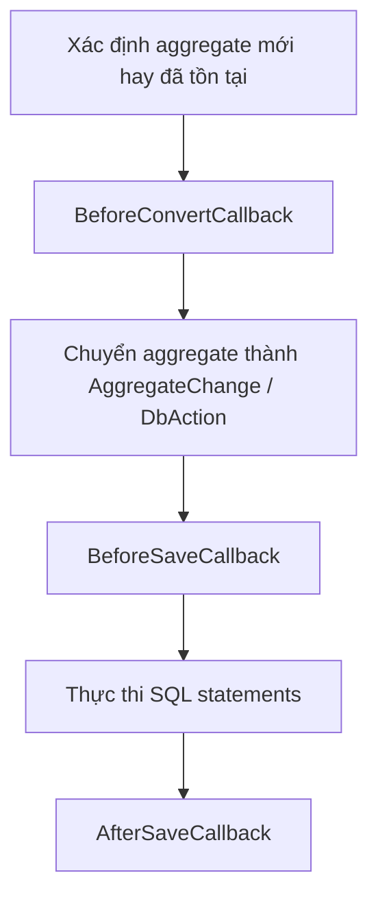
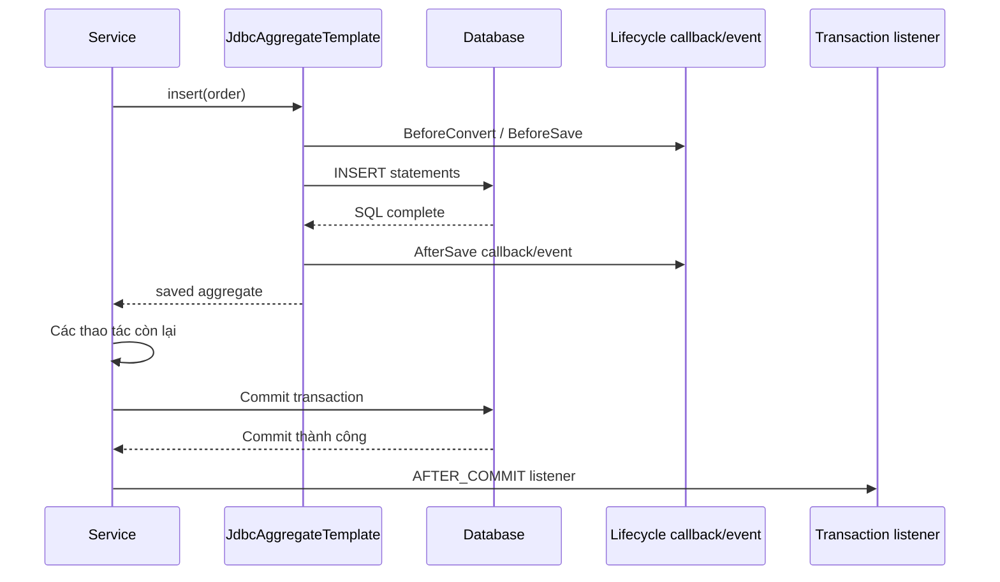

# Quản lý giao dịch, callback và sự kiện khi gọi template

Trong **Spring Data Relational JDBC**, `JdbcAggregateTemplate` là API thao tác trực tiếp với aggregate trong database. Nó cung cấp các thao tác như `insert`, `update`, `save`, `delete` và các phương thức đọc. Khi gọi template, ứng dụng có thể điều khiển chính xác thời điểm thực hiện từng thao tác mà không cần đi qua repository interface.

Các thao tác này thường phối hợp với ba cơ chế của Spring:

- **Transaction** xác định ranh giới commit hoặc rollback cho một hay nhiều thao tác database.
- **Entity callback** cung cấp điểm móc đồng bộ để thay đổi hoặc xử lý aggregate tại các bước trong vòng đời lưu, đọc và xóa.
- **Lifecycle event** thông báo cho listener rằng aggregate đã đi qua một bước cụ thể, ví dụ trước khi lưu hoặc sau khi chuyển đổi dữ liệu đọc.

Cần phân biệt lifecycle event của Spring Data JDBC với domain event của ứng dụng. Lifecycle event phản ánh hoạt động persistence; domain event diễn tả điều có ý nghĩa trong nghiệp vụ, chẳng hạn đơn hàng đã được thanh toán. Khi dùng trực tiếp `JdbcAggregateTemplate`, cần chủ động thiết kế cách phát domain event và thời điểm xử lý nó.

## 1. JdbcAggregateTemplate trong ứng dụng Spring

`JdbcAggregateTemplate` là API cấp aggregate của Spring Data JDBC. Repository của Spring Data JDBC cũng sử dụng template để triển khai phần lớn chức năng persistence.

Spring Boot/Spring Data JDBC có thể cấu hình template như một Spring bean. Hãy inject bean này vào service hoặc custom repository khi cần thao tác trực tiếp:

```java
import org.springframework.data.jdbc.core.JdbcAggregateTemplate;
import org.springframework.stereotype.Service;

@Service
public class PurchaseOrderService {

    private final JdbcAggregateTemplate template;

    public PurchaseOrderService(JdbcAggregateTemplate template) {
        this.template = template;
    }
}
```

Không nên tự tạo một instance bằng constructor trong từng service. Bean do Spring cấu hình được kết nối với mapping context, converter, data access strategy, entity callbacks và application event publisher của ứng dụng.

### 1.1. Các thao tác persistence chính

`JdbcAggregateTemplate` cung cấp một số nhóm thao tác:

| Phương thức | Mục đích |
|---|---|
| `insert(aggregate)` | Chèn aggregate mới |
| `update(aggregate)` | Cập nhật aggregate đã tồn tại |
| `save(aggregate)` | Lưu aggregate, xác định insert hay update theo trạng thái mới/cũ |
| `upsert(aggregate)` | Insert hoặc update bằng thao tác upsert của database khi dialect hỗ trợ |
| `delete(aggregate)` | Xóa aggregate theo root |
| `deleteById(id, type)` | Xóa aggregate theo ID và kiểu root |
| `findById(id, type)` | Tải aggregate theo ID |
| `findAll(type)` | Tải các aggregate theo kiểu |
| `count(type)` | Đếm số aggregate |

`insert` và `update` giả định trạng thái theo tên phương thức. `save` thực hiện kiểm tra trạng thái mới/cũ tương tự `save` của repository. `upsert` yêu cầu ID đã được gán và phụ thuộc khả năng của dialect; tài liệu hiện hành lưu ý upsert chưa hỗ trợ optimistic locking.

Ví dụ:

```java
PurchaseOrder inserted = template.insert(newOrder);
PurchaseOrder updated = template.update(existingOrder);
PurchaseOrder saved = template.save(order);
```

Một thao tác lưu aggregate có thể bao gồm nhiều câu SQL cho root và các entity thuộc aggregate. Template hiểu mapping aggregate và thực hiện các câu lệnh cần thiết theo cấu trúc đó.

### 1.2. Khi nào dùng template thay repository?

Dùng repository khi use case phù hợp với contract CRUD/query method và muốn giữ tầng persistence theo abstraction repository.

Dùng `JdbcAggregateTemplate` khi:

- Service cần gọi trực tiếp các thao tác insert/update/save/delete.
- Custom repository fragment cần sử dụng mapping aggregate có sẵn.
- Muốn xây dựng một thao tác persistence tổng quát mà không tạo thêm repository method.
- Cần dùng API query theo `Query` và `Criteria`.
- Muốn kết hợp nhiều thao tác template trong một transaction do service quản lý.

Template không thay thế mọi nhu cầu SQL tùy chỉnh. Nếu cần một projection JOIN phức tạp, `JdbcTemplate` hoặc `NamedParameterJdbcTemplate` vẫn có thể phù hợp hơn.

## 2. Transaction là ranh giới của thao tác template

Một aggregate có thể được lưu bằng nhiều câu SQL. Ví dụ một đơn hàng có root row và nhiều order item. Nếu một câu lệnh thành công nhưng câu lệnh sau thất bại, database có thể rơi vào trạng thái dở dang nếu các câu lệnh không nằm trong cùng transaction.

Vì vậy, hãy đặt transaction ở tầng service/application khi cần bảo đảm nhiều câu lệnh persistence cùng thành công hoặc cùng rollback.

### 2.1. Dùng @Transactional ở service

```java
import org.springframework.data.jdbc.core.JdbcAggregateTemplate;
import org.springframework.stereotype.Service;
import org.springframework.transaction.annotation.Transactional;

@Service
public class PurchaseOrderService {

    private final JdbcAggregateTemplate template;

    public PurchaseOrderService(JdbcAggregateTemplate template) {
        this.template = template;
    }

    @Transactional
    public PurchaseOrder place(PurchaseOrder order) {
        return template.insert(order);
    }

    @Transactional
    public PurchaseOrder revise(PurchaseOrder order) {
        return template.update(order);
    }
}
```

`@Transactional` tạo hoặc tham gia transaction theo cấu hình propagation. Khi phương thức service hoàn tất bình thường, transaction được commit. Khi có lỗi thuộc chính sách rollback, transaction được rollback.

Đặt transaction ở service còn cho phép gom nhiều thao tác template vào một đơn vị nghiệp vụ:

```java
@Transactional
public PurchaseOrder placeOrder(
        PurchaseOrder order,
        CustomerAccount account) {

    PurchaseOrder savedOrder = template.insert(order);
    template.update(account);

    return savedOrder;
}
```

Nếu thao tác thứ hai thất bại và exception làm transaction rollback, thao tác insert đơn hàng cũng được rollback. Điều này chỉ bảo đảm atomicity khi các thao tác cùng tham gia một transaction manager và cùng nguồn dữ liệu được quản lý.

### 2.2. Cùng DataSource và transaction manager

Spring JDBC đồng bộ connection với transaction manager. Để các thao tác template và JDBC cùng tham gia một transaction:

- Chúng phải dùng cùng DataSource được transaction manager quản lý.
- Dùng transaction manager phù hợp, thường là `JdbcTransactionManager` hoặc `DataSourceTransactionManager`.
- Các lời gọi phải diễn ra trong transaction context đang hoạt động.

Nếu service dùng template với một DataSource nhưng custom JDBC code lại dùng một DataSource khác và transaction manager khác, không thể mặc định cả hai cùng commit/rollback như một transaction duy nhất.

Trong ứng dụng Spring Boot có cấu hình Spring Data JDBC chuẩn, các bean thường được tự cấu hình. Nếu tự cấu hình nhiều DataSource, cần chỉ định đúng transaction manager cho service:

```java
@Transactional("ordersTransactionManager")
public void processOrder() {
    // Các thao tác dùng DataSource thuộc transaction manager này.
}
```

Tên qualifier ở ví dụ là tên bean do ứng dụng cấu hình, không phải tên mặc định bắt buộc.

### 2.3. Gộp thao tác bằng TransactionTemplate

Nếu cần điều khiển transaction theo chương trình thay vì annotation, dùng `TransactionTemplate`:

```java
import org.springframework.stereotype.Service;
import org.springframework.transaction.support.TransactionTemplate;

@Service
public class OrderBatchService {

    private final JdbcAggregateTemplate aggregateTemplate;
    private final TransactionTemplate transactionTemplate;

    public OrderBatchService(
            JdbcAggregateTemplate aggregateTemplate,
            TransactionTemplate transactionTemplate) {
        this.aggregateTemplate = aggregateTemplate;
        this.transactionTemplate = transactionTemplate;
    }

    public PurchaseOrder createOrder(PurchaseOrder order) {
        return transactionTemplate.execute(status -> {
            PurchaseOrder saved = aggregateTemplate.insert(order);

            // Có thể thực hiện thêm thao tác database
            // trong cùng transaction tại đây.

            return saved;
        });
    }
}
```

`TransactionTemplate.execute` nhận callback, quản lý việc bắt đầu/hoàn tất transaction và trả kết quả callback. Nó hữu ích khi ranh giới transaction phụ thuộc một nhánh xử lý trong code hoặc cần dùng trong một thành phần không thuận tiện đặt `@Transactional`.

### 2.4. Quy tắc rollback

Mặc định của Spring transaction declarative:

- `RuntimeException` và `Error` làm transaction rollback.
- Checked exception không tự động làm rollback theo quy tắc mặc định.
- Có thể chỉ định `rollbackFor` nếu checked exception cũng phải rollback.

Ví dụ:

```java
@Transactional(rollbackFor = IOException.class)
public void importOrders() throws IOException {
    template.insert(order);
    readExternalFile();
}
```

Nếu `readExternalFile` ném `IOException`, transaction được cấu hình rollback theo annotation.

Đừng bắt exception rồi bỏ qua nếu nghiệp vụ yêu cầu rollback. Khi exception bị nuốt và phương thức trả về bình thường, transaction interceptor có thể xem lời gọi là thành công và commit. Nếu cần bắt lỗi để chuyển đổi, hãy ném exception phù hợp hoặc đánh dấu rollback-only.

### 2.5. Lưu ý về proxy của @Transactional

Trong chế độ proxy mặc định, lời gọi phương thức transactional phải đi qua Spring proxy. Gọi một method transactional khác bằng `this.someMethod()` bên trong cùng bean không đi qua proxy, nên annotation của method được gọi có thể không được áp dụng như mong đợi.

Hãy đặt ranh giới transaction ở method service được gọi từ bean khác hoặc dùng cách quản lý transaction phù hợp. Đừng giả định chỉ cần đặt annotation ở bất kỳ method nào là mọi lời gọi nội bộ đều được bao transaction.

### 2.6. readOnly là một gợi ý cho thao tác đọc

```java
@Transactional(readOnly = true)
public PurchaseOrder findOrder(long id) {
    return template.findById(id, PurchaseOrder.class);
}
```

`readOnly = true` truyền một hint xuống transaction manager/JDBC driver và có thể hỗ trợ tối ưu. Nó không phải cơ chế kiểm tra tuyệt đối rằng code không thể chạy INSERT/UPDATE; hành vi còn phụ thuộc database và driver.

## 3. Vòng đời callback khi lưu aggregate

Spring Data JDBC cung cấp Entity Callback API để can thiệp vào các bước persistence. Callback được gọi đồng bộ theo các điểm móc xác định và có thể trả về chính aggregate hoặc một instance đã sửa đổi.

Khi lưu aggregate, trình tự khái quát là:



Các lifecycle event tương ứng cũng được phát ở những giai đoạn này. Phần event được trình bày ở mục sau.

### 3.1. BeforeConvertCallback

`BeforeConvertCallback<T>` chạy trước khi aggregate được chuyển thành kế hoạch thay đổi database. Đây là điểm thích hợp để chuẩn hóa aggregate hoặc gán ID theo chương trình.

Ví dụ:

```java
import org.springframework.data.relational.core.mapping.event.BeforeConvertCallback;
import org.springframework.stereotype.Component;

@Component
public class NormalizeOrderNumber
        implements BeforeConvertCallback<PurchaseOrder> {

    @Override
    public PurchaseOrder onBeforeConvert(PurchaseOrder aggregate) {
        String normalized = aggregate.orderNumber().trim();
        return aggregate.withOrderNumber(normalized);
    }
}
```

Ví dụ giả định `PurchaseOrder` có phương thức `withOrderNumber` trả về một record mới. Với object mutable, callback có thể thay đổi object rồi trả lại chính instance đó.

Nếu cần tạo ID bằng chương trình, `BeforeConvertCallback` là callback phù hợp. Spring Data đã quyết định aggregate là mới hay cũ trước khi gọi callback, sau đó mới chuyển đổi aggregate. Vì vậy ID được gán tại đây có thể được dùng khi tạo các hành động SQL tiếp theo.

### 3.2. BeforeSaveCallback

`BeforeSaveCallback<T>` chạy sau khi aggregate đã được chuyển thành `MutableAggregateChange`, nhưng trước khi các câu SQL được thực thi.

Chữ ký có dạng:

```java
T onBeforeSave(
    T aggregate,
    MutableAggregateChange<T> aggregateChange
);
```

Callback có thể trả về aggregate đã thay đổi và có thể điều chỉnh nội dung `MutableAggregateChange`. Tuy nhiên, việc quyết định insert hay update và cách xử lý ID đã được thực hiện ở bước trước. **Không dùng BeforeSaveCallback để tạo ID cho aggregate mới**; dùng `BeforeConvertCallback`.

Callback này phù hợp với các thao tác cần can thiệp vào kế hoạch ghi đã được tạo. Vì nó xuất hiện sau bước convert, hãy hiểu rõ thời điểm và tác động của mọi thay đổi đối với aggregate change.

### 3.3. AfterSaveCallback

`AfterSaveCallback<T>` chạy sau khi các câu SQL lưu aggregate đã được thực thi:

```java
@Component
public class OrderAfterSaveCallback
        implements AfterSaveCallback<PurchaseOrder> {

    @Override
    public PurchaseOrder onAfterSave(PurchaseOrder aggregate) {
        // Thực hiện xử lý đồng bộ sau bước save.
        return aggregate;
    }
}
```

Callback có thể trả về aggregate hiện tại hoặc một instance đã sửa đổi. Tuy nhiên, nếu lời gọi template đang nằm trong một transaction do service mở, `AfterSaveCallback` vẫn chạy **trước khi transaction chắc chắn commit**.

Nếu transaction bị rollback sau callback, callback đã chạy nhưng thay đổi database không được commit. Vì vậy không nên gửi email, gọi HTTP hoặc phát thông điệp không thể thu hồi trong `AfterSaveCallback`. Hãy dùng callback cho logic đồng bộ gắn với lifecycle persistence; side effect cần chờ commit nên dùng transactional event listener hoặc outbox.

### 3.4. Callback khi tải aggregate

`AfterConvertCallback<T>` chạy sau khi aggregate được tạo từ kết quả database và các property đã được ánh xạ.

```java
import org.springframework.data.relational.core.mapping.event.AfterConvertCallback;
import org.springframework.stereotype.Component;

@Component
public class OrderAfterConvertCallback
        implements AfterConvertCallback<PurchaseOrder> {

    @Override
    public PurchaseOrder onAfterConvert(PurchaseOrder aggregate) {
        // Có thể bổ sung xử lý sau khi mapping hoàn tất.
        return aggregate;
    }
}
```

Đây là điểm móc sau convert, không phải nơi để phát sinh thêm một truy vấn không kiểm soát cho từng aggregate. Nếu callback tải thêm dữ liệu cho từng root, có thể tạo vấn đề N+1 và tăng độ trễ khi đọc danh sách lớn.

### 3.5. Callback trước và sau khi xóa

Spring Data JDBC cũng cung cấp:

- `BeforeDeleteCallback<T>`: trước khi aggregate bị xóa.
- `AfterDeleteCallback<T>`: sau khi aggregate bị xóa.

Các callback nhận aggregate root, phù hợp với logic cần biết object nào đang bị xóa. Khi xóa theo ID, API có thể không có sẵn instance aggregate trong code gọi; callback lifecycle vẫn được thực hiện theo các thao tác aggregate mà template hỗ trợ.

### 3.6. Callback chỉ áp dụng cho aggregate root

Entity callback của Spring Data JDBC được gọi cho aggregate root. Nếu cần xử lý một entity con, hãy truy cập nó thông qua aggregate root chứa nó thay vì kỳ vọng một callback độc lập cho từng member.

Ví dụ một đơn hàng có nhiều dòng sản phẩm: callback nhận `PurchaseOrder` và có thể đọc danh sách items của aggregate đó.

## 4. Đăng ký và thứ tự callback

Trong ứng dụng Spring, callback thường được khai báo thành bean bằng `@Component` hoặc cấu hình bean. Hạ tầng Spring Data phát hiện và gọi callback tương ứng khi template thực hiện thao tác.

Nếu có nhiều callback cùng loại, có thể điều khiển thứ tự bằng cơ chế ordering của Spring, ví dụ `@Order` hoặc `Ordered`. Hãy dùng thứ tự tường minh khi callback sau phụ thuộc vào dữ liệu mà callback trước đã chuẩn hóa.

```java
@Component
@Order(10)
class TrimOrderNumber
        implements BeforeConvertCallback<PurchaseOrder> {

    @Override
    public PurchaseOrder onBeforeConvert(PurchaseOrder order) {
        return order.withOrderNumber(order.orderNumber().trim());
    }
}
```

```java
@Component
@Order(20)
class NormalizeOrderNumberCase
        implements BeforeConvertCallback<PurchaseOrder> {

    @Override
    public PurchaseOrder onBeforeConvert(PurchaseOrder order) {
        return order.withOrderNumber(
            order.orderNumber().toUpperCase(Locale.ROOT)
        );
    }
}
```

Trong ví dụ, callback thứ hai dùng kết quả đã trim từ callback thứ nhất. Nếu không có quan hệ phụ thuộc, tránh tạo nhiều callback nhỏ không cần thiết vì chúng làm luồng persistence khó theo dõi.

## 5. Lifecycle event của Spring Data JDBC

Lifecycle event là thông báo được Spring Data JDBC publish tới các `ApplicationListener` trong application context khi aggregate đi qua một giai đoạn persistence.

Các event phổ biến:

| Event | Thời điểm phát |
|---|---|
| `BeforeConvertEvent` | Trước khi aggregate được convert thành kế hoạch SQL |
| `BeforeSaveEvent` | Trước khi thực thi các câu SQL save |
| `AfterSaveEvent` | Sau khi các câu SQL save đã thực thi |
| `AfterConvertEvent` | Sau khi aggregate được tạo từ ResultSet và các property đã được ánh xạ |
| `BeforeDeleteEvent` | Trước khi aggregate root bị xóa |
| `AfterDeleteEvent` | Sau khi aggregate root bị xóa |

Các event và callback chỉ được kích hoạt cho aggregate root. Muốn xử lý dữ liệu entity con, listener cần đọc member từ aggregate root.

### 5.1. Lắng nghe event theo kiểu aggregate

Có thể dùng `AbstractRelationalEventListener<T>` để chỉ xử lý event của một loại domain object:

```java
import org.springframework.data.relational.core.mapping.event.AbstractRelationalEventListener;
import org.springframework.data.relational.core.mapping.event.AfterSaveEvent;
import org.springframework.stereotype.Component;

@Component
public class PurchaseOrderLifecycleListener
        extends AbstractRelationalEventListener<PurchaseOrder> {

    @Override
    protected void onAfterSave(AfterSaveEvent<PurchaseOrder> event) {
        PurchaseOrder order = event.getEntity();

        System.out.println(
            "Purchase order saved: " + order.id()
        );
    }
}
```

Listener này nhận event sau khi aggregate đã được save. Không cần tự cast object nếu listener đã khai báo đúng kiểu generic.

Có thể override các phương thức tương ứng như `onBeforeSave`, `onAfterSave`, `onAfterConvert` hoặc các hook delete theo phiên bản Spring Data Relational đang dùng.

### 5.2. Dùng ApplicationListener trực tiếp

```java
@Bean
ApplicationListener<BeforeSaveEvent<Object>> logAggregateSave() {
    return event -> {
        Object aggregate = event.getEntity();
        log.info("Preparing to save aggregate: {}", aggregate);
    };
}
```

Cách này hữu ích cho logging hoặc telemetry dùng chung. Nếu cần xử lý riêng từng aggregate type, `AbstractRelationalEventListener<T>` thường dễ quản lý hơn.

### 5.3. Lifecycle event là thông báo, không phải nơi ưu tiên để sửa entity

Event được thiết kế chủ yếu để thông báo một giai đoạn đã xảy ra. Entity callback được khuyến nghị khi cần thay đổi aggregate, đặc biệt với immutable record.

Lý do:

- Callback trả về instance mới hoặc instance đã sửa đổi.
- Callback chạy đồng bộ theo thứ tự lifecycle xác định.
- Event phụ thuộc `ApplicationEventMulticaster`; nếu cấu hình executor bất đồng bộ, thời điểm xử lý không còn được bảo đảm theo thứ tự thao tác persistence.
- Listener nhận event không nên trở thành nơi âm thầm thay đổi trạng thái domain.

Nếu cần chuẩn hóa dữ liệu trước khi ghi, dùng callback. Nếu cần ghi log hoặc phản ứng với sự kiện persistence, dùng listener.

### 5.4. Tắt lifecycle event trên template

Lifecycle event có thể tạo thêm chi phí, nhất là khi tải nhiều aggregate. `JdbcAggregateTemplate` cho phép tắt việc publish các lifecycle event:

```java
template.setEntityLifecycleEventsEnabled(false);
```

Mặc định event được bật. Tắt event giúp giảm chi phí phát và xử lý event trong trường hợp ứng dụng không cần chúng.

Thiết lập này chỉ điều khiển việc publish lifecycle event. Nó không phải công tắc thay thế cho Entity Callback API. Chỉ tắt sau khi xác nhận ứng dụng không dựa vào các listener lifecycle đang đăng ký.

## 6. Phân biệt lifecycle event và domain event

| Tiêu chí | Lifecycle event | Domain event |
|---|---|---|
| Ý nghĩa | Framework báo aggregate đang/đã được lưu, tải hoặc xóa | Nghiệp vụ báo một điều có ý nghĩa đã xảy ra |
| Ví dụ | `AfterSaveEvent<PurchaseOrder>` | `OrderPaid`, `OrderPlaced` |
| Nơi phát | Spring Data JDBC trong quy trình persistence | Domain/application code |
| Người tiêu thụ | Logging, metrics, audit kỹ thuật, tích hợp lifecycle | Các use case nghiệp vụ, thông báo, tích hợp hệ thống |
| Gắn với trạng thái DB | Phản ánh một bước persistence; có thể xảy ra trước commit | Nên phát khi quy tắc nghiệp vụ đã hoàn tất và xử lý side effect theo transaction |
| Mục đích | Quan sát lifecycle kỹ thuật | Truyền đạt sự kiện nghiệp vụ |

`AfterSaveEvent` chỉ cho biết aggregate đã qua bước lưu SQL. Nó không tự nói rằng đơn hàng đã được thanh toán. Đơn hàng có thể được save khi đổi địa chỉ, ghi chú hoặc trạng thái; domain event `OrderPaid` chỉ nên được tạo khi nghiệp vụ thanh toán thực sự xảy ra.

## 7. @DomainEvents khi dùng repository và khi gọi template

Spring Data Commons có `@DomainEvents` và `@AfterDomainEventPublication` để aggregate root cung cấp các domain event cần publish.

Ví dụ khái quát:

```java
class PurchaseOrder {

    private final List<Object> domainEvents = new ArrayList<>();

    @DomainEvents
    Collection<Object> domainEvents() {
        return List.copyOf(domainEvents);
    }

    @AfterDomainEventPublication
    void clearDomainEvents() {
        domainEvents.clear();
    }
}
```

Phương thức có `@DomainEvents` không nhận tham số và có thể trả về một event hoặc collection event. `@AfterDomainEventPublication` được gọi sau khi các event đó được publish, thường dùng để dọn danh sách event đã phát.

Cơ chế này được Spring Data Commons kích hoạt qua các phương thức repository như `save`, `saveAll` và các phương thức delete có aggregate instance. **Không nên mặc định gọi trực tiếp `JdbcAggregateTemplate.save` sẽ kích hoạt cùng quy trình repository domain-event publication.**

Khi use case đi qua template, hãy chủ động publish domain event từ application service sau khi thao tác template đã hoàn tất trong transaction.

## 8. Phát domain event sau khi template lưu aggregate

Giả sử nghiệp vụ thanh toán đơn hàng cần phát `OrderPaid` để một listener gửi thông báo hoặc cập nhật hệ thống khác.

### 8.1. Khai báo domain event

```java
public record OrderPaid(
    Long orderId,
    Instant occurredAt
) {}
```

### 8.2. Publish trong service cùng transaction

```java
import java.time.Instant;
import org.springframework.context.ApplicationEventPublisher;
import org.springframework.data.jdbc.core.JdbcAggregateTemplate;
import org.springframework.stereotype.Service;
import org.springframework.transaction.annotation.Transactional;

@Service
public class PaymentService {

    private final JdbcAggregateTemplate template;
    private final ApplicationEventPublisher publisher;

    public PaymentService(
            JdbcAggregateTemplate template,
            ApplicationEventPublisher publisher) {
        this.template = template;
        this.publisher = publisher;
    }

    @Transactional
    public PurchaseOrder markPaid(long orderId) {
        PurchaseOrder current = template.findById(
            orderId,
            PurchaseOrder.class
        );

        if (current == null) {
            throw new IllegalArgumentException("Order not found");
        }

        PurchaseOrder paid = current.withStatus("PAID");
        PurchaseOrder saved = template.update(paid);

        publisher.publishEvent(
            new OrderPaid(saved.id(), Instant.now())
        );

        return saved;
    }
}
```

Event được publish sau khi thao tác update aggregate đã thực hiện trong transaction. Tuy nhiên, `publishEvent` không tự đợi transaction commit. Một listener thông thường có thể chạy ngay trong luồng publish, khi transaction vẫn chưa commit.

### 8.3. Chỉ xử lý sau khi transaction commit

Dùng `@TransactionalEventListener` với phase `AFTER_COMMIT`:

```java
import org.springframework.stereotype.Component;
import org.springframework.transaction.event.TransactionPhase;
import org.springframework.transaction.event.TransactionalEventListener;

@Component
public class OrderPaidNotificationListener {

    @TransactionalEventListener(phase = TransactionPhase.AFTER_COMMIT)
    public void onOrderPaid(OrderPaid event) {
        // Gửi thông báo hoặc gọi hệ thống khác sau commit.
    }
}
```

Khi transaction commit thành công, listener mới được gọi. Nếu transaction rollback, listener không chạy theo mặc định. Đây là lựa chọn phù hợp cho side effect không nên xảy ra nếu thay đổi database chưa commit.

Nếu không có transaction đang hoạt động, `@TransactionalEventListener` mặc định không thực thi event; có thể bật `fallbackExecution` nếu thực sự muốn xử lý trường hợp đó, nhưng phải hiểu rõ semantics.

### 8.4. Sau commit không còn khả năng rollback transaction gốc

Listener ở phase `AFTER_COMMIT` chạy sau khi transaction database đã commit. Nếu gửi email thất bại, transaction cập nhật đơn hàng không thể rollback lại chỉ vì email thất bại.

Điều đó thường đúng với thông báo hoặc tích hợp ngoài database. Nếu cần retry, cần cơ chế retry/idempotency hoặc hàng đợi bền vững. Đừng giả định lỗi trong after-commit listener sẽ hoàn tác thay đổi đã commit.

## 9. Outbox pattern khi cần bảo đảm phát thông điệp bền vững

Transactional event listener giải quyết thứ tự “chỉ xử lý sau commit”, nhưng bản thân event trong bộ nhớ không phải một hàng đợi bền vững. Nếu ứng dụng dừng đột ngột sau khi database commit nhưng trước khi listener gửi thông điệp, thông điệp có thể bị mất.

Với tích hợp quan trọng, cân nhắc **Transactional Outbox**:

1. Cập nhật aggregate bằng template.
2. Ghi một outbox record vào cùng database và cùng transaction.
3. Commit cả aggregate và outbox record.
4. Một worker đọc các outbox record chưa gửi và publish tới broker.
5. Đánh dấu đã gửi hoặc retry khi thất bại.

Ví dụ schema:

```sql
CREATE TABLE outbox_events (
    id UUID PRIMARY KEY,
    aggregate_type VARCHAR(100) NOT NULL,
    aggregate_id VARCHAR(100) NOT NULL,
    event_type VARCHAR(150) NOT NULL,
    payload TEXT NOT NULL,
    occurred_at TIMESTAMP NOT NULL,
    published_at TIMESTAMP NULL
);
```

Ghi aggregate và outbox trong cùng transaction:

```java
@Transactional
public PurchaseOrder markPaid(long orderId) {
    PurchaseOrder current = requireOrder(orderId);
    PurchaseOrder saved = template.update(current.withStatus("PAID"));

    jdbcTemplate.update(
        """
        INSERT INTO outbox_events (
            id, aggregate_type, aggregate_id,
            event_type, payload, occurred_at
        )
        VALUES (?, ?, ?, ?, ?, ?)
        """,
        UUID.randomUUID(),
        "PurchaseOrder",
        saved.id().toString(),
        "OrderPaid",
        serialize(new OrderPaid(saved.id(), Instant.now())),
        Timestamp.from(Instant.now())
    );

    return saved;
}
```

Nếu transaction rollback, cả update aggregate và insert outbox đều rollback. Nếu commit, worker có thể tiếp tục gửi event ngay cả khi ứng dụng restart.

Outbox không tự bảo đảm exactly-once delivery. Worker có thể gửi lại nếu đã publish nhưng chưa kịp đánh dấu record. Consumer nên xử lý idempotent dựa trên event ID hoặc khóa nghiệp vụ.

## 10. Thời điểm callback/event so với commit

Một điểm rất quan trọng: tên `AfterSave` có nghĩa là sau bước thực thi câu SQL save, **không nhất thiết là sau transaction commit**.

```java
@Transactional
public void placeOrder(PurchaseOrder order) {
    PurchaseOrder saved = template.insert(order);

    // SQL insert đã chạy, nhưng transaction có thể chưa commit.
    doAnotherDatabaseOperation();
}
```

Thứ tự khái quát:



Nếu một thao tác sau `template.insert` ném exception làm transaction rollback:

- SQL insert có thể bị rollback.
- `AfterSaveCallback` đã chạy trước đó.
- `AfterSaveEvent` có thể đã được publish trước đó.
- `TransactionalEventListener(AFTER_COMMIT)` không chạy vì không có commit thành công.

Vì vậy, hãy phân biệt rõ “sau câu SQL” và “sau commit”. Dùng lifecycle callback/event để quan sát bước persistence; dùng transactional event listener hoặc outbox cho tác vụ cần phụ thuộc vào commit.

## 11. Bulk query và những thao tác không kích hoạt lifecycle như aggregate save

Khi gọi `JdbcAggregateTemplate.insert/update/save/delete`, framework biết aggregate root đang được thao tác và có thể thực hiện lifecycle callback/event tương ứng.

Ngược lại, một câu SQL bulk được khai báo bằng `@Query` hoặc query method sửa nhiều hàng có thể không cung cấp aggregate instance cụ thể cho framework. Spring Data JDBC không có cách hiệu quả để xác định đầy đủ các aggregate bị ảnh hưởng trong những thao tác này, nên save/delete callbacks và events không được gọi cho các derived/annotated query methods tương ứng.

Ví dụ:

```java
@Modifying
@Query("UPDATE purchase_orders SET status = 'EXPIRED' WHERE expires_at < :now")
int expireOrders(Instant now);
```

Đây là bulk SQL update. Đừng mong `BeforeSaveCallback` hoặc `AfterSaveEvent` chạy riêng cho từng đơn hàng bị ảnh hưởng.

Nếu cần domain event cho từng aggregate, hãy thiết kế quy trình đọc và xử lý aggregate có chủ đích, hoặc ghi outbox event bằng SQL cùng transaction. Với bulk operation, cần xác định rõ event nào đại diện cho thao tác hàng loạt và ai chịu trách nhiệm phát nó.

## 12. Hiệu năng và lỗi thường gặp khi dùng callback/event

### 12.1. Không chạy truy vấn phụ cho từng aggregate một cách vô điều kiện

Một callback được gọi cho mỗi aggregate root. Nếu callback thực hiện một SELECT bổ sung cho từng root, tải danh sách 1.000 aggregate có thể tạo thêm 1.000 query.

Hãy tránh logic N+1 trong callback. Nếu cần dữ liệu dùng chung, tải theo batch ở service hoặc query chuyên biệt.

### 12.2. Không gửi request mạng trong callback save

Callback chạy trong luồng persistence và thường nằm trong transaction hiện tại. Gọi HTTP hoặc gửi email tại đây có thể kéo dài transaction và giữ connection lâu hơn cần thiết.

Hãy publish domain event và xử lý sau commit hoặc dùng outbox nếu cần bảo đảm bền vững.

### 12.3. Listener bất đồng bộ có thể chạy khác thứ tự

Lifecycle event phụ thuộc `ApplicationEventMulticaster`. Nếu cấu hình executor, event có thể được xử lý trên thread khác và không có bảo đảm thứ tự hoàn tất như thứ tự publish.

Không dùng event lifecycle để thực hiện một chuỗi cập nhật aggregate cần thứ tự nghiêm ngặt mà không có cơ chế đồng bộ phù hợp.

### 12.4. Callback sửa dữ liệu không đúng giai đoạn

| Vấn đề | Giai đoạn phù hợp |
|---|---|
| Chuẩn hóa dữ liệu trước khi convert | `BeforeConvertCallback` |
| Gán ID theo chương trình | `BeforeConvertCallback` |
| Can thiệp kế hoạch aggregate change | `BeforeSaveCallback` |
| Xử lý sau khi SQL save đã chạy | `AfterSaveCallback` |
| Xử lý sau khi đọc và map xong | `AfterConvertCallback` |
| Logic trước khi xóa | `BeforeDeleteCallback` |
| Logic sau bước xóa | `AfterDeleteCallback` |
| Thông báo sau commit | `@TransactionalEventListener(AFTER_COMMIT)` |

### 12.5. Không dùng AfterSaveEvent để khẳng định transaction đã commit

`AfterSaveEvent` được phát sau khi SQL save đã thực thi. Nếu transaction còn mở, nó có thể rollback về sau. Nếu listener cần phản ứng với dữ liệu đã commit, dùng `@TransactionalEventListener`.

### 12.6. Không nhầm domain event với event kỹ thuật

`AfterSaveEvent` không đồng nghĩa `OrderPaid`. Chỉ phát domain event khi quy tắc nghiệp vụ tương ứng đã xảy ra. Điều này giúp consumer không phải suy đoán ý nghĩa từ một thay đổi persistence chung chung.

## 13. Ví dụ hoàn chỉnh: cập nhật aggregate và phát sự kiện sau commit

Aggregate:

```java
import org.springframework.data.annotation.Id;
import org.springframework.data.relational.core.mapping.Table;

@Table("purchase_orders")
public record PurchaseOrder(
    @Id Long id,
    String orderNumber,
    String status
) {
    public PurchaseOrder withStatus(String newStatus) {
        return new PurchaseOrder(id, orderNumber, newStatus);
    }

    public PurchaseOrder withOrderNumber(String newNumber) {
        return new PurchaseOrder(id, newNumber, status);
    }
}
```

Domain event:

```java
import java.time.Instant;

public record OrderPaid(
    Long orderId,
    Instant occurredAt
) {}
```

Service:

```java
import java.time.Instant;
import org.springframework.context.ApplicationEventPublisher;
import org.springframework.data.jdbc.core.JdbcAggregateTemplate;
import org.springframework.stereotype.Service;
import org.springframework.transaction.annotation.Transactional;

@Service
public class PaymentService {

    private final JdbcAggregateTemplate template;
    private final ApplicationEventPublisher publisher;

    public PaymentService(
            JdbcAggregateTemplate template,
            ApplicationEventPublisher publisher) {
        this.template = template;
        this.publisher = publisher;
    }

    @Transactional
    public PurchaseOrder pay(long orderId) {
        PurchaseOrder current = template.findById(
            orderId,
            PurchaseOrder.class
        );

        if (current == null) {
            throw new IllegalArgumentException("Order not found");
        }

        if (!"NEW".equals(current.status())) {
            throw new IllegalStateException("Order is not payable");
        }

        PurchaseOrder paid = current.withStatus("PAID");
        PurchaseOrder saved = template.update(paid);

        publisher.publishEvent(
            new OrderPaid(saved.id(), Instant.now())
        );

        return saved;
    }
}
```

Listener:

```java
import org.springframework.stereotype.Component;
import org.springframework.transaction.event.TransactionPhase;
import org.springframework.transaction.event.TransactionalEventListener;

@Component
public class OrderPaidListener {

    @TransactionalEventListener(phase = TransactionPhase.AFTER_COMMIT)
    public void onOrderPaid(OrderPaid event) {
        // Thực hiện thông báo hoặc tích hợp sau khi transaction commit.
    }
}
```

Callback chuẩn hóa mã đơn:

```java
import org.springframework.data.relational.core.mapping.event.BeforeConvertCallback;
import org.springframework.stereotype.Component;

@Component
public class OrderNumberCallback
        implements BeforeConvertCallback<PurchaseOrder> {

    @Override
    public PurchaseOrder onBeforeConvert(PurchaseOrder order) {
        return order.withOrderNumber(order.orderNumber().trim());
    }
}
```

Luồng xử lý:

1. Service bắt đầu transaction.
2. Template tải aggregate.
3. Service kiểm tra điều kiện thanh toán.
4. Template cập nhật aggregate.
5. Callback `BeforeConvertCallback` chuẩn hóa mã đơn ở bước persistence.
6. SQL được thực thi và lifecycle callback/event tương ứng chạy.
7. Service publish domain event.
8. Transaction commit.
9. Listener `AFTER_COMMIT` xử lý domain event.

Nếu bất kỳ bước database nào thất bại và transaction rollback, listener after-commit không được gọi.

## 14. Kiểm thử transaction, callback và event

Nên kiểm tra hành vi ở cả ba lớp: database state, callback invocation và event timing.

### 14.1. Kiểm tra rollback

Một test có thể tạo aggregate rồi cố ý ném runtime exception sau khi template đã lưu:

```java
assertThatThrownBy(() ->
    service.insertThenFail(order)
).isInstanceOf(IllegalStateException.class);

assertThat(template.findById(order.id(), PurchaseOrder.class))
    .isNull();
```

Test phải chạy qua Spring transaction proxy và database test thực sự tham gia transaction. Nếu gọi method transactional bằng self-invocation, test có thể không kiểm tra đúng ranh giới transaction.

### 14.2. Kiểm tra callback được gọi

Có thể dùng một callback test hoặc spy bean để xác nhận `BeforeConvertCallback` được gọi khi template thực hiện insert/save.

Nên kiểm tra cả giá trị aggregate trả về và dữ liệu trong database nếu callback có thay đổi field.

### 14.3. Kiểm tra listener chỉ chạy sau commit

Dùng một listener test ghi nhận thời điểm được gọi. Với transaction thành công, listener phase `AFTER_COMMIT` được gọi sau khi commit. Với transaction rollback, listener không được gọi.

### 14.4. Kiểm tra rollback sau AfterSave

Một test hữu ích là:

1. Gọi template insert trong transaction.
2. Xác nhận callback/event after-save đã chạy.
3. Ném exception để rollback.
4. Xác nhận row không còn trong database.
5. Xác nhận transactional listener after-commit không chạy.

Test này giúp chứng minh `AfterSave` không đồng nghĩa với commit.

### 14.5. Kiểm thử với database phù hợp

Callback ordering và transaction semantics có thể kiểm thử bằng database test của ứng dụng. Với tính năng phụ thuộc dialect, dùng Testcontainers hoặc database cùng hệ quản trị/version production để xác nhận hành vi thật.

## 15. Bài thực hành

**Bài 1.** Một service cần insert đơn hàng và update tài khoản khách hàng trong cùng một nghiệp vụ. Nên đặt transaction ở đâu?

*Đáp án:* Đặt `@Transactional` ở application service bao trùm cả hai thao tác template, dùng cùng DataSource và transaction manager.

**Bài 2.** Muốn chuẩn hóa order number trước khi Spring Data JDBC tạo SQL, dùng callback nào?

*Đáp án:* `BeforeConvertCallback` vì callback chạy trước khi aggregate được chuyển thành AggregateChange.

**Bài 3.** Muốn tạo ID cho aggregate mới trong callback, nên dùng `BeforeConvertCallback` hay `BeforeSaveCallback`?

*Đáp án:* `BeforeConvertCallback`. Quyết định ID và cách gửi ID xuống database đã được xác định ở giai đoạn convert; không dùng BeforeSave để tạo ID.

**Bài 4.** `AfterSaveCallback` đã chạy. Có thể khẳng định transaction đã commit chưa?

*Đáp án:* Chưa. SQL save đã chạy, nhưng transaction của service có thể vẫn đang mở và có thể rollback sau đó.

**Bài 5.** Muốn gửi email chỉ khi transaction thanh toán commit thành công, dùng cơ chế nào?

*Đáp án:* Publish domain event trong transaction và xử lý bằng `@TransactionalEventListener(phase = AFTER_COMMIT)`. Nếu cần bảo đảm bền vững và retry sau crash, cân nhắc outbox.

**Bài 6.** `@DomainEvents` có tự động được xử lý khi gọi trực tiếp `JdbcAggregateTemplate.save` không?

*Đáp án:* Không nên dựa vào điều đó. Spring Data Commons mô tả publication qua các repository methods; khi gọi template trực tiếp, hãy publish domain event tường minh hoặc dùng một cơ chế ứng dụng khác.

**Bài 7.** Một listener lifecycle event được cấu hình executor bất đồng bộ. Có thể dựa vào thứ tự xử lý của các event không?

*Đáp án:* Không. Việc xử lý phụ thuộc ApplicationEventMulticaster và executor; nếu cần thứ tự nghiệp vụ, hãy thiết kế cơ chế điều phối riêng.

**Bài 8.** Tại sao một bulk `@Query` update không kích hoạt callback cho từng aggregate?

*Đáp án:* Framework không có aggregate instance và không thể xác định hiệu quả mọi aggregate bị ảnh hưởng bởi câu SQL bulk. Nếu cần domain event, ứng dụng phải phát event hoặc ghi outbox theo quy trình riêng.

## 16. Điều cần ghi nhớ

- `JdbcAggregateTemplate` là API trực tiếp để insert, update, save, upsert, delete và đọc aggregate; nên inject bean Spring đã cấu hình.
- Dùng `@Transactional` hoặc `TransactionTemplate` ở application service để gom các thao tác template vào một transaction.
- Các thao tác template và JDBC khác chỉ cùng atomic khi tham gia cùng transaction manager và DataSource.
- `BeforeConvertCallback` chạy trước convert; đây là nơi phù hợp để chuẩn hóa aggregate hoặc gán ID bằng chương trình.
- `BeforeSaveCallback` chạy sau khi AggregateChange đã được tạo; không dùng nó để tạo ID cho aggregate mới.
- `AfterSaveCallback` chạy sau khi SQL save thực thi, nhưng có thể vẫn trước commit.
- `AfterConvertCallback` xử lý aggregate sau khi được đọc và map; delete callbacks có điểm móc trước/sau xóa.
- Lifecycle events thông báo các giai đoạn persistence; entity callbacks phù hợp hơn khi cần thay đổi aggregate, đặc biệt với immutable object.
- Lifecycle callback/event chỉ được kích hoạt cho aggregate root; entity con được xử lý thông qua root.
- `@DomainEvents` được Spring Data Commons kích hoạt qua repository methods; khi gọi template trực tiếp, chủ động publish domain event.
- Dùng `@TransactionalEventListener(AFTER_COMMIT)` cho side effect chỉ được thực hiện sau commit.
- Với thông điệp quan trọng cần bảo đảm bền vững, dùng Transactional Outbox thay vì chỉ dựa vào event trong bộ nhớ.
- Không thực hiện I/O mạng kéo dài trong callback hoặc transaction nếu không cần thiết; tránh N+1 query trong callback.

### Tài liệu tham khảo chính thức

- [Spring Data Relational — Persisting Entities và Template API](https://docs.spring.io/spring-data/relational/reference/jdbc/entity-persistence.html): cách inject và sử dụng `JdbcAggregateTemplate`, các thao tác save/insert/update/upsert.
- [Spring Data Relational — Lifecycle Events](https://docs.spring.io/spring-data/relational/reference/jdbc/events.html): event lifecycle, callback ordering và giới hạn callback/event.
- [Spring Data Relational — Transactionality](https://docs.spring.io/spring-data/relational/reference/jdbc/transactions.html): transaction mặc định, service facade và query methods.
- [Spring Data Commons — Publishing Events from Aggregate Roots](https://docs.spring.io/spring-data/commons/reference/repositories/core-domain-events.html): `@DomainEvents` và `@AfterDomainEventPublication`.
- [Spring Framework — Declarative Transaction Management](https://docs.spring.io/spring-framework/reference/data-access/transaction/declarative/annotations.html): cấu hình và hành vi `@Transactional`.
- [Spring Framework — Transaction-bound Events](https://docs.spring.io/spring-framework/reference/data-access/transaction/event.html): `@TransactionalEventListener` và các transaction phase.

Khi triển khai, đối chiếu API của đúng phiên bản Spring Data Relational và cấu hình transaction manager của ứng dụng. Đặc biệt, hãy tách thời điểm callback/event persistence chạy khỏi thời điểm transaction commit và thời điểm domain event được xử lý.
