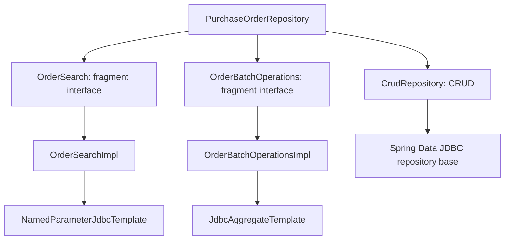

# Thiết kế repository fragment và lớp triển khai

Trong **Spring Data Relational JDBC**, repository không nhất thiết chỉ gồm các thao tác CRUD có sẵn hoặc query được suy ra từ tên method. Khi một ứng dụng cần tìm kiếm phức tạp, bulk operation, truy vấn DTO, hoặc logic persistence đặc thù, có thể mở rộng repository bằng **repository fragments**.

Một fragment gồm hai phần:

1. **Fragment interface** khai báo capability mà repository cần cung cấp.
2. **Fragment implementation** triển khai interface đó bằng các thành phần Spring phù hợp, ví dụ `JdbcAggregateTemplate`, `NamedParameterJdbcTemplate` hoặc một dịch vụ domain.

Repository chính kết hợp các fragment bằng cách `extends` interface của chúng. Spring Data ghép implementation vào repository proxy, vì vậy caller vẫn sử dụng một repository thống nhất.



Thiết kế theo fragment giúp chia repository thành các capability nhỏ, có thể tái sử dụng và kiểm thử độc lập. Đây là cách mở rộng hiện đại của Spring Data; pattern một class `PurchaseOrderRepositoryImpl` chứa tất cả custom methods theo kiểu cũ thường khó phát triển khi repository lớn dần.

## 1. Khi nào nên tạo repository fragment?

Hãy tạo fragment khi method cần một khả năng không phù hợp với CRUD hoặc query derivation thông thường:

- Truy vấn SQL phức tạp, JOIN, CTE, aggregation hoặc vendor-specific SQL.
- Trả về DTO/projection được ghép từ nhiều bảng.
- Bulk operation cần điều khiển `JdbcAggregateTemplate` hoặc JDBC batch.
- Logic truy vấn có nhiều bước, cần kết hợp nhiều JDBC API.
- Một capability có thể được dùng bởi nhiều repository.

Không cần tạo fragment chỉ để bọc một derived query đơn giản như `findByStatus(...)` hoặc một `@Query` ngắn. Dùng method repository thông thường trong trường hợp đó sẽ dễ đọc và ít lớp hơn.

| Nhu cầu | Cách triển khai thường phù hợp |
|---|---|
| CRUD aggregate | `CrudRepository` |
| Điều kiện đơn giản theo property root | Derived query method |
| SQL cố định, ngắn, trả entity/projection | `@Query` |
| SQL phức tạp, dynamic filtering/sorting, DTO tùy chỉnh | Repository fragment + JDBC operations |
| Ghi aggregate qua template | Fragment dùng `JdbcAggregateTemplate` |
| Thay đổi hành vi nền tảng cho mọi repository | Custom repository base class, chỉ khi thật sự cần |

## 2. Repository fragment gồm interface và implementation

Giả sử cần thêm khả năng tìm kiếm đơn hàng theo khách hàng, trả về một DTO tóm tắt. Đầu tiên, tạo interface riêng cho capability đó:

```java
package com.example.sales;

import java.util.List;

import org.springframework.data.domain.Pageable;

public interface OrderSearch {

    List<OrderSummary> searchByCustomer(Long customerId, Pageable pageable);
}
```

`OrderSearch` chỉ khai báo hợp đồng. Nó không cần extends `Repository`, `CrudRepository` hay `PagingAndSortingRepository`; đây là fragment interface sẽ được repository chính kết hợp.

DTO cho kết quả:

```java
package com.example.sales;

import java.time.LocalDateTime;

public record OrderSummary(
        Long id,
        String status,
        LocalDateTime createdAt
) {}
```

Sau đó tạo implementation có tên theo quy ước mặc định: **tên fragment interface + `Impl`**.

```java
package com.example.sales;

import java.util.ArrayList;
import java.util.List;

import org.springframework.data.domain.Pageable;
import org.springframework.data.domain.Sort;
import org.springframework.jdbc.core.namedparam.MapSqlParameterSource;
import org.springframework.jdbc.core.namedparam.NamedParameterJdbcTemplate;

public class OrderSearchImpl implements OrderSearch {

    private final NamedParameterJdbcTemplate jdbc;

    public OrderSearchImpl(NamedParameterJdbcTemplate jdbc) {
        this.jdbc = jdbc;
    }

    @Override
    public List<OrderSummary> searchByCustomer(Long customerId, Pageable pageable) {
        if (pageable.isUnpaged()) {
            throw new IllegalArgumentException("A paged request is required");
        }

        String orderBy = toOrderBy(pageable.getSort());

        String sql = """
                SELECT o.id, o.status, o.created_at
                FROM purchase_order o
                WHERE o.customer_id = :customerId
                ORDER BY %s
                LIMIT :limit OFFSET :offset
                """.formatted(orderBy);

        MapSqlParameterSource parameters = new MapSqlParameterSource()
                .addValue("customerId", customerId)
                .addValue("limit", pageable.getPageSize())
                .addValue("offset", pageable.getOffset());

        return jdbc.query(sql, parameters, (rs, rowNum) -> new OrderSummary(
                rs.getLong("id"),
                rs.getString("status"),
                rs.getTimestamp("created_at").toLocalDateTime()
        ));
    }

    private String toOrderBy(Sort sort) {
        List<String> clauses = new ArrayList<>();

        for (Sort.Order order : sort) {
            String column = switch (order.getProperty()) {
                case "createdAt" -> "o.created_at";
                case "id" -> "o.id";
                case "status" -> "o.status";
                default -> throw new IllegalArgumentException(
                        "Unsupported sort property: " + order.getProperty());
            };

            clauses.add(column + (order.isAscending() ? " ASC" : " DESC"));
        }

        if (clauses.isEmpty()) {
            clauses.add("o.created_at DESC");
        }

        if (sort.getOrderFor("id") == null) {
            clauses.add("o.id ASC"); // tie-breaker để thứ tự ổn định
        }

        return String.join(", ", clauses);
    }
}
```

Ví dụ SQL dùng cú pháp `LIMIT/OFFSET` của PostgreSQL. Nếu database mục tiêu có cú pháp phân trang khác, hãy thay đổi SQL tương ứng hoặc dùng abstraction phù hợp. `Pageable` cung cấp offset, limit và sort; với SQL tự viết, implementation phải chủ động áp dụng những thông tin đó.

Tên cột trong `ORDER BY` không thể bind như một giá trị SQL parameter. Vì vậy `toOrderBy` dùng **whitelist** các property được phép và ánh xạ sang identifier cố định. Không nối trực tiếp tên sort do client gửi vào SQL.

## 3. Kết hợp fragment vào repository chính

Repository chính extends cả contract CRUD và fragment interface:

```java
package com.example.sales;

import org.springframework.data.repository.CrudRepository;

public interface PurchaseOrderRepository extends
        CrudRepository<PurchaseOrder, Long>,
        OrderSearch {
}
```

Sau khi Spring Data phát hiện `OrderSearchImpl`, fragment trở thành một phần của repository proxy. Caller chỉ cần inject `PurchaseOrderRepository`:

```java
@Service
public class OrderQueryService {

    private final PurchaseOrderRepository orders;

    public OrderQueryService(PurchaseOrderRepository orders) {
        this.orders = orders;
    }

    public List<OrderSummary> recentOrders(Long customerId) {
        Pageable pageable = PageRequest.of(
                0,
                20,
                Sort.by(Sort.Order.desc("createdAt"), Sort.Order.asc("id"))
        );

        return orders.searchByCustomer(customerId, pageable);
    }
}
```

Không cần inject riêng `OrderSearchImpl` vào caller. Fragment được expose thông qua repository composition.

## 4. Quy tắc đặt tên và vị trí implementation

Với repository fragment, Spring Data tìm implementation dựa trên tên interface và **implementation postfix**. Mặc định postfix là `Impl`.

```text
com.example.sales
├── PurchaseOrderRepository.java
├── OrderSearch.java
├── OrderSearchImpl.java
├── OrderBatchOperations.java
├── OrderBatchOperationsImpl.java
├── PurchaseOrder.java
└── OrderSummary.java
```

Quy ước:

- Interface fragment: `OrderSearch`.
- Implementation tương ứng: `OrderSearchImpl`.
- Repository chính: `PurchaseOrderRepository`.
- Implementation được đặt trong package được repository infrastructure scan; đặt cùng package với repository/fragment là cách đơn giản nhất.
- Class implementation là Spring-managed bean được repository infrastructure phát hiện theo naming convention; constructor injection dùng để nhận dependencies.

Nếu đổi postfix, ví dụ từ `Impl` sang `Custom`, implementation phải đổi tên tương ứng. Với cấu hình Java repository, có thể đặt postfix trên `@EnableJdbcRepositories`:

```java
@Configuration
@EnableJdbcRepositories(
        basePackages = "com.example.sales",
        repositoryImplementationPostfix = "Custom"
)
public class SalesJdbcConfiguration {
}
```

Khi đó `OrderSearch` cần implementation tên `OrderSearchCustom`. Chỉ thay postfix khi có lý do nhất quán ở cấp repository infrastructure; đừng cấu hình khác nhau tùy tiện giữa các package.

Không nên đặt `@Component` hoặc `@Repository` theo thói quen mà không hiểu cách repository implementation scanner đang phát hiện bean. Nếu vừa tự đăng ký bean bằng component scan vừa để repository scanner phát hiện cùng implementation, có nguy cơ tạo bean trùng hoặc ambiguity. Theo convention thông thường, đặt implementation đúng package và tên là đủ.

## 5. Một repository có thể kết hợp nhiều fragment

Một repository có thể kết hợp nhiều capability độc lập. Ví dụ thêm fragment để nhập batch aggregate:

```java
package com.example.sales;

import java.util.List;

public interface OrderBatchOperations {

    List<PurchaseOrder> insertNewOrders(Iterable<PurchaseOrder> orders);
}
```

Implementation dùng `JdbcAggregateTemplate`:

```java
package com.example.sales;

import java.util.List;

import org.springframework.data.jdbc.core.JdbcAggregateTemplate;
import org.springframework.transaction.annotation.Transactional;

public class OrderBatchOperationsImpl implements OrderBatchOperations {

    private final JdbcAggregateTemplate template;

    public OrderBatchOperationsImpl(JdbcAggregateTemplate template) {
        this.template = template;
    }

    @Override
    @Transactional
    public List<PurchaseOrder> insertNewOrders(Iterable<PurchaseOrder> orders) {
        return template.insertAll(orders);
    }
}
```

Repository kết hợp cả hai fragment:

```java
public interface PurchaseOrderRepository extends
        CrudRepository<PurchaseOrder, Long>,
        OrderSearch,
        OrderBatchOperations {
}
```

Khi gọi `purchaseOrderRepository.insertNewOrders(...)`, Spring chuyển lời gọi đến `OrderBatchOperationsImpl`. Khi gọi `searchByCustomer(...)`, lời gọi đến `OrderSearchImpl`. Các method CRUD tiếp tục được xử lý bởi repository base implementation.

### Vì sao nên chia fragment theo capability?

| Fragment | Trách nhiệm |
|---|---|
| `OrderSearch` | Query đọc tùy chỉnh, trả DTO |
| `OrderBatchOperations` | Các thao tác ghi aggregate theo batch |
| `OrderReporting` | Truy vấn tổng hợp/báo cáo |
| `OrderArchiveOperations` | Các thao tác lưu trữ/archive chuyên biệt |

Mỗi fragment có thể được tái sử dụng bởi nhiều repository nếu contract phù hợp. Giữ fragment nhỏ giúp implementation dễ đọc, mock/test độc lập và tránh một class custom repository phình to.

## 6. Fragment có thể dùng các API nào của Spring Data JDBC?

Chọn API theo mục đích của fragment:

| Thành phần | Dùng khi | Lưu ý |
|---|---|---|
| `JdbcAggregateTemplate` | Cần thao tác với aggregate theo mapping Spring Data JDBC | Tôn trọng root, owned entities, callbacks và version theo lifecycle template |
| `NamedParameterJdbcTemplate` | Cần SQL tùy chỉnh, bind named parameters, map DTO | Tự chịu trách nhiệm về SQL, mapping và count/pagination nếu cần |
| `JdbcTemplate` | SQL positional parameters hoặc batch JDBC đơn giản | Không tự quản lý aggregate lifecycle |
| `DataAccessStrategy` | Cần tùy biến hạ tầng SQL cấp entity ở mức thấp | API infrastructure; chỉ dùng khi có yêu cầu sâu và hiểu mapping nội bộ |
| Repository khác | Use case cần phối hợp nhiều aggregate/repository | Cẩn trọng dependency cycle; orchestration thường thuộc application service |

### Fragment đọc bằng JDBC template

`OrderSearchImpl` ở ví dụ trên dùng `NamedParameterJdbcTemplate` vì truy vấn trả DTO và có điều kiện SQL tùy chỉnh. Ưu điểm là kiểm soát rõ JOIN, projection, filter và SQL. Đổi lại, SQL phải đồng bộ với schema migration; đổi tên cột cần cập nhật query.

### Fragment ghi aggregate bằng `JdbcAggregateTemplate`

`OrderBatchOperationsImpl` dùng `JdbcAggregateTemplate.insertAll()` để ghi root cùng các entity con theo mapping. Cách này phù hợp hơn việc tự viết nhiều `INSERT` vào các bảng root/child rồi phải tự xử lý generated IDs, FK, lifecycle và version.

Không dùng `NamedParameterJdbcTemplate` để cập nhật bảng aggregate tùy tiện nếu thao tác đó phải duy trì invariant hoặc đồng bộ child. Nếu direct SQL là chủ đích, cần tự xử lý callbacks/auditing/version và trạng thái object trong memory.

## 7. Transaction boundary trong custom fragment

Một fragment implementation là một thành phần Spring được repository proxy sử dụng. Với thao tác nhiều statement, hãy xác định transaction boundary rõ ràng.

Có hai lựa chọn phổ biến:

1. Đặt `@Transactional` trên method fragment implementation, như `insertNewOrders(...)`.
2. Đặt transaction trên application service bao quanh nhiều repository/fragment operations nếu use case phối hợp nhiều aggregate hoặc nhiều bước.

Ví dụ service điều phối hai capability:

```java
@Service
public class OrderImportService {

    private final PurchaseOrderRepository orderRepository;
    private final ImportAuditRepository auditRepository;

    public OrderImportService(
            PurchaseOrderRepository orderRepository,
            ImportAuditRepository auditRepository) {
        this.orderRepository = orderRepository;
        this.auditRepository = auditRepository;
    }

    @Transactional
    public List<PurchaseOrder> importOrders(List<PurchaseOrder> orders) {
        List<PurchaseOrder> inserted = orderRepository.insertNewOrders(orders);
        auditRepository.save(new ImportAudit(inserted.size()));
        return inserted;
    }
}
```

Nếu hai repository dùng cùng `DataSource` và transaction manager, thao tác insert cùng ghi audit có thể commit/rollback cùng nhau. Nếu dùng resource khác, `@Transactional` JDBC thông thường không tự tạo distributed transaction.

Không giả định mọi custom query method tự có transaction chỉ vì repository CRUD có transaction metadata. Với custom fragment, hãy khai báo transaction ở nơi phù hợp và kiểm thử rollback thực tế. `@Transactional` vẫn hoạt động qua Spring proxy; tránh self-invocation nếu trông đợi một transaction boundary mới.

## 8. Không inject repository vào chính fragment implementation một cách tùy tiện

Một anti-pattern thường gặp là:

```java
public class OrderSearchImpl implements OrderSearch {

    private final PurchaseOrderRepository repository;

    public OrderSearchImpl(PurchaseOrderRepository repository) {
        this.repository = repository;
    }
}
```

Implementation fragment là một phần cấu thành `PurchaseOrderRepository`. Inject chính repository vào implementation có thể tạo dependency cycle hoặc khiến method gọi ngược lại chính fragment, gây recursion khó hiểu.

Thay vào đó:

- Dùng `JdbcAggregateTemplate` khi cần thao tác aggregate.
- Dùng `NamedParameterJdbcTemplate`/`JdbcTemplate` cho SQL tùy chỉnh.
- Tách orchestration nhiều repository lên application service.
- Nếu thực sự cần một capability khác, inject một bean độc lập có trách nhiệm rõ ràng thay vì repository đang chứa fragment đó.

## 9. Xử lý nhiều fragment và xung đột method

Khi repository kết hợp nhiều fragment, tránh để nhiều interface khai báo cùng một method signature nhưng kỳ vọng các implementation khác nhau. Nếu hai fragment đều cung cấp method trùng tên/parameter/return type, việc phân giải method có thể phụ thuộc thứ tự composition và quy tắc ưu tiên implementation.

Thiết kế tốt hơn:

- Đặt tên method thể hiện capability (`searchByCustomer`, `archiveBefore`, `insertNewOrders`).
- Giữ mỗi fragment có contract riêng, không dùng chung method signature cho ý nghĩa khác nhau.
- Nếu cần override một method CRUD hoặc method base, hãy xác định rõ mục tiêu và viết integration test chứng minh implementation nào được gọi.
- Tránh tạo fragment “God interface” có hàng chục method không liên quan.

Fragment implementation có thể inject các dependency Spring bình thường qua constructor. Nếu implementation cần cấu hình riêng, dùng `@ConfigurationProperties` hoặc bean cấu hình tương ứng; không hard-code connection, URL hoặc secret trong fragment.

## 10. Phân biệt repository fragment với custom repository base class

Hai cách mở rộng này giải quyết hai vấn đề khác nhau:

| Cách mở rộng | Phạm vi | Khi phù hợp |
|---|---|---|
| Repository fragment | Một capability có thể được gắn vào một hoặc nhiều repository | Search tùy chỉnh, batch operation, reporting |
| Custom repository base class | Hành vi nền tảng dùng chung cho toàn bộ repository trong phạm vi cấu hình | Muốn thay đổi cách triển khai method nền như `save`/CRUD cho mọi repository |

Nếu chỉ một repository cần thêm `searchByCustomer`, dùng fragment. Nếu mọi repository trong module cần cùng một cơ chế chung thay thế base behavior, mới cân nhắc custom base class và cấu hình repository factory tương ứng.

Không nên dùng class `PurchaseOrderRepositoryImpl` để override mọi thứ chỉ vì đó là pattern cũ quen thuộc. Với fragment composition hiện đại, đặt phần mở rộng theo interface capability (`OrderSearch` → `OrderSearchImpl`) làm dependency rõ ràng hơn và cho phép tái sử dụng.

## 11. Kiểm thử fragment implementation

Có thể kiểm thử hai lớp ở hai mức:

- **Unit test implementation:** mock `NamedParameterJdbcTemplate` hoặc `JdbcAggregateTemplate` để xác nhận method gọi đúng API, bind đúng parameter và xử lý kết quả.
- **Integration test repository composition:** nạp Spring Data JDBC context, inject repository chính và gọi method fragment để xác nhận Spring đã phát hiện implementation đúng.

Ví dụ integration test cho custom query:

```java
@DataJdbcTest
class PurchaseOrderRepositoryFragmentTest {

    @Autowired PurchaseOrderRepository repository;
    @Autowired JdbcTemplate jdbcTemplate;

    @Test
    void customSearchFragmentIsComposedIntoRepository() {
        jdbcTemplate.update("""
                INSERT INTO purchase_order(id, customer_id, status, created_at)
                VALUES (?, ?, ?, ?)
                """,
                101L,
                42L,
                "OPEN",
                Timestamp.valueOf(LocalDateTime.of(2026, 1, 10, 9, 0))
        );

        Pageable pageable = PageRequest.of(
                0,
                10,
                Sort.by(Sort.Order.desc("createdAt"), Sort.Order.asc("id"))
        );

        List<OrderSummary> result = repository.searchByCustomer(42L, pageable);

        assertThat(result).hasSize(1);
        assertThat(result.get(0).id()).isEqualTo(101L);
        assertThat(result.get(0).status()).isEqualTo("OPEN");
    }
}
```

Test cần schema `purchase_order` có các cột được query và mọi FK bắt buộc phải có fixture tương ứng. SQL trong implementation ở ví dụ dùng `LIMIT/OFFSET`; điều chỉnh cho database test. Mục tiêu của test là chứng minh method fragment xuất hiện trên repository proxy và SQL trả đúng DTO.

### Kiểm thử transaction của fragment ghi batch

Với `OrderBatchOperationsImpl`, viết integration test để:

1. Gọi `repository.insertNewOrders(...)` với nhiều aggregate có child.
2. Xác nhận root và child rows đều được ghi.
3. Tạo một aggregate vi phạm constraint ở giữa batch.
4. Nếu method/service được đánh dấu transactional, xác nhận dữ liệu của toàn batch được rollback theo ranh giới transaction đã chọn.
5. Kiểm tra `@Version`, generated ID và callback nếu domain dùng chúng.

Không chỉ mock template nếu mục tiêu là chứng minh FK, SQL và rollback hoạt động trên database thật.

## 12. Các lỗi cấu hình thường gặp

| Biểu hiện | Nguyên nhân có thể | Cách xử lý |
|---|---|---|
| `NoSuchBeanDefinition` hoặc repository không có method fragment | Fragment interface chưa được extends bởi repository hoặc implementation không được phát hiện | Kiểm tra `extends`, tên `FragmentNameImpl`, package và repository scan |
| Spring báo không tìm thấy custom implementation | Tên class không khớp postfix hoặc class nằm ngoài vùng scan | Đặt implementation đúng package hoặc cấu hình base packages/postfix |
| Constructor implementation không tạo được | Dependency không có bean hoặc bean configuration sai | Kiểm tra `JdbcTemplate`, `JdbcAggregateTemplate` và constructor injection |
| Repository method được gọi nhưng implementation khác chạy | Method signature bị trùng giữa fragment/base/custom implementation | Đổi tên capability hoặc xác định rõ composition precedence |
| `@Transactional` không rollback | Method không đi qua proxy, exception bị bắt/nuốt hoặc transaction manager sai | Kiểm tra proxy, rollback rule và cùng DataSource |
| SQL fragment lỗi khi đổi database | SQL vendor-specific hoặc tên cột/schema hard-code | Cô lập SQL theo dialect, migration và integration test theo engine |
| Sort tạo SQL không hợp lệ hoặc nguy hiểm | Nối identifier trực tiếp từ request | Whitelist property và ánh xạ sang tên cột cố định |
| Custom update làm entity stale | Direct SQL không đồng bộ object trong memory | Reload aggregate; tự xử lý version/auditing nếu direct DML |
| Vòng dependency giữa fragment và repository | Fragment inject repository đang chứa chính fragment | Dùng template/JDBC operations hoặc chuyển orchestration lên service |

## 13. Quy trình thiết kế một fragment mới

1. **Xác định capability:** method phục vụ query tùy chỉnh, batch write hay một nghiệp vụ persistence riêng?
2. **Chọn abstraction:** derived query/`@Query` đã đủ chưa, hay cần fragment?
3. **Tạo interface nhỏ:** đặt tên theo capability, khai báo method và kiểu trả về rõ ràng.
4. **Tạo implementation:** tên `FragmentNameImpl`, constructor inject dependency cần thiết.
5. **Chọn JDBC API:** `JdbcAggregateTemplate` cho aggregate lifecycle; `NamedParameterJdbcTemplate` cho SQL/DTO tùy chỉnh.
6. **Kết hợp repository:** thêm fragment interface vào danh sách `extends`.
7. **Kiểm tra discovery:** package, postfix và `@EnableJdbcRepositories` nếu có cấu hình riêng.
8. **Đặt transaction boundary:** method fragment hoặc application service; không giả định direct SQL tự transactional.
9. **Kiểm thử:** unit test implementation và integration test repository composition/SQL/rollback.
10. **Giữ ranh giới rõ:** không inject ngược repository gây cycle, không gom các capability không liên quan vào một class.

### Bảng quyết định nhanh

| Câu hỏi | Hướng xử lý |
|---|---|
| Chỉ cần một query đơn giản theo property? | Derived query method |
| SQL cố định, ngắn và không cần logic riêng? | `@Query` |
| Cần custom SQL, DTO hoặc dynamic filtering? | Repository fragment + JDBC template |
| Cần lưu aggregate cùng owned entities? | Fragment dùng `JdbcAggregateTemplate` |
| Capability được nhiều repository dùng? | Fragment interface có thể tái sử dụng |
| Muốn thay hành vi base của mọi repository? | Cân nhắc custom repository base class |
| Fragment cần transaction nhiều bước? | `@Transactional` ở fragment hoặc application service |

**Điểm cốt lõi:** repository fragment là một capability gồm interface và implementation được ghép vào repository proxy. Dùng tên `FragmentNameImpl` theo postfix mặc định `Impl`, đặt implementation trong package được repository scan, và inject các JDBC abstraction phù hợp. `JdbcAggregateTemplate` giữ semantics của aggregate; JDBC template cho phép kiểm soát SQL tùy chỉnh. Transaction, mapping, version, auditing và kiểm thử vẫn phải được thiết kế rõ ràng trong implementation.

## Tài liệu tham khảo chính thức

- [Spring Data Relational — Custom Repository Implementations](https://docs.spring.io/spring-data/relational/reference/repositories/custom-implementations.html): repository fragments, composition và naming convention.
- [Spring Data Commons — Custom Repository Implementations](https://docs.spring.io/spring-data/commons/reference/repositories/custom-implementations.html): fragment interface, implementation discovery và custom base class.
- [Spring Data JDBC — `@EnableJdbcRepositories` API](https://docs.spring.io/spring-data/relational/reference/api/java/org/springframework/data/jdbc/repository/config/EnableJdbcRepositories.html): package scanning và implementation postfix.
- [Spring Data JDBC — `JdbcAggregateTemplate` API](https://docs.spring.io/spring-data/relational/reference/api/java/org/springframework/data/jdbc/core/JdbcAggregateTemplate.html): thao tác aggregate trực tiếp.
- [Spring Framework — `NamedParameterJdbcTemplate` API](https://docs.spring.io/spring-framework/docs/current/javadoc-api/org/springframework/jdbc/core/namedparam/NamedParameterJdbcTemplate.html): SQL named parameters và RowMapper.
- [Spring Data JDBC — Transactionality](https://docs.spring.io/spring-data/relational/reference/jdbc/transactions.html): transaction boundary cho repository và service layer.
