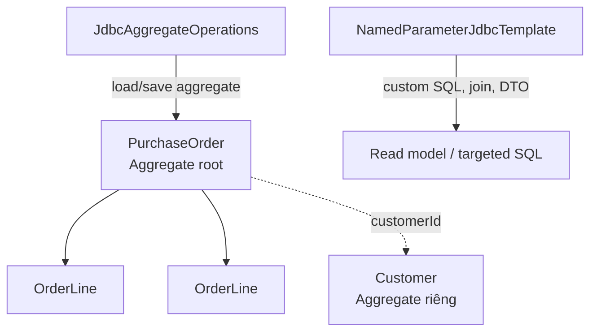
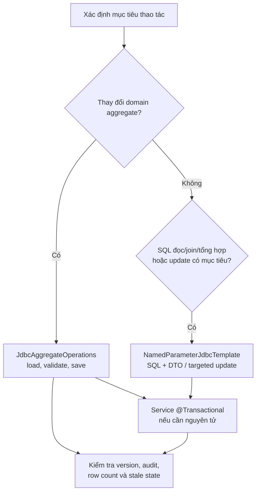

# Kết hợp JdbcAggregateOperations với NamedParameterJdbcTemplate

Trong Spring Data JDBC, một ứng dụng có thể cần cả thao tác aggregate theo mô hình domain và câu SQL tùy chỉnh. Hai công cụ thường dùng là `JdbcAggregateOperations` và `NamedParameterJdbcTemplate`.

`JdbcAggregateOperations` làm việc ở cấp aggregate: tải và lưu aggregate root cùng các thành phần thuộc aggregate theo mapping Spring Data JDBC. `NamedParameterJdbcTemplate` làm việc ở cấp SQL: viết câu lệnh rõ ràng, bind giá trị bằng tên và ánh xạ kết quả sang DTO hoặc kiểu dữ liệu cần thiết.

Kết hợp hai công cụ giúp giữ thao tác domain ở ranh giới aggregate, đồng thời tận dụng SQL cho truy vấn chuyên biệt. Cần xác định rõ công cụ nào sở hữu thao tác nào, dùng chung transaction khi cần tính nguyên tử và tránh để SQL trực tiếp làm dữ liệu aggregate đang ở trong bộ nhớ trở nên lỗi thời.

## 1. Vai trò của từng công cụ

### JdbcAggregateOperations

`JdbcAggregateOperations` là abstraction thao tác aggregate của Spring Data JDBC. Trong cấu hình thông thường, implementation được cung cấp bởi `JdbcAggregateTemplate`. Có thể inject abstraction để service phụ thuộc vào hợp đồng thay vì class triển khai:

```java
import org.springframework.data.jdbc.core.JdbcAggregateOperations;
import org.springframework.stereotype.Service;

@Service
public class OrderService {

    private final JdbcAggregateOperations aggregates;

    public OrderService(JdbcAggregateOperations aggregates) {
        this.aggregates = aggregates;
    }
}
```

Một số thao tác thường gặp:

```java
PurchaseOrder order =
    aggregates.findById(orderId, PurchaseOrder.class)
        .orElseThrow(() -> new OrderNotFoundException(orderId));

PurchaseOrder saved = aggregates.save(order);

long totalOrders = aggregates.count(PurchaseOrder.class);

boolean exists =
    aggregates.existsById(orderId, PurchaseOrder.class);
```

Tên và overload cụ thể cần đối chiếu với phiên bản Spring Data JDBC mà dự án đang dùng. Ý nghĩa chung của API là thao tác trên kiểu aggregate root được truyền vào, không phải thao tác SQL tùy ý trên một bảng bất kỳ.

Khi lưu aggregate, Spring Data JDBC áp dụng mapping của aggregate, quản lý các object con thuộc root và các cơ chế persistence được cấu hình. Đây là lựa chọn tự nhiên khi thay đổi trạng thái domain của một aggregate.

### NamedParameterJdbcTemplate

`NamedParameterJdbcTemplate` là API Spring JDBC cho phép viết SQL với named parameter như `:customerId` thay vì placeholder vị trí `?`:

```java
String sql = """
    SELECT id, status
    FROM purchase_order
    WHERE customer_id = :customerId
      AND status = :status
    """;

MapSqlParameterSource params = new MapSqlParameterSource()
    .addValue("customerId", customerId)
    .addValue("status", status);

List<OrderRow> rows =
    namedParameterJdbcTemplate.query(sql, params, rowMapper);
```

Công cụ này phù hợp khi cần join nhiều bảng, chỉ lấy một số cột, dùng hàm tổng hợp hoặc SQL đặc thù database, thực hiện cập nhật có mục tiêu hoặc truy vấn một tập ID/filter bằng collection parameter.

Named parameter chỉ đại diện cho **giá trị dữ liệu**. Tên bảng, tên cột, toán tử và cấu trúc SQL vẫn phải nằm trong câu lệnh hoặc được chọn từ allowlist do ứng dụng kiểm soát.
## 2. Mô hình ví dụ PurchaseOrder

Giả sử ứng dụng quản lý đơn hàng. `PurchaseOrder` là aggregate root, `OrderLine` là các phần tử con, còn khách hàng là aggregate độc lập được tham chiếu bằng ID.



Aggregate root minh họa:

```java
package com.example.orders.domain;

import java.math.BigDecimal;
import java.time.LocalDateTime;
import java.util.List;

import org.springframework.data.annotation.Id;
import org.springframework.data.annotation.Version;
import org.springframework.data.relational.core.mapping.MappedCollection;
import org.springframework.data.relational.core.mapping.Table;

@Table("purchase_order")
public record PurchaseOrder(
    @Id Long id,
    @Version Long version,
    Long customerId,
    String status,
    BigDecimal totalAmount,
    String note,
    LocalDateTime createdAt,
    @MappedCollection(
        idColumn = "order_id",
        keyColumn = "line_no"
    )
    List<OrderLine> lines
) {
    public PurchaseOrder withStatus(String newStatus) {
        return new PurchaseOrder(
            id, version, customerId, newStatus,
            totalAmount, note, createdAt, lines
        );
    }
}
```

Child object:

```java
package com.example.orders.domain;

import java.math.BigDecimal;

public record OrderLine(
    Long productId,
    int quantity,
    BigDecimal unitPrice
) {}
```

Trong ví dụ, `customerId` là ID tham chiếu. `lines` thuộc vòng đời aggregate `PurchaseOrder`. Sự phân biệt này quan trọng khi chọn công cụ: lưu trạng thái đơn hàng và các dòng hàng nên đi qua aggregate operations; truy vấn join đơn hàng với tên khách hàng để hiển thị có thể dùng SQL và DTO.

## 3. Dùng JdbcAggregateOperations cho thao tác domain

Khi nghiệp vụ cần đọc đơn hàng, kiểm tra trạng thái, thay đổi domain state rồi lưu, dùng aggregate operations:

```java
@Service
public class OrderService {

    private final JdbcAggregateOperations aggregates;

    public OrderService(JdbcAggregateOperations aggregates) {
        this.aggregates = aggregates;
    }

    @Transactional
    public PurchaseOrder confirm(long orderId) {
        PurchaseOrder current = aggregates
            .findById(orderId, PurchaseOrder.class)
            .orElseThrow(() -> new OrderNotFoundException(orderId));

        if (!"CREATED".equals(current.status())) {
            throw new InvalidOrderStateException(current.status());
        }

        PurchaseOrder confirmed = current.withStatus("CONFIRMED");
        return aggregates.save(confirmed);
    }
}
```

Ở đây service tải aggregate theo ID. Các dòng hàng được ánh xạ theo cấu hình Spring Data JDBC, nên object được dùng để thay đổi phản ánh aggregate hiện tại. Service kiểm tra invariant rồi gọi `save`.

Có thể dùng `insert` khi muốn yêu cầu insert aggregate mới, hoặc `update` khi muốn cập nhật aggregate đã tồn tại, tùy hợp đồng API và phiên bản. `save` thường phù hợp khi ứng dụng muốn thao tác lưu theo trạng thái mới/cũ của aggregate. Hãy phân biệt rõ create/update trong service để tránh dùng sai semantics.

Không nên dựng một `PurchaseOrder` partial chỉ có ID và một vài field rồi gọi `save`. Các child collection bị bỏ khỏi object có thể được hiểu là trạng thái collection hiện tại, làm mất các hàng con cần giữ. Với thao tác domain, hãy tải aggregate đầy đủ trước khi sửa.

## 4. Dùng NamedParameterJdbcTemplate cho read model và truy vấn join

Một màn hình danh sách có thể cần mã đơn, trạng thái, tên khách hàng và tổng tiền. Dữ liệu này không nhất thiết cần một aggregate đầy đủ. Tạo DTO/read model:

```java
package com.example.orders.readmodel;

import java.math.BigDecimal;
import java.time.LocalDateTime;

public record OrderListItem(
    Long orderId,
    String status,
    String customerName,
    BigDecimal totalAmount,
    LocalDateTime createdAt
) {}
```

Custom query repository:

```java
@Repository
public class OrderQueryRepository {

    private final NamedParameterJdbcTemplate jdbc;

    public OrderQueryRepository(NamedParameterJdbcTemplate jdbc) {
        this.jdbc = jdbc;
    }

    public List<OrderListItem> findForCustomer(long customerId) {
        String sql = """
            SELECT po.id AS order_id,
                   po.status,
                   c.display_name AS customer_name,
                   po.total_amount,
                   po.created_at
            FROM purchase_order po
            JOIN customer c ON c.id = po.customer_id
            WHERE po.customer_id = :customerId
            ORDER BY po.created_at DESC, po.id DESC
            """;

        var params = new MapSqlParameterSource()
            .addValue("customerId", customerId);

        return jdbc.query(sql, params, (rs, rowNum) ->
            new OrderListItem(
                rs.getLong("order_id"),
                rs.getString("status"),
                rs.getString("customer_name"),
                rs.getBigDecimal("total_amount"),
                rs.getObject("created_at", LocalDateTime.class)
            )
        );
    }
}
```

Query chỉ lấy các cột cần thiết và ánh xạ thành `OrderListItem`. Không cần cố tạo một `PurchaseOrder` từ kết quả join này. DTO thể hiện đây là dữ liệu đọc phục vụ màn hình, không phải aggregate đầy đủ để lưu lại.

Lợi ích:

- SQL join và cột trả về được kiểm soát rõ.
- Không tải collection con khi màn hình không cần.
- Tránh đưa một projection thiếu field vào `aggregates.save(...)`.
- Có thể tối ưu index và execution plan theo truy vấn đọc.

Nếu kết quả query cần các dòng hàng đầy đủ hoặc cần thay đổi nghiệp vụ trên aggregate, tải root bằng `JdbcAggregateOperations` sau khi đã xác định ID phù hợp.

## 5. Bind collection bằng named parameter

Một truy vấn có thể lọc theo nhiều trạng thái:

```java
public List<OrderListItem> findByStatuses(
        long customerId,
        Collection<String> statuses) {

    if (statuses == null || statuses.isEmpty()) {
        return List.of();
    }

    String sql = """
        SELECT id, status, total_amount, created_at
        FROM purchase_order
        WHERE customer_id = :customerId
          AND status IN (:statuses)
        ORDER BY created_at DESC, id DESC
        """;

    var params = new MapSqlParameterSource()
        .addValue("customerId", customerId)
        .addValue("statuses", statuses);

    return jdbc.query(sql, params, (rs, rowNum) ->
        new OrderListItem(
            rs.getLong("id"),
            rs.getString("status"),
            null,
            rs.getBigDecimal("total_amount"),
            rs.getObject("created_at", LocalDateTime.class)
        )
    );
}
```

`NamedParameterJdbcTemplate` mở rộng collection thành các placeholder giá trị phù hợp. Không nối từng status vào chuỗi SQL. Cần quyết định rõ semantics khi danh sách rỗng: trả danh sách rỗng như trên, bỏ điều kiện lọc, hoặc trả validation error. Không phụ thuộc vào `IN ()` vì cú pháp này không được các database hỗ trợ thống nhất.

Trong ví dụ, `customerId` và từng phần tử `statuses` đều là giá trị được bind. Identifier và thứ tự sort vẫn được viết cố định trong SQL.
## 6. Kết hợp aggregate write và SQL tùy chỉnh trong một service

Một nghiệp vụ có thể vừa cập nhật aggregate, vừa ghi một bản ghi audit riêng. Ví dụ xác nhận đơn hàng cần đổi trạng thái đơn và ghi lại người thực hiện:

```java
@Service
public class OrderWorkflowService {

    private final JdbcAggregateOperations aggregates;
    private final NamedParameterJdbcTemplate jdbc;

    public OrderWorkflowService(
            JdbcAggregateOperations aggregates,
            NamedParameterJdbcTemplate jdbc) {
        this.aggregates = aggregates;
        this.jdbc = jdbc;
    }

    @Transactional
    public PurchaseOrder confirm(long orderId, long actorId) {
        PurchaseOrder current = aggregates
            .findById(orderId, PurchaseOrder.class)
            .orElseThrow(() -> new OrderNotFoundException(orderId));

        if (!"CREATED".equals(current.status())) {
            throw new InvalidOrderStateException(current.status());
        }

        PurchaseOrder saved =
            aggregates.save(current.withStatus("CONFIRMED"));

        String auditSql = """
            INSERT INTO order_audit
                (order_id, action, actor_id, occurred_at)
            VALUES
                (:orderId, :action, :actorId, CURRENT_TIMESTAMP)
            """;

        var params = new MapSqlParameterSource()
            .addValue("orderId", saved.id())
            .addValue("action", "CONFIRMED")
            .addValue("actorId", actorId);

        jdbc.update(auditSql, params);

        return saved;
    }
}
```

`@Transactional` đặt ranh giới transaction ở tầng nghiệp vụ. Nếu thao tác lưu aggregate hoặc insert audit thất bại, transaction có thể rollback cả hai thay đổi.

Điều kiện để chúng thực sự cùng transaction:

- `JdbcAggregateOperations` và `NamedParameterJdbcTemplate` dùng cùng `DataSource`.
- Cả hai tham gia cùng transaction manager của Spring.
- Method được gọi qua Spring transaction proxy và không tự vô hiệu hóa transaction.
- Các thao tác đều nằm trong cùng transaction/database resource được quản lý.

Trong cấu hình Spring Boot thông thường với một datasource, các bean JDBC thường được cấu hình dùng chung datasource và transaction manager. Nếu ứng dụng có nhiều datasource, phải chỉ rõ transaction manager phù hợp và cấu hình các adapter dùng đúng datasource. Một annotation `@Transactional` không thể tự tạo transaction phân tán giữa nhiều database.

## 7. Dùng SQL cập nhật có mục tiêu khi không cần save toàn aggregate

Có trường hợp một thao tác chỉ cần cập nhật một cột và không cần đồng bộ collection con. Ví dụ thay đổi ghi chú đơn hàng. Có thể dùng câu SQL trực tiếp:

```java
@Repository
public class OrderDirectUpdateRepository {

    private final NamedParameterJdbcTemplate jdbc;

    public OrderDirectUpdateRepository(
            NamedParameterJdbcTemplate jdbc) {
        this.jdbc = jdbc;
    }

    public int updateNote(
            long orderId,
            String note,
            long expectedVersion) {

        String sql = """
            UPDATE purchase_order
            SET note = :note,
                version = version + 1
            WHERE id = :id
              AND version = :expectedVersion
            """;

        var params = new MapSqlParameterSource()
            .addValue("note", note)
            .addValue("id", orderId)
            .addValue("expectedVersion", expectedVersion);

        return jdbc.update(sql, params);
    }
}
```

Ví dụ giả định bảng có cột `version` và aggregate dùng `@Version`. Câu SQL kiểm tra version mong đợi và tăng version khi cập nhật. Nếu số hàng bị tác động bằng 0, bản ghi có thể không tồn tại hoặc version đã thay đổi; service cần xử lý theo hợp đồng nghiệp vụ.

Direct SQL có ích khi chỉ cần cập nhật một vài cột độc lập, muốn cập nhật hàng loạt theo điều kiện, không cần tải và lưu toàn bộ aggregate hoặc cần cú pháp đặc thù database.

Nhưng câu SQL này không chạy qua cơ chế lưu aggregate đầy đủ. Nó không tự đồng bộ child collection, không tự gọi domain method và có thể bỏ qua lifecycle callback/auditing/event tích hợp với đường lưu aggregate. Người viết SQL phải chịu trách nhiệm về invariant, version, audit và các tác động liên quan.

Nếu cập nhật một field ảnh hưởng invariant của aggregate, hãy đánh giá liệu targeted SQL có giữ được invariant đó không. Ví dụ đổi trạng thái đơn có thể cần kiểm tra các dòng hàng, ghi lịch sử và xác thực quyền; khi đó service nên tải aggregate và điều phối nghiệp vụ qua `JdbcAggregateOperations`.

## 8. Tránh stale aggregate khi trộn hai cơ chế ghi

Giả sử service tải đơn hàng vào biến `current`, rồi một repository khác dùng `NamedParameterJdbcTemplate` cập nhật trực tiếp cùng hàng trong database. Object `current` không tự thay đổi theo SQL vừa chạy.

Nếu sau đó gọi `aggregates.save(current)`, ứng dụng có thể ghi lại giá trị cũ. Nếu aggregate có child collection, việc save còn có thể đồng bộ collection theo snapshot cũ. Đây là nguy cơ lost update.

Các nguyên tắc:

1. Không giữ aggregate trong bộ nhớ rồi cập nhật cùng hàng bằng SQL ở một đường khác mà không có kế hoạch đồng bộ.
2. Nếu SQL trực tiếp cập nhật root có `@Version`, tăng version trong cùng câu lệnh và kiểm tra row count.
3. Nếu cần tiếp tục thao tác domain sau direct SQL, tải lại aggregate sau khi cập nhật.
4. Không save lại một object cũ chỉ để “đồng bộ” trạng thái.
5. Nếu custom SQL thay đổi child table, bảo đảm không có aggregate đang giữ collection cũ sẽ được save sau đó.

`@Version` giúp phát hiện một số cập nhật đồng thời khi đường ghi đều tôn trọng version. Nó không tự ngăn một câu SQL tùy chỉnh bỏ qua version. Vì vậy mọi custom update cần có chính sách concurrency rõ ràng.

## 9. Không dùng NamedParameterJdbcTemplate để dựng aggregate thiếu dữ liệu

Một query tùy chỉnh có thể chỉ lấy:

```sql
SELECT id, status
FROM purchase_order
WHERE customer_id = :customerId;
```

Đây là dữ liệu hợp lệ cho màn hình chỉ hiển thị mã và trạng thái. Nhưng nó không đủ để dựng `PurchaseOrder` đầy đủ, vì thiếu customer ID, total, note, createdAt, version và collection lines.

Không ánh xạ kết quả vào entity rồi gọi:

```java
aggregates.save(partialOrder);
```

Hãy dùng DTO:

```java
public record OrderStatusRow(
    Long id,
    String status
) {}
```

Khi người dùng yêu cầu thay đổi một đơn, dùng ID trong DTO để tải aggregate đầy đủ bằng `aggregates.findById(...)`, kiểm tra domain rule rồi lưu.

| Mục tiêu | Kiểu kết quả phù hợp |
| --- | --- |
| Đọc đầy đủ để thực hiện nghiệp vụ | Aggregate root từ `JdbcAggregateOperations`. |
| Danh sách hiển thị, join, báo cáo | DTO/read model từ `NamedParameterJdbcTemplate`. |
| Cập nhật một cột theo điều kiện | `UPDATE` có bind parameter, kiểm tra row count/version. |
| Lưu aggregate và child collection | `JdbcAggregateOperations`. |
## 10. Kết hợp truy vấn đọc và thao tác aggregate theo hai bước

Một pattern phổ biến là dùng SQL nhẹ để tìm ID phù hợp, sau đó tải từng aggregate bằng aggregate operations khi cần chạy nghiệp vụ:

```java
public List<PurchaseOrder> loadOrdersForReview(
        long customerId,
        int limit) {

    String sql = """
        SELECT id
        FROM purchase_order
        WHERE customer_id = :customerId
          AND status = :status
        ORDER BY created_at, id
        LIMIT :limit
        """;

    var params = new MapSqlParameterSource()
        .addValue("customerId", customerId)
        .addValue("status", "CREATED")
        .addValue("limit", limit);

    List<Long> ids = jdbc.query(
        sql,
        params,
        (rs, rowNum) -> rs.getLong("id")
    );

    return ids.stream()
        .map(id -> aggregates.findById(id, PurchaseOrder.class)
            .orElseThrow(() -> new OrderNotFoundException(id)))
        .toList();
}
```

Pattern này hữu ích khi điều kiện lọc phức tạp nhưng chỉ một tập nhỏ kết quả cần được xử lý như aggregate. Tuy nhiên, nó tạo thêm truy vấn tải từng aggregate theo số ID. Nếu số lượng lớn, cân nhắc batch phù hợp, giới hạn số ID hoặc thiết kế một query/command chuyên biệt.

Giữa truy vấn lấy ID và tải aggregate, dữ liệu có thể thay đổi hoặc bị xóa. Nếu cần bảo đảm điều kiện vẫn đúng ở thời điểm xử lý, hãy kiểm tra lại trạng thái trong service hoặc đưa điều kiện cần thiết vào thao tác cập nhật có điều kiện. Không xem danh sách ID vừa đọc là bảo đảm khóa dữ liệu cho các bước sau.

## 11. Dùng transaction cho nhiều thao tác phối hợp

Một transaction có thể bao gồm:

- Đọc aggregate bằng `JdbcAggregateOperations`.
- Lưu aggregate bằng `save`.
- Ghi audit hoặc outbox bằng `NamedParameterJdbcTemplate.update`.
- Chạy query kiểm tra hoặc cập nhật bảng phụ.

Ví dụ:

```java
@Transactional
public void cancelOrder(long orderId, long actorId) {
    PurchaseOrder order = aggregates
        .findById(orderId, PurchaseOrder.class)
        .orElseThrow(() -> new OrderNotFoundException(orderId));

    if ("SHIPPED".equals(order.status())) {
        throw new InvalidOrderStateException(order.status());
    }

    aggregates.save(order.withStatus("CANCELLED"));

    jdbc.update("""
        INSERT INTO order_audit
            (order_id, action, actor_id, occurred_at)
        VALUES
            (:orderId, :action, :actorId, CURRENT_TIMESTAMP)
        """,
        new MapSqlParameterSource()
            .addValue("orderId", orderId)
            .addValue("action", "CANCELLED")
            .addValue("actorId", actorId)
    );
}
```

Nếu insert audit thất bại và exception làm transaction rollback, cập nhật aggregate cũng rollback khi cả hai thao tác dùng cùng transaction manager/resource. Nếu ứng dụng bắt exception rồi tiếp tục mà không đánh dấu rollback, kết quả có thể khác dự kiến; hãy để lỗi truyền ra hoặc cấu hình rollback policy rõ ràng.

Đối với thao tác gọi hệ thống ngoài database, `@Transactional` không thể rollback tác động bên ngoài. Khi cần phát sự kiện đáng tin cậy, cân nhắc ghi outbox row trong cùng transaction rồi phát đi bằng worker riêng.

## 12. Cấu hình datasource và transaction manager

Hai công cụ chỉ phối hợp trong cùng transaction khi chúng tham gia đúng transaction manager và datasource.

Trong cấu hình một datasource thông thường:

- Spring Boot tạo `DataSource`.
- `NamedParameterJdbcTemplate` được cấu hình dùng datasource đó.
- Spring Data JDBC tạo aggregate operations dựa trên cùng cấu hình kết nối.
- `@Transactional` dùng transaction manager quản lý datasource.

Nếu tự cấu hình nhiều datasource, hãy kiểm tra từng bean và chỉ định transaction manager phù hợp:

```java
@Transactional(transactionManager = "ordersTransactionManager")
public void performOrderWorkflow(...) {
    // Aggregate operations và JDBC template phải cùng dùng
    // datasource do ordersTransactionManager quản lý.
}
```

Không chỉ dựa vào việc cả hai bean đều được inject thành công. Cần xác nhận chúng thực sự dùng cùng datasource và transaction manager. Nếu khác datasource, cần giải pháp điều phối transaction riêng; một local JDBC transaction không tự nguyên tử hóa nhiều resource.

## 13. Ranh giới lifecycle, auditing và domain events

Khi lưu qua `JdbcAggregateOperations`, Spring Data JDBC thực hiện mapping aggregate và các cơ chế lifecycle/auditing/events đã được cấu hình cho đường lưu đó.

Khi chạy `NamedParameterJdbcTemplate.update(...)` trực tiếp, Spring chỉ thực thi SQL. Nó không tự:

- Gọi domain method trên aggregate.
- Đồng bộ collection con theo `@MappedCollection`.
- Tạo một aggregate object đã cập nhật.
- Chạy các callback/auditing gắn với quy trình lưu aggregate.
- Phát domain event tương đương với một thao tác aggregate nếu ứng dụng không chủ động làm điều đó.
- Tăng `@Version` trong câu SQL tùy chỉnh.

Nếu direct SQL là lựa chọn phù hợp, service hoặc adapter phải chịu trách nhiệm cho các tác động nghiệp vụ cần thiết. Ví dụ, cập nhật bảng audit bằng JDBC là có chủ đích; cập nhật trạng thái aggregate bằng JDBC cần xem xét invariant, version và event.

## 14. Quản lý SQL và repository theo trách nhiệm

Một cách tổ chức dễ bảo trì là tách hai adapter:

```text
OrderService
  ├── JdbcAggregateOperations
  │     └── Load/save PurchaseOrder aggregate
  └── OrderQueryRepository
        └── NamedParameterJdbcTemplate
              ├── Search/list DTO
              ├── Join/report query
              └── Targeted SQL
```

Ví dụ package:

```text
orders/
  domain/
    PurchaseOrder.java
    OrderLine.java
  service/
    OrderService.java
    OrderWorkflowService.java
  repository/
    OrderQueryRepository.java
    OrderDirectUpdateRepository.java
```

Không cần tạo class riêng cho mọi câu SQL nhỏ, nhưng nên giữ câu lệnh và row mapper trong adapter/repository có tên theo mục đích. Tránh đặt SQL trong controller hoặc rải chuỗi SQL ở nhiều service.

Tên method nên nói rõ nó làm gì:

- `findOrderListItems(...)`: trả read model.
- `findIdsForReview(...)`: trả ID để tải aggregate tiếp.
- `updateNoteIfVersionMatches(...)`: cập nhật có điều kiện.
- `softDelete(...)`: cập nhật trạng thái xóa mềm.

Tên rõ ràng giúp người gọi biết method có trả aggregate hay DTO và có bypass mapping hay không.
## 15. SQL injection và dynamic query

Named parameter giúp bind giá trị an toàn:

```java
String sql = """
    SELECT id, status
    FROM purchase_order
    WHERE customer_id = :customerId
      AND status = :status
    """;
```

Không nối giá trị request vào SQL:

```java
// Không an toàn.
String sql = "SELECT * FROM purchase_order WHERE status = '"
    + requestedStatus + "'";
```

Named parameter không thể thay tên bảng, tên cột, toán tử hoặc `ORDER BY` động. Nếu API cho chọn sort, ánh xạ một enum/allowlist sang identifier đã định nghĩa trong code rồi bind các giá trị filter riêng.

Ví dụ:

```java
String sortColumn = switch (sortChoice) {
    case NEWEST -> "created_at";
    case AMOUNT -> "total_amount";
};

String sql = """
    SELECT id, status, total_amount
    FROM purchase_order
    WHERE customer_id = :customerId
    ORDER BY %s DESC, id DESC
    """.formatted(sortColumn);
```

Chỉ `sortColumn` đã được chọn từ enum mới được đưa vào SQL. Không dùng trực tiếp chuỗi tên cột từ client.

## 16. Những lỗi thường gặp khi kết hợp hai công cụ

| Lỗi | Hậu quả | Cách xử lý |
| --- | --- | --- |
| Dùng SQL projection rồi gọi aggregate save | Object thiếu field/child rows có thể ghi đè dữ liệu. | Dùng DTO cho read model; tải aggregate đầy đủ trước khi save. |
| Cập nhật root bằng JDBC rồi save object cũ | Có thể ghi đè giá trị mới hoặc gây lost update. | Reload aggregate, dùng version và không tái sử dụng snapshot cũ. |
| Direct SQL bỏ qua version | Ghi đồng thời không được phát hiện theo optimistic locking. | Kiểm tra và tăng version trong câu SQL. |
| Dùng JDBC update cho thao tác có invariant phức tạp | Bỏ qua domain behavior và lifecycle tích hợp. | Dùng aggregate operations/service điều phối. |
| Hai công cụ dùng datasource khác nhau | `@Transactional` không bao trùm cả hai thao tác như dự kiến. | Cấu hình cùng datasource/transaction manager hoặc thiết kế điều phối riêng. |
| Quên điều kiện trong SQL tùy chỉnh | Có thể cập nhật nhầm tenant, trạng thái hoặc bản ghi đã xóa. | Thêm predicate nghiệp vụ và bind mọi giá trị. |
| Dùng query trả entity thiếu cột | Mapping aggregate không đầy đủ hoặc lỗi đọc. | Trả DTO/projection cho query rút gọn. |
| Không kiểm tra row count | Không biết update có tác động bản ghi nào. | Kiểm tra số hàng và chuyển thành kết quả/lỗi nghiệp vụ. |
| Dùng SQL bulk update mà quên audit | Lịch sử nghiệp vụ không phản ánh thay đổi. | Ghi audit/outbox trong cùng transaction nếu yêu cầu. |

## 17. Kiểm thử khi phối hợp aggregate operations và JDBC template

Nên kiểm thử riêng từng trách nhiệm và kiểm thử tích hợp luồng kết hợp.

### Kiểm thử aggregate persistence

- Tạo `PurchaseOrder` mới bằng aggregate operations.
- Đọc lại bằng `findById` và xác nhận các child rows được ánh xạ.
- Cập nhật trạng thái qua service và xác nhận các dòng hàng vẫn còn.
- Kiểm tra optimistic locking nếu aggregate có `@Version`.

### Kiểm thử custom query

- Query join trả đúng DTO và alias cột.
- Named parameter bind đúng giá trị có dấu nháy/Unicode.
- Collection `IN` xử lý danh sách rỗng, một phần tử và nhiều phần tử.
- Filter, sort và pagination trả đúng dữ liệu theo SQL.
- Không trả projection thiếu field như thể đó là aggregate đầy đủ.

### Kiểm thử transaction kết hợp

1. Gọi service cập nhật aggregate rồi ghi audit bằng JDBC.
2. Xác nhận cả hai thay đổi cùng commit khi thành công.
3. Tạo lỗi có chủ đích ở bước ghi audit.
4. Xác nhận thay đổi aggregate rollback nếu hai thao tác dùng cùng transaction manager/resource.
5. Kiểm tra custom update với version cũ trả row count bằng 0.
6. Đọc lại aggregate sau direct SQL để xác nhận state mới.
7. Kiểm tra không có đường code nào save lại object stale.

Ví dụ kiểm thử transaction theo ý nghĩa:

```java
@Test
void auditFailureRollsBackAggregateUpdate() {
    PurchaseOrder before = aggregates
        .findById(orderId, PurchaseOrder.class)
        .orElseThrow();

    assertThatThrownBy(() ->
        workflow.confirm(orderId, actorId)
    ).isInstanceOf(DataAccessException.class);

    PurchaseOrder after = aggregates
        .findById(orderId, PurchaseOrder.class)
        .orElseThrow();

    assertThat(after.status()).isEqualTo(before.status());
    assertThat(auditRepository.existsFor(orderId, "CONFIRMED"))
        .isFalse();
}
```

Test cần cấu hình lỗi audit có thể tái lập, chạy trên database phù hợp và bảo đảm exception thực sự làm transaction rollback. Nếu code bắt exception và không đánh dấu rollback, assertion có thể không đúng.

## 18. Quy trình quyết định chọn công cụ

Trước khi viết một thao tác repository, hãy xác định mục tiêu:

1. Cần tải aggregate đầy đủ để kiểm tra hoặc thay đổi domain behavior? Dùng `JdbcAggregateOperations.findById(...)`.
2. Cần lưu root cùng child collection? Dùng `save/insert/update` theo semantics nghiệp vụ.
3. Cần join, tổng hợp hoặc chỉ lấy vài cột cho màn hình? Dùng `NamedParameterJdbcTemplate` và DTO/read model.
4. Cần cập nhật một cột độc lập? Cân nhắc JDBC update có điều kiện, kiểm tra row count và version.
5. Cần phối hợp nhiều lệnh trong một nghiệp vụ? Đặt `@Transactional` trên service và xác nhận cùng datasource/transaction manager.
6. Direct SQL có bỏ qua invariant, callback, audit hoặc version không? Nếu có, bổ sung trách nhiệm đó hoặc chuyển thao tác về aggregate operations.
7. Có giữ object aggregate cũ sau direct SQL không? Reload trước khi tiếp tục thao tác domain.

Sơ đồ lựa chọn:



## 19. Câu hỏi tự kiểm tra

- `JdbcAggregateOperations` khác `NamedParameterJdbcTemplate` ở cấp độ thao tác nào?
- Vì sao service nên inject `JdbcAggregateOperations` thay vì phụ thuộc trực tiếp vào implementation khi không cần?
- Khi nào nên tải đầy đủ aggregate trước khi gọi `save`?
- Vì sao DTO từ truy vấn join không nên được truyền vào aggregate save?
- Named parameter có thể bind tên bảng hoặc tên cột không?
- Khi nào nên dùng `NamedParameterJdbcTemplate` để lấy ID rồi tải aggregate theo từng ID?
- Vì sao cách lấy ID rồi tải từng aggregate có thể tạo nhiều query?
- Điều kiện nào giúp thao tác aggregate và SQL tùy chỉnh tham gia cùng transaction?
- Direct SQL có thể bỏ qua những cơ chế lifecycle nào của đường lưu aggregate?
- Vì sao phải tăng/kiểm tra `@Version` trong custom update?
- Điều gì xảy ra nếu save một aggregate object cũ sau khi JDBC template đã cập nhật cùng hàng?
- Những test nào chứng minh hai thao tác cùng commit hoặc rollback?

Kết hợp `JdbcAggregateOperations` với `NamedParameterJdbcTemplate` hiệu quả khi mỗi công cụ được dùng đúng trách nhiệm: aggregate operations quản lý vòng đời aggregate; named JDBC template thực hiện SQL chuyên biệt và ánh xạ read model. Đặt transaction ở service khi các thay đổi phải cùng thành công hoặc thất bại, kiểm tra version/row count cho direct update và không dùng DTO hoặc object stale làm aggregate đầu vào cho thao tác save.
