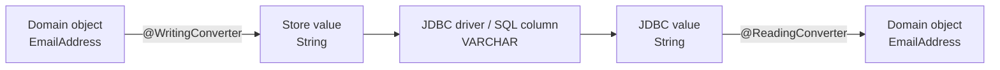

# Phân biệt kiểu đơn giản, kiểu miền và hướng chuyển đổi

Trong **Spring Data Relational JDBC**, một property Java có thể được ánh xạ trực tiếp thành một cột SQL, được mở rộng thành nhiều cột, hoặc được hiểu là một entity có quan hệ riêng. Để chọn đúng cách ánh xạ, cần phân biệt ba khái niệm:

- **Simple type** là kiểu mà Spring Data xem như một giá trị đơn, chẳng hạn `String`, `Long`, `UUID`, `BigDecimal`, `Instant` và nhiều kiểu chuẩn khác. Property kiểu này thường được lưu trong một cột.
- **Domain type** là kiểu do ứng dụng định nghĩa để biểu diễn ý nghĩa nghiệp vụ, ví dụ `EmailAddress`, `Money`, `CustomerId` hoặc `Percentage`. Một domain type không tự động được mọi module Spring Data coi là simple type.
- **Converter** quy định cách chuyển một kiểu Java thành kiểu mà JDBC driver/database có thể lưu, và cách chuyển ngược khi đọc dữ liệu.

Hai hướng converter cần nhớ:

| Hướng | Annotation | Kiểu tổng quát | Ý nghĩa |
|---|---|---|---|
| Ghi xuống database | `@WritingConverter` | `Converter<DomainType, StoreType>` | Domain object → giá trị lưu trữ đơn giản |
| Đọc từ database | `@ReadingConverter` | `Converter<StoreType, DomainType>` | Giá trị JDBC → domain object |

Ví dụ, domain model dùng `EmailAddress`, còn database lưu email bằng `VARCHAR`. Khi ghi, chuyển `EmailAddress` thành `String`; khi đọc, chuyển `String` thành `EmailAddress`. Hướng chuyển đổi được đặt theo **chiều dữ liệu đi qua persistence**, không phải theo tên method hoặc chiều mũi tên trong class diagram.

## 1. Simple type được Spring Data hiểu như thế nào?

Spring Data dùng metadata mapping và danh sách kiểu đơn giản (`SimpleTypeHolder`) để quyết định một property có thể được xem như một giá trị đơn hay cần tiếp tục phân tích như một object/entity. Các kiểu chuẩn thường gặp gồm:

| Nhóm | Ví dụ Java |
|---|---|
| Primitive và wrapper | `int`, `long`, `boolean`, `Integer`, `Long`, `Boolean` |
| Chuỗi và ký tự | `String`, `Character` |
| Số | `BigDecimal`, `BigInteger`, `Double`, `Float` |
| Ngày giờ | `LocalDate`, `LocalDateTime`, `Instant`, `OffsetDateTime`, `Duration` |
| Định danh và dữ liệu chuẩn | `UUID`, `URI`, `URL`, `Locale`, `Currency` |
| Kiểu đặc biệt | `byte[]`, enum và một số kiểu do store/driver hỗ trợ |

Danh sách chính xác phụ thuộc Spring Data module, dialect, custom conversions và phiên bản đang dùng. Một kiểu được JDBC driver hỗ trợ không nhất thiết đồng nghĩa mọi database đều có cùng kiểu SQL; ví dụ `UUID` có thể được bind trực tiếp với PostgreSQL/H2 nhưng được lưu dưới dạng `CHAR(36)`, `BINARY(16)` hoặc `RAW(16)` trên database khác.

Khi property là simple type, Spring Data thường ánh xạ property đó thành **một giá trị/cột**. Ví dụ:

```java
@Table("customer")
public class Customer {

    @Id
    private Long id;

    private String name;

    private BigDecimal creditLimit;

    private Instant registeredAt;
}
```

Các property `name`, `creditLimit`, `registeredAt` được lưu như các cột trong bảng `customer`. Spring Data không cần tạo entity/table riêng cho `String`, `BigDecimal` hay `Instant`.

## 2. Domain type không tự động là simple type

Ứng dụng thường tạo wrapper type để biểu diễn khái niệm nghiệp vụ thay vì truyền `String` hoặc `BigDecimal` ở mọi nơi:

```java
public record EmailAddress(String value) {

    public EmailAddress {
        if (value == null || value.isBlank() || !value.contains("@")) {
            throw new IllegalArgumentException("Invalid email address");
        }
        value = value.trim().toLowerCase(Locale.ROOT);
    }
}
```

`EmailAddress` thể hiện rõ ý nghĩa của giá trị. Method domain có thể nhận `EmailAddress` thay vì một chuỗi tùy ý:

```java
public void changeEmail(EmailAddress newEmail) {
    this.email = Objects.requireNonNull(newEmail);
}
```

Tuy nhiên, Spring Data JDBC không thể mặc nhiên biết phải lấy field `value` để ghi vào cột `email_address`. Nếu không có converter hoặc mapping phù hợp, framework có thể tiếp tục phân tích `EmailAddress` như một kiểu object và không ánh xạ nó theo ý định một-cột của ứng dụng.

Đăng ký converter giữa domain type và store type đơn giản giúp Spring Data biết cách biểu diễn giá trị đó trong relational store. Khi có custom conversion phù hợp, domain type được xử lý như một giá trị đơn trong mapping thay vì cần một bảng/entity riêng.

### Phân biệt domain value với entity

| Đặc điểm | Value/domain type | Entity/aggregate |
|---|---|---|
| Ý nghĩa | Mô tả một giá trị nghiệp vụ | Có identity và vòng đời riêng |
| Ví dụ | `EmailAddress`, `Percentage`, `Money` | `Customer`, `PurchaseOrder`, `Product` |
| Lưu trữ | Một cột qua converter, hoặc nhiều cột qua embedded mapping | Root và các bảng/quan hệ theo aggregate mapping |
| Tham chiếu | Thường được copy theo giá trị | Có identity; aggregate khác tham chiếu bằng ID |
| Repository riêng | Thường không | Aggregate root thường có repository |

Không phải cứ class Java tự định nghĩa là entity. Một `EmailAddress` chỉ là giá trị của khách hàng; nó không cần `@Id`, repository hay bảng riêng.

## 3. Hai hướng converter: đọc và ghi

Spring Data sử dụng converter theo chiều dữ liệu đi qua database:



### Writing converter

Writing converter có source là kiểu domain và target là kiểu lưu trữ:

```java
@WritingConverter
public class EmailAddressToStringConverter
        implements Converter<EmailAddress, String> {

    @Override
    public String convert(EmailAddress source) {
        return source.value();
    }
}
```

Khi `Customer` được lưu, converter nhận `EmailAddress` và trả về `String` để Spring Data JDBC bind vào cột `VARCHAR`.

### Reading converter

Reading converter có source là kiểu JDBC/store và target là kiểu domain:

```java
@ReadingConverter
public class StringToEmailAddressConverter
        implements Converter<String, EmailAddress> {

    @Override
    public EmailAddress convert(String source) {
        return new EmailAddress(source);
    }
}
```

Khi đọc hàng `customer`, driver trả về `String`; Spring Data dùng converter để tạo lại `EmailAddress`.

### Vì sao cần `@ReadingConverter` và `@WritingConverter`?

Trong ví dụ, cả `String` và `EmailAddress` đều có thể được coi là kiểu đơn giản sau khi custom conversion được đăng ký. Nếu chỉ nhìn chữ ký `Converter<A, B>`, Spring Data có thể không biết conversion đó dành cho chiều đọc hay chiều ghi trong một số trường hợp có hai kiểu đơn giản.

Annotation xác định chiều:

- `@WritingConverter`: domain/source → store/target.
- `@ReadingConverter`: store/source → domain/target.

Đây là cách tránh việc Spring chọn converter sai chiều hoặc báo lỗi do converter mơ hồ. Đặt annotation trên đúng class converter, không đặt trên entity property.

## 4. Ví dụ đầy đủ: `EmailAddress` lưu trong một cột `VARCHAR`

### Domain type

```java
package com.example.customer;

import java.util.Locale;

public record EmailAddress(String value) {

    public EmailAddress {
        if (value == null || value.isBlank() || !value.contains("@")) {
            throw new IllegalArgumentException("Invalid email address");
        }
        value = value.trim().toLowerCase(Locale.ROOT);
    }
}
```

### Aggregate root

```java
package com.example.customer;

import org.springframework.data.annotation.Id;
import org.springframework.data.relational.core.mapping.Column;
import org.springframework.data.relational.core.mapping.Table;

@Table("customer")
public class Customer {

    @Id
    private Long id;

    private String name;

    @Column("email_address")
    private EmailAddress email;

    protected Customer() {}

    public Customer(String name, EmailAddress email) {
        this.name = name;
        this.email = email;
    }

    public Long getId() { return id; }
    public String getName() { return name; }
    public EmailAddress getEmail() { return email; }

    public void changeEmail(EmailAddress email) {
        this.email = email;
    }
}
```

### Writing converter

```java
package com.example.customer;

import org.springframework.core.convert.converter.Converter;
import org.springframework.data.convert.WritingConverter;

@WritingConverter
public class EmailAddressToStringConverter
        implements Converter<EmailAddress, String> {

    @Override
    public String convert(EmailAddress source) {
        return source.value();
    }
}
```

### Reading converter

```java
package com.example.customer;

import org.springframework.core.convert.converter.Converter;
import org.springframework.data.convert.ReadingConverter;

@ReadingConverter
public class StringToEmailAddressConverter
        implements Converter<String, EmailAddress> {

    @Override
    public EmailAddress convert(String source) {
        return new EmailAddress(source);
    }
}
```

### Đăng ký converter

Với cấu hình dựa trên `AbstractJdbcConfiguration`, đăng ký converter trong `userConverters()`:

```java
package com.example.config;

import java.util.List;

import org.springframework.context.annotation.Configuration;
import org.springframework.data.jdbc.repository.config.AbstractJdbcConfiguration;

import com.example.customer.EmailAddressToStringConverter;
import com.example.customer.StringToEmailAddressConverter;

@Configuration
public class JdbcConfiguration extends AbstractJdbcConfiguration {

    @Override
    protected List<?> userConverters() {
        return List.of(
                new EmailAddressToStringConverter(),
                new StringToEmailAddressConverter()
        );
    }
}
```

`AbstractJdbcConfiguration` kết hợp converter do ứng dụng cung cấp với các conversion mặc định của Spring Data JDBC. Vì vậy nên thêm converter trong `userConverters()` thay vì tự thay thế toàn bộ `JdbcCustomConversions` theo cách làm mất conversion mặc định hoặc conversion do dialect cung cấp.

Nếu dự án Spring Boot đã có cấu hình JDBC tùy chỉnh, hãy bổ sung converter vào cấu hình hiện có và bảo đảm chỉ có một `JdbcMappingContext`/cấu hình conversion được repository sử dụng.

### Schema và repository

```sql
CREATE TABLE customer (
    id BIGINT GENERATED BY DEFAULT AS IDENTITY PRIMARY KEY,
    name VARCHAR(150) NOT NULL,
    email_address VARCHAR(320) NOT NULL
);
```

```java
public interface CustomerRepository extends CrudRepository<Customer, Long> {
}
```

Ghi và đọc:

```java
Customer customer = new Customer(
        "Lan",
        new EmailAddress("Lan@example.com")
);

Customer saved = customerRepository.save(customer);

Customer loaded = customerRepository.findById(saved.getId())
        .orElseThrow();

EmailAddress email = loaded.getEmail();
```

Trong database, `email_address` chứa chuỗi `lan@example.com`. Trong domain model, property vẫn có kiểu `EmailAddress`. Repository caller không cần tự gọi converter.

## 5. Domain type có thể chuyển sang các kiểu store khác nhau

Store type phải phù hợp với database và JDBC driver. Ví dụ một domain type `Percentage` có thể lưu thành `BigDecimal`:

```java
public record DiscountRate(BigDecimal value) {
    public DiscountRate {
        Objects.requireNonNull(value);
        if (value.compareTo(BigDecimal.ZERO) < 0
                || value.compareTo(BigDecimal.ONE) > 0) {
            throw new IllegalArgumentException("Rate must be between 0 and 1");
        }
    }
}
```

Converter ghi:

```java
@WritingConverter
public class DiscountRateToBigDecimalConverter
        implements Converter<DiscountRate, BigDecimal> {

    @Override
    public BigDecimal convert(DiscountRate source) {
        return source.value();
    }
}
```

Converter đọc:

```java
@ReadingConverter
public class BigDecimalToDiscountRateConverter
        implements Converter<BigDecimal, DiscountRate> {

    @Override
    public DiscountRate convert(BigDecimal source) {
        return new DiscountRate(source);
    }
}
```

Store type là `BigDecimal`, nên cột SQL có thể là `NUMERIC(5,4)`:

```sql
discount_rate NUMERIC(5,4) NOT NULL
```

Việc chọn precision/scale phải khớp miền giá trị và quy tắc làm tròn của nghiệp vụ. Converter không tự giải quyết quy tắc tiền tệ, scale hay rounding; những điều đó cần được định nghĩa trong domain type hoặc service.

## 6. `JdbcValue` khi cần chỉ định JDBC type

Thông thường, converter trả về một simple store type như `String`, `BigDecimal`, `UUID` hoặc `byte[]`, và driver suy luận JDBC type phù hợp. Một số trường hợp cần chỉ định rõ JDBC type để driver bind đúng kiểu, ví dụ binary, decimal hoặc kiểu vendor-specific.

Spring Data JDBC cung cấp `JdbcValue`, chứa giá trị cùng `JDBCType`:

```java
import java.sql.JDBCType;

import org.springframework.data.jdbc.core.mapping.JdbcValue;

@WritingConverter
public class EmailAddressToJdbcValueConverter
        implements Converter<EmailAddress, JdbcValue> {

    @Override
    public JdbcValue convert(EmailAddress source) {
        return JdbcValue.of(source.value(), JDBCType.VARCHAR);
    }
}
```

Đây là **một lựa chọn thay thế** cho `Converter<EmailAddress, String>` khi cần JDBC type hint. Không đăng ký cả hai writing converter cho cùng một source type nếu không có cách phân giải rõ ràng. Với `VARCHAR` thông thường, trả `String` trực tiếp thường đơn giản hơn.

`JDBCType` là enum chuẩn của JDBC. Giá trị cần chọn phải phù hợp với store type, driver và schema. `JdbcValue` không biến một kiểu SQL không được database hỗ trợ thành kiểu được hỗ trợ; nó chỉ cung cấp thông tin bind rõ ràng hơn.

## 7. Khi nào dùng converter, khi nào dùng `@Embedded`?

Converter phù hợp khi domain type được lưu như **một giá trị đơn**. Nếu một value object gồm nhiều thành phần cần lưu vào nhiều cột, `@Embedded` thường diễn đạt đúng hơn.

Ví dụ `Money` gồm số tiền và loại tiền:

```java
public record Money(BigDecimal amount, String currency) {}
```

Nếu chỉ chuyển `Money` thành `BigDecimal`, thông tin `currency` sẽ bị mất. Có thể mã hóa cả hai thành một chuỗi duy nhất, nhưng việc query/index theo amount hoặc currency sẽ khó hơn. Nếu muốn lưu hai cột, dùng embedded mapping:

```java
public class Money {
    private BigDecimal amount;
    private String currency;
}

@Embedded(prefix = "total_")
private Money total;
```

Schema có thể chứa:

```sql
total_amount NUMERIC(19, 2),
total_currency VARCHAR(3)
```

| Nhu cầu | Cách mapping phù hợp |
|---|---|
| `EmailAddress` được lưu trong một cột text | Converter `EmailAddress ↔ String` |
| `DiscountRate` được lưu trong một cột numeric | Converter `DiscountRate ↔ BigDecimal` |
| `Money` cần hai cột amount/currency | `@Embedded` |
| Một value object có nhiều thành phần nhưng phải đóng gói thành một scalar theo contract hệ thống | Converter sang một store type, nếu chấp nhận semantics đó |
| Tham chiếu `Customer` là aggregate root khác | ID hoặc `AggregateReference<Customer, ID>` |
| `OrderLine` được `PurchaseOrder` sở hữu | `@MappedCollection` |

Không dùng converter để biến một entity có identity/vòng đời riêng thành scalar chỉ nhằm né thiết kế quan hệ. Converter là cách biểu diễn một **giá trị**, không thay thế aggregate boundary.

## 8. Converter không đổi tên property hay tên cột

`@Column` và converter giải quyết hai vấn đề khác nhau:

```java
@Column("email_address")
private EmailAddress email;
```

- `@Column("email_address")` xác định **tên cột SQL**.
- `EmailAddressToStringConverter` xác định **giá trị Java được chuyển thành gì khi ghi**.
- `StringToEmailAddressConverter` xác định **giá trị JDBC được dựng thành gì khi đọc**.

Derived query vẫn tham chiếu tên property Java:

```java
List<Customer> findByEmail(EmailAddress email);
```

Không viết `findByEmailAddress(...)` chỉ vì tên cột là `email_address`, trừ khi entity thực sự có property tên `emailAddress`. Tương tự, SQL trong `@Query` dùng tên cột database:

```java
@Query("SELECT * FROM customer WHERE email_address = :email")
List<Customer> findByStoredEmail(@Param("email") String email);
```

Conversion không thay thế naming strategy và cũng không làm thay đổi identifier SQL.

## 9. Converter được đăng ký theo kiểu, không phải theo từng field tùy ý

Custom conversions của Spring Data được đăng ký trong conversion service/mapping infrastructure. Chúng được chọn dựa trên source type, target type và hướng conversion. Vì vậy converter áp dụng cho các property có cặp kiểu tương ứng trong phạm vi cấu hình đó.

Ví dụ, nếu có hai property đều mang `EmailAddress`, cùng dùng một store representation `String`, cùng converter sẽ áp dụng cho cả hai. Đây là điều tốt khi semantics giống nhau.

Nếu cùng một Java type cần lưu theo hai định dạng khác nhau tùy property (ví dụ một nơi cần canonical email lowercase, nơi khác cần giữ nguyên chuỗi nhập), converter toàn cục có thể không đủ biểu đạt. Hãy cân nhắc:

- Tạo hai domain types riêng với semantics rõ ràng.
- Chuẩn hóa dữ liệu trong domain type để cùng một kiểu luôn có một biểu diễn duy nhất.
- Dùng một mapping/value object khác nếu hai property thực sự khác ý nghĩa.
- Viết custom persistence query khi yêu cầu đặc thù chỉ thuộc một thao tác.

Không tạo nhiều converter cạnh tranh cho cùng một cặp source/target với kỳ vọng Spring tự biết field nào cần converter nào.

## 10. Null và validation trong conversion

Converter thường chuyển đổi một giá trị không-null. Việc property là `null` được xử lý theo mapping và nullability của database; không nên dựa vào converter để thay thế ràng buộc `NOT NULL`.

Ví dụ:

```java
@Column("email_address")
private EmailAddress email;
```

Nếu schema khai báo `email_address NOT NULL`, ứng dụng phải bảo đảm property luôn có giá trị trước khi lưu. Converter không tự biến `null` thành chuỗi rỗng hoặc một địa chỉ mặc định nếu bạn không chủ động thiết kế hành vi đó.

Validation domain nên được thực hiện khi tạo domain value:

```java
EmailAddress email = new EmailAddress(input);
```

Khi đọc dữ liệu cũ, `StringToEmailAddressConverter` cũng gọi constructor validation. Nếu dữ liệu database không còn hợp lệ theo quy tắc domain mới, việc đọc có thể thất bại. Khi thay đổi validation, cần xem xét dữ liệu lịch sử và migration trước khi triển khai.

## 11. Kiểm thử converter và round-trip qua repository

Nên kiểm tra hai tầng:

1. **Unit test converter:** xác nhận hướng, giá trị và validation.
2. **Integration test repository:** xác nhận Spring Data đã đăng ký converter và ghi/đọc đúng qua JDBC driver/database thật.

### Unit test

```java
class EmailAddressConverterTest {

    private final EmailAddressToStringConverter writing =
            new EmailAddressToStringConverter();

    private final StringToEmailAddressConverter reading =
            new StringToEmailAddressConverter();

    @Test
    void convertsDomainValueToStoreValueAndBack() {
        EmailAddress input = new EmailAddress("Lan@example.com");

        String stored = writing.convert(input);
        EmailAddress restored = reading.convert(stored);

        assertThat(stored).isEqualTo("lan@example.com");
        assertThat(restored).isEqualTo(input);
    }
}
```

### Integration test

```java
@DataJdbcTest
class CustomerRepositoryConversionTest {

    @Autowired CustomerRepository repository;
    @Autowired JdbcTemplate jdbcTemplate;

    @Test
    void writesEmailAsStringAndReadsItAsDomainType() {
        Customer saved = repository.save(
                new Customer("Lan", new EmailAddress("Lan@example.com"))
        );

        String stored = jdbcTemplate.queryForObject(
                "SELECT email_address FROM customer WHERE id = ?",
                String.class,
                saved.getId()
        );

        assertThat(stored).isEqualTo("lan@example.com");

        Customer loaded = repository.findById(saved.getId()).orElseThrow();
        assertThat(loaded.getEmail()).isEqualTo(new EmailAddress("lan@example.com"));
    }
}
```

`@DataJdbcTest` cần nạp `JdbcConfiguration` có converter vào context. Tùy cấu hình component scan/slice test, có thể cần import configuration một cách tường minh. Schema test phải có cột `email_address VARCHAR(320)` và các cột còn lại tương ứng.

Test H2 kiểm tra được conversion flow trong môi trường test, nhưng nếu production dùng PostgreSQL, MySQL, SQL Server hoặc Oracle, hãy chạy thêm integration test với đúng database/driver. JDBC type binding và kiểu giá trị driver trả về có thể khác nhau.

## 12. Lỗi thường gặp khi đăng ký converter

| Biểu hiện | Nguyên nhân có thể | Cách xử lý |
|---|---|---|
| Spring cố ánh xạ domain class như entity/struct | Chưa có converter phù hợp hoặc converter không được đăng ký | Đăng ký cặp converter domain ↔ store simple type |
| `ConverterNotFoundException` | Thiếu converter cho chiều đọc hoặc chiều ghi | Kiểm tra cả hai hướng và source/target generic type |
| Converter bị chọn sai chiều | Không đánh dấu converter đơn giản bằng annotation direction | Dùng `@ReadingConverter`/`@WritingConverter` đúng chiều |
| Giá trị ghi xuống không đúng | Writing converter trả sai store type hoặc biến đổi sai dữ liệu | Kiểm tra `Converter<Domain, Store>` và kiểu cột |
| Đọc dữ liệu bị lỗi parse | Reading converter không xử lý dữ liệu cũ/null/format | Kiểm tra `Converter<Store, Domain>` và dữ liệu thực tế |
| JDBC báo không bind được kiểu | Store type không được driver hỗ trợ hoặc JDBC type không phù hợp | Chọn store type đơn giản, dùng `JdbcValue` nếu cần type hint |
| Cột không tồn tại | Nhầm `@Column` hoặc tên cột SQL | Kiểm tra schema và mapping column name |
| Converter không chạy trong repository | Cấu hình custom conversions không thuộc mapping context đang dùng | Kiểm tra `AbstractJdbcConfiguration.userConverters()` và test context |
| Hai property cần cách lưu khác nhau nhưng dùng cùng converter | Conversion được đăng ký theo cặp kiểu trong phạm vi cấu hình | Dùng domain types khác nhau hoặc custom persistence logic |
| Dữ liệu cũ không tạo được domain object | Validation mới nghiêm hơn dữ liệu lịch sử | Chuẩn hóa/migrate dữ liệu hoặc thiết kế reading conversion có chính sách rõ |

## 13. Những nhầm lẫn cần tránh

| Nhầm lẫn | Thực tế |
|---|---|
| `@WritingConverter` là store → domain | Sai; writing là domain → store |
| `@ReadingConverter` là domain → store | Sai; reading là store → domain |
| `@Column` biến một domain type thành simple type | Không; `@Column` chỉ định tên cột |
| Mọi custom class đều tự được lưu trong một cột | Không; cần converter hoặc mapping phù hợp |
| Converter thay thế `@Embedded` cho mọi value object | Không; embedded phù hợp khi cần nhiều cột |
| Converter tạo quan hệ FK/JOIN | Không; converter biểu diễn giá trị, không tạo quan hệ entity |
| Converter được chọn theo tên field | Thông thường conversion được đăng ký theo cặp kiểu và hướng |
| Converter bỏ qua JDBC driver | Không; store type cuối cùng vẫn phải tương thích driver/database |
| Direct SQL luôn chạy converter | Không; câu SQL tự viết phải tự truyền store value đúng kiểu hoặc dùng JDBC operations thích hợp |

## 14. Quy trình chọn kiểu và converter

Khi thêm một property domain mới, hãy quyết định theo thứ tự:

1. **Xác định semantics:** đây là giá trị bất biến hay entity có identity/vòng đời riêng?
2. **Kiểm tra simple type:** kiểu Java đã được Spring Data/JDBC hỗ trợ trực tiếp chưa?
3. **Chọn cấu trúc lưu:** một cột, nhiều cột (`@Embedded`), hay bảng/quan hệ entity?
4. **Nếu một cột:** chọn store type đơn giản mà driver/database hỗ trợ.
5. **Viết converter hai chiều:** domain → store với `@WritingConverter`, store → domain với `@ReadingConverter`.
6. **Đăng ký conversion:** thêm vào `userConverters()` của `AbstractJdbcConfiguration` hoặc cơ chế cấu hình tương ứng.
7. **Kiểm tra column mapping:** dùng `@Column` khi tên SQL khác property Java.
8. **Kiểm thử round-trip:** kiểm tra converter unit test và repository integration test.
9. **Kiểm tra database thật:** xác nhận JDBC type, nullability, precision/scale, encoding và dữ liệu lịch sử.

### Bảng quyết định nhanh

| Property domain | Kiểu lưu | Cách làm |
|---|---|---|
| `String`, `Long`, `Instant`, `BigDecimal` | Simple type tương ứng | Dùng trực tiếp nếu driver hỗ trợ |
| `EmailAddress` | `VARCHAR` | `EmailAddress → String` và `String → EmailAddress` |
| `DiscountRate` | `NUMERIC` | `DiscountRate → BigDecimal` và ngược lại |
| `Money(amount, currency)` | Hai cột | `@Embedded` |
| `CustomerId(UUID)` | UUID hoặc text tùy schema | Converter wrapper ↔ store type |
| `Customer` là aggregate root khác | ID/FK | `AggregateReference` hoặc scalar ID |
| `OrderLine` được root sở hữu | Bảng child | `@MappedCollection` |

**Điểm cốt lõi:** simple type được lưu như một giá trị đơn. Domain type là kiểu do ứng dụng định nghĩa và cần được biểu diễn rõ trong persistence mapping. Khi lưu một domain value vào một cột, dùng `@WritingConverter` theo chiều domain → store và `@ReadingConverter` theo chiều store → domain. Chọn converter khi value object tương ứng với một scalar; chọn `@Embedded` khi cần nhiều cột; giữ entity/aggregate reference cho đối tượng có identity và vòng đời riêng.

## Tài liệu tham khảo chính thức

- [Spring Data Relational — Mapping](https://docs.spring.io/spring-data/relational/reference/jdbc/mapping.html): simple types, custom conversions, mapping domain properties và store values.
- [Spring Data Relational — Custom Conversions](https://docs.spring.io/spring-data/relational/reference/jdbc/mapping.html#jdbc.custom-conversions): đăng ký `@ReadingConverter`, `@WritingConverter`, `userConverters()` và store type.
- [Spring Data JDBC — `AbstractJdbcConfiguration` API](https://docs.spring.io/spring-data/relational/reference/api/java/org/springframework/data/jdbc/repository/config/AbstractJdbcConfiguration.html): cấu hình JDBC và custom converters.
- [Spring Data Commons — `CustomConversions` API](https://docs.spring.io/spring-data/commons/docs/current/api/org/springframework/data/convert/CustomConversions.html): quản lý conversion và simple type holder.
- [Spring Data Commons — `ReadingConverter` API](https://docs.spring.io/spring-data/commons/docs/current/api/org/springframework/data/convert/ReadingConverter.html): đánh dấu converter cho chiều đọc.
- [Spring Data Commons — `WritingConverter` API](https://docs.spring.io/spring-data/commons/docs/current/api/org/springframework/data/convert/WritingConverter.html): đánh dấu converter cho chiều ghi.
- [Spring Data JDBC — `JdbcValue` API](https://docs.spring.io/spring-data/relational/reference/api/java/org/springframework/data/jdbc/core/mapping/JdbcValue.html): gắn JDBC type với giá trị ghi.
