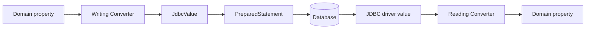

# JdbcValue và khai báo JDBCType tường minh

Khi Spring Data JDBC ghi một property xuống database, framework phải chuyển giá trị Java thành tham số JDBC và chọn kiểu SQL phù hợp. Thông thường, kiểu Java và metadata của property đủ để Spring Data cùng JDBC driver suy ra kiểu cần dùng. Nhưng có những trường hợp driver không thể suy luận chính xác, hoặc ứng dụng cần chỉ định rõ kiểu SQL để tránh binding sai.

**`JdbcValue`** giải quyết trường hợp đó. Đây là wrapper chứa hai thông tin: giá trị cần ghi và kiểu SQL dùng khi truyền giá trị ấy vào `PreparedStatement`. Một custom writing converter có thể trả về `JdbcValue` để chỉ định kiểu JDBC tường minh thay vì để framework suy luận.

Bài học này giải thích mối quan hệ giữa kiểu Java, kiểu SQL và `JDBCType`; cách tạo `JdbcValue`; cách viết và đăng ký converter; cách đọc lại value object; và những điểm cần chú ý khi dùng kiểu dữ liệu đặc thù hoặc giá trị NULL.

## 1. Vì sao cần chỉ định JDBC type?

Java và database có hai hệ kiểu dữ liệu liên quan nhưng không giống nhau.

| Kiểu Java | Kiểu SQL thường dùng |
|---|---|
| `String` | `VARCHAR`, `CHAR`, `CLOB` |
| `Integer` | `INTEGER` |
| `Long` | `BIGINT` |
| `BigDecimal` | `DECIMAL` hoặc `NUMERIC` |
| `Boolean` | `BOOLEAN` hoặc kiểu số/ký tự tùy database |
| `LocalDate` | `DATE` |
| `LocalDateTime` | `TIMESTAMP` |
| `byte[]` | `VARBINARY` hoặc `BLOB` |
| `UUID` | Phụ thuộc database và JDBC driver |

Với những kiểu phổ biến, Spring Data JDBC và driver thường có thể suy luận cách binding phù hợp. Ví dụ một property `String` được ánh xạ vào cột `VARCHAR` thường không cần khai báo thêm.

Nhưng suy luận tự động không phải lúc nào cũng đủ:

- Database có cột đặc thù như JSON, XML, ARRAY hoặc kiểu vendor-specific.
- Driver cần biết kiểu SQL chính xác khi bind giá trị.
- Một value object Java được chuyển thành một kiểu SQL cụ thể.
- Kiểu Java tổng quát nhưng cột yêu cầu kiểu JDBC rõ ràng.
- Cách driver xử lý một giá trị phụ thuộc vào kiểu được truyền cho `PreparedStatement`.

Nếu chỉ truyền giá trị mà không cung cấp kiểu phù hợp, driver có thể chọn kiểu không mong muốn, báo lỗi chuyển đổi hoặc xử lý giá trị NULL không chính xác.

## 2. JdbcValue là gì?

`JdbcValue` nằm trong package:

```java
import org.springframework.data.jdbc.core.mapping.JdbcValue;
```

Lớp này bao bọc một giá trị cùng kiểu SQL dùng để truyền giá trị đó như bind parameter cho `PreparedStatement`.

API chính:

```java
public static JdbcValue of(Object value, SQLType jdbcType)
```

Các phương thức đọc:

```java
Object getValue();
SQLType getJdbcType();
```

`JdbcValue.of(value, jdbcType)` là factory method được dùng để tạo wrapper. Constructor không được thiết kế để ứng dụng gọi trực tiếp.

Ví dụ:

```java
import java.sql.JDBCType;

JdbcValue value = JdbcValue.of("user@example.com", JDBCType.VARCHAR);
```

Trong ví dụ:

- Giá trị được ghi là chuỗi `user@example.com`.
- Kiểu SQL được chỉ định là `VARCHAR`.
- Spring Data JDBC có thể dùng cả hai thông tin khi bind tham số.

`JdbcValue` không phải một kiểu cột mới trong database và cũng không thay đổi schema. Nó là metadata bổ sung cho giá trị trong quá trình chuyển đổi và binding.

### 2.1. JdbcValue chứa giá trị và SQLType

Có thể hình dung:

```text
JdbcValue
  ├── value    = "user@example.com"
  └── jdbcType = JDBCType.VARCHAR
```

Giá trị và kiểu SQL đi cùng nhau. Nếu cùng một giá trị Java cần được ghi dưới một kiểu SQL cụ thể, wrapper cho phép converter truyền cả hai thông tin đến lớp JDBC.

### 2.2. JdbcValue được dùng ở bước ghi

Trong Spring Data JDBC, `JdbcValue` chủ yếu được sử dụng làm kết quả của custom write converter. Converter chuyển property domain thành wrapper; hạ tầng mapping dùng value và SQL type khi chuẩn bị tham số cho JDBC.

Nó không thay thế aggregate, repository hoặc `JdbcAggregateTemplate`. Nó cũng không tự thực hiện câu INSERT/UPDATE. Vai trò của nó là mô tả cách một property được truyền xuống JDBC.

## 3. Phân biệt SQLType, JDBCType và java.sql.Types

Java cung cấp các khái niệm liên quan:

- `SQLType` là interface mô tả kiểu SQL.
- `JDBCType` là enum chuẩn của JDBC, triển khai `SQLType`.
- `java.sql.Types` là tập hằng số kiểu JDBC dạng số nguyên, được dùng trong nhiều API JDBC cũ.

`JdbcValue.of` nhận `SQLType`. Trong phần lớn trường hợp, có thể truyền trực tiếp một giá trị `JDBCType`.

```java
import java.sql.JDBCType;
import java.math.BigDecimal;
import java.time.LocalDate;

JdbcValue textValue =
    JdbcValue.of("ABC-001", JDBCType.VARCHAR);

JdbcValue decimalValue =
    JdbcValue.of(new BigDecimal("1250.75"), JDBCType.DECIMAL);

JdbcValue dateValue =
    JdbcValue.of(LocalDate.now(), JDBCType.DATE);
```

`JDBCType` phù hợp vì nó biểu diễn tên kiểu có ý nghĩa và tránh phải ghi nhớ các mã số trong `Types`.

### 3.1. Một số JDBCType thường gặp

| JDBCType | Ý nghĩa | Ví dụ kiểu Java thường truyền |
|---|---|---|
| `VARCHAR` | Chuỗi ký tự có độ dài thay đổi | `String` |
| `CHAR` | Chuỗi ký tự độ dài cố định | `String` |
| `INTEGER` | Số nguyên | `Integer` |
| `BIGINT` | Số nguyên lớn | `Long` |
| `DECIMAL` | Số thập phân chính xác | `BigDecimal` |
| `NUMERIC` | Kiểu số chính xác | `BigDecimal` |
| `BOOLEAN` | Giá trị đúng/sai | `Boolean` |
| `DATE` | Ngày | `LocalDate` hoặc kiểu ngày tương thích |
| `TIMESTAMP` | Ngày giờ không kèm múi giờ | `LocalDateTime` hoặc kiểu tương thích |
| `VARBINARY` | Dữ liệu nhị phân | `byte[]` |
| `BLOB` | Binary Large Object | `byte[]` hoặc kiểu driver hỗ trợ |
| `CLOB` | Character Large Object | `String` hoặc kiểu tương thích |
| `ARRAY` | SQL array | Kiểu array do driver hỗ trợ |
| `SQLXML` | SQL XML | Kiểu XML/JDBC tương thích |
| `OTHER` | Kiểu SQL khác hoặc vendor-specific | Phụ thuộc driver |

Chọn kiểu dựa trên kiểu cột thật trong schema và khả năng của database/driver. Không chọn `VARCHAR` chỉ vì giá trị Java là `String` nếu cột thực tế yêu cầu một kiểu vendor-specific.

### 3.2. JDBCType không phải tên cột

`JDBCType.VARCHAR` mô tả kiểu SQL của tham số, không chỉ ra cột nào được ghi. Tên cột vẫn được quyết định bởi mapping của property, ví dụ `@Column` hoặc naming strategy.

### 3.3. JDBCType không thay thế kiểu Java

Nếu property domain là `Money`, converter vẫn phải tạo một giá trị JDBC mà driver có thể xử lý, chẳng hạn `BigDecimal`. Chỉ chọn kiểu `JDBCType.DECIMAL` mà không chuyển `Money` thành giá trị số phù hợp là chưa đủ.

### 3.4. Không truyền hằng số Types vào factory

`JDBCType.VARCHAR` là một enum triển khai `SQLType`. Trong khi đó, `Types.VARCHAR` là một số nguyên. Factory `JdbcValue.of` nhận `SQLType`, nên dùng enum `JDBCType` thay vì truyền hằng số int từ `java.sql.Types`.

## 4. Khi nào nên dùng JdbcValue?

Hãy dùng `JdbcValue` khi cần kiểm soát kiểu JDBC của một property trong quá trình ghi.

Các trường hợp thường gặp:

1. **Value object:** một kiểu domain riêng cần được lưu dưới dạng VARCHAR, DECIMAL hoặc kiểu SQL khác.
2. **Kiểu dữ liệu đặc thù:** database/driver cần một SQL type cụ thể để nhận giá trị.
3. **Binding không suy luận đúng:** kiểu Java không đủ để xác định cách driver nên bind tham số.
4. **Tính tương thích:** cần bảo đảm một converter luôn ghi theo kiểu SQL mà schema quy định.

Không cần tạo `JdbcValue` cho mọi property. Nếu kiểu Java chuẩn đã được mapping đúng, để Spring Data JDBC xử lý tự động thường đơn giản và ít cấu hình hơn.

## 5. Ví dụ: ghi EmailAddress thành VARCHAR

Giả sử domain model dùng value object `EmailAddress` thay vì để property email là một chuỗi thuần.

### 5.1. Value object

```java
public record EmailAddress(String value) {

    public EmailAddress {
        if (value == null || value.isBlank()) {
            throw new IllegalArgumentException("Email must not be blank");
        }
    }
}
```

Aggregate:

```java
import org.springframework.data.annotation.Id;
import org.springframework.data.relational.core.mapping.Column;
import org.springframework.data.relational.core.mapping.Table;

@Table("customers")
public record Customer(
    @Id Long id,
    String fullName,
    @Column("email_address") EmailAddress email
) {}
```

Schema:

```sql
CREATE TABLE customers (
    id BIGINT GENERATED BY DEFAULT AS IDENTITY PRIMARY KEY,
    full_name VARCHAR(120) NOT NULL,
    email_address VARCHAR(320) NOT NULL
);
```

Property Java là `EmailAddress`, còn cột database là `VARCHAR`. Cần converter chuyển value object thành giá trị chuỗi và chỉ định JDBC type.

### 5.2. Writing converter trả về JdbcValue

```java
import java.sql.JDBCType;

import org.springframework.core.convert.converter.Converter;
import org.springframework.data.convert.WritingConverter;
import org.springframework.data.jdbc.core.mapping.JdbcValue;

@WritingConverter
public class EmailAddressWriteConverter
        implements Converter<EmailAddress, JdbcValue> {

    @Override
    public JdbcValue convert(EmailAddress source) {
        return JdbcValue.of(source.value(), JDBCType.VARCHAR);
    }
}
```

Đây là phần quan trọng:

- Source type là `EmailAddress`.
- Target type là `JdbcValue`.
- Giá trị bên trong wrapper là `String`.
- SQL type là `JDBCType.VARCHAR`.
- `@WritingConverter` nói rõ converter này được dùng theo hướng ghi.

Spring Data JDBC dùng converter khi chuyển property `EmailAddress` thành giá trị để ghi. Thông tin `VARCHAR` được mang theo cùng chuỗi.

### 5.3. Vì sao converter trả về JdbcValue thay vì String?

Nếu converter chỉ trả `String`:

```java
@WritingConverter
public class EmailAddressWriteConverter
        implements Converter<EmailAddress, String> {

    @Override
    public String convert(EmailAddress source) {
        return source.value();
    }
}
```

Spring Data JDBC biết giá trị đã thành chuỗi, nhưng kiểu SQL có thể tiếp tục được suy luận từ metadata hoặc quy tắc mapping. Khi converter trả `JdbcValue`, ứng dụng nêu rõ cả giá trị lẫn kiểu SQL muốn sử dụng.

Nếu schema/driver đã suy luận đúng `VARCHAR` thì converter trả `String` có thể đủ. Dùng `JdbcValue` khi cần chỉ định kiểu JDBC tường minh.

## 6. Đọc lại value object bằng ReadingConverter

`JdbcValue` chủ yếu hỗ trợ quá trình ghi. Khi đọc từ database, Spring Data JDBC cần converter theo hướng ngược lại để chuyển giá trị mà driver trả về thành kiểu domain.

```java
import org.springframework.core.convert.converter.Converter;
import org.springframework.data.convert.ReadingConverter;

@ReadingConverter
public class EmailAddressReadConverter
        implements Converter<String, EmailAddress> {

    @Override
    public EmailAddress convert(String source) {
        return new EmailAddress(source);
    }
}
```

Hai converter có trách nhiệm khác nhau:

| Converter | Source | Target | Hướng |
|---|---|---|---|
| `EmailAddressWriteConverter` | `EmailAddress` | `JdbcValue` | Ghi |
| `EmailAddressReadConverter` | `String` | `EmailAddress` | Đọc |

Đọc từ database:

```java
Customer customer = customerRepository.findById(10L)
    .orElseThrow();

String email = customer.email().value();
```

Spring Data JDBC đọc cột `email_address` thành kiểu Java mà JDBC driver cung cấp, sau đó dùng reading converter để tạo `EmailAddress`.

### 6.1. Vì sao cần @ReadingConverter và @WritingConverter?

Spring Conversion Service không phải lúc nào cũng suy ra được chiều chuyển đổi mong muốn, đặc biệt khi source và target đều là kiểu đơn giản hoặc có nhiều converter có thể áp dụng.

Các annotation định hướng:

- `@WritingConverter`: chuyển từ kiểu domain sang kiểu dùng khi ghi.
- `@ReadingConverter`: chuyển từ kiểu JDBC/driver trả về sang kiểu domain.

Với value object, khai báo hướng rõ ràng giúp tránh Spring chọn converter sai chiều.

## 7. Đăng ký converter với AbstractJdbcConfiguration

Converter cần được đăng ký để Spring Data JDBC đưa chúng vào `JdbcConverter`.

Có thể mở rộng `AbstractJdbcConfiguration` và override `userConverters`:

```java
import java.util.List;

import org.springframework.context.annotation.Configuration;
import org.springframework.data.jdbc.repository.config.AbstractJdbcConfiguration;

@Configuration
public class JdbcConfiguration extends AbstractJdbcConfiguration {

    @Override
    protected List<?> userConverters() {
        return List.of(
            new EmailAddressWriteConverter(),
            new EmailAddressReadConverter()
        );
    }
}
```

Spring Data JDBC kết hợp converter của ứng dụng với converter mặc định và converter theo dialect.

Trong các phiên bản hiện hành, `userConverters()` là điểm mở rộng dành cho converter của ứng dụng. Không nên ghi đè `jdbcCustomConversions()` theo các ví dụ cũ mà chưa kiểm tra phiên bản, vì cách đó có thể bỏ sót converter do dialect cung cấp.

### 7.1. Nếu dùng Spring Boot

Spring Boot thường tự cấu hình DataSource, JDBC operations, mapping context và repository infrastructure khi có starter phù hợp.

Khi thêm custom converter, hãy tích hợp cấu hình vào application context hiện tại. Nếu tự khai báo một cấu hình kế thừa `AbstractJdbcConfiguration`, cần hiểu cách cấu hình đó tương tác với auto-configuration và các bean đang có. Không tạo một DataSource hoặc JdbcConverter thứ hai chỉ để đăng ký converter.

### 7.2. Đăng ký nhiều converter

Có thể trả về nhiều converter trong một danh sách:

```java
@Override
protected List<?> userConverters() {
    return List.of(
        new EmailAddressWriteConverter(),
        new EmailAddressReadConverter(),
        new MoneyWriteConverter(),
        new MoneyReadConverter()
    );
}
```

Nên nhóm converter theo domain type hoặc tách thành các lớp riêng để dễ kiểm soát hướng chuyển đổi.

## 8. Ví dụ thứ hai: Money thành DECIMAL

Value object tiền tệ có thể lưu phần số tiền vào cột DECIMAL. Ví dụ này chỉ lưu amount; currency được lưu ở cột riêng.

### 8.1. Value object và aggregate

```java
import java.math.BigDecimal;

public record Money(BigDecimal amount) {
    public Money {
        if (amount == null) {
            throw new IllegalArgumentException("Amount is required");
        }
    }
}
```

```java
@Table("invoices")
public record Invoice(
    @Id Long id,
    String invoiceNumber,
    @Column("total_amount") Money totalAmount
) {}
```

Schema:

```sql
CREATE TABLE invoices (
    id BIGINT GENERATED BY DEFAULT AS IDENTITY PRIMARY KEY,
    invoice_number VARCHAR(40) NOT NULL,
    total_amount DECIMAL(19, 4) NOT NULL
);
```

### 8.2. Writing converter

```java
import java.sql.JDBCType;

@WritingConverter
public class MoneyWriteConverter
        implements Converter<Money, JdbcValue> {

    @Override
    public JdbcValue convert(Money source) {
        return JdbcValue.of(source.amount(), JDBCType.DECIMAL);
    }
}
```

Converter chuyển `Money` thành `BigDecimal` và chỉ định `DECIMAL`. Không chuyển tiền qua `double` hoặc `float` vì các kiểu dấu phẩy động nhị phân không biểu diễn chính xác nhiều giá trị thập phân.

### 8.3. Reading converter

```java
@ReadingConverter
public class MoneyReadConverter
        implements Converter<BigDecimal, Money> {

    @Override
    public Money convert(BigDecimal source) {
        return new Money(source);
    }
}
```

Khi đọc cột DECIMAL, driver thường trả `BigDecimal`. Reading converter đóng gói giá trị thành `Money`.

### 8.4. Lưu cả amount và currency

Nếu nghiệp vụ cần currency, nên lưu riêng currency code thay vì giả định một amount có thể tự xác định đơn vị tiền:

```sql
CREATE TABLE invoices (
    id BIGINT GENERATED BY DEFAULT AS IDENTITY PRIMARY KEY,
    invoice_number VARCHAR(40) NOT NULL,
    total_amount DECIMAL(19, 4) NOT NULL,
    currency_code CHAR(3) NOT NULL
);
```

Một converter cho `Money` có thể không phù hợp nếu value object chứa nhiều trường cần ghi vào nhiều cột. `JdbcValue` mô tả một giá trị JDBC cho property; nó không tự trải một object thành nhiều cột. Với value object nhiều cột, hãy cân nhắc `@Embedded` hoặc mapping phù hợp.

## 9. JdbcValue và kiểu dữ liệu vendor-specific

Một số database cung cấp kiểu ngoài nhóm SQL phổ biến. Ví dụ:

- PostgreSQL có `JSONB`, `UUID` và các kiểu mở rộng.
- Oracle có kiểu dữ liệu riêng và các kiểu object/collection.
- Một số database hỗ trợ ARRAY, XML hoặc spatial types.

Trong trường hợp này, `JDBCType.OTHER` hoặc một `SQLType` phù hợp có thể là một phần của giải pháp, nhưng chỉ chọn type code là chưa chắc đủ. Driver có thể yêu cầu object đặc thù như `PGobject`, `java.sql.Array` hoặc API riêng.

Ví dụ khái niệm cho một giá trị JSON:

```java
@WritingConverter
public class JsonDocumentWriteConverter
        implements Converter<JsonDocument, JdbcValue> {

    @Override
    public JdbcValue convert(JsonDocument source) {
        return JdbcValue.of(
            source.jsonText(),
            JDBCType.OTHER
        );
    }
}
```

Đoạn này chỉ phù hợp nếu database/driver chấp nhận chuỗi JSON được bind như `OTHER`. Với PostgreSQL JSONB, driver có thể yêu cầu kiểu đối tượng/parameter cụ thể để phân biệt JSONB với VARCHAR. Cần xác nhận bằng integration test với driver và database production.

**Không có một JDBCType chung bảo đảm mọi vendor-specific type hoạt động giống nhau.** Đọc tài liệu driver, xác định cách bind được hỗ trợ và chỉ tạo converter theo contract đó.

## 10. JdbcValue không thay thế custom reading converter

Hai hướng chuyển đổi có thể được hình dung:



Khi ghi:

1. Spring Data JDBC lấy giá trị property.
2. Writing converter chuyển kiểu domain thành `JdbcValue`.
3. `JdbcValue` cung cấp giá trị và SQL type.
4. Hạ tầng JDBC bind tham số và thực thi SQL.

Khi đọc:

1. JDBC driver trả giá trị theo kiểu Java mà driver hỗ trợ.
2. Spring Data JDBC xác định converter đọc phù hợp.
3. Reading converter tạo kiểu domain.
4. Aggregate được hoàn thiện với property domain đã chuyển đổi.

Không cần reading converter trả về `JdbcValue`. Wrapper này được dùng để mang kiểu SQL khi truyền tham số ghi.

## 11. JdbcValue khác SqlParameterValue và MapSqlParameterSource như thế nào?

Cả ba khái niệm đều có thể giúp điều khiển kiểu tham số, nhưng nằm ở các lớp API khác nhau.

| API | Nơi sử dụng | Mục đích |
|---|---|---|
| `JdbcValue` | Spring Data JDBC custom conversion | Trả giá trị property kèm SQL type từ writing converter |
| `SqlParameterValue` | Spring JDBC operations | Truyền một giá trị cùng kiểu SQL khi gọi JDBC template |
| `MapSqlParameterSource` | `NamedParameterJdbcTemplate` | Khai báo named parameter và có thể chỉ định SQL type |

Ví dụ dùng `MapSqlParameterSource` trong custom JDBC code:

```java
MapSqlParameterSource parameters = new MapSqlParameterSource()
    .addValue("email", "user@example.com", Types.VARCHAR)
    .addValue("amount", new BigDecimal("1250.75"), Types.DECIMAL)
    .addValue("id", 10L);

namedParameterJdbcTemplate.update(
    """
    UPDATE customers
    SET email_address = :email
    WHERE id = :id
    """,
    parameters
);
```

Đoạn code trên là Spring JDBC trực tiếp. Nó không phải cách sử dụng `JdbcValue` trong custom converter của Spring Data JDBC.

Khi property của aggregate cần kiểu SQL tường minh, dùng converter trả `JdbcValue`. Khi tự viết câu lệnh bằng `JdbcTemplate` hoặc `NamedParameterJdbcTemplate`, dùng API parameter của Spring JDBC phù hợp.

## 12. Giá trị NULL và JDBC type

SQL NULL không giống một chuỗi rỗng hoặc số 0. Khi ghi NULL, JDBC thường cần biết kiểu SQL của tham số để gọi thao tác binding phù hợp.

`JdbcValue` cho phép wrapper mang một giá trị nullable và một `SQLType`. API factory chấp nhận giá trị null:

```java
JdbcValue nullText = JdbcValue.of(null, JDBCType.VARCHAR);
```

Tuy nhiên, cần chú ý đường đi của converter. Spring Conversion Service thường xử lý null riêng và không gọi converter như một giá trị thông thường. Vì vậy, không nên mặc định writing converter sẽ luôn nhận source null rồi tạo `JdbcValue` như ví dụ trên.

Khi property có thể null:

- Xác định Spring Data JDBC đang suy ra kiểu của property từ metadata nào.
- Kiểm tra converter có thực sự được gọi trong trường hợp null hay không.
- Xác nhận driver nhận đúng SQL type khi bind NULL.
- Kiểm thử trên database/driver thực tế.
- Không tự thay NULL bằng chuỗi rỗng hoặc giá trị mặc định nếu nghiệp vụ phân biệt hai trạng thái.

Nếu cần một giá trị NULL có kiểu cụ thể trong câu SQL tự viết, Spring JDBC có API khai báo type tường minh như `MapSqlParameterSource.addValue(name, null, sqlType)` hoặc `SqlParameterValue`.

## 13. Những giới hạn quan trọng của JdbcValue

`JdbcValue` chỉ giải quyết việc cung cấp giá trị và kiểu SQL khi bind một property. Nó không tự làm các việc sau:

- Tạo hoặc thay đổi column trong schema.
- Chọn tên bảng/cột.
- Chuyển một object nhiều property thành nhiều cột.
- Thay thế toàn bộ custom conversion.
- Bảo đảm driver hiểu một kiểu vendor-specific nếu driver yêu cầu object riêng.
- Quy định converter đọc dữ liệu từ database.
- Thay thế transaction, repository hoặc aggregate lifecycle.

Nếu một property cần được trải thành nhiều cột, dùng mapping như `@Embedded` hoặc thiết kế converter/mapping khác phù hợp. Nếu chỉ cần chuyển một value object thành một giá trị JDBC có type rõ ràng, `JdbcValue` là lựa chọn trực tiếp.

## 14. Kiểm thử converter và JDBC type

Một converter có thể chạy đúng trong unit test nhưng vẫn gặp lỗi khi driver bind tham số. Vì vậy nên kiểm thử ở hai mức.

### 14.1. Unit test converter

```java
class EmailAddressWriteConverterTest {

    private final EmailAddressWriteConverter converter =
        new EmailAddressWriteConverter();

    @Test
    void returnsVarcharJdbcValue() {
        JdbcValue result = converter.convert(
            new EmailAddress("user@example.com")
        );

        assertThat(result.getValue()).isEqualTo("user@example.com");
        assertThat(result.getJdbcType()).isEqualTo(JDBCType.VARCHAR);
    }
}
```

Test xác nhận converter tạo đúng value và SQL type.

### 14.2. Integration test ghi và đọc aggregate

```java
@DataJdbcTest
class CustomerRepositoryTest {

    @Autowired
    CustomerRepository repository;

    @Test
    void writesAndReadsEmailAddress() {
        Customer customer = new Customer(
            null,
            "An Nguyen",
            new EmailAddress("an@example.com")
        );

        Customer saved = repository.save(customer);

        Customer loaded = repository.findById(saved.id())
            .orElseThrow();

        assertThat(loaded.email())
            .isEqualTo(new EmailAddress("an@example.com"));
    }
}
```

Test cần cấu hình converter và schema test tương ứng. Nếu kiểu SQL phụ thuộc vendor, hãy dùng Testcontainers hoặc database cùng loại/version với môi trường production.

### 14.3. Kiểm thử kiểu dữ liệu đặc thù

Với JSONB, ARRAY, UUID hoặc kiểu vendor-specific:

- Ghi một giá trị đại diện.
- Đọc lại giá trị.
- Kiểm tra kiểu cột và phép so sánh SQL phù hợp.
- Kiểm tra NULL nếu property cho phép.
- Kiểm tra hành vi với driver đang triển khai.

Không chỉ xác nhận Java object sau khi save có giá trị đúng; hãy kiểm tra dữ liệu thực sự được database nhận theo kiểu mong muốn.

## 15. Những lỗi thường gặp

| Triệu chứng | Nguyên nhân | Cách xử lý |
|---|---|---|
| Driver không nhận giá trị | Kiểu bind suy luận không phù hợp | Converter trả `JdbcValue` với JDBCType rõ ràng |
| Value object không được ghi | Chưa đăng ký writing converter | Đăng ký converter trong `userConverters()` |
| Converter chạy sai chiều | Thiếu annotation định hướng | Dùng `@WritingConverter` hoặc `@ReadingConverter` |
| Đọc lại không tạo được domain type | Thiếu reading converter | Đăng ký converter từ kiểu driver trả về sang domain type |
| Cột DECIMAL nhận kiểu không mong muốn | Chuyển đổi sai hoặc chọn SQL type không phù hợp | Dùng `BigDecimal` và `JDBCType.DECIMAL` |
| JSON/UUID vendor-specific bị lỗi | `JDBCType.OTHER` chưa đủ cho driver | Dùng object/parameter API theo tài liệu driver |
| NULL được bind sai kiểu | Không có type metadata phù hợp hoặc converter không được gọi cho null | Kiểm tra đường mapping và dùng SQL type rõ ràng cho query JDBC trực tiếp |
| Ghi value object nhiều cột không hoạt động | `JdbcValue` chỉ đại diện một bind value | Dùng `@Embedded` hoặc mapping nhiều cột |
| Converter mặc định của dialect bị mất | Ghi đè cấu hình custom conversions cũ không đúng cách | Dùng extension point `userConverters()` theo version |
| Unit test pass nhưng production lỗi | Database test không cùng driver/dialect | Integration test với database production-compatible |
| Tạo JdbcValue cho mọi property | Dùng wrapper không cần thiết | Chỉ khai báo tường minh khi có yêu cầu về SQL type |

## 16. Bài thực hành

**Bài 1.** `JdbcValue` chứa những thông tin gì?

*Đáp án:* Giá trị cần ghi và `SQLType` dùng khi bind nó vào PreparedStatement.

**Bài 2.** `JdbcValue.of("ABC", JDBCType.VARCHAR)` có nghĩa gì?

*Đáp án:* Giá trị chuỗi ABC được truyền xuống JDBC với kiểu SQL VARCHAR.

**Bài 3.** Một value object `EmailAddress` được lưu vào cột VARCHAR. Converter ghi nên có source và target type nào?

*Đáp án:* `Converter<EmailAddress, JdbcValue>`, được đánh dấu `@WritingConverter`.

**Bài 4.** `JdbcValue` có thay thế reading converter không?

*Đáp án:* Không. Đọc dữ liệu cần converter theo chiều từ kiểu Java mà JDBC driver trả về sang kiểu domain.

**Bài 5.** Vì sao `JDBCType` có thể truyền vào `JdbcValue.of`?

*Đáp án:* `JDBCType` là enum triển khai `SQLType`, đúng với kiểu tham số mà factory method nhận.

**Bài 6.** Có nên dùng `JdbcValue` cho mọi property String không?

*Đáp án:* Không. Nếu Spring Data JDBC và driver đã suy ra đúng VARCHAR, converter bổ sung không mang lại lợi ích.

**Bài 7.** Có thể dùng `JdbcValue.of(null, JDBCType.VARCHAR)` để chắc chắn converter nhận null không?

*Đáp án:* Không. Factory hỗ trợ value null, nhưng conversion service thường xử lý null riêng. Phải kiểm tra đường binding thực tế và không giả định writing converter được gọi với source null.

**Bài 8.** Cần lưu một value object gồm amount và currency vào hai cột. `JdbcValue` có tự tạo hai cột không?

*Đáp án:* Không. `JdbcValue` đại diện một giá trị JDBC. Hãy dùng mapping nhiều cột như `@Embedded` hoặc thiết kế persistence mapping phù hợp.

## 17. Điều cần ghi nhớ

- `JdbcValue` bọc một giá trị và `SQLType` để chỉ định kiểu SQL khi bind tham số JDBC.
- Dùng `JdbcValue.of(value, JDBCType.X)` để tạo wrapper; factory nhận `SQLType` nên có thể dùng `JDBCType`.
- `JDBCType` là enum chuẩn của JDBC; chọn type khớp với schema và driver.
- Trong Spring Data JDBC, custom writing converter có thể trả `JdbcValue` để kiểm soát kiểu JDBC thay vì để framework suy luận.
- Đánh dấu converter ghi bằng `@WritingConverter` và converter đọc bằng `@ReadingConverter` khi cần xác định hướng.
- Đăng ký converter ứng dụng qua `AbstractJdbcConfiguration.userConverters()` theo API phiên bản đang dùng.
- `JdbcValue` không thay thế reading converter, không tạo schema và không ánh xạ một object thành nhiều cột.
- Với JSON, UUID, ARRAY và kiểu vendor-specific, kiểm tra tài liệu driver; chỉ chọn `JDBCType.OTHER` chưa chắc đã đủ.
- Với NULL, đừng giả định converter sẽ được gọi với source null; kiểm tra cách binding thực tế.
- Chỉ dùng `JdbcValue` khi cần điều khiển SQL type tường minh; để mapping mặc định xử lý các kiểu thông thường.

### Tài liệu tham khảo chính thức

- [Spring Data Relational — Custom Conversions và JdbcValue](https://docs.spring.io/spring-data/relational/reference/jdbc/mapping.html): custom converter và cách Spring Data JDBC dùng JdbcValue khi ghi property.
- [JdbcValue API](https://docs.spring.io/spring-data/relational/reference/api/java/org/springframework/data/jdbc/core/mapping/JdbcValue.html): package, factory method `of`, `getValue` và `getJdbcType`.
- [Spring Data Relational — JDBC Reference](https://docs.spring.io/spring-data/relational/reference/jdbc.html): mapping và cấu hình Spring Data JDBC.
- [Java JDBCType API](https://docs.oracle.com/en/java/javase/21/docs/api/java.sql/java/sql/JDBCType.html): các kiểu JDBC chuẩn triển khai SQLType.
- [Spring Framework — Type Conversion](https://docs.spring.io/spring-framework/reference/core/validation/convert.html): cơ chế Converter và ConversionService của Spring.

Khi triển khai, đối chiếu phiên bản Spring Data Relational, kiểu cột trong schema và tài liệu JDBC driver. Mục tiêu của JdbcValue là làm rõ kiểu SQL tại thời điểm bind, để giá trị domain được ghi bằng đúng kiểu mà database mong đợi.
