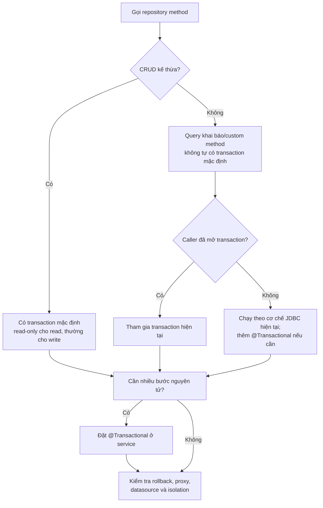

# Giao dịch mặc định của phương thức CRUD và phương thức truy vấn khai báo

Spring Data JDBC tích hợp với cơ chế quản lý transaction của Spring. Tuy nhiên, không phải mọi method trong một repository đều tự động có cùng cấu hình giao dịch. Các phương thức CRUD kế thừa từ repository base có cấu hình mặc định; những phương thức truy vấn do ứng dụng khai báo, chẳng hạn derived query hoặc method dùng `@Query`, không tự nhận cấu hình transaction đó.

Sự khác biệt này ảnh hưởng trực tiếp đến cách thiết kế service. Một lệnh `save` đơn lẻ có thể được thực hiện trong transaction do repository quản lý, nhưng một use case gồm đọc, kiểm tra, lưu aggregate và ghi lịch sử cần một transaction bao quanh toàn bộ quy trình. Bài học này giải thích transaction mặc định, cách query method tham gia transaction, và cách đặt ranh giới giao dịch ở tầng service.

## 1. Transaction trong Spring Data JDBC

Transaction gom một hoặc nhiều thao tác database thành một đơn vị công việc. Nếu transaction commit, các thay đổi được xác nhận. Nếu transaction rollback, các thay đổi thuộc transaction được hoàn tác theo khả năng của database.

Ví dụ một nghiệp vụ xác nhận đơn hàng có thể cần:

1. Đọc đơn hàng hiện tại.
2. Kiểm tra đơn đang ở trạng thái `CREATED`.
3. Cập nhật trạng thái thành `CONFIRMED`.
4. Ghi một dòng audit để lưu người thực hiện.

Nếu bước 3 thành công nhưng bước 4 thất bại, ứng dụng thường không muốn đơn hàng ở trạng thái đã xác nhận mà không có audit tương ứng. Một transaction ở tầng use case giúp cả hai thay đổi cùng commit hoặc cùng rollback.

Spring Data JDBC dùng transaction abstraction của Spring. Với JDBC thông thường, transaction manager quản lý connection gắn với `DataSource`. Repository và các thành phần JDBC có thể tham gia transaction hiện tại nếu chúng dùng cùng datasource và transaction manager phù hợp.

## 2. Cấu hình mặc định của các phương thức CRUD kế thừa

Các phương thức CRUD kế thừa từ repository base như `CrudRepository` có cấu hình transaction mặc định:

| Nhóm phương thức | Ví dụ | Cấu hình mặc định |
| --- | --- | --- |
| Đọc | `findById`, `findAll`, `count`, `existsById` | Transaction read-only. |
| Ghi | `save`, `saveAll`, `delete`, `deleteById` | Transaction thông thường, không đặt `readOnly = true`. |

Ví dụ repository:

```java
public interface PurchaseOrderRepository
        extends CrudRepository<PurchaseOrder, Long> {
}
```

Các method `findById`, `findAll` và `save` được cung cấp bởi repository base. Người dùng không cần thêm `@Transactional` chỉ để những CRUD method này có transaction mặc định.

Đối với một thao tác `save` aggregate trong Spring Data JDBC, transaction của repository bao trùm thao tác lưu root và các thành phần con thuộc aggregate theo mapping. Nếu việc lưu child row thất bại, các thay đổi của cùng thao tác repository có thể rollback cùng nhau.

### Transaction riêng của từng lời gọi không phải transaction của cả use case

Giả sử service gọi hai CRUD method mà không có transaction bên ngoài:

```java
public void registerOrder(PurchaseOrder order) {
    orderRepository.save(order);
    auditRepository.save(createAudit(order));
}
```

Mỗi method CRUD có thể chạy trong transaction riêng của nó. Nếu `orderRepository.save` đã commit rồi `auditRepository.save` thất bại, thao tác đầu tiên không tự động rollback theo thao tác thứ hai.

Muốn cả hai lệnh là một đơn vị nguyên tử, đặt transaction ở service:

```java
@Transactional
public void registerOrder(PurchaseOrder order) {
    orderRepository.save(order);
    auditRepository.save(createAudit(order));
}
```

Với propagation mặc định `REQUIRED`, các CRUD method được gọi bên trong sẽ tham gia transaction đang tồn tại thay vì commit độc lập.

## 3. Phương thức truy vấn khai báo không tự có transaction mặc định

Một repository có thể khai báo derived query:

```java
public interface PurchaseOrderRepository
        extends CrudRepository<PurchaseOrder, Long> {

    List<PurchaseOrder> findByCustomerId(Long customerId);

    List<PurchaseOrder> findByStatus(String status);
}
```

Hai method `findByCustomerId` và `findByStatus` là query methods do ứng dụng khai báo. Chúng không tự nhận cấu hình transaction read-only chỉ vì tên bắt đầu bằng `find`.

Điều tương tự áp dụng cho query method dùng `@Query`:

```java
@Query("""
    SELECT id, customer_id, status, total_amount
    FROM purchase_order
    WHERE customer_id = :customerId
    """)
List<PurchaseOrder> findRecentByCustomer(Long customerId);
```

Nếu method được gọi khi không có transaction hiện tại, repository query method không tự mở một transaction theo cấu hình CRUD mặc định. Nó vẫn có thể thực thi SQL qua JDBC; việc không có transaction khai báo ở repository không đồng nghĩa câu SELECT không thể chạy. Nhưng nhiều truy vấn riêng lẻ sẽ không tự trở thành một đơn vị transaction chỉ vì chúng nằm trong cùng một service method.

### Query method vẫn tham gia transaction do caller mở

Ví dụ:

```java
@Service
public class OrderSearchService {

    private final PurchaseOrderRepository orders;

    public OrderSearchService(PurchaseOrderRepository orders) {
        this.orders = orders;
    }

    @Transactional(readOnly = true)
    public List<PurchaseOrder> findCustomerOrders(long customerId) {
        return orders.findByCustomerId(customerId);
    }
}
```

Ở đây transaction được mở bởi `OrderSearchService`. Query method tham gia transaction hiện tại vì propagation mặc định của `@Transactional` là `REQUIRED`.

Vì vậy, cần phân biệt hai ý:

- Query method khai báo không tự tạo transaction mặc định.
- Query method vẫn chạy bên trong transaction nếu caller đã mở một transaction phù hợp.

## 4. Khai báo transaction cho query method

Nếu muốn một query method luôn chạy trong read-only transaction ngay cả khi được gọi độc lập, có thể đánh dấu trực tiếp:

```java
public interface PurchaseOrderRepository
        extends CrudRepository<PurchaseOrder, Long> {

    @Transactional(readOnly = true)
    List<PurchaseOrder> findByCustomerId(Long customerId);

    @Transactional(readOnly = true)
    List<PurchaseOrder> findByStatus(String status);
}
```

Cũng có thể đặt cấu hình transaction ở cấp interface để áp dụng cho các method của repository, sau đó ghi đè ở method cần cấu hình khác. Tuy nhiên, nên giữ annotation ở vị trí làm rõ trách nhiệm và tránh vô tình áp dụng read-only cho method ghi.

Ví dụ query method có timeout riêng:

```java
@Transactional(readOnly = true, timeout = 5)
List<PurchaseOrder> findByCustomerId(Long customerId);
```

Giá trị timeout được diễn giải bởi transaction manager và hạ tầng tương ứng; không phải mọi JDBC driver/database đều cưỡng chế timeout transaction theo cùng một cách.

### Dùng service facade cho một nhóm query

Nếu nhiều query cùng phục vụ một use case đọc, thường dễ quản lý hơn khi đặt transaction ở service:

```java
@Service
@Transactional(readOnly = true)
public class OrderReadService {

    private final PurchaseOrderRepository orders;
    private final CustomerRepository customers;

    public OrderReadService(
            PurchaseOrderRepository orders,
            CustomerRepository customers) {
        this.orders = orders;
        this.customers = customers;
    }

    public List<PurchaseOrder> findOrders(long customerId) {
        return orders.findByCustomerId(customerId);
    }

    public Optional<Customer> findCustomer(long customerId) {
        return customers.findById(customerId);
    }
}
```

Cách này đặt transaction boundary theo use case thay vì lặp annotation trên từng repository method. Repository vẫn tập trung vào truy vấn và persistence.

## 5. Dùng @Transactional ở tầng service để bao trùm nghiệp vụ

Tầng service là vị trí phù hợp để xác định ranh giới transaction vì service biết một nghiệp vụ gồm những bước nào và bước nào phải thành công cùng nhau.

Ví dụ xác nhận đơn hàng và ghi audit:

```java
@Service
public class OrderWorkflowService {

    private final PurchaseOrderRepository orders;
    private final OrderAuditRepository audits;

    public OrderWorkflowService(
            PurchaseOrderRepository orders,
            OrderAuditRepository audits) {
        this.orders = orders;
        this.audits = audits;
    }

    @Transactional
    public void confirm(long orderId, long actorId) {
        PurchaseOrder order = orders.findById(orderId)
            .orElseThrow(() -> new OrderNotFoundException(orderId));

        if (!"CREATED".equals(order.status())) {
            throw new InvalidOrderStateException(order.status());
        }

        orders.save(order.withStatus("CONFIRMED"));
        audits.save(new OrderAudit(orderId, actorId, "CONFIRMED"));
    }
}
```

Vì service mở transaction trước khi thực thi thân method, các repository call tham gia cùng transaction nếu dùng cùng transaction manager. Nếu ghi audit thất bại bằng exception làm rollback, cập nhật trạng thái đơn cũng được rollback.

Nếu không có `@Transactional` ở service, hai method repository có thể chạy trong hai transaction riêng. Đó là khác biệt giữa transaction của một repository method và transaction của một use case nhiều bước.

## 6. Transaction read-only có ý nghĩa gì?

`@Transactional(readOnly = true)` đánh dấu transaction là chỉ đọc. Transaction manager có thể dùng thông tin này làm hint cho JDBC connection, driver hoặc database để tối ưu thao tác đọc.

Ví dụ:

```java
@Transactional(readOnly = true)
public List<OrderSummary> listRecentOrders(long customerId) {
    return queryRepository.findRecent(customerId);
}
```

Cần hiểu đúng giới hạn:

- `readOnly = true` không phải cơ chế phân quyền database.
- Không phải database/driver nào cũng từ chối lệnh ghi trong read-only transaction.
- Nó không thay thế quyền truy cập, validation hoặc thiết kế repository.
- Không nên đặt read-only cho một use case có chủ đích ghi dữ liệu.

Nếu class service được đánh dấu `@Transactional(readOnly = true)` ở cấp class, method ghi nên khai báo transaction ghi rõ ràng:

```java
@Service
@Transactional(readOnly = true)
public class OrderService {

    private final PurchaseOrderRepository orders;

    public OrderService(PurchaseOrderRepository orders) {
        this.orders = orders;
    }

    public List<PurchaseOrder> findByStatus(String status) {
        return orders.findByStatus(status);
    }

    @Transactional
    public PurchaseOrder create(PurchaseOrder order) {
        return orders.save(order);
    }
}
```

Annotation ở method ghi ghi đè cấu hình class-level cho method đó. Cách tổ chức này phù hợp khi phần lớn service là đọc, chỉ một số use case cần ghi.
## 7. Các thuộc tính transaction mặc định của @Transactional

Khi dùng `@Transactional` mà không chỉ định thuộc tính, Spring áp dụng các giá trị mặc định của annotation:

| Thuộc tính | Mặc định | Ý nghĩa |
| --- | --- | --- |
| `propagation` | `REQUIRED` | Tham gia transaction hiện tại; nếu chưa có thì tạo transaction mới. |
| `isolation` | `DEFAULT` | Dùng mức isolation mặc định của database/transaction manager. |
| `readOnly` | `false` | Không đánh dấu transaction là read-only. |
| `timeout` | Giá trị mặc định của transaction manager | Không đặt timeout riêng từ annotation. |
| `rollbackFor` | Không khai báo thêm | Mặc định rollback với unchecked exception và `Error`. |

Các thuộc tính trên là mặc định của `@Transactional` khi annotation được áp dụng. Riêng CRUD method kế thừa cho thao tác đọc có `readOnly = true` theo cấu hình repository mặc định.

### Propagation REQUIRED

`REQUIRED` là propagation mặc định. Nếu service đã mở transaction, repository method được gọi bên trong sẽ tham gia transaction đó. Nếu chưa có transaction, method có annotation `@Transactional` có thể mở transaction mới.

```java
@Transactional
public void placeOrder(PurchaseOrder order) {
    orders.save(order);
    inventory.reserve(order);
}
```

Không nên đổi sang `REQUIRES_NEW` chỉ để “chắc chắn có transaction”. `REQUIRES_NEW` tạo transaction độc lập, có thể commit dù transaction bên ngoài rollback. Chỉ dùng khi nghiệp vụ thực sự muốn hành vi độc lập đó, chẳng hạn một số loại audit cần tồn tại dù use case chính thất bại. Cần đánh giá connection pool, thứ tự commit và tính nhất quán của audit.

### Isolation DEFAULT

`Isolation.DEFAULT` dùng isolation mặc định của database. Mức isolation cụ thể không giống nhau ở mọi hệ quản trị. Nếu use case cần bảo đảm chống dirty read, non-repeatable read hoặc phantom read, hãy hiểu mức isolation của database đích trước khi nâng isolation cho method.

Không nâng isolation tùy tiện: transaction có thể giữ lock lâu hơn hoặc giảm khả năng xử lý đồng thời. Chọn mức phù hợp với invariant nghiệp vụ rồi kiểm thử concurrency trên engine thực tế.
## 8. Quy tắc rollback khi có exception

Mặc định, Spring rollback transaction khi method transactional kết thúc bằng unchecked exception (`RuntimeException`) hoặc `Error`. Checked exception không tự động kích hoạt rollback theo quy tắc mặc định.

Ví dụ:

```java
@Transactional
public void confirm(long orderId) throws IOException {
    orders.updateStatus(orderId, "CONFIRMED");
    audit.write(orderId);
}
```

Nếu `IOException` là checked exception và thoát khỏi method, mặc định transaction có thể commit thay vì rollback. Nếu nghiệp vụ yêu cầu rollback cả trường hợp này, khai báo:

```java
@Transactional(rollbackFor = IOException.class)
public void confirm(long orderId) throws IOException {
    orders.updateStatus(orderId, "CONFIRMED");
    audit.write(orderId);
}
```

Có thể cấu hình nhiều loại exception trong `rollbackFor` hoặc quy tắc loại trừ bằng `noRollbackFor`. Chỉ định theo semantics nghiệp vụ; không đặt rollback cho mọi checked exception theo thói quen nếu có những trường hợp được phép commit.

### Bắt exception bên trong method

Nếu method bắt exception rồi không ném tiếp:

```java
@Transactional
public void confirm(long orderId) {
    orders.updateStatus(orderId, "CONFIRMED");

    try {
        audit.write(orderId);
    } catch (DataAccessException ex) {
        log.warn("Could not write audit", ex);
        // Method kết thúc bình thường nếu không đánh dấu rollback.
    }
}
```

Spring nhìn thấy method kết thúc bình thường, nên transaction có thể commit. Nếu lỗi phải làm rollback, hãy để exception truyền ra hoặc đánh dấu transaction rollback-only bằng cơ chế phù hợp như `TransactionAspectSupport.currentTransactionStatus().setRollbackOnly()`.

Không nuốt exception rồi giả định transaction tự rollback. Hãy thể hiện rõ chính sách lỗi ở service.

## 9. Transaction proxy và self-invocation

Spring thường áp dụng transaction declarative thông qua proxy. Lời gọi từ một bean khác đi qua proxy sẽ được interceptor mở/tham gia transaction theo annotation.

Ví dụ:

```java
@Service
public class OrderService {

    @Transactional
    public void confirm(long orderId) {
        // Transaction được áp dụng khi method được gọi qua proxy.
    }
}
```

Một lỗi phổ biến là method trong cùng object gọi trực tiếp method transactional khác:

```java
@Service
public class OrderService {

    public void process(long orderId) {
        confirm(orderId); // self-invocation
    }

    @Transactional
    public void confirm(long orderId) {
        // Lời gọi nội bộ không đi qua proxy.
    }
}
```

Trong chế độ proxy mặc định, lời gọi `this.confirm(...)` không đi qua proxy, nên annotation trên `confirm` không tạo transaction mới như mong đợi. Cách rõ ràng là đặt ranh giới transaction trên method public được gọi từ bean khác, hoặc tách use case transactional thành một bean/service riêng.

Cũng cần bảo đảm object được Spring quản lý. Tự tạo service bằng `new OrderService(...)` sẽ bỏ qua proxy và các cơ chế AOP liên quan.
## 10. Gọi query method từ service và bảo đảm cùng snapshot

Một use case đọc có thể cần nhiều query liên tiếp:

```java
@Service
public class OrderReportService {

    private final PurchaseOrderRepository orders;
    private final CustomerRepository customers;

    public OrderReportService(
            PurchaseOrderRepository orders,
            CustomerRepository customers) {
        this.orders = orders;
        this.customers = customers;
    }

    @Transactional(readOnly = true)
    public CustomerOrderReport report(long customerId) {
        Customer customer = customers.findById(customerId)
            .orElseThrow();

        List<PurchaseOrder> recentOrders =
            orders.findByCustomerId(customerId);

        return new CustomerOrderReport(customer, recentOrders);
    }
}
```

Hai query method có thể tham gia cùng read-only transaction do service mở. Điều này giúp transaction manager áp dụng một ranh giới giao dịch cho use case. Tuy nhiên, mức nhất quán giữa các lần đọc vẫn phụ thuộc isolation level của database. Với `READ_COMMITTED`, hai SELECT có thể quan sát các commit khác nhau tùy database; không nên mặc định read-only đồng nghĩa snapshot bất biến.

Nếu báo cáo cần một snapshot nhất quán, hãy chọn isolation phù hợp hoặc dùng snapshot/version theo khả năng database. Đừng nâng isolation mà không xem xét tác động lock và concurrency.

## 11. Kết hợp CRUD method và query method trong cùng transaction

Giả sử repository có cả method kế thừa và derived query:

```java
public interface PurchaseOrderRepository
        extends CrudRepository<PurchaseOrder, Long> {

    List<PurchaseOrder> findByCustomerId(Long customerId);
}
```

Service có thể kết hợp chúng:

```java
@Service
public class OrderMaintenanceService {

    private final PurchaseOrderRepository orders;

    public OrderMaintenanceService(PurchaseOrderRepository orders) {
        this.orders = orders;
    }

    @Transactional
    public void cancelCustomerOrders(long customerId) {
        List<PurchaseOrder> openOrders =
            orders.findByCustomerId(customerId);

        for (PurchaseOrder order : openOrders) {
            if ("CREATED".equals(order.status())) {
                orders.save(order.withStatus("CANCELLED"));
            }
        }
    }
}
```

Ở đây derived query không tự mở transaction, nhưng tham gia transaction đã mở bởi service. Các `save` method cũng tham gia transaction hiện tại theo propagation mặc định. Nếu một lần lưu ném exception làm rollback, các thay đổi trước đó trong cùng transaction cũng được rollback.

Nếu bỏ `@Transactional` ở service, từng `save` có thể commit riêng. Một lỗi ở đơn thứ năm không tự động hoàn tác bốn lần lưu trước.

Với số lượng bản ghi lớn, vòng lặp tải và lưu từng aggregate có thể không hiệu quả. Cần đánh giá batch, bulk SQL hoặc thiết kế xử lý theo lô, đồng thời giữ đúng invariant và optimistic locking của domain.

## 12. Cấu hình transaction manager cho Spring Data JDBC

Trong ứng dụng Spring Boot với một datasource, auto-configuration thường tạo datasource, JDBC templates và transaction manager phù hợp. Khi Spring Data JDBC và `NamedParameterJdbcTemplate` cùng dùng datasource đó, chúng có thể tham gia cùng transaction được quản lý.

Nếu cấu hình thủ công, cần có transaction manager JDBC cho datasource:

```java
@Configuration
@EnableTransactionManagement
public class JdbcTransactionConfig {

    @Bean
    PlatformTransactionManager transactionManager(DataSource dataSource) {
        return new JdbcTransactionManager(dataSource);
    }
}
```

`JdbcTransactionManager` là transaction manager dành cho JDBC trên một `DataSource`. Ở các phiên bản/cấu hình khác có thể dùng `DataSourceTransactionManager`; chọn implementation tương thích với Spring Framework version của dự án.

Nếu có nhiều datasource, mỗi datasource có thể cần transaction manager riêng. Khi đó phải chỉ rõ repository và service sử dụng transaction manager nào, ví dụ thuộc tính `transactionManagerRef` của cấu hình repository hoặc tên bean trong `@Transactional(transactionManager = "...")`. Một transaction manager JDBC cục bộ không tự đảm bảo atomicity giữa hai datasource độc lập.

## 13. Transaction của custom repository và NamedParameterJdbcTemplate

Method trong custom repository không tự nhận transaction CRUD chỉ vì class mang tên repository. Ví dụ:

```java
@Repository
public class OrderQueryRepository {

    private final NamedParameterJdbcTemplate jdbc;

    public OrderQueryRepository(NamedParameterJdbcTemplate jdbc) {
        this.jdbc = jdbc;
    }

    public List<OrderSummary> findRecent(long customerId) {
        return jdbc.query("""
            SELECT id, status, created_at
            FROM purchase_order
            WHERE customer_id = :customerId
            ORDER BY created_at DESC, id DESC
            """,
            Map.of("customerId", customerId),
            rowMapper
        );
    }
}
```

Nếu method này được gọi độc lập, nó không tự có transaction do quy ước tên class hoặc do dùng `NamedParameterJdbcTemplate`. Có thể:

- Gọi nó từ một service method đã có `@Transactional(readOnly = true)`.
- Đánh dấu method/class custom repository bằng `@Transactional(readOnly = true)`.
- Để một query đơn giản chạy mà không có transaction tường minh nếu nghiệp vụ không cần transaction rộng hơn.

Với custom write method, hãy đặt transaction ở service hoặc annotate method ghi để các lệnh liên quan cùng tham gia. Việc dùng JDBC template không tự làm transaction khác với transaction manager Spring đang quản lý.

## 14. Những hiểu lầm thường gặp

| Hiểu lầm | Thực tế |
| --- | --- |
| Mọi method bắt đầu bằng `find` đều tự read-only transactional. | Chỉ các CRUD read method kế thừa có cấu hình mặc định đó; query method khai báo cần transaction riêng hoặc tham gia transaction của caller. |
| Mỗi repository method đều có transaction riêng và các method trong service tự gộp lại. | Không có transaction bên ngoài thì các CRUD call có thể commit riêng. Muốn nguyên tử ở cấp use case, đặt transaction ở service. |
| Query method không có annotation thì không thể tham gia transaction. | Nó vẫn tham gia transaction hiện tại nếu caller đã mở transaction phù hợp. |
| `readOnly = true` luôn ngăn mọi lệnh ghi. | Đây là hint/thuộc tính transaction; mức cưỡng chế tùy transaction manager, driver và database. |
| Gọi method transactional từ method khác trong cùng class luôn mở transaction. | Self-invocation không đi qua proxy trong chế độ proxy mặc định. |
| Bắt exception thì transaction vẫn tự rollback. | Nếu exception bị bắt và method kết thúc bình thường, transaction có thể commit trừ khi được đánh dấu rollback-only. |
| `@Transactional` tạo transaction phân tán giữa mọi datasource. | Một transaction manager JDBC quản lý resource của datasource tương ứng; nhiều datasource cần thiết kế riêng. |
## 15. Kiểm thử ranh giới transaction

Nên kiểm thử hành vi commit/rollback trên database test thực tế hoặc môi trường tích hợp tương đương. Chỉ kiểm tra rằng method có annotation `@Transactional` chưa chứng minh các thao tác đã tham gia cùng transaction.

Một số kịch bản cần có:

- Gọi hai CRUD write method trong service transaction và xác nhận cả hai cùng commit.
- Làm bước thứ hai thất bại và xác nhận thay đổi ở bước đầu rollback.
- Gọi query method khai báo bên trong read-only service transaction và xác nhận nó đọc được dữ liệu trong transaction hiện tại.
- Gọi query method độc lập có `@Transactional(readOnly = true)` và xác nhận cấu hình được áp dụng.
- Kiểm tra checked exception có/không rollback theo `rollbackFor`.
- Kiểm tra self-invocation để tránh dựa vào annotation không được proxy kích hoạt.
- Nếu có nhiều datasource, kiểm tra rõ transaction manager nào bao trùm từng thao tác.

Ví dụ integration test cho rollback:

```java
@Test
void rollsBackOrderWhenAuditWriteFails() {
    PurchaseOrder before = orders.findById(orderId).orElseThrow();

    assertThatThrownBy(() ->
        workflow.confirmWithAuditFailure(orderId, actorId)
    ).isInstanceOf(DataAccessException.class);

    PurchaseOrder after = orders.findById(orderId).orElseThrow();

    assertThat(after.status()).isEqualTo(before.status());
    assertThat(audits.existsFor(orderId, "CONFIRMED")).isFalse();
}
```

Test cần làm cho lỗi audit xảy ra sau khi cập nhật aggregate, và exception phải thoát khỏi transactional method (hoặc transaction được đánh dấu rollback-only). Sau khi test kết thúc, đọc lại dữ liệu trong transaction mới để kiểm tra trạng thái đã rollback thật sự.

### Kiểm tra transaction của query method

Có thể gọi một service method `@Transactional(readOnly = true)` thực hiện hai query repository rồi xác nhận cả hai kết quả. Nếu use case phụ thuộc vào snapshot nhất quán, test concurrency riêng trên database đích để xác nhận isolation level thực tế.

Không nên chỉ mock repository rồi kết luận transaction hoạt động. Mock có thể kiểm tra luồng gọi method, nhưng không kiểm tra JDBC connection, commit, rollback hay isolation của database.

## 16. Quy trình chọn nơi đặt @Transactional

Khi thiết kế repository và service, hãy lần lượt trả lời:

1. Đây là CRUD method kế thừa hay query/custom method do ứng dụng khai báo?
2. Method có transaction mặc định không? Nếu là query method, caller có mở transaction không?
3. Các bước nào phải commit hoặc rollback cùng nhau?
4. Transaction boundary nên nằm ở service method nào để bao trùm use case?
5. Có query chỉ đọc nào nên đánh dấu `readOnly = true` không?
6. Có write method nào đang nằm trong class read-only và cần override cấu hình không?
7. Exception nào phải rollback, kể cả checked exception?
8. Lời gọi có đi qua Spring proxy không, hay là self-invocation?
9. Các repository/JDBC templates có cùng datasource và transaction manager không?
10. Isolation mặc định của database có đủ cho nghiệp vụ không?

Một sơ đồ đơn giản:



## 17. Câu hỏi tự kiểm tra

- Vì sao `findById` kế thừa từ `CrudRepository` có transaction read-only mặc định?
- Vì sao `findByStatus` do ứng dụng khai báo không tự nhận transaction đó?
- Query method không có `@Transactional` có thể tham gia transaction của service không?
- Điều gì xảy ra nếu service gọi hai CRUD write method mà không có transaction bao quanh?
- Vì sao service facade là nơi phù hợp để đặt transaction boundary?
- `REQUIRED` khác `REQUIRES_NEW` như thế nào?
- `readOnly = true` có phải cơ chế ngăn ghi tuyệt đối không?
- Spring mặc định rollback với loại exception nào? Checked exception được xử lý ra sao?
- Vì sao self-invocation có thể khiến `@Transactional` không được áp dụng?
- Khi nào cần cấu hình transaction manager riêng?
- Vì sao read-only transaction không tự bảo đảm snapshot nhất quán qua nhiều query?
- Integration test nào chứng minh hai repository write cùng commit hoặc rollback?

Ghi nhớ: CRUD method kế thừa có transaction mặc định của repository; read method được đánh dấu read-only, write method dùng transaction thông thường. Query method khai báo không tự có cấu hình đó, nhưng vẫn tham gia transaction do caller mở. Với nghiệp vụ gồm nhiều thao tác, hãy đặt `@Transactional` ở service để ranh giới commit/rollback phản ánh đúng use case, rồi kiểm tra propagation, rollback rules, proxy và datasource thực tế.
