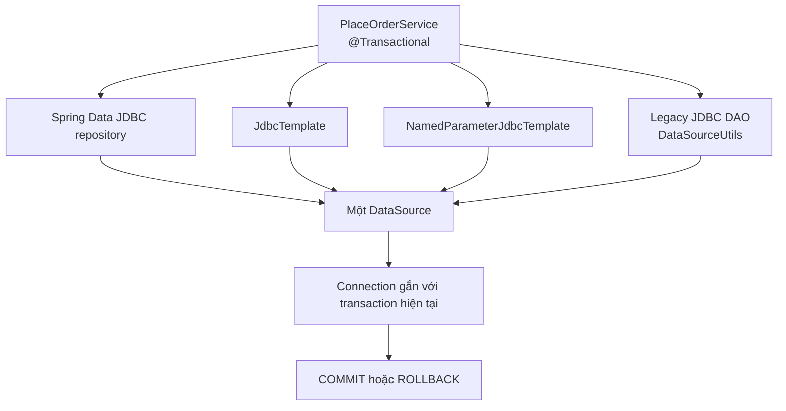
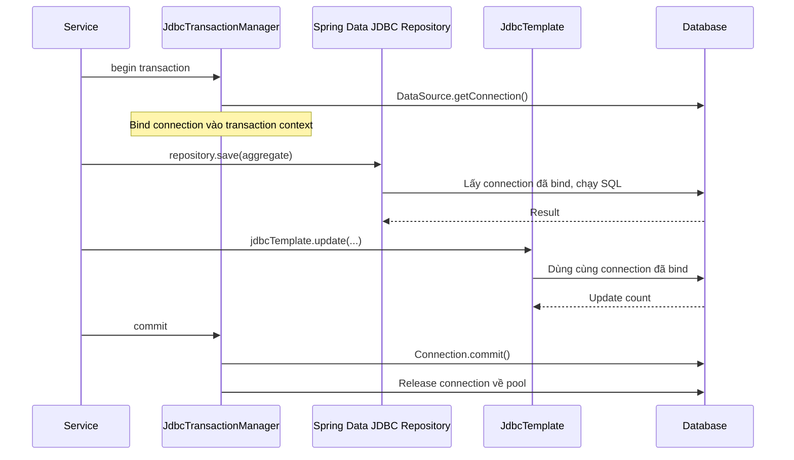

# `JdbcTransactionManager`, `DataSourceTransactionManager` và kết nối dùng chung

Trong **Spring Data Relational JDBC**, transaction manager điều khiển việc commit hoặc rollback các thao tác JDBC. Với một `DataSource`, Spring có hai lựa chọn thường gặp là `DataSourceTransactionManager` và `JdbcTransactionManager`.

Hai class này có cùng cơ chế transaction cốt lõi: lấy một JDBC `Connection` từ `DataSource`, gắn connection đó với transaction hiện tại trên thread, rồi commit/rollback và giải phóng connection khi transaction kết thúc. Điểm khác biệt chính là **`JdbcTransactionManager` bổ sung dịch exception SQL ở bước commit/rollback**, giúp lỗi database xuất hiện muộn ở cuối transaction được chuyển thành các exception trong hệ `DataAccessException`, tương tự cách `JdbcTemplate` dịch lỗi SQL.

Việc các thao tác dùng chung một transaction phụ thuộc vào việc chúng sử dụng **cùng `DataSource` và cơ chế lấy connection có nhận biết transaction**. `JdbcTemplate`, `NamedParameterJdbcTemplate` và Spring Data JDBC đã tích hợp cơ chế này. Code JDBC tự viết cần dùng `DataSourceUtils` hoặc `TransactionAwareDataSourceProxy`; gọi `dataSource.getConnection()` trực tiếp thường lấy một connection độc lập và có thể nằm ngoài transaction của Spring.

## 1. Vai trò của transaction manager trong Spring Data JDBC

Một use case có thể ghi dữ liệu qua nhiều thành phần:

- `PurchaseOrderRepository` lưu aggregate bằng Spring Data JDBC.
- `InventoryRepository` cập nhật aggregate tồn kho.
- `JdbcTemplate` ghi một bản ghi audit hoặc chạy câu SQL đặc thù.
- Một DAO cũ dùng JDBC API trực tiếp.

Nếu các thao tác cần cùng thành công hoặc cùng thất bại, application service mở transaction ở tầng use case:



Khi mọi thành phần cùng dùng một resource JDBC và cùng transaction manager, các câu SQL tham gia cùng transaction. Nếu một bước ném exception làm transaction rollback, các thay đổi trước đó trong transaction cũng được hoàn tác.

Transaction manager không phải connection pool và cũng không phải JDBC driver. Nó quản lý vòng đời transaction trên các connection do `DataSource` cung cấp. Connection pool chịu trách nhiệm cấp/recycle connection vật lý; driver thực hiện giao tiếp với database.

## 2. `DataSourceTransactionManager` là gì?

`DataSourceTransactionManager` là implementation của `PlatformTransactionManager` dành cho **một JDBC `DataSource`**. Khi transaction bắt đầu, manager lấy một connection từ DataSource và bind connection vào transaction context của thread hiện tại. Các thao tác JDBC tiếp theo dùng Spring's connection lookup có thể lấy lại connection đã bind.

Import:

```java
import org.springframework.jdbc.datasource.DataSourceTransactionManager;
```

Đăng ký manager bằng Java configuration:

```java
@Configuration
@EnableTransactionManagement
public class JdbcTransactionConfiguration {

    @Bean
    public PlatformTransactionManager transactionManager(DataSource dataSource) {
        return new DataSourceTransactionManager(dataSource);
    }
}
```

Với một ứng dụng Spring Boot dùng một DataSource, auto-configuration có thể đã tạo transaction manager. Chỉ khai báo bean thủ công khi cần tùy biến hoặc khi cấu hình hiện tại chưa có manager phù hợp; tránh tạo hai manager cùng quản lý một resource mà không có chủ đích.

### Các khả năng transaction

`DataSourceTransactionManager` hỗ trợ những tính năng JDBC transaction thông dụng:

- `PROPAGATION_REQUIRED`, `REQUIRES_NEW`, `SUPPORTS` và các propagation mode khác của Spring.
- Isolation level theo khả năng của database/driver.
- Transaction timeout; với JDBC statement, timeout được áp dụng thông qua Spring JDBC hoặc `DataSourceUtils.applyTransactionTimeout(...)`.
- Savepoint và `PROPAGATION_NESTED` nếu driver/database hỗ trợ savepoint.
- Commit/rollback connection khi transaction hoàn tất.

Manager làm việc với một DataSource đơn. Nếu ứng dụng có hai database độc lập, một instance `DataSourceTransactionManager` không tự điều phối cả hai thành một distributed transaction.

## 3. `JdbcTransactionManager` khác gì?

`JdbcTransactionManager` được giới thiệu trong Spring Framework **5.3** và kế thừa `DataSourceTransactionManager`:

```java
import org.springframework.jdbc.support.JdbcTransactionManager;
```

```java
@Configuration
@EnableTransactionManagement
public class JdbcTransactionConfiguration {

    @Bean
    public PlatformTransactionManager transactionManager(DataSource dataSource) {
        return new JdbcTransactionManager(dataSource);
    }
}
```

Về cơ chế transaction, nó sử dụng cùng nền tảng với `DataSourceTransactionManager`: quản lý connection theo DataSource, bind connection với transaction hiện tại, hỗ trợ propagation/isolation/timeout/savepoint theo khả năng JDBC resource.

Điểm mở rộng là **dịch `SQLException` phát sinh khi commit hoặc rollback** bằng `SQLExceptionTranslator`. Nhờ đó, lỗi database như deadlock hoặc serialization/concurrency failure xuất hiện ở bước commit có thể được chuyển thành một `DataAccessException` phù hợp, thay vì chỉ xuất hiện dưới dạng `TransactionSystemException` như hành vi của `DataSourceTransactionManager` thuần.

Điều này quan trọng vì một số database không báo lỗi concurrency ngay tại câu `UPDATE`. Ví dụ, transaction ở isolation level `SERIALIZABLE` có thể chạy các statement thành công rồi database chỉ phát hiện serialization conflict khi commit. Nếu chỉ dịch lỗi ở `JdbcTemplate`, exception ở commit vẫn có thể đi qua một đường xử lý khác. `JdbcTransactionManager` giúp thống nhất việc dịch lỗi ở cả JDBC operation và commit/rollback.

| Tiêu chí | `DataSourceTransactionManager` | `JdbcTransactionManager` |
|---|---|---|
| Quan hệ kế thừa | Manager JDBC cơ sở | Subclass của `DataSourceTransactionManager` |
| Quản lý connection | Bind connection theo DataSource/thread | Cùng cơ chế kế thừa |
| Commit/rollback | Có | Có |
| Propagation, isolation, timeout, savepoint | Có theo khả năng resource | Kế thừa cùng hỗ trợ |
| Dịch lỗi SQL khi chạy `JdbcTemplate` | `JdbcTemplate` tự dịch lỗi của statement | `JdbcTemplate` vẫn tự dịch lỗi statement |
| Dịch lỗi SQL ở commit/rollback | Thường ném `TransactionSystemException` | Dùng `SQLExceptionTranslator`, có thể ném `DataAccessException` |
| Spring Framework | Có từ lâu | Có từ 5.3 |

Với ứng dụng JDBC mới trên Spring Framework 5.3 trở lên, `JdbcTransactionManager` thường là lựa chọn phù hợp nếu muốn exception ở commit/rollback nhất quán với hệ `DataAccessException`. `DataSourceTransactionManager` vẫn hợp lệ khi cần giữ hành vi exception cũ hoặc có yêu cầu tương thích cụ thể.

## 4. Cấu hình một manager dùng chung DataSource

Trong một ứng dụng Spring Data JDBC thông thường, hãy để repository infrastructure, `JdbcTemplate` và transaction manager nhận cùng bean `DataSource`.

```java
@Configuration
@EnableTransactionManagement
public class PersistenceConfiguration {

    @Bean
    public JdbcTransactionManager transactionManager(DataSource dataSource) {
        return new JdbcTransactionManager(dataSource);
    }

    @Bean
    public JdbcTemplate jdbcTemplate(DataSource dataSource) {
        return new JdbcTemplate(dataSource);
    }
}
```

Spring Data JDBC sử dụng hạ tầng JDBC được cấu hình với DataSource của ứng dụng. `JdbcTemplate` cũng nhận đúng bean đó. Khi service mở transaction, cả repository và template có thể tham gia cùng transaction.

Không cần tự lấy một connection rồi truyền cho từng repository. Spring quản lý connection theo transaction context và các abstraction JDBC sẽ lấy lại connection tương ứng khi được gọi trên cùng thread.

### Ví dụ phối hợp repository và `JdbcTemplate`

```java
@Service
public class PlaceOrderService {

    private final PurchaseOrderRepository orderRepository;
    private final InventoryRepository inventoryRepository;
    private final JdbcTemplate jdbcTemplate;

    public PlaceOrderService(
            PurchaseOrderRepository orderRepository,
            InventoryRepository inventoryRepository,
            JdbcTemplate jdbcTemplate) {
        this.orderRepository = orderRepository;
        this.inventoryRepository = inventoryRepository;
        this.jdbcTemplate = jdbcTemplate;
    }

    @Transactional
    public PurchaseOrder place(PurchaseOrder order, Long productId, int quantity) {
        Inventory inventory = inventoryRepository.findById(productId)
                .orElseThrow();

        inventory.reserve(quantity);
        inventoryRepository.save(inventory);

        PurchaseOrder saved = orderRepository.save(order);

        jdbcTemplate.update(
                "INSERT INTO order_audit(order_id, event_type) VALUES (?, ?)",
                saved.getId(),
                "ORDER_CREATED"
        );

        return saved;
    }
}
```

Nếu `inventoryRepository`, `orderRepository` và `jdbcTemplate` dùng cùng DataSource/transaction manager, ba thao tác ghi tham gia transaction mở bởi `place()`. Nếu ghi `order_audit` lỗi và exception gây rollback, cập nhật tồn kho và insert đơn hàng cũng rollback.

Đây là lý do transaction boundary thường đặt ở application service: một use case có thể phối hợp nhiều repository và JDBC API nhưng vẫn commit/rollback như một đơn vị.

## 5. Connection được dùng chung như thế nào?

Spring transaction manager không truyền connection như một tham số qua mọi method. Thay vào đó, manager bind connection với resource key của DataSource trong transaction context của thread.

Luồng khái quát:



`JdbcTemplate` sử dụng `DataSourceUtils` ở bên trong để lấy và giải phóng connection. Spring Data JDBC cũng dùng hạ tầng JDBC của Spring nên các thao tác repository tham gia transaction nếu được cấu hình với cùng DataSource và manager.

“Dùng chung connection” có nghĩa các thao tác đồng bộ trong cùng transaction trên cùng thread sử dụng connection đã được bind. Điều này không có nghĩa connection được chia sẻ đồng thời cho nhiều thread, hoặc transaction tự lan qua HTTP request, message broker hay một process khác.

## 6. `DataSourceUtils`: cách lấy connection cho JDBC code tự viết

Nếu phải dùng JDBC API trực tiếp, không gọi `dataSource.getConnection()` khi muốn tham gia transaction Spring. Dùng `DataSourceUtils.getConnection(dataSource)`:

```java
import java.sql.Connection;
import java.sql.PreparedStatement;
import java.sql.SQLException;

import javax.sql.DataSource;

import org.springframework.jdbc.datasource.DataSourceUtils;
import org.springframework.stereotype.Repository;

@Repository
public class LegacyOrderDao {

    private final DataSource dataSource;

    public LegacyOrderDao(DataSource dataSource) {
        this.dataSource = dataSource;
    }

    public int updateStatus(Long orderId, String status) {
        Connection connection = DataSourceUtils.getConnection(dataSource);

        try (PreparedStatement statement = connection.prepareStatement(
                "UPDATE purchase_order SET status = ? WHERE id = ?")) {
            statement.setString(1, status);
            statement.setLong(2, orderId);
            return statement.executeUpdate();
        } catch (SQLException ex) {
            throw new IllegalStateException("Could not update order", ex);
        } finally {
            DataSourceUtils.releaseConnection(connection, dataSource);
        }
    }
}
```

Điểm cần chú ý:

- `DataSourceUtils.getConnection(...)` trả connection đã bind nếu transaction hiện tại đang quản lý DataSource đó.
- `releaseConnection(...)` biết connection có đang được transaction giữ hay không. Nếu connection đang thuộc transaction, nó không đóng vật lý trước khi transaction kết thúc.
- Không gọi `connection.commit()` hoặc `connection.rollback()` trong DAO này; transaction manager quản lý commit/rollback.
- Không dùng `try-with-resources` trực tiếp cho connection được lấy qua `DataSourceUtils`, vì gọi `Connection.close()` có thể đóng connection mà transaction đang cần. Dùng `releaseConnection` trong `finally`.
- `PreparedStatement` vẫn nên được đóng bằng try-with-resources.

Nếu không có transaction Spring, `DataSourceUtils` vẫn hoạt động như cách lấy connection thông thường và release connection sau thao tác.

## 7. `TransactionAwareDataSourceProxy` cho code legacy

Một thư viện hoặc DAO cũ có thể chỉ nhận `DataSource` và tự gọi:

```java
try (Connection connection = dataSource.getConnection()) {
    // JDBC code không biết Spring DataSourceUtils
}
```

Trong trường hợp không thể sửa code đó để dùng `DataSourceUtils`, Spring cung cấp `TransactionAwareDataSourceProxy`. Proxy này bọc DataSource thật và làm cho lời gọi `getConnection()` tiêu chuẩn nhận được connection gắn với transaction hiện tại.

```java
@Bean
public DataSource legacyAwareDataSource(DataSource targetDataSource) {
    return new TransactionAwareDataSourceProxy(targetDataSource);
}
```

Sau đó truyền proxy cho thành phần legacy cần dùng `DataSource.getConnection()`.

Lưu ý quan trọng: **transaction manager phải quản lý target DataSource thực**, không nên cấu hình manager trên proxy dùng cho code legacy. `DataSourceTransactionManager` có thể unwrap `TransactionAwareDataSourceProxy`, nhưng cấu hình rõ target DataSource giúp tránh nhầm resource key.

`TransactionAwareDataSourceProxy` chủ yếu là adapter cho code cũ. Với code mới, ưu tiên `JdbcTemplate`, `NamedParameterJdbcTemplate` hoặc `DataSourceUtils` vì chúng quản lý connection và exception theo tích hợp Spring.

## 8. Vì sao gọi `DataSource.getConnection()` trực tiếp có thể nằm ngoài transaction?

Đoạn code sau có vấn đề khi chạy trong một method `@Transactional`:

```java
@Transactional
public void updateTwoTables() throws SQLException {
    jdbcTemplate.update(
            "UPDATE account SET balance = balance - 100 WHERE id = ?",
            1L
    );

    try (Connection connection = dataSource.getConnection()) {
        try (PreparedStatement ps = connection.prepareStatement(
                "UPDATE ledger SET amount = amount + 100 WHERE account_id = ?")) {
            ps.setLong(1, 1L);
            ps.executeUpdate();
        }
    }
}
```

`JdbcTemplate` tham gia transaction Spring. Nhưng `dataSource.getConnection()` trực tiếp thường cấp một connection khác từ pool. Connection đó có thể tự commit theo cấu hình mặc định và không được transaction manager rollback cùng thao tác đầu tiên.

Nếu câu SQL thứ hai thất bại, account balance có thể đã được cập nhật trong transaction Spring trong khi ledger update nằm ngoài transaction. Kết quả là dữ liệu không còn atomic.

Sửa bằng một trong hai cách:

1. Chuyển JDBC code sang `JdbcTemplate`/`NamedParameterJdbcTemplate`.
2. Dùng `DataSourceUtils.getConnection(...)` và `releaseConnection(...)` như phần trước.

Với code legacy không sửa được, truyền `TransactionAwareDataSourceProxy`.

## 9. “Cùng DataSource” cần chính xác đến đâu?

Để các thành phần dùng chung transaction, chúng phải tham chiếu cùng resource DataSource mà transaction manager quản lý. Cách cấu hình dễ hiểu nhất là inject cùng một bean DataSource vào:

- `JdbcTransactionManager` hoặc `DataSourceTransactionManager`.
- Spring Data JDBC infrastructure.
- `JdbcTemplate` và `NamedParameterJdbcTemplate`.
- DAO dùng `DataSourceUtils`.

Không nên tự tạo một connection pool thứ hai bằng cùng JDBC URL rồi nghĩ rằng nó là cùng resource. Hai bean pool khác nhau thường cấp các connection độc lập; transaction manager bind connection của pool A không thể tự quản lý connection được lấy từ pool B.

Tương tự, hai wrapper DataSource khác nhau có thể làm resource lookup khó hiểu nếu chúng không được unwrap/chuẩn hóa cùng target. Dùng cùng bean DataSource trong cấu hình là lựa chọn an toàn nhất. Với `TransactionAwareDataSourceProxy`, manager dùng target DataSource còn legacy DAO dùng proxy.

### Các trường hợp không dùng chung transaction

| Cấu hình | Có cùng local JDBC transaction? | Lý do |
|---|---|---|
| Repository và `JdbcTemplate` cùng DataSource | Có | Cùng resource và Spring connection lookup |
| `JdbcTemplate` và DAO dùng `DataSourceUtils` với cùng DataSource | Có | Cùng connection được bind |
| DAO legacy dùng `TransactionAwareDataSourceProxy` của target DataSource | Có thể | Proxy tham gia transaction của target |
| Hai pool khác nhau nhưng cùng JDBC URL | Không | Hai DataSource/resource khác nhau |
| Hai DataSource và hai `DataSourceTransactionManager` riêng | Không phải một transaction | Mỗi manager quản lý một resource |
| Một thao tác chạy trên thread khác qua `@Async` | Không tự động | Transaction JDBC gắn với thread hiện tại |
| Một service gọi HTTP sang service khác | Không | Transaction JDBC cục bộ không truyền qua network |

## 10. Một DataSource hay nhiều DataSource?

Với một database chính, thường chỉ cần một DataSource và một transaction manager JDBC:

```text
ordersDataSource
    ├── Spring Data JDBC repositories
    ├── JdbcTemplate
    ├── NamedParameterJdbcTemplate
    └── JdbcTransactionManager
```

Nếu ứng dụng dùng hai database độc lập, cấu hình hai cặp DataSource/transaction manager:

```java
@Bean("ordersTransactionManager")
JdbcTransactionManager ordersTransactionManager(
        @Qualifier("ordersDataSource") DataSource dataSource) {
    return new JdbcTransactionManager(dataSource);
}

@Bean("reportingTransactionManager")
JdbcTransactionManager reportingTransactionManager(
        @Qualifier("reportingDataSource") DataSource dataSource) {
    return new JdbcTransactionManager(dataSource);
}
```

Service chọn manager rõ ràng:

```java
@Transactional("ordersTransactionManager")
public void placeOrder(...) {
    // thao tác thuộc ordersDataSource
}
```

Nếu một use case ghi cả orders database và reporting database, một annotation `@Transactional` gắn với một manager không làm hai resource commit/rollback nguyên tử. Có thể dùng distributed transaction/XA nếu hạ tầng hỗ trợ và yêu cầu thật sự cần, hoặc thiết kế outbox/saga để phối hợp nhiều local transaction.

Với Spring Data JDBC, mỗi repository infrastructure phải được gắn đúng DataSource và transaction manager của nó. Nếu cấu hình nhiều nhóm repository bằng `@EnableJdbcRepositories`, kiểm tra `dataSourceRef` và `transactionManagerRef` của từng nhóm để tránh repository dùng nhầm resource.

## 11. Transaction manager và transaction propagation

`JdbcTransactionManager` kế thừa propagation behavior của `DataSourceTransactionManager`. Các mode thường gặp:

| Propagation | Hành vi |
|---|---|
| `REQUIRED` | Tham gia transaction hiện có; nếu chưa có thì tạo mới |
| `REQUIRES_NEW` | Tạm treo transaction hiện tại và mở transaction độc lập |
| `SUPPORTS` | Tham gia nếu có transaction; nếu không thì chạy không transaction |
| `MANDATORY` | Yêu cầu phải có transaction hiện tại |
| `NOT_SUPPORTED` | Tạm treo transaction hiện tại và chạy không transaction |
| `NEVER` | Báo lỗi nếu đang có transaction |
| `NESTED` | Dùng savepoint trong transaction hiện tại nếu manager/resource hỗ trợ |

Ví dụ hai service cùng dùng một manager:

```java
@Service
public class OrderService {

    private final InventoryService inventoryService;

    public OrderService(InventoryService inventoryService) {
        this.inventoryService = inventoryService;
    }

    @Transactional
    public void placeOrder(...) {
        // ghi order
        inventoryService.reserve(...); // REQUIRED mặc định tham gia transaction hiện tại
    }
}

@Service
public class InventoryService {

    @Transactional
    public void reserve(...) {
        // ghi inventory trong transaction đang có
    }
}
```

Với `REQUIRED`, lời gọi service thứ hai không mở một connection/transaction độc lập khi transaction ngoài đang hoạt động trên cùng manager/resource. Nó tham gia transaction hiện tại.

`REQUIRES_NEW` có thể cần thêm connection trong khi transaction ngoài vẫn giữ connection đã bind. Nếu connection pool quá nhỏ và nhiều request cùng gọi nested `REQUIRES_NEW`, có thể cạn pool hoặc chờ connection. Chỉ dùng khi phần việc bên trong thực sự cần commit độc lập.

## 12. `@Transactional` cần được gọi qua Spring proxy

Transaction annotation được xử lý thông qua Spring transaction infrastructure, thường bằng proxy. Method được gọi từ bên ngoài qua bean Spring sẽ đi qua interceptor và mở/tham gia transaction.

Ví dụ self-invocation không kích hoạt transaction interceptor cho method bên trong:

```java
public class OrderService {

    public void process() {
        saveOrder(); // gọi trực tiếp this.saveOrder(), không đi qua proxy
    }

    @Transactional
    public void saveOrder() {
        // không nên kỳ vọng lời gọi nội bộ này tự mở transaction
    }
}
```

Hãy đặt transaction ở method use case được gọi qua bean proxy, hoặc tách phần transactional thành một Spring bean riêng. Không dùng `new OrderService(...)` để tạo instance thủ công nếu muốn `@Transactional` được áp dụng.

Transaction JDBC là thread-bound. Khi dùng `@Async`, executor hoặc tạo thread mới, connection/transaction hiện tại không tự truyền sang thread khác. Mỗi thread cần transaction riêng và nếu workflow phải phối hợp kết quả, cần thiết kế message/outbox hoặc cơ chế đồng bộ phù hợp.

## 13. Spring Data JDBC đã có transaction mặc định ở đâu?

Các method của `CrudRepository` trong Spring Data JDBC có transaction metadata mặc định:

- Method đọc được cấu hình `readOnly = true`.
- Các method ghi có `@Transactional` mặc định.

Tuy nhiên, application service vẫn nên định nghĩa transaction boundary khi một use case gọi nhiều repository hoặc phối hợp repository với `JdbcTemplate`. Transaction bên ngoài quyết định cấu hình thực tế cho các lời gọi tham gia nó.

Các query methods do ứng dụng khai báo nên được đánh dấu transaction phù hợp. Điều này đặc biệt quan trọng trong Spring Data JDBC vì việc tải một aggregate có thể cần nhiều query. Nếu không có transaction chung, các query tải root và relation có thể chạy trên các connection khác nhau, tạo thêm tải cho pool và có thể quan sát các snapshot dữ liệu không đồng nhất.

Ví dụ:

```java
@Transactional(readOnly = true)
public interface CustomerRepository extends CrudRepository<Customer, Long> {

    List<Customer> findByStatus(String status);

    @Modifying
    @Transactional
    @Query("DELETE FROM customer WHERE active = false")
    int deleteInactiveCustomers();
}
```

`readOnly = true` là một hint cho transaction manager/driver và có thể giúp tối ưu; nó không phải cơ chế bảo mật đảm bảo mọi câu ghi đều bị chặn. Với modifying query, override bằng transaction ghi.

## 14. Exception ở lúc commit: vì sao `JdbcTransactionManager` hữu ích?

Một lỗi SQL có thể xuất hiện ở hai thời điểm:

1. **Trong khi chạy statement:** ví dụ vi phạm unique constraint ở `INSERT`.
2. **Khi commit:** ví dụ serialization failure/deadlock được database phát hiện khi kết thúc transaction.

`JdbcTemplate` dịch `SQLException` xảy ra trong thao tác query/update thành `DataAccessException` phù hợp. Nhưng nếu database ném lỗi tại `Connection.commit()`, transaction manager là thành phần nhận exception đó.

Với `DataSourceTransactionManager`, lỗi commit/rollback thường được bọc thành `TransactionSystemException`. `JdbcTransactionManager` sử dụng `SQLExceptionTranslator` để cố gắng dịch lỗi thành `DataAccessException` tương ứng; nếu không dịch được, nó vẫn có thể fallback về `TransactionSystemException`.

Điều này có ý nghĩa với xử lý retry:

- Không retry mọi `DataAccessException` một cách mù quáng; validation/constraint errors thường không thể sửa bằng cách thử lại ngay.
- Serialization/deadlock/concurrency failures có thể retry toàn bộ transaction nếu use case idempotent và có giới hạn.
- Với `JdbcTransactionManager`, code cần chuẩn bị xử lý `DataAccessException` có thể phát sinh từ commit/rollback, không chỉ từ câu `JdbcTemplate.update()`.
- Không tiếp tục dùng transaction đã rollback-only; retry cần một transaction mới.

## 15. Kiểm thử để chứng minh kết nối dùng chung

Một test đơn giản nên chứng minh rằng thao tác qua Spring Data JDBC và `JdbcTemplate` cùng rollback khi một bước thất bại.

Ví dụ service:

```java
@Service
public class TransferService {

    private final AccountRepository accountRepository;
    private final JdbcTemplate jdbcTemplate;

    public TransferService(
            AccountRepository accountRepository,
            JdbcTemplate jdbcTemplate) {
        this.accountRepository = accountRepository;
        this.jdbcTemplate = jdbcTemplate;
    }

    @Transactional
    public void transfer(Long accountId, BigDecimal amount) {
        Account account = accountRepository.findById(accountId).orElseThrow();
        account.debit(amount);
        accountRepository.save(account);

        jdbcTemplate.update(
                "INSERT INTO transfer_audit(account_id, amount) VALUES (?, ?)",
                accountId,
                amount
        );

        throw new IllegalStateException("Simulated failure");
    }
}
```

Integration test gọi service qua Spring bean rồi đọc dữ liệu sau khi method kết thúc:

```java
@SpringBootTest
class TransferTransactionTest {

    @Autowired TransferService transferService;
    @Autowired JdbcTemplate jdbcTemplate;

    @Test
    void repositoryAndJdbcTemplateWritesRollbackTogether() {
        BigDecimal before = jdbcTemplate.queryForObject(
                "SELECT balance FROM account WHERE id = ?",
                BigDecimal.class,
                1L
        );

        assertThatThrownBy(() -> transferService.transfer(1L, new BigDecimal("10.00")))
                .isInstanceOf(IllegalStateException.class);

        BigDecimal after = jdbcTemplate.queryForObject(
                "SELECT balance FROM account WHERE id = ?",
                BigDecimal.class,
                1L
        );
        Integer auditCount = jdbcTemplate.queryForObject(
                "SELECT COUNT(*) FROM transfer_audit WHERE account_id = ?",
                Integer.class,
                1L
        );

        assertThat(after).isEqualByComparingTo(before);
        assertThat(auditCount).isZero();
    }
}
```

Test cần schema và dữ liệu account ban đầu. Nếu dùng `@Transactional` ở chính test class, hãy chú ý test transaction ngoài có thể làm kết quả kiểm tra khó diễn giải; có thể để test không transactional và gọi service qua proxy để transaction của service commit/rollback trước khi assertion chạy.

### Kiểm tra connection identity khi cần chẩn đoán

Khi nghi ngờ các DAO dùng hai connection khác nhau, có thể tạm thời log thông tin connection được lấy qua `DataSourceUtils` trong cùng transaction. Chỉ dùng để chẩn đoán ở test/development; connection proxy có thể làm `toString()` hoặc object identity không thể hiện trực tiếp connection vật lý. Kiểm tra rollback là bằng chứng chức năng tốt hơn việc so sánh object reference.

## 16. Các lỗi cấu hình thường gặp

| Biểu hiện | Nguyên nhân có thể | Cách xử lý |
|---|---|---|
| Repository rollback nhưng JDBC DAO vẫn commit | DAO gọi `DataSource.getConnection()` trực tiếp và lấy connection khác | Dùng `JdbcTemplate`, `DataSourceUtils` hoặc `TransactionAwareDataSourceProxy` |
| `JdbcTemplate` không tham gia transaction service | Template và manager dùng DataSource khác nhau hoặc chọn sai manager | Dùng chung bean DataSource và transaction manager phù hợp |
| Hai repository không rollback cùng nhau | Chúng được cấu hình với DataSource/manager khác nhau | Kiểm tra repository configuration và `@Transactional` manager qualifier |
| Connection pool bị cạn khi dùng `REQUIRES_NEW` | Transaction ngoài giữ connection, transaction mới cần connection khác | Giảm `REQUIRES_NEW`, tăng pool có tính toán hoặc thay transaction design |
| Lỗi chỉ xuất hiện lúc commit | Database kiểm tra serialization/locking ở cuối transaction | Cân nhắc `JdbcTransactionManager`, xử lý concurrency exception và retry toàn transaction |
| Bắt được `TransactionSystemException` nhưng không bắt lỗi dịch | Dùng `JdbcTransactionManager`, commit exception có thể là `DataAccessException` | Xử lý exception theo hierarchy phù hợp, không giả định một kiểu duy nhất |
| `@Transactional` không có hiệu lực | Self-invocation, object tạo bằng `new`, bean không qua proxy | Gọi qua Spring bean proxy và đặt transaction ở use-case method |
| `@Async` không dùng transaction hiện tại | Transaction JDBC gắn với thread | Mở transaction riêng trong async worker và truyền dữ liệu cần thiết |
| Legacy DAO gọi `close()` làm lỗi thao tác tiếp theo | Đóng connection đang được transaction giữ | Dùng `DataSourceUtils.releaseConnection` hoặc proxy tương thích |
| Hai DataSource cùng URL nhưng không atomic | Hai pool/manager là hai resource độc lập | Một DataSource dùng chung, hoặc XA/outbox/saga cho nhiều resource |

## 17. Quy trình chọn transaction manager và kết nối

1. **Xác định database resource:** ứng dụng có một DataSource hay nhiều DataSource?
2. **Chọn manager:** dùng `JdbcTransactionManager` trên Spring Framework 5.3+ nếu muốn dịch lỗi commit/rollback nhất quán với JDBC; dùng `DataSourceTransactionManager` khi cần hành vi cơ sở/tương thích.
3. **Dùng chung bean DataSource:** cấu hình manager, Spring Data JDBC và `JdbcTemplate` với cùng resource.
4. **Đặt transaction boundary:** mở `@Transactional` ở application service cho use case phối hợp nhiều repository.
5. **Chuẩn hóa connection lookup:** code mới dùng template; JDBC thuần dùng `DataSourceUtils`; legacy code dùng `TransactionAwareDataSourceProxy` khi cần.
6. **Kiểm tra thread boundary:** không giả định transaction tự truyền sang `@Async`, executor hoặc HTTP call.
7. **Kiểm tra multi-resource:** mỗi manager quản lý resource của nó; nhiều DataSource không tự trở thành một transaction ACID.
8. **Kiểm thử rollback:** gây lỗi sau khi một số thao tác đã chạy và xác nhận mọi thay đổi thuộc transaction đều được hoàn tác.
9. **Xử lý exception commit:** chuẩn bị cho `DataAccessException` khi dùng `JdbcTransactionManager` và retry chỉ với lỗi có thể phục hồi.

### Bảng quyết định nhanh

| Trường hợp | Lựa chọn |
|---|---|
| Một JDBC DataSource, ứng dụng mới trên Spring 5.3+ | Thường chọn `JdbcTransactionManager` |
| Cần giữ semantics exception của manager cơ sở | `DataSourceTransactionManager` |
| Spring Data JDBC + `JdbcTemplate` cùng database | Dùng chung DataSource và một manager |
| JDBC code tự viết cần tham gia transaction | `DataSourceUtils.getConnection/releaseConnection` |
| Thư viện legacy chỉ nhận DataSource và gọi `getConnection()` | `TransactionAwareDataSourceProxy` |
| Hai pool/database độc lập cần cùng commit | XA/JTA nếu phù hợp, hoặc outbox/saga |
| Công việc chạy trên thread khác | Transaction riêng ở worker; không dùng connection của thread gọi |

**Điểm cốt lõi:** `DataSourceTransactionManager` và `JdbcTransactionManager` dùng cùng cơ chế transaction JDBC trên một DataSource; `JdbcTransactionManager` bổ sung dịch lỗi SQL khi commit/rollback. Để Spring Data JDBC, `JdbcTemplate` và DAO tự viết dùng chung transaction, hãy bảo đảm chúng dùng cùng DataSource và lấy connection qua cơ chế Spring nhận biết transaction. `DataSourceUtils` là lựa chọn cho code JDBC mới; `TransactionAwareDataSourceProxy` dành cho code legacy. Nhiều DataSource hoặc nhiều thread là các ranh giới resource khác và cần được thiết kế riêng.

## Tài liệu tham khảo chính thức

- [Spring Framework — Controlling Database Connections](https://docs.spring.io/spring-framework/reference/data-access/jdbc/connections.html): `DataSourceUtils`, `TransactionAwareDataSourceProxy`, `DataSourceTransactionManager` và `JdbcTransactionManager`.
- [Spring Framework — Synchronizing Resources with Transactions](https://docs.spring.io/spring-framework/reference/data-access/transaction/tx-resource-synchronization.html): cách Spring bind/reuse connection và đồng bộ resource với transaction.
- [Spring Framework — `JdbcTransactionManager` API](https://docs.spring.io/spring-framework/docs/current/javadoc-api/org/springframework/jdbc/support/JdbcTransactionManager.html): kế thừa `DataSourceTransactionManager` và dịch exception commit/rollback.
- [Spring Framework — `DataSourceTransactionManager` API](https://docs.spring.io/spring-framework/docs/current/javadoc-api/org/springframework/jdbc/datasource/DataSourceTransactionManager.html): transaction manager cho một JDBC DataSource.
- [Spring Framework — `DataSourceUtils` API](https://docs.spring.io/spring-framework/docs/current/javadoc-api/org/springframework/jdbc/datasource/DataSourceUtils.html): lấy và giải phóng connection có nhận biết transaction.
- [Spring Framework — `TransactionAwareDataSourceProxy` API](https://docs.spring.io/spring-framework/docs/current/javadoc-api/org/springframework/jdbc/datasource/TransactionAwareDataSourceProxy.html): adapter cho code dùng trực tiếp `DataSource.getConnection()`.
- [Spring Data Relational — Transactionality](https://docs.spring.io/spring-data/relational/reference/jdbc/transactions.html): transaction mặc định của repository và transaction boundary ở service layer.
