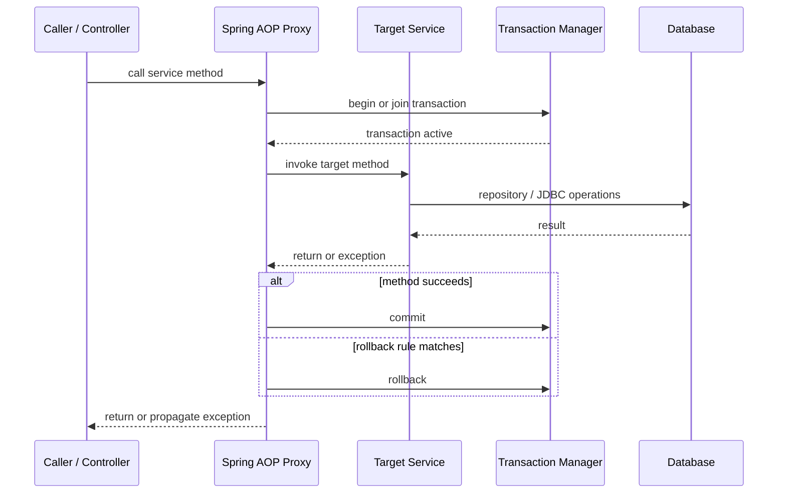
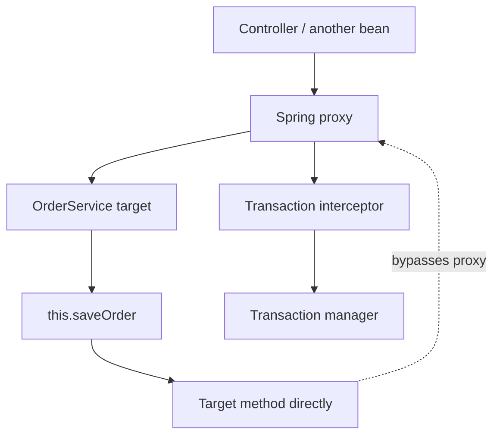
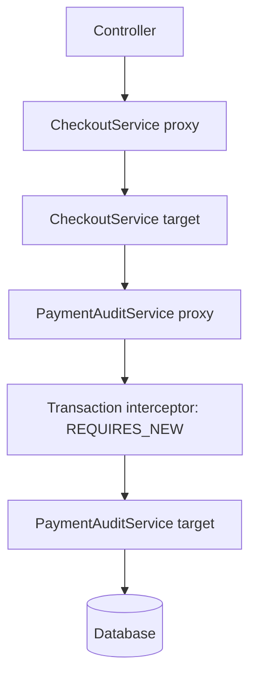

# Proxy, self-invocation và nguyên nhân @Transactional không có hiệu lực

Trong ứng dụng **Spring Data Relational JDBC**, annotation **@Transactional** thường được dùng ở tầng service để gom nhiều thao tác repository/JDBC vào một transaction. Tuy nhiên, chỉ đặt annotation lên method không bảo đảm transaction sẽ được mở. Với cấu hình transaction mặc định của Spring, lời gọi phải đi qua **Spring AOP proxy** để transaction interceptor có cơ hội chạy.

Một lỗi thường gặp là **self-invocation**: một method trong bean gọi method khác cũng nằm trong chính bean đó bằng cú pháp **this.someMethod()**. Lời gọi nội bộ này đi thẳng tới object đích và bỏ qua proxy. Vì vậy, **@Transactional** trên method được gọi nội bộ không được áp dụng như một lần gọi từ bên ngoài.

Ví dụ, method **checkout()** đang chạy trong transaction gọi **this.writeAudit()**, trong khi **writeAudit()** được đánh dấu **Propagation.REQUIRES_NEW**. Nếu lời gọi không đi qua proxy, Spring không tạo transaction độc lập mới. Method đó chạy trong transaction hiện có và các thuộc tính như propagation, isolation, timeout hoặc read-only trên method nội bộ không được áp dụng.

Bài học giải thích cách transaction proxy hoạt động, vì sao self-invocation bỏ qua proxy, những trường hợp khác khiến **@Transactional** không có hiệu lực, và cách tổ chức code để ranh giới transaction rõ ràng trong ứng dụng Spring Data JDBC.

## 1. @Transactional hoạt động qua Spring proxy

Trong chế độ proxy mặc định, Spring tạo một proxy bao quanh Spring bean có phương thức transaction. Proxy nhận lời gọi từ bean khác, kiểm tra metadata **@Transactional**, nhờ transaction manager bắt đầu hoặc tham gia transaction, rồi mới gọi method trên object đích.

Luồng gọi khái quát:



Proxy là điểm chặn nơi transaction interceptor được thực thi. Khi method gọi một method khác trực tiếp trên cùng object, lời gọi đó không quay lại proxy.

Điều này giải thích khác biệt giữa hai cách gọi:

```java
// Caller gọi Spring bean đã được inject:
orderService.checkout(orderId);

// Bên trong target object:
this.writeAudit(orderId);
```

Lời gọi đầu tiên có thể đi qua proxy. Lời gọi thứ hai là lời gọi Java trực tiếp trên target object.

### 1.1. Spring Data JDBC và transaction manager

Spring Data JDBC thực hiện các câu SQL qua JDBC. Khi service được bao quanh bởi transaction manager phù hợp, repository và JdbcTemplate có thể tham gia cùng transaction nếu chúng sử dụng cùng DataSource và cùng transaction infrastructure.

Ví dụ:

```java
@Service
public class OrderService {

    private final PurchaseOrderRepository orders;
    private final OrderLineRepository lines;

    public OrderService(
            PurchaseOrderRepository orders,
            OrderLineRepository lines
    ) {
        this.orders = orders;
        this.lines = lines;
    }

    @Transactional
    public void confirmOrder(long orderId) {
        PurchaseOrder order = orders.findById(orderId)
                .orElseThrow();

        order.confirm();
        orders.save(order);

        lines.markReserved(orderId);
    }
}
```

Nếu thao tác cập nhật order thành công nhưng cập nhật lines thất bại và exception làm transaction rollback, các thay đổi database trong cùng transaction được rollback cùng nhau.

**@Transactional** điều khiển transaction ở application boundary; nó không tự biến nhiều DataSource độc lập thành một transaction phân tán. Nếu repository và JDBC template dùng các DataSource/transaction manager khác nhau, cần cấu hình transaction phù hợp cho từng nguồn dữ liệu.

## 2. Self-invocation là gì?

Self-invocation xảy ra khi một method của bean gọi một method khác trên chính instance đó. Ví dụ:

```java
@Service
public class OrderService {

    public void checkout(long orderId) {
        this.saveOrder(orderId);
    }

    @Transactional
    public void saveOrder(long orderId) {
        // Ghi database
    }
}
```

Nếu controller gọi **orderService.checkout(...)** qua proxy, proxy chỉ thấy lời gọi **checkout()**. Vì **checkout()** không có transaction metadata nên transaction interceptor không mở transaction cho method đó.

Sau đó **checkout()** gọi **this.saveOrder(...)**. Đây là lời gọi trực tiếp trên target object, không quay lại proxy. **@Transactional** trên **saveOrder()** vì vậy không được xử lý.

Hệ quả: thao tác trong **saveOrder()** có thể chạy mà không có transaction do annotation này yêu cầu.

### 2.1. Sơ đồ self-invocation



Proxy không thể tự chặn mọi lời gọi Java xảy ra bên trong target. Nó chỉ chặn những lời gọi đi qua proxy.

### 2.2. this không phải proxy

Trong một class được Spring quản lý, object target và proxy là hai vai trò khác nhau:

- Proxy là object được caller nhìn thấy khi inject bean.
- Target là object thực thi business method.
- **this** bên trong method trỏ tới target object đang chạy.
- Gọi **this.otherMethod()** không tự chuyển lời gọi sang proxy.

Dù proxy được tạo bằng JDK dynamic proxy hay CGLIB, nguyên tắc self-invocation trong proxy mode vẫn như vậy.

## 3. Trường hợp nào self-invocation làm transaction sai?

### 3.1. Method nội bộ là nơi duy nhất có @Transactional

Ví dụ:

```java
@Service
public class InventoryService {

    public void reserve(long productId, int quantity) {
        updateStock(productId, quantity);
        writeReservation(productId, quantity);
    }

    @Transactional
    public void updateStock(long productId, int quantity) {
        // UPDATE stock
    }

    @Transactional
    public void writeReservation(long productId, int quantity) {
        // INSERT reservation
    }
}
```

Nếu caller gọi **reserve()** và method này không có transaction, hai method được gọi nội bộ sẽ không tự mở transaction. Một thao tác có thể commit trong khi thao tác còn lại thất bại.

Đây là tình huống dễ tạo dữ liệu lệch: stock đã giảm nhưng reservation chưa được ghi.

### 3.2. Outer method có transaction, inner method yêu cầu REQUIRES_NEW

Ví dụ:

```java
@Service
public class OrderService {

    @Transactional
    public void checkout(long orderId) {
        updateOrder(orderId);
        this.writeAuditInNewTransaction(orderId);
    }

    @Transactional(propagation = Propagation.REQUIRES_NEW)
    public void writeAuditInNewTransaction(long orderId) {
        // Ghi audit
    }
}
```

Khi caller gọi **checkout()** qua proxy, transaction ngoài được mở. Nhưng **this.writeAuditInNewTransaction(...)** bỏ qua proxy nên Spring không nhìn thấy yêu cầu **REQUIRES_NEW**.

Kết quả, audit insert chạy trong transaction ngoài. Nếu **checkout()** sau đó ném exception và transaction ngoài rollback, audit cũng rollback. Điều này khác với ý định ban đầu là audit được commit trong một transaction độc lập.

### 3.3. Inner method yêu cầu NOT_SUPPORTED hoặc MANDATORY

Self-invocation cũng bỏ qua các thuộc tính propagation khác:

- **NOT_SUPPORTED**: lẽ ra tạm ngưng transaction hiện tại, nhưng lời gọi nội bộ không yêu cầu proxy thực hiện việc đó.
- **MANDATORY**: lẽ ra phải có transaction hiện tại, nhưng lời gọi nội bộ không được interceptor kiểm tra.
- **NEVER**: lẽ ra từ chối nếu đang có transaction, nhưng quy tắc đó không được áp dụng qua lời gọi nội bộ.
- **NESTED**: lẽ ra sử dụng nested transaction/savepoint nếu transaction manager hỗ trợ, nhưng cấu hình trên method nội bộ bị bỏ qua.

Tương tự, các thuộc tính **readOnly**, **timeout**, **isolation**, **rollbackFor** hoặc **noRollbackFor** của method nội bộ không tạo một ranh giới mới khi proxy không được gọi.

### 3.4. Outer method đã có transaction

Cần hiểu một chi tiết: nếu outer method đã được gọi qua proxy và đang có transaction, inner method được self-invoke vẫn chạy bên trong transaction đang có. Các câu SQL của nó vẫn có thể tham gia transaction đó vì transaction context đã được mở ở outer boundary.

Điều bị bỏ qua là **cấu hình transaction riêng của inner method**.

Ví dụ inner method có **Propagation.REQUIRED** thì trên thực tế nó vẫn chạy trong transaction ngoài, nhưng không phải vì annotation trên inner method đã được interceptor xử lý. Nếu inner method yêu cầu **REQUIRES_NEW**, nó vẫn không được tách transaction.

## 4. Ví dụ lỗi và kết quả thực tế

Giả sử service sau được dùng để thanh toán đơn hàng:

```java
@Service
public class CheckoutService {

    private final PurchaseOrderRepository orders;
    private final PaymentAuditRepository audits;

    public CheckoutService(
            PurchaseOrderRepository orders,
            PaymentAuditRepository audits
    ) {
        this.orders = orders;
        this.audits = audits;
    }

    @Transactional
    public void checkout(long orderId) {
        PurchaseOrder order = orders.findById(orderId)
                .orElseThrow();

        order.markAsPaid();
        orders.save(order);

        this.writeAudit(orderId);

        throw new IllegalStateException("Simulated failure");
    }

    @Transactional(propagation = Propagation.REQUIRES_NEW)
    public void writeAudit(long orderId) {
        audits.insertPaidEvent(orderId);
    }
}
```

Kỳ vọng của người viết có thể là:

1. Cập nhật order trong transaction ngoài.
2. Ghi audit trong transaction mới.
3. Nếu checkout thất bại, rollback order.
4. Audit vẫn tồn tại vì transaction mới đã commit.

Nhưng **this.writeAudit(...)** không đi qua proxy. Audit insert tham gia transaction ngoài. Exception sau đó làm rollback cả order và audit.

Bảng kết quả:

| Thao tác | Kỳ vọng khi REQUIRES_NEW được áp dụng | Thực tế khi self-invocation |
|---|---|---|
| Update order | Transaction ngoài | Transaction ngoài |
| Insert audit | Transaction mới độc lập | Transaction ngoài |
| Ném exception sau audit | Rollback transaction ngoài | Rollback transaction ngoài |
| Order sau cùng | Không có thay đổi | Không có thay đổi |
| Audit sau cùng | Vẫn tồn tại | Bị rollback |

Không phải **REQUIRES_NEW** bị lỗi. Transaction interceptor đơn giản là không nhận được lời gọi tới method có cấu hình đó.

## 5. Cách sửa tốt nhất: tách transaction boundary thành bean riêng

Cách rõ ràng nhất là chuyển method cần transaction riêng sang một Spring bean khác. Caller inject bean đó và gọi qua proxy của bean đích.

Ví dụ:

```java
@Service
public class PaymentAuditService {

    private final PaymentAuditRepository audits;

    public PaymentAuditService(PaymentAuditRepository audits) {
        this.audits = audits;
    }

    @Transactional(propagation = Propagation.REQUIRES_NEW)
    public void writePaidEvent(long orderId) {
        audits.insertPaidEvent(orderId);
    }
}
```

Service checkout:

```java
@Service
public class CheckoutService {

    private final PurchaseOrderRepository orders;
    private final PaymentAuditService paymentAuditService;

    public CheckoutService(
            PurchaseOrderRepository orders,
            PaymentAuditService paymentAuditService
    ) {
        this.orders = orders;
        this.paymentAuditService = paymentAuditService;
    }

    @Transactional
    public void checkout(long orderId) {
        PurchaseOrder order = orders.findById(orderId)
                .orElseThrow();

        order.markAsPaid();
        orders.save(order);

        paymentAuditService.writePaidEvent(orderId);

        throw new IllegalStateException("Simulated failure");
    }
}
```

Luồng gọi mới:



**paymentAuditService** là bean khác được inject từ Spring container. Lời gọi đi qua proxy của bean đó, nên **REQUIRES_NEW** được áp dụng: transaction ngoài bị suspend, transaction audit mới được mở và commit khi method audit thành công. Sau đó transaction ngoài tiếp tục; nếu checkout thất bại, nó rollback độc lập với transaction audit đã commit.

### 5.1. Tách bean theo trách nhiệm, không chỉ để né proxy

Không nên tạo một class mới chỉ để di chuyển một method tùy tiện. Hãy tách khi method đó có trách nhiệm rõ ràng và transaction boundary có ý nghĩa nghiệp vụ/kỹ thuật riêng.

Ví dụ hợp lý:

- **OrderService**: điều phối thay đổi đơn hàng.
- **PaymentAuditService**: ghi audit cần transaction độc lập.
- **InventoryReservationService**: quản lý việc giữ tồn kho.
- **NotificationOutboxService**: ghi outbox row trong transaction phù hợp.

Ranh giới bean làm cho transaction boundary hiển thị qua dependency injection và dễ kiểm thử.

## 6. Cách sửa khác: gọi qua proxy một cách có chủ đích

Có thể gọi method thông qua proxy thay vì **this**, nhưng cách này làm code phụ thuộc vào proxy infrastructure.

### 6.1. Inject chính bean vào chính nó

Ví dụ dùng self injection:

```java
@Service
public class OrderService {

    private final OrderService self;

    public OrderService(@Lazy OrderService self) {
        this.self = self;
    }

    public void checkout(long orderId) {
        self.writeAuditInNewTransaction(orderId);
    }

    @Transactional(propagation = Propagation.REQUIRES_NEW)
    public void writeAuditInNewTransaction(long orderId) {
        // Ghi audit
    }
}
```

Nếu **self** là proxy do Spring inject, lời gọi **self.writeAuditInNewTransaction(...)** đi qua proxy.

Tuy nhiên, self injection có một số nhược điểm:

- Tạo dependency vòng trong cùng bean.
- Làm ranh giới transaction khó nhận ra khi đọc code.
- Có thể phụ thuộc vào cấu hình proxy và injection.
- Dễ gây nhầm lẫn khi refactor hoặc viết test unit thuần.

Vì vậy, tách transaction collaborator thành bean riêng thường dễ bảo trì hơn.

### 6.2. AopContext.currentProxy()

Một lựa chọn khác là lấy proxy hiện tại:

```java
@EnableAspectJAutoProxy(exposeProxy = true)
@Configuration
class AopConfiguration {
}
```

Sau đó:

```java
public void checkout(long orderId) {
    ((OrderService) AopContext.currentProxy())
            .writeAuditInNewTransaction(orderId);
}
```

Cách này cần expose proxy và phụ thuộc vào Spring AOP context. Nó làm code gắn chặt với AOP, vì vậy chỉ nên dùng khi có lý do cụ thể và đã chấp nhận coupling này.

Không gọi **AopContext.currentProxy()** trong một object không chạy dưới proxy hoặc khi proxy chưa được expose; khi đó có thể phát sinh lỗi runtime.

## 7. Dùng TransactionTemplate khi cần ranh giới lập trình

Nếu transaction boundary được quyết định động hoặc không phù hợp với annotation, **TransactionTemplate** cho phép điều khiển transaction một cách tường minh.

Ví dụ:

```java
@Service
public class OrderCommandService {

    private final TransactionTemplate transactionTemplate;
    private final PurchaseOrderRepository orders;

    public OrderCommandService(
            PlatformTransactionManager transactionManager,
            PurchaseOrderRepository orders
    ) {
        this.transactionTemplate =
                new TransactionTemplate(transactionManager);
        this.orders = orders;
    }

    public void confirm(long orderId) {
        transactionTemplate.executeWithoutResult(status -> {
            PurchaseOrder order = orders.findById(orderId)
                    .orElseThrow();

            order.confirm();
            orders.save(order);
        });
    }
}
```

Để tạo transaction độc lập **REQUIRES_NEW**, cấu hình propagation trên template riêng:

```java
TransactionTemplate requiresNew =
        new TransactionTemplate(transactionManager);

requiresNew.setPropagationBehavior(
        TransactionDefinition.PROPAGATION_REQUIRES_NEW
);

requiresNew.executeWithoutResult(status -> {
    auditRepository.insertPaidEvent(orderId);
});
```

**TransactionTemplate** không phụ thuộc vào self-invocation proxy cho đoạn code nằm bên trong callback. Nó hữu ích khi cần transaction boundary lập trình hoặc khi muốn giữ logic trong cùng class mà không dùng self proxy.

Tuy nhiên, hãy tránh tạo quá nhiều template với propagation khác nhau trong cùng service nếu một bean collaborator có thể diễn đạt ranh giới rõ hơn.

## 8. AspectJ mode: giải pháp khi cần intercept self-invocation

Spring hỗ trợ transaction management ở chế độ AspectJ. Khác proxy mode, AspectJ weaving áp dụng advice trực tiếp vào bytecode của class. Vì vậy, self-invocation có thể được intercept.

Cấu hình khái quát:

```java
@Configuration
@EnableTransactionManagement(mode = AdviceMode.ASPECTJ)
public class TransactionConfiguration {
}
```

Cách này cần AspectJ transaction aspect và thiết lập compile-time hoặc load-time weaving phù hợp với ứng dụng, thường liên quan dependency **spring-aspects** và cấu hình weaving.

So sánh:

| Tiêu chí | Proxy mode | AspectJ mode |
|---|---|---|
| Cơ chế | Proxy bao quanh bean | Weaving vào bytecode |
| Self-invocation | Không được intercept | Có thể được intercept |
| Cấu hình | Thường đơn giản, là mặc định | Phức tạp hơn |
| Yêu cầu weaving | Không | Có |
| Phù hợp | Hầu hết service transaction thông thường | Trường hợp cần advice cả lời gọi nội bộ |

Không chuyển sang AspectJ chỉ để sửa một method self-invocation nếu có thể tách bean hoặc dùng **TransactionTemplate**. AspectJ có thể phù hợp với kiến trúc đã dùng weaving có chủ đích.

## 9. Proxy type: JDK dynamic proxy và CGLIB

Spring AOP có thể tạo proxy theo hai cách phổ biến.

### 9.1. JDK dynamic proxy

JDK proxy tạo object triển khai các interface của bean. Caller cần truy cập bean qua interface mà proxy cung cấp.

Ví dụ:

```java
public interface OrderOperations {
    void checkout(long orderId);
}
```

```java
@Service
public class OrderService implements OrderOperations {

    @Override
    @Transactional
    public void checkout(long orderId) {
        // ...
    }
}
```

Khi proxy dùng JDK interface proxy, method được gọi cần được khai báo trên interface proxy. Một public method chỉ tồn tại trên implementation class nhưng không có trên interface không phải entry point của JDK proxy.

### 9.2. CGLIB class-based proxy

CGLIB tạo subclass của class được proxy. Cách này cho phép proxy bean theo concrete class mà không cần interface.

Nhưng subclass proxy có giới hạn của Java:

- Không thể subclass một class **final**.
- Không thể override một method **final**.
- Không thể override một method **private**.
- Method **static** không được override theo cách proxy cần.

Vì vậy, method final hoặc private không thể được intercept bằng class-based proxy thông thường.

### 9.3. Quy tắc visibility theo loại proxy

Trong Spring Framework hiện đại, class-based proxy có thể hỗ trợ method public, protected và package-visible theo transaction attribute source mặc định. Với interface-based proxy, method transactional cần là public và được khai báo trên interface.

Để code ít phụ thuộc proxy strategy và dễ hiểu, quy ước an toàn là:

- Đặt **@Transactional** trên method public của service bean.
- Gọi method đó từ bean khác qua dependency injection.
- Tránh private, final hoặc self-invocation cho method cần transaction boundary riêng.
- Đặt annotation trên concrete service method để metadata rõ ràng.

Ví dụ không nên dựa vào:

```java
@Service
public class OrderService {

    @Transactional
    private void persistOrder() {
        // Private method không thể được proxy subclass override.
    }
}
```

Hãy để public application method là transaction boundary, rồi gọi các private helper thông thường bên trong boundary đó.

## 10. Những nguyên nhân khác khiến @Transactional không hoạt động

Self-invocation là nguyên nhân phổ biến, nhưng không phải nguyên nhân duy nhất. Khi transaction không được mở hoặc không rollback như mong đợi, kiểm tra thêm các điểm sau.

### 10.1. Bean không do Spring quản lý

Nếu tự tạo object bằng **new**, object đó không được Spring AOP proxy bao quanh:

```java
OrderService service = new OrderService(...);
service.checkout(orderId);
```

Annotation vẫn nằm trên class, nhưng Spring không có cơ hội tạo proxy cho instance tự khởi tạo này.

Hãy inject bean từ Spring container:

```java
@Service
public class CheckoutController {

    private final OrderService orders;

    public CheckoutController(OrderService orders) {
        this.orders = orders;
    }

    public void checkout(long orderId) {
        orders.checkout(orderId);
    }
}
```

### 10.2. Transaction management chưa được bật

Trong Spring Boot, transaction infrastructure thường được auto-configure khi dependency và transaction manager phù hợp có mặt. Trong ứng dụng Spring cấu hình thủ công, cần bật transaction management:

```java
@Configuration
@EnableTransactionManagement
public class TransactionConfiguration {
}
```

Cần có **PlatformTransactionManager** tương ứng với database. Với JDBC, có thể dùng **JdbcTransactionManager** hoặc **DataSourceTransactionManager** tùy phiên bản và cấu hình.

Nếu không có transaction manager phù hợp, ứng dụng có thể báo lỗi khi gọi method transactional hoặc không có transaction infrastructure như mong muốn.

### 10.3. Dùng sai transaction manager

Ứng dụng có nhiều database có thể có nhiều transaction manager. Nếu service dùng manager A nhưng repository đang truy cập DataSource B, transaction của A không tự bao quanh thao tác trên B.

Có thể chỉ định manager rõ ràng:

```java
@Transactional(transactionManager = "ordersTransactionManager")
public void confirmOrder(long orderId) {
    // Repository phải dùng cùng DataSource được manager này quản lý.
}
```

Tên bean manager cần khớp cấu hình thực tế. Một local JDBC transaction manager không tự điều phối transaction của nhiều database độc lập.

### 10.4. Method không đi qua proxy

Các trường hợp điển hình:

- Method được gọi bằng **this.method()**.
- Caller dùng object được tạo bằng **new**.
- Bean được gọi qua reference tới target không phải proxy.
- Method không được expose bởi interface trong JDK proxy.
- Method private hoặc final không thể được class-based proxy intercept.

Hãy kiểm tra bean mà caller inject thực sự là proxy, không chỉ nhìn annotation trong source.

### 10.5. Exception không kích hoạt rollback theo mặc định

Mặc định phổ biến của Spring transaction là rollback khi method ném **RuntimeException** hoặc **Error**. Checked exception thường không kích hoạt rollback nếu không cấu hình thêm.

Ví dụ:

```java
@Transactional
public void importOrders() throws IOException {
    repository.save(...);
    throw new IOException("File is invalid");
}
```

Nếu muốn rollback cả checked exception:

```java
@Transactional(rollbackFor = IOException.class)
public void importOrders() throws IOException {
    repository.save(...);
    throw new IOException("File is invalid");
}
```

Có thể cấu hình **noRollbackFor** cho trường hợp cần commit dù có exception cụ thể. Hãy xác định rollback rule theo exception thực tế và cấu hình transaction của dự án.

### 10.6. Exception bị bắt và không được đánh dấu rollback

Ví dụ:

```java
@Transactional
public void process() {
    try {
        repository.save(...);
        callExternalStep();
    } catch (RuntimeException ex) {
        log.warn("Processing failed", ex);
        // Không ném lại và không đánh dấu rollback-only.
    }
}
```

Nếu exception bị bắt và method kết thúc bình thường, transaction interceptor có thể commit. Nếu muốn rollback, hãy ném lại exception hoặc đánh dấu transaction rollback-only qua cơ chế phù hợp.

Một inner transaction tham gia transaction ngoài cũng có thể đánh dấu rollback-only. Khi outer method cố commit, Spring có thể ném **UnexpectedRollbackException**.

### 10.7. @Transactional trên method không phù hợp

Method private, final, static hoặc method không thể được proxy gọi có thể khiến annotation không được áp dụng như kỳ vọng. Với JDK proxy, method cần có trên interface. Với class-based proxy, method không được private/final nếu cần override để intercept.

Hãy dùng public service methods làm transaction boundary, nhất là khi dự án có thể thay đổi proxy strategy.

### 10.8. Transaction bị vượt qua thread boundary

Transaction JDBC trong Spring thường gắn với thread hiện tại. Nếu method transactional khởi chạy công việc qua **@Async**, executor hoặc thread mới, transaction context không tự truyền sang thread đó.

Ví dụ:

```java
@Transactional
public void createOrderAsync() {
    repository.save(...);

    executor.execute(() -> {
        // Không mặc định tham gia transaction của thread gọi.
        repository.save(...);
    });
}
```

Nếu công việc nền cần transaction, hãy gọi một Spring bean khác trong worker thread và đặt transaction boundary ở method chạy trên thread đó.

## 11. Transaction propagation và self-invocation

Propagation chỉ được xử lý khi transaction interceptor được gọi. Bảng dưới đây mô tả những gì có thể bị bỏ qua khi method được self-invoke:

| Propagation trên inner method | Hành vi nếu proxy intercept | Khi self-invocation |
|---|---|---|
| **REQUIRED** | Tham gia transaction hiện có hoặc tạo mới | Không có boundary riêng; dùng transaction hiện có nếu outer đã mở |
| **REQUIRES_NEW** | Suspend transaction ngoài và mở transaction mới | Không suspend, không mở transaction mới |
| **SUPPORTS** | Tham gia nếu có, nếu không chạy không transaction | Annotation inner không được xử lý |
| **NOT_SUPPORTED** | Suspend transaction hiện tại | Không suspend |
| **MANDATORY** | Báo lỗi nếu không có transaction | Không thực hiện kiểm tra của inner method |
| **NEVER** | Báo lỗi nếu đang có transaction | Không thực hiện kiểm tra của inner method |
| **NESTED** | Dùng nested transaction/savepoint nếu manager hỗ trợ | Không tạo savepoint theo annotation inner |

Đặc biệt với **REQUIRES_NEW**, đừng suy luận từ việc inner method chạy khi outer transaction đang active rằng nó đã tạo transaction mới. Nó có thể chỉ đang dùng transaction của outer method.

## 12. Transaction boundary nên đặt ở đâu trong ứng dụng Spring Data JDBC?

Thông thường, transaction boundary nên nằm ở application service đại diện cho một use case nghiệp vụ.

Ví dụ:

```java
@Service
public class OrderApplicationService {

    private final PurchaseOrderRepository orders;
    private final InventoryService inventory;

    public OrderApplicationService(
            PurchaseOrderRepository orders,
            InventoryService inventory
    ) {
        this.orders = orders;
        this.inventory = inventory;
    }

    @Transactional
    public void confirm(long orderId) {
        PurchaseOrder order = orders.findById(orderId)
                .orElseThrow();

        order.confirm();
        inventory.reserve(order);
        orders.save(order);
    }
}
```

**confirm()** là entry point từ bean khác. Proxy mở transaction trước khi target method chạy. Repository và các JDBC operation cùng DataSource có thể tham gia transaction đó.

Nếu **InventoryService.reserve(...)** cũng được đánh dấu **@Transactional(REQUIRED)**, lời gọi qua bean inventory sẽ đi qua proxy và tham gia transaction hiện có.

Nếu inventory cần transaction độc lập, đặt **REQUIRES_NEW** trên method public của bean khác và gọi qua injected proxy.

### 12.1. Không đặt transaction boundary quá sâu trong repository helper

Một repository method có thể được gọi từ nhiều use case. Nếu transaction boundary nằm rải rác trong các helper nội bộ, khó biết nhiều thao tác có thật sự nằm trong cùng transaction hay không.

Application service giúp thể hiện rõ đơn vị nghiệp vụ:

- Đọc aggregate.
- Kiểm tra domain invariant.
- Gọi các collaborator.
- Lưu thay đổi.
- Commit/rollback ở một boundary xác định.

### 12.2. Transaction không làm side effect bên ngoài trở nên atomic

Một transaction JDBC có thể rollback SQL trên cùng database. Nó không tự rollback:

- Email đã gửi.
- HTTP request tới dịch vụ khác.
- Message đã publish lên broker.
- File đã ghi ra filesystem.
- Công việc đã chạy trên executor thread khác.

Nếu cần đồng bộ thay đổi database với message, cân nhắc transactional outbox. Nếu gọi service bên ngoài trong transaction, cần xem xét timeout, retry và khả năng idempotent.

## 13. Cách chẩn đoán transaction proxy

Khi **@Transactional** có vẻ không hoạt động, kiểm tra từ ngoài vào trong.

### 13.1. Xác nhận bean có phải proxy

Có thể kiểm tra trong test hoặc lúc debug:

```java
import org.springframework.aop.support.AopUtils;

boolean proxy = AopUtils.isAopProxy(orderService);
boolean classProxy = AopUtils.isCglibProxy(orderService);
boolean jdkProxy = AopUtils.isJdkDynamicProxy(orderService);
```

Nếu bean không phải proxy, kiểm tra bean có được Spring quản lý không, transaction management có được bật không và transaction metadata có được nhận diện không.

Đây là công cụ chẩn đoán; không nên dùng logic production để rẽ nhánh nghiệp vụ dựa trên việc bean có proxy hay không.

### 13.2. Kiểm tra transaction đang active

Có thể dùng **TransactionSynchronizationManager** trong log/test:

```java
boolean active =
        TransactionSynchronizationManager.isActualTransactionActive();

boolean synchronizationActive =
        TransactionSynchronizationManager.isSynchronizationActive();
```

Hai trạng thái này khác nhau:

- **isActualTransactionActive()** cho biết có transaction thực tế gắn với thread.
- **isSynchronizationActive()** cho biết transaction synchronization đang hoạt động.

Một transaction có thể không được phản ánh chỉ bằng việc kiểm tra annotation trong source. Hãy kiểm tra ngay tại điểm thực thi repository/JDBC.

### 13.3. Bật log transaction khi debug

Có thể bật log trong môi trường local/test:

```properties
logging.level.org.springframework.transaction=TRACE
logging.level.org.springframework.jdbc.datasource=DEBUG
```

Tên logger và mức log hữu ích có thể thay đổi theo phiên bản. Log có thể cho thấy transaction bắt đầu, tham gia, suspend, commit hoặc rollback.

Không bật log quá chi tiết trên production nếu nó làm lộ SQL parameter hoặc dữ liệu nhạy cảm.

### 13.4. Kiểm tra thứ tự lời gọi

Đặt breakpoint tại:

1. Method caller.
2. Proxy/interceptor nếu cần debug sâu.
3. Target method.
4. Repository/JdbcTemplate call.
5. Transaction manager begin/commit/rollback.

Nếu caller vào target method trực tiếp mà không qua proxy, hãy xem lại cách bean được gọi. Nếu transaction active nhưng propagation không đúng, rất có thể inner method đã bị self-invoke.

## 14. Kiểm thử self-invocation và REQUIRES_NEW

Một integration test có thể xác nhận khác biệt giữa lời gọi qua proxy và self-invocation.

Giả sử **CheckoutService.checkout()** mở transaction ngoài, ghi order, gọi audit writer rồi ném exception. Audit writer được đánh dấu **REQUIRES_NEW**.

**Trường hợp đúng — audit writer là bean riêng:**

1. Gọi checkout qua proxy.
2. Transaction ngoài bắt đầu.
3. Audit service được gọi qua proxy riêng.
4. Transaction ngoài được suspend.
5. Audit transaction commit.
6. Exception làm transaction ngoài rollback.
7. Kiểm tra order chưa được cập nhật, audit row vẫn tồn tại.

**Trường hợp self-invocation:**

1. Gọi checkout qua proxy.
2. Transaction ngoài bắt đầu.
3. **this.writeAudit()** gọi trực tiếp target method.
4. Không có transaction mới.
5. Exception làm transaction ngoài rollback.
6. Kiểm tra order và audit row đều không tồn tại thay đổi.

Test nên chạy trên database integration test với cùng transaction manager/DataSource như production. Test này xác nhận transaction boundary thật, không chỉ kiểm tra annotation bằng reflection.

### 14.1. Tránh test bị bao trong transaction ngoài

Một số test framework có thể tự chạy mỗi test method trong transaction và rollback sau test. Điều này làm khó quan sát transaction commit độc lập.

Khi kiểm tra **REQUIRES_NEW**, hãy chú ý transaction của chính test. Có thể dùng test không transactional, hoặc chủ động kiểm soát transaction để quan sát dữ liệu sau khi service trả về.

Nếu test method đang mở transaction, **REQUIRES_NEW** có thể commit riêng nhưng transaction test ngoài vẫn đang active. Truy vấn kiểm tra trong cùng transaction ngoài có thể không nhìn thấy dữ liệu theo cách bạn mong đợi tùy isolation/database. Thiết kế test để quan sát từ transaction khác hoặc sau khi transaction test kết thúc.

## 15. Các lỗi thường gặp và hướng xử lý

| Triệu chứng | Nguyên nhân thường gặp | Hướng xử lý |
|---|---|---|
| Method có @Transactional nhưng không thấy transaction | Self-invocation hoặc bean không qua Spring proxy | Gọi qua bean proxy từ bean khác |
| REQUIRES_NEW không commit độc lập | Inner method được gọi bằng this | Tách inner method sang bean riêng hoặc dùng TransactionTemplate |
| Inner method vẫn rollback cùng outer | Propagation của inner method không được interceptor áp dụng | Xác nhận lời gọi đi qua proxy |
| private @Transactional không hoạt động | Proxy không intercept private method | Đặt boundary trên public service method |
| final @Transactional không hoạt động với CGLIB | CGLIB không override final method | Bỏ final hoặc dùng cấu trúc proxy phù hợp |
| Bean tạo bằng new không có transaction | Không được Spring quản lý | Inject bean từ container |
| JDK proxy không gọi được method implementation | Method không nằm trên interface proxy | Đưa method vào interface hoặc dùng class-based proxy có chủ đích |
| Checked exception không rollback | Rollback mặc định chủ yếu áp dụng RuntimeException/Error | Khai báo rollbackFor hoặc cấu hình rollback rule |
| Exception bị catch nhưng dữ liệu vẫn commit | Method kết thúc bình thường và transaction không bị đánh dấu rollback-only | Ném lại exception hoặc đánh dấu rollback-only |
| Repository và JdbcTemplate không cùng transaction | Khác DataSource/transaction manager | Dùng cùng transaction manager và DataSource |
| @Async không tham gia transaction gọi | Transaction JDBC gắn với thread hiện tại | Đặt transaction boundary trong worker bean |
| Test không thấy REQUIRES_NEW commit | Test method đang mở transaction hoặc đọc trong transaction cũ | Kiểm soát transaction của test và xác minh từ transaction độc lập |

## 16. Nguyên tắc thiết kế dễ nhớ

- Trong proxy mode, **@Transactional** được xử lý khi lời gọi đi qua Spring AOP proxy.
- Self-invocation như **this.otherMethod()** bỏ qua proxy.
- Nếu outer method đã có transaction, inner self-invocation vẫn có thể chạy trong transaction đó, nhưng propagation và thuộc tính riêng của inner method bị bỏ qua.
- **REQUIRES_NEW** chỉ tạo transaction độc lập khi transaction interceptor thực sự nhận lời gọi.
- Đặt transaction boundary ở public application service method và gọi qua bean được inject.
- Khi cần transaction riêng, tách collaborator thành bean khác; dùng **TransactionTemplate** nếu cần boundary lập trình.
- AspectJ weaving có thể intercept self-invocation nhưng cần cấu hình phức tạp hơn.
- Kiểm tra proxy type, visibility, Spring bean lifecycle, transaction manager, DataSource và rollback rules khi transaction không hoạt động.
- Với Spring Data JDBC, repository và JdbcTemplate chỉ cùng transaction khi chúng tham gia cùng transaction infrastructure/DataSource.
- Transaction database không tự bao phủ email, HTTP, broker hoặc thread khác.

**@Transactional** là metadata cho transaction interceptor; nó không phải lệnh mở transaction được thực thi ở mọi lần method được gọi. Khi dùng proxy mode mặc định, hãy thiết kế lời gọi qua bean boundary để interceptor nhìn thấy method cần quản lý. Đặc biệt với **REQUIRES_NEW**, **NOT_SUPPORTED** hoặc các rollback rule riêng, hãy tránh self-invocation và kiểm thử transaction thật trên database.
