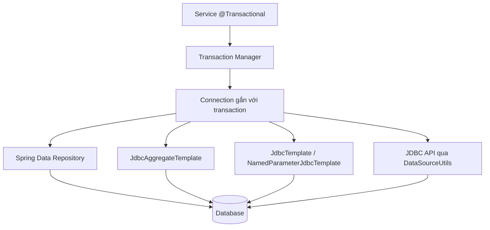

# Giao dịch khi trộn repository, template và JDBC trực tiếp

Trong ứng dụng **Spring Data Relational JDBC**, một use case có thể cần nhiều cách truy cập database: lưu aggregate bằng repository, thao tác aggregate khác bằng `JdbcAggregateTemplate` và chạy SQL riêng bằng `JdbcTemplate` hoặc JDBC API thuần. Các cách truy cập này có thể tham gia **cùng một transaction** nếu chúng dùng cùng DataSource và cùng transaction manager theo cơ chế quản lý tài nguyên của Spring.

Ví dụ, nghiệp vụ đặt hàng cần lưu đơn hàng, tạo reservation cho hàng tồn kho và ghi audit. Nếu một bước thất bại, ứng dụng thường muốn rollback tất cả thay đổi. Muốn đạt điều đó, hãy đặt ranh giới transaction ở tầng service, để repository và template tham gia transaction đó, và dùng cách lấy connection có nhận biết transaction khi viết JDBC trực tiếp.

Việc chỉ dùng chung database URL hoặc cùng database server chưa đủ để bảo đảm các thao tác thuộc cùng transaction.

## 1. Vì sao cần trộn nhiều cách truy cập dữ liệu?

Mỗi API có một vai trò riêng:

| Cách truy cập | Vai trò thường gặp |
|---|---|
| Spring Data repository | Lưu và tải aggregate, dùng CRUD hoặc query method |
| `JdbcAggregateTemplate` | Thao tác aggregate trực tiếp qua API persistence cấp aggregate |
| `JdbcTemplate` | Thực thi SQL tùy chỉnh, batch update và mapping kết quả |
| `NamedParameterJdbcTemplate` | Viết SQL với named parameters |
| JDBC API trực tiếp | Dùng `Connection`, `PreparedStatement` và `ResultSet` khi cần tính năng JDBC cụ thể |

Ví dụ use case đặt hàng:

1. `PurchaseOrderRepository` lưu aggregate đơn hàng.
2. `JdbcAggregateTemplate` lưu một aggregate reservation độc lập.
3. `NamedParameterJdbcTemplate` ghi một dòng audit vào bảng kỹ thuật.
4. Tất cả thay đổi cần được commit hoặc rollback cùng nhau.

Không cần ép mọi truy vấn vào một abstraction. Repository phù hợp với aggregate; JDBC template phù hợp với SQL tùy chỉnh. Điều cần thống nhất là transaction và DataSource mà chúng sử dụng.

## 2. Đặt transaction ở tầng service

Một transaction service-level bao trùm toàn bộ nghiệp vụ:

```java
@Service
public class OrderApplicationService {

    private final PurchaseOrderRepository orderRepository;
    private final JdbcAggregateTemplate aggregateTemplate;
    private final NamedParameterJdbcTemplate jdbc;

    public OrderApplicationService(
            PurchaseOrderRepository orderRepository,
            JdbcAggregateTemplate aggregateTemplate,
            NamedParameterJdbcTemplate jdbc) {
        this.orderRepository = orderRepository;
        this.aggregateTemplate = aggregateTemplate;
        this.jdbc = jdbc;
    }

    @Transactional
    public Long placeOrder(
            PurchaseOrder order,
            InventoryReservation reservation) {

        PurchaseOrder savedOrder = orderRepository.save(order);

        aggregateTemplate.insert(reservation);

        jdbc.update(
            """
            INSERT INTO order_audit (
                order_id, action, created_at
            )
            VALUES (
                :orderId, :action, CURRENT_TIMESTAMP
            )
            """,
            Map.of(
                "orderId", savedOrder.id(),
                "action", "ORDER_PLACED"
            )
        );

        return savedOrder.id();
    }
}
```

Giả sử ba thành phần được cấu hình dùng cùng DataSource và cùng transaction manager:

- Khi service bắt đầu, transaction manager mở transaction và gắn connection JDBC phù hợp với transaction hiện tại.
- Repository thực hiện lệnh lưu trong transaction đang có.
- Template tiếp tục dùng hạ tầng JDBC được cấu hình cho cùng DataSource.
- `NamedParameterJdbcTemplate` lấy connection theo cơ chế Spring và tham gia transaction đó.
- Khi method trả về bình thường, transaction commit.
- Nếu có lỗi làm rollback, các thay đổi database trong transaction được rollback cùng nhau.

`@Transactional` ở service thể hiện ranh giới nghiệp vụ. Đây là cách phù hợp khi một thao tác cần phối hợp nhiều repository, template hoặc câu SQL.

### 2.1. Vì sao không để từng lệnh tự quản lý transaction?

Các CRUD methods của `CrudRepository` có transaction mặc định: thao tác đọc dùng cấu hình read-only, các thao tác còn lại dùng `@Transactional` mặc định. Nếu không có transaction bên ngoài, mỗi lần gọi repository có thể tự mở và kết thúc transaction của riêng nó.

Ví dụ:

```java
public void placeOrder(PurchaseOrder order) {
    orderRepository.save(order);
    auditRepository.save(new AuditEntry(...));
}
```

Nếu mỗi lời gọi tự chạy trong transaction riêng, lần lưu đầu có thể đã commit trước khi lần lưu thứ hai thất bại. Kết quả là nghiệp vụ chỉ hoàn thành một phần.

Khi method service được đánh dấu `@Transactional`, các repository methods có propagation mặc định `REQUIRED` sẽ tham gia transaction bên ngoài thay vì tự commit độc lập.

### 2.2. Repository query methods cần được bao transaction

Các query methods tự khai báo không phải lúc nào cũng có transaction mặc định giống CRUD methods kế thừa. Hãy đặt `@Transactional(readOnly = true)` trên query method/interface hoặc gọi chúng bên trong transaction service khi phù hợp.

Spring Data JDBC có thể cần nhiều câu SQL để hoàn tất việc đọc aggregate. Nếu các câu lệnh đó không có transaction chung, chúng có thể dùng các connection khác nhau, làm tăng áp lực connection pool và trong một số tình huống góp phần gây deadlock.

## 3. Điều kiện để repository, template và JdbcTemplate dùng chung transaction

Để các thao tác tham gia cùng một transaction JDBC cục bộ, cần đáp ứng các điều kiện chính:

1. Cùng sử dụng DataSource mà transaction manager quản lý.
2. Các thao tác được gọi trong phạm vi transaction đang hoạt động.
3. JDBC code dùng cơ chế lấy connection có nhận biết transaction của Spring.
4. Không tự commit, rollback hoặc đóng connection đang được transaction manager quản lý.
5. Không chuyển thao tác sang thread khác rồi kỳ vọng transaction tự truyền theo.



Sơ đồ thể hiện các API cùng tham gia một transaction resource khi chúng được cấu hình đúng. Không nên hiểu rằng mỗi API nhất thiết giữ một object Connection trong field; Spring quản lý việc lấy, đồng bộ và giải phóng connection theo transaction context.

### 3.1. Cùng database URL chưa đủ

Hai bean DataSource có thể cùng trỏ đến một database/schema nhưng vẫn cấp các connection vật lý khác nhau. Nếu mỗi bean được quản lý bởi một transaction manager cục bộ riêng, transaction của bean thứ nhất không tự động bao gồm câu lệnh của bean thứ hai.

Cần kiểm tra cấu hình bean thực tế:

- Repository được cấu hình với DataSource nào?
- `JdbcAggregateTemplate` dùng DataSource nào?
- `JdbcTemplate` hoặc `NamedParameterJdbcTemplate` dùng DataSource nào?
- Transaction manager được `@Transactional` chọn là bean nào?

Điểm quan trọng là cùng transaction resource theo cấu hình Spring, không chỉ cùng hostname hoặc database name.

### 3.2. Cùng một transaction manager

Với một DataSource JDBC, Spring thường dùng `JdbcTransactionManager` hoặc `DataSourceTransactionManager`. Transaction manager này gắn một connection với thread đang thực thi transaction.

Các thành phần Spring JDBC như `JdbcTemplate` và `NamedParameterJdbcTemplate` tự sử dụng cơ chế này. Repository Spring Data JDBC cũng được tích hợp với DataSource và transaction infrastructure của ứng dụng.

Nếu có nhiều transaction manager, chỉ ghi `@Transactional` mà không chỉ định đúng manager có thể khiến service mở transaction cho một DataSource khác với DataSource mà repository đang dùng.

## 4. JdbcTemplate tự tham gia transaction của Spring

Khi dùng `JdbcTemplate` hoặc `NamedParameterJdbcTemplate` trong method đã có `@Transactional`, không cần tự lấy connection:

```java
@Transactional
public void updateOrderAndAudit(long orderId, String status) {
    orderRepository.updateStatus(orderId, status);

    jdbcTemplate.update(
        "UPDATE order_statistics SET update_count = update_count + 1"
    );
}
```

`JdbcTemplate` dùng cơ chế truy xuất connection của Spring. Nếu transaction hiện tại đã có connection được gắn với DataSource tương ứng, template dùng connection đó. Template cũng quản lý statement, result set và việc giải phóng tài nguyên.

Điều này giúp SQL tùy chỉnh tham gia transaction giống repository mà không phải viết mã quản lý connection thủ công.

### 4.1. NamedParameterJdbcTemplate

Named parameters chỉ thay đổi cách biểu diễn tham số SQL; chúng không tạo transaction riêng:

```java
@Transactional
public void recordAudit(long orderId, String action) {
    MapSqlParameterSource parameters = new MapSqlParameterSource()
        .addValue("orderId", orderId)
        .addValue("action", action);

    namedParameterJdbcTemplate.update(
        """
        INSERT INTO order_audit(order_id, action, created_at)
        VALUES (:orderId, :action, CURRENT_TIMESTAMP)
        """,
        parameters
    );
}
```

`NamedParameterJdbcTemplate` vẫn dùng DataSource được cấu hình và tham gia transaction hiện tại theo cơ chế của Spring JDBC.

### 4.2. Batch update cũng tham gia transaction

Một batch update thực hiện qua `JdbcTemplate` có thể tham gia cùng transaction với repository:

```java
@Transactional
public void updateInventory(List<InventoryChange> changes) {
    jdbcTemplate.batchUpdate(
        """
        UPDATE inventory
        SET available_quantity = available_quantity + ?
        WHERE product_id = ?
        """,
        changes,
        100,
        (ps, change) -> {
            ps.setInt(1, change.quantityDelta());
            ps.setLong(2, change.productId());
        }
    );
}
```

Nếu batch nằm trong transaction của service và có lỗi làm rollback, các thay đổi database thuộc transaction đó được xử lý theo chính sách rollback. Batch không tự tạo một transaction độc lập chỉ vì nó gửi nhiều câu lệnh.

## 5. Dùng JDBC API trực tiếp mà vẫn tham gia transaction

Đôi khi cần dùng trực tiếp `Connection` hoặc `PreparedStatement`. Không nên gọi `dataSource.getConnection()` theo cách thông thường bên trong transaction Spring nếu muốn dùng chung connection.

Có hai cách thường dùng:

- Dùng `JdbcTemplate.execute(ConnectionCallback)` để Spring cấp connection phù hợp.
- Dùng `DataSourceUtils.getConnection(dataSource)` và `DataSourceUtils.releaseConnection(connection, dataSource)` khi thực sự cần thao tác cấp thấp.

### 5.1. Cách ưu tiên: ConnectionCallback

```java
public int markAuditProcessed(long auditId) {
    return jdbcTemplate.execute(
        (ConnectionCallback<Integer>) connection -> {
            try (PreparedStatement statement =
                    connection.prepareStatement(
                        "UPDATE order_audit SET processed = ? WHERE id = ?"
                    )) {

                statement.setBoolean(1, true);
                statement.setLong(2, auditId);

                return statement.executeUpdate();
            }
        }
    );
}
```

`JdbcTemplate` cung cấp connection đã được quản lý đúng theo transaction context và dọn dẹp tài nguyên sau callback. `PreparedStatement` do đoạn code tạo được đóng bằng try-with-resources; không đóng connection do template quản lý.

Nếu method này được gọi bên trong service `@Transactional` và dùng cùng DataSource, câu UPDATE tham gia transaction của service.

### 5.2. Dùng DataSourceUtils ở mức thấp

Nếu API hiện có bắt buộc làm việc với DataSource trực tiếp:

```java
import java.sql.Connection;
import java.sql.PreparedStatement;
import java.sql.SQLException;

import javax.sql.DataSource;

import org.springframework.dao.DataAccessResourceFailureException;
import org.springframework.jdbc.datasource.DataSourceUtils;

public int updateAudit(
        DataSource dataSource,
        long auditId) {

    Connection connection =
        DataSourceUtils.getConnection(dataSource);

    try {
        try (PreparedStatement statement =
                connection.prepareStatement(
                    "UPDATE order_audit SET processed = ? WHERE id = ?"
                )) {

            statement.setBoolean(1, true);
            statement.setLong(2, auditId);

            return statement.executeUpdate();
        }
    } catch (SQLException exception) {
        throw new DataAccessResourceFailureException(
            "Could not update audit record",
            exception
        );
    } finally {
        DataSourceUtils.releaseConnection(connection, dataSource);
    }
}
```

`DataSourceUtils.getConnection` kiểm tra xem transaction hiện tại đã gắn connection với DataSource này chưa. Nếu có, nó trả về connection được đồng bộ với transaction. `releaseConnection` giải phóng theo đúng quy tắc sở hữu: nếu connection đang thuộc transaction, Spring không đóng connection đó giữa chừng.

Trong code mới, `JdbcTemplate` thường gọn và ít lỗi hơn. Dùng `DataSourceUtils` khi cần làm việc trực tiếp với JDBC API hoặc tích hợp một thư viện cấp thấp.

### 5.3. Không gọi commit/rollback trên connection được Spring quản lý

Khi connection thuộc transaction do Spring điều khiển, không tự gọi:

```java
connection.commit();
connection.rollback();
connection.setAutoCommit(true);
```

Transaction manager chịu trách nhiệm commit/rollback và quản lý trạng thái connection. Tự điều khiển các thao tác này có thể làm hỏng ranh giới transaction, khiến một phần thay đổi được commit ngoài dự kiến hoặc làm transaction manager gặp trạng thái không nhất quán.

## 6. Vì sao DataSource.getConnection() trực tiếp có thể phá vỡ transaction?

Đoạn code sau là một lỗi phổ biến:

```java
@Transactional
public void placeOrder(PurchaseOrder order) throws SQLException {
    orderRepository.save(order);

    try (Connection connection = dataSource.getConnection();
         PreparedStatement statement =
             connection.prepareStatement(
                 "INSERT INTO order_audit(order_id, action) VALUES (?, ?)"
             )) {

        statement.setLong(1, order.id());
        statement.setString(2, "ORDER_PLACED");
        statement.executeUpdate();
    }
}
```

`DataSource.getConnection()` lấy connection trực tiếp từ DataSource. Nó không tự tra cứu connection đã được transaction manager gắn với thread. Với connection pool, lời gọi có thể nhận một connection khác.

Hệ quả có thể xảy ra:

1. Repository lưu đơn hàng bằng connection thuộc transaction Spring.
2. JDBC trực tiếp ghi audit bằng connection khác.
3. Connection thứ hai có thể chạy với auto-commit.
4. Audit có thể commit ngay, dù transaction của service sau đó rollback.
5. Database chỉ còn audit record mà không có đơn hàng tương ứng.

Đây là lý do cần dùng `JdbcTemplate`, `DataSourceUtils` hoặc một `TransactionAwareDataSourceProxy` trong trường hợp tích hợp legacy đặc biệt.

### 6.1. Không tự đóng connection transaction-bound

Nếu lấy connection qua `DataSourceUtils`, hãy giải phóng bằng `DataSourceUtils.releaseConnection`. Gọi `connection.close()` trực tiếp có thể đóng/giải phóng connection đang được transaction manager sử dụng, làm các thao tác tiếp theo thất bại.

Với `JdbcTemplate`, không tự đóng connection được truyền vào callback. Chỉ đóng statement/result set do code của bạn tạo.

### 6.2. TransactionAwareDataSourceProxy cho API legacy

`TransactionAwareDataSourceProxy` bọc một DataSource để mã cũ chỉ biết giao diện `DataSource` vẫn có thể tham gia transaction Spring khi nó gọi `getConnection()`.

Đây là giải pháp tương thích khi không thể sửa thư viện hoặc mã legacy. Với code mới, ưu tiên `JdbcTemplate` hoặc `DataSourceUtils` vì chúng thể hiện rõ việc tham gia transaction và quản lý tài nguyên.

## 7. JdbcAggregateTemplate tham gia transaction như thế nào?

`JdbcAggregateTemplate` là API persistence aggregate của Spring Data JDBC. Template sử dụng hạ tầng JDBC/DataSource được cấu hình trong application context.

Khi service mở transaction trên cùng DataSource:

```java
@Transactional
public void reserveInventory(InventoryReservation reservation) {
    aggregateTemplate.insert(reservation);

    jdbcTemplate.update(
        """
        UPDATE inventory
        SET available_quantity = available_quantity - :quantity
        WHERE product_id = :productId
        """,
        Map.of(
            "quantity", reservation.quantity(),
            "productId", reservation.productId()
        )
    );
}
```

Hai thao tác có thể tham gia cùng transaction khi template và JDBC template dùng cùng DataSource được transaction manager quản lý. Nếu câu UPDATE thất bại và exception làm transaction rollback, thao tác insert aggregate reservation cũng được rollback.

Không nên dựa vào một transaction mặc định độc lập do mỗi lời gọi template tự tạo để gom nhiều thao tác. Hãy đặt ranh giới transaction ở service cho use case cần atomicity.

### 7.1. Repository và template cùng thao tác một aggregate

Repository Spring Data JDBC sử dụng hạ tầng aggregate persistence của Spring Data. Vì vậy, không cần gọi cả repository save và template save cho cùng một thay đổi chỉ để “đảm bảo” transaction.

Hãy chọn API theo trách nhiệm:

- Repository cho contract aggregate và query của ứng dụng.
- Template khi service/custom persistence component cần API aggregate trực tiếp.
- JDBC template cho SQL tùy chỉnh hoặc read model.

Nếu gọi nhiều API trên cùng aggregate trong một use case, cần xác định thứ tự và trạng thái dữ liệu rõ ràng để tránh ghi lặp hoặc ghi đè.

## 8. Transaction propagation khi các thành phần gọi lồng nhau

Mặc định `@Transactional` dùng `Propagation.REQUIRED`. Nếu đã có transaction, method mới tham gia transaction đó; nếu chưa có, Spring bắt đầu một transaction mới.

| Propagation | Hành vi | Ảnh hưởng khi trộn API |
|---|---|---|
| `REQUIRED` | Tham gia transaction hiện có hoặc tạo mới | Lựa chọn phổ biến cho service và repository |
| `REQUIRES_NEW` | Tạm ngưng transaction ngoài, tạo transaction mới | Thao tác trong có thể commit độc lập |
| `SUPPORTS` | Tham gia nếu có; nếu không thì chạy không transaction | Không bảo đảm atomic khi gọi độc lập |
| `MANDATORY` | Yêu cầu phải có transaction đang hoạt động | Hữu ích cho thành phần chỉ được gọi từ use case transactional |
| `NOT_SUPPORTED` | Tạm ngưng transaction hiện có | Thao tác không thuộc transaction ngoài |
| `NEVER` | Báo lỗi nếu đang có transaction | Dùng khi cấm thực thi trong transaction |
| `NESTED` | Tạo nested scope thường dựa trên savepoint | Phụ thuộc transaction manager và database |

### 8.1. REQUIRED là lựa chọn thường gặp

```java
@Transactional
public void placeOrder() {
    orderRepository.save(order);
    auditService.record(order.id());
}
```

Nếu `auditService.record` cũng dùng `@Transactional(propagation = REQUIRED)`, method đó tham gia transaction của `placeOrder`. Khi một thao tác làm transaction rollback, các thay đổi trong transaction chung được rollback cùng nhau.

### 8.2. REQUIRES_NEW có thể tạo commit độc lập

```java
@Transactional(propagation = Propagation.REQUIRES_NEW)
public void recordIndependentAudit(AuditEntry entry) {
    auditRepository.save(entry);
}
```

Nếu method này được gọi từ một transaction đang chạy:

- Transaction ngoài bị tạm ngưng.
- Transaction mới thực hiện audit.
- Transaction audit có thể commit.
- Sau đó transaction ngoài được tiếp tục.

Nếu transaction ngoài rollback, audit đã commit trong `REQUIRES_NEW` vẫn có thể tồn tại. Đây có thể là yêu cầu đúng cho audit kỹ thuật, nhưng không phù hợp nếu audit phải atomic cùng nghiệp vụ đặt hàng.

`REQUIRES_NEW` cũng có thể cần thêm connection trong khi transaction ngoài đang giữ connection. Dùng không hợp lý với pool nhỏ có thể gây cạn connection hoặc chờ đợi lẫn nhau.

### 8.3. NESTED và savepoint

Với `DataSourceTransactionManager`/`JdbcTransactionManager` và driver hỗ trợ savepoint, `PROPAGATION_NESTED` có thể tạo savepoint trong cùng transaction vật lý. Nếu phần nested rollback, Spring có thể rollback đến savepoint trong khi transaction ngoài tiếp tục.

Nó không giống `REQUIRES_NEW`: nested transaction không có commit vật lý độc lập. Hãy kiểm tra hỗ trợ savepoint của database/driver và transaction manager trước khi dùng.

## 9. Nhiều DataSource hoặc nhiều transaction manager

Một transaction manager JDBC cục bộ quản lý transaction cho một DataSource. Nếu repository dùng DataSource A, còn custom JDBC dùng DataSource B, một `@Transactional` chọn manager A không tự bao gồm thao tác trên B.

```java
@Transactional("ordersTransactionManager")
public void process() {
    orderRepository.save(order);        // DataSource A
    reportingJdbcTemplate.update(...);  // DataSource B
}
```

Nếu `reportingJdbcTemplate` được cấu hình với DataSource B, câu lệnh đó không tự tham gia transaction của DataSource A. Nó có thể chạy trong transaction khác hoặc auto-commit tùy cấu hình.

### 9.1. Chỉ định transaction manager

`@Transactional("ordersTransactionManager")` chọn transaction manager theo bean name/qualifier. Nó không tự kết hợp nhiều manager thành một transaction phân tán.

Nếu một service gọi hai manager độc lập, có thể xảy ra tình huống một database commit còn database kia rollback. Không có atomicity toàn cục chỉ vì cả hai method đều có annotation.

### 9.2. Khi nào cần XA/JTA?

Nếu nghiệp vụ bắt buộc nhiều resource/database commit hoặc rollback như một đơn vị phân tán, cần transaction coordinator và resource hỗ trợ XA/JTA phù hợp. Cấu hình này phức tạp hơn transaction JDBC cục bộ và phải được hỗ trợ bởi database, driver, pool và transaction manager.

Với nhiều hệ thống, transactional outbox, saga hoặc quy trình bù trừ có thể phù hợp hơn distributed transaction. Chọn theo yêu cầu nhất quán, khả năng retry và mức độ chấp nhận trạng thái trung gian.

## 10. Rollback khi một thao tác thất bại

Mặc định của Spring declarative transaction:

- `RuntimeException` và `Error` kích hoạt rollback.
- Checked exception không kích hoạt rollback theo mặc định.
- Có thể khai báo `rollbackFor` để rollback với checked exception cụ thể.
- Nếu bắt exception rồi trả về bình thường, transaction có thể commit trừ khi đã được đánh dấu rollback-only.

Ví dụ:

```java
@Transactional
public void placeOrder(PurchaseOrder order) {
    orderRepository.save(order);

    jdbcTemplate.update(
        "INSERT INTO order_audit(order_id, action) VALUES (?, ?)",
        order.id(),
        "ORDER_PLACED"
    );

    throw new IllegalStateException("Force rollback");
}
```

Nếu hai thao tác tham gia cùng transaction, exception runtime làm transaction rollback và cả đơn hàng lẫn audit đều không được commit.

### 10.1. Không nuốt exception nếu cần rollback

Không nên:

```java
@Transactional
public void placeOrder(PurchaseOrder order) {
    orderRepository.save(order);

    try {
        writeAudit(order);
    } catch (DataAccessException exception) {
        log.error("Audit failed", exception);
        // Phương thức vẫn kết thúc bình thường.
    }
}
```

Nếu exception bị bắt và không được ném lại, transaction interceptor có thể xem method thành công và commit thay đổi trước đó.

Nếu nghiệp vụ cho phép tiếp tục khi audit thất bại, cần xác định rõ audit có bắt buộc atomic hay không. Nếu bắt buộc rollback, ném exception tiếp tục lên hoặc đánh dấu transaction rollback-only bằng cơ chế phù hợp.

### 10.2. Checked exception

```java
@Transactional(rollbackFor = IOException.class)
public void importAndPersist() throws IOException {
    orderRepository.save(order);
    writeFile();
}
```

Khi `writeFile` ném `IOException`, transaction được cấu hình rollback. Nếu không có `rollbackFor` tương ứng, checked exception không làm rollback theo mặc định.

### 10.3. Exception xảy ra sau khi một repository method đã hoàn tất

Nếu repository method được gọi bên trong transaction ngoài `REQUIRED`, nó chưa commit độc lập khi trở về. Lệnh SQL đã chạy nhưng commit thuộc transaction ngoài. Vì vậy lỗi ở bước JDBC sau đó vẫn có thể rollback thay đổi repository.

Nếu không có transaction ngoài, repository CRUD method có thể commit khi method repository kết thúc. Khi đó lỗi ở lệnh JDBC tiếp theo không thể rollback lần commit trước.

## 11. Read-only transaction khi kết hợp API

Với use case chỉ đọc, có thể dùng:

```java
@Transactional(readOnly = true)
public OrderView loadOrder(long orderId) {
    PurchaseOrder order = orderRepository.findById(orderId)
        .orElseThrow();

    return jdbcTemplate.queryForObject(
        "SELECT status FROM order_status_view WHERE order_id = ?",
        (rs, rowNum) -> new OrderView(
            order.id(),
            rs.getString("status")
        ),
        orderId
    );
}
```

`readOnly = true` là hint được truyền xuống transaction infrastructure/driver để có thể tối ưu. Nó không phải cơ chế bảo đảm code không thể thực hiện INSERT/UPDATE. Một số database có thể từ chối thao tác ghi trong read-only transaction; hành vi phụ thuộc database và driver.

Nếu method vừa đọc vừa ghi bằng repository, template hoặc JDBC, không đặt read-only chỉ vì phần lớn câu lệnh là SELECT.

## 12. Transaction không tự truyền qua thread

Transaction JDBC do Spring quản lý thường gắn với thread hiện tại. Nếu một service mở transaction rồi gửi công việc sang executor hoặc `@Async`, thread mới không tự kế thừa transaction đó.

```java
@Transactional
public void placeOrder(PurchaseOrder order) {
    orderRepository.save(order);

    asyncAuditService.writeAudit(order.id());
}
```

Nếu `asyncAuditService` chạy trên thread khác, thao tác JDBC của nó không thuộc transaction đang chạy ở thread gọi. Nó cần transaction riêng theo cấu hình của method chạy bất đồng bộ.

Nếu audit phải atomic cùng đơn hàng, hãy ghi audit trong transaction hiện tại hoặc ghi outbox record cùng transaction rồi xử lý bất đồng bộ sau commit.

Không truyền `Connection` đang được transaction quản lý sang thread khác. Không giữ connection trong field hoặc chia sẻ nó giữa các request.

## 13. Một ví dụ đầy đủ với repository, JdbcAggregateTemplate và JDBC trực tiếp

Giả sử nghiệp vụ đặt hàng cần:

- Lưu aggregate `PurchaseOrder` qua repository.
- Lưu aggregate `InventoryReservation` qua `JdbcAggregateTemplate`.
- Ghi audit bằng `JdbcTemplate`.
- Cập nhật một bảng thống kê bằng `ConnectionCallback`.

```java
@Service
public class CheckoutService {

    private final PurchaseOrderRepository orders;
    private final JdbcAggregateTemplate aggregateTemplate;
    private final JdbcTemplate jdbcTemplate;

    public CheckoutService(
            PurchaseOrderRepository orders,
            JdbcAggregateTemplate aggregateTemplate,
            JdbcTemplate jdbcTemplate) {
        this.orders = orders;
        this.aggregateTemplate = aggregateTemplate;
        this.jdbcTemplate = jdbcTemplate;
    }

    @Transactional
    public Long checkout(
            PurchaseOrder order,
            InventoryReservation reservation) {

        PurchaseOrder saved = orders.save(order);

        aggregateTemplate.insert(reservation);

        jdbcTemplate.update(
            """
            INSERT INTO order_audit(order_id, action, created_at)
            VALUES (?, ?, CURRENT_TIMESTAMP)
            """,
            saved.id(),
            "CHECKOUT"
        );

        jdbcTemplate.execute(
            (ConnectionCallback<Void>) connection -> {
                try (PreparedStatement statement =
                        connection.prepareStatement(
                            """
                            UPDATE checkout_metrics
                            SET completed_count = completed_count + 1
                            WHERE metric_name = ?
                            """
                        )) {
                    statement.setString(1, "orders");
                    statement.executeUpdate();
                }

                return null;
            }
        );

        return saved.id();
    }
}
```

Các điểm cần có trong cấu hình:

- `PurchaseOrderRepository` được tạo từ Spring Data JDBC.
- `JdbcAggregateTemplate` được Spring cấu hình.
- `JdbcTemplate` dùng cùng DataSource.
- Transaction manager được cấu hình cho chính DataSource đó.
- Method `checkout` được gọi qua Spring proxy để `@Transactional` có hiệu lực.

Nếu câu lệnh cuối gặp lỗi SQL, exception được chuyển thành exception truy cập dữ liệu của Spring. Khi exception thoát khỏi method, transaction runtime rollback; các thay đổi trước đó trong transaction cũng rollback.

Ví dụ giả định các bảng và aggregate mapping đã được cấu hình đúng. Mục đích là minh họa cách nhiều API có thể dùng chung transaction, không phải một schema hoàn chỉnh cho ứng dụng.

## 14. Kiểm thử tính atomic khi trộn API

Nên có integration test chạy với Spring context và database phù hợp. Unit test mock repository/JdbcTemplate không thể chứng minh nhiều API thực sự dùng chung một connection và transaction.

Một kịch bản hữu ích:

1. Service lưu đơn hàng qua repository.
2. Service insert reservation qua template.
3. Service ghi audit bằng JdbcTemplate.
4. Một thao tác cuối cố ý thất bại.
5. Sau khi service kết thúc, kiểm tra cả ba thay đổi đều không tồn tại.

Ví dụ khung kiểm thử:

```java
@SpringBootTest
class CheckoutTransactionIntegrationTest {

    @Autowired
    CheckoutService checkoutService;

    @Autowired
    PurchaseOrderRepository orderRepository;

    @Autowired
    InventoryReservationRepository reservationRepository;

    @Autowired
    JdbcTemplate jdbcTemplate;

    @Test
    @Transactional(propagation = Propagation.NOT_SUPPORTED)
    void rollsBackRepositoryTemplateAndJdbcChangesTogether() {
        PurchaseOrder order = testOrder();
        InventoryReservation reservation = testReservation();

        assertThatThrownBy(() ->
            checkoutService.checkoutThenFail(order, reservation)
        ).isInstanceOf(DataAccessException.class);

        assertThat(orderRepository.findById(order.id())).isEmpty();
        assertThat(reservationRepository.findById(reservation.id())).isEmpty();

        Integer auditCount = jdbcTemplate.queryForObject(
            "SELECT COUNT(*) FROM order_audit WHERE order_id = ?",
            Integer.class,
            order.id()
        );

        assertThat(auditCount).isZero();
    }
}
```

Ví dụ giả định có một biến thể test-only `checkoutThenFail` hoặc một bước SQL cố ý vi phạm constraint. `Propagation.NOT_SUPPORTED` trên test tránh một test transaction bên ngoài làm thay đổi cách quan sát transaction mà service tự mở. Dùng fixture và ID phù hợp với schema thực tế.

### 14.1. Kiểm thử đường JDBC trực tiếp

Nếu code có dùng `DataSourceUtils` hoặc `ConnectionCallback`, test nên xác nhận:

- Câu SQL trực tiếp tham gia transaction service.
- Connection được giải phóng đúng cách.
- Không có commit độc lập.
- Exception SQL được chuyển thành exception phù hợp và kích hoạt rollback.

### 14.2. Kiểm thử hai DataSource

Nếu ứng dụng có nhiều DataSource, hãy viết test riêng chứng minh transaction nào quản lý từng thao tác. Đừng suy ra atomicity từ việc các thao tác đều truy cập cùng một database server.

## 15. Những lỗi thường gặp

| Triệu chứng | Nguyên nhân | Cách xử lý |
|---|---|---|
| Repository đã lưu nhưng JDBC sau đó lỗi, dữ liệu repository vẫn còn | Hai thao tác chạy trong transaction riêng | Bao toàn use case bằng một service-level transaction |
| Audit vẫn tồn tại sau khi order rollback | JDBC code gọi `DataSource.getConnection()` và dùng connection khác | Dùng `JdbcTemplate` hoặc `DataSourceUtils` |
| JdbcTemplate không rollback cùng repository | Khác DataSource hoặc transaction manager | Dùng cùng DataSource bean và manager |
| Template và repository không atomic | Thiếu transaction service hoặc template dùng DataSource khác | Kiểm tra wiring và mở transaction ở service |
| Connection pool bị cạn | Dùng `REQUIRES_NEW` nhiều lần trong khi outer transaction giữ connection | Rà soát propagation và pool capacity |
| Tự đóng connection làm lỗi câu SQL tiếp theo | Đóng connection transaction-bound | Dùng `releaseConnection` hoặc để JdbcTemplate quản lý |
| Commit sớm giữa use case | Repository method chạy không có transaction ngoài | Bao các bước bằng `@Transactional` |
| Bulk SQL không theo lifecycle aggregate | JDBC trực tiếp không gọi aggregate persistence lifecycle | Xử lý event/audit theo use case rõ ràng |
| Async task không thấy transaction gọi | Transaction gắn với thread hiện tại | Mở transaction riêng ở thread xử lý hoặc dùng outbox |
| Exception bị bắt và transaction vẫn commit | Exception bị nuốt, không đánh dấu rollback-only | Ném lại exception hoặc đánh dấu rollback-only |
| Checked exception không rollback | Chính sách mặc định không rollback checked exception | Cấu hình `rollbackFor` phù hợp |
| Ghi vào database thứ hai không rollback | Transaction manager cục bộ chỉ quản lý một DataSource | Dùng XA/JTA hoặc outbox/saga tùy yêu cầu |

## 16. Quy trình chọn cách truy cập dữ liệu

Khi thiết kế một use case có nhiều API, hãy xác định lần lượt:

1. Những aggregate nào cần được lưu qua repository hoặc template?
2. Những thao tác SQL nào cần dùng JDBC template hoặc JDBC API?
3. Các thao tác có cần atomic với nhau không?
4. Chúng có cùng DataSource và transaction manager không?
5. Có đoạn JDBC trực tiếp nào đang gọi `DataSource.getConnection()` hoặc tự commit không?
6. Có method nào dùng `REQUIRES_NEW`, `NOT_SUPPORTED` hoặc chạy async khiến transaction tách ra không?
7. Integration test có chứng minh được rollback xuyên tất cả API không?

Nếu nghiệp vụ cần atomicity, đặt transaction ở service và giữ tất cả thao tác trong cùng transaction resource. Nếu các thao tác thuộc nhiều database/resource, thiết kế transaction phân tán hoặc mô hình nhất quán phù hợp thay vì kỳ vọng một local transaction bao trùm tất cả.

## 17. Bài thực hành

**Bài 1.** Một service gọi `repository.save()` rồi `JdbcTemplate.update()` trong cùng method `@Transactional`. Hai thao tác có thể rollback cùng nhau không?

*Đáp án:* Có, nếu cả hai dùng cùng DataSource và transaction manager, và lời gọi đi qua Spring transaction infrastructure.

**Bài 2.** Vì sao `DataSource.getConnection()` trực tiếp có thể khiến audit commit dù order rollback?

*Đáp án:* Nó có thể lấy connection khác không được gắn với transaction hiện tại; connection đó có thể auto-commit độc lập.

**Bài 3.** API nào nên dùng khi cần JDBC `PreparedStatement` trực tiếp nhưng vẫn tham gia transaction Spring?

*Đáp án:* Ưu tiên `JdbcTemplate.execute(ConnectionCallback)`. Với truy cập cấp thấp, dùng `DataSourceUtils.getConnection` và `releaseConnection`.

**Bài 4.** `REQUIRES_NEW` có làm audit rollback cùng transaction đặt hàng không?

*Đáp án:* Không. Nó tạo transaction độc lập sau khi tạm ngưng transaction ngoài; audit có thể commit dù transaction đặt hàng rollback.

**Bài 5.** Hai DataSource cùng URL có tự động tham gia một transaction không?

*Đáp án:* Không. Transaction manager JDBC cục bộ quản lý resource của DataSource được cấu hình. Muốn atomic qua nhiều resource cần giải pháp phân tán phù hợp hoặc thiết kế outbox/saga.

**Bài 6.** Có nên gọi `connection.commit()` trong callback của `JdbcTemplate` không?

*Đáp án:* Không. Transaction manager quản lý commit/rollback. Gọi commit trực tiếp có thể phá vỡ transaction của Spring.

**Bài 7.** Một method `@Transactional` gọi `@Async` để ghi audit. Audit có nằm trong transaction của caller không?

*Đáp án:* Không. Async chạy ở thread khác; cần transaction riêng hoặc ghi outbox trong transaction ban đầu.

## 18. Điều cần ghi nhớ

- Repository, `JdbcAggregateTemplate` và `JdbcTemplate` có thể cùng tham gia một transaction JDBC nếu dùng cùng DataSource và transaction manager.
- Đặt `@Transactional` ở application service để bao trùm toàn bộ use case cần atomicity.
- CRUD repository methods có transaction mặc định; outer service transaction quyết định ranh giới thực tế khi các method tham gia `REQUIRED`.
- `JdbcTemplate` và `NamedParameterJdbcTemplate` tự dùng cơ chế connection-aware của Spring để tham gia transaction hiện tại.
- Với JDBC API trực tiếp, ưu tiên `ConnectionCallback`; nếu cần mức thấp hơn, dùng `DataSourceUtils.getConnection` và `releaseConnection`.
- Không dùng `DataSource.getConnection()` trực tiếp nếu cần lấy connection đang gắn với transaction Spring.
- Không tự commit, rollback hoặc đóng connection do transaction manager quản lý.
- `REQUIRES_NEW` tạo transaction độc lập; nó có thể commit dù transaction ngoài rollback.
- Một local JDBC transaction chỉ quản lý DataSource được cấu hình. Nhiều DataSource cần thiết kế transaction riêng, XA/JTA hoặc outbox/saga nếu yêu cầu atomicity.
- Transaction JDBC gắn với thread; async task không tự kế thừa transaction của caller.
- Kiểm thử integration rollback xuyên repository, template và JDBC trực tiếp trên database phù hợp.

### Tài liệu tham khảo chính thức

- [Spring Data Relational — Transactionality](https://docs.spring.io/spring-data/relational/reference/jdbc/transactions.html): transaction mặc định của repository, service facade và query methods.
- [Spring Framework — Synchronizing Resources with Transactions](https://docs.spring.io/spring-framework/reference/data-access/transaction/tx-resource-synchronization.html): đồng bộ resource và cách dùng `DataSourceUtils`.
- [Spring Framework — Controlling Database Connections](https://docs.spring.io/spring-framework/reference/data-access/jdbc/connections.html): `DataSourceTransactionManager`, `JdbcTransactionManager` và `TransactionAwareDataSourceProxy`.
- [Spring Framework — JDBC Core](https://docs.spring.io/spring-framework/reference/data-access/jdbc/core.html): `JdbcTemplate`, callback và quản lý tài nguyên JDBC.
- [Spring Framework — Using @Transactional](https://docs.spring.io/spring-framework/reference/data-access/transaction/declarative/annotations.html): propagation, rollback rules và chọn transaction manager.

Khi triển khai, kiểm tra DataSource và transaction manager thực tế của từng bean. Mấu chốt của việc trộn repository, template và JDBC trực tiếp là tất cả thao tác cần atomic phải dùng cùng transaction resource, và code JDBC cấp thấp phải lấy connection qua cơ chế Spring quản lý.
