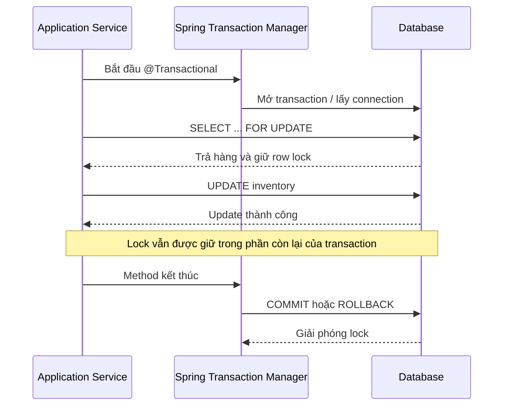
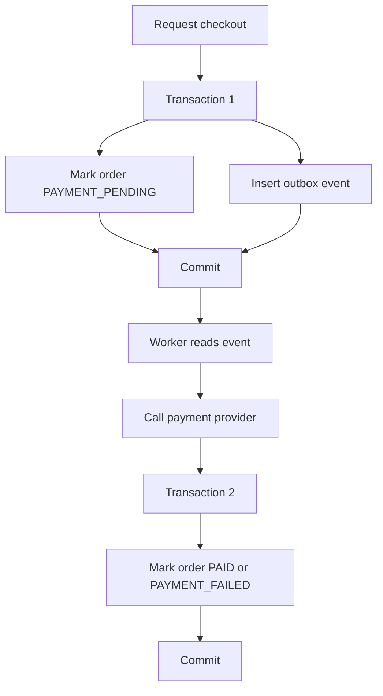
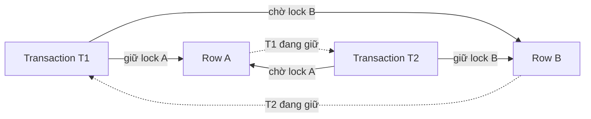

# Thời gian giữ khóa, deadlock và thứ tự truy cập dữ liệu

Trong **Spring Data Relational JDBC**, các thao tác đọc/ghi có thể lấy khóa ở database để bảo vệ dữ liệu khi nhiều transaction cùng truy cập. Khóa thường được giữ đến khi transaction commit hoặc rollback. Nếu transaction kéo dài, nó có thể giữ connection và row lock lâu, làm transaction khác phải chờ. Nếu nhiều transaction khóa các hàng theo thứ tự khác nhau, chúng có thể chờ lẫn nhau và tạo thành **deadlock**.

Ba nguyên tắc quan trọng khi thiết kế thao tác đồng thời:

- **Giữ transaction ngắn:** chỉ thực hiện các thao tác database cần cùng commit/rollback trong transaction; tránh gọi HTTP, chờ người dùng hoặc xử lý tốn thời gian khi đang giữ khóa.
- **Truy cập dữ liệu theo thứ tự nhất quán:** mọi luồng nghiệp vụ khóa nhiều hàng nên dùng cùng một thứ tự, chẳng hạn theo loại tài nguyên rồi theo primary key tăng dần.
- **Chuẩn bị cho xung đột:** dùng constraint, optimistic locking hoặc row lock theo invariant; khi database phát hiện deadlock/serialization conflict, retry toàn bộ transaction có giới hạn nếu nghiệp vụ cho phép.

## 1. Khóa database được giữ trong bao lâu?

Trong relational database, khóa bảo vệ một phần dữ liệu khỏi các thao tác xung đột. Với pessimistic row locking, transaction thường giữ khóa đến khi transaction kết thúc — commit hoặc rollback. Câu SQL tạo khóa có thể chạy rất nhanh, nhưng khóa vẫn được giữ nếu transaction tiếp tục mở.

Ví dụ:

```java
@Transactional
public void reserveStock(Long productId, int quantity) {
    Inventory inventory = loadForUpdate(productId);
    inventory.reserve(quantity);
    inventoryRepository.save(inventory);

    // Row lock vẫn có thể được giữ ở đây.
    writeAuditRecord(productId, quantity);

    // Chỉ khi method kết thúc và transaction commit/rollback,
    // database mới giải phóng các lock thuộc transaction.
}
```

Nếu `writeAuditRecord` gọi mạng hoặc chờ một hệ thống ngoài, transaction có thể giữ row lock lâu hơn nhiều so với thời gian thực sự cần để cập nhật tồn kho.

### Vòng đời khóa trong transaction



Với transaction ở chế độ autocommit, một statement thường là một transaction riêng; lock được giải phóng khi statement/transaction hoàn tất. Vì vậy, `SELECT ... FOR UPDATE` chạy ngoài transaction tường minh thường không bảo vệ được khoảng thời gian giữa lúc đọc và lúc ghi: transaction của câu SELECT có thể kết thúc ngay sau câu lệnh.

**Điểm cần nhớ:** thời gian giữ khóa phụ thuộc vào thời gian sống của transaction, không chỉ thời gian chạy câu SQL đã lấy khóa.

## 2. Những loại khóa thường gặp

Database có nhiều loại lock. Tên gọi và chi tiết phụ thuộc engine, nhưng các khái niệm sau thường hữu ích:

| Loại khóa | Mục đích | Ví dụ |
|---|---|---|
| Shared/read lock | Cho phép nhiều transaction đọc theo quy tắc engine, ngăn một số thay đổi xung đột | `SELECT ... FOR SHARE` trên database hỗ trợ |
| Exclusive/write lock | Bảo vệ hàng đang được sửa, ngăn ghi xung đột | `UPDATE account SET balance = ...` |
| Pessimistic row lock | Khóa hàng trước khi ứng dụng quyết định cập nhật | `SELECT ... FOR UPDATE` |
| Table lock | Khóa phạm vi bảng, có thể ảnh hưởng nhiều hàng | DDL hoặc một số thao tác/engine-specific statements |
| Predicate/range/gap lock | Bảo vệ một khoảng khóa hoặc điều kiện tìm kiếm | Next-key/gap locking của InnoDB trong một số isolation/query patterns |

Không phải mọi `SELECT` đều khóa hàng. Một truy vấn đọc thông thường thường không lấy exclusive row lock; MVCC database có thể cho reader thấy snapshot mà không chặn writer. Ngược lại, `UPDATE`, `DELETE`, `SELECT ... FOR UPDATE`, constraint enforcement và một số thao tác DDL có thể lấy khóa.

### `SELECT ... FOR UPDATE`

Đây là cách phổ biến để đọc hàng và yêu cầu khóa ghi trước khi thay đổi:

```sql
SELECT id, balance
FROM account
WHERE id = :accountId
FOR UPDATE;
```

Transaction khác muốn cập nhật hoặc khóa cùng hàng thường phải chờ cho đến khi transaction hiện tại kết thúc. Cú pháp chính xác và loại lock được lấy phụ thuộc database. SQL Server dùng locking hints như `UPDLOCK` thay vì cú pháp `FOR UPDATE` thông thường; các database cũng có thể hỗ trợ thêm `NOWAIT`, `SKIP LOCKED` hoặc lock mode khác nhau.

### Update tự lấy khóa

Ngay cả khi không viết `SELECT ... FOR UPDATE`, câu lệnh:

```sql
UPDATE inventory
SET available = available - :quantity
WHERE product_id = :productId;
```

cũng cần khóa thích hợp để thay đổi hàng. Với thao tác đơn giản, một câu UPDATE có điều kiện có thể an toàn và ngắn hơn quy trình đọc, khóa, rồi ghi riêng. Có thể kiểm tra `update count` để biết có hàng nào đáp ứng điều kiện.

## 3. Vì sao transaction dài làm giảm khả năng xử lý đồng thời?

Transaction dài có thể gây ra nhiều vấn đề cùng lúc:

- Giữ row/table lock lâu, làm transaction khác phải chờ.
- Giữ một connection từ pool trong thời gian dài.
- Tăng nguy cơ deadlock vì transaction có nhiều cơ hội lấy thêm lock.
- Làm version hoặc snapshot dữ liệu cũ hơn trước khi commit.
- Tăng lượng undo/MVCC version cần database giữ và dọn dẹp.
- Khi rollback, database phải hoàn tác nhiều thay đổi hơn.

Ví dụ không tốt:

```java
@Transactional
public void checkout(Long orderId) {
    PurchaseOrder order = orderRepository.findById(orderId).orElseThrow();
    order.markPaymentPending();
    orderRepository.save(order);

    paymentClient.charge(order); // HTTP call có thể mất vài giây hoặc timeout
    notificationClient.sendReceipt(order); // thêm một network call

    order.markPaid();
    orderRepository.save(order);
}
```

Transaction database có thể mở trong suốt thời gian gọi hai hệ thống ngoài. Nếu `paymentClient` chờ timeout 30 giây, connection và lock liên quan đến đơn hàng có thể bị giữ trong thời gian đó. Ngoài ra, database rollback không thể tự hoàn tác một khoản thanh toán đã thành công ở payment service.

### Tách quy trình dài thành các transaction ngắn

Một thiết kế tốt hơn là ghi trạng thái và outbox event trong transaction ngắn, sau đó xử lý payment ở worker/service riêng:



Mỗi transaction chỉ giữ lock trong phần việc database của nó. Network call nằm ngoài transaction. Workflow cần idempotency, retry và trạng thái trung gian để xử lý trường hợp process chết hoặc kết quả payment chưa rõ.

## 4. Deadlock là gì?

Deadlock xảy ra khi hai hoặc nhiều transaction giữ những lock mà transaction khác cần, đồng thời mỗi transaction lại chờ một lock đang do transaction khác giữ. Không transaction nào có thể tiếp tục nếu không có một transaction bị hủy hoặc lock được giải phóng.

Ví dụ hai tài khoản `A` và `B`:

- Transaction T1 khóa tài khoản A, sau đó muốn khóa B.
- Transaction T2 khóa tài khoản B, sau đó muốn khóa A.



Wait-for graph tạo thành chu trình: T1 chờ T2 và T2 chờ T1. Database phát hiện chu trình, chọn một transaction làm **deadlock victim**, rollback transaction đó và cho transaction còn lại tiếp tục.

### Ví dụ SQL tạo deadlock

Giả sử hai transaction chạy đồng thời:

```sql
-- Transaction T1
BEGIN;
UPDATE account SET balance = balance - 10 WHERE id = 1;
-- T1 đang giữ lock của account 1

-- Sau đó T1 muốn cập nhật account 2
UPDATE account SET balance = balance + 10 WHERE id = 2;
```

```sql
-- Transaction T2
BEGIN;
UPDATE account SET balance = balance - 20 WHERE id = 2;
-- T2 đang giữ lock của account 2

-- Sau đó T2 muốn cập nhật account 1
UPDATE account SET balance = balance + 20 WHERE id = 1;
```

Nếu T1 và T2 thực hiện xen kẽ đúng thời điểm, mỗi transaction giữ một row và chờ row còn lại. Database phát hiện deadlock và hủy một bên. Ứng dụng phải xử lý lỗi; không nên giả định cả hai transaction sẽ tự hoàn tất.

## 5. Deadlock khác lock wait timeout như thế nào?

Hai tình huống thường bị nhầm:

| Tình huống | Deadlock | Lock wait timeout |
|---|---|---|
| Điều kiện | Có chu trình chờ khóa | Transaction chờ một lock quá thời hạn cấu hình |
| Có cần chu trình? | Có | Không |
| Database xử lý | Phát hiện chu trình và chọn victim | Hủy hoặc báo lỗi statement/transaction đang chờ theo semantics engine |
| Thời gian xảy ra | Có thể phát hiện nhanh sau khi hình thành chu trình | Có thể phải chờ đến timeout |
| Cách xử lý | Điều chỉnh thứ tự truy cập, giảm lock duration, retry transaction | Giảm thời gian chờ, kiểm tra blocker, điều chỉnh timeout có chủ đích |

Một transaction có thể chờ lâu vì transaction khác chưa commit nhưng không tạo deadlock. Ví dụ T1 khóa một hàng và bị treo ở network call; T2 chờ hàng đó. Không có chu trình nên database không nhất thiết báo deadlock, nhưng hệ thống vẫn bị chậm.

Tăng lock timeout chỉ làm transaction chờ lâu hơn; nó không sửa deadlock hoặc transaction giữ khóa quá lâu. Hãy tìm nguyên nhân giữ khóa và thứ tự truy cập trước khi thay timeout.

## 6. Quy tắc quan trọng nhất: khóa theo thứ tự nhất quán

Nếu nhiều use case phải khóa nhiều hàng, hãy thống nhất một thứ tự toàn hệ thống. Một quy ước đơn giản là:

1. Khóa theo nhóm tài nguyên cố định (ví dụ `account` trước `ledger`).
2. Trong cùng một nhóm, khóa theo primary key tăng dần.
3. Nếu có nhiều loại aggregate/table, mọi luồng nghiệp vụ dùng cùng thứ tự.

Ví dụ chuyển tiền giữa hai tài khoản:

```java
@Transactional
public void transfer(long fromId, long toId, BigDecimal amount) {
    long firstId = Math.min(fromId, toId);
    long secondId = Math.max(fromId, toId);

    Account first = accountDao.findByIdForUpdate(firstId);
    Account second = accountDao.findByIdForUpdate(secondId);

    Account source = fromId == firstId ? first : second;
    Account target = toId == firstId ? first : second;

    source.debit(amount);
    target.credit(amount);

    accountRepository.save(source);
    accountRepository.save(target);
}
```

`findByIdForUpdate` dùng SQL khóa hàng:

```java
public Account findByIdForUpdate(long id) {
    return jdbcTemplate.queryForObject(
            "SELECT id, balance, version FROM account WHERE id = ? FOR UPDATE",
            accountRowMapper,
            id
    );
}
```

Hai transfer ngược chiều (A → B và B → A) đều khóa ID nhỏ trước, ID lớn sau. Do đó chúng không tạo chu trình chỉ vì thứ tự hai tài khoản bị đảo ngược trong nghiệp vụ.

SQL trên minh họa PostgreSQL/MySQL InnoDB/Oracle với cú pháp phù hợp; SQL Server cần locking hints và database khác có thể có cú pháp riêng. Phải chạy method bên trong transaction đang hoạt động, nếu không lock có thể được giải phóng ngay sau câu SELECT.

### Vì sao không chỉ dùng `ORDER BY id`?

Một câu `SELECT ... WHERE id IN (...) ORDER BY id FOR UPDATE` có thể giúp thể hiện thứ tự mong muốn, nhưng thứ tự thực tế database lấy lock còn phụ thuộc execution plan và engine. Khi cần quy tắc chặt chẽ, một cách dễ hiểu là chuẩn hóa danh sách ID, sắp xếp trong ứng dụng rồi khóa từng hàng theo thứ tự cố định. Với tập rất lớn, cần cân nhắc chi phí round-trip và dùng chiến lược database-specific đã được kiểm chứng.

Thứ tự nhất quán phải áp dụng ở **mọi đường code** có thể khóa các tài nguyên đó, không chỉ một service. Nếu một batch job khóa B rồi A trong khi transfer service khóa A rồi B, deadlock vẫn có thể xảy ra.

## 7. Dùng conditional update để giảm thời gian giữ khóa

Một số nghiệp vụ có thể thực hiện bằng một câu UPDATE nguyên tử, tránh khoảng thời gian giữa đọc và ghi:

```sql
UPDATE inventory
SET available = available - :quantity,
    version = version + 1
WHERE product_id = :productId
  AND available >= :quantity;
```

Nếu `update count = 1`, reserve thành công. Nếu bằng 0, sản phẩm không tồn tại hoặc không đủ hàng (hoặc điều kiện khác không khớp). Có thể đọc thêm để phân biệt nguyên nhân nếu nghiệp vụ cần.

Lợi ích:

- Database kiểm tra điều kiện và thay đổi trong một statement nguyên tử.
- Không giữ row lock qua khoảng thời gian application xử lý object giữa SELECT và UPDATE.
- Không cần một `SELECT ... FOR UPDATE` riêng nếu invariant có thể biểu diễn bằng điều kiện SQL.

Tuy nhiên, direct SQL không tự chạy entity callbacks/auditing và không tự áp dụng optimistic locking của Spring Data JDBC. Nếu dùng cột `version`, phải tự đưa version vào điều kiện và tăng version như ví dụ. Sau direct update, object đã tải trước đó có thể stale; hãy reload khi cần.

## 8. Optimistic locking có thể tránh giữ lock từ lúc đọc

Không phải use case nào cũng cần pessimistic lock. Nếu xung đột hiếm, dùng `@Version` để phát hiện cập nhật đồng thời:

```java
@Table("inventory")
public class Inventory {

    @Id
    private Long productId;

    @Version
    private Long version;

    private int available;

    public void reserve(int quantity) {
        if (quantity <= 0 || quantity > available) {
            throw new InsufficientStockException();
        }
        available -= quantity;
    }
}
```

Khi save, Spring Data JDBC tạo update có điều kiện theo ID và version hiện tại, sau đó tăng version. Nếu transaction khác đã cập nhật trước, update không khớp version và Spring ném `OptimisticLockingFailureException`.

Optimistic locking thường tránh việc giữ một row lock tường minh trong toàn bộ khoảng thời gian ứng dụng đọc rồi quyết định. Tuy nhiên, chính câu UPDATE vẫn lấy khóa ghi trong lúc thực thi, và database vẫn có thể phát hiện deadlock nếu transaction sửa nhiều hàng theo thứ tự khác nhau.

| Cơ chế | Cách phát hiện xung đột | Đặc điểm |
|---|---|---|
| Optimistic locking (`@Version`) | So sánh version ở lúc update | Phù hợp khi xung đột ít; caller có thể reload/retry |
| Pessimistic locking (`FOR UPDATE`) | Khóa hàng trước khi đọc/quyết định | Phù hợp khi cần tuần tự hóa thao tác; giữ lock đến transaction end |
| Conditional update | Điều kiện được kiểm tra trong một UPDATE | Tốt cho invariant đơn giản có thể biểu diễn trong SQL |
| Constraint database | Database từ chối trạng thái vi phạm | Lớp bảo vệ cuối cùng cho unique/check/FK invariants |

Không nên dùng `@Version` và `FOR UPDATE` cùng lúc một cách máy móc. Chọn cơ chế dựa trên tần suất xung đột, invariant và độ dài transaction.

## 9. Index ảnh hưởng đến phạm vi khóa và thời gian chờ

Một truy vấn khóa cần tìm đúng hàng. Nếu predicate không có index phù hợp, database có thể phải scan nhiều hàng hoặc phạm vi index rộng. Tùy engine và isolation level, điều này có thể làm tăng số khóa, lock contention hoặc thời gian giữ khóa.

Ví dụ:

```sql
SELECT id, status
FROM purchase_order
WHERE customer_id = :customerId
  AND status = 'OPEN'
FOR UPDATE;
```

Nếu ứng dụng thường khóa các đơn hàng theo `customer_id` và `status`, cân nhắc index phù hợp:

```sql
CREATE INDEX idx_purchase_order_customer_status
    ON purchase_order(customer_id, status, id);
```

Index chính xác phụ thuộc query workload, selectivity, sort và database. Không tạo index theo từng truy vấn một cách mù quáng: index làm tăng chi phí INSERT/UPDATE/DELETE và có thể ảnh hưởng locking khi cập nhật index entry.

### Gap lock và next-key lock

Trong MySQL InnoDB, ở một số isolation/query patterns, transaction có thể lấy gap lock hoặc next-key lock để bảo vệ khoảng khóa, không chỉ một hàng hiện có. Một truy vấn khóa theo điều kiện không duy nhất hoặc range scan có thể chặn thao tác insert vào khoảng đó.

Vì vậy:

- Dùng index phù hợp với điều kiện `WHERE`.
- Hiểu isolation level thực tế (ví dụ InnoDB mặc định thường là `REPEATABLE READ`).
- Xem execution plan và lock monitoring khi có contention.
- Không giả định `SELECT ... FOR UPDATE` chỉ khóa đúng một row nếu predicate có thể khớp nhiều hàng hoặc range.

Các chi tiết này khác nhau giữa PostgreSQL, MySQL/InnoDB, SQL Server, Oracle và DB2. Hãy dựa vào tài liệu database mục tiêu.

## 10. Khóa ngoại và deadlock

Foreign key enforcement cũng có thể làm transaction cần kiểm tra/khóa hàng ở bảng được tham chiếu. Ví dụ insert `order_line` có `product_id` trỏ đến `product.id`; database phải bảo vệ tính hợp lệ của reference trong lúc ghi.

Deadlock có thể xuất hiện giữa thao tác trên nhiều bảng, kể cả khi code không có câu `SELECT ... FOR UPDATE`:

- Transaction T1 cập nhật `purchase_order`, sau đó insert `order_line`.
- Transaction T2 cập nhật `order_line` hoặc bảng liên quan, sau đó cập nhật `purchase_order`.
- Trigger, FK hoặc index maintenance bổ sung các lock khác.

Để giảm rủi ro:

- Xác định thứ tự cập nhật các bảng/aggregate và giữ nhất quán giữa mọi use case.
- Tránh các trigger tạo chuỗi cập nhật ngược chiều khó nhìn thấy trong code Java.
- Dùng FK/index phù hợp và kiểm tra lock graph khi deadlock xảy ra.
- Giữ transaction ngắn và hạn chế bulk operation quá lớn trong transaction tương tác.

Không xóa FK chỉ để tránh lock. FK bảo vệ tính toàn vẹn tham chiếu; hãy xử lý thứ tự ghi, transaction scope và index.

## 11. `SKIP LOCKED` và `NOWAIT` cho worker lấy việc

Một số database hỗ trợ các tùy chọn khi lấy row lock:

- `NOWAIT`: nếu hàng đang bị khóa, trả lỗi ngay thay vì chờ.
- `SKIP LOCKED`: bỏ qua các hàng đang bị transaction khác khóa.

Ví dụ PostgreSQL cho worker queue:

```sql
SELECT id, payload
FROM job_queue
WHERE status = 'READY'
ORDER BY id
FOR UPDATE SKIP LOCKED
LIMIT 20;
```

Hai worker có thể cùng lấy batch mà không phải chờ những hàng đã được worker kia khóa. Worker A khóa các job đầu tiên; worker B bỏ qua chúng và lấy job khác.

Điều kiện sử dụng:

- Phải chạy trong transaction để giữ lock trong lúc đánh dấu/claim job.
- Ngay sau khi lấy hàng, cập nhật trạng thái thành `PROCESSING` hoặc ghi lease/claim owner trong cùng transaction rồi commit.
- Không giữ transaction mở trong khi thực thi công việc lâu; commit claim trước, xử lý ngoài transaction, sau đó mở transaction khác để ghi kết quả.
- Có cơ chế lease/timeout để phục hồi job nếu worker chết sau khi claim.
- Chấp nhận rằng `SKIP LOCKED` có thể bỏ qua hàng cũ đang bị khóa và không bảo đảm thứ tự FIFO tuyệt đối.

Cú pháp và semantics của `NOWAIT`/`SKIP LOCKED` phụ thuộc database. Không đưa chúng vào query chung nếu ứng dụng hỗ trợ nhiều dialect mà không có abstraction tương ứng.

## 12. Cấu hình lock timeout và transaction timeout

Hai loại timeout cần phân biệt:

| Timeout | Giới hạn điều gì? | Ví dụ |
|---|---|---|
| Lock wait timeout | Thời gian database cho phép chờ một lock | PostgreSQL `lock_timeout`, MySQL `innodb_lock_wait_timeout`, SQL Server `SET LOCK_TIMEOUT` |
| Transaction timeout | Thời gian transaction được phép tồn tại theo cấu hình transaction manager | `@Transactional(timeout = 5)` |
| Statement/query timeout | Thời gian một câu SQL được phép chạy/chờ theo JDBC statement | `JdbcTemplate`/`DataSourceUtils` transaction timeout hoặc query timeout |

Ví dụ transaction timeout:

```java
@Transactional(timeout = 5)
public void reserve(Long productId, int quantity) {
    // Database operations cần hoàn tất trong giới hạn transaction đã cấu hình.
}
```

Transaction timeout của Spring không đồng nghĩa mọi database lock wait đều bị ngắt chính xác sau 5 giây. Việc áp dụng phụ thuộc transaction manager, JDBC statement và driver. Nếu cần giới hạn chờ lock ở database, cấu hình setting database/session phù hợp.

Không tăng timeout chỉ để làm biến mất lỗi trong log. Timeout quá lớn có thể khiến request giữ connection và lock lâu hơn, làm hàng đợi tăng. Chọn timeout dựa trên latency mục tiêu và hành vi database.

## 13. Retry deadlock và serialization failure

Deadlock victim đã bị database rollback. Muốn thử lại, ứng dụng phải chạy **toàn bộ transaction** trong một transaction mới. Không tiếp tục thực thi phần còn lại trong transaction đã thất bại hoặc đã bị đánh dấu rollback-only.

Các lỗi thường có thể mang tính transient:

- Deadlock detected.
- Serialization failure do isolation level cao.
- Lock acquisition timeout trong một số use case có thể thử lại.

Nhưng không phải mọi `DataAccessException` đều nên retry. Lỗi unique constraint, FK, check constraint, dữ liệu đầu vào sai hoặc business rejection thường không được sửa bằng cách thử lại ngay.

### Retry có giới hạn và backoff

Ví dụ khái niệm dùng Spring Retry:

```java
@Retryable(
        retryFor = {
                CannotAcquireLockException.class,
                PessimisticLockingFailureException.class
        },
        maxAttempts = 3,
        backoff = @Backoff(delay = 100, multiplier = 2, random = true)
)
public void executeTransfer(TransferCommand command) {
    transferTransactionService.transferInNewTransaction(command);
}
```

Phương thức `transferInNewTransaction` nên nằm trên bean Spring khác và được đánh dấu `@Transactional`, để mỗi lần retry gọi một transaction mới. Ví dụ trên chỉ minh họa các exception class có thể gặp; exception translation thực tế phụ thuộc database, driver và transaction manager. Hãy kiểm tra exception/SQLState được dịch trong môi trường đang chạy và chỉ retry đúng nhóm lỗi transient.

Không đặt retry bên trong một method transaction duy nhất nếu lần retry vẫn tham gia transaction đã bị rollback-only. Một cấu trúc phổ biến là retry ở tầng bên ngoài, transaction ở bean thực hiện một lần thử:

```java
@Service
public class TransferFacade {

    private final TransferTransactionService transactionService;

    public TransferFacade(TransferTransactionService transactionService) {
        this.transactionService = transactionService;
    }

    @Retryable(
            retryFor = PessimisticLockingFailureException.class,
            maxAttempts = 3,
            backoff = @Backoff(delay = 100, multiplier = 2, random = true)
    )
    public void transfer(TransferCommand command) {
        transactionService.transferInNewTransaction(command);
    }
}

@Service
public class TransferTransactionService {

    @Transactional
    public void transferInNewTransaction(TransferCommand command) {
        // Một lần thực thi transaction; exception thoát ra để rollback.
    }
}
```

Đảm bảo thứ tự proxy/interceptor để retry bọc bên ngoài transaction. Cần thêm idempotency key nếu retry có thể lặp tác dụng bên ngoài database hoặc nếu caller cũng retry request.

### Retry không thay thế thiết kế thứ tự lock

Nếu hai transaction luôn khóa A rồi B và B rồi A, deadlock sẽ tiếp tục tái diễn khi tải đủ cao. Retry chỉ giúp một request có cơ hội thành công sau khi victim được rollback; sửa thứ tự lock mới giảm nguyên nhân gốc.

## 14. Quan sát deadlock và lock contention

Khi thấy request chậm hoặc lỗi deadlock, cần xác định:

1. Transaction nào đang giữ lock?
2. Transaction nào đang chờ lock nào?
3. Statement nào lấy lock đầu tiên?
4. Có chu trình wait-for graph hay chỉ là một blocker lâu?
5. Query có dùng index phù hợp không?
6. Transaction có giữ lock trong lúc gọi mạng hoặc chờ xử lý ngoài database không?
7. Trigger/FK/cascade có thêm lock mà application code không thể hiện không?

Các công cụ phụ thuộc database:

| Database | Nguồn quan sát thường dùng |
|---|---|
| PostgreSQL | `pg_stat_activity`, `pg_locks`, `pg_blocking_pids()`, deadlock details trong server log |
| MySQL/InnoDB | `performance_schema.data_locks`, `data_lock_waits`, `SHOW ENGINE INNODB STATUS` |
| SQL Server | DMVs như `sys.dm_tran_locks`, `sys.dm_os_waiting_tasks`, Extended Events/deadlock graph |
| Oracle | `V$LOCK`, `V$SESSION`, `DBA_BLOCKERS`, `DBA_WAITERS` và trace phù hợp |

Ví dụ PostgreSQL để xem session đang chặn session khác:

```sql
SELECT
    waiting.pid AS waiting_pid,
    waiting.query AS waiting_query,
    blocking.pid AS blocking_pid,
    blocking.query AS blocking_query
FROM pg_stat_activity AS waiting
JOIN LATERAL unnest(pg_blocking_pids(waiting.pid)) AS blocker(pid)
    ON true
JOIN pg_stat_activity AS blocking
    ON blocking.pid = blocker.pid;
```

Các view yêu cầu quyền phù hợp và cột/query có thể khác theo phiên bản PostgreSQL. Không chạy truy vấn chẩn đoán nặng liên tục trong production; dùng khi điều tra hoặc tích hợp vào monitoring với tần suất hợp lý.

### Log Spring JDBC

Có thể bật SQL logging trong development:

```yaml
logging:
  level:
    org.springframework.jdbc.core: DEBUG
    org.springframework.transaction: TRACE
```

Log Spring giúp thấy thứ tự statement và transaction interceptor, nhưng không phải lúc nào cũng cho biết chính xác lock nào database đang giữ. Để hiểu deadlock, cần kết hợp SQL log với deadlock report/lock monitoring của database.

Không log password, token hoặc dữ liệu nhạy cảm trong parameter. Khi cần tương quan transaction, ghi trace/request ID và transaction timing thay vì ghi toàn bộ payload.

## 15. Thứ tự truy cập dữ liệu trong Spring Data JDBC

Spring Data JDBC lưu aggregate root cùng các entity được sở hữu. Một lần `save(root)` có thể thực hiện nhiều statement trên root và child. Khi một use case lưu nhiều aggregate, các câu lệnh có thể lấy lock trên nhiều bảng/hàng.

Ví dụ một transaction cập nhật:

```text
PurchaseOrder → OrderLine → Inventory
```

Trong khi transaction khác cập nhật:

```text
Inventory → OrderLine → PurchaseOrder
```

Nếu hai luồng khóa các hàng theo hai thứ tự ngược nhau, deadlock có thể xảy ra dù mỗi repository method riêng lẻ đều hợp lệ.

Để tránh:

- Viết quy ước thứ tự truy cập cho các aggregate/table có thể bị cập nhật trong cùng use case.
- Dùng cùng thứ tự trong service, batch job, scheduled task và direct SQL.
- Nếu aggregate save nội bộ tạo ra nhiều DbAction, quan sát SQL thực tế để hiểu thứ tự lock; không suy luận chỉ từ thứ tự property trong Java class.
- Cân nhắc tách use case thành local transactions/outbox nếu việc phối hợp nhiều aggregate không cần atomic ngay lập tức.
- Tránh một transaction vừa giữ lock trên aggregate A vừa gọi service ngoài có thể quay lại cập nhật aggregate B.

### Batch operation và lock duration

`JdbcAggregateTemplate.insertAll`, `updateAll` hoặc `saveAll` có thể xử lý nhiều aggregate trong cùng một lần gọi. Nếu đặt toàn bộ batch trong một transaction, các lock phát sinh trong quá trình ghi có thể được giữ đến khi batch hoàn tất và commit.

Với batch lớn:

- Chia chunk theo kích thước phù hợp.
- Xác định rõ muốn atomic toàn bộ batch hay commit từng chunk.
- Sắp xếp input theo thứ tự khóa ổn định nếu nhiều aggregate dùng chung tài nguyên.
- Tránh xử lý logic không liên quan giữa các lần ghi trong khi transaction mở.
- Đo lock wait, transaction duration, pool utilization và throughput trên database thật.

Chia chunk làm giảm thời gian và lượng công việc trong mỗi transaction nhưng thay đổi semantics: chunk đã commit sẽ không tự rollback nếu chunk sau thất bại. Đây là quyết định nghiệp vụ, không chỉ là tối ưu kỹ thuật.

## 16. Lỗi thường gặp và cách xử lý

| Biểu hiện | Nguyên nhân có thể | Hướng xử lý |
|---|---|---|
| Request khác chờ lâu dù câu UPDATE rất nhanh | Transaction đầu giữ lock sau statement | Kiểm tra transaction duration; loại network call/chờ xử lý khỏi transaction |
| Deadlock khi chuyển tiền hai chiều | Hai luồng khóa tài khoản theo thứ tự ngược nhau | Khóa theo ID tăng dần trong mọi luồng |
| Deadlock xuất hiện trong batch job | Batch cập nhật nhiều root/bảng theo thứ tự khác service tương tác | Chuẩn hóa thứ tự khóa, giảm chunk và transaction duration |
| `SELECT ... FOR UPDATE` không bảo vệ lúc update | Câu SELECT chạy ngoài transaction hoặc connection khác | Đặt `@Transactional` và dùng cùng DataSource/transaction manager |
| Lock timeout nhưng không có deadlock | Một transaction giữ lock lâu, không có chu trình chờ | Tìm blocker, query đang chạy và transaction mở lâu |
| Tăng timeout làm hệ thống chậm hơn | Transaction chờ lâu hơn và giữ connection lâu hơn | Điều tra blocker, giảm lock duration, chỉ điều chỉnh timeout có chủ đích |
| Optimistic locking failure thường xuyên | Nhiều request cập nhật cùng root | Giảm contention, retry có giới hạn hoặc cân nhắc pessimistic lock |
| Database khóa nhiều hàng hơn dự kiến | Predicate thiếu index hoặc range scan/gap lock | Kiểm tra index, execution plan, isolation và engine lock behavior |
| Retry vẫn deadlock liên tục | Thứ tự lock không nhất quán hoặc transaction quá dài | Sửa nguyên nhân; retry chỉ là lớp phục hồi |
| Dùng `SKIP LOCKED` nhưng job bị bỏ qua lâu | Hàng luôn bị worker khác khóa hoặc lease không được phục hồi | Giới hạn transaction, lease/timeout và monitoring job age |
| Transaction rollback nhưng HTTP payment vẫn thành công | Network call nằm trong transaction JDBC | Outbox/saga, idempotency và compensation |

## 17. Quy trình thiết kế thao tác nhiều hàng an toàn

1. **Xác định invariant:** dữ liệu nào phải được bảo vệ khỏi cập nhật đồng thời?
2. **Chọn cơ chế:** constraint, conditional update, `@Version` hay pessimistic row lock.
3. **Xác định tập hàng cần khóa:** dùng predicate/selectivity rõ ràng và index phù hợp.
4. **Quy định thứ tự:** khóa theo loại tài nguyên cố định rồi theo ID ổn định.
5. **Mở transaction đúng nơi:** đặt `@Transactional` ở application service và dùng cùng DataSource/manager.
6. **Giữ transaction ngắn:** không gọi HTTP, không chờ người dùng, không xử lý file lớn khi đang giữ lock.
7. **Giới hạn batch:** chia chunk khi dữ liệu lớn và chấp nhận semantics commit từng chunk.
8. **Đặt timeout phù hợp:** phân biệt transaction timeout, statement timeout và lock wait timeout.
9. **Quan sát khi có contention:** lấy deadlock graph, blocker, SQL log, execution plan và transaction duration.
10. **Retry có kiểm soát:** chỉ retry lỗi transient, retry toàn transaction mới, dùng backoff và idempotency.
11. **Kiểm thử concurrency:** chạy nhiều transaction/connection thực sự trên database mục tiêu.

### Bảng quyết định nhanh

| Tình huống | Cách tiếp cận |
|---|---|
| Cập nhật một giá trị với điều kiện đơn giản | Conditional `UPDATE ... WHERE ...` |
| Nhiều request sửa cùng aggregate, xung đột hiếm | `@Version` optimistic locking |
| Cần đọc rồi cập nhật một số hàng và phải tuần tự hóa | `SELECT ... FOR UPDATE` trong transaction ngắn |
| Nhiều transaction khóa cùng tập hàng | Thứ tự khóa toàn cục, ví dụ theo primary key tăng dần |
| Worker cùng lấy việc từ queue | `FOR UPDATE SKIP LOCKED` nếu database hỗ trợ, claim ngắn rồi commit |
| Workflow gọi hệ thống ngoài | Outbox/saga; không giữ DB lock qua network call |
| Batch ghi rất lớn | Chunk, transaction boundary rõ và thứ tự input ổn định |
| Deadlock/serialization failure thoáng qua | Retry toàn transaction mới với giới hạn/backoff |

**Điểm cốt lõi:** row lock thường được giữ đến khi transaction kết thúc. Transaction càng dài, connection và lock càng bị giữ lâu; truy cập nhiều hàng theo thứ tự không thống nhất có thể tạo deadlock. Hãy rút ngắn transaction, khóa theo thứ tự ổn định, dùng index và cơ chế concurrency phù hợp, đồng thời chỉ retry toàn bộ transaction mới khi lỗi thực sự transient.

## Tài liệu tham khảo chính thức

- [Spring Framework — Transaction Management](https://docs.spring.io/spring-framework/reference/data-access/transaction.html): transaction boundary, propagation và quản lý transaction.
- [Spring Framework — Declarative Transaction Management](https://docs.spring.io/spring-framework/reference/data-access/transaction/declarative.html): `@Transactional`, proxy và rollback rules.
- [Spring Data Relational — Transactionality](https://docs.spring.io/spring-data/relational/reference/jdbc/transactions.html): transaction trong Spring Data JDBC và service layer.
- [Spring Data JDBC — Optimistic Locking](https://docs.spring.io/spring-data/relational/reference/jdbc/mapping.html): version property và xử lý cập nhật đồng thời.
- [PostgreSQL — Explicit Locking](https://www.postgresql.org/docs/current/explicit-locking.html): row/table locks, deadlocks và lock modes.
- [PostgreSQL — `SELECT`](https://www.postgresql.org/docs/current/sql-select.html): `FOR UPDATE`, `NOWAIT` và `SKIP LOCKED`.
- [PostgreSQL — Lock Management](https://www.postgresql.org/docs/current/monitoring-locks.html): quan sát lock và session đang chờ.
- [MySQL — InnoDB Locking](https://dev.mysql.com/doc/refman/8.4/en/innodb-locking.html): record, gap và next-key locks.
- [MySQL — InnoDB Deadlocks](https://dev.mysql.com/doc/refman/8.4/en/innodb-deadlocks.html): nguyên nhân, phát hiện và giảm deadlock.
- [SQL Server — Deadlocks Guide](https://learn.microsoft.com/en-us/sql/relational-databases/sql-server-deadlocks-guide): deadlock detection, graph và cách giảm xung đột.
