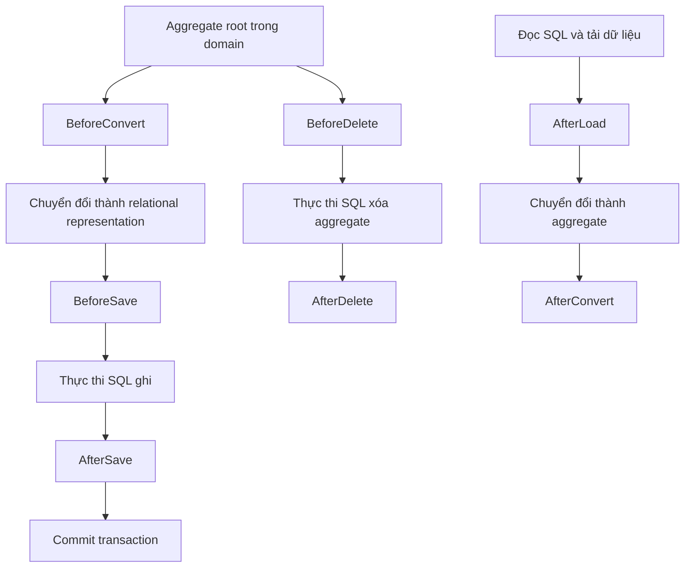
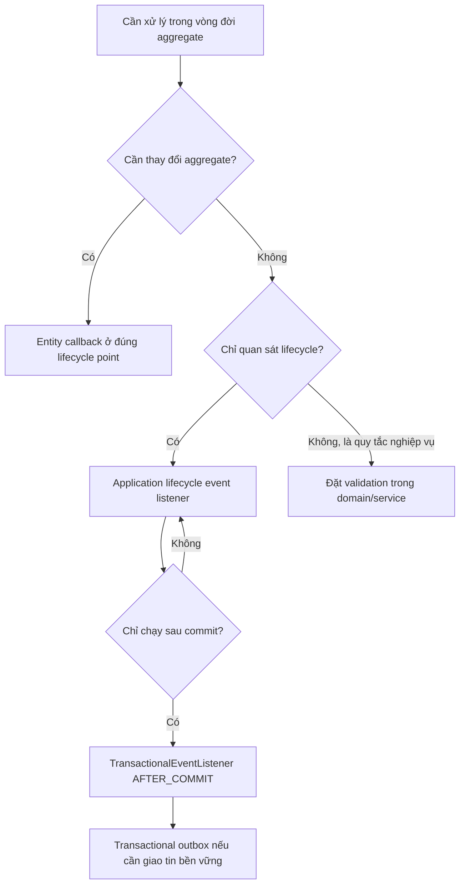

# Các giai đoạn chuyển đổi, lưu, đọc và xóa aggregate

Spring Data JDBC quản lý dữ liệu theo **aggregate**. Một aggregate có một root và có thể chứa các object con thuộc cùng ranh giới nhất quán. Khi lưu, đọc hoặc xóa aggregate, framework chuyển đổi object domain thành thao tác quan hệ và thực thi các câu SQL cần thiết. Trong quá trình đó, Spring Data JDBC cung cấp các lifecycle event và callback để ứng dụng phản ứng ở những thời điểm xác định.

Hiểu vòng đời này giúp đặt đúng logic: chuẩn hóa dữ liệu trước khi ghi, kiểm tra hoặc bổ sung thông tin trước khi câu SQL chạy, phản ứng sau khi lưu, xử lý dữ liệu sau khi đọc và ghi nhận thao tác xóa. Bài học trình bày các giai đoạn chuyển đổi, lưu, đọc và xóa aggregate, đồng thời phân biệt persistence lifecycle event với domain event và transaction event.

## 1. Aggregate và vòng đời persistence

Giả sử `PurchaseOrder` là aggregate root và `OrderLine` là các phần tử con:

```java
@Table("purchase_order")
public record PurchaseOrder(
    @Id Long id,
    @Version Long version,
    Long customerId,
    String status,
    BigDecimal totalAmount,
    LocalDateTime createdAt,
    @MappedCollection(idColumn = "order_id", keyColumn = "line_no")
    List<OrderLine> lines
) {}
```

```java
public record OrderLine(
    Long productId,
    int quantity,
    BigDecimal unitPrice
) {}
```

Root xác định ranh giới aggregate. Các dòng hàng được lưu và tải theo mapping của `PurchaseOrder`. `Customer` nếu là aggregate khác thường được tham chiếu bằng ID; nó không tự trở thành một phần của aggregate chỉ vì `PurchaseOrder` có `customerId`.

Spring Data JDBC không hoạt động như JPA persistence context với dirty checking liên tục. Ứng dụng gọi thao tác repository/aggregate operations để yêu cầu framework lưu hoặc đọc aggregate. Trong quá trình thực hiện, framework chuyển đổi object, tạo các thao tác SQL, thực thi chúng và phát lifecycle hook tương ứng.



Sơ đồ thể hiện các điểm lifecycle ở mức khái niệm. Chi tiết SQL, callback cụ thể và thời điểm transaction commit phụ thuộc thao tác và cấu hình; `AfterSave` không đồng nghĩa transaction đã commit.

## 2. Các lifecycle event chính

Spring Data Relational cung cấp các event gắn với vòng đời aggregate:

| Event | Thời điểm khái quát | Mục đích thường gặp |
| --- | --- | --- |
| `BeforeConvertEvent` | Trước khi aggregate được chuyển thành representation để ghi. | Quan sát trạng thái trước chuyển đổi, ghi log hoặc chuẩn bị dữ liệu theo cơ chế phù hợp. |
| `BeforeSaveEvent` | Trước khi các câu SQL lưu aggregate được thực thi. | Quan sát thao tác ghi và thay đổi cần thiết thông qua callback phù hợp. |
| `AfterSaveEvent` | Sau khi thao tác SQL lưu aggregate hoàn tất. | Ghi nhận kết quả lưu hoặc kích hoạt xử lý nội bộ phù hợp. |
| `AfterLoadEvent` | Sau khi dữ liệu aggregate được tải từ database. | Quan sát dữ liệu vừa đọc. |
| `AfterConvertEvent` | Sau khi dữ liệu quan hệ được chuyển thành object aggregate. | Quan sát aggregate đã được ánh xạ. |
| `BeforeDeleteEvent` | Trước khi thao tác xóa aggregate được thực thi. | Ghi nhận hoặc chuẩn bị cho thao tác xóa. |
| `AfterDeleteEvent` | Sau khi thao tác xóa aggregate hoàn tất. | Ghi nhận kết quả xóa. |

Các event này gắn với aggregate root và hoạt động persistence. Không nên giả định mỗi row của bảng con sẽ phát một event riêng như một entity độc lập. Nếu cần xử lý theo child, listener có thể đọc root và duyệt các phần tử con trong aggregate theo dữ liệu event cung cấp.

Event lifecycle phản ánh tiến trình persistence. Chúng không thay thế validation domain, authorization hoặc transaction boundary của service.

## 3. Giai đoạn chuyển đổi trước khi lưu: BeforeConvert

Khi ứng dụng yêu cầu lưu aggregate, Spring Data JDBC cần chuyển object domain thành representation quan hệ và các thao tác ghi. `BeforeConvertEvent` được phát trước giai đoạn chuyển đổi đó.

Các tình huống phù hợp để quan sát giai đoạn này:

- Ghi log thông tin định danh và loại aggregate chuẩn bị lưu.
- Thu thập metric về loại thao tác.
- Theo dõi các giá trị domain trước khi framework tạo câu lệnh persistence.
- Phối hợp với callback để chuẩn hóa hoặc bổ sung dữ liệu cần lưu.

Ví dụ listener chỉ ghi log:

```java
@Component
public class OrderLifecycleListener {

    private static final Logger log =
        LoggerFactory.getLogger(OrderLifecycleListener.class);

    @EventListener
    public void beforeConvert(BeforeConvertEvent<PurchaseOrder> event) {
        PurchaseOrder order = event.getSource();
        log.debug(
            "Preparing PurchaseOrder for conversion: id={}",
            order.id()
        );
    }
}
```

Event listener phù hợp để quan sát. Nếu cần thay đổi aggregate trước khi chuyển đổi, dùng entity callback tương ứng sẽ thể hiện rõ mục đích hơn vì callback có thể trả về instance đã thay đổi.

Không đặt thao tác gọi dịch vụ ngoài, gửi email hoặc công việc chậm trong callback chuyển đổi. Những thao tác đó làm tăng thời gian lưu và có thể chạy trong transaction đang giữ connection.

## 4. Giai đoạn chuẩn bị và thực thi lưu: BeforeSave và AfterSave

Sau khi aggregate được chuyển đổi và các thao tác persistence được chuẩn bị, `BeforeSaveEvent` đánh dấu thời điểm trước khi các câu SQL lưu được thực thi. Sau khi thao tác ghi hoàn tất, `AfterSaveEvent` được phát.

Có thể quan sát hai thời điểm này:

```java
@Component
public class OrderSaveListener {

    private static final Logger log =
        LoggerFactory.getLogger(OrderSaveListener.class);

    @EventListener
    public void beforeSave(BeforeSaveEvent<PurchaseOrder> event) {
        PurchaseOrder order = event.getSource();
        log.debug("Saving order id={}", order.id());
    }

    @EventListener
    public void afterSave(AfterSaveEvent<PurchaseOrder> event) {
        PurchaseOrder order = event.getSource();
        log.info("Saved order id={}", order.id());
    }
}
```

`BeforeSaveEvent` hữu ích khi cần quan sát aggregate change sắp được thực thi. Nếu cần thay đổi entity hoặc thao tác persistence, hãy dùng callback tương ứng và API được hỗ trợ thay vì dựa vào việc sửa object event một cách tùy tiện.

`AfterSaveEvent` cho biết thao tác lưu ở tầng Spring Data JDBC đã chạy xong. Nó **không khẳng định transaction bên ngoài đã commit**. Nếu service mở transaction lớn hơn, sau `AfterSaveEvent` vẫn có thể xảy ra lỗi ở bước tiếp theo khiến toàn bộ transaction rollback.

### Lưu aggregate không chỉ là ghi một row root

Khi lưu `PurchaseOrder`, Spring Data JDBC áp dụng mapping cho root và các thành phần con thuộc aggregate. Tùy thao tác insert/update, framework tạo các câu SQL cần thiết cho những bảng liên quan. Vì vậy, event ở mức aggregate không nên được hiểu là một thông báo cho duy nhất câu `INSERT` hoặc `UPDATE` trên root.

Nếu aggregate dùng `@Version`, framework áp dụng cơ chế optimistic locking trong đường lưu aggregate được quản lý. Direct SQL nằm ngoài đường lưu đó phải tự xử lý version nếu cần cùng bảo đảm.
## 5. Entity callback: khi cần biến đổi aggregate

Application event thường dùng để thông báo cho listener biết một lifecycle point đã xảy ra. Nếu mục tiêu là biến đổi aggregate trong pipeline persistence, Spring Data cung cấp EntityCallback API.

Một số callback thường gặp:

| Callback | Giai đoạn |
| --- | --- |
| `BeforeConvertCallback<T>` | Trước khi chuyển aggregate thành relational representation. |
| `BeforeSaveCallback<T>` | Trước khi thực thi thao tác lưu. |
| `AfterSaveCallback<T>` | Sau thao tác lưu. |
| `AfterLoadCallback<T>` | Sau khi dữ liệu aggregate được tải. |
| `AfterConvertCallback<T>` | Sau khi dữ liệu được chuyển thành object aggregate. |

Ví dụ callback chuẩn hóa ghi chú trước khi chuyển đổi:

```java
@Component
public class NormalizeOrderBeforeConvert
        implements BeforeConvertCallback<PurchaseOrder> {

    @Override
    public PurchaseOrder onBeforeConvert(PurchaseOrder order) {
        String normalizedNote = order.note() == null
            ? null
            : order.note().trim();

        return new PurchaseOrder(
            order.id(),
            order.version(),
            order.customerId(),
            order.status(),
            order.totalAmount(),
            normalizedNote,
            order.createdAt(),
            order.lines()
        );
    }
}
```

Callback trả về aggregate được sử dụng ở bước tiếp theo. Với immutable object như record, tạo instance mới thay vì cố sửa field. Với mutable entity, vẫn nên giới hạn thay đổi ở đúng lifecycle point và tránh thay đổi ngoài invariant domain.

`BeforeSaveCallback` có thể nhận thêm `AggregateChange` để làm việc với thay đổi persistence đã được chuẩn bị. Đây là hook ở mức thấp hơn; chỉ dùng khi thật sự cần can thiệp vào aggregate change. Không dùng callback để thay thế service validation hoặc tạo ra side effect bên ngoài database.

### Chọn event hay callback?

| Nhu cầu | Cách phù hợp |
| --- | --- |
| Ghi log, metric, quan sát lifecycle | Application event listener. |
| Biến đổi aggregate và trả instance mới | Entity callback. |
| Kiểm tra quy tắc nghiệp vụ trước thao tác | Domain/service method. |
| Phối hợp nhiều repository hoặc nhiều câu SQL | Service với `@Transactional`. |
| Phát thông báo đáng tin cậy ra hệ thống ngoài | Transactional outbox hoặc cơ chế phát sự kiện sau commit có bảo đảm phù hợp. |

Callback và event có thể cùng tồn tại. Tránh đặt cùng một logic ở cả hai nơi vì có thể khiến nó chạy hai lần hoặc tạo thứ tự phụ thuộc khó kiểm soát.

## 6. Giai đoạn đọc aggregate: AfterLoad và AfterConvert

Khi ứng dụng gọi một thao tác đọc aggregate, Spring Data JDBC thực hiện truy vấn root và tải các thành phần con theo mapping. Dữ liệu từ các row quan hệ được chuyển thành object domain. Hai lifecycle point đọc thường gặp là:

- `AfterLoadEvent`: dữ liệu aggregate đã được tải từ database.
- `AfterConvertEvent`: dữ liệu quan hệ đã được chuyển thành object aggregate.

Ví dụ listener quan sát aggregate sau khi chuyển đổi:

```java
@Component
public class OrderReadListener {

    private static final Logger log =
        LoggerFactory.getLogger(OrderReadListener.class);

    @EventListener
    public void afterConvert(AfterConvertEvent<PurchaseOrder> event) {
        PurchaseOrder order = event.getSource();
        log.debug(
            "Loaded PurchaseOrder id={}, status={}",
            order.id(),
            order.status()
        );
    }
}
```

Các hook đọc hữu ích cho metric, tracing hoặc logic kỹ thuật cần quan sát aggregate sau mapping. Tránh dùng chúng để gọi thêm query cho từng aggregate nếu điều đó tạo N+1 query hoặc làm thời gian đọc khó dự đoán.

### Không phải mọi câu SELECT đều phát lifecycle event aggregate

Lifecycle event của Spring Data JDBC gắn với pipeline mapping aggregate. Nếu ứng dụng dùng `JdbcTemplate` hoặc `NamedParameterJdbcTemplate` để chạy SQL trực tiếp và ánh xạ một DTO bằng `RowMapper`, thao tác đó không đi qua aggregate mapping pipeline. Vì vậy không nên kỳ vọng `AfterLoadEvent` hoặc `AfterConvertEvent` của aggregate sẽ được phát cho DTO đó.

Điều này cũng có nghĩa một màn hình đọc bằng custom SQL có thể có logging/tracing riêng. Nếu cần cùng một quy tắc cho cả aggregate read và DTO read, hãy đặt logic quan sát ở tầng service hoặc adapter dùng chung thay vì dựa hoàn toàn vào aggregate lifecycle event.
## 7. Giai đoạn xóa aggregate: BeforeDelete và AfterDelete

Khi xóa một aggregate, Spring Data JDBC thực hiện các thao tác xóa theo mapping của aggregate. Các phần tử con thuộc root được xử lý theo quan hệ phụ thuộc; một aggregate khác chỉ được tham chiếu bằng ID không tự bị xóa theo root này.

Các lifecycle point của thao tác xóa gồm:

| Event | Thời điểm |
| --- | --- |
| `BeforeDeleteEvent` | Trước khi câu lệnh xóa aggregate được thực thi. |
| `AfterDeleteEvent` | Sau khi thao tác xóa aggregate hoàn tất. |

Ví dụ, thao tác xóa root:

```java
@Transactional
public void removeOrder(long orderId) {
    PurchaseOrder order = aggregates
        .findById(orderId, PurchaseOrder.class)
        .orElseThrow(() -> new OrderNotFoundException(orderId));

    aggregates.delete(order);
}
```

Tải aggregate trước khi xóa giúp service có object để kiểm tra quyền, trạng thái hoặc ghi nhận thông tin domain cần thiết. Nếu chỉ cần xóa theo ID, aggregate operations cũng có API xóa theo ID tùy phiên bản; khi dùng đường này, không nên giả định listener luôn nhận được đầy đủ object root như khi xóa một instance đã tải.

### Xóa vật lý và xóa mềm là hai luồng khác nhau

Xóa vật lý đi qua thao tác delete aggregate của Spring Data JDBC. Xóa mềm thường là một `UPDATE deleted_at = ...` bằng custom SQL. Một lệnh `UPDATE` trực tiếp không phải thao tác delete aggregate, nên không nên kỳ vọng các lifecycle delete event của Spring Data JDBC tự được phát.

Nếu ứng dụng cần audit cho cả hai loại thao tác, hãy ghi audit rõ ràng ở service hoặc trong cơ chế phù hợp. Đừng dựa vào tên method như `softDelete` để suy ra framework đã chạy lifecycle xóa vật lý.

## 8. Application event, entity callback và domain event khác nhau

Ba khái niệm này có mục đích khác nhau:

| Cơ chế | Ai xác định sự kiện? | Mục tiêu |
| --- | --- | --- |
| Persistence lifecycle event | Spring Data JDBC | Thông báo một giai đoạn kỹ thuật của convert/save/load/delete đã xảy ra. |
| Entity callback | Spring Data callback pipeline và ứng dụng triển khai callback | Cho phép xử lý đồng bộ, có thể trả về aggregate đã biến đổi. |
| Domain event | Mô hình domain | Diễn đạt một sự kiện nghiệp vụ có ý nghĩa, ví dụ đơn hàng đã được xác nhận. |

Ví dụ `AfterSaveEvent<PurchaseOrder>` nói rằng thao tác lưu aggregate vừa hoàn tất ở tầng persistence. Nó không nói nghiệp vụ đã xác nhận đơn hàng. Một aggregate có thể được lưu vì thay đổi ghi chú, địa chỉ giao hàng hoặc một trường kỹ thuật.

Ngược lại, `OrderConfirmed` là domain event thể hiện chuyển đổi nghiệp vụ. Nó có thể được phát sau khi domain method xác nhận các điều kiện cần thiết, rồi được publish theo cơ chế của ứng dụng.

### Khai báo domain event trên aggregate root

Spring Data hỗ trợ `@DomainEvents` và `@AfterDomainEventPublication` trên aggregate root khi dùng repository infrastructure:

```java
public class PurchaseOrder {

    private final List<Object> domainEvents = new ArrayList<>();

    public void confirm() {
        // Kiểm tra và thay đổi trạng thái domain ở đây.
        domainEvents.add(new OrderConfirmed(id));
    }

    @DomainEvents
    public Collection<Object> domainEvents() {
        return List.copyOf(domainEvents);
    }

    @AfterDomainEventPublication
    public void clearDomainEvents() {
        domainEvents.clear();
    }
}
```

`OrderConfirmed` là event nghiệp vụ do ứng dụng định nghĩa. Repository infrastructure đọc các event aggregate cung cấp và publish chúng ở những repository operation được hỗ trợ. `@AfterDomainEventPublication` cho phép aggregate dọn các event đã công bố.

Cần xác định chính xác đường persistence đang sử dụng. Một câu SQL trực tiếp qua `JdbcTemplate` không đi qua repository event publication pipeline. Nếu ứng dụng gọi thẳng aggregate operations thay vì repository proxy, hãy xác nhận cách phát domain event của phiên bản và API đang dùng; không giả định mọi đường gọi đều kích hoạt `@DomainEvents` giống nhau.

## 9. Transaction và thời điểm listener được chạy

Lifecycle event được phát trong lúc thao tác persistence diễn ra. Với listener đồng bộ thông thường, listener được gọi trong luồng phát event. Vì vậy, `AfterSaveEvent` thường có nghĩa câu SQL lưu đã hoàn tất, không có nghĩa transaction bên ngoài đã commit.

Ví dụ:

```java
@Transactional
public void confirm(long orderId) {
    PurchaseOrder order = load(orderId);
    aggregates.save(order.withStatus("CONFIRMED"));

    // Sau đây vẫn còn có thể có bước ghi khác thất bại.
    auditRepository.save(createAudit(orderId));
}
```

Nếu listener gửi email ngay khi nhận `AfterSaveEvent`, email có thể đã được gửi dù bước ghi audit sau đó thất bại và transaction rollback. Listener không thể thu hồi email đã gửi.

### Chỉ thực hiện side effect sau commit khi cần

Nếu muốn xử lý sau khi transaction commit, có thể dùng `@TransactionalEventListener` với phase phù hợp:

```java
@Component
public class OrderNotificationListener {

    @TransactionalEventListener(phase = TransactionPhase.AFTER_COMMIT)
    public void afterOrderSaved(AfterSaveEvent<PurchaseOrder> event) {
        PurchaseOrder order = event.getSource();
        notificationService.notifySaved(order.id());
    }
}
```

Listener này chỉ được gọi sau commit của transaction đang chứa event. Nếu không có transaction phù hợp, hành vi mặc định của transactional event listener là không xử lý event; có thể cấu hình `fallbackExecution` khi thật sự cần.

`AFTER_COMMIT` phù hợp cho side effect chỉ nên xảy ra khi dữ liệu đã commit. Tuy nhiên, nó không tự bảo đảm thông điệp được giao ít nhất một lần: ứng dụng có thể dừng sau commit nhưng trước khi listener hoàn tất. Với tích hợp ngoài hệ thống cần độ tin cậy cao, transactional outbox thường phù hợp hơn: ghi event vào bảng outbox trong cùng transaction rồi worker phát lại có kiểm soát.

### Listener đồng bộ và bất đồng bộ

`@EventListener` thông thường chạy đồng bộ trong luồng phát event. Nếu listener chậm, thao tác persistence có thể bị kéo dài. Nếu dùng `@Async`, listener chạy bất đồng bộ theo executor đã cấu hình; lúc đó không nên dựa vào transaction thread ban đầu hoặc kỳ vọng lỗi listener làm rollback transaction đã hoàn tất.

Không đưa công việc dài, gọi HTTP hoặc gửi thông báo không cần thiết vào callback/lifecycle listener đồng bộ.

## 10. Event không thay thế validation và xử lý nghiệp vụ

Lifecycle hook phù hợp với logic kỹ thuật gắn với persistence. Các quy tắc như đơn hàng chỉ được xác nhận khi đã có dòng hàng, không được hủy đơn đã giao, hoặc tổng tiền phải khớp với các dòng hàng nên nằm trong aggregate method hoặc service/domain policy trước khi gọi persistence.

Ví dụ:

```java
@Transactional
public PurchaseOrder confirm(long orderId) {
    PurchaseOrder order = aggregates
        .findById(orderId, PurchaseOrder.class)
        .orElseThrow(() -> new OrderNotFoundException(orderId));

    PurchaseOrder confirmed = order.confirm();
    return aggregates.save(confirmed);
}
```

`confirm()` là nơi kiểm tra invariant và tạo trạng thái domain hợp lệ. `BeforeConvertCallback` có thể chuẩn hóa representation, còn `AfterSaveEvent` có thể thông báo thao tác persistence đã xong. Không chuyển toàn bộ nghiệp vụ vào listener chỉ vì event có thể được phát tự động.
## 11. Thứ tự và phạm vi xử lý của listener

Khi có nhiều listener cùng nhận một event, không nên dựa vào thứ tự ngẫu nhiên mà ứng dụng quan sát được trong một lần chạy. Nếu thứ tự xử lý có ý nghĩa, khai báo thứ tự bằng cơ chế ordering của Spring như `@Order` hoặc thiết kế một listener điều phối rõ ràng.

Một số nguyên tắc giúp lifecycle listener dễ dự đoán:

- Listener nên làm một việc kỹ thuật nhỏ và có tên thể hiện lifecycle point.
- Không để listener phụ thuộc vào việc một listener khác đã thay đổi trạng thái domain.
- Không tạo vòng lặp, ví dụ listener nhận `AfterSaveEvent` rồi lại lưu chính aggregate đó, khiến event tiếp tục được phát.
- Nếu cần thay đổi aggregate, dùng callback hoặc service trước khi persistence thay vì sửa object sau khi đã lưu.
- Nếu cần xử lý từng child, duyệt child từ root và kiểm soát số lượng thao tác; event không đồng nghĩa một event riêng cho mỗi row con.
- Chỉ dùng `@Async` khi chấp nhận xử lý bất đồng bộ và đã cấu hình executor, lỗi, retry cùng observability phù hợp.

Event lifecycle là cơ chế trong process. Nó giúp tách listener khỏi code gọi persistence, nhưng không tự tạo hàng đợi bền vững hoặc bảo đảm listener luôn chạy sau sự cố tiến trình.

## 12. Các thao tác nào không đi qua lifecycle pipeline?

Không phải mọi câu SQL trên bảng aggregate đều đi qua Spring Data JDBC mapping. Những thao tác sau thường bypass lifecycle pipeline của aggregate:

| Thao tác | Có đi qua aggregate lifecycle không? |
| --- | --- |
| `JdbcAggregateOperations.save(aggregate)` | Có, theo pipeline persistence aggregate. |
| Repository CRUD lưu aggregate | Có, theo pipeline repository/aggregate. |
| Repository query đọc aggregate và ánh xạ theo Spring Data JDBC | Có các hook đọc tương ứng với pipeline mapping. |
| `JdbcTemplate.update(...)` | Không tự kích hoạt lifecycle event aggregate. |
| `NamedParameterJdbcTemplate.query(...)` ánh xạ DTO | Không tự kích hoạt lifecycle event aggregate. |
| SQL bulk update/delete trực tiếp | Không tự chạy callback/event của từng aggregate bị tác động. |

Điều này quan trọng với bulk operation. Ví dụ một câu lệnh cập nhật trạng thái cho 10.000 đơn có thể rất hiệu quả, nhưng không tự gọi domain method hoặc callback cho từng `PurchaseOrder`. Nếu domain yêu cầu audit, version, event hoặc cập nhật child rows, ứng dụng phải thiết kế các trách nhiệm đó rõ ràng.

Không nên dùng một listener lifecycle làm cơ chế duy nhất để bảo đảm mọi thay đổi database đều được ghi audit. SQL trực tiếp, migration, batch job hoặc thao tác từ hệ thống khác có thể không đi qua pipeline đó. Với audit bắt buộc, cân nhắc database audit/trigger hoặc service/outbox được áp dụng nhất quán cho mọi writer.

## 13. Kiểm thử lifecycle event và callback

Kiểm thử nên xác nhận event/callback xuất hiện ở đúng thao tác và không nhầm thời điểm persistence với thời điểm commit.

### Kiểm thử các giai đoạn save

- Gọi thao tác lưu aggregate mới và xác nhận hook trước chuyển đổi/lưu được gọi.
- Xác nhận `AfterSaveEvent` chỉ xuất hiện sau khi thao tác SQL lưu hoàn tất.
- Làm cho bước tiếp theo trong transaction thất bại và xác nhận `AfterSaveEvent` có thể đã được phát dù transaction cuối cùng rollback.
- Kiểm tra callback trả về aggregate mới thực sự ảnh hưởng object được lưu.
- Nếu có `@Version`, kiểm tra xung đột optimistic locking.

### Kiểm thử các giai đoạn read

- Đọc aggregate bằng repository/aggregate operations và xác nhận các hook đọc được phát.
- Xác nhận object sau convert có root và child collection đúng mapping.
- Đọc DTO bằng `NamedParameterJdbcTemplate` và không giả định aggregate lifecycle event sẽ xuất hiện.
- Tránh listener tạo truy vấn bổ sung cho từng aggregate nếu có thể gây N+1.

### Kiểm thử các giai đoạn delete

- Xóa aggregate qua API Spring Data JDBC và xác nhận hook delete tương ứng.
- Kiểm tra root và child rows theo mapping sau thao tác xóa.
- Chạy custom SQL delete hoặc soft delete và xác nhận nó không tự kích hoạt lifecycle delete event của aggregate.
- Nếu có audit hoặc outbox, kiểm tra ghi nhận cùng transaction theo yêu cầu.

### Kiểm thử sau commit

Với `@TransactionalEventListener(phase = AFTER_COMMIT)`, kiểm tra listener không chạy khi transaction rollback và chạy sau khi commit thành công. Test cần thực sự đi qua transaction manager; mock event publisher đơn thuần không kiểm tra được commit/rollback.

Một test lifecycle hữu ích thường có hai phần: kiểm tra event đã được phát tại lifecycle point, và kiểm tra trạng thái database sau khi transaction kết thúc. Không suy luận phần thứ hai chỉ từ việc listener đã được gọi.

## 14. Những lỗi thường gặp

| Lỗi | Hậu quả | Cách xử lý |
| --- | --- | --- |
| Gửi email ngay trong `AfterSaveEvent` | Email có thể được gửi dù transaction sau đó rollback. | Dùng `AFTER_COMMIT` hoặc outbox. |
| Dùng lifecycle event để kiểm tra invariant | Quy tắc domain bị đặt muộn và phân tán. | Kiểm tra trong aggregate/service trước khi lưu. |
| Dùng event listener để sửa aggregate sau khi lưu | Object và database có thể không còn đồng bộ. | Dùng callback trước convert/save. |
| Cho listener lưu lại cùng aggregate | Có thể tạo vòng lặp event hoặc ghi lặp. | Tránh re-save trong listener lifecycle. |
| Cho rằng SQL trực tiếp phát event aggregate | Audit hoặc side effect bị bỏ sót. | Ghi nhận rõ ở service/outbox hoặc cơ chế chung cho mọi writer. |
| Cho rằng event là durable message | Mất thông báo nếu tiến trình dừng ở thời điểm không phù hợp. | Dùng outbox hoặc message infrastructure bền vững. |
| Cho rằng mỗi child row có event riêng | Xử lý thiếu hoặc hiểu sai phạm vi event. | Xem event ở mức aggregate root; duyệt child từ root khi cần. |
| Nhầm `AfterSaveEvent` với after commit | Tác vụ sau lưu chạy trước khi transaction hoàn tất. | Dùng transactional event listener theo phase hoặc outbox. |
| Dùng event để thay transaction | Nhiều thao tác có thể commit/rollback không đồng bộ. | Đặt transaction boundary ở service. |

## 15. Quy trình chọn lifecycle hook

Trước khi thêm listener hoặc callback, xác định rõ mục tiêu:

1. Cần quan sát thời điểm nào: trước convert, trước save, sau save, sau load, sau convert hay delete?
2. Logic chỉ ghi log/metric hay cần thay đổi aggregate?
3. Logic có phải invariant domain không? Nếu có, đặt ở aggregate/service.
4. Hook chạy trước hay sau SQL? Có thể xảy ra trước commit không?
5. Có cần side effect chỉ sau commit không?
6. Thao tác có đi qua Spring Data JDBC mapping hay là SQL trực tiếp?
7. Event ở mức root có đủ dữ liệu để xử lý child không?
8. Listener có tạo thêm query, vòng lặp hoặc công việc chậm không?
9. Nếu tiến trình dừng, thông báo có cần được giao lại không?
10. Đã có integration test cho commit, rollback và bypass path chưa?

Sơ đồ lựa chọn:


## 16. Câu hỏi tự kiểm tra

- Aggregate root và child entity có vai trò gì trong vòng đời persistence của Spring Data JDBC?
- `BeforeConvertEvent` khác `BeforeSaveEvent` ở thời điểm nào?
- Vì sao `AfterSaveEvent` không đồng nghĩa transaction đã commit?
- Khi nào nên dùng `BeforeConvertCallback` thay vì `@EventListener`?
- `AfterLoadEvent` và `AfterConvertEvent` phản ánh hai giai đoạn đọc nào?
- Vì sao query DTO bằng `NamedParameterJdbcTemplate` không tự phát lifecycle event của aggregate?
- `BeforeDeleteEvent` và `AfterDeleteEvent` được dùng trong giai đoạn nào?
- Vì sao SQL soft delete bằng UPDATE không phải thao tác delete aggregate?
- Persistence lifecycle event khác domain event như `OrderConfirmed` như thế nào?
- `@DomainEvents` và `@AfterDomainEventPublication` hỗ trợ điều gì?
- Vì sao gửi email trực tiếp trong listener `AfterSaveEvent` có thể tạo thông báo sai nếu transaction rollback?
- Khi nào nên dùng `@TransactionalEventListener(AFTER_COMMIT)` và khi nào cần transactional outbox?
- Vì sao bulk SQL không tự chạy callback hoặc domain method cho từng aggregate?
- Những integration test nào chứng minh event được phát đúng thời điểm và transaction có commit/rollback như mong đợi?

Vòng đời aggregate trong Spring Data JDBC đi qua các giai đoạn chuyển đổi, lưu, đọc và xóa; mỗi giai đoạn có lifecycle hook tương ứng. Dùng callback khi cần biến đổi aggregate trong pipeline, dùng application event để quan sát thao tác persistence, và dùng domain event để diễn đạt điều đã xảy ra trong nghiệp vụ. Luôn phân biệt thao tác SQL đã hoàn tất với transaction đã commit; với side effect bên ngoài cần độ tin cậy cao, hãy chọn cơ chế sau commit hoặc outbox phù hợp.
