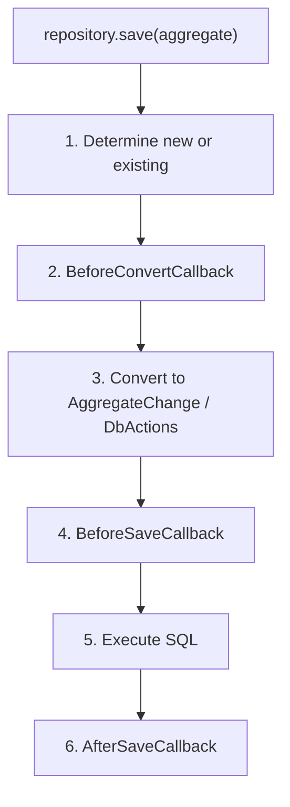

# BeforeConvertCallback và thời điểm quyết định insert/update

Trong Spring Data JDBC, khi gọi `repository.save(aggregate)`, framework cần xác định aggregate đang được tạo mới hay đã tồn tại để chọn câu lệnh INSERT hoặc UPDATE. Spring thực hiện quyết định này **trước khi gọi `BeforeConvertCallback`**.

Chi tiết thứ tự này rất quan trọng khi ứng dụng tự sinh ID. `BeforeConvertCallback` là vị trí phù hợp để gán ID cho một aggregate mới: framework đã xác định aggregate là mới, sau đó callback gán ID, rồi bước chuyển đổi tiếp theo sử dụng ID đó khi tạo câu lệnh INSERT. Việc ID vừa được gán không làm thay đổi quyết định INSERT đã có.

Bài học giải thích lifecycle của thao tác save, cách Spring xác định trạng thái new/existing, cách triển khai callback cho aggregate bất biến, và vì sao gán ID trong `BeforeSaveCallback` có thể quá muộn để thay đổi cách framework xử lý ID.

## 1. Hai quyết định khác nhau trong quá trình save

Khi lưu aggregate, có hai câu hỏi riêng biệt:

1. **Aggregate có mới không?** Câu trả lời quyết định Spring thực hiện INSERT hay UPDATE.
2. **ID sẽ do ai cung cấp?** Sau khi aggregate được chuyển đổi thành cấu trúc thay đổi dữ liệu, Spring xác định có gửi ID hiện có xuống database hay để database tự sinh ID.

Hai quyết định này diễn ra ở hai thời điểm khác nhau.

Ví dụ aggregate mới có ID ban đầu là null:

```text
Invoice đầu vào:
    id = null
    number = "INV-001"

Bước 1: Spring kiểm tra trạng thái
    id null -> aggregate mới
    quyết định: INSERT

Bước 2: BeforeConvertCallback
    gán id = "a UUID mới"

Bước 3: Tạo AggregateChange
    aggregate vẫn được INSERT
    ID đã có giá trị -> gửi ID đó trong INSERT

Bước 4: Thực thi SQL
    INSERT INTO invoices (id, number, ...)
    VALUES (?, ?, ...)
```

Điểm cốt lõi: **gán ID trong BeforeConvertCallback không đổi INSERT thành UPDATE**. Quyết định new/existing đã được đưa ra trước callback.

Ngược lại, nếu aggregate có ID khác null ngay khi gọi `save` và không có chiến lược newness nào khác đánh dấu nó là mới, Spring có thể xem aggregate là existing và chọn UPDATE. Gán hoặc thay đổi ID trong callback không thể quay lại thay đổi quyết định đó.

## 2. Thứ tự lifecycle khi lưu aggregate

Tài liệu Spring Data Relational mô tả thứ tự save như sau:



Mỗi bước có một trách nhiệm:

| Bước | Công việc | Ý nghĩa |
| --- | --- | --- |
| 1. Determine new/existing | Kiểm tra trạng thái aggregate. | Chọn INSERT hoặc UPDATE. |
| 2. `BeforeConvertCallback` | Cho phép sửa aggregate trước khi chuyển đổi. | Có thể tạo ID hoặc chuẩn hóa dữ liệu trước mapping. |
| 3. Convert | Tạo `AggregateChange` và các `DbAction`. | Xác định các thao tác SQL; xác định ID được truyền vào hay do database sinh. |
| 4. `BeforeSaveCallback` | Chạy sau khi AggregateChange đã được tạo. | Có thể xem/sửa aggregate change trước khi chạy SQL. |
| 5. Execute SQL | Thực thi các DbAction. | Ghi dữ liệu vào database. |
| 6. `AfterSaveCallback` | Chạy sau khi lưu. | Thực hiện xử lý sau persistence. |

Thứ tự này giải thích vì sao callback có tên “Before Convert” phù hợp để tạo ID, còn “Before Save” đã quá muộn cho việc thay đổi quyết định về chiến lược ID.

## 3. Spring xác định aggregate mới bằng cách nào?

Spring Data JDBC dùng trạng thái của aggregate để quyết định insert/update. Những chiến lược phổ biến gồm:

| Chiến lược | Quy tắc xác định new |
| --- | --- |
| Kiểm tra `@Id` (mặc định) | ID null hoặc 0 đối với primitive thì được xem là mới; ID có giá trị thì được xem là existing. |
| Kiểm tra `@Version` | Nếu có property version, null hoặc 0 đối với primitive biểu thị new; nếu có giá trị version khác thì existing. Khi không có version, framework quay về kiểm tra ID. |
| Implement `Persistable` | Spring gọi `isNew()` của aggregate để lấy quyết định. |

Khi có `@Version`, chiến lược version được ưu tiên để phát hiện newness. Vì vậy, một aggregate có ID được gán sẵn vẫn có thể được xem là mới nếu version của nó đang ở trạng thái khởi tạo biểu thị new.

### 3.1. ID null theo chiến lược mặc định

Ví dụ:

```java
@Table("invoices")
public record Invoice(
    @Id UUID id,
    String invoiceNumber,
    BigDecimal amount
) {}
```

Tạo aggregate mới:

```java
Invoice invoice = new Invoice(
    null,
    "INV-001",
    new BigDecimal("250.00")
);

Invoice saved = invoices.save(invoice);
```

Trước khi callback chạy, ID là null nên Spring phân loại aggregate là mới. Đây là trạng thái phù hợp để callback gán ID ứng dụng.

### 3.2. ID có sẵn không tự động có nghĩa là new

Nếu tạo UUID ngay trong constructor:

```java
Invoice invoice = new Invoice(
    UUID.randomUUID(),
    "INV-002",
    new BigDecimal("500.00")
);

invoices.save(invoice);
```

Với chiến lược kiểm tra ID mặc định và không có `@Version`/`Persistable` thay thế, ID đã khác null nên Spring có thể phân loại aggregate là existing và thực hiện UPDATE.

Nếu hàng chưa tồn tại, UPDATE có thể không tác động hàng nào hoặc dẫn đến lỗi tùy đường persistence và cấu hình. Không nên giả định ID tự sinh trong constructor khiến `save` luôn INSERT.

### 3.3. Dùng @Version để phát hiện newness

Ví dụ aggregate có version:

```java
@Table("invoices")
public record Invoice(
    @Id UUID id,
    @Version Long version,
    String invoiceNumber,
    BigDecimal amount
) {}
```

Nếu version là null, aggregate được xem là mới theo chiến lược version, ngay cả khi ID đã có giá trị. Sau khi insert, Spring cập nhật version theo cơ chế optimistic locking.

`@Version` còn có vai trò phát hiện cập nhật đồng thời; không nên thêm version chỉ để lách newness detection nếu domain không cần optimistic locking. Hãy chọn chiến lược dựa trên vòng đời và quy tắc concurrency của aggregate.

## 4. BeforeConvertCallback là gì?

`BeforeConvertCallback<T>` là một `EntityCallback<T>` của Spring Data Relational. Nó được gọi trước khi aggregate được chuyển đổi thành cấu trúc thay đổi database (`AggregateChange`).

Package:

```java
import org.springframework.data.relational.core.mapping.event.BeforeConvertCallback;
```

Interface có phương thức:

```java
T onBeforeConvert(T aggregate);
```

Callback nhận aggregate root và trả về aggregate sẽ được persistence. Nó có thể trả lại cùng instance hoặc một instance đã sửa đổi.

Callback phù hợp cho những thay đổi cần xuất hiện trong mapping và SQL được tạo ở bước sau, ví dụ:

- Sinh ID ứng dụng cho aggregate mới.
- Chuẩn hóa giá trị trước khi ghi.
- Gán mã nghiệp vụ được tạo từ dữ liệu aggregate.
- Bổ sung dữ liệu cần thiết trước khi tạo AggregateChange.

Callbacks được gọi cho aggregate root. Nếu cần xử lý entity con, hãy đi qua aggregate root chứa chúng và cập nhật collection/property tương ứng; đừng chờ Spring gọi callback riêng cho từng child entity.

## 5. Ví dụ tạo UUID trong BeforeConvertCallback

Giả sử ứng dụng không dùng ID auto-increment của database mà muốn tự tạo UUID cho mỗi invoice.

### 5.1. Domain aggregate bất biến

Dùng record để minh họa việc callback trả về instance mới:

```java
import java.math.BigDecimal;
import java.util.UUID;

import org.springframework.data.annotation.Id;
import org.springframework.data.relational.core.mapping.Table;

@Table("invoices")
public record Invoice(
    @Id UUID id,
    String invoiceNumber,
    BigDecimal amount
) {
    public Invoice withId(UUID newId) {
        return new Invoice(
            newId,
            invoiceNumber,
            amount
        );
    }
}
```

Schema:

```sql
CREATE TABLE invoices (
    id UUID PRIMARY KEY,
    invoice_number VARCHAR(40) NOT NULL UNIQUE,
    amount DECIMAL(12, 2) NOT NULL
);
```

Cột ID trong ví dụ nhận UUID do ứng dụng cung cấp.

### 5.2. Implement callback

```java
import java.util.UUID;

import org.springframework.data.relational.core.mapping.event.BeforeConvertCallback;
import org.springframework.stereotype.Component;

@Component
public class InvoiceIdGeneratingCallback
        implements BeforeConvertCallback<Invoice> {

    @Override
    public Invoice onBeforeConvert(Invoice invoice) {
        if (invoice.id() != null) {
            return invoice;
        }

        return invoice.withId(UUID.randomUUID());
    }
}
```

Điều kiện `invoice.id() != null` rất quan trọng. Callback được gọi cho cả aggregate mới và aggregate đã tồn tại. Chỉ tạo ID khi ID chưa có; không tạo UUID mới ở mọi lần save.

Vì Spring đã xác định aggregate là mới trước callback, việc trả về một Invoice có UUID không làm đổi thao tác đã chọn. Khi tạo AggregateChange sau đó, ID đã có giá trị nên được đưa vào câu INSERT.

### 5.3. Repository và sử dụng

```java
import java.util.UUID;

import org.springframework.data.repository.CrudRepository;

public interface InvoiceRepository
        extends CrudRepository<Invoice, UUID> {
}
```

Service:

```java
@Service
public class InvoiceService {

    private final InvoiceRepository invoices;

    public InvoiceService(InvoiceRepository invoices) {
        this.invoices = invoices;
    }

    public Invoice create(
        String invoiceNumber,
        BigDecimal amount
    ) {
        Invoice newInvoice = new Invoice(
            null,
            invoiceNumber,
            amount
        );

        return invoices.save(newInvoice);
    }
}
```

Luồng thực thi:

1. Service tạo Invoice có ID null.
2. Repository nhận aggregate và xác định đây là aggregate mới.
3. `InvoiceIdGeneratingCallback` tạo UUID.
4. Spring tạo AggregateChange cho thao tác INSERT với ID UUID đã có.
5. Database lưu invoice.
6. Kết quả save trả về aggregate được persistence theo callback và cơ chế ID của Spring Data JDBC.

Callback chỉ cấp ID. Nó không tự kiểm tra UUID đã tồn tại trong database; primary key constraint vẫn là lớp bảo vệ cuối cùng.

## 6. Tại sao BeforeSaveCallback quá muộn để tạo ID?

`BeforeSaveCallback<T>` được gọi sau khi aggregate đã được chuyển đổi thành `MutableAggregateChange<T>`.

Package:

```java
import org.springframework.data.relational.core.mapping.event.BeforeSaveCallback;
```

Chữ ký:

```java
T onBeforeSave(
    T aggregate,
    MutableAggregateChange<T> aggregateChange
);
```

Ở thời điểm này:

- Spring đã quyết định INSERT hay UPDATE.
- Các `DbAction` đã được tạo.
- Chiến lược ID đã được xác định: ID được gửi xuống database hay database cần sinh ID.
- Callback có thể quan sát hoặc chỉnh sửa aggregate change trước khi SQL chạy.

Vì vậy, nếu mục tiêu là tạo ID cho một aggregate mới, hãy dùng `BeforeConvertCallback`. Việc gán ID trong `BeforeSaveCallback` không quay lại thay đổi quyết định ID đã được đưa ra khi tạo AggregateChange.

### 6.1. Bảng so sánh hai callback

| Tiêu chí | `BeforeConvertCallback` | `BeforeSaveCallback` |
| --- | --- | --- |
| Thời điểm | Sau quyết định new/existing, trước khi tạo AggregateChange. | Sau khi AggregateChange được tạo, trước khi SQL chạy. |
| Nhận vào | Aggregate root. | Aggregate root và MutableAggregateChange. |
| Có thể trả instance đã sửa? | Có. | Có. |
| Phù hợp để tạo ID mới? | Có. | Không nên; quá muộn cho quyết định ID. |
| Có thể truy cập DbAction? | Chưa, vì AggregateChange chưa được tạo. | Có, qua AggregateChange. |
| Mục đích điển hình | Sinh ID, chuẩn hóa aggregate trước mapping. | Điều chỉnh AggregateChange hoặc thao tác trước khi SQL thực thi. |

### 6.2. Đừng nhầm tên callback với thứ tự newness

Tên `BeforeConvertCallback` có thể khiến người đọc nghĩ callback chạy trước mọi quyết định persistence. Thực tế, quyết định aggregate mới hay existing đã xảy ra trước đó.

Điều callback chạy trước là **chuyển đổi aggregate thành AggregateChange**, không phải trước bước phát hiện newness.

Đây là khác biệt cốt lõi cần nhớ khi thiết kế ID generation.

## 7. Điều gì xảy ra nếu callback thay đổi ID của aggregate existing?

Giả sử database đã có invoice với ID `A`. Khi gọi `save` với object đó, Spring xác định aggregate là existing trước khi callback chạy.

Nếu callback thay ID thành `B`:

```java
@Override
public Invoice onBeforeConvert(Invoice invoice) {
    return invoice.withId(UUID.randomUUID());
}
```

thì framework không quay lại chọn INSERT. Nó vẫn đang thực hiện đường UPDATE đã chọn từ đầu, nhưng dữ liệu chuyển đổi có thể chứa ID mới. Đây là thay đổi nguy hiểm và có thể dẫn đến update nhầm hàng, lỗi optimistic locking hoặc dữ liệu không nhất quán tùy cách mapping và SQL được tạo.

Vì vậy:

- Chỉ gán ID khi aggregate thực sự chưa có ID và callback được dùng cho quy tắc tạo mới.
- Không thay ID của aggregate existing.
- Không dùng callback để đổi định danh của một aggregate đã tồn tại.
- Nếu nghiệp vụ cần đổi khóa định danh, hãy thiết kế một use case migration/đổi khóa rõ ràng, không làm ngầm trong lifecycle callback.

Callback có thể được gọi ở nhiều lần save, nên phải viết theo hướng an toàn khi chạy lặp.

## 8. ID do database sinh và ID do ứng dụng sinh

Hai chiến lược cần được phân biệt.

### 8.1. Database-generated ID

Nếu database có identity/auto-increment:

```sql
CREATE TABLE invoices (
    id BIGINT GENERATED BY DEFAULT AS IDENTITY PRIMARY KEY,
    invoice_number VARCHAR(40) NOT NULL
);
```

Domain:

```java
@Table("invoices")
public record Invoice(
    @Id Long id,
    String invoiceNumber
) {}
```

Khi tạo mới, để ID null:

```java
Invoice invoice = new Invoice(null, "INV-DB-001");
Invoice saved = invoices.save(invoice);
```

Spring giữ ID ở trạng thái rỗng khi tạo AggregateChange để database sinh ID. Sau insert, generated key được gán vào aggregate trả về.

Trong trường hợp này, không cần callback chỉ để database tạo ID. Nếu callback tự gán một ID trước khi tạo AggregateChange, Spring có thể gửi ID đó xuống INSERT thay vì để database sinh.

### 8.2. Application-generated ID

Nếu ứng dụng muốn tự tạo UUID, callback có thể gán ID sau khi Spring đã phân loại aggregate là new:

```java
@Override
public Invoice onBeforeConvert(Invoice invoice) {
    return invoice.id() == null
        ? invoice.withId(UUID.randomUUID())
        : invoice;
}
```

Khi AggregateChange được tạo, ID đã có giá trị và được gửi trong INSERT.

### 8.3. So sánh

| Đặc điểm | Database-generated | Application-generated trong BeforeConvert |
| --- | --- | --- |
| ID trước save | null/giá trị ban đầu | null/giá trị ban đầu |
| Ai tạo ID? | Database | Callback/ứng dụng |
| ID ở bước tạo AggregateChange | Rỗng để database sinh | Đã có giá trị |
| Có cần callback? | Không chỉ để lấy generated ID | Có thể dùng callback để cấp ID |
| Ví dụ | BIGINT identity | UUID |

Không trộn lẫn hai chiến lược trong cùng một luồng mà không có chủ đích. Hãy xác định rõ ai là nguồn cấp ID và schema phải tương ứng.

## 9. ID được tạo từ constructor và Persistable

Một lựa chọn khác là tạo UUID ngay khi khởi tạo object:

```java
public Invoice(String invoiceNumber, BigDecimal amount) {
    this.id = UUID.randomUUID();
    this.invoiceNumber = invoiceNumber;
    this.amount = amount;
}
```

Cách này tiện vì ID có sẵn trước khi gọi repository. Nhưng với chiến lược mặc định kiểm tra ID, một object có ID khác null sẽ bị xem là existing.

Nếu muốn tạo ID trong constructor, cần một chiến lược newness khác, ví dụ:

- Có property `@Version` ở trạng thái null/0 để Spring nhận diện new.
- Implement `Persistable<ID>` và trả về trạng thái `isNew()` chính xác.
- Dùng callback để tạo ID sau khi Spring đã nhận diện object mới từ ID null.

`Persistable` hữu ích khi ứng dụng tự quản lý vòng đời new/existing, nhưng cần cập nhật trạng thái sau khi persist/load một cách chính xác. Nếu `isNew()` tiếp tục trả true sau khi đã insert, lần save tiếp theo có thể cố INSERT lần nữa.

Không nên triển khai một cờ `isNew` chỉ để né hiểu biết về thứ tự lifecycle. Chỉ dùng khi mô hình định danh và trạng thái entity thực sự cần nó.

## 10. @Version và BeforeConvertCallback

Khi aggregate root có `@Version`, Spring dùng version để xác định trạng thái new/existing theo quy tắc của Spring Data Relational:

- Version reference type null biểu thị aggregate mới.
- Version primitive bằng 0 biểu thị aggregate mới.
- Version đã có giá trị khác trạng thái khởi tạo biểu thị aggregate existing.
- Nếu không có property version, Spring dùng chiến lược ID.

Ví dụ:

```java
@Table("invoices")
public record Invoice(
    @Id UUID id,
    @Version Long version,
    String invoiceNumber,
    BigDecimal amount
) {}
```

Nếu version null, Spring đã xác định aggregate mới trước callback. Callback có thể tạo UUID nếu ID đang null:

```java
@Component
public class InvoiceCallback
        implements BeforeConvertCallback<Invoice> {

    @Override
    public Invoice onBeforeConvert(Invoice invoice) {
        if (invoice.id() != null) {
            return invoice;
        }

        return new Invoice(
            UUID.randomUUID(),
            invoice.version(),
            invoice.invoiceNumber(),
            invoice.amount()
        );
    }
}
```

Sau khi insert, Spring quản lý version theo cơ chế optimistic locking. Trong lần save sau, version đã được cập nhật và aggregate được nhận diện là existing.

Không thay version tùy tiện trong callback. Version là metadata concurrency; thay đổi nó không phải cách an toàn để ép INSERT hoặc UPDATE.

## 11. Callback chỉ chạy trên đường persistence aggregate

Các lifecycle callback save/delete của Spring Data JDBC gắn với quá trình persistence aggregate. Chúng không được gọi cho các derived query method hoặc annotated query thay đổi dữ liệu, vì framework không xác định aggregate nào bị ảnh hưởng bởi SQL đó.

Ví dụ một method:

```java
@Modifying
@Query("""
    UPDATE invoices
    SET status = :status
    WHERE id = :id
    """)
int updateStatus(
    @Param("id") UUID id,
    @Param("status") String status
);
```

Đường SQL trực tiếp này không đi qua quá trình `repository.save(aggregate)`, nên không chạy `BeforeConvertCallback`/`BeforeSaveCallback` như save aggregate thông thường.

Nếu một thao tác direct SQL cần dữ liệu audit hoặc ID, hãy cập nhật trực tiếp trong SQL/trigger hoặc dùng một đường persistence phù hợp. Đừng dựa vào callback để xử lý query viết tay.

## 12. Callback hay ApplicationEvent?

Spring Data Relational có cả lifecycle events và EntityCallback API. Hai cơ chế có mục đích gần nhau nhưng khác cách vận hành.

| Đặc điểm | EntityCallback | Lifecycle event |
| --- | --- | --- |
| Cách sử dụng | Implement interface callback. | Đăng ký ApplicationListener/event listener. |
| Kết quả trả về | Có thể trả aggregate đã sửa đổi. | Event chủ yếu dùng để thông báo; một số event có entity mutable nhưng không linh hoạt bằng callback. |
| Hỗ trợ immutable aggregate | Phù hợp vì callback trả instance mới. | Kém thuận tiện hơn với immutable object. |
| Thứ tự xử lý | Callback API thực thi đồng bộ theo lifecycle. | Phụ thuộc ApplicationEventMulticaster; có thể cấu hình executor bất đồng bộ. |
| Mục đích | Thay đổi entity trong lifecycle persistence. | Quan sát/thông báo về lifecycle. |

Nếu cần gán ID hoặc sửa aggregate trước khi chuyển đổi, ưu tiên `BeforeConvertCallback`. Nếu chỉ cần ghi log/quan sát một sự kiện save, listener có thể phù hợp hơn.

Không dùng event listener bất đồng bộ để sửa aggregate rồi kỳ vọng thay đổi đó chắc chắn được đưa vào câu SQL đang thực thi. Khi event được xử lý trên thread khác hoặc sau thời điểm cần thiết, thay đổi có thể đến quá muộn.

## 13. Callback và aggregate bất biến

Một lợi thế của EntityCallback là callback có thể trả về instance mới. Điều này phù hợp với record hoặc immutable class.

Ví dụ:

```java
public record Invoice(
    UUID id,
    String invoiceNumber,
    BigDecimal amount
) {
    public Invoice withId(UUID id) {
        return new Invoice(id, invoiceNumber, amount);
    }

    public Invoice withNormalizedNumber() {
        return new Invoice(
            id,
            invoiceNumber.trim().toUpperCase(Locale.ROOT),
            amount
        );
    }
}
```

Callback:

```java
@Component
public class InvoiceNormalizationCallback
        implements BeforeConvertCallback<Invoice> {

    @Override
    public Invoice onBeforeConvert(Invoice invoice) {
        Invoice normalized = invoice.withNormalizedNumber();

        if (normalized.id() == null) {
            return normalized.withId(UUID.randomUUID());
        }

        return normalized;
    }
}
```

Ở ví dụ này callback tạo một instance đã chuẩn hóa và có ID. Hãy bảo đảm quy tắc normalization thực sự là quy tắc persistence chung cho mọi đường lưu Invoice. Nếu chỉ một use case cần chuẩn hóa, service/domain method tường minh có thể dễ hiểu hơn callback toàn cục.

## 14. Đăng ký và phạm vi áp dụng callback

Khai báo callback thành Spring bean bằng component scan:

```java
@Component
public class InvoiceIdGeneratingCallback
        implements BeforeConvertCallback<Invoice> {
    // ...
}
```

Hoặc đăng ký bằng configuration:

```java
@Configuration
public class InvoiceCallbackConfiguration {

    @Bean
    BeforeConvertCallback<Invoice> invoiceIdCallback() {
        return invoice -> invoice.id() == null
            ? invoice.withId(UUID.randomUUID())
            : invoice;
    }
}
```

Spring Data phát hiện EntityCallback bean và gọi callback phù hợp với kiểu aggregate. Generic type giúp callback gắn với `Invoice` thay vì mọi aggregate.

Một số lưu ý:

- Callback phải là bean trong application context.
- Component scan phải bao phủ package callback.
- Với nhiều callback cùng kiểu, cân nhắc thứ tự nếu callback sau phụ thuộc kết quả callback trước.
- Tránh side effect ngoài database trong callback vì callback có thể được gọi ở nhiều đường save và trong transaction.
- Không truy vấn lại cùng aggregate một cách đệ quy từ callback, vì có thể tạo vòng lặp persistence hoặc hành vi khó đoán.

## 15. Kiểm thử thời điểm quyết định INSERT

Một integration test hữu ích cần chứng minh rằng ID được tạo trong BeforeConvert vẫn dẫn tới INSERT.

Ví dụ:

```java
@DataJdbcTest
@Import(InvoiceIdGeneratingCallback.class)
class InvoiceCallbackTest {

    @Autowired
    InvoiceRepository invoices;

    @Autowired
    JdbcTemplate jdbc;

    @Test
    void generatesIdAndInsertsNewAggregate() {
        Invoice saved = invoices.save(
            new Invoice(
                null,
                "INV-NEW-001",
                new BigDecimal("125.00")
            )
        );

        assertThat(saved.id()).isNotNull();

        Integer count = jdbc.queryForObject(
            "SELECT COUNT(*) FROM invoices WHERE id = ?",
            Integer.class,
            saved.id()
        );

        assertThat(count).isEqualTo(1);
    }
}
```

Test cần schema `invoices` tương ứng và callback được import vào test context. Nó xác nhận đường save tạo row với ID callback sinh ra.

### 15.1. Kiểm thử callback không đổi ID existing

Lưu một invoice, sau đó gọi save lần nữa:

```java
@Test
void preservesIdWhenSavingExistingAggregate() {
    Invoice first = invoices.save(
        new Invoice(null, "INV-EXISTING-001",
            new BigDecimal("100.00"))
    );

    UUID originalId = first.id();

    Invoice changed = new Invoice(
        originalId,
        first.invoiceNumber(),
        new BigDecimal("150.00")
    );

    Invoice savedAgain = invoices.save(changed);

    assertThat(savedAgain.id()).isEqualTo(originalId);
}
```

Test này kiểm tra callback chỉ tạo ID khi thiếu. Nếu callback tạo UUID mới ở mọi lần chạy, test sẽ phát hiện định danh bị thay đổi.

### 15.2. Kiểm thử callback được gọi trước khi tạo AggregateChange

Không cần phụ thuộc vào chi tiết nội bộ của từng `DbAction` để kiểm thử business behavior. Thường chỉ cần xác nhận:

- Aggregate đầu vào có ID null.
- Callback trả về aggregate có ID.
- Repository lưu được row.
- ID đã tạo là ID được dùng trong database.
- Lần save tiếp theo không tạo ID khác.

Nếu cần kiểm tra thứ tự lifecycle cụ thể, có thể dùng callback spy hoặc ghi nhận thứ tự các callback trong integration test. Tuy nhiên, tránh viết test phụ thuộc vào implementation detail không thuộc contract public của phiên bản đang sử dụng.

## 16. Những lỗi thường gặp

| Hiện tượng | Nguyên nhân | Hướng xử lý |
| --- | --- | --- |
| Callback gán ID nhưng repository vẫn UPDATE | Aggregate đã được phân loại existing trước callback. | Để ID null trước save hoặc dùng chiến lược newness phù hợp. |
| Gán ID trong BeforeSave nhưng database vẫn chờ generated ID | Quyết định ID đã được đưa ra khi tạo AggregateChange. | Dùng BeforeConvertCallback. |
| Mỗi lần save lại tạo UUID mới | Callback không kiểm tra ID hiện có. | Chỉ tạo ID khi ID null. |
| UUID được tạo trong constructor nhưng row không được INSERT | ID đã khác null nên default ID inspection xem là existing. | Dùng callback sau newness detection, @Version hoặc Persistable. |
| Callback không được gọi với @Modifying query | Direct SQL không đi qua aggregate save lifecycle. | Cập nhật dữ liệu trong SQL/trigger hoặc dùng repository.save. |
| Callback không chạy cho child entity | EntityCallback gắn với aggregate root. | Xử lý child thông qua root callback. |
| Event listener sửa object nhưng SQL không thấy thay đổi | Event có thể được xử lý bất đồng bộ hoặc không trả instance đã sửa. | Dùng EntityCallback để biến đổi aggregate. |
| Thay ID existing trong callback gây lỗi | Quyết định UPDATE đã được chọn; ID thay đổi quá muộn. | Không đổi ID aggregate đã tồn tại. |
| Callback gọi save lại chính repository | Gây đệ quy hoặc persistence lặp. | Giữ callback thuần, không gọi lại repository cho cùng aggregate. |
| Test chỉ kiểm tra callback unit mà không kiểm tra insert | Chưa xác nhận callback được đăng ký và mapping thực tế. | Thêm repository integration test. |

## 17. Quy trình lựa chọn callback

Khi cần thay đổi aggregate trước khi ghi:

1. Xác định ID do database hay ứng dụng sinh.
2. Xác định cách Spring nhận diện aggregate mới: ID, version hay Persistable.
3. Nếu cần gán ID ứng dụng cho aggregate mới có ID ban đầu null, dùng `BeforeConvertCallback`.
4. Giữ callback có điều kiện để không đổi ID của aggregate existing.
5. Dùng `BeforeSaveCallback` khi cần thao tác trên AggregateChange đã được tạo, không dùng nó để quyết định INSERT/UPDATE.
6. Dùng `AfterSaveCallback` cho xử lý sau khi SQL đã thực thi.
7. Nếu thao tác dùng derived/annotated modifying query, không trông đợi lifecycle save callback.
8. Ưu tiên EntityCallback cho thay đổi entity; dùng event cho mục đích thông báo.
9. Kiểm thử cả lần insert đầu tiên và lần save tiếp theo.
10. Xác nhận callback bean được đăng ký trong application context và hoạt động với đúng aggregate root.

> **BeforeConvertCallback chạy sau khi Spring đã quyết định aggregate là mới hay existing, nhưng trước khi tạo AggregateChange.** Vì vậy, callback có thể gán ID cho một aggregate đã được phân loại là mới mà vẫn giữ đường INSERT; bước chuyển đổi tiếp theo sẽ dùng ID đó thay vì chờ database sinh. BeforeSaveCallback chạy sau khi quyết định và kế hoạch SQL đã được tạo, nên không phải nơi để tạo ID cho aggregate mới.

### Tài liệu tham khảo

- [Spring Data Relational — Lifecycle Events and EntityCallbacks](https://docs.spring.io/spring-data/relational/reference/jdbc/events.html): thứ tự callback, sự kiện và quá trình save aggregate.
- [Spring Data Relational — BeforeConvertCallback API](https://docs.spring.io/spring-data/relational/reference/api/java/org/springframework/data/relational/core/mapping/event/BeforeConvertCallback.html): chữ ký callback và thời điểm quyết định insert/update.
- [Spring Data Relational — BeforeSaveCallback API](https://docs.spring.io/spring-data/jdbc/docs/current/api/org/springframework/data/relational/core/mapping/event/BeforeSaveCallback.html): callback sau khi AggregateChange được tạo.
- [Spring Data Relational — Persisting Entities](https://docs.spring.io/spring-data/relational/reference/jdbc/entity-persistence.html): save aggregate, ID generation và optimistic locking.
- [Spring Data Relational — Repository Core Concepts](https://docs.spring.io/spring-data/relational/reference/repositories/core-concepts.html): các chiến lược phát hiện entity mới.
- [Spring Data Commons — Entity Callbacks](https://docs.spring.io/spring-data/commons/reference/entity-callbacks.html): callback API và cách đăng ký callback.
