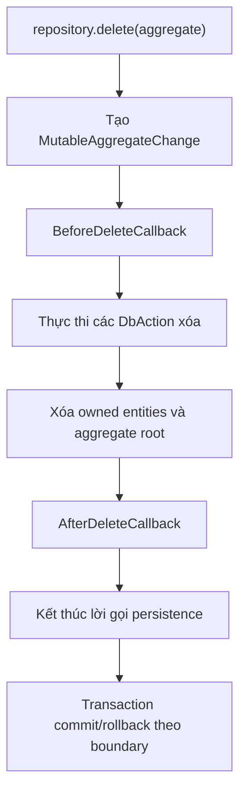

# `BeforeDeleteCallback` và `AfterDeleteCallback`

Trong **Spring Data Relational JDBC**, một lần xóa aggregate có thể cần thực hiện logic trước và sau khi các câu SQL xóa được chạy. Ví dụ, ứng dụng muốn ghi log về aggregate sắp bị xóa, bổ sung hành động vào kế hoạch xóa, hoặc thực hiện bookkeeping sau khi database đã xóa aggregate.

Spring Data JDBC cung cấp hai entity callback dành riêng cho vòng đời xóa:

- **`BeforeDeleteCallback<T>`** được gọi trước khi aggregate root bị xóa. Callback nhận aggregate và `MutableAggregateChange<T>` — kế hoạch các thao tác database sẽ thực hiện.
- **`AfterDeleteCallback<T>`** được gọi sau khi aggregate root đã được xóa. Callback nhận aggregate vừa bị xóa.

Hai callback làm việc ở cấp **aggregate root**. Các entity con được sở hữu sẽ bị xóa theo kế hoạch aggregate, nhưng callback không được gọi riêng cho từng child.

Điều kiện kích hoạt rất quan trọng: callback chỉ được gọi khi phương thức xóa nhận **instance của aggregate** làm đối số, ví dụ `repository.delete(customer)`. Xóa theo ID, xóa không có tham số, derived delete query và annotated query không kích hoạt các callback này.

## 1. Vị trí của delete callbacks trong vòng đời aggregate

Khi xóa một aggregate qua Spring Data JDBC repository hoặc `JdbcAggregateTemplate`, quy trình ở mức khái niệm là:

1. Ứng dụng truyền aggregate instance vào thao tác delete.
2. Spring Data JDBC tạo kế hoạch xóa (`MutableAggregateChange`) cho aggregate root và các entity được sở hữu.
3. `BeforeDeleteCallback` được gọi với aggregate cùng kế hoạch xóa.
4. Các câu SQL xóa những entity thuộc aggregate được thực thi theo thứ tự phù hợp với quan hệ dữ liệu.
5. `AfterDeleteCallback` được gọi sau khi thao tác xóa aggregate hoàn tất ở tầng persistence.



`BeforeDeleteCallback` chạy trước SQL delete; `AfterDeleteCallback` chạy sau khi SQL delete đã được thực thi. Nếu lời gọi nằm trong transaction do Spring quản lý, callback vẫn là một phần của quy trình transaction đó. **“After delete” không đồng nghĩa “after commit”**: transaction bao quanh repository/service có thể chỉ commit sau khi method transactional kết thúc.

## 2. `BeforeDeleteCallback<T>`

Interface nằm trong package:

```java
import org.springframework.data.relational.core.mapping.event.BeforeDeleteCallback;
```

Method callback có chữ ký:

```java
T onBeforeDelete(T aggregate, MutableAggregateChange<T> aggregateChange);
```

Tham số:

| Tham số | Ý nghĩa |
|---|---|
| `aggregate` | Aggregate root đang được yêu cầu xóa |
| `aggregateChange` | Kế hoạch các `DbAction` sẽ được thực thi cho thao tác xóa |

Callback trả về aggregate (có thể là instance ban đầu hoặc instance đã sửa). Nó cũng có thể thay đổi nội dung `MutableAggregateChange`.

### Lưu ý về thời điểm tạo kế hoạch xóa

`BeforeDeleteCallback` được gọi **sau khi aggregate đã được chuyển thành `MutableAggregateChange`**. Vì vậy, thay đổi các property persistent trên object `aggregate` trong callback không làm thay đổi kế hoạch xóa đã được tạo. API khuyến nghị chỉ thay đổi các field transient của aggregate trong callback này.

Nếu cần can thiệp vào kế hoạch persistence, callback có thể thao tác với `aggregateChange`. Đây là API ở mức thấp: chỉ bổ sung/chỉnh sửa `DbAction` khi hiểu rõ thứ tự thực thi, khóa ngoại và semantics của aggregate. Với phần lớn use case, chỉ cần đọc aggregate, ghi log hoặc kiểm tra điều kiện; không cần thay đổi kế hoạch nội bộ.

### Ví dụ: ghi log trước khi xóa Customer

```java
package com.example.customer;

import org.slf4j.Logger;
import org.slf4j.LoggerFactory;
import org.springframework.data.relational.core.conversion.MutableAggregateChange;
import org.springframework.data.relational.core.mapping.event.BeforeDeleteCallback;
import org.springframework.stereotype.Component;

@Component
public class CustomerBeforeDeleteCallback
        implements BeforeDeleteCallback<Customer> {

    private static final Logger log =
            LoggerFactory.getLogger(CustomerBeforeDeleteCallback.class);

    @Override
    public Customer onBeforeDelete(
            Customer aggregate,
            MutableAggregateChange<Customer> aggregateChange) {

        log.info("Deleting customer id={}, email={}",
                aggregate.getId(), aggregate.getEmail());

        return aggregate;
    }
}
```

Spring phát hiện callback dưới dạng bean trong application context. Có thể đăng ký bằng `@Component` hoặc khai báo bean trong `@Configuration`. Generic type `Customer` giới hạn callback cho aggregate root đó.

Ví dụ này chỉ ghi log. Nếu email là dữ liệu nhạy cảm, không nên ghi giá trị đầy đủ vào log; hãy tuân theo chính sách bảo vệ dữ liệu và chỉ ghi định danh phù hợp.

## 3. `AfterDeleteCallback<T>`

Interface nằm trong cùng package:

```java
import org.springframework.data.relational.core.mapping.event.AfterDeleteCallback;
```

Method callback:

```java
T onAfterDelete(T aggregate);
```

`AfterDeleteCallback` nhận aggregate root đã bị xóa và có thể trả lại cùng instance hoặc một instance đã sửa. Giá trị trả về phục vụ chuỗi callback; nó không làm sống lại aggregate hoặc ghi các thay đổi trở lại database.

### Ví dụ: ghi nhận thao tác xóa sau persistence

```java
package com.example.customer;

import org.slf4j.Logger;
import org.slf4j.LoggerFactory;
import org.springframework.data.relational.core.mapping.event.AfterDeleteCallback;
import org.springframework.stereotype.Component;

@Component
public class CustomerAfterDeleteCallback
        implements AfterDeleteCallback<Customer> {

    private static final Logger log =
            LoggerFactory.getLogger(CustomerAfterDeleteCallback.class);

    @Override
    public Customer onAfterDelete(Customer aggregate) {
        log.info("Customer aggregate deleted, id={}", aggregate.getId());
        return aggregate;
    }
}
```

Callback có thể đọc dữ liệu còn có trong object aggregate để ghi nhận thông tin. Database row đã bị xóa theo kế hoạch persistence; sửa object trong `onAfterDelete` không cập nhật một row đã biến mất.

## 4. Gắn cả hai callback vào cùng một bean

Nếu logic trước và sau xóa liên quan chặt chẽ, một class có thể triển khai cả hai interface:

```java
@Component
public class CustomerDeleteCallbacks implements
        BeforeDeleteCallback<Customer>,
        AfterDeleteCallback<Customer> {

    private static final Logger log =
            LoggerFactory.getLogger(CustomerDeleteCallbacks.class);

    @Override
    public Customer onBeforeDelete(
            Customer aggregate,
            MutableAggregateChange<Customer> aggregateChange) {

        log.info("About to delete customer {}", aggregate.getId());
        return aggregate;
    }

    @Override
    public Customer onAfterDelete(Customer aggregate) {
        log.info("Deleted customer {}", aggregate.getId());
        return aggregate;
    }
}
```

Tách thành hai bean cũng hợp lệ khi hai giai đoạn có dependency hoặc trách nhiệm khác nhau. Nên giữ callback nhỏ và tránh đưa toàn bộ use case xóa vào callback.

## 5. Cách đăng ký callback

Spring Data JDBC sử dụng `EntityCallback` infrastructure của Spring Data. Callback cần được đăng ký như một Spring bean để infrastructure phát hiện và gọi.

### Cách 1: `@Component`

```java
@Component
public class CustomerBeforeDeleteCallback
        implements BeforeDeleteCallback<Customer> {
    // implementation
}
```

Phù hợp khi component scan đã bao phủ package callback.

### Cách 2: `@Bean`

```java
@Configuration
public class CustomerCallbackConfiguration {

    @Bean
    BeforeDeleteCallback<Customer> customerBeforeDeleteCallback() {
        return (customer, change) -> {
            // Logic trước khi xóa.
            return customer;
        };
    }

    @Bean
    AfterDeleteCallback<Customer> customerAfterDeleteCallback() {
        return customer -> {
            // Logic sau khi SQL delete được thực thi.
            return customer;
        };
    }
}
```

Cách này phù hợp khi callback cần cấu hình hoặc dependency được tạo từ các bean khác. Không tự tạo `EntityCallbacks` mới nếu Spring Data JDBC đã cấu hình infrastructure; hãy đăng ký callback trong application context mà repository/template đang sử dụng.

## 6. Những phương thức delete nào kích hoạt callback?

Đây là khác biệt cần nhớ khi chọn API xóa:

| Thao tác | Có gọi `BeforeDeleteCallback` / `AfterDeleteCallback`? | Lý do |
|---|---|---|
| `repository.delete(entity)` | Có | Phương thức nhận aggregate instance |
| `repository.deleteAll(entities)` | Có, cho từng aggregate instance được xử lý | Phương thức nhận các aggregate instance |
| `aggregateTemplate.delete(entity)` | Có | Template nhận aggregate instance |
| `repository.deleteById(id)` | Không | Chỉ nhận identifier, không có aggregate instance |
| `repository.deleteAllById(ids)` | Không | Chỉ nhận identifiers |
| `repository.deleteAll()` | Không | Không nhận aggregate instance |
| Derived delete method, ví dụ `deleteByStatus(...)` | Không | Query method không cung cấp từng aggregate instance cho callback |
| Annotated delete query (`@Query`/`@Modifying`) | Không | SQL được thực thi trực tiếp, framework không xác định từng aggregate bị tác động |
| `JdbcTemplate.update("DELETE ...")` | Không | JDBC trực tiếp, không đi qua aggregate lifecycle |

Spring Data JDBC không có cách hiệu quả để xác định tất cả aggregate bị ảnh hưởng bởi một derived query hoặc annotated query, vì vậy các delete/save callbacks và lifecycle events không được gọi cho những đường này.

### Khi cần callback, tải aggregate rồi xóa bằng instance

Nếu use case cần callback và cần biết dữ liệu aggregate trước khi xóa:

```java
@Service
public class CustomerDeletionService {

    private final CustomerRepository repository;

    public CustomerDeletionService(CustomerRepository repository) {
        this.repository = repository;
    }

    @Transactional
    public void deleteCustomer(Long id) {
        Customer customer = repository.findById(id)
                .orElseThrow(() -> new CustomerNotFoundException(id));

        repository.delete(customer);
    }
}
```

Đường gọi `delete(customer)` nhận instance nên callback được kích hoạt. Lưu ý việc đọc rồi xóa có thể gặp race condition nếu dữ liệu thay đổi giữa hai bước; dùng transaction và cơ chế concurrency/constraint phù hợp với nghiệp vụ. Không nên chuyển mọi thao tác xóa sang tải aggregate chỉ để kích hoạt callback nếu không cần dữ liệu đó.

## 7. Callback chỉ áp dụng cho aggregate root

Giả sử aggregate:

```text
PurchaseOrder (root)
  ├── OrderLine
  └── OrderLine
```

Khi xóa `PurchaseOrder`, Spring Data JDBC xóa các entity được sở hữu trong aggregate theo kế hoạch persistence. `BeforeDeleteCallback<PurchaseOrder>` và `AfterDeleteCallback<PurchaseOrder>` được gọi cho root.

Framework không tự gọi `BeforeDeleteCallback<OrderLine>` rồi `AfterDeleteCallback<OrderLine>` cho từng dòng con như thể mỗi child là một aggregate độc lập. Nếu cần xử lý dữ liệu child:

- Dùng aggregate root trong callback để đọc collection con nếu aggregate instance có sẵn và cần thiết.
- Thực hiện nghiệp vụ child-specific ở application service trước khi xóa root.
- Nếu child có vòng đời/identity độc lập và cần callback riêng, xem lại aggregate boundary để child có thể trở thành root riêng.

Không dựa vào callback root để thực thi một side effect cho từng child mà không tính đến số lượng và cấu trúc aggregate. Với aggregate lớn, xử lý từng child trong callback có thể làm tăng đáng kể thời gian xóa.

## 8. Callback không thay thế domain rule hoặc kiểm soát quyền xóa

Có thể dùng `BeforeDeleteCallback` để kiểm tra một điều kiện và ném exception nếu không cho phép tiếp tục. Tuy nhiên, callback chỉ được gọi trên những đường xóa nhận aggregate instance. `deleteById`, bulk delete query và direct SQL không kích hoạt callback.

Do đó, không nên đặt invariant bảo mật hoặc quy tắc nghiệp vụ bắt buộc duy nhất trong `BeforeDeleteCallback`. Nếu quy tắc là “không xóa khách hàng còn đơn hàng chưa hoàn tất”, hãy đặt kiểm tra ở application/domain service và bảo vệ bằng database constraint hoặc transaction/concurrency strategy phù hợp.

Ví dụ kiểm tra trong use case:

```java
@Transactional
public void deleteCustomer(Long customerId) {
    Customer customer = customerRepository.findById(customerId)
            .orElseThrow(() -> new CustomerNotFoundException(customerId));

    if (orderRepository.existsOpenOrderForCustomer(customerId)) {
        throw new CustomerHasOpenOrdersException(customerId);
    }

    customerRepository.delete(customer);
}
```

Callback có thể bổ sung logging/metrics hoặc kiểm tra phụ trợ, nhưng application service mới là nơi thể hiện rõ use case và điều kiện nghiệp vụ cho mọi đường gọi.

## 9. Exception trong callback và transaction rollback

Callback là một phần của chuỗi persistence đồng bộ. Nếu `BeforeDeleteCallback` ném exception, việc xóa chưa được thực thi. Nếu `AfterDeleteCallback` ném exception, các câu SQL delete có thể đã chạy nhưng transaction bao quanh thao tác vẫn chưa chắc đã commit.

Với transaction Spring đang hoạt động:

- Runtime exception thoát khỏi transactional method thường đánh dấu transaction rollback.
- Nếu `AfterDeleteCallback` ném runtime exception và exception thoát khỏi transaction boundary, thay đổi database trong transaction đó có thể rollback.
- Nếu exception bị bắt và nuốt bên trong method, transaction có thể tiếp tục/commit tùy trạng thái rollback-only và nơi phát sinh lỗi.
- Checked exception không mặc định kích hoạt rollback; dùng `rollbackFor` nếu cần.

Ví dụ:

```java
@Transactional(rollbackFor = CustomerDeletionException.class)
public void deleteCustomer(Customer customer) throws CustomerDeletionException {
    customerRepository.delete(customer);
}
```

Hãy giữ callback đơn giản và để exception phản ánh lỗi thực sự. Không dùng callback để điều phối một workflow dài hoặc thực hiện nhiều network call khi transaction đang mở.

## 10. Không nhầm `AfterDeleteCallback` với xử lý sau commit

Tên `AfterDeleteCallback` có thể khiến người đọc nghĩ rằng database đã commit. Thực tế callback được gọi sau khi các thao tác delete aggregate được thực thi trong quy trình persistence, nhưng transaction bên ngoài có thể vẫn đang mở.

Ví dụ không nên:

```java
@Override
public Customer onAfterDelete(Customer customer) {
    emailClient.sendAccountDeleted(customer.getEmail());
    return customer;
}
```

Nếu email gửi thành công nhưng transaction sau đó rollback, khách hàng vẫn còn trong database nhưng đã nhận email thông báo xóa. Callback không thể rollback một network call.

### Cách phù hợp cho side effect bên ngoài

Nếu cần thông báo sau khi xóa commit thành công, có thể:

1. Ghi một outbox row cùng transaction với thao tác xóa.
2. Sau commit, worker đọc outbox và gửi message/email.
3. Consumer/worker xử lý idempotent và retry khi gặp lỗi tạm thời.

Hoặc publish một Spring application event rồi lắng nghe bằng `@TransactionalEventListener(phase = TransactionPhase.AFTER_COMMIT)` nếu semantics và yêu cầu độ bền của ứng dụng phù hợp. Với thông báo quan trọng không được mất khi process dừng, transactional outbox thường đáng tin cậy hơn event in-memory.

`AfterDeleteCallback` phù hợp với logic đồng bộ trong quy trình persistence; `AFTER_COMMIT` listener hoặc outbox phù hợp với hành động cần đợi transaction commit.

## 11. Phân biệt EntityCallback với lifecycle ApplicationEvent

Spring Data JDBC còn phát các event `BeforeDeleteEvent` và `AfterDeleteEvent`. Chúng có tên tương ứng nhưng khác mục đích và cơ chế với `BeforeDeleteCallback`/`AfterDeleteCallback`.

| Tiêu chí | Entity callback | Lifecycle event |
|---|---|---|
| API | `BeforeDeleteCallback`, `AfterDeleteCallback` | `BeforeDeleteEvent`, `AfterDeleteEvent` |
| Mục đích | Hook trong chuỗi persistence; có thể trả về entity hoặc thay đổi delete plan ở before callback | Thông báo về một giai đoạn lifecycle |
| Thực thi | Đồng bộ theo callback chain | Qua `ApplicationEventMulticaster` |
| Thay đổi entity | Hỗ trợ trả về instance mới, phù hợp cả immutable type | Event chủ yếu dành cho notification |
| Xử lý bất đồng bộ | Không phải cơ chế async mặc định | Có thể cấu hình multicaster với `TaskExecutor`; khi đó không có bảo đảm xử lý theo thứ tự đồng bộ |
| Sau commit | Không đồng nghĩa after-commit | Có thể dùng transactional event listener với phase `AFTER_COMMIT` |

Tài liệu Spring Data khuyến nghị dùng entity callbacks khi cần hook có thứ tự và khả năng thay đổi entity. Dùng lifecycle event khi mục đích là thông báo cho listener. Nếu cần listener chỉ chạy sau commit, cấu hình `@TransactionalEventListener` thay vì giả định event `AfterDeleteEvent` tự động có nghĩa transaction đã commit.

## 12. Thứ tự khi có nhiều callback

Một ứng dụng có thể có nhiều callback cùng kiểu cho cùng aggregate root, ví dụ một callback ghi audit và callback khác cập nhật metadata. Hãy tránh để kết quả phụ thuộc vào thứ tự không rõ ràng.

- Giữ mỗi callback có một trách nhiệm rõ.
- Nếu thứ tự có ý nghĩa, dùng cơ chế ordering của Spring (`Ordered` hoặc `@Order`) và xác nhận trong test với phiên bản framework đang chạy.
- Không để callback này phụ thuộc vào side effect chưa chắc callback khác đã hoàn thành nếu không cấu hình thứ tự.
- Không thực hiện cùng một hành động trong cả callback và event listener nếu sẽ tạo duplicate audit/notification.

Trong đa số ứng dụng, một callback trước và một callback sau cho mỗi aggregate type là đủ. Nếu có nhiều bước nghiệp vụ phụ thuộc thứ tự, chuyển orchestration lên application service để flow dễ nhìn và dễ kiểm thử hơn.

## 13. Kiểm thử callback với repository thật

Unit test có thể kiểm tra logic của callback độc lập, nhưng integration test mới xác nhận Spring Data JDBC gọi callback đúng đường delete.

### Test callback được gọi khi xóa aggregate instance

Có thể tạo callback ghi nhận ID đã xóa:

```java
class RecordingCustomerDeleteCallback implements
        BeforeDeleteCallback<Customer>,
        AfterDeleteCallback<Customer> {

    final List<Long> beforeIds = new ArrayList<>();
    final List<Long> afterIds = new ArrayList<>();

    @Override
    public Customer onBeforeDelete(
            Customer customer,
            MutableAggregateChange<Customer> change) {
        beforeIds.add(customer.getId());
        return customer;
    }

    @Override
    public Customer onAfterDelete(Customer customer) {
        afterIds.add(customer.getId());
        return customer;
    }
}
```

Đăng ký instance này thành bean trong test context rồi kiểm tra:

```java
@Test
void invokesDeleteCallbacksWhenDeletingAnAggregateInstance() {
    Customer customer = customerRepository.save(
            new Customer("Lan", "lan@example.com")
    );

    customerRepository.delete(customer);

    assertThat(recordingCallback.beforeIds).containsExactly(customer.getId());
    assertThat(recordingCallback.afterIds).containsExactly(customer.getId());
}
```

### Test đường xóa theo ID không gọi callback

```java
@Test
void doesNotInvokeDeleteCallbacksForDeleteById() {
    Customer customer = customerRepository.save(
            new Customer("Lan", "lan@example.com")
    );

    customerRepository.deleteById(customer.getId());

    assertThat(recordingCallback.beforeIds).isEmpty();
    assertThat(recordingCallback.afterIds).isEmpty();
}
```

Test context phải đăng ký callback đúng cách và dùng repository bean Spring thực tế. Nếu test method tự chạy trong transaction bao ngoài, hãy phân biệt callback timing với commit timing; test callback chỉ xác nhận hook được gọi trong chuỗi persistence.

### Những trường hợp nên kiểm tra thêm

- `deleteAll(Iterable)` gọi callback cho các aggregate instance được truyền vào.
- `deleteAll()` và `deleteAllById(...)` không gọi callback.
- Derived delete method và `@Modifying @Query DELETE` không gọi callback.
- Aggregate có child: callback chỉ nhận root; database xóa child theo aggregate plan.
- Exception trong before callback ngăn delete SQL chạy.
- Exception trong after callback được xử lý đúng với transaction boundary.
- Callback không gửi side effect bên ngoài trước khi commit nếu không có cơ chế phục hồi.

## 14. Các lỗi thường gặp

| Biểu hiện | Nguyên nhân | Cách xử lý |
|---|---|---|
| Callback không được gọi khi `deleteById` | Phương thức chỉ nhận ID, không có aggregate instance | Tải aggregate rồi gọi `delete(entity)` nếu cần callback |
| Callback không được gọi khi `deleteAll()` | API xóa không nhận aggregate instance | Dùng `deleteAll(Iterable)` khi cần callback cho từng instance |
| Callback không chạy với `deleteByStatus` | Derived delete query không gọi delete callbacks/events | Đưa nghiệp vụ cần hook lên service và xóa từng aggregate instance, hoặc xử lý rõ trong custom flow |
| Callback không chạy với `@Modifying @Query` | Direct DML bỏ qua aggregate lifecycle | Không kỳ vọng callback; tự triển khai side effect/transaction phù hợp |
| Callback cho child không chạy | Callback được gọi ở aggregate root, không phải từng owned entity | Xử lý child thông qua root hoặc xem lại aggregate boundary |
| Sửa field trong `BeforeDeleteCallback` nhưng SQL không thay đổi | Aggregate đã được chuyển thành `MutableAggregateChange` trước callback | Chỉ thay đổi transient field; nếu cần thay delete plan, dùng `aggregateChange` có chủ đích |
| `AfterDeleteCallback` gửi thông báo nhưng transaction rollback | Callback chạy sau SQL delete nhưng trước transaction commit | Dùng outbox hoặc `@TransactionalEventListener(AFTER_COMMIT)` |
| Callback không được Spring phát hiện | Class không phải bean trong application context hoặc cấu hình scan sai | Đăng ký bằng `@Component`/`@Bean` trong context JDBC |
| Xóa aggregate thất bại do FK | Còn tham chiếu từ bảng khác hoặc thứ tự/cascade không phù hợp | Kiểm tra ownership, FK và schema; callback không bỏ qua constraint |
| Callback chạy hai lần | Cùng logic được đăng ký ở nhiều bean hoặc được thực hiện cả callback lẫn event listener | Kiểm tra bean registration và phân chia trách nhiệm |

## 15. Quy trình chọn callback và delete API

1. **Xác định mục đích:** cần thay đổi delete plan, ghi log đồng bộ, hay thông báo sau commit?
2. **Chọn hook:** `BeforeDeleteCallback` cho trước SQL; `AfterDeleteCallback` cho sau SQL trong persistence flow.
3. **Kiểm tra API delete:** callback chỉ chạy khi thao tác nhận aggregate instance.
4. **Đăng ký callback bean:** dùng `@Component` hoặc `@Bean` trong application context.
5. **Giữ phạm vi root:** child được xử lý qua aggregate root; không kỳ vọng callback riêng cho từng child.
6. **Giữ callback nhỏ:** không nhồi workflow dài hoặc network call vào callback.
7. **Chọn transaction boundary:** dùng `@Transactional` khi xóa aggregate cần atomic với thao tác database khác.
8. **Tách after-commit side effect:** dùng outbox hoặc transactional event listener khi phải đợi commit.
9. **Bảo vệ domain rule ở service:** không dựa duy nhất vào callback vì delete-by-ID và bulk query bỏ qua callback.
10. **Kiểm thử từng đường xóa:** instance delete, ID delete, bulk delete, callback exception và transaction rollback.

### Bảng quyết định nhanh

| Nhu cầu | Cách phù hợp |
|---|---|
| Ghi log/kiểm tra phụ trợ trước khi xóa aggregate instance | `BeforeDeleteCallback<T>` |
| Can thiệp có chủ đích vào kế hoạch `DbAction` | `BeforeDeleteCallback<T>` với `MutableAggregateChange<T>` |
| Chạy logic đồng bộ sau khi SQL xóa aggregate | `AfterDeleteCallback<T>` |
| Xử lý từng child | Logic qua aggregate root hoặc application service |
| Xóa theo ID nhưng vẫn cần callback | Tải aggregate rồi gọi `delete(entity)` |
| Bulk delete/derived delete | Xử lý riêng trong use case; không kỳ vọng callbacks |
| Gửi message/email chỉ khi commit thành công | Outbox hoặc `@TransactionalEventListener(AFTER_COMMIT)` |
| Bảo vệ invariant xóa bắt buộc | Domain/application service và database constraints |

**Điểm cốt lõi:** `BeforeDeleteCallback` nhận aggregate cùng `MutableAggregateChange` trước khi SQL xóa chạy; `AfterDeleteCallback` nhận aggregate sau khi thao tác xóa hoàn tất. Cả hai chỉ áp dụng cho aggregate root và đường xóa nhận instance. Chúng là hook trong persistence lifecycle, không phải tín hiệu after-commit. Hãy dùng callback cho logic đồng bộ, giữ domain rule ở application/domain layer và dùng outbox hoặc transactional listener cho side effect cần chạy sau commit.

## Tài liệu tham khảo chính thức

- [Spring Data Relational — Lifecycle Events and Entity Callbacks](https://docs.spring.io/spring-data/relational/reference/jdbc/events.html): thứ tự callback, phạm vi aggregate root, khác biệt callback/event và các đường query không kích hoạt callback.
- [Spring Data Relational — `BeforeDeleteCallback` API](https://docs.spring.io/spring-data/relational/reference/api/java/org/springframework/data/relational/core/mapping/event/BeforeDeleteCallback.html): chữ ký `onBeforeDelete`, `MutableAggregateChange` và điều kiện callback được gọi.
- [Spring Data Relational — `AfterDeleteCallback` API](https://docs.spring.io/spring-data/relational/reference/api/java/org/springframework/data/relational/core/mapping/event/AfterDeleteCallback.html): chữ ký `onAfterDelete` và điều kiện callback được gọi.
- [Spring Data Relational — `MutableAggregateChange` API](https://docs.spring.io/spring-data/relational/reference/api/java/org/springframework/data/relational/core/conversion/MutableAggregateChange.html): API biểu diễn và điều chỉnh aggregate change plan.
- [Spring Framework — Transaction-bound Events](https://docs.spring.io/spring-framework/reference/data-access/transaction/event.html): `@TransactionalEventListener` và các transaction phases như `AFTER_COMMIT`.
- [Spring Data JDBC — Transactionality](https://docs.spring.io/spring-data/relational/reference/jdbc/transactions.html): transaction boundary cho repository và service layer.
