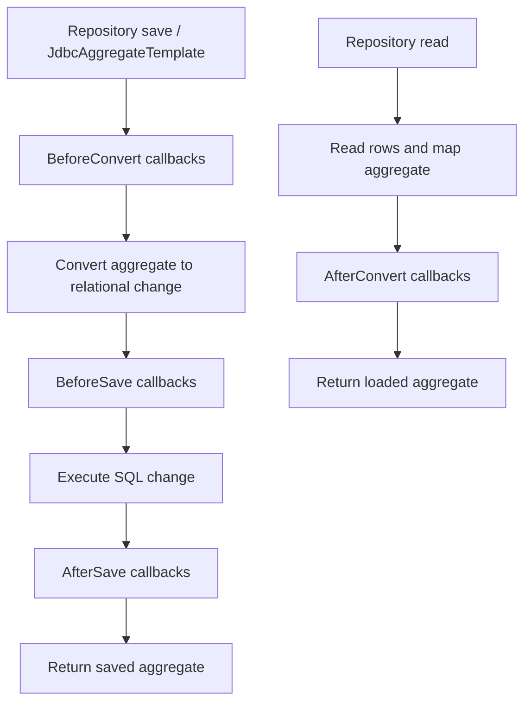
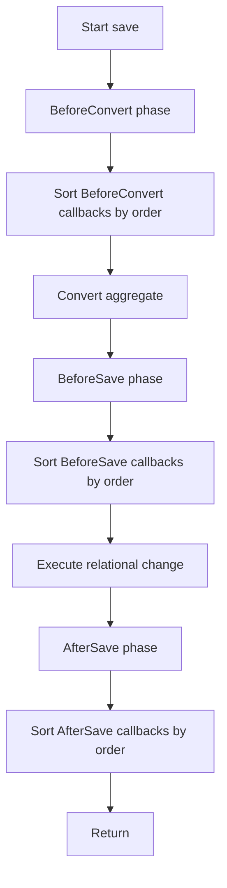

# Callback với entity bất biến và thứ tự ưu tiên

Trong **Spring Data Relational JDBC**, entity callback cho phép ứng dụng can thiệp vào vòng đời đọc và ghi aggregate. Callback có thể chuẩn hóa dữ liệu trước khi lưu, bổ sung thời điểm, quan sát relational change hoặc hoàn thiện object sau khi đọc.

Khi domain model dùng **entity bất biến**, callback cần trả về instance mới thay vì sửa trực tiếp object nhận được. Spring Data sử dụng giá trị callback trả về trong pipeline tương ứng. Nếu có nhiều callback cùng loại, thứ tự thực thi có thể được điều khiển bằng `@Order` hoặc `Ordered`.

Có hai loại thứ tự cần phân biệt:

- **Thứ tự các giai đoạn lifecycle:** ví dụ `BeforeConvertCallback` chạy trước conversion, sau đó đến `BeforeSaveCallback` và `AfterSaveCallback`.
- **Thứ tự ưu tiên giữa nhiều callback cùng giai đoạn:** được điều khiển bằng `@Order` hoặc `Ordered`; giá trị order nhỏ hơn chạy trước.

`@Order` không hoán đổi các giai đoạn lifecycle. Một callback `BeforeSaveCallback` vẫn thuộc giai đoạn sau conversion, dù nó có order ưu tiên cao hơn callback `BeforeConvertCallback`.

Bài học tập trung vào callback trong Spring Data JDBC, cách viết callback cho record/immutable class, cách phối hợp nhiều callback, và những điểm cần chú ý khi kết hợp auditing, transaction và aggregate mapping.

## 1. Entity callback là gì?

Entity callback là extension point của Spring Data cho phép thực thi logic tại một thời điểm xác định trong quá trình mapping và persistence của entity. Trong Spring Data JDBC, callback thường làm việc với aggregate root được repository hoặc `JdbcAggregateTemplate` đọc/ghi.

Một số callback phổ biến:

| Callback | Thời điểm | Mục đích |
|---|---|---|
| `BeforeConvertCallback<T>` | Trước khi aggregate được chuyển thành relational representation | Chuẩn hóa hoặc bổ sung giá trị sẽ được lưu |
| `BeforeSaveCallback<T>` | Sau conversion, trước khi SQL change được thực thi | Quan sát hoặc điều chỉnh relational change qua API được hỗ trợ |
| `AfterSaveCallback<T>` | Sau khi aggregate change đã được thực thi | Phản ứng sau thao tác save hoặc hoàn thiện object trả về |
| `AfterConvertCallback<T>` | Sau khi dữ liệu relational được chuyển thành object | Hoàn thiện object trong bộ nhớ sau khi đọc |

Các interface callback của Spring Data Relational nằm trong package `org.springframework.data.relational.core.mapping.event`. Callback dùng `Converter` hay `EntityCallback` thuộc các package Spring Data/Spring Core tương ứng.

Callback giúp đặt logic kỹ thuật gần lifecycle persistence. Ví dụ:

- Chuẩn hóa mã đơn hàng trước khi ghi.
- Gán giá trị mặc định khi tạo aggregate.
- Cập nhật metadata được tính từ domain value.
- Ghi log hoặc metric cho một thao tác save.
- Bổ sung giá trị chỉ dùng trong object sau khi đọc.

Callback không thay thế domain method. Quy tắc nghiệp vụ như “đơn hàng chỉ được thanh toán khi đang ở trạng thái NEW” vẫn nên nằm trong domain model hoặc application service để caller nhìn thấy và kiểm soát được.

## 2. Các giai đoạn callback khi lưu và đọc aggregate

Một lần save aggregate qua repository hoặc `JdbcAggregateTemplate` thường đi qua các giai đoạn khái quát sau:



Trình tự này giúp chọn đúng callback:

- Muốn thay đổi field được ghi xuống database: thường dùng `BeforeConvertCallback` để thay đổi object trước khi conversion.
- Muốn can thiệp vào relational change sau conversion: dùng `BeforeSaveCallback` và API change phù hợp với phiên bản.
- Muốn xử lý sau khi SQL đã chạy: dùng `AfterSaveCallback`.
- Muốn hoàn thiện object trong bộ nhớ sau khi đọc: dùng `AfterConvertCallback`.

### 2.1. BeforeConvertCallback

`BeforeConvertCallback<T>` nhận aggregate và trả về aggregate. Đây là vị trí phù hợp để tạo một immutable copy chứa các giá trị mới trước khi Spring Data chuyển object thành các cột SQL.

Chữ ký điển hình:

```java
public interface BeforeConvertCallback<T> {
    T onBeforeConvert(T aggregate);
}
```

Ví dụ chuẩn hóa mã đơn hàng:

```java
@Component
public class NormalizeOrderCodeCallback
        implements BeforeConvertCallback<PurchaseOrder> {

    @Override
    public PurchaseOrder onBeforeConvert(PurchaseOrder order) {
        String normalized = order.orderCode()
                .trim()
                .toUpperCase(Locale.ROOT);

        return order.withOrderCode(normalized);
    }
}
```

Nếu `PurchaseOrder` là immutable, callback không thay đổi object cũ. Nó tạo instance mới bằng `withOrderCode` và trả về. Instance trả về được dùng cho bước conversion tiếp theo.

### 2.2. BeforeSaveCallback

`BeforeSaveCallback<T>` chạy sau khi aggregate đã được chuyển thành relational change và trước khi change được thực thi. Callback thường nhận aggregate cùng `AggregateChange<T>`:

```java
public interface BeforeSaveCallback<T> {
    T onBeforeSave(T aggregate, AggregateChange<T> aggregateChange);
}
```

Ví dụ callback quan sát thay đổi trước khi ghi:

```java
@Component
public class OrderBeforeSaveCallback
        implements BeforeSaveCallback<PurchaseOrder> {

    private static final Logger log =
            LoggerFactory.getLogger(OrderBeforeSaveCallback.class);

    @Override
    public PurchaseOrder onBeforeSave(
            PurchaseOrder order,
            AggregateChange<PurchaseOrder> change
    ) {
        log.debug("Saving order id={}, code={}",
                order.id(), order.orderCode());

        return order;
    }
}
```

Cần phân biệt thời điểm này với `BeforeConvertCallback`: relational change đã được tạo. Nếu cần thay đổi một field domain để field đó được chuyển thành SQL, hãy thực hiện ở `BeforeConvertCallback`. Không nên giả định trả về một immutable copy mới từ `BeforeSaveCallback` sẽ khiến Spring Data chạy conversion lần nữa và tái tạo toàn bộ SQL change.

`AggregateChange` cung cấp thông tin về các thao tác relational được tạo cho aggregate. Khả năng chỉnh sửa change phụ thuộc API cụ thể của phiên bản Spring Data Relational; chỉ dùng các operation được phiên bản dự án công khai hỗ trợ.

### 2.3. AfterSaveCallback

`AfterSaveCallback<T>` được gọi sau khi relational change đã được thực thi:

```java
@Component
public class OrderAfterSaveCallback
        implements AfterSaveCallback<PurchaseOrder> {

    @Override
    public PurchaseOrder onAfterSave(PurchaseOrder order) {
        return order;
    }
}
```

Callback nhận object sau thao tác save. Nó có thể trả về object đó hoặc một instance khác nếu cần thay đổi giá trị trả về cho caller. Tuy nhiên, việc tạo copy ở giai đoạn này không ghi lại copy đó vào database. SQL đã được thực thi trước callback.

Nếu cần thay đổi giá trị được lưu, hãy đưa thay đổi vào giai đoạn trước conversion hoặc thực hiện một thao tác persistence tường minh khác trong transaction phù hợp.

### 2.4. AfterConvertCallback

`AfterConvertCallback<T>` được gọi sau khi Spring Data chuyển dữ liệu relational thành object:

```java
@Component
public class OrderAfterConvertCallback
        implements AfterConvertCallback<PurchaseOrder> {

    @Override
    public PurchaseOrder onAfterConvert(PurchaseOrder order) {
        return order;
    }
}
```

Callback này phù hợp với việc hoàn thiện object trong bộ nhớ sau khi đọc. Nếu trả về immutable copy, caller nhận instance mới. Thay đổi đó không tự ghi ngược xuống database.

Không nên dùng `AfterConvertCallback` để thực hiện query bổ sung cho từng aggregate nếu có thể tạo N+1 query. Nếu cần thêm dữ liệu từ bảng khác, hãy thiết kế read query/projection hoặc batch load rõ ràng.

## 3. Entity bất biến và callback phải trả về instance mới

Entity bất biến không cho phép thay đổi field sau khi được tạo. Với Java record, component được gán trong canonical constructor và accessor chỉ đọc giá trị.

Ví dụ aggregate:

```java
import java.time.Instant;

import org.springframework.data.annotation.Id;
import org.springframework.data.annotation.Version;
import org.springframework.data.relational.core.mapping.Column;
import org.springframework.data.relational.core.mapping.Table;

@Table("orders")
public record PurchaseOrder(
        @Id Long id,
        @Column("order_code") String orderCode,
        OrderStatus status,
        @Column("created_at") Instant createdAt,
        @Column("last_modified_at") Instant lastModifiedAt,
        @Version Long version
) {

    public PurchaseOrder withOrderCode(String value) {
        return new PurchaseOrder(
                id, value, status, createdAt, lastModifiedAt, version
        );
    }

    public PurchaseOrder withCreatedAt(Instant value) {
        return new PurchaseOrder(
                id, orderCode, status, value, lastModifiedAt, version
        );
    }

    public PurchaseOrder withLastModifiedAt(Instant value) {
        return new PurchaseOrder(
                id, orderCode, status, createdAt, value, version
        );
    }

    public PurchaseOrder withStatus(OrderStatus value) {
        return new PurchaseOrder(
                id, orderCode, value, createdAt, lastModifiedAt, version
        );
    }
}
```

Các method `with...` tạo record mới và giữ nguyên các component không thay đổi. Đây là cách phổ biến để cập nhật một phần dữ liệu của immutable object.

Callback không nên cố gắng dùng reflection hoặc setter giả để thay đổi record. Hãy trả về một instance mới.

### 3.1. Callback chuẩn hóa dữ liệu

```java
@Component
public class NormalizeOrderCodeCallback
        implements BeforeConvertCallback<PurchaseOrder> {

    @Override
    public PurchaseOrder onBeforeConvert(PurchaseOrder order) {
        String normalized = order.orderCode()
                .trim()
                .toUpperCase(Locale.ROOT);

        if (normalized.equals(order.orderCode())) {
            return order;
        }

        return order.withOrderCode(normalized);
    }
}
```

Kiểm tra trước khi tạo copy giúp tránh tạo object mới khi giá trị đã đúng. Điều này không bắt buộc về mặt persistence nhưng có thể làm callback dễ theo dõi hơn.

### 3.2. Callback gán thời điểm tạo

Ví dụ gán `createdAt` nếu chưa có:

```java
@Component
public class CreatedAtCallback
        implements BeforeConvertCallback<PurchaseOrder> {

    private final Clock clock;

    public CreatedAtCallback(Clock clock) {
        this.clock = clock;
    }

    @Override
    public PurchaseOrder onBeforeConvert(PurchaseOrder order) {
        if (order.createdAt() != null) {
            return order;
        }

        return order.withCreatedAt(clock.instant());
    }
}
```

Không nên suy luận duy nhất rằng `id == null` có nghĩa aggregate mới nếu ứng dụng hỗ trợ assigned ID. Kiểm tra field hoặc trạng thái domain phù hợp với quy tắc tạo dữ liệu. Trong ví dụ này, `createdAt` chưa được gán là dấu hiệu cần bổ sung timestamp.

### 3.3. Callback cập nhật thời điểm sửa

```java
@Component
public class LastModifiedAtCallback
        implements BeforeConvertCallback<PurchaseOrder> {

    private final Clock clock;

    public LastModifiedAtCallback(Clock clock) {
        this.clock = clock;
    }

    @Override
    public PurchaseOrder onBeforeConvert(PurchaseOrder order) {
        return order.withLastModifiedAt(clock.instant());
    }
}
```

Dùng `Clock` thay vì gọi trực tiếp `Instant.now()` giúp test có thể cố định thời gian. Ví dụ cấu hình bean:

```java
@Configuration
public class TimeConfiguration {

    @Bean
    Clock applicationClock() {
        return Clock.systemUTC();
    }
}
```

## 4. Thứ tự ưu tiên giữa nhiều callback

Một aggregate có thể có nhiều callback cùng loại. Ví dụ trước khi convert, ứng dụng muốn:

1. Chuẩn hóa mã đơn hàng.
2. Gán thời điểm tạo nếu chưa có.
3. Cập nhật thời điểm sửa.

Nếu các callback cùng xử lý `BeforeConvertCallback<PurchaseOrder>`, có thể đặt thứ tự bằng `@Order`.

```java
@Component
@Order(10)
public class NormalizeOrderCodeCallback
        implements BeforeConvertCallback<PurchaseOrder> {
    // ...
}
```

```java
@Component
@Order(20)
public class CreatedAtCallback
        implements BeforeConvertCallback<PurchaseOrder> {
    // ...
}
```

```java
@Component
@Order(30)
public class LastModifiedAtCallback
        implements BeforeConvertCallback<PurchaseOrder> {
    // ...
}
```

Giá trị nhỏ hơn có độ ưu tiên cao hơn và được thực thi trước. Trong ví dụ:

```text
@Order(10) -> @Order(20) -> @Order(30)
```

Kết quả mà callback trước trả về trở thành input cho callback tiếp theo trong cùng callback pipeline. Vì vậy, callback thứ hai nhận immutable copy đã được callback thứ nhất tạo ra.

### 4.1. Dùng Ordered thay cho @Order

Có thể triển khai interface `Ordered`:

```java
@Component
public class NormalizeOrderCodeCallback
        implements BeforeConvertCallback<PurchaseOrder>, Ordered {

    @Override
    public int getOrder() {
        return 10;
    }

    @Override
    public PurchaseOrder onBeforeConvert(PurchaseOrder order) {
        String normalized = order.orderCode()
                .trim()
                .toUpperCase(Locale.ROOT);

        return order.withOrderCode(normalized);
    }
}
```

`@Order` phù hợp khi thứ tự là metadata cố định trên class. `Ordered` phù hợp khi muốn biểu diễn thứ tự qua method hoặc cấu hình của instance.

Không cần triển khai cả hai cho cùng một callback nếu một cơ chế đã đủ rõ.

### 4.2. Các hằng số thứ tự

Spring cung cấp:

- `Ordered.HIGHEST_PRECEDENCE`: giá trị ưu tiên cao nhất, chạy trước.
- `Ordered.LOWEST_PRECEDENCE`: giá trị ưu tiên thấp nhất, chạy sau.

Có thể dùng các số nhỏ như 10, 20, 30 để tạo khoảng trống cho callback được thêm sau. Tránh dùng cùng một order cho các callback có phụ thuộc thứ tự.

Nếu nhiều callback có cùng order, không nên dựa vào thứ tự đăng ký bean hoặc thứ tự quét component như một hợp đồng ổn định. Khi thứ tự có ý nghĩa, gán các giá trị order khác nhau.

## 5. @Order sắp xếp callback cùng loại, không đổi lifecycle phase

Đây là quy tắc quan trọng nhất khi thiết kế callback.

Giả sử có:

- Một `BeforeConvertCallback` với `@Order(100)`.
- Một `BeforeSaveCallback` với `@Order(1)`.

Callback BeforeConvert vẫn chạy trước callback BeforeSave. Giá trị order không khiến BeforeSave chạy trước conversion.



Trong mỗi phase, callback cùng loại được sắp xếp theo order. Các phase có thứ tự do lifecycle persistence quy định.

Do đó:

- Dùng `@Order` để sắp xếp các callback cùng loại.
- Dùng đúng callback phase cho công việc cần làm.
- Không dùng order để cố đưa callback đọc vào trước callback ghi hoặc ngược lại.
- Nếu logic phụ thuộc kết quả của phase trước, hãy dùng giá trị aggregate được callback trước trả về hoặc thiết kế service/domain method phù hợp.

## 6. Ví dụ hoàn chỉnh: callback immutable có thứ tự

Giả sử aggregate cần chuẩn hóa mã đơn hàng trước khi tạo search key, sau đó mới gán timestamp.

Record:

```java
public record PurchaseOrder(
        Long id,
        String orderCode,
        String orderCodeKey,
        OrderStatus status,
        Instant createdAt,
        Instant lastModifiedAt,
        Long version
) {

    public PurchaseOrder withOrderCode(String value) {
        return new PurchaseOrder(
                id, value, orderCodeKey, status,
                createdAt, lastModifiedAt, version
        );
    }

    public PurchaseOrder withOrderCodeKey(String value) {
        return new PurchaseOrder(
                id, orderCode, value, status,
                createdAt, lastModifiedAt, version
        );
    }

    public PurchaseOrder withCreatedAt(Instant value) {
        return new PurchaseOrder(
                id, orderCode, orderCodeKey, status,
                value, lastModifiedAt, version
        );
    }

    public PurchaseOrder withLastModifiedAt(Instant value) {
        return new PurchaseOrder(
                id, orderCode, orderCodeKey, status,
                createdAt, value, version
        );
    }
}
```

Callback 1: chuẩn hóa mã:

```java
@Component
@Order(10)
public class NormalizeOrderCodeCallback
        implements BeforeConvertCallback<PurchaseOrder> {

    @Override
    public PurchaseOrder onBeforeConvert(PurchaseOrder order) {
        String normalized = order.orderCode()
                .trim()
                .toUpperCase(Locale.ROOT);

        return order.withOrderCode(normalized);
    }
}
```

Callback 2: tạo search key từ mã đã chuẩn hóa:

```java
@Component
@Order(20)
public class OrderCodeKeyCallback
        implements BeforeConvertCallback<PurchaseOrder> {

    @Override
    public PurchaseOrder onBeforeConvert(PurchaseOrder order) {
        String key = order.orderCode().toLowerCase(Locale.ROOT);
        return order.withOrderCodeKey(key);
    }
}
```

Callback 3: cập nhật timestamp:

```java
@Component
@Order(30)
public class OrderTimestampCallback
        implements BeforeConvertCallback<PurchaseOrder> {

    private final Clock clock;

    public OrderTimestampCallback(Clock clock) {
        this.clock = clock;
    }

    @Override
    public PurchaseOrder onBeforeConvert(PurchaseOrder order) {
        Instant now = clock.instant();

        PurchaseOrder result = order;
        if (result.createdAt() == null) {
            result = result.withCreatedAt(now);
        }

        return result.withLastModifiedAt(now);
    }
}
```

Khi lưu, pipeline nhận object ban đầu, chạy callback order 10 để chuẩn hóa, truyền object mới cho callback order 20 để tạo search key, rồi truyền object tiếp theo cho callback order 30 để gán thời gian. Conversion diễn ra sau khi chuỗi BeforeConvert hoàn tất.

Ví dụ này cho thấy thứ tự có ý nghĩa: nếu callback tạo search key chạy trước callback chuẩn hóa, key có thể được tính từ chuỗi chưa chuẩn hóa. Hãy dùng order để biểu diễn phụ thuộc đó một cách tường minh.

## 7. Callback với immutable class không phải record

Không bắt buộc phải dùng Java record. Một class immutable có thể cung cấp constructor đầy đủ và các method tạo copy.

Ví dụ:

```java
public final class Customer {

    private final Long id;
    private final String displayName;
    private final Instant createdAt;

    public Customer(
            Long id,
            String displayName,
            Instant createdAt
    ) {
        this.id = id;
        this.displayName = displayName;
        this.createdAt = createdAt;
    }

    public Long getId() {
        return id;
    }

    public String getDisplayName() {
        return displayName;
    }

    public Instant getCreatedAt() {
        return createdAt;
    }

    public Customer withDisplayName(String value) {
        return new Customer(id, value, createdAt);
    }

    public Customer withCreatedAt(Instant value) {
        return new Customer(id, displayName, value);
    }
}
```

Callback:

```java
@Component
public class CustomerNameCallback
        implements BeforeConvertCallback<Customer> {

    @Override
    public Customer onBeforeConvert(Customer customer) {
        String normalized = customer.getDisplayName().trim();

        if (normalized.equals(customer.getDisplayName())) {
            return customer;
        }

        return customer.withDisplayName(normalized);
    }
}
```

Với class immutable, cần bảo đảm constructor hoặc factory giữ đầy đủ trạng thái của object. Một method copy bỏ quên field có thể vô tình làm mất dữ liệu khi callback trả instance mới.

Có thể dùng builder hoặc copy constructor nếu entity có nhiều field. Điều quan trọng là callback trả về một instance hoàn chỉnh, không phải một object chỉ chứa những field callback quan tâm.

## 8. Callback và auditing

Spring Data JDBC hỗ trợ auditing với các annotation như:

- `@CreatedBy`
- `@CreatedDate`
- `@LastModifiedBy`
- `@LastModifiedDate`

Auditing infrastructure sử dụng callback để điền metadata vào aggregate trong lifecycle thích hợp. Nếu callback tùy chỉnh cũng thay đổi cùng các field audit, thứ tự thực thi sẽ ảnh hưởng giá trị cuối cùng.

Ví dụ, nếu một callback gán `lastModifiedAt` và auditing cũng gán field đó, chỉ một cơ chế nên chịu trách nhiệm cho field này. Nếu có lý do cần phối hợp, hãy kiểm tra callback auditing và order trong phiên bản Spring Data đang dùng, rồi đặt thứ tự rõ ràng.

Không nên dựa vào một con số order nội bộ chưa được xác nhận trong version của ứng dụng. Hãy xem API/source của dependency thực tế nếu cần sắp xếp callback tùy chỉnh tương đối với auditing callback.

### 8.1. Chọn auditing hoặc callback cho timestamp

Dùng auditing khi yêu cầu là metadata chuẩn như created/modified time và actor. Dùng callback tùy chỉnh khi logic timestamp có quy tắc riêng, ví dụ lấy thời gian từ một domain clock hoặc áp dụng theo điều kiện đặc thù.

Tránh:

- Auditing cập nhật `lastModifiedAt`.
- Callback khác cũng cập nhật `lastModifiedAt`.
- Database trigger lại ghi đè `last_modified_at`.

Ba nguồn ghi cùng một field có thể tạo kết quả khó đoán. Chọn một nguồn chịu trách nhiệm hoặc xác định thứ tự/ownership rõ ràng.

### 8.2. AuditorAware và entity bất biến

Khi auditing cần actor, cung cấp `AuditorAware`. Với entity immutable, auditing infrastructure phải trả về instance phù hợp theo callback mechanism của phiên bản. Không cần tự tạo setter chỉ để phục vụ auditing.

Nếu ứng dụng dùng record hoặc constructor-only entity, hãy kiểm thử rằng auditing callback cập nhật đúng component và giá trị được ghi vào database.

## 9. Callback và aggregate child entities

Spring Data JDBC lưu aggregate root cùng các entity con theo mapping của aggregate. Tuy nhiên, không nên giả định callback được gọi đệ quy cho từng object con trong mọi trường hợp.

Callback thường gắn với entity/aggregate root đang được xử lý bởi persistence lifecycle. Nếu cần chuẩn hóa child collection trước khi lưu, có thể thực hiện transformation từ callback của root bằng cách tạo root mới với danh sách child đã được chuyển đổi, hoặc đặt logic trong domain method/factory.

Ví dụ ý tưởng:

```java
public PurchaseOrder withLines(List<OrderLine> newLines) {
    return new PurchaseOrder(
            id,
            orderCode,
            orderCodeKey,
            status,
            createdAt,
            lastModifiedAt,
            version,
            List.copyOf(newLines)
    );
}
```

Một callback BeforeConvert của root có thể map qua collection, tạo immutable child mới và trả về root mới. Hãy đảm bảo việc copy không làm mất thứ tự, key hoặc quan hệ mapping của `@MappedCollection`.

Nếu child cần lifecycle độc lập, callback của root không phải cách thay thế cho một aggregate boundary riêng.
## 10. Callback chạy trong transaction ở thời điểm nào?

Khi save được gọi từ method có `@Transactional` và lời gọi đi qua transaction proxy, callback trong quá trình save thường chạy đồng bộ trong luồng thực thi của thao tác đó.

Trình tự khái quát:

1. Transaction interceptor bắt đầu hoặc tham gia transaction.
2. Repository/template bắt đầu xử lý aggregate.
3. Callback trước conversion chạy.
4. Spring Data tạo relational change.
5. Callback trước save chạy.
6. SQL được thực thi.
7. Callback sau save chạy.
8. Method trả về transaction interceptor.
9. Transaction được commit hoặc rollback theo kết quả và rollback rules.

Vì `AfterSaveCallback` chạy sau SQL nhưng trước khi method transaction hoàn tất, callback này **không đồng nghĩa database đã commit**. Một exception phát sinh sau callback vẫn có thể làm transaction rollback.

### 10.1. Không gửi side effect bên ngoài chỉ vì AfterSave đã chạy

Ví dụ, không nên mặc định gửi email hoặc publish message ngay trong `AfterSaveCallback` rồi xem đó là sự kiện đã commit. Nếu transaction sau đó rollback, hệ thống bên ngoài vẫn có thể đã nhận thông báo.

Nếu cần phát event bền vững cùng dữ liệu, hãy cân nhắc transactional outbox. Nếu chỉ cần xử lý sau commit, dùng transaction synchronization hoặc cơ chế event after-commit phù hợp.

Callback nên tập trung vào lifecycle mapping/persistence. Side effect nghiệp vụ thường phù hợp hơn ở application service hoặc outbox publisher.

### 10.2. Exception từ callback

Nếu callback ném exception và exception truyền ra khỏi transaction boundary, transaction manager áp dụng rollback rules như với exception từ method thông thường. Runtime exception thường kích hoạt rollback theo mặc định; checked exception cần rollback rule phù hợp nếu muốn rollback.

Không nên bắt rồi nuốt exception trong callback nếu điều đó khiến caller tưởng thao tác save đã hoàn tất trong khi dữ liệu chưa được xử lý theo yêu cầu.
## 11. Callback không tự chạy với mọi lệnh JDBC

Callback Spring Data Relational được gọi bởi persistence lifecycle có tích hợp entity callback. Một câu SQL trực tiếp qua `JdbcTemplate` không tự gọi `BeforeConvertCallback`, `BeforeSaveCallback` hoặc `AfterSaveCallback`.

Ví dụ:

```java
jdbcTemplate.update(
        "UPDATE orders SET status = ? WHERE id = ?",
        "PAID",
        orderId
);
```

Câu lệnh này chỉ thực thi SQL. Nếu callback có nhiệm vụ chuẩn hóa mã, cập nhật audit hoặc tạo metadata, direct DML phải thực hiện logic tương ứng một cách tường minh hoặc dùng database mechanism đã thiết kế.

Tương tự, không phải mọi câu query tùy chỉnh đều tạo một aggregate lifecycle giống repository save/read. Hãy xác định đường truy cập dữ liệu đang dùng trước khi dựa vào callback.

## 12. Callback order với nhiều implementation

Trong một ứng dụng lớn, nhiều module có thể đăng ký callback cùng loại. Ví dụ:

- Module order chuẩn hóa mã.
- Module audit gán actor/time.
- Module search tạo normalized key.
- Module compliance bổ sung metadata.

Nếu thứ tự quan trọng, khai báo order rõ ràng:

```java
@Component
@Order(10)
class NormalizeCodeCallback
        implements BeforeConvertCallback<PurchaseOrder> {
    // ...
}

@Component
@Order(20)
class CreateSearchKeyCallback
        implements BeforeConvertCallback<PurchaseOrder> {
    // ...
}

@Component
@Order(30)
class StampModifiedTimeCallback
        implements BeforeConvertCallback<PurchaseOrder> {
    // ...
}
```

Không dựa vào thứ tự component scan hoặc thứ tự khai báo bean trong configuration. Thứ tự đó không nên trở thành hợp đồng nghiệp vụ.

### 12.1. Callback cùng order

Nếu hai callback có cùng order, không nên dựa vào một thứ tự nghiệp vụ cụ thể giữa chúng. Hãy tránh phụ thuộc thứ tự của các callback cùng mức ưu tiên.

Nếu hai callback không phụ thuộc nhau, cùng order có thể không ảnh hưởng kết quả. Nếu callback B cần output của callback A, gán order khác nhau và viết test xác nhận.

### 12.2. Callback type khác nhau

`@Order` của callback BeforeConvert không được so sánh với `@Order` của callback AfterSave để thay đổi phase. Chúng thuộc hai điểm khác nhau trong lifecycle.

Hãy chia logic theo phase trước, sau đó mới sắp xếp các callback cùng phase.

## 13. Đăng ký callback như Spring bean

Callback phải được Spring Data phát hiện trong application context. Có thể đăng ký bằng component scanning:

```java
@Component
@Order(10)
public class NormalizeOrderCodeCallback
        implements BeforeConvertCallback<PurchaseOrder> {
    // ...
}
```

Hoặc khai báo bean:

```java
@Configuration
public class OrderCallbackConfiguration {

    @Bean
    @Order(10)
    NormalizeOrderCodeCallback normalizeOrderCodeCallback() {
        return new NormalizeOrderCodeCallback();
    }
}
```

Không tự gọi `new NormalizeOrderCodeCallback()` ở nơi khác rồi kỳ vọng Spring tự phát hiện instance đó. Instance tự tạo nằm ngoài callback discovery của Spring container trừ khi được đăng ký qua cơ chế tương ứng.

Constructor injection phù hợp để callback nhận các dependency như `Clock`, formatter hoặc domain service nhỏ. Tránh để callback phụ thuộc ngược vào repository/service đang gọi nó vì có thể tạo dependency cycle hoặc query lặp ngoài dự kiến.
## 14. Kiểm thử callback bất biến và thứ tự ưu tiên

Nên kiểm thử callback ở hai mức:

- Unit test để xác nhận mỗi callback tạo đúng immutable copy.
- Integration test để xác nhận callback được phát hiện, chạy đúng thứ tự và giá trị cuối cùng được ghi/đọc qua repository.

### 14.1. Unit test một callback

Ví dụ callback chuẩn hóa mã:

```java
@Test
void normalizesOrderCodeWithoutMutatingOriginal() {
    PurchaseOrder original = new PurchaseOrder(
            10L,
            " po-10 ",
            OrderStatus.NEW,
            null,
            null,
            0L
    );

    PurchaseOrder result =
            normalizeCallback.onBeforeConvert(original);

    assertThat(original.orderCode()).isEqualTo(" po-10 ");
    assertThat(result.orderCode()).isEqualTo("PO-10");
    assertThat(result).isNotSameAs(original);
}
```

Test thể hiện hai đặc điểm của immutable callback:

- Object đầu vào không bị thay đổi.
- Object trả về chứa giá trị mới.

Nếu callback không cần thay đổi object, có thể trả lại cùng instance.

### 14.2. Unit test thứ tự bằng callback chain

Có thể kiểm thử thứ tự qua integration context hoặc qua pipeline callback thực tế. Không nên chỉ gọi thủ công từng callback theo thứ tự mong muốn rồi kết luận Spring sẽ đăng ký đúng.

Một cách là tạo hai callback có order khác nhau và dùng giá trị mà callback thứ hai chỉ có thể tạo đúng khi nhận output của callback đầu tiên. Sau đó save qua repository và kiểm tra cột cuối cùng.

### 14.3. Integration test thứ tự callback

Ví dụ test dùng repository và database fixture:

```java
@DataJdbcTest
class OrderCallbackOrderTest {

    @Autowired
    PurchaseOrderRepository orders;

    @Autowired
    JdbcTemplate jdbc;

    @Test
    void appliesBeforeConvertCallbacksInConfiguredOrder() {
        PurchaseOrder order = new PurchaseOrder(
                null,
                " po-10 ",
                null,
                OrderStatus.NEW,
                null,
                null,
                null
        );

        PurchaseOrder saved = orders.save(order);

        assertThat(saved.orderCode()).isEqualTo("PO-10");

        String storedKey = jdbc.queryForObject(
                "SELECT order_code_key FROM orders WHERE id = ?",
                String.class,
                saved.id()
        );

        assertThat(storedKey).isEqualTo("po-10");
    }
}
```

Test này giả định callback chuẩn hóa chạy trước callback tạo search key và mapping/schema đã khai báo cột tương ứng. Nó kiểm tra kết quả persistence cuối cùng thay vì phụ thuộc vào thứ tự component scan.

### 14.4. Test AfterSave và AfterConvert

Với `AfterSaveCallback`, kiểm tra callback được gọi sau khi thao tác SQL thực thi và giá trị trả về của repository phản ánh pipeline callback.

Với `AfterConvertCallback`, đọc aggregate qua repository và kiểm tra instance trả về đã được hoàn thiện đúng. Nếu callback chỉ thay đổi object trong bộ nhớ, truy vấn SQL trực tiếp vẫn phải cho thấy database giữ nguyên giá trị đã lưu.

## 15. Những lỗi thường gặp

| Triệu chứng | Nguyên nhân có thể | Cách xử lý |
|---|---|---|
| Immutable entity không đổi sau callback | Callback tạo copy nhưng quên return copy | Trả về instance mới |
| Field mới không được ghi | Thay đổi được thực hiện ở callback sau conversion | Đưa thay đổi domain vào `BeforeConvertCallback` |
| Callback sau không thấy thay đổi callback trước | Callback trước trả về object cũ hoặc pipeline không dùng kết quả | Return immutable copy và kiểm tra callback type |
| Thứ tự callback không ổn định | Dựa vào component scan hoặc order trùng nhau | Gán `@Order`/`Ordered` khác nhau |
| `@Order` không làm BeforeSave chạy trước BeforeConvert | Nhầm order callback với lifecycle phase | Chọn đúng callback phase; phase có thứ tự cố định |
| Callback không được gọi | Instance không phải Spring bean hoặc đường ghi bypass Spring Data lifecycle | Đăng ký bean và dùng repository/template |
| AfterSave thay đổi field nhưng DB không đổi | SQL đã chạy trước callback | Dùng BeforeConvert cho giá trị cần lưu |
| AfterConvert làm DB thay đổi | Nhầm thay đổi in-memory với persistence | Thực hiện save riêng nếu cần ghi |
| Audit timestamp bị ghi đè | Auditing và callback cùng cập nhật một field | Chọn một nguồn ghi hoặc quy định order rõ |
| Email/message đã gửi dù transaction rollback | Side effect ngoài DB chạy trong AfterSave | Dùng outbox hoặc after-commit mechanism |
| Callback làm mất field khác | Immutable copy không truyền đủ component | Dùng constructor/copy method đầy đủ và test |
| Callback chạy cho root nhưng child không được xử lý | Giả định callback tự đệ quy qua object graph | Chuyển đổi child trong root callback/domain method hoặc dùng boundary riêng |

## 16. Nguyên tắc thiết kế callback

- Dùng `BeforeConvertCallback` cho thay đổi domain value cần được chuyển thành SQL.
- Với immutable entity, luôn trả về instance mới chứa đầy đủ component cần giữ.
- Dùng `BeforeSaveCallback` cho giai đoạn relational change đã được tạo; không giả định thay đổi object trả về sẽ được convert lại.
- Dùng `AfterSaveCallback` cho xử lý sau SQL; thay đổi object ở đây không tự ghi lại database.
- Dùng `AfterConvertCallback` để hoàn thiện object trong bộ nhớ sau khi đọc.
- Dùng `@Order` hoặc `Ordered` để sắp xếp các callback cùng loại; order nhỏ hơn chạy trước.
- Không dùng `@Order` để đổi thứ tự các phase lifecycle.
- Gán order khác nhau khi callback phụ thuộc output của nhau.
- Tránh nhiều callback cùng ghi một field audit hoặc metadata.
- Không đặt side effect bên ngoài transaction vào callback sau save nếu chưa có cơ chế after-commit/outbox.
- Đăng ký callback như Spring bean và kiểm thử qua repository/template.
- Không giả định callback tự chạy cho câu JDBC trực tiếp hoặc mọi child object trong aggregate.

Callback là một phần của lifecycle mapping/persistence, còn immutable entity yêu cầu callback thể hiện thay đổi bằng giá trị trả về. Khi nhiều callback cùng tham gia một phase, hãy sắp xếp bằng order rõ ràng và bảo đảm callback sau nhận đúng instance đã được callback trước cập nhật. Chọn đúng phase cũng quan trọng như thứ tự ưu tiên: dữ liệu cần lưu phải được hoàn thiện trước conversion, còn xử lý sau save chỉ tác động tới object hoặc công việc sau SQL.
