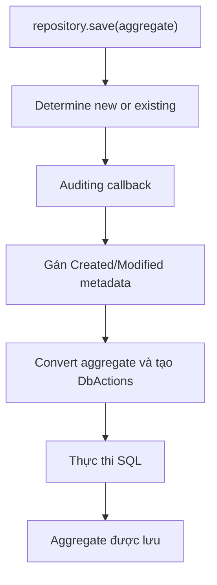

# Kích hoạt auditing bằng @EnableJdbcAuditing

Auditing trong Spring Data JDBC giúp tự động ghi nhận những thông tin như **ai tạo bản ghi, tạo lúc nào, ai sửa lần cuối và sửa lúc nào**. Thay vì yêu cầu từng service tự gán bốn trường này trước mỗi lần lưu, ứng dụng có thể bật auditing bằng `@EnableJdbcAuditing` và đánh dấu property trong aggregate bằng các annotation `@CreatedBy`, `@CreatedDate`, `@LastModifiedBy` và `@LastModifiedDate`.

Auditing giúp dữ liệu có metadata về vòng đời. Nó không tự tạo lịch sử thay đổi đầy đủ, không thay thế authorization và cũng không tự cập nhật các câu SQL tùy chỉnh chạy trực tiếp trên database. Muốn dùng đúng, cần hiểu cách Spring lấy người thực hiện, cách cung cấp thời gian, thời điểm callback được gọi và phạm vi các thao tác mà auditing bao phủ.

## 1. Auditing ghi nhận điều gì?

Một bảng nghiệp vụ thường cần lưu metadata về việc tạo và sửa:

| Property | Annotation | Ý nghĩa |
| --- | --- | --- |
| Người tạo | `@CreatedBy` | Actor tạo aggregate lần đầu. |
| Thời điểm tạo | `@CreatedDate` | Thời điểm aggregate được tạo. |
| Người sửa cuối | `@LastModifiedBy` | Actor thực hiện lần sửa gần nhất. |
| Thời điểm sửa cuối | `@LastModifiedDate` | Thời điểm cập nhật gần nhất. |

Ví dụ một đơn hàng:

```text
purchase_orders
+----+-------------+----------+---------------------+------------+---------------------+
| id | order_no    | status   | created_at          | created_by | last_modified_at    |
+----+-------------+----------+---------------------+------------+---------------------+
| 42 | PO-2026-042 | CONFIRMED| 2026-11-13 09:00:00 | alice      | 2026-11-13 09:12:00 |
+----+-------------+----------+---------------------+------------+---------------------+
```

Khi đơn hàng được tạo, Spring có thể điền `createdAt` và `createdBy`. Khi đơn hàng được lưu lại sau một thay đổi, `lastModifiedAt` và `lastModifiedBy` được cập nhật theo cấu hình auditing.

Các trường này trả lời câu hỏi “ai tạo/sửa và khi nào”. Chúng không lưu toàn bộ giá trị cũ, nội dung thay đổi hay chuỗi sự kiện. Nếu cần lịch sử từng lần thay đổi, cần thiết kế audit log, event table hoặc cơ chế lịch sử riêng.

## 2. Các annotation auditing

Các annotation thuộc Spring Data Commons, dùng được trong domain model Spring Data JDBC:

```java
import org.springframework.data.annotation.CreatedBy;
import org.springframework.data.annotation.CreatedDate;
import org.springframework.data.annotation.LastModifiedBy;
import org.springframework.data.annotation.LastModifiedDate;
```

### 2.1. @CreatedDate

Đánh dấu property lưu thời điểm tạo:

```java
@CreatedDate
@Column("created_at")
private Instant createdAt;
```

Giá trị được lấy từ `DateTimeProvider`. Nếu không cấu hình provider riêng, auditing sử dụng nguồn thời gian mặc định của Spring Data.

Property này thường được đặt một lần khi aggregate được tạo. Khi lưu aggregate hiện có, giá trị tạo ban đầu được giữ lại.

### 2.2. @LastModifiedDate

Đánh dấu property lưu thời điểm sửa gần nhất:

```java
@LastModifiedDate
@Column("last_modified_at")
private Instant lastModifiedAt;
```

Khi aggregate được lưu, auditing cập nhật thời điểm sửa theo provider. Với cấu hình mặc định `modifyOnCreate = true`, trường last-modified cũng được điền ở lần tạo đầu tiên.

Nếu nghiệp vụ không muốn trường modified có giá trị ngay lúc tạo, có thể cấu hình `modifyOnCreate = false` trong `@EnableJdbcAuditing`. Khi đó cần xác định rõ API và schema có chấp nhận giá trị null trong lần insert hay không.

### 2.3. @CreatedBy và @LastModifiedBy

Hai annotation này ghi nhận actor hiện tại:

```java
@CreatedBy
@Column("created_by")
private String createdBy;

@LastModifiedBy
@Column("last_modified_by")
private String lastModifiedBy;
```

Spring lấy actor từ bean `AuditorAware<T>`. Kiểu generic `T` phải tương thích với kiểu property được đánh dấu auditing.

Ví dụ dùng `AuditorAware<String>` thì `createdBy` và `lastModifiedBy` thường là `String`. Nếu domain lưu ID người dùng kiểu UUID, có thể dùng `AuditorAware<UUID>` và property UUID tương ứng.

Nếu không có `AuditorAware` hoặc provider không trả actor, các trường By không có giá trị mới để gán. Vì vậy, nếu cột trong database là NOT NULL, cần cung cấp actor mặc định có chủ đích cho job nền hoặc tài khoản hệ thống.

## 3. Domain model có auditing metadata

Ví dụ aggregate root đơn hàng:

```java
import java.time.Instant;

import org.springframework.data.annotation.CreatedBy;
import org.springframework.data.annotation.CreatedDate;
import org.springframework.data.annotation.Id;
import org.springframework.data.annotation.LastModifiedBy;
import org.springframework.data.annotation.LastModifiedDate;
import org.springframework.data.relational.core.mapping.Column;
import org.springframework.data.relational.core.mapping.Table;

@Table("purchase_orders")
public class PurchaseOrder {

    @Id
    private Long id;

    @Column("order_number")
    private String orderNumber;

    private String status;

    @CreatedDate
    @Column("created_at")
    private Instant createdAt;

    @CreatedBy
    @Column("created_by")
    private String createdBy;

    @LastModifiedDate
    @Column("last_modified_at")
    private Instant lastModifiedAt;

    @LastModifiedBy
    @Column("last_modified_by")
    private String lastModifiedBy;

    protected PurchaseOrder() {
    }

    public PurchaseOrder(String orderNumber, String status) {
        this.orderNumber = orderNumber;
        this.status = status;
    }

    public void confirm() {
        this.status = "CONFIRMED";
    }

    public Long getId() {
        return id;
    }

    public String getOrderNumber() {
        return orderNumber;
    }

    public String getStatus() {
        return status;
    }

    public Instant getCreatedAt() {
        return createdAt;
    }

    public String getCreatedBy() {
        return createdBy;
    }

    public Instant getLastModifiedAt() {
        return lastModifiedAt;
    }

    public String getLastModifiedBy() {
        return lastModifiedBy;
    }
}
```

Ở đây các property auditing là metadata persistence. Service không cần tự gán timestamp hoặc username mỗi lần gọi `save`. Khi Spring Data JDBC lưu aggregate qua lifecycle bình thường, auditing infrastructure cập nhật các property đã đánh dấu.

Có thể dùng immutable object/record nếu mô hình domain cần bất biến. Spring Data hỗ trợ tạo instance mới khi cần áp dụng giá trị auditing; ví dụ class mutable ở đây nhằm làm rõ property và annotation.

## 4. Schema database

Các cột phải tồn tại trong bảng và có kiểu phù hợp:

```sql
CREATE TABLE purchase_orders (
    id BIGINT GENERATED BY DEFAULT AS IDENTITY PRIMARY KEY,
    order_number VARCHAR(50) NOT NULL UNIQUE,
    status VARCHAR(24) NOT NULL,
    created_at TIMESTAMP WITH TIME ZONE,
    created_by VARCHAR(120),
    last_modified_at TIMESTAMP WITH TIME ZONE,
    last_modified_by VARCHAR(120)
);
```

Tên cột được liên kết bằng `@Column`. Nếu naming strategy của dự án đã ánh xạ tên property đúng với schema, annotation có thể không cần thiết; trong ví dụ này tên được khai báo tường minh để dễ đối chiếu.

Kiểu thời gian trong DDL phụ thuộc database. `TIMESTAMP WITH TIME ZONE` là cách viết phổ biến ở một số hệ quản trị, nhưng ý nghĩa và cách lưu thực tế khác nhau giữa PostgreSQL, Oracle, SQL Server và MySQL. Chọn kiểu cột theo database đang dùng và kiểm thử với JDBC driver tương ứng.

Các cột auditing thường được để nullable trong giai đoạn triển khai đầu tiên nếu bảng đã có dữ liệu cũ. Sau khi backfill và bảo đảm mọi đường ghi đều điền metadata, có thể cân nhắc constraint NOT NULL. Không thêm NOT NULL ngay vào bảng có hàng cũ mà chưa có migration/backfill phù hợp.

## 5. Kích hoạt auditing bằng @EnableJdbcAuditing

Chỉ thêm annotation auditing vào domain class là chưa đủ. Cần bật hạ tầng auditing trong Spring configuration bằng `@EnableJdbcAuditing`.

Import:

```java
import org.springframework.data.jdbc.repository.config.EnableJdbcAuditing;
```

Cấu hình tối thiểu:

```java
import org.springframework.context.annotation.Configuration;
import org.springframework.data.jdbc.repository.config.EnableJdbcAuditing;

@Configuration
@EnableJdbcAuditing
public class JdbcAuditingConfiguration {
}
```

Annotation này đăng ký infrastructure cần thiết để Spring Data JDBC áp dụng auditing metadata trong lifecycle persistence.

Khi chỉ cần ngày giờ, có thể dùng cấu hình mặc định mà không cần tự khai báo `AuditorAware`. Nếu muốn điền người tạo/người sửa, ứng dụng cần cung cấp `AuditorAware` để xác định actor hiện tại.

Có thể chỉ rõ bean cung cấp actor và bean cung cấp thời gian:

```java
@Configuration
@EnableJdbcAuditing(
    auditorAwareRef = "auditorAware",
    dateTimeProviderRef = "auditingDateTimeProvider"
)
public class JdbcAuditingConfiguration {
    // Các bean được khai báo bên dưới hoặc trong configuration khác.
}
```

Tên trong `auditorAwareRef` và `dateTimeProviderRef` phải khớp tên bean thực tế trong application context.

## 6. Cung cấp actor hiện tại bằng AuditorAware

`AuditorAware<T>` là contract cho phép Spring Data lấy actor hiện tại:

```java
import java.util.Optional;

import org.springframework.data.domain.AuditorAware;

public interface AuditorAware<T> {
    Optional<T> getCurrentAuditor();
}
```

Ví dụ ứng dụng có một abstraction lấy username từ context:

```java
public interface CurrentActor {
    Optional<String> currentUsername();
}
```

Implement bean:

```java
import java.util.Optional;

import org.springframework.context.annotation.Bean;
import org.springframework.context.annotation.Configuration;
import org.springframework.data.domain.AuditorAware;

@Configuration
public class AuditorConfiguration {

    @Bean
    AuditorAware<String> auditorAware(CurrentActor currentActor) {
        return currentActor::currentUsername;
    }
}
```

Khi Spring Data cần gán `@CreatedBy` hoặc `@LastModifiedBy`, nó gọi `getCurrentAuditor()`. Nếu context trả về `Optional.of("alice")`, các property auditor có thể nhận giá trị `alice`.

### 6.1. Tích hợp Spring Security

Nếu ứng dụng dùng Spring Security, `AuditorAware` có thể lấy username từ `SecurityContextHolder`:

```java
import java.util.Optional;

import org.springframework.data.domain.AuditorAware;
import org.springframework.security.authentication.AnonymousAuthenticationToken;
import org.springframework.security.core.Authentication;
import org.springframework.security.core.context.SecurityContextHolder;

public class SecurityAuditorAware
        implements AuditorAware<String> {

    @Override
    public Optional<String> getCurrentAuditor() {
        Authentication authentication =
            SecurityContextHolder.getContext().getAuthentication();

        if (authentication == null
                || !authentication.isAuthenticated()
                || authentication instanceof AnonymousAuthenticationToken) {
            return Optional.empty();
        }

        return Optional.of(authentication.getName());
    }
}
```

Đăng ký:

```java
@Bean
AuditorAware<String> auditorAware() {
    return new SecurityAuditorAware();
}
```

Không nên mặc định mọi request đều có authenticated user. Health check, scheduled job, message consumer hoặc tác vụ migration có thể không chạy trong security context của người dùng. Hãy quyết định policy cho các trường hợp đó, chẳng hạn actor hệ thống `system`, một service identity hoặc cho phép auditor rỗng nếu schema/domain chấp nhận.

### 6.2. AuditorAware không phải authorization

`AuditorAware` chỉ trả lời câu hỏi “ai đang thực hiện thao tác để ghi metadata?”. Nó không kiểm tra người đó có quyền sửa aggregate hay không.

Authorization vẫn phải được thực hiện ở security/application/domain layer. Không dùng giá trị auditor làm bằng chứng duy nhất rằng một thao tác đã được cho phép.

## 7. Cung cấp thời gian bằng DateTimeProvider

Mặc định auditing sử dụng nguồn thời gian hiện tại. Nếu cần kiểm soát clock, chuẩn hóa UTC hoặc làm test xác định, có thể cung cấp `DateTimeProvider`.

`DateTimeProvider` trả về `Optional<TemporalAccessor>`:

```java
import java.time.Clock;
import java.util.Optional;
import java.time.temporal.TemporalAccessor;

import org.springframework.data.auditing.DateTimeProvider;

public class UtcDateTimeProvider implements DateTimeProvider {

    private final Clock clock;

    public UtcDateTimeProvider(Clock clock) {
        this.clock = clock;
    }

    @Override
    public Optional<TemporalAccessor> getNow() {
        return Optional.of(clock.instant());
    }
}
```

Một cách khai báo bean:

```java
import java.time.Clock;
import java.time.temporal.TemporalAccessor;
import java.util.Optional;

import org.springframework.context.annotation.Bean;
import org.springframework.context.annotation.Configuration;
import org.springframework.data.auditing.DateTimeProvider;

@Configuration
public class AuditingTimeConfiguration {

    @Bean
    Clock auditingClock() {
        return Clock.systemUTC();
    }

    @Bean
    DateTimeProvider auditingDateTimeProvider(Clock auditingClock) {
        return () -> Optional.<TemporalAccessor>of(
            auditingClock.instant()
        );
    }
}
```

Và bật bằng bean reference:

```java
@EnableJdbcAuditing(
    auditorAwareRef = "auditorAware",
    dateTimeProviderRef = "auditingDateTimeProvider"
)
```

Dùng `Instant` giúp biểu diễn một thời điểm tuyệt đối và tránh phụ thuộc timezone mặc định của máy chạy ứng dụng. Khi map xuống SQL, cần kiểm tra precision và timezone semantics của cột/driver.

Nếu không cần clock tùy chỉnh, không phải tạo `DateTimeProvider` riêng. Cấu hình mặc định phù hợp với nhiều ứng dụng.

## 8. Cấu hình hoàn chỉnh

Một cấu hình có actor provider và time provider:

```java
@Configuration
@EnableJdbcAuditing(
    auditorAwareRef = "auditorAware",
    dateTimeProviderRef = "auditingDateTimeProvider"
)
public class JdbcAuditingConfiguration {

    @Bean
    Clock auditingClock() {
        return Clock.systemUTC();
    }

    @Bean
    AuditorAware<String> auditorAware(CurrentActor currentActor) {
        return currentActor::currentUsername;
    }

    @Bean
    DateTimeProvider auditingDateTimeProvider(Clock auditingClock) {
        return () -> Optional.<TemporalAccessor>of(
            auditingClock.instant()
        );
    }
}
```

Các import liên quan:

```java
import java.time.Clock;
import java.time.temporal.TemporalAccessor;
import java.util.Optional;

import org.springframework.context.annotation.Bean;
import org.springframework.context.annotation.Configuration;
import org.springframework.data.domain.AuditorAware;
import org.springframework.data.auditing.DateTimeProvider;
import org.springframework.data.jdbc.repository.config.EnableJdbcAuditing;
```

Nếu dự án đã có configuration chứa `@EnableJdbcAuditing`, không cần tạo thêm một cấu hình enablement thứ hai. Bổ sung bean vào cấu hình hiện tại và bảo đảm các bean reference trỏ tới đúng tên.

## 9. Điều gì xảy ra khi repository.save được gọi?

Khi aggregate được lưu qua repository CRUD bình thường, Spring Data JDBC áp dụng entity lifecycle callback cho aggregate. Auditing infrastructure sử dụng metadata annotation để cập nhật các property trước khi dữ liệu được chuyển thành thao tác SQL.

Về mặt khái niệm:



Kết quả mong đợi:

| Thao tác | CreatedDate/CreatedBy | LastModifiedDate/LastModifiedBy |
| --- | --- | --- |
| Insert aggregate mới | Được gán theo auditing | Được gán khi `modifyOnCreate` bật (mặc định). |
| Update aggregate hiện có | Giữ giá trị tạo ban đầu | Được cập nhật theo provider hiện tại. |
| Đọc aggregate bằng repository | Đọc giá trị đã lưu | Đọc giá trị đã lưu. |
| SQL tùy chỉnh chạy trực tiếp | Không tự chạy auditing callback | Không tự cập nhật. |

Callback được thực hiện trong lifecycle persistence của Spring Data JDBC. Nó không phải trigger database. Giá trị thời gian/actor được đưa vào aggregate ở phía ứng dụng trước khi SQL ghi dữ liệu.

### 9.1. Created và LastModified không có cùng semantics

`createdAt` và `createdBy` đại diện cho lần tạo ban đầu. Khi update, các giá trị này cần được giữ lại.

`lastModifiedAt` và `lastModifiedBy` đại diện cho lần sửa gần nhất. Khi aggregate được lưu lại, chúng được cập nhật theo auditing configuration.

Không nên tự gán `createdAt` mới mỗi lần cập nhật. Để Spring Data quản lý các property bằng annotation giúp giữ semantics nhất quán giữa các service.

### 9.2. modifyOnCreate

Mặc định `modifyOnCreate` bật, vì vậy các trường LastModified cũng được thiết lập trong lần insert đầu tiên. Điều này thường hữu ích vì một aggregate vừa được tạo cũng có thể được xem là vừa thay đổi.

Nếu cấu hình `modifyOnCreate = false`, các trường LastModified không được thiết lập trong quá trình tạo mới. Khi đó, schema và API cần chấp nhận trạng thái này cho tới lần sửa tiếp theo.

## 10. Auditing với Spring Boot

Trong ứng dụng Spring Boot dùng Spring Data JDBC, cấu hình datasource và repository thường được auto-configure theo starter. Tuy nhiên, **không nên giả định chỉ thêm starter là auditing tự được bật**. Hãy khai báo `@EnableJdbcAuditing` trong configuration được component scan.

Ví dụ cấu trúc:

```text
com.example.application
├── Application.java
├── config
│   └── JdbcAuditingConfiguration.java
├── domain
│   └── PurchaseOrder.java
├── repository
│   └── PurchaseOrderRepository.java
└── service
    └── PurchaseOrderService.java
```

Nếu `Application.java` nằm ở package gốc `com.example.application`, configuration con thường được component scan tự động.

Nếu configuration nằm ngoài vùng scan, hãy import rõ hoặc điều chỉnh component scan. Nếu ứng dụng có nhiều DataSource/transaction manager, cần cấu hình repository và auditing infrastructure nhất quán với persistence setup; không để bean auditing được bật ở một context nhưng repository thực tế chạy trong context khác.

## 11. Auditing với direct SQL và @Modifying

Một điểm rất quan trọng: auditing callback được gắn với lifecycle save aggregate. Một câu SQL tùy chỉnh như:

```java
@Modifying
@Query("""
    UPDATE purchase_orders
    SET status = :status
    WHERE id = :id
    """)
int updateStatus(
    @Param("id") Long id,
    @Param("status") String status
);
```

được thực thi trực tiếp. Nó không materialize aggregate rồi gọi `repository.save`, nên không tự gọi auditing callback.

Nếu direct UPDATE cần cập nhật thời gian sửa, hãy làm rõ trong SQL:

```java
@Modifying
@Query("""
    UPDATE purchase_orders
    SET status = :status,
        last_modified_at = :modifiedAt,
        last_modified_by = :modifiedBy
    WHERE id = :id
    """)
int updateStatus(
    @Param("id") Long id,
    @Param("status") String status,
    @Param("modifiedAt") Instant modifiedAt,
    @Param("modifiedBy") String modifiedBy
);
```

Service lấy actor và clock theo cùng policy của ứng dụng rồi truyền giá trị vào query. Một lựa chọn khác là database trigger quản lý metadata, nhưng khi đó cần quyết định database hay application là nguồn sự thật cho thời gian/actor.

Không nên kỳ vọng `@EnableJdbcAuditing` tự sửa mọi câu UPDATE được viết trong `@Query` hoặc custom JDBC operations.

## 12. Auditing không thay thế audit history

Bốn property auditing thường chỉ lưu trạng thái hiện tại của metadata:

```text
created_by        = alice
created_at        = thời điểm tạo
last_modified_by  = bob
last_modified_at  = thời điểm sửa gần nhất
```

Sau nhiều lần cập nhật, `last_modified_by` và `last_modified_at` được thay bằng giá trị mới. Những lần sửa trước không còn được biểu diễn trong các cột này.

Nếu cần biết:

- Ai đã đổi trạng thái từ PENDING sang CONFIRMED?
- Giá trị trước và sau là gì?
- Thay đổi xảy ra ở từng thời điểm nào?
- Có thể khôi phục phiên bản dữ liệu trước đó không?

thì cần audit history riêng, chẳng hạn bảng `purchase_order_audit`, domain events, outbox hoặc hệ thống versioning. Không nên xem bốn annotation auditing là một hệ thống lịch sử đầy đủ.

Auditing cũng không tự ghi nhận thao tác DELETE theo cách tạo bản ghi lịch sử. Nếu cần lưu người xóa và thời điểm xóa, hãy dùng soft delete với metadata riêng hoặc ghi audit event trước khi xóa trong cùng transaction.

## 13. Auditing với aggregate child

Spring Data JDBC tổ chức persistence theo aggregate root. Lifecycle callbacks được thiết kế quanh quá trình persistence aggregate; không nên mặc định rằng một callback được gọi độc lập cho từng row/entity con trong collection.

Ví dụ một PurchaseOrder sở hữu nhiều OrderLine. Nếu yêu cầu nghiệp vụ là mỗi dòng hàng cũng phải có metadata tạo/sửa riêng, hãy xác định rõ cách cập nhật các property đó trong thao tác domain hoặc thiết kế persistence phù hợp. Đừng chỉ thêm annotation vào child rồi giả định callback sẽ chạy như một repository save riêng cho từng child.

Nếu child có vòng đời độc lập và cần auditing độc lập, hãy cân nhắc liệu nó có nên là aggregate root riêng hay không. Nếu vẫn là child, có thể cập nhật metadata thông qua logic aggregate root và kiểm thử kết quả lưu thực tế.

## 14. Kiểm thử auditing với @DataJdbcTest

Một repository integration test nên xác nhận metadata được điền khi lưu và giữ đúng khi đọc lại.

Cấu hình test có thể bật auditing với auditor và thời gian cố định:

```java
@TestConfiguration
@EnableJdbcAuditing(
    auditorAwareRef = "testAuditorAware",
    dateTimeProviderRef = "testDateTimeProvider"
)
static class TestAuditingConfiguration {

    @Bean
    AuditorAware<String> testAuditorAware() {
        return () -> Optional.of("test-user");
    }

    @Bean
    DateTimeProvider testDateTimeProvider() {
        Instant fixed = Instant.parse("2026-11-13T09:00:00Z");
        return () -> Optional.<TemporalAccessor>of(fixed);
    }
}
```

Test:

```java
@DataJdbcTest
@Import(TestAuditingConfiguration.class)
class PurchaseOrderAuditingTest {

    @Autowired
    PurchaseOrderRepository orders;

    @Test
    void populatesAuditingFieldsOnInsert() {
        PurchaseOrder saved = orders.save(
            new PurchaseOrder("PO-AUDIT-001", "PENDING")
        );

        assertThat(saved.getCreatedBy()).isEqualTo("test-user");
        assertThat(saved.getLastModifiedBy()).isEqualTo("test-user");
        assertThat(saved.getCreatedAt())
            .isEqualTo(Instant.parse("2026-11-13T09:00:00Z"));
        assertThat(saved.getLastModifiedAt())
            .isEqualTo(Instant.parse("2026-11-13T09:00:00Z"));

        PurchaseOrder loaded = orders.findById(saved.getId())
            .orElseThrow();

        assertThat(loaded.getCreatedBy()).isEqualTo("test-user");
        assertThat(loaded.getCreatedAt())
            .isEqualTo(Instant.parse("2026-11-13T09:00:00Z"));
    }
}
```

Test cần schema `purchase_orders` và entity/repository tương ứng. Dùng thời gian cố định giúp assertion không phụ thuộc tốc độ máy hoặc thời điểm test chạy.

### 14.1. Kiểm thử update

Để xác nhận LastModified thay đổi trong khi Created được giữ lại, có thể dùng provider và actor có thể thay đổi giữa hai lần save. Ví dụ test fixture giữ `AtomicReference`:

```java
AtomicReference<Instant> now = new AtomicReference<>(
    Instant.parse("2026-11-13T09:00:00Z")
);
AtomicReference<String> actor = new AtomicReference<>("alice");
```

Auditor provider đọc `actor.get()`, DateTimeProvider đọc `now.get()`. Sau lần insert, cập nhật hai reference trước lần save thứ hai:

```java
actor.set("bob");
now.set(Instant.parse("2026-11-13T09:15:00Z"));

PurchaseOrder changed = orders.findById(saved.getId()).orElseThrow();
changed.confirm();

PurchaseOrder updated = orders.save(changed);
```

Assertions mong đợi:

```java
assertThat(updated.getCreatedBy()).isEqualTo("alice");
assertThat(updated.getLastModifiedBy()).isEqualTo("bob");
assertThat(updated.getCreatedAt()).isEqualTo(createdAt);
assertThat(updated.getLastModifiedAt())
    .isEqualTo(Instant.parse("2026-11-13T09:15:00Z"));
```

Đây là cách kiểm tra semantics của Created và LastModified bằng dữ liệu xác định. Khi triển khai test thực tế, cung cấp hai reference qua bean test configuration và giữ chúng trong scope của test context.

### 14.2. Kiểm thử khi không có auditor

Nếu `AuditorAware` trả `Optional.empty()`, cần xác nhận policy mong muốn:

- Cột actor được phép NULL và vẫn lưu được.
- Job nền dùng actor hệ thống.
- Hoặc use case phải thất bại nếu không xác định được actor.

Không nên để behavior này phụ thuộc ngẫu nhiên vào việc test có security context hay không.

## 15. Những lỗi thường gặp

| Hiện tượng | Nguyên nhân | Hướng xử lý |
| --- | --- | --- |
| Các trường Created/Modified luôn null | Chưa bật `@EnableJdbcAuditing` hoặc callback infrastructure không được đăng ký. | Bật auditing trong configuration được scan/import. |
| Date có giá trị nhưng By vẫn null | Chưa có `AuditorAware` hoặc provider trả Optional.empty. | Đăng ký bean đúng kiểu và đúng bean reference. |
| Không tìm thấy AuditorAware bean | `auditorAwareRef` sai tên hoặc bean không nằm trong context. | Đối chiếu tên bean và configuration. |
| Kiểu actor không khớp property | Generic AuditorAware khác kiểu cột/property. | Dùng cùng kiểu, ví dụ String/String hoặc UUID/UUID. |
| CreatedDate bị thay đổi mỗi lần update | Logic ứng dụng tự gán lại field hoặc mapping auditing không đúng. | Để auditing quản lý field Created và kiểm thử save nhiều lần. |
| LastModifiedDate không được điền lúc insert | `modifyOnCreate` bị tắt. | Bật nếu muốn modified metadata có từ lần tạo. |
| Job nền không có createdBy | Không có security/user context. | Cung cấp actor hệ thống theo policy. |
| @Modifying không cập nhật LastModified | Direct SQL không chạy auditing callback. | Cập nhật audit columns trong SQL hoặc dùng trigger. |
| Thời gian lệch giữa môi trường | Timezone/clock khác nhau hoặc cột SQL không phù hợp. | Dùng Instant/UTC và kiểm thử mapping trên database thật. |
| Bảng cũ lỗi NOT NULL khi insert | Cột auditing mới có constraint nhưng đường ghi chưa điền giá trị hoặc migration chưa backfill. | Mở rộng schema, backfill rồi mới siết constraint. |
| Mong muốn xem toàn bộ lịch sử nhưng chỉ có LastModified | Auditing metadata chỉ giữ lần sửa gần nhất. | Tạo audit log/event history riêng. |
| Child entity không có metadata như mong đợi | Callback lifecycle của Spring Data JDBC tập trung vào aggregate root. | Xác định rõ logic cập nhật child hoặc mô hình hóa vòng đời độc lập. |

## 16. Quy trình kích hoạt auditing trong dự án

Khi thêm auditing vào ứng dụng Spring Data JDBC:

1. Xác định metadata cần lưu: actor, thời điểm tạo, actor sửa cuối và thời điểm sửa cuối.
2. Thêm các cột tương ứng vào schema bằng migration.
3. Khai báo property trong aggregate và gắn annotation auditing.
4. Chọn kiểu thời gian phù hợp, thường là `Instant` nếu domain cần thời điểm tuyệt đối.
5. Bật hạ tầng bằng `@EnableJdbcAuditing` trong configuration được Spring scan.
6. Nếu cần actor, đăng ký `AuditorAware<T>` với kiểu generic khớp property.
7. Nếu cần clock tùy chỉnh/test xác định, đăng ký `DateTimeProvider`.
8. Xác định actor cho request người dùng, scheduled job và message consumer.
9. Dùng repository save bình thường để auditing callback cập nhật metadata.
10. Với direct SQL/`@Modifying`, tự cập nhật audit fields hoặc dùng trigger.
11. Viết integration test cho insert, update, actor rỗng và round-trip.
12. Nếu cần lịch sử đầy đủ hoặc audit delete, xây dựng audit log/event riêng.

> **@EnableJdbcAuditing bật hạ tầng auditing cho Spring Data JDBC.** Các annotation Created/LastModified đánh dấu property cần quản lý; `AuditorAware` cung cấp người thực hiện và `DateTimeProvider` cung cấp thời gian. Auditing được áp dụng trên lifecycle lưu aggregate, còn SQL tùy chỉnh và lịch sử từng lần thay đổi cần được xử lý riêng.

### Tài liệu tham khảo

- [Spring Data Relational — Auditing](https://docs.spring.io/spring-data/relational/reference/jdbc/auditing.html): kích hoạt auditing và cấu hình trong Spring Data JDBC.
- [Spring Data Commons — Auditing](https://docs.spring.io/spring-data/commons/reference/auditing.html): Created/LastModified annotations, AuditorAware và DateTimeProvider.
- [Spring Data JDBC — EnableJdbcAuditing API](https://docs.spring.io/spring-data/relational/reference/api/java/org/springframework/data/jdbc/repository/config/EnableJdbcAuditing.html): annotation kích hoạt auditing cho JDBC.
- [Spring Data Commons — AuditorAware API](https://docs.spring.io/spring-data/commons/docs/current/api/org/springframework/data/domain/AuditorAware.html): contract cung cấp actor hiện tại.
- [Spring Data Commons — DateTimeProvider API](https://docs.spring.io/spring-data/commons/docs/current/api/org/springframework/data/auditing/DateTimeProvider.html): nguồn thời gian cho auditing.
